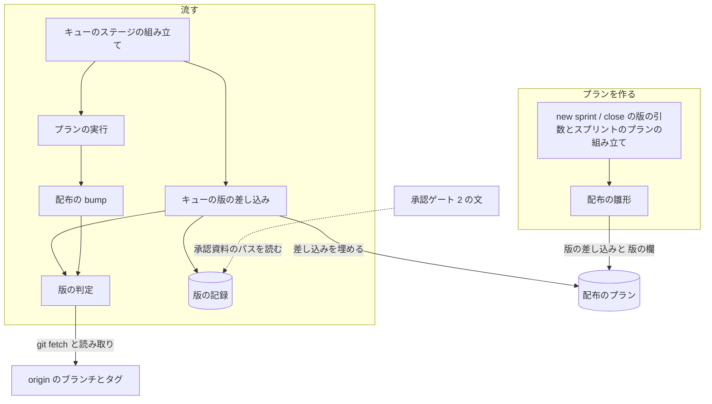
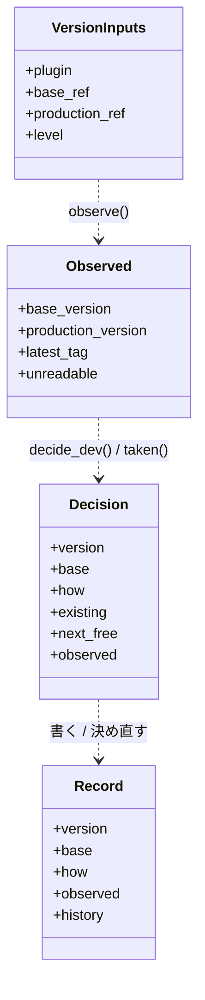
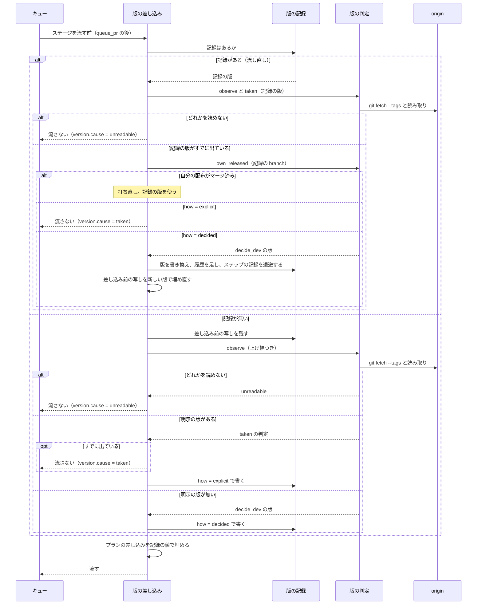

# スプリントの配布: 版数を配布のステップを流す時点に決め、並行するスプリントが先に版を出してもプランを作り直さずに出せる（#2164）

## 目的

- **何が壊れているか**: スプリントのプランは、作った時点の版数を開発版と本番のプランへ書き込む。配布までの間に並行する別のスプリントがその版を出すと、プランは使えなくなる。古いプランのまま流すと、開発版の `bump` は版を戻したまま進み、本番の `release` がタグの重複に気づく時点では開発版の PR がすでにベースブランチへ入っている
- **誰が困るか**: スプリントを回す conductor（m2087 ではプランを作り直し、m26-1 では版を手で書き換えた。どちらもキューが止まった）と、版が戻った開発版を受け取る利用者
- **直すと何が成り立つか**: 版を明示せずに作ったプランは、流した時点の origin から次に空いている版を決めて出す。明示した版がすでに出ていれば、`bump` より前に止まる

## 適用範囲

- **働く範囲**: NDF を使うすべてのリポジトリのうち、`.ndf/supervise.json` の `release.form` が `package-plugin`（雛形で配る形）で、`delivery.needs_version` が真の経路だけ（要求の前提 1 は `.ndf/release.json` と書くが、`release.form` を持つのは `.ndf/supervise.json` である）
- **プロジェクトごとに違うもの**: ベースブランチと本番のブランチは `.ndf/worktree.json`、配るプラグインは `.ndf/supervise.json` の `release.plugin` から読む。上げ幅は `new sprint` / `new close` の引数で受ける
- **当たるモード**: `standard`

## あるべき姿の根拠

| 根拠 | 種類 | 何を示すか |
| --- | --- | --- |
| 2026-11-01 に使い捨ての worktree で `release-steps.py bump --plugin ndf --to 10.27.5-dev.1 --base develop` を打つと、develop・main とも 10.27.5 のところで終了コード 0 で 5 ファイルを書き換えた | 実測（要求の起票者の推定 S2 の欄） | 今の `bump` は版を戻す呼び方を止めない。止める場所は `bump` か、その前である |
| `release-steps.py` の `cmd_release` は、開発版の PR をベースブランチへマージした後に `タグ <plugin>--v<版> は既にある` を調べる | コードの読み取り（`plugins/ndf/scripts/release-steps.py` の `cmd_release`） | 今の唯一の止まり方は、開発版を出した後に働く |
| m2087（2026-10-29）はプランの作り直し、m26-1（2026-10-31）は版の書き換え（10.27.0 → 10.27.2）で進んだ | 実測（課題の本文の 2 回の発生） | 並行するスプリントのたびに起き、conductor の手当てで埋めている |
| キューは `{queue_pr:<名>}`・`{queue_state:<名>}` を、ステージを流す直前に名前の一致するプランの結果で埋め、埋められなければ流さずに `stopped` で返す | コードの読み取り（`supervise_lib/queue_fill.py`・`queue.py` の `fill_stage`。#2079） | 流す時点の値をプランへ入れる仕組みが既にある |

要求と受け入れ条件は #2164 の本文にある（コピーは `issues/issue-2164-requirements.md`）。この文書は「どう作るか」だけを扱う。

## ドメインモデル

### コンテキスト

| コンテキスト | 何の語が 1 つの意味に決まるか |
| --- | --- |
| NDF の開発ワークフロー（`ndf-workflow`） | プラン・キュー・版の差し込み・版の記録・明示の版 |
| NDF のリリース（`ndf-release`） | 開発版・正式版・上げ幅・リリースタグ・`bump` |

リリースが供給者、開発ワークフローが顧客の関係（顧客 / 供給者）。リリースは「次に空いている版」と「その版はもう出ているか」の 2 つの判定を 1 つのモジュール（`lib/release_version.py`）で提供し、キューの差し込みと `bump` がそれを呼ぶ。キューは判定の結果を版の記録とプランへ写すだけで、版の規則を持たない。

### 集約

| 集約 | 持ち主（書き換えてよいもの） | 根 | エンティティ | 値オブジェクト |
| --- | --- | --- | --- | --- |
| 配布のプラン | 作るのは配布の雛形（`release_templates.py`）、作った後に書き換えるのはキューの版の差し込みだけ | 1 本のプランのファイル | — | プランの「版」の欄（プラグイン・チャネル・上げ幅・明示の版・系列）・版の差し込み |
| 版の記録 | キューの版の差し込み | 1 本のプランの版の決定（状態ディレクトリの `version.json`） | 差し込み前のプランの写し（状態ディレクトリの `version-plan.json`） | 決めた版・基底の版・決め方（決めた / 明示 / 系列）・根拠（読んだ ref と版・最新のタグ・上げ幅）・決め直しの履歴 |
| 作業場所の版 | 配布の `bump` | 作業場所の `plugin.json` の `version` | 版数を持つほかのファイル | 旧版・新版 |

### 不変条件

| # | 集約 | 条件 | 破れたときの扱い |
| --- | --- | --- | --- |
| I1 | 配布のプラン | 版を明示せずに作ったプランのファイルと `sprint.json` は、具体的な版数を持たない。版を名前に持つ値（作業場所・`branch`・承認資料のパス・ステップの引数）は版の差し込みで書く | 雛形のテストが落ちる |
| I2 | 版の記録 | 決めた開発版は、読んだ origin のベースブランチの版より大きく、その基底の版のリリースタグは無い | 判定のテストが落ちる |
| I3 | 版の記録 | 自分の `release/v<版>` がベースブランチへマージされるまでは、流し直しで記録の版がすでに別のスプリントに出ていると分かったときに限り決め直せる（決定 8）。マージの後と、記録の版がまだ出ていないときは書き換えず、流し直しは記録の版を使う。明示の版（`how = explicit`）は決め直さない | 差し込みのテストが落ちる |
| I4 | 版の記録 | 本番のプランの版は、明示が無ければ同じスプリントの開発版の記録の基底の版に等しい。開発版の記録が決め直されたら、承認ゲート 2 の前なら本番も新しい基底の版を使い、後なら本番のプランを流さない | 開発版の記録が無ければ差し込みを埋めず、プランを流さない。承認の後に系列が変わっていればキューの結果が `stopped`（`cause: series_changed`） |
| I5 | 版の記録 | 明示の版がすでに出ていれば記録を書かず、差し込みを埋めず、プランを流さない（開発版はベースブランチの版が同じか大きい、正式版は同じ版のタグがある） | キューの結果が `stopped` になり、既に出ている版と次に空いている版を項目に載せる |
| I6 | 版の記録 | origin のベースブランチ・本番のブランチ・タグのどれかを読めなければ、記録を書かない | I5 と同じく流さず、読めなかったものを項目に載せる |
| I7 | 作業場所の版 | `bump` は、新しい版がベースブランチの版以下か、新しい版が正式版でそのタグがあれば、ファイルを書き換えない | `bump` が `stopped`・終了コード 3（`emit` へ `code=EXIT_PRECONDITION` を明示して渡す）で返し、ステップは `on_exit` で judge を通らずに止まる |
| I8 | 配布のプラン | 明示の版がまだ出ていなければ、差し込みの後のプランのステップと版は今の雛形が組むものと同じである | 雛形のテストが落ちる |
| I9 | 版の記録 | 決め直したときは、差し込み前のプランの写しを新しい版で埋め直し、前の版のステップの記録を退避し、前の版・新しい版・理由・時刻を記録の履歴へ足す。履歴は消さない | 差し込みのテストが落ちる |

### ドメインイベント

| # | イベント | 発生元 | 受け手 |
| --- | --- | --- | --- |
| E1 | スプリントのプランを作った（版の差し込みを持つ、または明示の版を持つ） | `supervise.py new sprint` / `new close` | キュー（E3 で差し込みを埋める） |
| E2 | 並行する別のスプリントが、ベースブランチか本番のブランチへ版を出した | 別のスプリントの配布 | E3 の判定（origin の版とタグとして読む） |
| E3 | 開発版のプランの版を決めた（版の記録を書き、差し込みを埋めた） | キューの版の差し込み | 開発版のプランの全ステップ・E7（本番の版の系列） |
| E4 | 明示の版がすでに出ていると分かり、プランを流さなかった | キューの版の差し込み | conductor（キューの結果 `stopped`） |
| E5 | 開発版をベースブランチへ出し、決めた版を結果 JSON に載せた | `release-steps.py release` | 承認資料（`approval-facts`）・E6 |
| E6 | 承認ゲート 2 で利用者が承認した | 利用者 | 本番のプラン（`approve` のステップ） |
| E7 | 本番のプランの版を、開発版の記録の基底の版に決め、タグが無いことを確かめた | キューの版の差し込み | 本番のプランの全ステップ。タグがあれば conductor（キューの結果 `stopped`） |
| E8 | 本番へ出し、タグを打ち、決めた版を結果 JSON に載せた | `release-steps.py release` | `record`・まとめの `close` |
| E9 | 開発版の流し直しで、記録の版が別のスプリントに出ていると分かり、記録の版を決め直した | キューの版の差し込み | 開発版のプランの全ステップ（新しい作業場所と `branch` で頭から）・E7 |

### 用語

| 用語 | 意味 | 用語集への反映 |
| --- | --- | --- |
| 版の差し込み | 配布のプランが具体的な版の代わりに持つ `{release_version}`（出す版）と `{release_base}`（その接尾辞を外した版）。キューがステージを流す直前に版の記録の値で埋める | 追加（`ndf-workflow`） |
| 版の記録 | 配布のプランの状態ディレクトリの `version.json`。キューが決めた、または確かめた版と、決めた根拠と、決め直しの履歴を持つ。流し直しはこれを読む | 追加（`ndf-workflow`） |
| 版の決め直し | 開発版の流し直しで、版の記録の版が自分の配布のマージより前に別のスプリントに出ていたとき、キューが次に空いている版を決め、差し込み前のプランの写しから埋め直すこと。明示の版と、自分の配布のマージの後には行わない | 追加（`ndf-workflow`） |
| 明示の版 | `new sprint` / `new close` の `--version`・`--prod`、`new release` の `--version` で渡した版。プランを作る時点で決まり、キューはその版がまだ出ていないかだけを確かめる | 追加（`ndf-workflow`） |

## 機能一覧

| # | 機能 | 誰が使うか |
| --- | --- | --- |
| F1 | 版を渡さずにスプリントのプランを作る（上げ幅は `--level`、既定 PATCH） | conductor |
| F2 | 開発版のプランを流す時点で、origin から次に空いている開発版を決める | キュー |
| F3 | 本番のプランを流す時点で、開発版の記録から本番の版を決め、タグが無いことを確かめる | キュー |
| F4 | 明示の版がすでに出ていれば、プランを流さずに止める | キュー |
| F5 | 版を戻す `bump` と、既にタグのある正式版への `bump` を止める | 配布のステップ（新旧どのプランからも） |
| F6 | 決めた版と根拠を、版の記録と結果 JSON から読む | conductor・振り返り |
| F7 | 開発版の流し直しで、自分の配布のマージより前に記録の版が別のスプリントに出ていれば、版を決め直してプランを埋め直す | キュー |

## 構成要素

| 要素 | 責務 |
| --- | --- |
| 版の判定（`plugins/ndf/scripts/lib/release_version.py`、新設） | origin を `git fetch` してベースブランチと本番のブランチの `plugin.json` の版・最新のリリースタグを読み、次に空いている開発版を決める（`decide_dev`）。ある版がもう出ているかを判定する（`taken`）。`release/v<版>` → ベースブランチのマージ済みの PR があるか（自分の配布か）を照会する（`own_released`）。読めなかったものを返す。ファイルを書かない |
| キューの版の差し込み（`supervise_lib/queue_fill.py` に `fill_release_version` を足す） | プランの「版」の欄を読む。記録が無ければ差し込み前のプランの写しを残し、版の判定を呼んで記録を書き、差し込みを埋める。記録があれば、開発版は記録の版がもう出ていないかを確かめ、自分の配布の前に出ていれば決め直す（決定 8）。埋められなければ理由と判定の結果を返す |
| キューのステージの組み立て（`supervise_lib/queue.py` の `fill_stage`） | `fill_queue_prs`・`fill_queue_pr` の後に `fill_release_version` を呼び、返った判定の結果を流さなかった項目の `version` に載せる |
| 配布の雛形（`supervise_lib/release_templates.py`） | 版が無ければ、版を書く箇所すべてに版の差し込みを書き、プランへ「版」の欄を置く。版があれば今と同じ値を書き、「版」の欄の `明示` に入れる。`bump` のステップに `on_exit: {"2": "stop", "3": "stop"}` を置く（キーは `bump` が `emit` へ明示する終了コードと一致させる） |
| スプリントのプランの組み立て（`supervise_lib/sprint_waves.py`・`sprint.py`） | 開発版と本番のプランへ明示の版（無ければ空）と上げ幅を渡す。本番の版を `prod_version(a.version)` で作らず、明示が無ければ系列（開発版のプランの名前 `release`）を渡す |
| 承認ゲート 2 の文（`supervise_lib/sprint_routes.py` の `normal_gate_2_stage`） | 承認資料のパスを、版を含む具体のパスではなく「開発版のプランの版の記録の `base` から作るパス」として書く |
| 版の引数（`supervise_lib/new_args.py`・`decl.py` の `require_versions`） | `--version`・`--prod` を雛形の配布でも任意にし、`--level`（`patch` / `minor` / `major`）を `sprint` と `close` に足す |
| 配布の `bump`（`release-steps.py` の `cmd_bump`） | 書き換える前に版の判定の `taken` と下限の比較を呼び（打ち直しの照会は `own_released`）、当たれば `stopped`・終了コード 3 で返す。終了コードは `emit(..., code=EXIT_PRECONDITION)` と明示する（`stopped` の既定は 1 で、既存の staleness の停止と同じ書き方では `on_exit` が働かない） |
| Skill 本文（`development-workflow` の `references/pace.md`・`references/waiting.md`） | `new sprint` / `new close` の例から必須の `--version`・`--prod` を外し、版が決まる時点と止まったときの扱いを書く |



図に含めない要素: Skill 本文（手順の説明で、処理の流れに現れない）。

### 置き場所

```text
plugins/ndf/scripts/
├── lib/
│   └── release_version.py          # 新設: 版の判定
├── release-steps.py                # cmd_bump に止まり方を足す
├── supervise_lib/
│   ├── queue_fill.py               # fill_release_version を足す
│   ├── queue.py                    # fill_stage から呼ぶ
│   ├── release_templates.py        # 版の差し込みと 版の欄
│   ├── sprint_waves.py             # 明示の版・上げ幅・系列を渡す
│   ├── sprint.py                   # prod_version で本番の版を作らない
│   ├── sprint_routes.py            # 承認ゲート 2 の文
│   ├── new_args.py                 # --level・--version と --prod の help
│   └── decl.py                     # require_versions を外す
└── tests/                          # 下の「テスト設計」
plugins/ndf/skills/development-workflow/references/
├── pace.md
└── waiting.md
docs/glossary/glossary.json         # 用語 4 つ（glossary.py render で docs/glossary.md）
```

## 構造



- `observe(repo, inputs) -> Observed`: `git fetch -q origin --tags` の後に読む。読めなかったものは `unreadable` に名前（`origin/<base>`・`origin/<production>`・`tags`）で入れる。本番のブランチを宣言していないリポジトリでは本番のブランチを読まない（読めないには数えない）。タグが 1 つも無いことは読めないに数えず、`latest_tag` を空にする
- `decide_dev(obs, level) -> Decision`: 下の「処理の流れ」の規則で開発版を決める。`unreadable` が空でなければ決めない
- `taken(obs, version) -> Decision`: 開発版はベースブランチの版が `version` 以上、正式版は `<plugin>--v<version>` のタグがあるとき、`existing` に既に出ている版、`next_free` に次に空いている版を入れる
- `own_released(repo, branch, base) -> bool | None`: `branch`（`release/v<版>`）→ `base` のマージ済みの PR を 1 回照会する。照会できなければ `None`（読めない）。`bump` の打ち直しと、差し込みの決め直しの判定が使う
- いずれも純粋な関数ではない（`observe` が git を打つ）。`decide_dev` と `taken` は `Observed` だけから決まり、テストは `Observed` を組んで渡せる

## データ構造

### プランの「版」の欄

配布のプランの最上位に置く（`作業場所` と同じ階層）。

| 列 | 型 | 空を許すか | 意味 |
| --- | --- | --- | --- |
| `プラグイン` | 文字列 | 許さない | 版を上げるプラグイン（`release.plugin`） |
| `チャネル` | `dev` / `prod` | 許さない | 開発版か本番か |
| `上げ幅` | `patch` / `minor` / `major` | 許さない | 開発版を新しい系列で始めるときの上げ幅。既定 `patch` |
| `明示` | 文字列 | 許す | 明示の版。空（`null`）は「流す時点に決める」 |
| `系列` | 文字列 | 許す | 本番のプランだけ。版を読む開発版のプランの名前（スプリントでは `release`）。空は「明示の版を使う」。`チャネル` が `prod` で `明示` と `系列` が両方空なら、雛形が作らない |

**この欄を持たないプラン（この変更より前に作ったもの）には、キューは何もしない。** その版は `bump` の止まり方（I7）だけが守る。

### 版の記録（`<プランの状態ディレクトリ>/version.json`）

| 列 | 型 | 空を許すか | 意味 |
| --- | --- | --- | --- |
| `version` | 文字列 | 許さない | 出す版（開発版は `X.Y.Z-dev.N`、本番は `X.Y.Z`） |
| `base` | 文字列 | 許さない | `version` の接尾辞を外した版。承認資料のパス `issues/approval-<plugin>-v<base>.md` の版 |
| `how` | `decided` / `explicit` / `series` | 許さない | 決めた・明示を確かめた・開発版の記録から読んだ |
| `level` | 文字列 | 許さない | 使った上げ幅 |
| `observed` | オブジェクト | 許さない | 読んだ値（`base_ref`・`base_version`・`production_ref`・`production_version`・`latest_tag`）。本番のブランチを読まなかったときは `production_ref` を空にする（「該当なし」） |
| `series_from` | 文字列 | 許す | `how` が `series` のときだけ、読んだ開発版の記録のパス |
| `at` | 文字列（ISO 8601） | 許さない | 今の版を書いた時刻 |
| `history` | 配列 | 許す（空の配列） | 決め直しの履歴。1 回の決め直しにつき 1 件を末尾へ足す（下の表） |

`history` の 1 件:

| 列 | 型 | 空を許すか | 意味 |
| --- | --- | --- | --- |
| `from` | 文字列 | 許さない | 前の版 |
| `to` | 文字列 | 許さない | 新しい版 |
| `reason` | `taken` / `series_changed` | 許さない | 前の版が別のスプリントに出ていた / 本番が読む開発版の記録の版が変わった |
| `existing` | 文字列 | 許す | `taken` のとき、読んだベースブランチの版かタグ |
| `observed` | オブジェクト | 許す | 前の版を捨てたときに読んだ値（`version.json` の `observed` と同じ形） |
| `left` | オブジェクト | 許さない | 前の版で使った `作業場所`・`branch` と、ステップの記録を退避したディレクトリ（`superseded/v<前の版>/`）。消さずに残し、後片付けに任せる |
| `at` | 文字列（ISO 8601） | 許さない | 決め直した時刻 |

### 差し込み前のプランの写し（`<プランの状態ディレクトリ>/version-plan.json`）

版の差し込みを最初に埋める直前のプランのファイルを、そのまま写したもの。`{queue_pr:<名>}` などほかの差し込みは埋まった後で、版の差し込みだけが残っている。決め直しはこの写しを新しい版で埋めてプランのファイルを書き直す。写しは書き換えない。

**時系列の扱い**: 記録の版は、自分の配布のマージより前に別のスプリントに出ていたときだけ決め直し（I3）、前の版は `history` に残す（I9）。`at` は今の版を書いた時刻で、最初に決めた時刻は `history` の先頭の件の前の版として読む。プランを作り直したときは状態ディレクトリも新しくなり、別の記録になる。

| 機能 | 配布のプラン | 版の記録 | 作業場所の版 |
| --- | --- | --- | --- |
| F1 プランを作る | C | — | — |
| F2 開発版を決める | U（差し込みを埋める） | C（写しも） | — |
| F3 本番の版を決める | U | C（自分）・R（開発版） | — |
| F4 明示の版で止める | R | — | — |
| F5 bump を止める | — | — | R |
| F6 根拠を読む | — | R | — |
| F7 決め直す | U（写しから埋め直す） | U（版と履歴）・R（写し） | — |

**移行**: 既に作ったプランのファイルは書き換えない（要求の「境界」）。「版」の欄を持たないプランは今と同じに流れ、版が戻る呼び方だけを `bump` が止める。

## 入出力の契約

### `supervise.py new sprint` / `new close`

| 項目 | 変更 |
| --- | --- |
| `--version` | 雛形の配布でも任意。渡せば明示の版（今と同じプラン） |
| `--prod`（`close`） | 任意。渡せば本番の明示の版。渡さなければ開発版の記録の基底の版 |
| `--level`（新設、`sprint` と `close`） | `patch` / `minor` / `major`。既定 `patch`。明示の版を渡したときは使わない |
| 互換性 | 今の呼び方（`--version` あり）はそのまま動き、プランの中身は I8 のとおり今と同じ。`--version` を省いた呼び方は、今は `DeclError` で止まるため、壊れる呼び出し側は無い |

`supervise.py new release` は変えない（`--version` は今までどおり必須で、明示の版として「版」の欄を持つ）。

### キューの結果（`supervise.py queue` の結果 JSON）

版の差し込みを埋められなかったプランは、今の #2079 と同じ項目（`result: 流さなかった`・`unfilled: true`・`reason`）に `version` を足して返す。キューの `status` は今と同じく `stopped` になる。

| `version` の鍵 | 意味 |
| --- | --- |
| `cause` | `taken`（明示の版か本番の版がすでに出ている）/ `unreadable`（origin を読めない、または自分の配布の照会ができない）/ `no_series`（本番が読む開発版の記録が無い）/ `series_changed`（承認ゲート 2 の後に、本番が読む開発版の記録の版が変わった） |
| `version` | 確かめた版（`unreadable` で開発版を決められなかったときは空） |
| `existing` | 既に出ている版（ベースブランチの版かタグ） |
| `next_free` | 次に空いている版（`taken` のときだけ。人へ戻す材料で、自動では使わない） |
| `unreadable` | 読めなかったものの名前の並び |

埋めたプランは、記録のパスを進捗ログへ 1 行書く。決め直したプランは、前の版・新しい版・残した `作業場所` と `branch` を進捗ログへ 1 行書き、プランは流す（`stopped` にしない）。決めた版は流したプランの `release` のステップの結果 JSON の `metrics.version` に載る（今の `cmd_release` が `--version` の値を載せるので、差し込みが埋まれば決めた版になる）。

### `release-steps.py bump`

| 項目 | 内容 |
| --- | --- |
| 新しい失敗 | `--to` がベースブランチ（`origin/<base>`）の版以下、または `--to` が正式版で `<plugin>--v<to>` のタグがある |
| 出力 | `status: stopped`・終了コード 3（`emit` へ `code=EXIT_PRECONDITION` を明示する。既定の 1 では雛形の `on_exit` が働かない）。`metrics` に `from`・`to`・`base_version`・`existing`・`next_free`。ファイルを書き換えない |
| 打ち直し | 作業場所がすでに `--to` で、ベースブランチの版が `--to` より小さいときは今と同じ `ok`（`already: true`）。ベースブランチの版が `--to` と等しいときは、`release/v<to>` → ベースブランチのマージ済みの PR を 1 回だけ照会し、あれば自分の配布として `ok`（`already: true`）。無ければ上の新しい失敗（別のスプリントが出した版）。照会はこの等しい場合だけで、他の経路の呼び出しの回数は変えない。照会できなければ下の「読めない」と同じ扱い |
| ベースブランチの版を読めない | 書き換えずに `stopped`・終了コード 2（`code=EXIT_UNREADABLE` を明示。推定で進めない）。雛形の `on_exit` の `"2"` で judge を通らずに止める。judge を通すと修正担当が版を推して書き換えうるためである。`bump` が既に終了コード 2 を返す呼び出しの誤り・ファイルを読めないときも同じく止まるが、どれも修正担当が推して進めてよいものではない |
| 互換性 | 他のプラグインを上げる `bump-others` も同じ `bump` を呼び、同じ止まり方が当たる |

## 処理の流れ

### 開発版の版を決める



**開発版を決める規則（`decide_dev`）**: ベースブランチの版を B、最新の正式版のタグの版を T、本番のブランチの版を P とする。

1. B が `X-dev.N` で、タグ `<plugin>--vX` が無ければ `X-dev.(N+1)`
2. そうでなければ、T・P・B の基底の版のうち最も大きいものを上げ幅で上げた Y の `Y-dev.1`

例（受け入れ条件 2・3）: B = `10.27.5`・T = `10.27.5`・PATCH なら `10.27.6-dev.1`。B = `10.27.6-dev.1` でタグ `ndf--v10.27.6` が無ければ `10.27.6-dev.2`。作った時点の B が `10.27.5` で、配布の前に別のスプリントが `10.27.6` を本番へ出したなら（B = `10.27.6`・T = `10.27.6`）`10.27.7-dev.1`。どちらの規則でも結果は B より大きい（I2）。

### 版を決め直す

開発版のプランの流し直しで記録があるときは、判定を打って記録の版がもう出ていないかを確かめる（`taken`: B が記録の版以上）。出ていなければ記録の版を使う（受け入れ条件 7）。出ていれば次の順に扱う。

1. `own_released` で記録の `branch`（`release/v<記録の版>`）→ ベースブランチのマージ済みの PR を照会する。あれば自分の配布の後の流し直しで、記録の版を使う（`bump` の打ち直しと同じ判定）。照会できなければ流さない（`unreadable`）
2. `how` が `explicit` なら流さない（`taken`。受け入れ条件 4）
3. `how` が `decided` なら `decide_dev` で新しい版を決め、次をこの順に行う
   1. 状態ディレクトリのステップの記録（`state.json`・`progress.jsonl`・`report.md`・ステップの出力）を `superseded/v<前の版>/` へ移す。版の記録・差し込み前の写しは移さない
   2. 版の記録の `version`・`base`・`observed`・`at` を新しい値にし、`history` の末尾へ前の版の 1 件を足す
   3. 差し込み前の写しを新しい版で埋め、プランのファイルを書き直す

例: 記録の版 `10.27.6-dev.1` で `bump` まで流して止まり、その間に別のスプリントが `10.27.6` を本番へ出した（B = `10.27.6`）。自分の `release/v10.27.6-dev.1` のマージ済みの PR は無いので、`10.27.7-dev.1` に決め直し、作業場所と `branch` を `release/v10.27.7-dev.1` の名前で作り直して、プランを頭から流す。前の作業場所と `branch` は消さずに `history` の `left` に残す。

順序は、落ちたときに流し直しで同じ結果へ戻るように選ぶ。1 の後に落ちれば記録はまだ前の版で、流し直しが同じ判定で決め直しに入る。2 の後に落ちれば記録はもう新しい版で、まだ出ていないので 3 を埋め直しとして行う（記録の版とプランの版が違えば、写しから埋め直す）。

**本番は自分で決め直さない。** 本番の記録がある流し直しでは、`系列` の開発版の記録の `base` が本番の記録の版と違うときだけ扱う。本番のプランの状態に承認ゲート 2 の通過（`approve` のステップの結果）が無ければ、上の 1〜3 と同じ手順で新しい基底の版に取り直し（`reason: series_changed`）、あれば流さない（`series_changed`）。開発版は自分の配布のマージの後に決め直さず、本番のプランは開発版のプランが完了してから流れるため、通常の流れではこの扱いに当たらない。開発版のプランを手で作り直して流したときなどに、承認した版と出す版が食い違うのを止める守りである（決定 3）。

### 本番の版を決める

本番のプランの差し込みは、記録が無ければ次の順に決める（記録がある流し直しは「版を決め直す」の最後の段落）。

1. 「版」の欄に `明示` があればその版、無ければ `系列` の名前の開発版のプランの記録（同じディレクトリの、名前の一致するプランの状態ディレクトリ。`results_named` と同じ探し方）の `base`。開発版の記録が無ければ流さない（`no_series`）
2. `observe` の後に `taken` で `<plugin>--v<版>` のタグを調べ、あれば流さない（`taken`。`next_free` を添える）
3. `how` を `explicit` か `series` にして記録を書き、差し込みを埋める

**本番は次に空いている版へ自動で移らない。** 承認ゲート 2 で人が承認した承認資料の版と、出す版が食い違うためである（要求の S4・受け入れ条件 6）。

### `bump` の止まり方

`cmd_bump` は旧版を読んだ後、書き換えの前に `observe` で `origin/<base>` の版を読み、`--to` との比較と、`--to` が正式版のときの `taken` を打つ。打ち直し（旧版と新版が同じでベースブランチの版が小さい）の判定は今の順のまま先に行う。旧版と新版が同じでベースブランチの版が等しいときだけ、`release/v<to>` → ベースブランチのマージ済みの PR を照会し、あれば打ち直しとして `ok` を返す（`release` が開発版を出した後の流し直し。決定 2）。

## 非機能の実現方式

| 大項目 | 要求の条件 | 実現方式 | 確かめ方 |
| --- | --- | --- | --- |
| 運用・保守性 | 版を決めた根拠（読んだベースブランチの版・最新のタグ・上げ幅）が配布の結果 JSON か状態のファイルに残り、後から読んで決め方を確かめられる | 版の記録の `observed` と `level` に読んだ値を書き、止めたときはキューの項目の `version` に載せる | 一時の git リポジトリで差し込みを流し、記録の `observed` が作ったブランチとタグの版に一致することを見る |
| 移行性 | この変更より前に作ったプラン（版数を持つもの）は、明示の版を持つプランとして扱い、受け入れ条件 4・6 の止まり方が当たる。作り直しは求めない | 「版」の欄を持たないプランはキューが触らず、`bump` の止まり方（I7）がベースブランチの版以下と既にタグのある正式版を止める | 「版」の欄を持たないプランの `bump` へ、ベースブランチと同じ版とタグのある正式版を渡して止まることを見る |

## 決定の記録

### 決定 1: 作業場所とブランチの名前まで流す時点の版に揃えるため、版をキューの差し込みで決める

版は作業場所のパス・`branch`・承認資料のパス・ステップの引数のすべてに入り、プランの実行は最初のステップより前に作業場所を作る（`paths.ensure_worktree`）。キューの差し込みはプランの実行より前にプランのファイルを書き換える既存の層（`{queue_pr:<名>}`・#2079）で、埋められなければ流さずに `stopped` を返す扱いもそのまま使える。版の判定をプランの先頭のステップに置く案は、作業場所を作った後にしか動かず、名前を揃えられないため採らない。conductor が流す前に版を書き込む案は、今の手当てを手順にするだけで止まりどころが残るため採らない。

根拠: Vision / Value 4（MVV 版 3）

### 決定 2: 流し直しで自分の開発版を「使われた版」と見ないため、決めた版を版の記録に書いて使い続ける

差し込みはプランのファイルを書き換えるため、多くの流し直しでは埋まった値がそのまま残る。それでも、記録を書いてからプランを書き換える間に落ちたときと、`release` が開発版を出した後の流し直しで、判定をやり直すと次の版へ進んでしまう。記録を先に書き、記録があれば新しい版を決めずに記録の版を使うことで、どの時点の流し直しでも同じ版になる（受け入れ条件 7）。`release` が開発版を出した後の流し直しでは、ベースブランチの版がすでに記録の版に等しく、下限の比較（I7）だけでは止まってしまう。そのため `bump` は、等しいときに `release/v<版>` → ベースブランチのマージ済みの PR があれば自分の配布として打ち直しの `ok` を返す（入出力の契約の `bump` の「打ち直し」）。プランのファイルだけを手がかりにする案は、上の間に落ちたときに判定をやり直すため採らない。記録の版を書き換えてよいのは、自分の配布のマージより前に別のスプリントがその版を出したときだけである（決定 8）。

根拠: Value 1 / Value 4（MVV 版 3）

### 決定 3: 承認した版と出す版を食い違わせないため、本番の版は開発版の記録から読み、タグがあれば止めて人へ戻す

本番の版はスプリントの開発版の系列（接尾辞を外した版）で、承認資料はその版を名前と中身に持つ。本番の時点で origin から決め直すと、並行するスプリントが先に出したときに承認していない版で出る。タグがあれば流さず、既に出ている版と次に空いている版をキューの結果に載せて人へ戻す（受け入れ条件 6）。次に空いている版へ自動で移る案は、承認資料の材料の正しさを効率より下に置くことになるため採らない。

根拠: Value 10 の但し書き / Value 2（MVV 版 3）

### 決定 4: 開発版と本番、キューと `bump` で版の規則を分けないため、判定を `lib/release_version.py` の 1 か所に置く

次に空いている版を決める規則と、ある版がもう出ているかの判定は、キューの差し込み（開発版・本番・明示）と `bump` の 4 か所が使う。`lib/versions.py` の `next_version`・`compare_versions`・`release_base` を使い、git を読む部分だけを足す。`release-steps.py` の中に置く案は、`supervise_lib` が `release-steps.py` を読み込むことになり、層の向きが逆になるため採らない。

根拠: Value 6 / Value 5（MVV 版 3）

### 決定 5: 既に作ったプランを書き換えずに版の戻りを止めるため、`bump` に下限の比較とタグの判定を足す

要求の移行性は、作り直しを求めずに古いプランへ受け入れ条件 4・6 の止まり方を当てることを求める。古いプランは「版」の欄を持たないためキューは触れないが、開発版も本番も必ず `bump` を通り、`bump` はどのプランよりも前にファイルを書き換える唯一の場所である。止まったときは終了コード 3 を `emit` へ明示して返し（`stopped` の既定の終了コードは 1 のため、明示しないと `on_exit` が働かない）、ステップの `on_exit` で judge を通さずに止める。専用の終了コードを新設せずに 3 を使うのは、`lib/step_result.py` の `EXIT_PRECONDITION` が「各スクリプトが定めた正常な否定の結果」も含むと定めており、版がもう出ているという止まりはその否定の結果に当たるためである（75 は基盤の待ちという別の意味で、再試行の対象になるため使い回さない）。judge を通すと、修正（fix）の担当が版を書き換えて別の版で進みうるためである（受け入れ条件 4 の「別の版へ移って進まない」）。古いプランのファイルをキューが読み替える案は、要求の境界（既に作ったプランのファイルを書き換えない）に反するため採らない。

根拠: Value 1 / Value 6（MVV 版 3）

### 決定 6: 上げ幅を中身から推さずに渡せるようにするため、`new sprint` / `new close` に `--level` を足し、プランの「版」の欄に載せる

要求は上げ幅をプランを作る時点で指定でき、既定を PATCH とする（前提 4）。上げ幅は判定が新しい系列を始めるとき（規則の 2）だけ使い、ベースブランチが同じ系列の開発版なら使わない。既存の `bump-others` の上げ幅の表（承認資料の表）へ載せる案は、本番の承認資料が開発版の後にしかできず、開発版の版を決める時点で読めないため採らない。

根拠: Value 5（MVV 版 3）

### 決定 7: `.ndf/release.json` の `{version}` と取り違えないため、版の差し込みの語を `{release_version}` と `{release_base}` にする

`.ndf/release.json` の手順は `{version}` を `release-steps.py run` が埋める語として既に使っている。同じ語を差し込みに使うと、キューが手順の語まで埋める。基底の版を別の語にするのは、雛形が版から基底を作る `re.sub(r"-.*$", "", v)` を差し込みの語へ当てられないためである。

根拠: Value 8（MVV 版 3）

### 決定 8: 記録を書いた後に別のスプリントが先に版を出してもプランを作り直さずに出すため、自分の配布のマージまでは記録の開発版を決め直す

記録を 1 回だけ書く形では、記録を書いてから自分の `release/v<版>` がマージされるまでに別のスプリントがその版を出すと、流し直しは記録の古い版を使い、`bump` が I7 で止まり続け、プランを作り直すしかない。これは要求が無くそうとした作り直しそのものである（受け入れ条件 3）。2026-11-01 の承認ゲート 1 で、利用者はこの間の決め直しを認める案を選んだ（レビューの指摘 PRRT_kwDOSII3uc6yWWo2）。

決め直すのは、開発版の `how = decided` の記録で、流し直しの判定で記録の版がもう出ていて、自分の配布のマージ済みの PR が無いときだけである。自分の配布の後は `bump` の打ち直しと同じ照会（`own_released`）で見分け、決め直さない（受け入れ条件 7）。明示の版は人が選んだ版のため決め直さず止める（受け入れ条件 4）。本番は承認した版で出すため自分では決め直さず、開発版の記録の版が変わったら承認ゲート 2 の前だけ追い、後なら止める（決定 3）。

作り直す対象は、記録を最初に書く直前のプランを状態ディレクトリへ写して持ち、決め直しはその写しを新しい版で埋めてプランのファイルを書き直す。作業場所と `branch` は新しい版の名前でプランの実行が作り（`paths.ensure_worktree`）、前の版のステップの記録は退避してプランを頭から流す。前の作業場所・`branch` と、開いたままの PR があればそれは消さずに履歴へ残し、後片付けに任せる。差し込みは GitHub へ書かない層で、閉じる・消す操作をここへ入れると耐久ステップの再生で副作用を打ち直しうるためである。

ほかの案は次の理由で採らない。流す直前に毎回写しから埋め直す案は、記録が変わらない流し直しでもプランのファイルを書き換え、今の `{queue_pr:<名>}` の「埋めたら書き換えない」扱いと分かれる。作り直す対象（作業場所・`branch`・承認資料のパス・ステップの引数）の一覧を記録に持つ案は、雛形が版を書く箇所を増やすたびに一覧を直す必要があり、雛形と記録で版の置き場所を二重に持つ。

根拠: Vision / Value 4 / Value 10 の但し書き（MVV 版 3）

## テスト設計

| 受け入れ条件・不変条件 | どの振る舞いで縛るか | どう壊したら落ちるべきか |
| --- | --- | --- |
| 受け入れ条件 1・I1 | `--version` を省いた `new sprint`（pace の normal・fast・auto）と `new close` が書いた `sprint.json` と開発版・本番のプランに、`X.Y.Z` の形の版が無く、作業場所・`branch`・承認資料のパスが版の差し込みを持つ | 雛形が `a.version` の代わりに空の文字列や `prod_version(None)` を書くと落ちる |
| 受け入れ条件 2・I2 | `decide_dev` が要求の 2 つの例で `10.27.6-dev.1`・`10.27.6-dev.2` を返し、結果がつねにベースブランチの版より大きい | 規則の 1 をタグを見ずに当てる、または規則の 2 で T・P を見ないと落ちる |
| 受け入れ条件 3 | 一時の git リポジトリで、プランを作った後に origin のベースブランチと本番へ `10.27.6` とタグを足してからキューの差し込みを流すと、プランの版が `10.27.7-dev.1` に埋まる | 版をプランを作る時点の値で埋めると落ちる |
| 受け入れ条件 4・I5 | 明示の開発版がベースブランチの版以下のとき、差し込みがプランを流さず、項目の `version.cause` が `taken` で `existing` を持ち、プランのファイルが変わらない | 明示の版を確かめずに流す、または `next_free` で埋めると落ちる |
| 受け入れ条件 5・I7 | ベースブランチが `10.27.5` のとき `bump --to 10.27.5-dev.1` が終了コード 3 で止まり、作業場所のファイルが変わらない。打ち直しは `ok`。ベースブランチが `--to` と等しく `release/v<to>` のマージ済みの PR があれば `ok`（`already: true`）、無ければ終了コード 3。雛形の `bump` のステップの `on_exit` のキーが `bump` の返す 2・3 と一致する。タグのある正式版への `bump` も止まる | 比較を `<` にする（同じ版を通す）、タグを見ない、`emit` へ終了コードを明示しない（既定の 1 で返る）、または自分の配布の打ち直しを止めると落ちる |
| 受け入れ条件 6・I4 | 本番の差し込みが開発版の記録の `base` で埋まり、そのタグがあれば流さずに `existing` と `next_free` を載せる | 本番の版を origin から決め直すと落ちる |
| 受け入れ条件 7・I3 | 開発版の記録を書いた後、origin のベースブランチを記録の版へ進め、`release/v<記録の版>` のマージ済みの PR がある（照会を差し替える）状態で差し込みを流し直すと、同じ版で埋まり記録が変わらない。ベースブランチが記録の版より小さいときも同じ | 自分の配布の照会を見ずに決め直す、またはまだ出ていない記録の版を決め直すと落ちる |
| 決定 8・I3・I9 | 開発版の記録 `10.27.6-dev.1` を書いた後、origin のベースブランチとタグを `10.27.6` へ進め、マージ済みの PR が無い状態で流し直すと、プランの版・作業場所・`branch` が `10.27.7-dev.1` で埋まり直し、記録の `history` に `from: 10.27.6-dev.1`・`to: 10.27.7-dev.1`・`reason: taken`・`left` が 1 件入り、前のステップの記録が `superseded/v10.27.6-dev.1/` にある | 記録の古い版で流す、写しでなく埋めた後のプランを置き換えようとして版が残る、履歴を上書きする、または前のステップの記録を残したまま流して途中から再開すると落ちる |
| 決定 8（落ちたときの戻り） | 決め直しの手順の 1 の後・2 の後で止めてから流し直すと、どちらも同じ新しい版で埋まり、`history` は 1 件だけである | 記録とプランの版の食い違いを埋め直さない、または履歴を 2 度足すと落ちる |
| 決定 8・受け入れ条件 4 | `how = explicit` の記録で同じ状況を作ると、決め直さずに流さず `version.cause` が `taken` になる | 明示の版を決め直すと落ちる |
| 決定 8・I4 | 本番の記録の後に開発版の記録の `base` を変えると、本番の状態に `approve` の結果が無ければ新しい基底の版で埋まり直し（`reason: series_changed`）、あれば流さず `version.cause` が `series_changed` になる | 承認の後に新しい版で埋める、または承認の前に古い版のまま流すと落ちる |
| I6（流し直し） | 記録がある流し直しで origin か自分の配布の照会を読めないと、記録とプランを変えずに流さない | 読めないときに記録の版で進める、または決め直すと落ちる |
| 受け入れ条件 8・I6 | origin を読めない（取り除いたリモート・無いブランチ）と、差し込みが記録を書かずに流さず、`unreadable` に名前が入る | 読めない値を空や 0 として判定すると落ちる |
| 受け入れ条件 9 | 差し込みを埋めた開発版のプランの `release` のステップの `cmd` が決めた版を `--version` に持つ | 差し込みを `release` のステップに書き漏らすと落ちる |
| 受け入れ条件 10・I8 | `--version` を渡した `new sprint` / `new close` のプランを差し込みの後に比べると、ステップと版がこの変更の前の雛形の出力と同じ（「版」の欄を除く） | 明示の版のプランに差し込みを書くと落ちる |
| 非機能（運用・保守性） | 版の記録の `observed` と `level` が、読んだブランチとタグの版と渡した上げ幅に一致する | 根拠を書かずに版だけを書くと落ちる |
| 非機能（移行性） | 「版」の欄を持たないプランをキューが書き換えず、その `bump` が受け入れ条件 5 のとおり止まる | キューが欄の無いプランへ判定を打つと落ちる |

## 設計の結果

| 課題 | 扱い | 取り込み先 | 触るファイル |
| --- | --- | --- | --- |
| #2164 | 実装する | — | `plugins/ndf/scripts/lib/release_version.py`、`plugins/ndf/scripts/release-steps.py`、`plugins/ndf/scripts/supervise_lib/queue_fill.py`、`plugins/ndf/scripts/supervise_lib/queue.py`、`plugins/ndf/scripts/supervise_lib/release_templates.py`、`plugins/ndf/scripts/supervise_lib/sprint_waves.py`、`plugins/ndf/scripts/supervise_lib/sprint.py`、`plugins/ndf/scripts/supervise_lib/sprint_routes.py`、`plugins/ndf/scripts/supervise_lib/new_args.py`、`plugins/ndf/scripts/supervise_lib/decl.py`、`plugins/ndf/scripts/tests/`、`plugins/ndf/skills/development-workflow/references/pace.md`、`plugins/ndf/skills/development-workflow/references/waiting.md`、`docs/glossary/glossary.json`、`docs/glossary.md` |

## 未確認のまま残ること

| 項目 | 内容 |
| --- | --- |
| スプリント PR の版の行の衝突（要求の前提 5） | m26-1 でスプリント PR が版の行を持った仕組みは読んでいない。この設計は配布のプランだけを変え、スプリントのブランチは版の行を書かないため、版の行の衝突は起きなくなると見込む。リリース後テストで、並行するスプリントのスプリント PR が版の行で衝突しないかを見る |
| 並行するスプリントが同じ系列の開発版を出したとき | 先のスプリントが `10.27.6-dev.1` をベースブランチへ出しただけ（本番はまだ）なら、後のスプリントは規則の 1 で `10.27.6-dev.2` になり、2 つのスプリントの本番が同じ `10.27.6` を求める。後に本番へ進む方は決定 3 のとおり止まって人へ戻る。この止まりが実際にどれだけ起きるかは、リリース後テストで conductor の手当ての記録から数える |
| `sprint-state.py loop sprint` の `--dev` | ループは今も `--dev` を必須にして `new sprint --version` へ渡す。明示の版として受け入れ条件 4・10 が当たり、退行はしないが、ループからは流す時点の版を選べない。要求の対象範囲（`new sprint` / `new close`）の外のため、範囲外の課題として起こす |
| `bump-others` の止まり方 | 他のプラグインの `bump` にも下限とタグの判定が当たる。他のプラグインのタグの付け方が `ndf` と違うリポジトリで誤って止まらないかは、実装のテストで `bump-others` の経路を 1 度通して確かめる |
| キューの耐久ステップでの判定 | 差し込みは耐久ステップ（`ndf.supervise.queue.fill`）の中で origin を読む。耐久の記録からの再生では判定を打ち直さず、記録の値が使われる見込みだが、実装で再生の経路を 1 度通して確かめる |
| 記録を書いてから自分の `release` がマージされるまでに、別のスプリントが記録の版を出したとき | 決めた（決定 8）。2026-11-01 の承認ゲート 1 で利用者が案 B（自分の配布のマージまでは記録の版を決め直せる）を選んだ |
| 決め直しで残した前の作業場所・`branch`・PR | 決め直しは前の版の作業場所・`branch` を消さず、`release` が開いた PR があれば開いたまま残す（決定 8）。後片付けがこれらを拾うか、PR を誰かが誤ってマージしないかは、実装で決め直しの経路を 1 度通し、後片付けの対象に入るかを確かめる |
| 決め直しとキューの再開 | ステップの記録を退避した後、キューの再開（`queue_resume.py`）と耐久ステップの再生がプランを頭から流すかは読んでいない。実装で、決め直しの後に `queue` を打ち直して最初のステップから流れることを 1 度確かめる |
