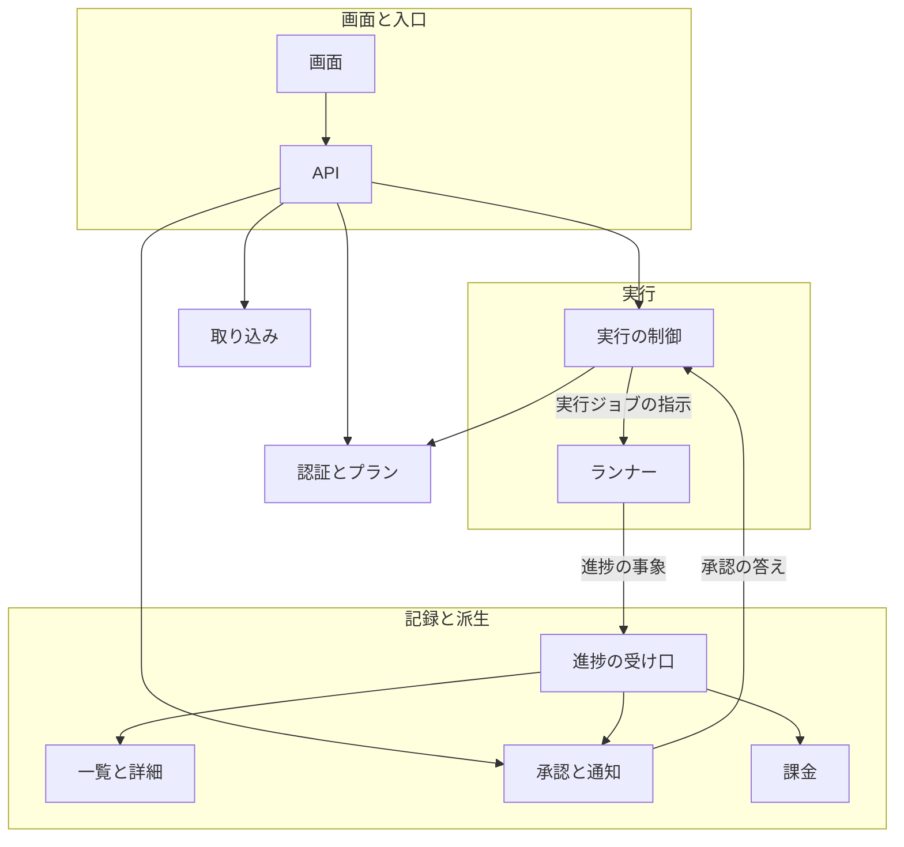
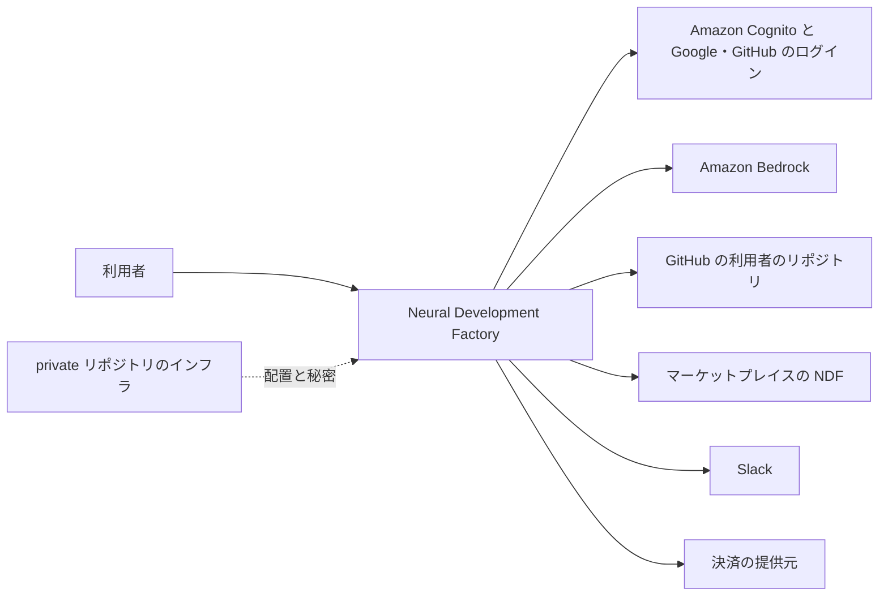
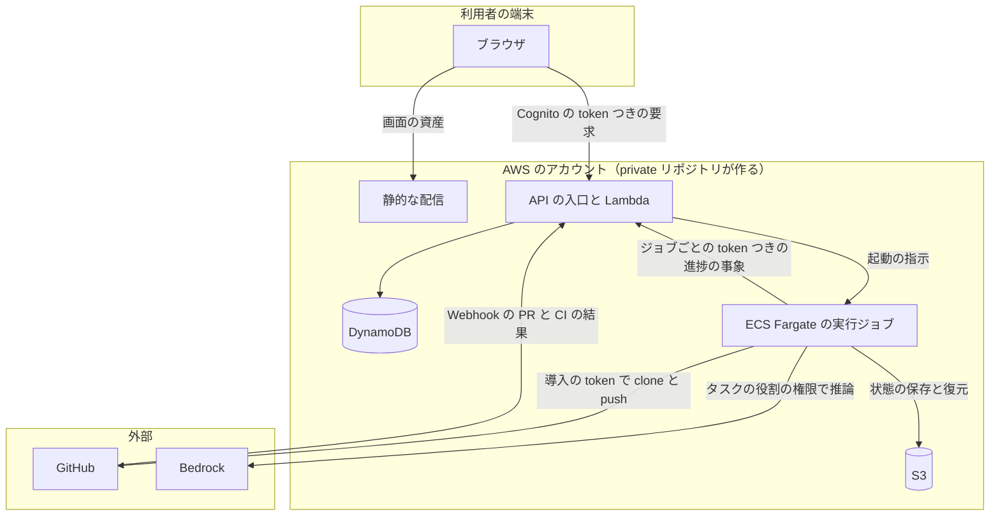
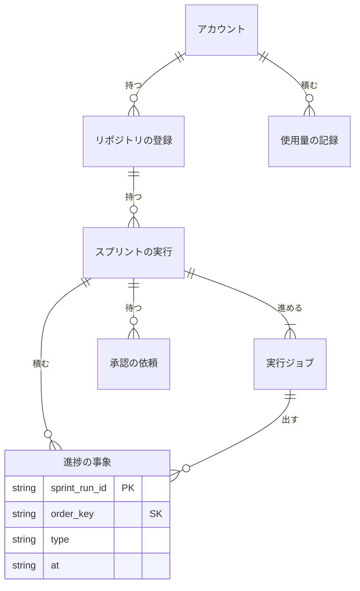
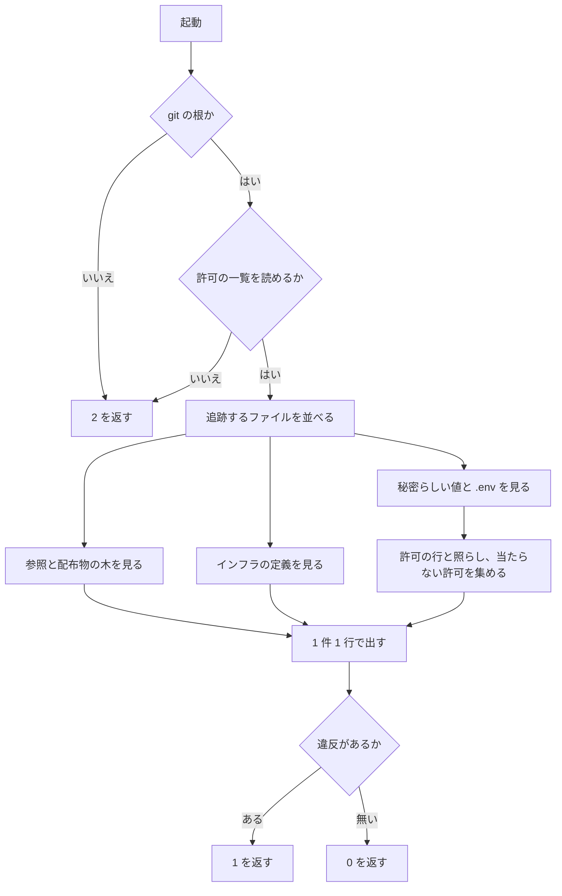
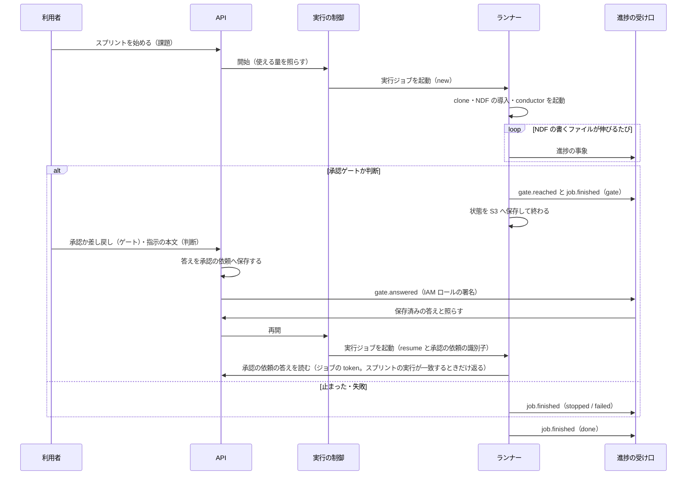
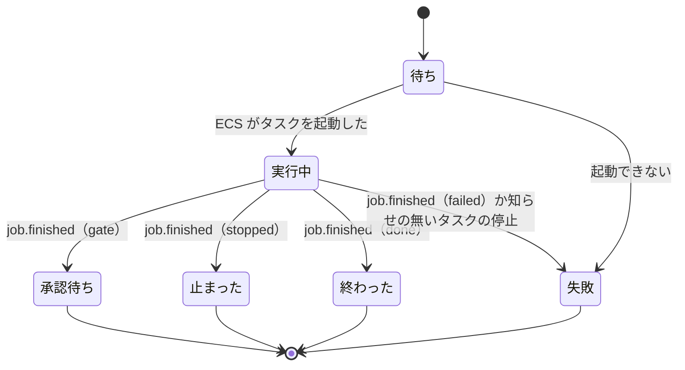

# Neural Development Factory: Web サービスをプラグインと分けた置き場に始め、子課題が同じ契約で並列に進める（#2169）

## 目的

- **何が壊れているか**: Web サービスのコードの置き場・ライセンスの境目・インフラと秘密を入れない約束が決まっておらず、サービス全体の形（実行基盤・進捗の正本・構成要素の間の契約）も無い
- **誰が困るか**: #2170〜#2174 を進める担当（互いの契約が無く、並列に進めると食い違う）と、プラグインの利用者（サービスの変更が配布物へ混ざると振る舞いが変わる）
- **直すと何が成り立つか**: サービスのコードは根の `factory/` 1 つに閉じ、ライセンスを差し替えても配布物に何も起きない。インフラと秘密が入れば CI が落とす。子課題は本書の契約に沿って並列に進められる

## 適用範囲

- **働く範囲**: このリポジトリだけ。境界の検査は配布物に入れない（`scripts/` に置く）。サービスが取り込む利用者のリポジトリには何も置かない
- **プロジェクトごとに違うもの**: 取り込むリポジトリのベースブランチ・テストのコマンド・配布の手段は、そのリポジトリの `.ndf/` の設定で受ける。サービスはリポジトリごとの既定を持たない（決定 8）
- **当たるモード**: `standard`

## あるべき姿の根拠

| 根拠 | 種類 | 何を示すか |
| --- | --- | --- |
| 「Webサービス部分はライセンスを切り離す可能性があるため、ディレクトリを明確に分離しておく」 | 利用者の指示の原文（#2168） | サービスを 1 つのディレクトリに閉じ、`LICENSE` をその中に持つ |
| 「CDKなどのセキュリティに関わるインフラ部分は別のprivate repositoryに(owner=volare)」 | 利用者の指示の原文（#2168） | インフラの定義と秘密をこのリポジトリに置かず、機械で落とす |
| `.claude-plugin/marketplace.json` の `source` 12 件がすべて `./plugins/` の下を指す（2026-10-30 に `jq` で確認） | 実測 | 根の直下に置いたディレクトリは、どのプラグインの配布物の木にも入らない |
| 秘密の形の値の既存の当たりは `plugins/ndf/scripts/tests/test_project_decl.py:22` の 1 件、PEM の秘密鍵・インフラの定義・`.env` の実ファイルは 0 件（2026-10-30 に `git grep` と `git ls-files` で確認） | 実測 | 許可を 1 件置けば、検査を足しても既存の木は通る |
| 必須チェックへ入れる前のジョブを「追加待ち」として宣言する仕組みが `scripts/required-checks-allow.json` にある | 既存の形 | 新しいジョブを足し、ruleset への追加をゲート 2 で人が行える |

要求と受け入れ条件は #2169 の本文にある（コピーは `issues/issue-2169-requirements.md`）。この文書は「どう作るか」だけを扱う。決定の記録は `issues/issue-2169-design-decisions.md` にある。

本書は 2 つの層を扱う。**この課題で作るもの**（サービスのディレクトリと境界の検査）と、**子課題が作るものの形**（サービス全体の構成・実行基盤・進捗の正本・契約）である。後者は子課題の設計の入力になり、この課題では実装しない。

## ドメインモデル

### コンテキスト

| コンテキスト | 何の語が 1 つの意味に決まるか |
| --- | --- |
| Neural Development Factory（`ndf-factory`） | サービスのディレクトリ・境界の検査・アカウント・リポジトリの登録・スプリントの実行・実行ジョブ・進捗の事象・承認の依頼・使用量の記録 |
| NDF の開発ワークフロー（`ndf-workflow`） | スプリント・フェーズ・承認ゲート・conductor・`sprint.json`・`progress.jsonl` |
| このリポジトリの開発の検査（`repo-dev-checks`） | 必須チェック・追加待ち |

`ndf-workflow` が上流、`ndf-factory` が下流で、**腐敗防止層**の関係にする。ランナーが NDF の書くファイル（`sprint.json`・`progress.jsonl`・作業の報告）を読み、`ndf-factory` の語（進捗の事象）へ翻訳する。NDF のファイルの形が変わっても、受けるのはランナーの翻訳だけで、画面・通知・課金は変わらない（決定 6）。`ndf-factory` の中の構成要素どうしは、文書化した事象の形（公開された言語）でつなぐ（決定 7）。

### 集約

| 集約 | 持ち主（書き換えてよいもの） | 根 | エンティティ | 値オブジェクト |
| --- | --- | --- | --- | --- |
| 境界の宣言 | 境界の検査（この課題） | 許可の一覧 | 許可の行 | ファイルのパス・値の sha256・理由 |
| アカウント | 認証とプラン（#2170） | アカウント | 席 | プラン・使える量 |
| リポジトリの登録 | 取り込み（#2171） | 登録 | — | GitHub のリポジトリの識別子・GitHub App の導入の識別子 |
| スプリントの実行 | 実行の制御（#2171） | スプリントの実行 | 実行ジョブ | NDF の版・スプリントの状態・ジョブの結果 |
| 進捗の記録 | 進捗の受け口（#2171） | スプリントの実行の識別子ごとの列 | 進捗の事象 | 種類・発生の時刻・冪等の鍵 |
| 承認の依頼 | 承認（#2173） | 承認の依頼 | — | 種類（ゲート 1・ゲート 2・判断）・答え |
| 使用量の記録 | 課金（#2174） | アカウントと月ごとの台帳 | 使用量の行 | モデル・入力と出力の token・費用 |

ほかの集約は識別子で参照する。1 つの処理が書き換える集約は 1 つで、集約の間は進捗の事象で後から揃える。

### 不変条件

| # | 集約 | 条件 | 破れたときの扱い |
| --- | --- | --- | --- |
| I1 | 境界の宣言 | `plugins/` の下と `.claude-plugin/marketplace.json` のどのファイルも、サービスのディレクトリを参照しない（パスの語・シンボリックリンクの行き先） | 境界の検査が「サービスへの参照」で 1 を返す |
| I2 | 境界の宣言 | どのプラグインの配布物の木（`source` が指すディレクトリ）も、サービスのディレクトリと重ならない | 境界の検査が「配布物の木の重なり」で 1 を返す |
| I3 | 境界の宣言 | リポジトリの追跡するファイルに、インフラの定義が無い | 境界の検査が「インフラの定義」で 1 を返す。許可で除けない |
| I4 | 境界の宣言 | 秘密らしい値は、許可の一覧のファイルと値（sha256）の組に一致するものだけがある。`.env` の実ファイルは無い | 境界の検査が「秘密らしい値」「.env の実ファイル」で 1 を返す |
| I5 | 境界の宣言 | 許可の行はどれも、今の木の 1 か所以上に当たる。ディレクトリ単位の許可は無い | 当たらない行は「古い許可」で 1、形の違う行は 2 を返す |
| I6 | 境界の宣言 | サービスのディレクトリの `.env.example` は、どの変数にも値を持たない | 境界の検査が「値を持つ .env.example」で 1 を返す |
| I7 | 境界の宣言 | 検査はサービスのディレクトリの `LICENSE` の種類と文面を合否の条件にしない。秘密らしい値の検査（I4）は `LICENSE` にもほかのファイルと同じく当てる | 秘密らしい値を含まない別の文面へ差し替えた `LICENSE` で結果が変われば、テストが落ちる。`LICENSE` に入れた秘密らしい値は「秘密らしい値」で 1 を返す |
| I8 | スプリントの実行 | 実行ジョブは承認の依頼が出たら終わる。人の答えを待つ間に動いている実行ジョブは無い | 実行の制御が待ちの上限で止め、ジョブの結果を「失敗」にする（#2171） |
| I9 | スプリントの実行 | 1 つのスプリントの実行で、同時に動く実行ジョブは 1 つ | 2 つ目の開始を拒む（#2171） |
| I10 | 進捗の記録 | 進捗の事象は追記だけで、書いた事象を書き換えない。同じ冪等の鍵の事象は 1 つ | 同じ鍵の 2 回目は受け取ったと返し、保存しない（#2171） |
| I11 | 承認の依頼 | 承認の依頼の種類のうち、承認を求めるのはゲート 1 とゲート 2 の 2 つだけ | 3 つ目の種類の承認を受け付けない（#2173） |

### ドメインイベント

| # | イベント | 発生元 | 受け手 |
| --- | --- | --- | --- |
| E1 | Web サービスのディレクトリを作った | この課題の実装 | 境界の検査（I2・I6 の対象になる） |
| E2 | Pull Request で境界の検査が走った | GitHub Actions（`service-boundary-check`） | 必須チェック（ゲート 2 で ruleset へ足した後） |
| E3 | 境界の違反を見つけて Pull Request を落とした | 境界の検査 | Pull Request の作者 |
| E4 | プラグインを配布した | リリース | 利用者（配布物にサービスのディレクトリが入らない。I2） |
| E5 | サービスのディレクトリのライセンスを差し替えた（将来） | 利用者の決定 | 無し（I7 により、検査とテストの結果が変わらない） |
| E6 | 進捗の事象を受け取った（子課題で作る） | 進捗の受け口 | 一覧と詳細（#2172）・承認（#2173）・課金（#2174） |
| E7 | 承認の依頼に答えた（子課題で作る） | 承認（#2173） | 実行の制御（次の実行ジョブを始める。#2171） |

E1〜E5 は要求の番号を引き継ぐ。E6・E7 は子課題の契約を固めるために置く。

### 用語

| 用語 | 意味 | 用語集への反映 |
| --- | --- | --- |
| ランナー | 1 つの実行ジョブの中で利用者のリポジトリを取り込み、NDF を導入して conductor を動かし、NDF の書くファイルを進捗の事象へ翻訳して送るプログラム | 追加（`ndf-factory`） |
| 実行ジョブ | 実行基盤が 1 回起動するコンテナ 1 つ分の実行。スプリントの開始か承認の答えで始まり、次の承認の依頼・止まった・終わったのどれかで終わる | 追加（`ndf-factory`） |
| スプリントの実行 | サービスが動かす NDF のスプリント 1 つ（`sprint.json` 1 つ）と、それを進める実行ジョブの列 | 追加（`ndf-factory`） |
| 進捗の事象 | ランナーと GitHub の通知から受け取り、追記だけで持つ 1 件の出来事。一覧・詳細・通知・課金はここから導く | 追加（`ndf-factory`） |
| 承認の依頼 | 実行ジョブが人の答えを待って終わったときに作る依頼。種類はゲート 1・ゲート 2・判断（止めて人へ戻した）の 3 つ | 追加（`ndf-factory`） |

## 機能一覧

| # | 機能 | 誰が使うか |
| --- | --- | --- |
| F1 | サービスのディレクトリ（`README.md`・`LICENSE`・`.env.example`・`.gitignore`）を置く | サービスの開発者 |
| F2 | 境界の検査を手元と CI で走らせ、違反を 1 件 1 行で知らせる | このリポジトリの開発者・CI |
| F3 | 秘密の形をした偽の値を、ファイルと値の組で許可する | このリポジトリの開発者 |
| F4 | ライセンスの差し替えの手順を根の `README.md` とサービスの `README.md` で案内する | 利用者（ライセンスを決める人） |
| F5 | サービス全体の構成・実行基盤・進捗の正本・契約・子課題の範囲を、子課題が読む形で決める | #2170〜#2174 の担当 |

## 構成要素

### この課題で作るもの

| 要素 | 責務 |
| --- | --- |
| サービスのディレクトリ（`factory/`） | サービスのコードの唯一の置き場。`LICENSE`（根と同じ MIT の写し）・`README.md`・`.env.example`（変数の名前だけ）・`.gitignore`（`.env` と `node_modules/`）を持つ |
| 境界の検査（`scripts/check-service-boundary.py`） | I1〜I7 を、git が追跡するファイルに対して見る。出力は 1 件 1 行、終了コード 0 / 1 / 2 |
| 許可の一覧（`scripts/service-boundary-allow.json`） | 秘密の形をした偽の値の、ファイルと値の sha256 と理由の組 |
| 検査のテスト（`scripts/tests/test_check_service_boundary.py`） | 違反を 1 つずつ入れた一時のリポジトリで、検査が落ちることを確かめる |
| CI のジョブ（`service-boundary-check`） | `runtime-plugin-validate.yml` に足し、Pull Request で常に走る。`required-checks-allow.json` の追加待ちに置く |
| 案内（根の `README.md`・`AGENTS.md` の構造の図） | サービスのディレクトリの位置とライセンスが別ファイルであることを示す |

### サービス全体（子課題が作る）

| 要素 | 責務 | 作る課題 |
| --- | --- | --- |
| 画面（`factory/web/`） | ログイン・リポジトリの登録・スプリントの一覧と詳細・承認・プランと請求の画面 | #2170〜#2174 が各画面 |
| API（`factory/api/`） | 画面からの要求を受け、アカウントで認可して各集約の持ち主へ渡す | 各課題が自分の経路 |
| 認証とプラン | Cognito の利用者プール（Google・GitHub）とアカウント・席・プランの使える量 | #2170 |
| 取り込み | GitHub App の導入とリポジトリの登録 | #2171 |
| 実行の制御 | スプリントの実行と実行ジョブの状態を持ち、実行ジョブを起動・終了を受ける。同時の数をプランの使える量で抑える | #2171 |
| ランナー（`factory/runner/`） | 実行ジョブの中身。取り込み・NDF の導入・conductor の起動・翻訳・送信・状態の保存 | #2171 |
| 進捗の受け口 | ランナー・GitHub の通知・API から進捗の事象を受け、出所ごとに認証して冪等に追記する | #2171 |
| 一覧と詳細 | 進捗の事象からスプリントの一覧と詳細の読み出しの形を導く | #2172 |
| 承認と通知 | 承認の依頼を作って知らせ（Web・Slack）、答えを実行の制御へ渡す | #2173 |
| 課金 | 使用量の事象を台帳へ積み、プランの料金に上乗せして請求する | #2174 |
| 契約（`factory/contracts/`） | 進捗の事象・実行ジョブの指示・API の形の機械可読な定義（JSON Schema と OpenAPI） | #2171（形は本書の「入出力の契約」） |



境界の検査とサービスのディレクトリは実行時の要素でないため、この図に描かない（処理の流れの「境界の検査」の図にある）。契約は要素の間の線そのものなので箱にしない。

### システムの文脈



決済の提供元は #2174 が決める。インフラはサービスの外にあり、このリポジトリはインフラへ渡す変数の名前（`factory/.env.example`）だけを持つ。

### 配置



実行ジョブとランナーは同じもの（ジョブのコンテナの中身がランナー）なので 1 つの箱にする。秘密（GitHub App の秘密鍵・Slack の Webhook の URL・決済の鍵）は Secrets Manager に置き、サービスのコードはその ARN を環境変数で受ける（決定 13）。

### パッケージ・モジュール構成

この課題で作るもの（新設）と、子課題が足す場所（括弧つき）:

```text
factory/                      # サービスのディレクトリ（新設）
├── LICENSE                   # 根と同じ MIT の写し。差し替えはこの 1 ファイル
├── README.md                 # 位置づけ・ライセンス・子課題の一覧・本書への参照
├── .env.example              # インフラへ渡す変数の名前（値は空）
├── .gitignore                # .env・node_modules/
├── (contracts/)              # #2171: 事象と指示の JSON Schema・OpenAPI
├── (web/)                    # #2170・#2172〜#2174: React の SPA
├── (api/)                    # #2170〜#2174: Lambda の処理
└── (runner/)                 # #2171: 実行ジョブのコンテナ
scripts/
├── check-service-boundary.py # 新設
├── service-boundary-allow.json  # 新設
├── required-checks-allow.json   # 追加待ちに 1 行
└── tests/test_check_service_boundary.py  # 新設
.github/workflows/runtime-plugin-validate.yml  # ジョブ 1 つと push の paths に factory/**
```

`factory/.env.example` に置く名前: `AWS_REGION`・`COGNITO_USER_POOL_ID`・`COGNITO_CLIENT_ID`・`GITHUB_APP_ID`・`GITHUB_APP_PRIVATE_KEY_SECRET_ARN`・`BEDROCK_REGION`・`NDF_MARKETPLACE`・`NDF_CHANNEL`・`RUNNER_TASK_DEFINITION_ARN`。子課題は名前を足してよく、値は書かない（I6）。

## データ構造

進捗の正本の形だけをここで決める（決定 5）。ほかの集約の表は持ち主の子課題が決める。



**時系列は事象の記録で持つ。** 状態（今のフェーズ・承認待ちか）は事象から導き、上書きした状態を正にしない。一覧のための集約した形は、事象から作り直せる派生として #2172 が持つ。

| 列 | 型 | 空を許すか | 意味 |
| --- | --- | --- | --- |
| `sprint_run_id` | 文字列 | 許さない | 区分の鍵。スプリントの実行の識別子 |
| `order_key` | 文字列 | 許さない | 並びの鍵。`<at>#<冪等の鍵>`。並べるためだけに使い、重複の判定には使わない |
| `idempotency_key` | 文字列 | 許さない | 重複の判定の鍵（下の表）。一意はこの値だけで決める（I10） |
| `type` | 文字列 | 許さない | 下の「進捗の事象の種類」のどれか |
| `at` | 文字列（ISO 8601、UTC） | 許さない | 事象が起きた時刻（下の表の取り方）。送り直しでも変えない |
| `source` | 文字列 | 許さない | `runner` / `github` / `api` / `control` |
| `job_id` | 文字列 | 許す | 空は「実行ジョブの外で起きた」（GitHub の通知・API の操作） |
| `schema_version` | 整数 | 許さない | 事象の形の版。上げるのは互換の無い変更のときだけ |
| `payload` | JSON | 許さない | 種類ごとの中身。無い種類は `{}` |

| `source` | `idempotency_key` の形 | `at` の取り方 |
| --- | --- | --- |
| `runner` | `<job_id>:<seq>`（`seq` はジョブの中で 1 から増やす）。`job.finished` だけは `<job_id>:finished` | ランナーが事象を作った時刻 |
| `github` | `github:<配送の識別子>`（`X-GitHub-Delivery`） | Webhook の本文にある対象の更新時刻（`pull_request.updated_at`、チェックは `check_run.completed_at` で、無ければ `check_run.started_at`）。受け口の受け取った時刻は使わない |
| `api` | `api:<承認の依頼の識別子>`。1 つの承認の依頼への答えは 1 つ | API が答えを受け付けた時刻 |
| `control` | `<job_id>:finished`（ランナーの `job.finished` と同じ鍵） | 実行の制御が ECS の停止の知らせを受けた時刻 |

重複の拒否は、冪等の鍵を鍵にした項目（`idempotency_key` だけを鍵にする冪等の鍵の表）への条件つきの書き込みと、事象の書き込みを 1 つのトランザクションで行う。冪等の鍵の項目が既にあればトランザクションごと書かない。`job.finished` はランナーと実行の制御が同じ鍵を使うため、先に書いた 1 つだけが残る。

| 機能 | 進捗の事象 | スプリントの実行 | 承認の依頼 | 使用量の記録 |
| --- | --- | --- | --- | --- |
| 進捗の受け口（#2171） | C | — | R（`gate.answered` の照合） | — |
| 実行の制御（#2171） | C（`job.*`） | C・U | R | — |
| 一覧と詳細（#2172） | R | R | R | — |
| 承認と通知（#2173） | R | — | C・U | — |
| 課金（#2174） | R | — | — | C |

## 入出力の契約

### 境界の検査（この課題）

| 項目 | 内容 |
| --- | --- |
| 名前 | `python3 scripts/check-service-boundary.py [--root <dir>] [--allow <file>]` |
| 入力 | `--root` のリポジトリ（既定は今の git の根）が追跡するファイル。`--allow` の許可の一覧（既定 `scripts/service-boundary-allow.json`） |
| 出力 | 違反 1 件 1 行で `<種類>: <パス>:<行> → <直し方>`（行の無い種類は `:<行>` を省く）、最後に件数の行 |
| 失敗の形 | 0 = 違反なし / 1 = 違反が 1 件以上 / 2 = 読めない（git の外・許可の一覧が壊れている・知らない鍵）。2 では違反を出さない |
| 互換性 | 新設。既存のスクリプトとチェックの名前は変えない |

| 種類 | 何に当たるか | 直し方 |
| --- | --- | --- |
| サービスへの参照 | `plugins/` の下と `.claude-plugin/marketplace.json` で、パスの区切りとして現れる `factory/`、または行き先がサービスのディレクトリのシンボリックリンク | 参照を外す。プラグインからサービスを使わない |
| 配布物の木の重なり | `source` が根・サービスのディレクトリ・その祖先か子孫を指す | `source` を `plugins/` の下へ戻す |
| インフラの定義 | `cdk.json`・`cdk.context.json`、依存の宣言（`package.json`・`pyproject.toml`・`requirements*.txt`）の `aws-cdk-lib`、`*.tf`・`*.tf.json`・`*.tfvars`・`.terraform.lock.hcl`、`.json`・`.yaml`・`.yml`・`.template` の CloudFormation の宣言（`AWSTemplateFormatVersion` か `AWS::` の資源の型）。Markdown の本文の語は見ない（決定 12） | private リポジトリへ移す |
| 秘密らしい値 | AWS のアクセスキーの形（`AKIA` か `ASIA` に英大文字と数字 16 字）、PEM の秘密鍵の始まりの行。許可の行と一致するものを除く | 値を消して環境変数で受ける。偽の値なら許可へ足す |
| .env の実ファイル | 名前が `.env` か `.env.<何か>` のファイル（`.env.example` を除く） | ファイルを消し、`.gitignore` に足す |
| 値を持つ .env.example | `factory/` の下の `.env.example` で、`=` の後が空でない行（注釈の行を除く） | 値を消し、名前だけにする |
| 古い許可 | 許可の行が今の木のどこにも当たらない | 許可の一覧から外す |

許可の一覧の形:

```json
{"version": 1, "secrets": [{"path": "plugins/ndf/scripts/tests/test_project_decl.py", "sha256": "<値の sha256>", "reason": "<なぜ偽の値を置くか>"}]}
```

`path` はファイル 1 つで、ディレクトリや glob は 2 を返す（I5）。値を一覧に直に書かないのは、一覧そのものが秘密らしい値として当たるためである（決定 10）。

### 構成要素の間の契約（子課題が作る）

子課題は次の形を変えずに作る。変えるときは本書を直す Pull Request を先に出す。

**実行ジョブの指示**（実行の制御 → ランナー。コンテナの環境変数で渡す）:

| 入力 | 型・必須 | 意味 |
| --- | --- | --- |
| `SPRINT_RUN_ID`・`JOB_ID` | 文字列・必須 | 事象の宛先と冪等の鍵の頭 |
| `REPO` | `owner/name`・必須 | 取り込むリポジトリ |
| `NDF_VERSION` | 文字列・必須 | スプリントの開始で固定した NDF の版（決定 4） |
| `START` | `new` / `resume`・必須 | `new` は課題から始め、`resume` は保存した状態から続ける |
| `ISSUES` | 番号の並び・`new` で必須 | スプリントへ入れる課題 |
| `APPROVAL_REQUEST_ID` | 文字列・`resume` で必須 | 答えの出た承認の依頼の識別子。答えの本文は環境変数に載せない（RunTask の `overrides` は全体で 8192 字が上限で、長い差し戻しで起動が失敗するため） |
| `INGEST_URL`・`INGEST_TOKEN_SECRET_ARN` | 文字列・必須 | 進捗の受け口と、このジョブだけに効く token の置き場 |

`resume` のランナーは、`APPROVAL_REQUEST_ID` の答えを #2173 の API（承認の依頼の答えを読む経路）から、このジョブの token で読む。#2173 はその token を #2171 の token の検証の契約で確かめ、token の実行ジョブの `sprint_run_id` と承認の依頼の属するスプリントの実行が一致し、かつ答えが保存済みのときだけ本文を返す。一致しなければ 403 を返し、本文も依頼の有無も明かさない（別のスプリントやアカウントの依頼の識別子を指しても、利用者の指示や差し戻しの本文を返さない）。答えの形は種類で分ける:

| 種類 | 答えの形 | ランナーが NDF へ書くもの |
| --- | --- | --- |
| ゲート 1・ゲート 2 | 承認か差し戻しか・本文 | `sprint-state.py gate --by user` の承認の記録（差し戻しは本文を添える） |
| 判断 | 指示の本文だけ（承認・差し戻しを持たない） | ゲートの記録は書かない。指示の本文を、再開した conductor への利用者の指示として渡す |

ランナーの終了は進捗の事象 `job.finished` で伝え、終了コードは 0（結果を送った）/ 1（送れなかった）に限る。`job.finished` を送れずに終わったジョブは、実行の制御が ECS の停止の知らせを受けて `job.finished`（`failed`。`source` は `control`、冪等の鍵は `<job_id>:finished`）を進捗の記録へ直に書く。ランナーの `job.finished` が先に書かれていれば、同じ鍵のため書かれない（I10）。

**進捗の事象の種類**（ランナー・GitHub・API → 進捗の受け口）:

| 種類 | 出所 | `payload` | 主な受け手 |
| --- | --- | --- | --- |
| `job.started` | ランナー | NDF の版・`START` | #2172 |
| `phase.changed` | ランナー（`sprint.json` の計画と `progress.jsonl` の `step` の行） | フェーズの名前（名前の集合は #2172 が決める）・課題 | #2172 |
| `step.recorded` | ランナー（`progress.jsonl` の `step`） | ステップ・終了コード・秒・要約 | #2172 |
| `attention` | ランナー（`progress.jsonl` の `attention`） | 理由・要約 | #2172・#2173 |
| `gate.reached` | ランナー（作業の報告の `判断が要る` と承認資料） | 種類（ゲート 1・ゲート 2・判断）・Pull Request の URL・承認資料の本文 | #2173 |
| `gate.answered` | API（#2173） | 承認の依頼の識別子・種類・承認か差し戻しか（判断では無し）・答えた人のアカウント。本文は承認の依頼が持ち、事象に載せない | #2171・#2172 |
| `usage.recorded` | ランナー（claude の結果の使用量） | モデル・入力と出力の token・費用・ステップ | #2174 |
| `job.finished` | ランナー。送れずに終わったときは実行の制御（`control`） | 結果（`gate` / `stopped` / `done` / `failed`）・要約 | #2171・#2172 |
| `pr.updated`・`ci.updated` | GitHub の Webhook | Pull Request の番号と状態・チェックの名前と結論 | #2172 |

受け口の認証は出所ごとに 1 つに決め、認証の手段と事象の `source` が食い違えば拒む。実行の制御は受け口を通らず、進捗の記録へ直に書く（上の CRUD の表）。

| 出所（`source`） | 認証の手段 | 書ける種類 |
| --- | --- | --- |
| `runner` | 実行ジョブごとの token（`INGEST_TOKEN_SECRET_ARN`）。token の実行ジョブと事象の `job_id`・`sprint_run_id` が一致すること | `gate.answered`・`pr.updated`・`ci.updated` を除く種類 |
| `api` | #2173 のサービスとしての認証（#2173 のサービスの IAM ロールによる署名）だけ。利用者の Cognito の token では書けない。加えて、受け口は事象を承認の依頼の保存済みの答えと照らし、依頼の識別子・属するスプリントの実行・種類・答えた人・承認か差し戻しかがすべて一致するときだけ書く（答えが保存されていなければ 403）。利用者の答えを受けるときの Cognito の token と `account_id` の確かめは #2173 の API が行う | `gate.answered` |
| `github` | Webhook の署名（`X-Hub-Signature-256`）を GitHub App の Webhook の秘密で検証する | `pr.updated`・`ci.updated` |

受け口の応答: 受け取ったら 202（同じ冪等の鍵の 2 回目も 202）、認証できなければ 401、認証の手段と `source`・種類・識別子が食い違えば 403、形が違えば 400。ランナーは 5xx と接続の失敗を、同じ事象のまま送り直す。

**子課題の範囲と、互いに依存する契約**:

| 課題 | 受け持つ範囲 | 提供する契約 | 使う契約 |
| --- | --- | --- | --- |
| #2170 | Cognito の利用者プール・アカウント・席・プランと使える量の画面と API | 認可の token の `account_id`、使える量の問い合わせ（同時のスプリントの数・月の token の上限） | 無し |
| #2171 | GitHub App・リポジトリの登録・スプリントの実行と実行ジョブ・ランナー・進捗の受け口・`factory/contracts/` | 実行ジョブの指示・進捗の事象の種類と形・受け口の認証と応答・実行ジョブの token の検証（token から実行ジョブと `sprint_run_id` を返し、無効なら拒む） | #2170 の `account_id` と使える量、#2173 の承認の依頼の答えを読む経路と保存済みの答え（`gate.answered` の照合） |
| #2172 | 一覧と詳細の画面・派生の形・フェーズの名前の集合 | 無し | 進捗の事象（`phase.changed`・`step.recorded`・`pr.updated`・`ci.updated`） |
| #2173 | 承認の依頼・Web と Slack の通知・Web からの承認 | `gate.answered`（サービスの IAM ロールの署名で送る）、承認の依頼の答えを読む経路（実行ジョブの token で読み、スプリントの実行が一致するときだけ返す）、実行の制御への再開の要求 | `gate.reached`・`attention`、#2171 の実行ジョブの token の検証 |
| #2174 | プランの料金・使用量の台帳・決済の手段・Bedrock の使用量の帰属 | 請求の画面と API | `usage.recorded`、#2170 のプラン |

## 処理の流れ

### 境界の検査



### スプリントの実行（子課題が作る）



ランナーはゲートの答えを NDF の既存の記録（`sprint-state.py gate --by user`）として書いてから conductor を続ける。判断への答えはゲートの記録にせず、指示の本文を conductor への利用者の指示として渡して続ける（「実行ジョブの指示」の答えの形の表）。承認の答えはサービスが作り、NDF の承認ゲートの数と置き場所は変えない（I11）。進め方（`pace`）は取り込んだリポジトリの `.ndf/pace.json` が決め、サービスは上書きしない。

### 実行ジョブの状態



実行ジョブは承認待ちから実行中へ戻らない。再開は新しい実行ジョブである（I8）。

## 非機能の実現方式

| 大項目 | 要求の条件 | 実現方式 | 確かめ方 |
| --- | --- | --- | --- |
| 運用・保守性 | 境界の検査は 1 本のスクリプトで、手元でも CI と同じコマンドで走る。所要は 10 秒以内 | 標準ライブラリだけの Python 1 本。対象は `git ls-files` の 1 回で並べ、各ファイルを 1 回だけ読む。CI のジョブは手元と同じ `python3 scripts/check-service-boundary.py` を打つ | 今の木で `time python3 scripts/check-service-boundary.py` を測り 10 秒以内を見る |
| セキュリティ | このリポジトリに秘密・認証情報・インフラの定義を置かない（受け入れ条件 4）。`.env.example` は値を持たない | 境界の検査の I3・I4・I6 を必須チェックで落とす。`factory/.gitignore` で `.env` を追跡から外す。サービスの設定は秘密の ARN だけを受ける | テスト設計の受け入れ条件 4 と I6 の行 |

## 決定の記録

決定の記録は `issues/issue-2169-design-decisions.md` にある。

## テスト設計

| 受け入れ条件・不変条件 | どの振る舞いで縛るか | どう壊したら落ちるべきか |
| --- | --- | --- |
| 受け入れ条件 1・I2 | `source` が `./plugins/<名前>` の一時のリポジトリで、`factory/` にファイルを足しても消しても検査は 0、各 `source` の追跡ファイルの一覧も変わらない | `source` を `./` か `./factory` にすると「配布物の木の重なり」で 1 |
| 受け入れ条件 2・I1 | `plugins/` の下の `.md` と `.json` に `factory/` のパスを 1 つ書くと 1。`factory/` を指すシンボリックリンクでも 1 | 参照の検出を `plugins/` の外だけに絞る・リンクを見ないように壊すと、違反の入力で 0 が返り落ちる |
| 受け入れ条件 3・I7 | `factory/LICENSE` を別の文面にした一時のリポジトリで、検査の結果が差し替える前と同じ。`factory/LICENSE` に AWS のアクセスキーの形の値を足すと「秘密らしい値」で 1 | 検査が `LICENSE` の文面を条件に使うよう壊すと結果が変わり落ちる。`LICENSE` を秘密の検査から外すよう壊すと 0 になり落ちる |
| 受け入れ条件 4・I3 | `cdk.json`・`aws-cdk-lib` を依存に持つ `package.json`・`.tf`・CloudFormation の YAML を 1 つずつ入れると、それぞれ 1 で種類「インフラの定義」。`aws-cdk-lib` の語を書いた `.md` は 0 | どれか 1 つの形を見ないように壊すと、その入力で 0 が返り落ちる |
| 受け入れ条件 4・I4 | アクセスキーの形の値・PEM の秘密鍵の始まりの行・`.env` を 1 つずつ入れると、それぞれ 1。`.env.example` は 0。値はテストの中で組み立て、テストのファイル自身が当たらない | 許可をパスだけで照らすよう壊すと、許可したファイルに別の値を足した入力で 0 が返り落ちる |
| I5 | 当たらない許可の行で 1（古い許可）。ディレクトリや glob の `path`、知らない鍵で 2 | 当たらない行を黙って通すよう壊すと 0 が返り落ちる |
| I6 | `factory/.env.example` に値のある行を足すと 1。注釈の行と `NAME=` は 0。`plugins/mcp/` の `.env.example` は対象外で 0 | 対象を `factory/` に絞らず全体へ広げると、既存の木で 1 が返り落ちる |
| 受け入れ条件 5 | 今のリポジトリの木で検査が 0。既存のテスト・`claude plugin validate .`・既存の必須チェックが通る | 許可の一覧から既存の偽の値を外すと 1 |
| 非機能（10 秒） | 今の木で検査の所要が 10 秒以内 | 実装で計測し、超えたら完了にしない |
| 受け入れ条件 6・7 | 本書の「入出力の契約」「処理の流れ」「決定の記録」が各項目を決め、ai-plugins の形を既定に持たない | ゲート 1 の承認で見る（文書の文言を照合するテストは書かない） |
| I8〜I11 | 子課題の設計のテスト設計が 1 条件 1 テストで縛る（I8・I9・I10 は #2171、I11 は #2173） | 子課題の設計に該当の行が無ければ、その設計 Pull Request で指摘する |

## 設計の結果

| 課題 | 扱い | 取り込み先 | 触るファイル |
| --- | --- | --- | --- |
| #2169 | 実装する | — | `factory/`、`scripts/check-service-boundary.py`、`scripts/service-boundary-allow.json`、`scripts/tests/test_check_service_boundary.py`、`scripts/required-checks-allow.json`、`.github/workflows/runtime-plugin-validate.yml`、`README.md`、`AGENTS.md` |

## 未確認のまま残ること

| 項目 | 内容 |
| --- | --- |
| ruleset への追加 | `service-boundary-check` を必須チェックへ足すのは、ゲート 2 で利用者が行う。それまでは追加待ちとして `check-required-checks.py` が知らせる |
| 検証用の Pull Request | 違反を入れた Pull Request が CI で落ちることは、実装の Pull Request の検査で 1 回見る（要求の「手動確認」） |
| ランナーで使える CLI | 実行ジョブの中では Bedrock 経由の claude だけを前提にする。cross-review が 2 つ目の CLI を要るときの扱いは #2171 が決める |
| Bedrock の使用量の帰属 | `usage.recorded` はランナーの見た使用量である。Bedrock の請求と突き合わせて利用者ごとに分ける方法は #2174 が決める |
| 実行ジョブの上限の時間 | 承認待ちに達しない長いジョブの打ち切りの時間は #2171 が実測で決める |
| フェーズの名前 | `phase.changed` が運ぶ名前の集合（設計・実装・検査・取り込み・仕上げ など）は #2172 が決める |
