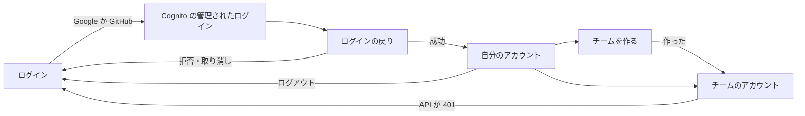
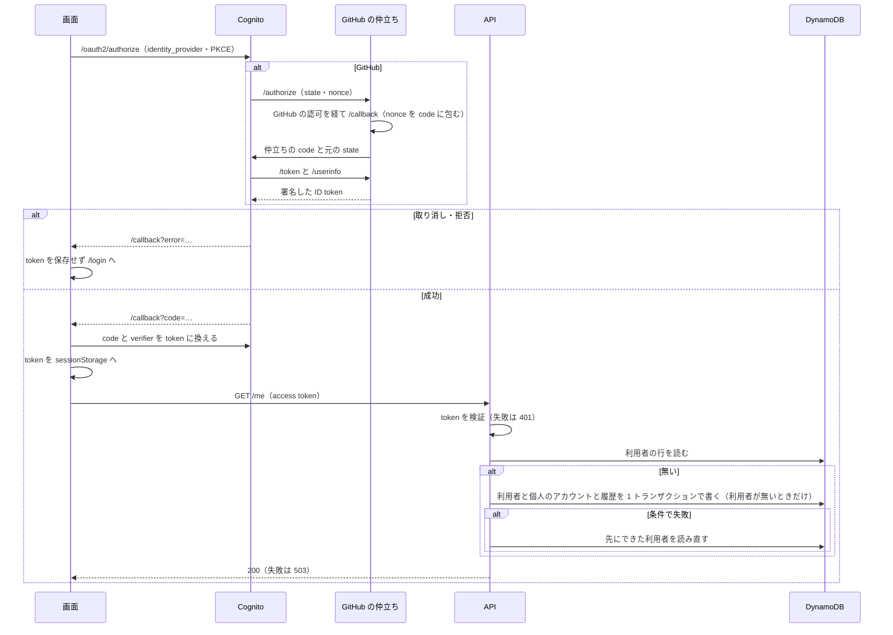
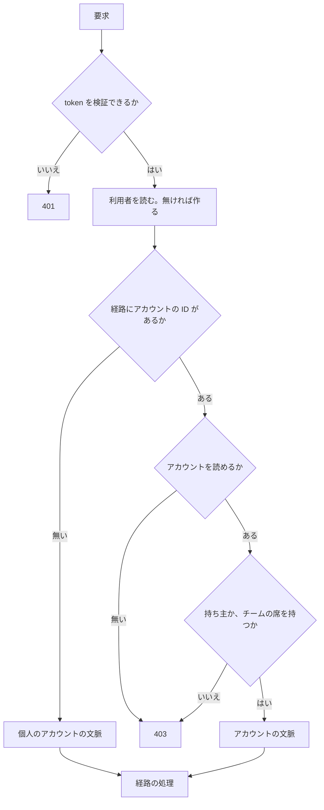
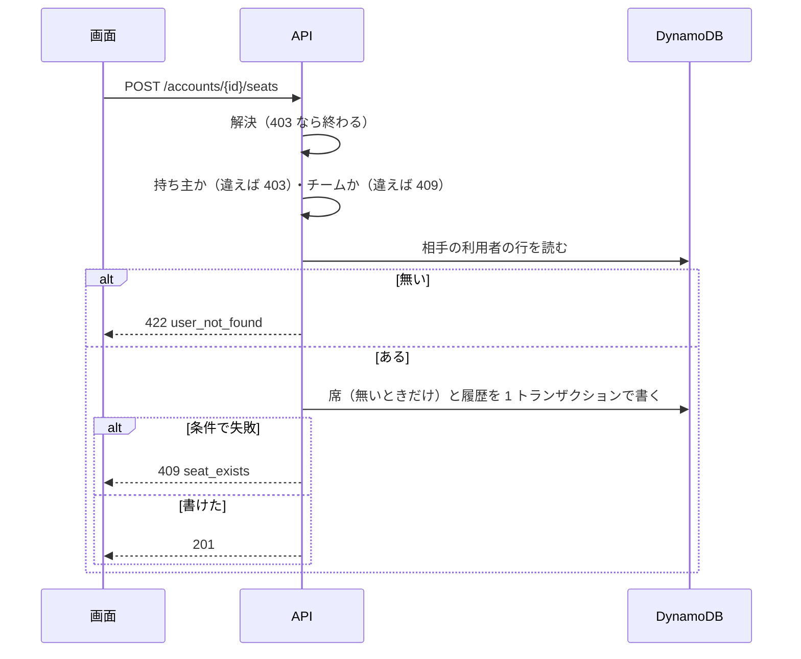

# #2170 の設計の入出力の契約と処理の流れ

[設計文書](issue-2170-design.md) から分けた節である。

## 入出力の契約

### API（`factory/contracts/openapi/accounts.yaml`）

経路はすべて `Authorization: Bearer <access token>` を要る。エラーの本文は `{"error": {"code": "<機械の値>", "message": "<利用者に出す文>"}}` に揃える。

| 経路 | 入力 | 成功 | 失敗 |
| --- | --- | --- | --- |
| `GET /me` | — | 200 `{user_id, idp, personal_account_id, accounts: [{account_id, kind, name, plan, role, seat_type, execution_mode}]}`。初回は個人のアカウントを作る（E2） | 401。作成に失敗したら 503 `account_unavailable` |
| `GET /accounts/{account_id}` | — | 200 `{account_id, kind, name, plan, role, seat_type, execution_mode, limits: {concurrent_sprint_runs, monthly_tokens}, seats}`。`execution_mode` は `local` / `byok` / `managed`。`monthly_tokens` は `managed` のときだけ数で、ほかは `null`（掛けない、I23）。`seats` はチームだけで `[{user_id, idp, seat_type, added_at}]` | 401。席も持ち主でもない・存在しない → 403 `forbidden`（I18） |
| `POST /teams` | `{name: 1〜64 字, seat_type}` | 201 アカウントの本文（上と同じ形） | 400 `invalid_request` |
| `POST /accounts/{account_id}/seats` | `{user_id, seat_type}` | 201 席 | 403 `forbidden`（I17・I18）・409 `not_a_team`（I13）・422 `user_not_found`（I16）・409 `seat_exists`（I15） |
| `PATCH /accounts/{account_id}/seats/{user_id}` | `{seat_type}` | 200 席 | 403・409 `not_a_team`・404 `seat_not_found` |
| `DELETE /accounts/{account_id}/seats/{user_id}` | — | 204 | 403・409 `not_a_team`・409 `owner_seat_protected`（I14）・404 `seat_not_found` |
| `PUT /accounts/{account_id}/execution-mode` | `{execution_mode: "local" \| "byok" \| "managed"}` | 200 アカウントの本文（`GET /accounts/{account_id}` と同じ形）。今と同じ値なら履歴の行を足さずに 200 | 400 `invalid_request`（知らない値）・403 `forbidden`（持ち主でない、I22。席も持たない者は I18 と同じ本文）・409 `managed_not_allowed_on_free`（I21。`message` は「Free のプランでは managed（サービスの Bedrock）を選べません」）・503 `account_unavailable`（版の競合で 3 回書けない） |

`409 managed_not_allowed_on_free` を返すのも、持ち主と確かめた後だけである。`byok` を選んでもキーの登録はこの経路で求めない（キーの保存は #2186）。

`404 seat_not_found` を返すのは、要求した者がそのチームの持ち主と確かめた後だけである。持ち主でなければ、席の有無にかかわらず先に 403 を返す（I18）。

**使える量は HTTP の経路にしない。** #2186・#2174 の処理は同じ `factory/api/` の中で `index.ts` の関数を呼ぶ（「構造」の表）。画面は `GET /accounts/{account_id}` の `limits` で上限を出す（受け入れ条件 8）。

### GitHub の仲立ち（Cognito から呼ばれる）

発行元は `GITHUB_OIDC_ISSUER`（例: `https://<API の入口>/oidc/github`）で、その下に次の経路を置く。Cognito の OIDC の IdP の登録（クライアントの ID と秘密は GitHub の OAuth App のもの）は private リポジトリが行う。

| 経路 | 中身 |
| --- | --- |
| `GET /.well-known/openid-configuration` | 発行元と下の経路（`/callback` を除く 4 つ）、`id_token_signing_alg_values_supported: ["RS256"]` |
| `GET /authorize` | 受けた `client_id`・`redirect_uri`・`state`・`nonce` を、署名の鍵で署名した有効期限 10 分の JWT（仲立ちの `state`）に包み、`redirect_uri=${GITHUB_OIDC_ISSUER}/callback`・`scope=read:user user:email` で GitHub の認可の画面へ 302 で送る |
| `GET /callback` | GitHub から `code` と仲立ちの `state` を受け、`state` の署名と期限を確かめる。GitHub の `code` と `state` の中の `client_id`・`redirect_uri`・`nonce` を、署名した有効期限 5 分の JWT（仲立ちの `code`）に包み、Cognito の `redirect_uri` へ Cognito の元の `state` と一緒に 302 で返す。GitHub がエラーを返したら、`error` を元の `state` と一緒にそのまま返す |
| `POST /token` | 受けた仲立ちの `code` の署名と期限を確かめ、中の `client_id`・`redirect_uri` が要求のものと同じでなければ `invalid_grant` で断る。中の GitHub の `code` とクライアントの ID と秘密を GitHub の token の経路へ渡し、得た access token で GitHub の利用者を引き、`sub` = GitHub の数の利用者 ID、`aud` = `client_id`、`nonce` = 仲立ちの `code` の中の値（`/authorize` で受けなければ載せない）、有効期限 5 分の ID token を署名して返す。`access_token` は GitHub のものをそのまま返す |
| `GET /userinfo` | 受けた access token で GitHub の利用者を引き、`sub`・`name`・`preferred_username` と、検証済みの主のメールがあれば `email`・`email_verified` を返す |
| `GET /jwks.json` | 署名の鍵の公開鍵 |

`sub` に GitHub のログイン名やメールを使わない。どちらも利用者が変えられ、別人と入れ替わるためである。

**`nonce` は表を使わず、署名した `state` と `code` で運ぶ。** Cognito は OIDC の IdP へ `nonce` を送り、返った ID token の `nonce` と照らす。GitHub の `code` を Cognito へ直に戻すと、`/token` は Cognito の要求に `nonce` が無いため値を復元できない。そこで GitHub の戻り先を仲立ちの `/callback` にし、`nonce` を仲立ちの `code` に結び付ける。包む JWT は ID token と同じ署名の鍵（`GITHUB_OIDC_SIGNING_KEY_SECRET_ARN`）で署名し、新しい秘密と表を足さない。GitHub の `code` は署名だけで暗号化しないが、換えるには Cognito が持つクライアントの秘密が要り、GitHub が 1 回しか換えさせないため、標準の流れでブラウザの URL に出るのと変わらない。

### 画面

| 画面 | 経路 | 何をする場所か |
| --- | --- | --- |
| ログイン | `/login` | Google と GitHub の 2 つのボタン。`?error=` があれば「ログインできませんでした」を出す |
| ログインの戻り | `/callback` | code を token に換え、`/account` へ移る。IdP の拒否・取り消し（`error` つきの戻り）は token を保存せず `/login?error=…` へ移る |
| 自分のアカウント | `/account` | 利用者の ID（写すボタン）・IdP・個人のプランと実行の形態と 2 つの上限（`managed` でなければ月の token は「掛けない」）・形態を変える操作・席を持つチームの一覧・チームを作る・ログアウト |
| チームを作る | `/teams/new` | 名前と自分の席の種類を入れて作る |
| チームのアカウント | `/accounts/:accountId` | プラン・実行の形態・自分の席の種類と 2 つの上限・席の一覧。持ち主には席の追加・種類の変更・削除と形態を変える操作が出る |

| 画面 | 項目 | 型 | 必須 | 上限 | 満たさないときの表示 |
| --- | --- | --- | --- | --- | --- |
| チームを作る | 名前 | 文字列 | 必須 | 64 字 | 「1〜64 字で入力してください」 |
| チームを作る | 自分の席の種類 | standard / premium | 必須 | — | 既定は standard |
| チームのアカウント | 足す利用者の ID | 文字列（UUID の形） | 必須 | 36 字 | 「利用者の ID の形ではありません」。API の 422 は「その利用者はまだログインしていません」 |
| チームのアカウント | 席の種類 | standard / premium | 必須 | — | — |
| 自分のアカウント・チームのアカウント | 実行の形態 | local / byok / managed | 必須 | — | Free では managed を選べない。API の 409 は `message` を出す |

| 状態 | 出すもの |
| --- | --- |
| 読み込み中 | 「読み込み中」 |
| 未ログイン・API の 401 | token を消して `/login` へ移る（受け入れ条件 3） |
| 403 | 「このアカウントを見る権限がありません」。アカウントの有無は出さない |
| 席の操作と形態の変更の 409・422 | API の `message` を操作の下に出す。席の一覧と形態は読み直さない |
| 5xx | 「時間をおいてやり直してください」 |

| 画面の要素 | 持ち主 | 席を持つ利用者 |
| --- | --- | --- |
| 席の一覧 | 見える | 見える |
| 席の追加・種類の変更・削除 | 出す | 出さない（隠す） |
| 実行の形態 | 見える・変える操作を出す | 見える（変える操作は隠す） |

画面の判定は表示のためだけで、認可は API が毎回行う（I17・I18・I22）。

## 処理の流れ

使える量の表と判定は、ほかの要素を呼ばない計算で順序を持たないため、ここの図に含めない（形は設計文書の「構造」）。パッケージの根・CI のジョブ・API の契約も実行時の流れに現れない。

### ログインと初回のアカウントの作成

### 要求の認可（他の子課題の経路も同じ）

### 席の追加

席の種類の変更と削除も同じ順で、書き込みの条件を「席があること」（削除はさらに「持ち主の席でないこと」を先に照らす）に替える。プランの変更（`setPlan`）は、アカウントの行の更新を「種類とプランの組が I13 を満たすこと」の条件で行い、履歴と同じトランザクションで書く。`free` へ下げるとき（#2174 の支払いの失敗など）に形態が `managed` なら、同じ更新で `execution_mode` を `local` にし、`plan.changed` と `execution_mode.changed` の 2 つの履歴の行を同じトランザクションで足す（I21）。実行の形態の変更（`PUT /accounts/{account_id}/execution-mode`）は持ち主を確かめた後、アカウントの行の更新を「`managed` を置くならプランが `free` でないこと」の条件で行い、条件で失敗すれば 409 を返す。

**プランと形態の更新は、読んだアカウントの行の版が変わっていないことを条件に足す。** アカウントの行は数の `version` を持ち（作成のときは 1）、`setPlan` と形態の変更はどちらも「`version` が読んだ値と等しいこと」を上の条件に足し、同じ更新で `version` を 1 増やす。条件で失敗したら、行を読み直して I13・I21 を判定し直し、もう一度書く（3 回で書けなければ、`setPlan` は `PlanError` でなく保存の失敗を返し、形態の変更は 503 `account_unavailable`）。読み直した後も形態の変更の「プランが `free` でないこと」に反すれば、これまでどおり 409 を返す。これが無いと、プロ・`local` を読んだ `setPlan` が形態を変えないと決めた後に、別の要求がプロの条件で `managed` を保存し、続けて `setPlan` が `free` を保存して、どちらの条件も通ったまま `free`・`managed` が残る（I21 を破る）。
