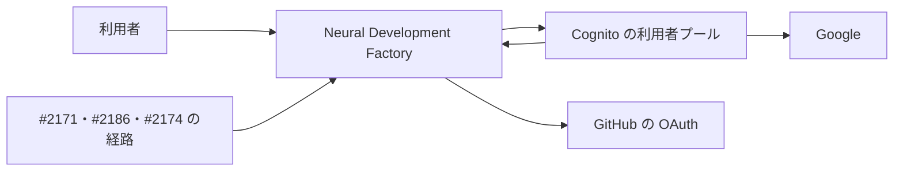
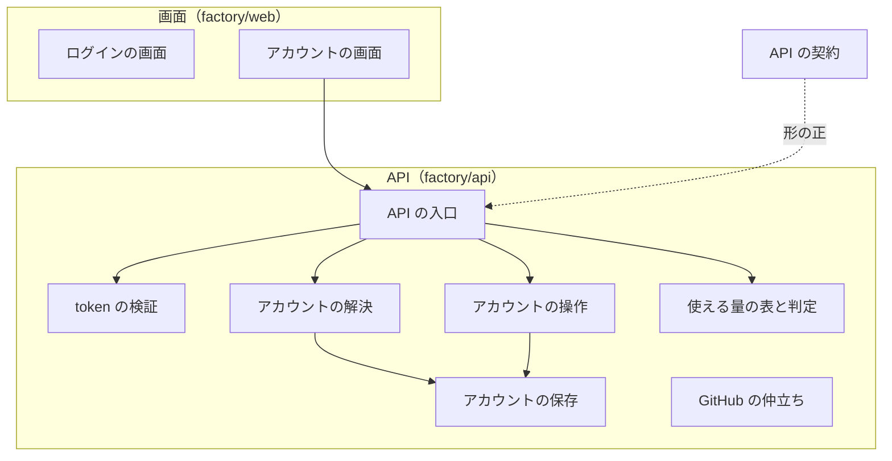
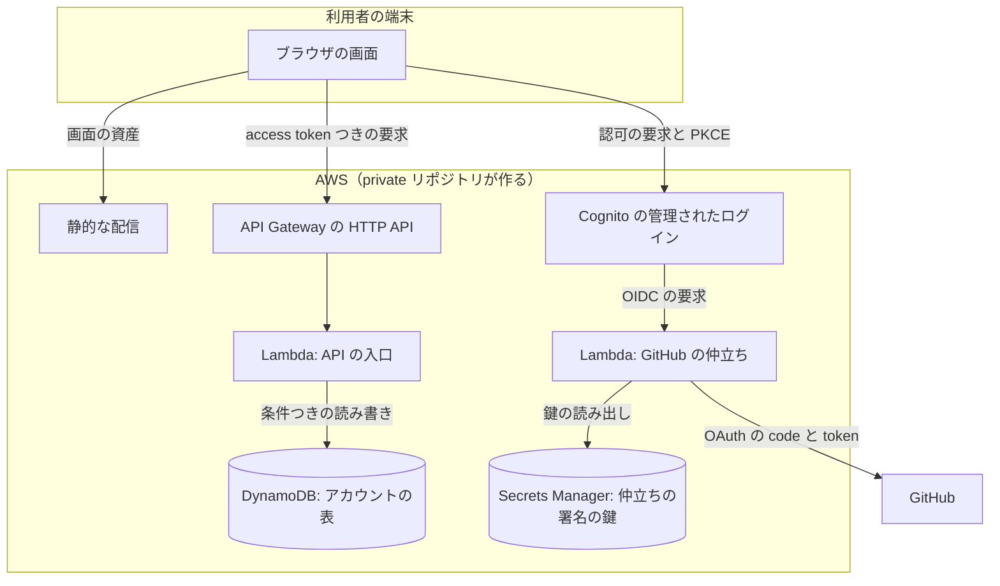
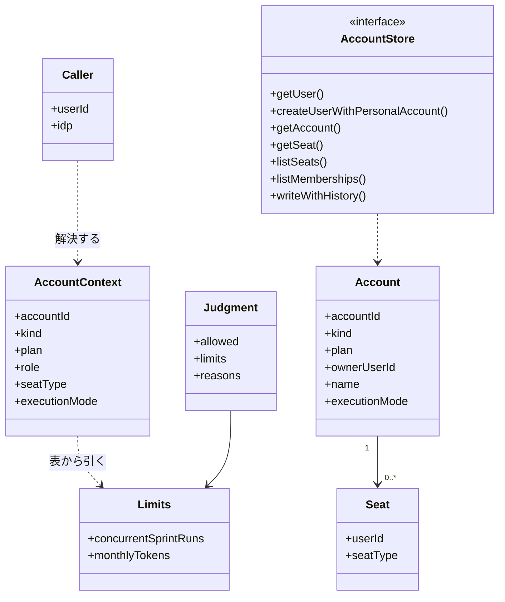
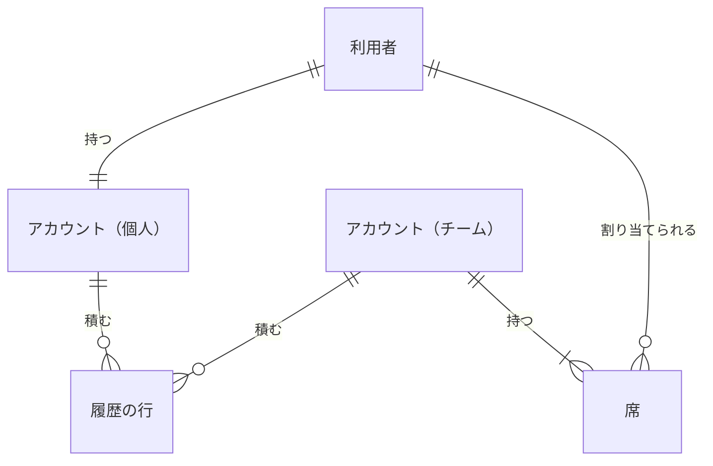

# Neural Development Factory の認証とプラン: Google か GitHub でログインし、アカウントと席ごとの使える量を 1 か所で問い合わせられる（#2170）

## 目的

- **何が壊れているか**: `factory/` にはまだコードが無く、ログイン・アカウント・使える量を決める場所が無い。TypeScript のパッケージの管理の道具も決まっていない
- **誰が困るか**: 後続の子課題（#2171・#2186・#2174・#2172・#2173）。どれも「この要求はどのアカウントのものか」と「このアカウントはあと何を使えるか」を前提に作るため、着手できない
- **直すと何が成り立つか**: Google か GitHub でログインでき、API の要求 1 つから利用者とアカウントが決まり、使える量の上限と判定を 1 つの関数から得られる。`factory/web/`・`factory/api/` に同じ形でコードを足し、手元と CI で同じコマンドで検査できる

## 適用範囲

- **働く範囲**: このリポジトリの `factory/` と CI だけ。プラグインの配布物・Skill・hook は変わらない。インフラ（Cognito の利用者プール・DynamoDB の表・Lambda の束ね方）は private リポジトリが作り、この設計はその受け渡しの形（変数の名前・表の鍵・handler の場所）だけを決める
- **プロジェクトごとに違うもの**: 無し（サービスは 1 つで、値はインフラから環境変数で受ける）
- **当たるモード**: `standard`。共通原則の C2（認証・認可を変える）に当たるため、ゲート 1・2 は MVV の判定で自動に通さず、人が承認ゲートで見る

## あるべき姿の根拠

| 根拠 | 種類 | 何を示すか |
| --- | --- | --- |
| 「Cognitoによる認証(Google, Githubの認証に対応)」「Claude.aiと類似の認証・課金モデル(Free, 個人PRo, 個人Max, Team(standard/premium sear) etc)」（#2170 の依頼の原文） | 利用者の指示の原文 | 認証の手段・2 つの IdP・5 つのプランと席の種類 |
| 確定仕様 [ndf-factory-service-boundary.md](../docs/specifications/ndf-factory-service-boundary.md) の「サービス全体の契約」 | 承認済みの仕様 | 集約「アカウント」の持ち主はこの課題。提供する契約は `account_id`・使える量の問い合わせ・アカウントの実行の形態で、使う契約は無い |
| 確定仕様の「実行の形態」（PR #2190 https://github.com/devbasex/ai-plugins/pull/2190 で直した。2026-10-30 の利用者の決定） | 承認済みの仕様 | 形態は `local`・`byok`・`managed` の 3 つで、値はアカウントの集約が持つ。Free は `local` と `byok` だけを選べ、月の token の上限は `managed` だけに掛かる（決定 14） |
| 手元の実測（2026-10-30）: Node v24.22.1・npm 11.19.1 があり pnpm は無い。一時ディレクトリで npm の workspaces に `web`・`api` を置き、`npm run check -w api`（`tsc --noEmit` と `vitest run`）が通り、型の誤りを入れると 1 で終わった | 実測 | 決定 1・2 の道具の組み合わせが動く |
| 手元の実測（2026-10-30）: `aws-jwt-verify` 5.2.1 に、テストの中で作った鍵の公開鍵の一覧を `cacheJwks` で渡すと、正しい token は通り、別のクライアント・期限切れ・`token_use` の違いはそれぞれ別の例外で落ちた | 実測 | 決定 9 の token の検証を、本物の Cognito なしでテストできる |

要求と受け入れ条件は #2170 の本文にある（コピーは [issue-2170-requirements.md](issue-2170-requirements.md)）。この文書は「どう作るか」だけを扱う。決定の記録は [issue-2170-design-decisions.md](issue-2170-design-decisions.md) に分けた。

## ドメインモデル

### コンテキスト

| コンテキスト | 何の語が 1 つの意味に決まるか |
| --- | --- |
| Neural Development Factory（`ndf-factory`） | 利用者・アカウント・席・プラン・使える量・使える量の判定・実行の形態・GitHub の仲立ち |

コンテキストは 1 つで、関係の宣言は要らない。Cognito と GitHub は外部の系で、利用者の識別子（Cognito の `sub`）だけを受け取る。

### 集約

| 集約 | 持ち主（書き換えてよいもの） | 根 | エンティティ | 値オブジェクト |
| --- | --- | --- | --- | --- |
| 利用者 | 認証とプラン（#2170）の API | 利用者 | — | 利用者の ID（Cognito の `sub`）・IdP の種類 |
| アカウント | 認証とプラン（#2170）の API | アカウント | 席 | 種類（個人・チーム）・プラン・席の種類・使える量・実行の形態・履歴の行 |

**利用者を別の集約にする。** 利用者は個人のアカウントを 1 つ指し（I12）、席はアカウントの中のエンティティとして利用者を ID で指す。初めてのログインは「利用者」と「個人のアカウント」の 2 つを作るが、2 つは同じ利用者の作成でしか生まれず、片方だけがある状態を作らないため、1 つのトランザクションで書く（決定 5）。これは「1 つの処理で書き換える集約は 1 つ」の唯一の例外で、作成の時だけに限る。

### 不変条件

確定仕様の I1〜I11 に続けて番号を振る。

| # | 集約 | 条件 | 破れたときの扱い |
| --- | --- | --- | --- |
| I12 | 利用者 | 1 人の利用者の個人のアカウントは 1 つだけ（受け入れ条件 12） | 2 つ目の作成は条件つきの書き込みで失敗し、先にできた方を読み直して返す |
| I13 | アカウント | 個人のアカウントは席を持たず、プランは `free`・`pro`・`max` のどれか。チームのアカウントのプランは `team` | 席の操作は 409、プランの変更は失敗を返して変えない |
| I14 | アカウント | チームのアカウントでは、持ち主が必ず席を 1 つ持つ（受け入れ条件 9・11） | 持ち主の席を外す要求は 409 で、席は変わらない |
| I15 | アカウント | 1 人の利用者は 1 つのチームに席を 1 つまで持つ（受け入れ条件 11） | 2 つ目の追加は 409 で、席は変わらない |
| I16 | アカウント | 席が指す利用者は、既に 1 度ログインした利用者である（受け入れ条件 11） | 422 で、席は変わらない |
| I17 | アカウント | 席を足す・種類を変える・外すのは、チームの持ち主だけ（受け入れ条件 10） | 403 で、席は変わらない |
| I18 | アカウント | 個人のアカウントの持ち主でもチームの席を持つ利用者でもない者には、アカウントの有無も中身も応答に出ない（受け入れ条件 5・13） | 存在しないアカウントと同じ 403 と同じ本文を返す |
| I19 | アカウント | 使える量の値は使える量の表 1 か所からだけ決まる（受け入れ条件 6、前提 6） | 表に無いプランと席の種類の組は、判定を断る側へ倒し、理由に「表に無い」を返す |
| I20 | アカウント | プラン・席・実行の形態を変えるたびに、同じトランザクションで履歴の行を 1 つ足し、履歴の行は書き換えない | 履歴を書けなければ変更ごと書かない |
| I21 | アカウント | プランが `free` のアカウントの実行の形態は `managed` でない（受け入れ条件 19、決定 14） | 形態を `managed` へ変える要求は 409 で、形態は変わらない。`setPlan` で `free` へ下げるとき形態が `managed` なら、同じトランザクションで `local` へ変え、履歴の行を足す |
| I22 | アカウント | 実行の形態を変えるのは、アカウントの持ち主（個人は本人、チームはチームの持ち主）だけ（受け入れ条件 19） | 403 で、形態は変わらない |
| I23 | アカウント | 月の token の上限を判定で照らすのは、実行の形態が `managed` のときだけ。同時に動かせるスプリントの実行の数は 3 つの形態すべてで照らす（受け入れ条件 20） | `local`・`byok` の判定は月の token の今の値を見ない |
| I24 | アカウント | 新しいアカウント（個人もチームも）の実行の形態は `local` で始まる（決定 14） | 作成の書き込みは `local` 以外の形態を受けない |

### ドメインイベント

要求の E1〜E9 を引き継ぐ。どれも同じ集約の中で閉じ、ほかの集約へ非同期に知らせる事象は無い（I20 の履歴の行は記録で、知らせではない）。

| # | イベント | 発生元 | 受け手 |
| --- | --- | --- | --- |
| E1 | 利用者が Google か GitHub でログインした | 画面（Cognito の管理されたログイン） | 画面のログインの戻り |
| E2 | 初めてログインした利用者に、個人のアカウント（Free）を作った | API の利用者の解決 | 画面の自分のアカウント |
| E3 | API が token を検証し、`account_id` を解決した | API の認証の中間処理 | API の各経路と、#2171・#2186・#2174 の経路 |
| E4 | 利用者がチームのアカウントを作った | API の `POST /teams` | 画面のチームのアカウント |
| E5 | チームの持ち主が席を足した・種類を変えた・外した | API の席の経路 | 画面のチームのアカウント・履歴の行 |
| E6 | アカウントのプランを変えた | API の内側の関数 `setPlan`（#2174 が呼ぶ） | 履歴の行・以後の使える量の問い合わせ。`free` へ下げて形態が `managed` なら、同じトランザクションで E9 も起きる（I21） |
| E7 | 使える量を問い合わせた・判定した | API の内側の関数 `getLimits`・`judgeLimits`（#2186 と画面） | 呼んだ側（#2186 がスプリントの開始を断る） |
| E8 | ログアウトした | 画面 | 画面のログイン |
| E9 | アカウントの実行の形態を変えた | API の `PUT /accounts/{account_id}/execution-mode` と `setPlan`（I21） | 履歴の行・以後のアカウントの文脈（#2186・#2189・#2174 が読む）と使える量の判定 |

### 用語

| 用語 | 意味 | 用語集への反映 |
| --- | --- | --- |
| 利用者 | Google か GitHub の 1 つのアカウントで Neural Development Factory にログインした人。Cognito の `sub` を利用者の ID として持つ。同じ人でも IdP が違えば別の利用者である | 追加（`ndf-factory`） |
| チームの持ち主 | チームのアカウントを作った利用者。席を足す・種類を変える・外すことができる唯一の利用者 | 追加（`ndf-factory`） |
| 使える量の判定 | 呼び出す側が渡した今の値（動いているスプリントの実行の数・その月の token の数）を使える量の上限と照らし、許すか断るかと理由を返すこと | 追加（`ndf-factory`） |
| GitHub の仲立ち | GitHub の OAuth を Cognito が受け取れる OIDC の形へ変える、`factory/api/` のプログラム | 追加（`ndf-factory`） |
| 実行の形態 | アカウントのランナーが Claude をどう呼ぶか。`local`（手元のランナー）・`byok`（キーの持ち込み）・`managed`（サービスの Bedrock）の 3 つで、アカウントごとに 1 つ持つ。Free は `managed` を選べず、月の token の上限は `managed` だけに掛かる | 追加（`ndf-factory`） |

## 機能一覧

| # | 機能 | 誰が使うか |
| --- | --- | --- |
| F1 | Google か GitHub でログインし、ログアウトする | 利用者 |
| F2 | 自分の利用者の ID・個人のアカウントのプランと使える量・席を持つチームの一覧を見る | 利用者 |
| F3 | チームのアカウントを作る | 利用者 |
| F4 | チームのプラン・自分の席と使える量・席の一覧を見る | チームの席を持つ利用者 |
| F5 | 席を足す・席の種類を変える・席を外す | チームの持ち主 |
| F6 | 要求の token から利用者とアカウントを解決する | #2171・#2186・#2174 の API の経路 |
| F7 | 使える量を問い合わせ、今の値で判定する | #2186（スプリントの開始）と画面 |
| F8 | アカウントのプランを変える | #2174（決済の後） |
| F9 | `factory/` の型検査とテストを手元と CI で走らせる | 開発者と CI |
| F10 | アカウントの実行の形態を見る・変える | 見るのは席を持つ利用者と #2186・#2189・#2174、変えるのはアカウントの持ち主 |

## 構成要素

| 要素 | 責務 |
| --- | --- |
| パッケージの根（`factory/package.json`・`package-lock.json`・`.node-version`） | npm の workspaces で `web`・`api` を束ね、依存を 1 つのロックファイルで固める。`npm run check` で契約の検査と両方の検査を走らせる（決定 1・2） |
| ログインの画面（`factory/web/`） | Cognito の管理されたログインへ Google か GitHub を指定して送り、戻りで token を受けて保存する。ログアウトで token を消す（決定 10） |
| アカウントの画面（`factory/web/`） | 自分のアカウント・チームを作る・チームのアカウントの 3 画面。API の 401 で token を消してログインへ戻す |
| token の検証（`factory/api/src/auth/`） | `Authorization: Bearer` の access token を署名・発行元・クライアント・期限・`token_use` で検証し、利用者の ID を返す。失敗は 401（決定 9） |
| アカウントの解決（`factory/api/src/auth/`） | 利用者の ID と要求のアカウントの ID から、権限つきのアカウントの文脈を返す。無ければ個人のアカウントを作る（決定 4・5）。権限が無ければ 403 |
| アカウントの操作（`factory/api/src/accounts/`） | チームの作成・席の追加と種類の変更と削除・プランの変更・実行の形態の変更。不変条件 I13〜I17・I20〜I22・I24 を守る |
| 使える量の表と判定（`factory/api/src/accounts/limits.ts`） | プランと席の種類ごとの上限を 1 つの表で持ち、実行の形態に合わせて問い合わせと判定を返す（決定 7・14、I23） |
| アカウントの保存（`factory/api/src/accounts/store.ts`） | DynamoDB の 1 つの表への読み書き。条件つきの書き込みとトランザクションで I12・I15・I20 を守る（決定 8） |
| API の入口（`factory/api/src/handlers/api.ts`） | API Gateway の HTTP API から呼ばれる Lambda の handler。経路を割り振り、エラーを決まった形で返す（決定 11） |
| GitHub の仲立ち（`factory/api/src/handlers/github-oidc.ts`） | Cognito から OIDC の IdP として呼ばれ、GitHub の OAuth へ取り次ぎ、署名した ID token を返す（決定 3） |
| API の契約（`factory/contracts/openapi/accounts.yaml`） | 画面向けの経路の OpenAPI。Spectral で検査する（決定 13） |
| CI のジョブ（`.github/workflows/factory-check.yml` の `factory-check`） | Pull Request で起動し、`factory/` かこのワークフローが変わったときだけ `npm ci` と `npm run check` を走らせる（決定 12） |

### システムの文脈



`COG --> SVC` は、Cognito が GitHub の仲立ちを OIDC の IdP として呼ぶ線である。Cognito の利用者プールの設定（IdP の登録・コールバックの URL）は private リポジトリが作り、この変更では変えられない外部として扱う。

### 構成要素の関係



ログインの画面は API を呼ばず、Cognito とだけ話す。GitHub の仲立ちは Cognito からだけ呼ばれ、ほかの要素と線を持たない。パッケージの根と CI のジョブは検査の経路で、実行時の関係を持たないため図に含めない。API の契約は形の正として点線で示す。

### 配置



インフラへ渡す形は次の 6 つで、private リポジトリはこれに合わせて資源を作る。

| 渡す形 | 中身 |
| --- | --- |
| handler | `factory/api/src/handlers/api.ts` の `handler`（HTTP API の payload 2.0）、`factory/api/src/handlers/github-oidc.ts` の `handler`（同）。束ね方（esbuild など）はインフラが決める |
| 画面の資産 | `npm run build -w web` が作る `factory/web/dist/` |
| 表の鍵 | 下の「データ構造」の `pk`・`sk` と GSI `gsi1`（`gsi1pk`・`gsi1sk`）。GSI の射影は KEYS_ONLY でよい（API は GSI の行の表の鍵 `pk` からアカウントの ID だけを取り、中身は表から強い整合で読む） |
| Cognito の IdP の名前 | `Google`（組み込みの Google）と `GitHub`（OIDC の IdP。発行元は `GITHUB_OIDC_ISSUER`）。大文字と小文字もこのとおりにする。画面が送る `identity_provider` と、API が `idp` を決める token の `username` の頭（`Google_`・`GitHub_`）がこの名前に依存する |
| GitHub の仲立ちの経路 | API Gateway の HTTP API の `/oidc/github/{proxy+}` を、認可なしで `github-oidc.ts` の `handler` へ通す。`GITHUB_OIDC_ISSUER` は `https://<API の入口>/oidc/github` にする（経路は「入出力の契約」の「GitHub の仲立ち」）。GitHub の OAuth App のコールバックの URL は Cognito でなく `${GITHUB_OIDC_ISSUER}/callback` にする（`nonce` を運ぶため） |
| CORS | API の handler が持つ。許すオリジンは `FACTORY_WEB_URL` のオリジン、ヘッダは `Authorization`・`Content-Type`、メソッドは GET・POST・PUT・PATCH・DELETE で、preflight（OPTIONS）は認証より先に返す。HTTP API の CORS の設定は使わず、OPTIONS も認可なしで `api.ts` の `handler` へ通す |

### 置き場所

```text
factory/
├── .node-version                  # 新設。24
├── package.json                   # 新設。workspaces: web, api。scripts: check, lint:contracts
├── package-lock.json              # 新設。唯一のロックファイル
├── .gitignore                     # 変更。dist/ と coverage/ を足す
├── .env.example                   # 変更。下の「データ・設定」の 7 つの名前を足す
├── README.md                      # 変更。「パッケージの管理」の節を足す（受け入れ条件 15）
├── contracts/openapi/accounts.yaml  # 新設
├── api/
│   ├── package.json  tsconfig.json
│   └── src/
│       ├── index.ts               # 他の子課題へ公開する関数の入口
│       ├── handlers/{api,github-oidc}.ts
│       ├── auth/{verify,resolve}.ts
│       ├── accounts/{model,limits,service,store}.ts
│       ├── routes/{me,teams,accounts}.ts
│       └── github-oidc/{app,keys}.ts
└── web/
    ├── package.json  tsconfig.json  vite.config.ts  index.html
    └── src/{main.tsx,auth.ts,api.ts,pages/}
.github/workflows/factory-check.yml  # 新設
scripts/required-checks-allow.json   # 変更。awaiting に factory-check
```

テストは各ファイルの隣に `*.test.ts(x)` で置く。

## 構造



他の子課題へ公開する関数は `factory/api/src/index.ts` の次の 5 つだけである（受け入れ条件 5・6・7、前提 8）。

| 関数 | 入力 | 出力 | 失敗 |
| --- | --- | --- | --- |
| `verifyRequest(authorization)` | `Authorization` の値 | `Caller`（利用者の ID・IdP） | 401 の `AuthError` |
| `resolveAccount(caller, accountId?)` | `Caller`・アカウントの ID（省くと個人のアカウント） | `AccountContext`（`role` は `owner` / `member`、`seatType` はチームのときだけ、`executionMode` は `local` / `byok` / `managed`。#2186・#2189・#2174 は形態をここから読む） | 403 の `ForbiddenError`（I18） |
| `getLimits(ctx)` | `AccountContext`（`executionMode` を含む） | `Limits`。`monthlyTokens` は `executionMode` が `managed` のときだけ表の値で、ほかは `null`（掛けない、I23） | 例外を投げない。表に無い組は `null` を返し、`judgeLimits` が断る。`managed` なのに表に月の token の値が無い組も断る側へ倒す（I19） |
| `judgeLimits(ctx, current)` | `AccountContext`・`current = {runningSprintRuns, tokensThisMonth}`（チームでは、その席の利用者の分。`managed` でなければ `tokensThisMonth` は省いてよい） | `Judgment`。`allowed` が偽なら `reasons` に `{quantity, limit, current}` を並べる。`limits.monthlyTokens` が `null` なら月の token を照らさない（I23） | — |
| `setPlan(accountId, plan)` | アカウントの ID・プラン | 無し | 知らないプラン・I13 に反する組は `PlanError`（E6） |

**判定は「今の値が上限より小さければ許す」である。** 同時のスプリントの実行は、新しい 1 つを始める前の数を渡す。上限 3 なら今が 2 で許し、3 で断る。月の token は、その UTC の暦月に使った数を渡し、上限ちょうどで断る。月の token を照らすのは実行の形態が `managed` のときだけである（I23）。

## データ構造

DynamoDB の 1 つの表（`ACCOUNTS_TABLE_NAME`）に、利用者・アカウント・席・履歴の行を置く（決定 8）。



| 行 | `pk` | `sk` | `gsi1pk` | `gsi1sk` |
| --- | --- | --- | --- | --- |
| 利用者 | `USER#<user_id>` | `USER` | — | — |
| アカウント | `ACCOUNT#<account_id>` | `ACCOUNT` | — | — |
| 席 | `ACCOUNT#<account_id>` | `SEAT#<user_id>` | `USER#<user_id>` | `ACCOUNT#<account_id>` |
| 履歴の行 | `ACCOUNT#<account_id>` | `HIST#<at>#<uuid>` | — | — |

| 行 | 列 | 型 | 空を許すか | 意味 |
| --- | --- | --- | --- | --- |
| 利用者 | `user_id` | 文字列 | 許さない | Cognito の access token の `sub` |
| 利用者 | `idp` | 文字列 | 許さない | `google` / `github`。token の `username` の頭（`Google_`・`GitHub_`）から決める |
| 利用者 | `personal_account_id` | 文字列 | 許さない | 個人のアカウントの ID（I12） |
| 利用者 | `created_at` | 文字列（ISO 8601、UTC） | 許さない | 初めてログインした時刻 |
| アカウント | `account_id` | 文字列（UUID） | 許さない | `crypto.randomUUID()` で作る |
| アカウント | `kind` | 文字列 | 許さない | `personal` / `team` |
| アカウント | `plan` | 文字列 | 許さない | `free` / `pro` / `max` / `team`（I13） |
| アカウント | `execution_mode` | 文字列 | 許さない | `local` / `byok` / `managed`。作成のときは `local`（I24）。プランが `free` なら `managed` を置かない（I21） |
| アカウント | `version` | 数 | 許さない | 作成のときは 1。プランと形態を変えるたびに同じ更新で 1 増やし、書き込みの条件で読んだ値と照らす（I21 の競合を防ぐ。「入出力の契約」の席の追加の節の後） |
| アカウント | `owner_user_id` | 文字列 | 許さない | 個人は本人、チームはチームの持ち主 |
| アカウント | `name` | 文字列 | 許す | チームの名前（1〜64 字）。空は「個人のアカウント」で、未入力ではない |
| アカウント | `created_at`・`updated_at` | 文字列（ISO 8601、UTC） | 許さない | 作成と最後の変更の時刻 |
| 席 | `seat_type` | 文字列 | 許さない | `standard` / `premium` |
| 席 | `added_at` | 文字列（ISO 8601、UTC） | 許さない | 席を足した時刻 |
| 履歴の行 | `type` | 文字列 | 許さない | `account.created` / `plan.changed` / `seat.added` / `seat.changed` / `seat.removed` / `execution_mode.changed` |
| 履歴の行 | `at` | 文字列（ISO 8601、UTC） | 許さない | 変えた時刻 |
| 履歴の行 | `actor` | 文字列 | 許さない | 変えた利用者の ID。`setPlan` は `system` |
| 履歴の行 | `before`・`after` | JSON | 許す | 変える前と後の値。空は「無かった」（作成の `before`・削除の `after`） |

**メールアドレスは保存しない。** 席は利用者の ID で指す（決定 6）ため、メールを持つ理由が無い。

**時系列は事象の記録で守る。** 今の値（アカウント・席の行）は上書きするが、変えるたびに同じトランザクションで履歴の行を足す（I20）。請求（#2174）が「いつ何の席が何日あったか」を追える。

**移行は無い。** 新しい表で、既存のデータは無い。

| 機能 | 利用者 | アカウント | 席 | 履歴の行 |
| --- | --- | --- | --- | --- |
| F2 自分のアカウントを見る | C（初回）・R | C（初回）・R | R（GSI） | C（初回） |
| F3 チームを作る | R | C | C | C |
| F4 チームを見る | — | R | R | — |
| F5 席を操作する | R（相手） | R | C・U・D | C |
| F6 解決する | C（初回）・R | C（初回）・R | R | C（初回） |
| F7 使える量 | — | R | R | — |
| F8 プランを変える | — | U（`free` へ下げるときは形態も） | — | C |
| F10 実行の形態を変える | — | R・U | R | C |

### データ・設定

`factory/.env.example` に次の名前を足す（値は書かない、I6）。既存の `AWS_REGION`・`COGNITO_USER_POOL_ID`・`COGNITO_CLIENT_ID` はそのまま使う。

| 名前 | 使う側 | 意味 |
| --- | --- | --- |
| `COGNITO_DOMAIN` | 画面・GitHub の仲立ち | Cognito の管理されたログインのドメイン。仲立ちは `/authorize` で受ける `redirect_uri` をこのドメインの `/oauth2/idpresponse` と照らす |
| `FACTORY_WEB_URL` | 画面・API | 画面の URL。画面はログインの戻り（`/callback`）とログアウトの戻りに、API は CORS で許すオリジンに使う |
| `FACTORY_API_URL` | 画面 | API の入口の URL |
| `ACCOUNTS_TABLE_NAME` | API | アカウントの表の名前 |
| `GITHUB_OIDC_ISSUER` | GitHub の仲立ち | 仲立ちの発行元の URL |
| `GITHUB_OAUTH_CLIENT_ID` | GitHub の仲立ち | GitHub の OAuth App のクライアントの ID（秘密でない）。`/authorize` で受ける `client_id` と照らす |
| `GITHUB_OIDC_SIGNING_KEY_SECRET_ARN` | GitHub の仲立ち | ID token を署名する RSA の秘密鍵の置き場 |

画面は `vite.config.ts` が、上の画面の 3 つと `COGNITO_CLIENT_ID` だけを名前で選んで埋め込む。ほかの変数を画面へ入れない。

### 使える量の初めの値（ゲート 1 で利用者が承認した。Free の月の token は実行の形態の決定で直した。どちらも 2026-10-30）

| プラン・席の種類 | 同時に動かせるスプリントの実行 | 月の token の上限（`managed` だけ。入力と出力の和。cache の読み書きを含む） | Bedrock の費用の目安（Opus 5.5） |
| --- | --- | --- | --- |
| Free | 1 | 掛けない（③ `managed` を選べない） | — |
| 個人 Pro | 3 | 20,000,000 | 約 $19 |
| 個人 Max | 10 | 100,000,000 | 約 $94 |
| Team standard | 3 | 25,000,000 | 約 $24 |
| Team premium | 10 | 125,000,000 | 約 $118 |

**月の token の上限は、実行の形態が ③ `managed` のときだけ掛ける。** ① `local` と ② `byok` は利用者の Claude の認証情報で呼び、サービスが token の費用を払わないためである。同時に動かせるスプリントの実行の数は 3 つの形態すべてに掛かる（I23）。

Pro と Max の比、Team standard を個人 Pro の少し上、Team premium を個人 Max の少し上に置く比は、依頼の「Claude.aiと類似の」に合わせた。**token は cache の読み書きを含めて数える。** Bedrock の請求と同じ単位で数えるためである。cache を除いて入力と出力だけを数えると、NDF の実行ではほぼ全部が出力になり、同じ上限でも費用が約 20 倍に変わる。

費用の目安は、Bedrock の global エンドポイントの料金（Opus 5.5 は 100 万 token あたり入力 $4・出力 $20、cache read は入力の 0.1 倍、cache write は 1.25 倍）に、このスプリントの設計フェーズの実測の内訳（cache read 92.7%・cache write 5.9%・出力 1.4%。557 万 token で $5.20）を当てた値で、100 万 token あたり約 $0.94 になる。料金は第三者の記事から取ったもので、実装の前に AWS の料金ページで確かめる。スプリント m2169 は Claude だけで約 740 万 token を使い、ゲート 1 で承認した Free の上限（2,000,000）ではスプリントを 1 本も通せなかった。このため Free には ③ を置かず、月の token の上限を掛けない（決定 14）。値の妥当さは #2174 の使用量の台帳ができた後に実測で見直す（未確認のまま残ること）。

## 入出力の契約

[issue-2170-design-interfaces.md](issue-2170-design-interfaces.md) に分けた（API・GitHub の仲立ち・画面）。

## 処理の流れ

[issue-2170-design-interfaces.md](issue-2170-design-interfaces.md) の「処理の流れ」に分けた（ログインと初回のアカウントの作成・要求の認可・席の追加）。

## 非機能の実現方式

| 大項目 | 要求の条件 | 実現方式 | 確かめ方 |
| --- | --- | --- | --- |
| セキュリティ | token は API で毎回検証し、画面の判定だけで認可しない | Lambda の中で `aws-jwt-verify` が署名・発行元・`client_id`・期限・`token_use=access` を見る。API Gateway に認可を任せても重ねて検証する。経路ごとに `resolveAccount` を通す（決定 9） | 受け入れ条件 4・13 のテスト |
| セキュリティ | 秘密は Secrets Manager の ARN だけで受け、値をコード・ログ・応答に出さない | 秘密は GitHub の仲立ちの署名の鍵 1 つで、`GITHUB_OIDC_SIGNING_KEY_SECRET_ARN` から起動のたびに 1 回読み、関数の中に持つ。GitHub の OAuth App の秘密は Cognito が持ち、仲立ちは受け渡すだけで保存も記録もしない（決定 3） | 境界の検査が 0。ログの出力を集めて token・`client_secret`・鍵の形が無いことをテストで見る |
| セキュリティ | token と利用者のメールアドレスをログに出さない | ログは利用者の ID・経路・状態コードだけを JSON で出す。メールは保存もしない | 同上 |
| 運用・保守性 | 使える量の値は表の 1 か所で変える | `limits.ts` の 1 つの表（決定 7） | 表の値を変えると問い合わせの結果だけが変わるテスト |
| 運用・保守性 | 断った判定の理由は、利用者に出す文と同じ中身を API の応答に構造で返す | `Judgment.reasons` を `{quantity, limit, current}` で返し、画面と #2186 が同じ値から文を作る | 受け入れ条件 7 のテスト |
| システム環境 | 画面は React の SPA（Vite）、API は Node の Lambda、TypeScript。Node の版は 1 つに揃える | `factory/.node-version` に `24` を置き、`package.json` の `engines` と CI の `setup-node` が同じファイルを読む（決定 2） | CI のジョブが `.node-version` で動く |

## 決定の記録

[issue-2170-design-decisions.md](issue-2170-design-decisions.md) に分けた。

## テスト設計

| 受け入れ条件・不変条件 | どの振る舞いで縛るか | どう壊したら落ちるべきか |
| --- | --- | --- |
| 1 | ログインの画面の 2 つのボタンが、それぞれ `identity_provider=Google` / `GitHub` を付けて Cognito へ送る。戻りの後に `/account` がプランを出す（偽の Cognito と偽の API で） | 片方の `identity_provider` を落とすと落ちる |
| 2 | `error` つきの戻りで `/login` に「ログインできませんでした」が出て、保存先に token が無い | 戻りで先に token を保存するように変えると落ちる |
| 3 | ログアウトで保存先の token が消え、`/account` を開くと `/login` へ移る。API の 401 でも同じ | ログアウトで token を残すと落ちる |
| 4 | token が無い・署名が違う・期限切れ・別の利用者プール・別のクライアント・ID token をそれぞれ 1 つずつ送ると 401 で、本文にアカウントの中身が無い | どれか 1 つの検証を外すと、その入力のテストが落ちる |
| 5 | `resolveAccount` が個人とチームで文脈を返し、席の無いチームの ID で 403 を返す。#2186 の経路を模した経路から同じ関数で使える | 席の確かめを外すと落ちる |
| 6・I19 | 5 つの組の問い合わせ（Free 以外は `managed` の文脈で）が表の値と一致する。表に無い組は断る判定になる | 席の種類を見ずにプランだけで引くと、Team の 2 行が落ちる |
| 7 | `managed` の文脈で、2 つの量それぞれで、上限より 1 少ない → 許す・ちょうど → 断る・1 多い → 断る。断るときの理由に量と上限と今の値が入る | `<` を `<=` にすると「ちょうど」が落ちる |
| 8 | 自分のアカウントとチームのアカウントの画面に 2 つの上限が出る | 応答の `limits` を出さないと落ちる |
| 9 | チームを作ると持ち主が作った利用者で、持ち主の席が選んだ種類で 1 つある | 席を作らないと落ちる |
| 10・I17 | 持ち主は席を足す・変える・外せる。持ち主でない席の利用者の同じ 3 操作は 403 で、席の一覧が変わらない | 持ち主の確かめを外すと落ちる |
| 11・I14・I15・I16 | 未ログインの利用者 → 422、既に席がある → 409、持ち主の席を外す → 409。どれも席の一覧と履歴が変わらない | 条件つきの書き込みの条件を外すと 409 の行が落ちる |
| 12・I12 | 同じ利用者で `GET /me` を並べて 2 回呼んでも、個人のアカウントは 1 つで、2 回とも同じ ID を返す（DynamoDB の条件つきのトランザクションの振る舞いで） | 利用者の行の条件を外すと 2 つできて落ちる |
| 13・I18 | 利用者 A の token で、他人の個人のアカウント・入っていないチーム・存在しない ID の 3 つに読む・書くの両方を送ると、すべて 403 で本文が同じ | 存在しない ID で 404 を返すように変えると落ちる |
| 14 | `python3 scripts/check-service-boundary.py` が 0。テストの鍵はテストの中で作り、ファイルに置かない | PEM の鍵をテストの入力ファイルに置くと境界の検査が落ちる |
| 15 | `factory/package.json` の workspaces が `web`・`api` で、`npm ci` がロックファイルどおりに入る。`factory/README.md` に規則がある | ロックファイルを消すと `npm ci` が落ちる |
| 16 | `npm run check -w web`・`npm run check -w api` が手元と CI の両方で走り、型の誤りかテストの失敗で 1 になる。`factory/` を変えない Pull Request ではジョブが成功で終わる | 型の誤りを入れた Pull Request が赤にならなければ落ちる |
| 17 | `uv run --frozen --project . --all-extras pytest . -q -n 4`・`claude plugin validate .`・既存の必須チェックが変更の前と同じに通る | `plugins/` から `factory/` を参照すると境界の検査が落ちる |
| I13 | 個人のアカウントへの席の操作は 409、`setPlan` で個人に `team`・チームに `pro` は失敗で、行が変わらない | 組の照合を外すと落ちる |
| I20 | 席・プラン・実行の形態の変更のたびに履歴の行が 1 つ増え、変更が失敗したときは増えない | 履歴を別の書き込みにすると、失敗時の行の数のテストが落ちる |
| 18 | `GET /me`・`GET /accounts/{account_id}` の応答と `resolveAccount` の文脈に `execution_mode` が出て、保存した値と一致する | 応答から形態を落とすと落ちる |
| 19 | 持ち主の `PUT /accounts/{account_id}/execution-mode` は 200 で形態が変わる。チームの持ち主でない席の利用者は 403、Free で `managed` は 409 `managed_not_allowed_on_free` と理由の文で、どちらも形態と履歴が変わらない | プランの照合を外すと Free の行が落ちる |
| 20 | `local`・`byok` の文脈で、月の token が上限より多い今の値を渡しても許す。同時のスプリントの数がちょうど上限なら 3 つの形態のどれでも断る | 形態を見ずに月の token を照らすと `local`・`byok` の行が落ちる |
| I21 | 形態が `managed` のプロのアカウントへ `setPlan(…, "free")` を呼ぶと、プランが `free`・形態が `local` になり、`plan.changed` と `execution_mode.changed` の履歴の行が同じトランザクションで増える。形態の書き込みが失敗すればプランも変わらない | 形態を別の書き込みにすると、失敗時にプランだけが変わって落ちる |
| I21（競合） | プロ・`local` の行を読んだ `setPlan(…, "free")` の書き込みの前に、別の要求が `managed` を保存して `version` を進めると、`setPlan` の書き込みは条件で失敗し、読み直して形態を `local` にして書く。終わったときプランが `free`・形態が `local` | 版の条件を外すと `free`・`managed` が残って落ちる |
| I22 | 個人のアカウントは本人だけ、チームは持ち主だけが形態を変えられ、ほかは 403 で本文が I18 と同じ形 | 持ち主の確かめを外すと落ちる |
| I23 | `getLimits` が `managed` の文脈でだけ `monthlyTokens` に表の値を返し、`local`・`byok` では `null` を返す。`managed` で月の token の値が無い組は断る | `managed` の判定を外すと `local` の行が落ちる |
| I24 | 初めてのログインで作る個人のアカウントと `POST /teams` で作るチームのアカウントの形態が `local` | 既定を `managed` にすると落ちる |
| GitHub の仲立ち | ID token の `sub` が GitHub の数の利用者 ID で、`aud` が `client_id`、公開した鍵で検証できる。検証済みでないメールは返さない。`/authorize` で受けた `nonce` が `/callback` を経て `/token` の ID token の `nonce` に同じ値で出る。署名の壊れた・期限の切れた・`client_id` か `redirect_uri` の違う `state` と `code` は断る。`/authorize` に `https://${COGNITO_DOMAIN}/oauth2/idpresponse` と違う `redirect_uri` か `GITHUB_OAUTH_CLIENT_ID` と違う `client_id` が来たら、GitHub へ送らずに 400 `invalid_request` を返す | `sub` にログイン名を入れると落ちる。`nonce` を包まずに運ぶと ID token に出ずに落ちる。`redirect_uri` を照らさずに GitHub へ送ると 302 が返って落ちる |

## 設計の結果

| 課題 | 扱い | 取り込み先 | 触るファイル |
| --- | --- | --- | --- |
| #2170 | 実装する | — | `factory/package.json`、`factory/package-lock.json`、`factory/.node-version`、`factory/.gitignore`、`factory/.env.example`、`factory/README.md`、`factory/contracts/openapi/`、`factory/api/`、`factory/web/`、`.github/workflows/factory-check.yml`、`scripts/required-checks-allow.json` |

## 未確認のまま残ること

| 項目 | 内容 |
| --- | --- |
| Cognito が GitHub を直に受けないこと | Cognito の利用者プールの組み込みの IdP は Google・Facebook・Amazon・Apple で、GitHub は OIDC の IdP の条件（ID token を返す）を満たさないという理解で決定 3 を置いた。この環境では公式の文書を開けず、実装の前に確かめる |
| Lambda の `nodejs24.x` | 手元の Node は 24 で動くことを確かめた。Lambda の実行環境に 24 があることは公式の文書で確かめていない。無ければ `.node-version` を 22 にする（1 行の変更） |
| 受け入れ条件 15 の「`web/`・`api/` にロックファイル」 | npm の workspaces ではロックファイルは `factory/package-lock.json` の 1 つで、`web`・`api` の依存を両方固める（決定 1）。この読み方でよいかをゲート 1 で利用者が確かめる |
| `factory/contracts/` の置き方 | この課題が `factory/contracts/openapi/accounts.yaml` を最初に置く。#2171 が `contracts/` の形を決めるとき、このファイルをそのまま取り込むかを #2171 の設計で決める |
| チームの使える量と支払い | プランの有料化の経路は #2174 にあり、それまではチームを作れば Team の使える量が無料で使える。#2174 の設計で、支払いの前のチームの扱い（作成を止めるか、Free 相当にするか）を決める |
| 席ごとの月の token | チームでは、その席の利用者がその月に使った token を呼ぶ側が渡す。#2174 の使用量の台帳が利用者ごとに数えられる形かは #2174 の設計で決める |
| 使える量の初めの値の妥当さ | 実測が無い。#2174 の台帳ができた後に見直す |
| DynamoDB の条件つきの書き込みのテストの組み方 | 受け入れ条件 12 は条件つきのトランザクションの振る舞いで縛る。DynamoDB Local を CI で使うか、保存の層の偽物で同じ条件を再現するかは `tdd-cycle` で走らせて決める |
| 実際の Google と GitHub のアカウントでのログイン | インフラがそろうまで確かめられない。リリース後テストへ回す |
