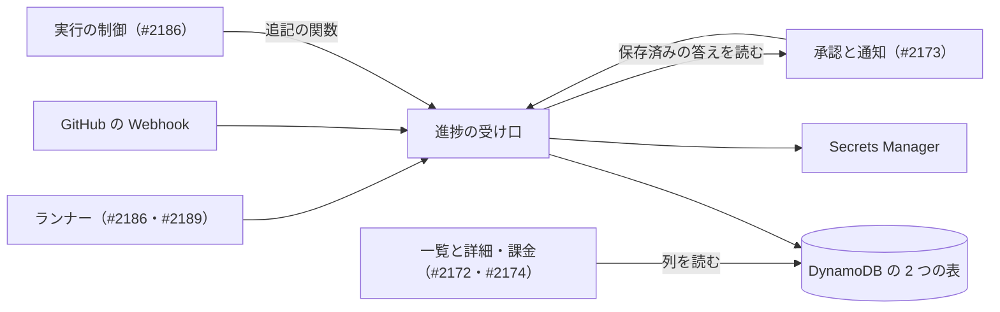
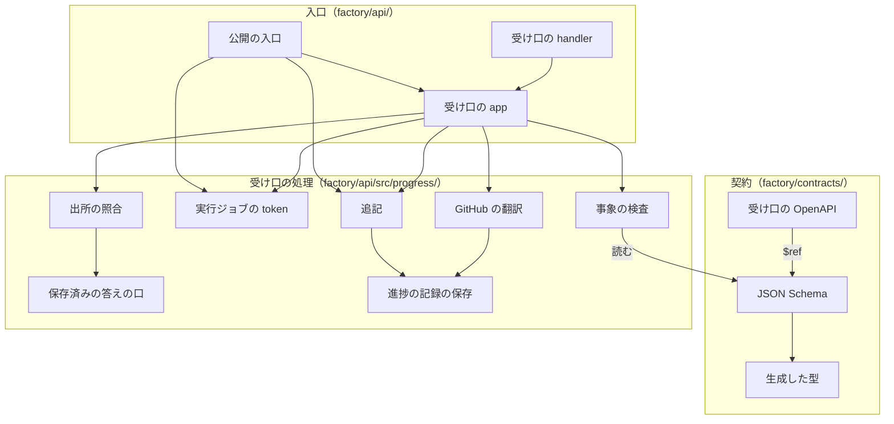
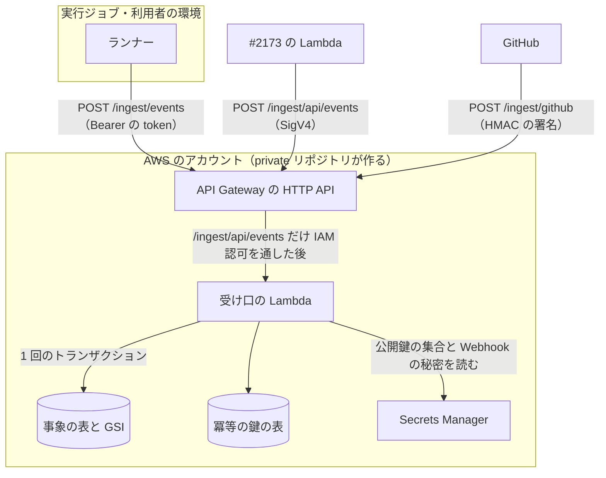
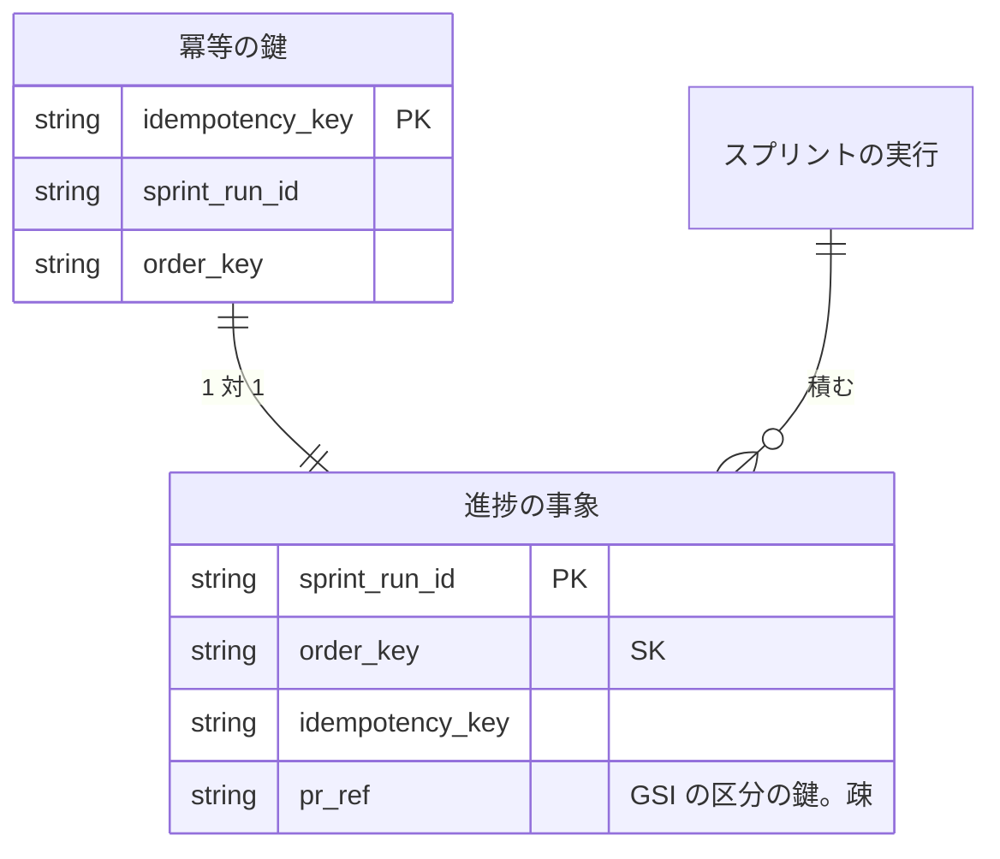
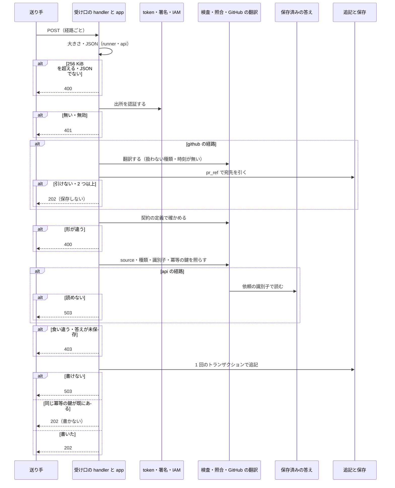

# Neural Development Factory の契約と進捗の受け口: 子課題が同じ形で事象を読み書きし、届いた進捗を出所ごとに確かめて 1 度だけ残せる（#2171）

## 目的

- **何が壊れているか**: 実行ジョブの指示と進捗の事象の形は確定仕様の表にしか無く、機械で読める定義も型も無い。進捗の事象を受けて残す経路と、実行ジョブの token を確かめる手順も無い
- **誰が困るか**: 後続の子課題（#2186・#2172・#2173・#2174・#2189）。事象を送る側・読む側・token を発行する側が、同じ形を別々に書き起こすことになり、食い違っても検査で落ちない
- **直すと何が成り立つか**: `factory/contracts/` の定義から生成した型を全員が使い、定義と型がずれれば `npm run check` が落ちる。ランナー・#2173・GitHub から届く事象は、出所ごとの認証と照合を通ったものだけがスプリントの実行ごとの列へ 1 度だけ残る。token は 1 つの関数で確かめられる

## 適用範囲

- **働く範囲**: このリポジトリの `factory/`（`contracts/` と `api/`）と、確定仕様 [ndf-factory-service-boundary.md](../docs/specifications/ndf-factory-service-boundary.md) の 2 か所（決定 7）。プラグインの配布物は変わらない。DynamoDB の表と GSI・API Gateway の経路と IAM 認可・ロール・秘密は private リポジトリが作り、この設計は受け渡しの形（変数の名前・表の鍵・経路・handler の場所）だけを決める
- **プロジェクトごとに違うもの**: 無し（サービスは 1 つで、値はインフラから環境変数で受ける）
- **当たるモード**: `standard`。共通原則の C1（token の署名の鍵・Webhook の秘密に触れる）と C2（受け口の認証を作る）に当たるため、ゲート 1・2 は MVV の判定で自動に通さず、人が承認ゲートで見る

## あるべき姿の根拠

| 根拠 | 種類 | 何を示すか |
| --- | --- | --- |
| 確定仕様 [ndf-factory-service-boundary.md](../docs/specifications/ndf-factory-service-boundary.md) の「サービス全体の契約」（ゲート 1 で利用者が承認済み） | 承認済みの仕様 | 集約「進捗の記録」の持ち主はこの課題。事象の 10 種類・列・冪等の鍵の形・出所ごとの認証・応答の 4 つ・2 表のトランザクション |
| 「sprint一覧でそれぞれがどのフェーズを進めているかが化しかできる」「sprint詳細で進捗状況が可視化できる。」（#2171 の依頼の原文） | 利用者の指示の原文 | 一覧と詳細（#2172）が読む進捗の事象が、欠けず重ならずに残ること |
| 手元の実測（2026-10-30、Node v24.22.1）: `json-schema-to-typescript` 16.0.0 が、`$defs` と `oneOf` の種類ごとの定義から、`type` の値で分かれる共用の型（`JobStartedEvent \| JobFinishedEvent`）を出した | 実測 | 決定 2 の型の生成が成り立つ |
| 手元の実測（同）: `ajv` 8.20.0 の 2020-12 版と `ajv-formats` 3.0.1 で同じ定義を読み、正しい事象は通り、余分な列・知らない種類・`schema_version` 2・時刻でない `at` はそれぞれ落ちた | 実測 | 決定 3 の実行時の検査が、型と同じ定義から作れる |
| 手元の実測（同）: Spectral 6.17.0 が OpenAPI 3.1 から JSON Schema のファイルへの `$ref` を辿り、正しい参照で 0 件、ファイルの名前を壊すと `invalid-ref` の error を出した | 実測 | 決定 1 の「OpenAPI は JSON Schema を指すだけ」で `npm run lint:contracts` が参照切れを落とす |
| 手元の実測（同）: `jose` 6 で Ed25519 の JWT を公開鍵の集合で確かめ、正しい token は `sub` と `sprint_run_id` を返し、別の鍵の署名は `ERR_JWS_SIGNATURE_VERIFICATION_FAILED`、知らない `kid` は `ERR_JWKS_NO_MATCHING_KEY`、期限切れは `ERR_JWT_EXPIRED`、形の違いは `ERR_JWS_INVALID` で落ちた。token の検証と事象の検査は 1 件あたり 0.217 ms（2,000 件の平均） | 実測 | 決定 5 の 4 つの「無効」が別々の失敗として取れ、受け口の処理の時間は表への書き込みに比べて小さい |
| #2173 の本文: 「`gate.answered` の `payload` の『答えた人のアカウント』は、その解決の結果の `accountId` を使う」 | 承認済みの他の課題の本文 | `gate.answered` の答えた人の鍵を `answered_by_account_id` にする |

要求と受け入れ条件は #2171 の本文にある（コピーは [issue-2171-requirements.md](issue-2171-requirements.md)）。この文書は「どう作るか」だけを扱う。定義と経路と関数の形は [issue-2171-design-contracts.md](issue-2171-design-contracts.md) に、決定の記録は [issue-2171-design-decisions.md](issue-2171-design-decisions.md) に分けた。

## ドメインモデル

### コンテキスト

| コンテキスト | 何の語が 1 つの意味に決まるか |
| --- | --- |
| Neural Development Factory（`ndf-factory`） | 進捗の受け口・進捗の事象・冪等の鍵・実行ジョブの token・スプリントの実行・実行ジョブ・承認の依頼 |

GitHub は外部の系で、`ndf-factory` が下流の**腐敗防止層**の関係にある。受け口が Webhook の `pull_request`・`check_run` を `pr.updated`・`ci.updated` へ翻訳し、GitHub の語（delivery・check suite など）を事象へ持ち込まない。NDF の開発ワークフロー（`ndf-workflow`）との翻訳はランナー（#2186）が持ち、この課題は触らない。

### 集約

| 集約 | 持ち主（書き換えてよいもの） | 根 | エンティティ | 値オブジェクト |
| --- | --- | --- | --- | --- |
| 進捗の記録 | 進捗の受け口（#2171）。実行の制御（#2186）は、この課題が公開する追記の関数を通してだけ書く | スプリントの実行の識別子ごとの列 | 進捗の事象 | 種類・発生の時刻・冪等の鍵・出所・Pull Request の参照 |

**冪等の鍵の表は集約の一部で、別の集約ではない。** 鍵の一意（I10）を守るためだけにあり、事象と同じトランザクションで書く。ほかの集約（スプリントの実行・承認の依頼）は識別子で参照し、承認の依頼は保存済みの答えを読むだけにする（決定 10）。

### 不変条件

I10 は確定仕様のもの。続けて #2170 の I24 の次から番号を振る。

| # | 集約 | 条件 | 破れたときの扱い |
| --- | --- | --- | --- |
| I10 | 進捗の記録 | 進捗の事象は追記だけで書き換えない。同じ冪等の鍵の事象は 1 つ（受け入れ条件 14〜16） | 同じ鍵の 2 回目は 202 を返し、保存しない。書き換える・消す経路を作らない |
| I25 | 進捗の記録 | 事象の `source` は、受け取った経路の認証の手段と一致する（`runner` の経路は `runner`、`api` の経路は `api`、`github` の経路は翻訳した `github`、追記の関数は `control`）（受け入れ条件 11） | 403 で保存しない。追記の関数は失敗を返して書かない |
| I26 | 進捗の記録 | 出所ごとに書ける種類は決まっている（`runner` は `gate.answered`・`pr.updated`・`ci.updated` 以外、`api` は `gate.answered`、`github` は `pr.updated`・`ci.updated`、`control` は `job.finished`）（受け入れ条件 6・9） | 403 で保存しない |
| I27 | 進捗の記録 | `runner` の事象の `job_id`・`sprint_run_id` は token のものと一致し、冪等の鍵は `<job_id>:<seq>`（`seq` は 1 以上）か、`job.finished` だけ `<job_id>:finished` である（受け入れ条件 5・7） | 403 で保存しない |
| I28 | 進捗の記録 | `gate.answered` は、依頼の識別子・属するスプリントの実行・種類・答えた人・承認か差し戻しかが保存済みの答えとすべて一致するときだけ残る。冪等の鍵は `api:<依頼の識別子>`（受け入れ条件 10） | 未保存も含めて 403 で保存しない。答えを読めなければ 503 |
| I29 | 進捗の記録 | 残る事象は契約の定義に合い、1 件の大きさは 256 KiB 以下である（受け入れ条件 11・13、決定 8） | 400 で保存しない |
| I30 | 進捗の記録 | 401 と 403 の応答の本文は理由によらず同じで、事象・依頼・スプリントの実行の有無を明かさない（非機能のセキュリティ） | 理由ごとの文言を出さない。テストが本文の一致で落とす |
| I31 | 進捗の記録 | 実行ジョブの token は `account_id` を運ばない。token の値・署名の鍵・Webhook の秘密は応答・ログ・事象に出ない（前提 3・受け入れ条件 19） | 発行の関数は `account_id` を受け付けない形にする。ログの形は決まった列だけにする |

### ドメインイベント

要求の E1〜E9 を引き継ぐ。

| # | イベント | 発生元 | 受け手 |
| --- | --- | --- | --- |
| E1 | 実行ジョブの token を発行した | 実行の制御（#2186）が `signRunJobToken` で作る | ランナー（`INGEST_TOKEN_SECRET_ARN` の置き場から読む） |
| E2 | 受け口が事象の要求を受け取った | ランナー・#2173・GitHub | 受け口の経路 |
| E3 | 出所を認証した | 受け口の経路 | 形の検査（E4）か翻訳（E6） |
| E4 | 事象の形を確かめた | 受け口の契約の検査 | 照合（E5） |
| E5 | 認証の手段と事象の出所・種類・識別子を照らした | 受け口の照合 | 追記（E7） |
| E6 | GitHub の Webhook を `pr.updated`・`ci.updated` へ翻訳した | 受け口の翻訳 | 追記（E7） |
| E7 | 進捗の事象を追記した | 進捗の記録の保存 | 一覧と詳細（#2172）・承認と通知（#2173）・課金（#2174）が列を読む。実行の制御（#2186）は `job.finished` を読み、結果（`gate` / `stopped` / `done` / `failed`）でジョブの状態を承認待ち・止まった・終わった・失敗へ移す（確定仕様 `docs/specifications/ndf-factory-service-boundary.md` の事象の表と状態の図） |
| E8 | 実行の制御が `job.finished`（`control`）を直に追記した | 実行の制御（#2186）が `appendControlEvent` を呼ぶ | E7 と同じ受け手 |
| E9 | 実行ジョブの token を検証した | `verifyRunJobToken`（受け口の E3、#2173 の答えを読む経路） | 呼んだ側 |

### 用語

| 用語 | 意味 | 用語集への反映 |
| --- | --- | --- |
| 進捗の受け口 | ランナー・GitHub の Webhook・承認の API から進捗の事象を受け、出所ごとに認証して冪等に追記する、`factory/api/` の HTTP の経路 | 追加（`ndf-factory`。要求の変更で反映済み） |
| 実行ジョブの token | 実行の制御が実行ジョブ 1 つごとに発行する、期限つきの token。そのジョブのスプリントの実行にだけ進捗の事象を書け、承認の依頼の答えを読める | 追加（`ndf-factory`。要求の変更で反映済み） |
| 冪等の鍵 | 進捗の事象の重複を判定する鍵（`idempotency_key`）。形は出所ごとに決まり、同じ鍵の事象は 1 つだけ残る | 追加（`ndf-factory`。要求の変更で反映済み） |

## 機能一覧

| # | 機能 | 誰が使うか |
| --- | --- | --- |
| F1 | 実行ジョブの指示・進捗の事象・受け口の応答の定義と、そこから生成した型を読む | #2186・#2172・#2173・#2174・#2189 の実装 |
| F2 | 定義と型の食い違い・OpenAPI の参照切れを検査で落とす | 開発者と CI |
| F3 | 実行ジョブの token つきで進捗の事象を送る | ランナー（#2186 の形態 ② ③、#2189 の形態 ①） |
| F4 | IAM ロールの署名つきで `gate.answered` を送る | 承認と通知（#2173） |
| F5 | Pull Request と CI の Webhook を送る | GitHub（GitHub App の Webhook） |
| F6 | 実行ジョブの token を発行の形で作る・確かめる | #2186（作る）、受け口と #2173（確かめる）、各課題のテスト |
| F7 | `job.finished`（`control`）を受け口と同じ重複の拒否で直に追記する | 実行の制御（#2186） |

## 構成要素

| 要素 | 責務 |
| --- | --- |
| 契約のパッケージ（`factory/contracts/`、workspace `@ndf-factory/contracts`） | JSON Schema（2020-12）を正として持ち、生成した型と定義のオブジェクトを export する。`generate` で型を作り直し、`check` で作り直した結果とコミットした型を比べる（決定 1・2） |
| 受け口の OpenAPI（`factory/contracts/openapi/ingest.yaml`） | 3 つの経路の要求と 202 / 400 / 401 / 403 / 503。本文の形は JSON Schema のファイルを `$ref` で指すだけにする（決定 1） |
| 事象の検査（`factory/api/src/progress/validate.ts`） | 本文の大きさ・JSON・契約の定義（`ajv` の 2020-12 版）を確かめ、失敗の位置（`instancePath` と規則の名前）を返す（決定 3・8） |
| 実行ジョブの token（`factory/api/src/progress/run-job-token.ts`） | 発行の形（`signRunJobToken`）と検証（`verifyRunJobToken`）。公開鍵の集合を Secrets Manager から読み、5 分ごとに読み直す（決定 5） |
| 出所の照合（`factory/api/src/progress/authorize.ts`） | 経路ごとの `source`・書ける種類・識別子・冪等の鍵の形（I25〜I28）を照らし、403 の失敗を返す |
| GitHub の翻訳（`factory/api/src/progress/github.ts`） | `X-Hub-Signature-256` の検証と、`pull_request`・`check_run` から事象への翻訳。宛先のスプリントの実行は Pull Request の参照で引く（決定 7） |
| 保存済みの答えの口（`factory/api/src/progress/saved-answers.ts`） | `SavedAnswerReader` の型と、#2173 が実装するまでの既定（読めないとして 503 にする）（決定 10） |
| 進捗の記録の保存（`factory/api/src/progress/store.ts`・`memory-store.ts`） | 事象の表と冪等の鍵の表への 1 回のトランザクション。書き換え・削除の操作を持たない（I10、決定 6） |
| 追記（`factory/api/src/progress/append.ts`） | 事象から `order_key` と Pull Request の参照を作り、保存へ渡して `{ written }` を返す。受け口と `appendControlEvent` が同じ関数を通る |
| 受け口の app（`factory/api/src/progress/app.ts`） | Hono の app。3 つの経路と、失敗を決まった本文の応答へ変える処理とログ（決定 4・11） |
| 受け口の handler（`factory/api/src/handlers/ingest.ts`） | API Gateway の HTTP API から呼ばれる Lambda の handler。環境変数から依存を 1 回だけ作る |
| 公開の入口（`factory/api/src/index.ts`） | `verifyRunJobToken`・`createRunJobTokenVerifier`・`signRunJobToken`・`createRunJobTokenKit`・`appendControlEvent`・`createIngestApp`・`SavedAnswerReader`・`RunJobTokenError`・`ProgressEventError`・契約の型を足す。既存の export は変えない |
| 変数の名前（`factory/.env.example`）と案内（`factory/README.md`） | 受け口が読む 5 つの変数の名前、3 つ目の handler と経路ごとの認証の手段 |
| 確定仕様（`docs/specifications/ndf-factory-service-boundary.md`） | `step.recorded` の Pull Request の参照、GitHub の Webhook の宛先の引き方、`pr_ref` の列を足す（決定 7） |

### システムの文脈



DynamoDB の表と GSI・Secrets Manager の秘密・API Gateway の経路と IAM 認可はインフラが作り、この変更では変えられない外部として扱う。GitHub の Webhook の宛先の URL と秘密は GitHub App の設定（#2186 とインフラ）が持つ。

### 構成要素の関係



`GHT --> STO` は、Pull Request の参照から宛先のスプリントの実行を引く読み出しである。

### 配置



経路ごとの認証の手段は、IAM 認可だけが API Gateway の設定で、ほかの 2 つは Lambda の中で確かめる（決定 4）。

### 置き場所

```text
factory/
├── package.json                    # 変更: workspaces と check に contracts を足す
├── .env.example                    # 変更: 5 つの変数の名前を足す
├── README.md                       # 変更: contracts の workspace・受け口の handler と経路
├── contracts/
│   ├── package.json                # 新設: @ndf-factory/contracts
│   ├── tsconfig.json               # 新設
│   ├── scripts/generate.ts         # 新設: 型の生成と --check
│   ├── schemas/                    # 新設: JSON Schema（決定 1）
│   │   ├── progress-event.schema.json
│   │   ├── run-job-instruction.schema.json
│   │   └── ingest-response.schema.json
│   ├── src/
│   │   ├── index.ts                # 新設: 型と定義の export、種類の一覧
│   │   └── generated/              # 新設: 生成した型（コミットする）
│   ├── tests/                      # 新設: 型のずれ・定義の正しさ・確定仕様の表との対応
│   └── openapi/
│       ├── .spectral.yaml          # 変えない
│       ├── accounts.yaml           # 変えない
│       └── ingest.yaml             # 新設
└── api/
    ├── package.json                # 変更: ajv・ajv-formats・@ndf-factory/contracts を足す
    └── src/
        ├── index.ts                # 変更: export を足す
        ├── handlers/ingest.ts      # 新設
        ├── testing/run-job-tokens.ts  # 新設
        └── progress/               # 新設: 上の表の 9 つのファイルとテスト
```

## データ構造

**時系列の扱いは「事象の記録」である。** 状態を持たず、起きたことを追記だけで積み、一覧と詳細は #2172 が導く（確定仕様の決定 5）。書き換え・削除の操作は保存の型に無い（I10）。



**事象の表**（`PROGRESS_EVENTS_TABLE_NAME`）。列は確定仕様の「進捗の正本」の 9 列に `pr_ref` を足す（決定 7）。

| 列 | 型 | 空を許すか | 意味 |
| --- | --- | --- | --- |
| `sprint_run_id` | 文字列 | 許さない | 区分の鍵。`^[A-Za-z0-9_-]{1,128}$` |
| `order_key` | 文字列 | 許さない | 並びの鍵。`<at をミリ秒の 3 桁にそろえた UTC>#<冪等の鍵>`（決定 6） |
| `idempotency_key` | 文字列 | 許さない | 確定仕様の出所ごとの形 |
| `type` | 文字列 | 許さない | 10 種類のどれか |
| `at` | 文字列 | 許さない | 送られた値のまま（UTC、末尾 `Z`） |
| `source` | 文字列 | 許さない | `runner` / `github` / `api` / `control` |
| `job_id` | 文字列 | 許す | 空（`null`）は「実行ジョブの外で起きた」（`github`・`api`） |
| `schema_version` | 数 | 許さない | 今は `1` だけ |
| `payload` | Map | 許さない | 種類ごとの中身。無い種類は `{}` |
| `pr_ref` | 文字列 | 許す | 列そのものが無いのは「Pull Request を指さない事象」。`step.recorded` の `payload.pull_request` があるときだけ `<owner/name を小文字にしたもの>#<番号>` を置く |

GSI `pr_ref-index`（区分の鍵 `pr_ref`、射影は `sprint_run_id` だけ）。`pr_ref` の無い項目は GSI に入らない。

**冪等の鍵の表**（`PROGRESS_IDEMPOTENCY_TABLE_NAME`）。区分の鍵 `idempotency_key` だけ。`sprint_run_id`・`order_key` は、重複したときにどこに 1 件目があるかを調べるための写しで、照合には使わない。TTL を置かない（I10 は期限なく成り立つ）。

| 機能 | 事象の表 | 冪等の鍵の表 | GSI | 承認の依頼（#2173） |
| --- | --- | --- | --- | --- |
| F3 ランナーの事象 | C | C | — | — |
| F4 `gate.answered` | C | C | — | R |
| F5 GitHub の Webhook | C | C | R | — |
| F7 直の追記 | C | C | — | — |

**移行は無い。** 2 つの表と GSI は新しく作る（インフラ）。

## 処理の流れ



図に含めない要素は、実行時に動かない契約のパッケージ・受け口の OpenAPI・変数の名前と案内・確定仕様と、関数として呼ばれる公開の入口である。

**`appendControlEvent` は認証の手前を通らない。** 契約の定義の検査・`control` の照合（`job.finished` だけ、鍵は `<job_id>:finished`）・追記の 3 つだけを通る。失敗は例外で返す（HTTP の応答を持たない）。

## 非機能の実現方式

| 大項目 | 要求の条件 | 実現方式 | 確かめ方 |
| --- | --- | --- | --- |
| 可用性 | 表へ書けない・保存済みの答えを読めないときは 5xx を返し、受け付けたことにしない | 保存と答えの読み出しの失敗（条件の失敗を除く）と、秘密を読めない失敗を 503 `ingest_unavailable` にする。条件の失敗だけを 202 の重複へ読み替える | 偽の保存と偽の答えに失敗を投げさせ、503 と保存 0 件を見る。同じ事象の送り直しで 1 件になる |
| 性能・拡張性 | 1 件の追記は表への 1 回のトランザクションで済ませる。1 件の所要を手元の偽の表で測って記録する | `TransactWrite` 1 回に 2 つの `Put`（冪等の鍵の表を先に置く）。Pull Request の参照の読み出しは `github` の経路だけの GSI の `Query` 1 回。token の検証と事象の検査は 1 件 0.217 ms（実測。上の「あるべき姿の根拠」） | `aws-sdk-client-mock` で 1 件の追記が `TransactWriteCommand` 1 回であることを見る。偽の表で 1,000 件を追記した 1 件の平均を実装で測り、Pull Request の本文に書く |
| セキュリティ | 認証は出所ごとに 1 つ。秘密は ARN だけで受け、応答・ログ・事象に値を出さない。401 / 403 は有無を明かさない | 経路が認証の手段を決め、`source` と照らす（決定 4）。token の公開鍵の集合と Webhook の秘密は `*_SECRET_ARN` から読む。401 と 403 は理由によらず 1 つの本文（決定 11）。ログは `route`・`type`・`status`・`sprint_run_id` の 4 列だけ | テストで token の値・秘密の値が応答とログの出力に現れないことを見る。401 の理由ごと・403 の理由ごとに本文が同じであることを見る |
| 運用・保守性 | 契約の形の正は確定仕様で、定義と型の食い違いを検査で落とす | `npm run check -w contracts` が型を作り直して比べ、確定仕様の表の行の数と定義の項目の数を比べる（下の「テスト設計」） | 定義を変えて生成しないと `npm run check` が 1 で終わる |

## 決定の記録

[issue-2171-design-decisions.md](issue-2171-design-decisions.md) に分けた。

## テスト設計

テストは vitest で、`factory/contracts/tests/` と `factory/api/src/progress/*.test.ts` に置く。表は偽の保存（`memory-store.ts`）と、DynamoDB の呼び出しの形は `aws-sdk-client-mock` で縛る（#2170 の前例）。token はテストの中で作った鍵で作り、ファイルに置かない（境界の検査）。

| 受け入れ条件・不変条件 | どの振る舞いで縛るか | どう壊したら落ちるべきか |
| --- | --- | --- |
| 1 | 確定仕様の「実行ジョブの指示」の 11 の入力の名前の集合と、定義の `properties` の名前の集合が等しい。10 種類の名前の集合と定義の種類の集合が等しい。`START`・`EXECUTION_MODE` の組ごとに、必須の入力が欠けると落ち、`local`・`managed` に `MODEL_CREDENTIAL_SECRET_ARN` があると落ちる | 定義から 1 項目・1 種類を消す、`if`/`then` を消すと落ちる |
| 2 | `npm run lint:contracts` が `ingest.yaml` を含めて 0 で終わる | `$ref` の先のファイルの名前を変えると 1 |
| 3 | `check -w contracts` が生成し直した型とコミットした型を比べる | 定義に項目を足して生成しないと落ちる |
| 4 | `runner` の経路で token が無い・`Bearer` でない・無効（受け入れ条件 18 の 4 つ）がそれぞれ 401 で、保存 0 件 | 検証を飛ばすと落ちる |
| 5・I27 | token と `job_id`・`sprint_run_id` のどちらかが違えば 403、保存 0 件 | 片方だけ照らすように壊すと落ちる |
| 6・I26 | `runner` の経路で `gate.answered`・`pr.updated`・`ci.updated` がそれぞれ 403 | 種類の照合を消すと落ちる |
| 7・I27 | 鍵が別のジョブの頭・`seq` が 0 か数でない・`job.finished` に `seq`・ほかの種類に `finished` がそれぞれ 403 | 鍵の形の照合を消すと落ちる |
| 8 | `api` の経路で IAM の文脈が無い（Cognito の token だけ）と 401、別のロールの ARN は 403、保存 0 件 | ロールの照合を消すと落ちる |
| 9・I26 | `api` の経路で `gate.answered` 以外は 403 | 同上 |
| 10・I28 | 依頼の識別子・スプリントの実行・種類・答えた人・承認か差し戻しかの 5 つを 1 つずつ変えると 403、答えが `null` で 403、読み出しが投げると 503。どれも保存 0 件 | 1 つの項目の比較を消すと、その項目の行が落ちる |
| 11・I25・I29 | どの経路でも `source` の食い違いは 403。知らない種類・`schema_version` 2・`payload` の余分な鍵・共通の列の欠けは 400 | 経路と `source` の照合を消すと落ちる。検査を緩めると落ちる |
| 12 | 署名が無い・合わないと 401。合った `pull_request` と `check_run` が、鍵 `github:<delivery>` と対象の更新時刻の `at` で残る。扱わない種類（`ping` など）・宛先が引けない・2 つ以上引ける Webhook は 202 で保存 0 件 | 受け取った時刻を `at` にすると落ちる。署名の比較を飛ばすと落ちる |
| 13・I29 | 256 KiB ちょうどの本文は通り、1 バイト超えると 400 で保存 0 件 | 上限を外すと落ちる |
| 14 | 受け付けた事象が 202 で、列に 1 件、`order_key` が `<ミリ秒にそろえた at>#<鍵>` | `order_key` の形を変えると落ちる |
| 15・I10 | 同じ鍵の 2 回目は中身が違っても 202 で、1 件目が変わらず件数 1。同じ鍵を `Promise.all` で 2 本送っても 1 件。DynamoDB の取り消しの理由（`ConditionalCheckFailed`）が重複として読まれ、ほかの理由は 503 | 条件つきの書き込みを外すと落ちる |
| 16・I10 | 保存の型（`ProgressEventStore`）に書き換えと削除の操作が無いことを型の検査で縛り、DynamoDB へ送るのが `TransactWriteCommand` の `Put` 2 つだけ | `Update`・`Delete` の操作を足すと型の検査かテストで落ちる |
| 17 | 正しい token から `jobId`・`sprintRunId` が返る | — |
| 18 | 形が違う・署名が合わない・期限切れ・知らない `kid` が、それぞれ `RunJobTokenError` の `malformed`・`bad_signature`・`expired`・`unknown_key` | 失敗の種類を 1 つにまとめると落ちる |
| 19・I31 | `index.ts` から `verifyRunJobToken`・`signRunJobToken`・`createRunJobTokenKit` を import して往復できる。`signRunJobToken` の引数に `account_id` を渡すと型の検査で落ちる。テストの全経路で応答とログに token と秘密の値が現れない | ログに要求の見出しを出すと落ちる |
| 20 | `appendControlEvent` が、ランナーの `job.finished` が先にあれば `{ written: false }` で 1 件のまま、無ければ `{ written: true }` で 1 件。`job.finished` 以外・鍵が `finished` でないものは失敗 | 重複の拒否を通さずに書くと落ちる |
| 21 | 既存の `api.test.ts` とアカウントのテストが変わらずに通る。`accounts.yaml` の差分が無い。`python3 scripts/check-service-boundary.py` が 0 | — |
| I30 | 401 の理由ごと、403 の理由ごとに本文が 1 つずつである | 理由を本文に入れると落ちる |
| `pr_ref`（決定 7） | `pull_request` を持つ `step.recorded` だけが `pr_ref` を持ち、`Owner/Name` は小文字にそろう | 大文字のまま置くと、Webhook の `full_name` の小文字化と合わず落ちる |

## 設計の結果

| 課題 | 扱い | 取り込み先 | 触るファイル |
| --- | --- | --- | --- |
| #2171 | 実装する | — | `factory/contracts/`、`factory/api/`、`factory/package.json`、`factory/package-lock.json`、`factory/.env.example`、`factory/README.md` |

## 未確認のまま残ること

| 項目 | 内容 |
| --- | --- |
| API Gateway の IAM 認可の文脈の形 | payload 2.0 の `requestContext.authorizer.iam.userArn` が `arn:aws:sts::<アカウント>:assumed-role/<ロールの名前>/<セッション>` で届く前提で照らす（決定 12）。実環境の形はリリース後テストで確かめる |
| GitHub の `opened` の取りこぼし | Pull Request を作った直後の `pull_request.opened` は、ランナーが `step.recorded` で参照を送るより先に届くため、宛先が引けず保存されない。以後の `synchronize`・`closed` と CI は届く。#2172 は最初の状態を `step.recorded` の参照から読める（決定 7） |
| GSI の結果整合 | `pr_ref-index` は結果整合のため、参照を書いた直後の Webhook も取りこぼすことがある。上と同じ扱い |
| リポジトリの改名 | `pr_ref` は `owner/name` で作るため、スプリントの実行の途中で改名すると引けなくなる。改名は稀で、GitHub の数の ID を事象に足すと確定仕様の形がさらに変わるため見送る |
| token の公開鍵の差し替えの手順 | 公開鍵を集合へ足してから 5 分（読み直しの間隔）待って発行の鍵を替える手順は、#2186 とインフラの運用で決める |
| 承認資料の切り詰め | 256 KiB を超える `gate.reached` は、ランナー（#2186）が本文を切り詰めて Pull Request の URL を残す（決定 8）。切り詰めの形は #2186 が決める |
