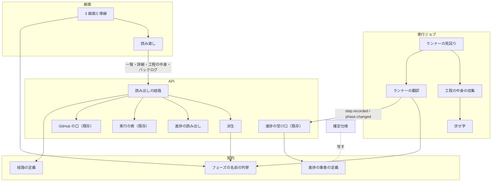
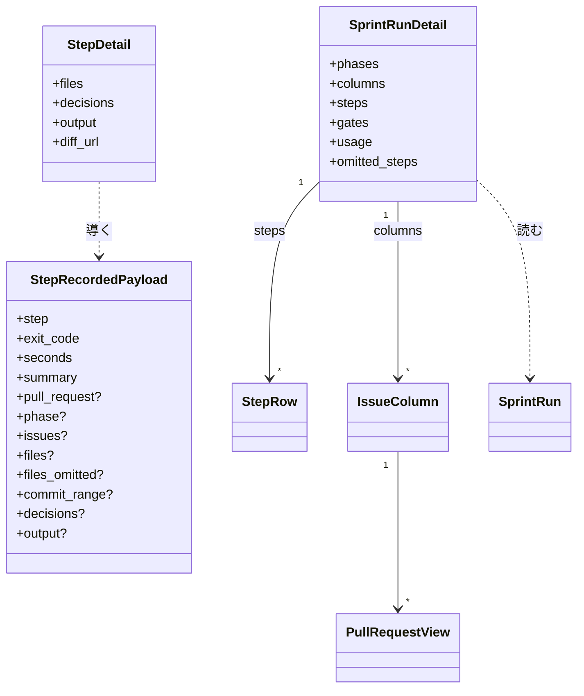
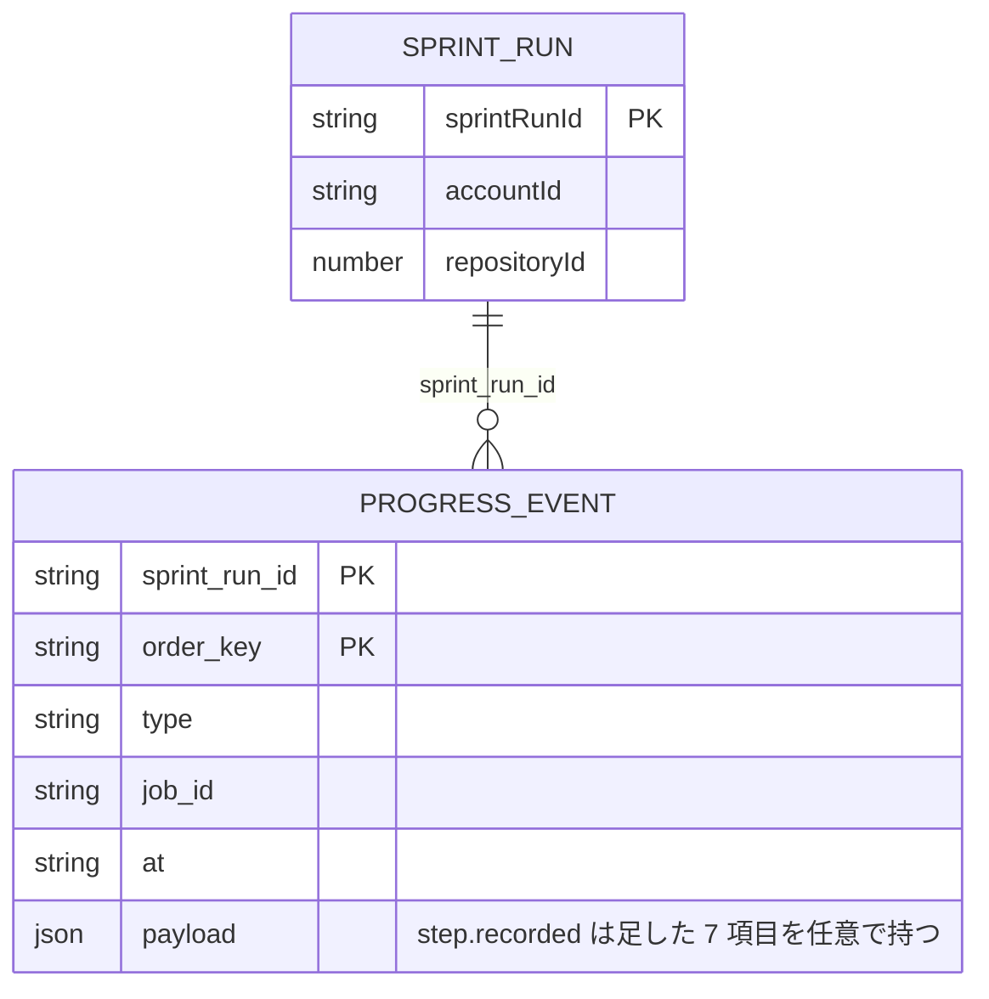
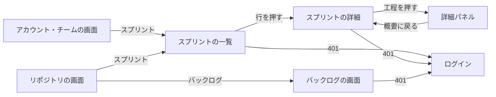
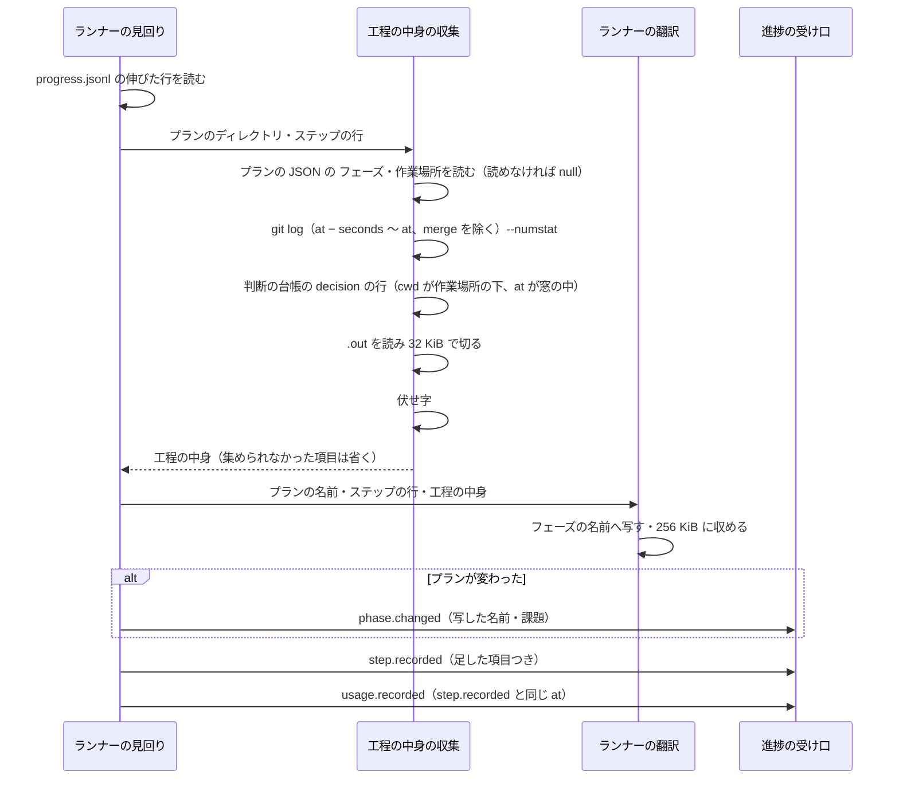
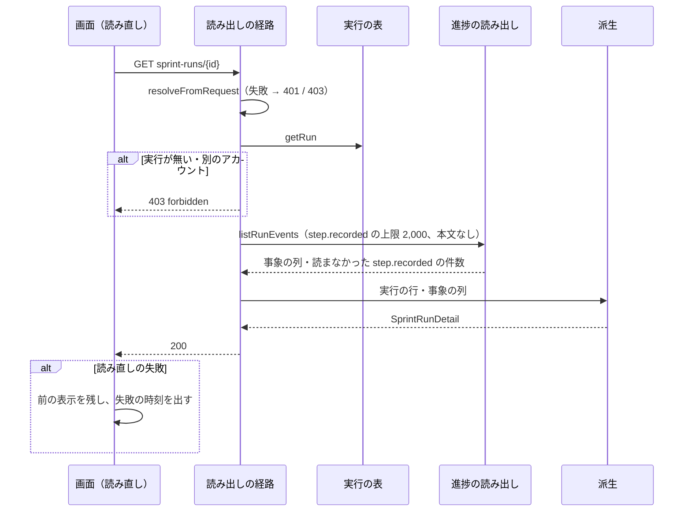
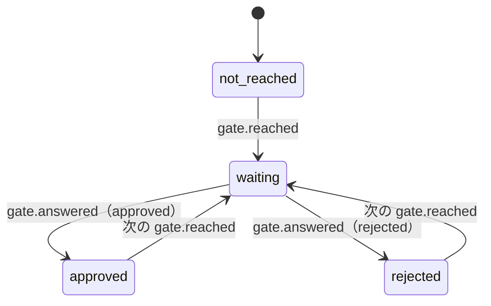

# NDF Factory: 並列に動くスプリントの今のフェーズと、課題ごとの工程・Pull Request・CI・承認ゲートを画面で追える（#2172）

## 目的

- **何が壊れているか**: Factory の画面には、スプリントの実行の状態（`running` など）しか出ない。今どのフェーズにいるか、課題ごとにどの工程まで進んだか、Pull Request と CI と承認ゲートがどうなっているかは、進捗の事象として残っているのに読み出す経路が無い。`phase.changed` の `phase` はプランの名前の断片（`impl`・`release-prod`）で、フェーズの名前になっていない
- **誰が困るか**: 1 つのアカウントで複数のスプリントを並列に流す利用者。どれが承認を待ち、どれが止まったかを GitHub と端末を見比べて探すことになる
- **直すと何が成り立つか**: スプリントの一覧で各実行の今のフェーズと状態を、スプリントの詳細で課題ごとの工程・Pull Request・CI・承認ゲートを、工程の詳細パネルで触ったファイル・決めたこと・費用・作業の報告を読める。バックログの画面で順位の表と棚卸しの記録をスプリントの外で読める

## 適用範囲

- **働く範囲**: `factory/` の中（契約・ランナー・API・画面）と、確定仕様 2 本。`plugins/` とプラグインの利用者の振る舞いは変えない
- **プロジェクトごとに違うもの**: 取り込んだリポジトリごとの違い（作業場所・テストのコマンド）はランナーが NDF のプランの JSON から読む。画面の読み直しの間隔は画面の設定（環境変数 `FACTORY_POLL_INTERVAL_MS`）で受ける
- **当たるモード**: `standard`

## あるべき姿の根拠

| 根拠 | 種類 | 何を示すか |
| --- | --- | --- |
| 依頼（2026-10-30）「sprint一覧でそれぞれがどのフェーズを進めているかが可視化できる」「sprint詳細で進捗状況が可視化できる」 | 利用者の指示の原文 | 一覧はフェーズ、詳細は進捗を出す |
| モック https://claude.ai/artifact/MYL6CPBTsm6JFTNgtiwY2J（版 1793412669-5df4。要求の「モックの中身」に写した） | 利用者の指示 | 3 画面の配置と項目、詳細パネルの項目 |
| 過去の 11 スプリントの `progress.jsonl`（`/work/ai-plugins/.ndf/loop`・`.ndf/tmp`、94 ファイル、2026-10-31 に測った） | 実測 | 1 スプリントの記録は最大 399 行、事象にして最大 233 件。ステップの行は最大 525 バイト。作業の報告（`.out`）は 1,114 件で p50 353 バイト・p99 19,323 バイト・最大 57,843 バイト。32 KiB で切った報告の和は 1 スプリントで最大 375,257 バイト |
| 同じ記録のプランの JSON の `"フェーズ"` の値 | 実測 | `設計`・`実装`・`検査`・`配布（開発版）`・`配布（本番）`・`まとめ` の 6 つが現れる。振り返りと棚卸しのステップの識別子は `retro`・`refine`（`supervise_lib/sprint_close_steps.py`） |
| NDF の `agent-layers.md` の「フェーズ」の表 | 一次情報（このリポジトリの規約） | 取り込みのフェーズが検証リリースまで、仕上げが本番へのリリース・振り返り・棚卸しを通す |

要求と受け入れ条件は #2172 の本文にある（コピーは `issues/issue-2172-requirements.md`）。この文書は「どう作るか」だけを扱う。決定の記録は `issues/issue-2172-design-decisions.md` に分けた。

## ドメインモデル

### コンテキスト

| コンテキスト | 何の語が 1 つの意味に決まるか |
| --- | --- |
| Neural Development Factory（`ndf-factory`） | スプリントの実行・進捗の事象・フェーズの名前・工程の記録・スプリントの一覧と詳細 |
| NDF の開発ワークフロー（`ndf-workflow`） | プラン・ステップ・プランの `"フェーズ"`・`progress.jsonl`・作業の報告 |

**`ndf-factory` が下流で、ランナーの翻訳を腐敗防止層に置く（腐敗防止層）。** NDF の語（`配布（本番）`・`retro`・`.out`）はランナーの翻訳の中だけで読み、進捗の事象の形へ移してから外へ出す。#2169 の確定仕様の決定 6 のとおりで、この変更は翻訳の中身を足すだけである。

### 集約

| 集約 | 持ち主（書き換えてよいもの） | 根 | エンティティ | 値オブジェクト |
| --- | --- | --- | --- | --- |
| 進捗の記録（変える） | 進捗の受け口（`factory/api/src/progress/`）。追記だけ | スプリントの実行ごとの事象の列 | 進捗の事象 | 工程の中身（フェーズ・課題・触ったファイル・コミットの範囲・決めたこと・出力） |
| スプリントの実行（読むだけ） | 実行の制御（#2186、`factory/api/src/runs/`） | スプリントの実行 | 実行ジョブ | 状態・課題 |

**一覧・詳細・バックログは集約でなく、2 つの集約から導く読み出しの形（派生）である。** 派生は表に保存せず、読み出しのたびに導く（決定 9）。派生の関数は 2 つの集約のどちらも書き換えない。

### 不変条件

| # | 集約 | 条件 | 破れたときの扱い |
| --- | --- | --- | --- |
| I1 | 進捗の記録 | `step.recorded` の足した項目（`phase`・`issues`・`files`・`files_omitted`・`commit_range`・`decisions`・`output`）はどれも任意で、無い事象（`schema_version` 1 の今の形）も受け口が 202 で受ける | 受け口が 400 を返したら定義の誤り。既存の受け口のテストが落ちる |
| I2 | 進捗の記録 | 事象 1 件は 256 KiB 以下。ランナーは超える `step.recorded` を `output.text` → `files` → `decisions` の順に削って収め、削ったことを `output.truncated`・`files_omitted` に残す | 削っても超えるなら足した項目をすべて外して送る（今の形に戻る） |
| I3 | 進捗の記録 | ランナーは `output.text`・`decisions` の文・`files` のパスを、送る前に伏せ字の規則に通す | 規則を通らない送信の経路があれば、伏せ字のテストが落ちる |
| I4 | 派生 | 一覧の今のフェーズは、その実行の最後の `phase.changed`（`order_key` の順）の `phase` である。0 件なら `null`（画面は「始まる前」） | — |
| I5 | 派生 | 5 つの名前に無い `phase` は捨てずに名前のまま返す（画面は「その他（<名前>）」）。読み出しは 200 を返す | — |
| I6 | 派生 | 工程は `payload.issues` の課題ごとの欄に 1 回ずつ並び、`issues` が無いか空なら「スプリント全体」の欄に並ぶ。欄の中は `order_key` の順 | — |
| I7 | 派生 | 工程のフェーズは `payload.phase`、無ければ同じ実行ジョブの直前の `phase.changed` の `phase` である | — |
| I8 | 派生 | 工程の費用は、同じ `job_id`・同じ `payload.step`・同じ `at` の `usage.recorded` の `cost_usd` の和で、1 件も無ければ `null`（画面は「—」） | — |
| I9 | 派生 | 承認の欄はゲート 1・ゲート 2 の 2 つだけで、判断の欄は 1 つ。どの欄も、その種類の最後の `gate.reached` と、それより後の同じ種類の `gate.answered` から状態を決める | — |
| I10 | 派生 | 仕上げの欄は、振り返り（`retro`）と棚卸し（`refine`）の行を常に持つ。記録が無ければ `record` が `null`（画面は「まだ」） | — |
| I11 | 派生 | 詳細の上限は `step.recorded` だけに効き、新しい方から最大 2,000 件読む。超えたら古い `step.recorded` から省き、省いた件数を `omitted_steps` に返す。`step.recorded` 以外の事象（`phase.changed`・`gate.reached`・`gate.answered`・`usage.recorded`・`job.*` など）は件数によらずすべて読み、I4・I7〜I9 の状態と `usage` の和から欠かさない | — |
| I12 | 読み出しの経路 | 一覧・詳細・工程の中身・バックログは、`resolveAccount` で解決したアカウントの実行とリポジトリだけを返す。他人のアカウント・無いアカウント・アカウントに属さない実行・無い実行・登録の無いリポジトリは、どれも同じ 403 `forbidden` の本文 | 本文か状態のコードが分かれたら、認可のテストが落ちる |
| I13 | 読み出しの経路 | 一覧・詳細・工程の中身の読み出しは GitHub の口を呼ばない。バックログは順位の表の読み出し（`findRankingTable`）だけを呼び、書き込む口を呼ばない | 偽の GitHub の口の呼び出しの数で落ちる |
| I14 | 読み出しの経路 | 読み出しは事象の表と実行の表へ書かない | 偽の保存の行が変わればテストが落ちる |

### ドメインイベント

| # | イベント | 発生元 | 受け手 |
| --- | --- | --- | --- |
| E1 | ランナーがフェーズの移りを `phase.changed` で送った（`phase` は 5 つの名前に写した値） | ランナーの翻訳 | 進捗の受け口 → 一覧・詳細の派生 |
| E2 | ランナーが工程の終わりを `step.recorded` で送った（足した項目つき） | ランナーの翻訳 | 進捗の受け口 → 詳細の派生・工程の中身・バックログ |
| E3 | GitHub の Webhook から `pr.updated`・`ci.updated` が残った | 進捗の受け口（GitHub の翻訳） | 詳細の派生（課題の欄の Pull Request と CI） |
| E4 | ランナーが承認ゲートに達し `gate.reached` と `job.finished`（`gate`）を送った | ランナー | 詳細の派生（承認の欄）・実行の制御（`awaiting_approval`） |
| E5 | 利用者が答え、`gate.answered` が残った | #2173 の API | 詳細の派生（承認の欄） |
| E6 | 利用者がスプリントの一覧を開いた | 画面 | 一覧の経路 |
| E7 | 利用者がスプリントの詳細を開いた | 画面 | 詳細の経路 |
| E8 | 利用者が工程の行を押し、詳細パネルに切り替わった | 画面 | 工程の中身の経路 |
| E9 | 画面が読み直しの間隔ごとに読み直した | 画面の読み直し | 一覧・詳細の経路 |
| E10 | 利用者がバックログの画面を開いた | 画面 | バックログの経路 → GitHub の口（順位の表） |

### 用語

| 用語 | 意味 | 用語集への反映 |
| --- | --- | --- |
| フェーズの名前 | `phase.changed` と `step.recorded` の `phase` が運ぶ、`設計`・`実装`・`検査`・`取り込み`・`仕上げ` の 5 つ。`factory/contracts/src/phases.ts` の列挙が正 | 追加（`ndf-factory`） |
| 工程の記録 | スプリントの詳細に並ぶ `step.recorded` の 1 件ずつの行。NDF のプランのステップ 1 つが 1 行になる | 追加（`ndf-factory`） |
| 工程の中身 | 1 件の工程の記録の、触ったファイル・コミットの範囲・決めたこと・出力（作業の報告かログ）。詳細パネルが出す | 追加（`ndf-factory`） |
| スプリント全体の欄 | スプリントの詳細で、課題の番号を持たない工程の記録を並べる欄 | 追加（`ndf-factory`） |

## 機能一覧

| # | 機能 | 誰が使うか |
| --- | --- | --- |
| F1 | スプリントの一覧で、実行ごとのリポジトリ・課題・状態・今のフェーズ・今の工程・始めた日時・最後の動きを見て、タブで絞る | アカウントの持ち主と席を持つ人 |
| F2 | スプリントの詳細で、フェーズの欄・課題ごとの工程の記録と Pull Request と CI・承認の欄・使用量を見る | 同上 |
| F3 | 工程の記録を押して詳細パネルで工程の中身を見て、概要へ戻る | 同上 |
| F4 | バックログの画面で、リポジトリの順位の表と棚卸しの記録を見る | 同上 |
| F5 | 画面を開いたまま、新しい進捗の事象を読み直しで出す | 同上 |
| F6 | ランナーが、フェーズの名前を 5 つへ写し、工程の中身を `step.recorded` に添えて送る | ランナー（実行ジョブ） |

## 構成要素

| 要素 | 責務 |
| --- | --- |
| フェーズの名前の列挙（`factory/contracts/src/phases.ts`、新設） | 5 つの名前・`isPhaseName`。依存を持たず、`@ndf-factory/contracts/phases` で画面からも読める |
| 進捗の事象の定義（`factory/contracts/schemas/progress-event.schema.json`） | `StepRecordedPayload` に任意の 7 項目を足す（「データ構造」）。型を作り直す |
| ランナーの翻訳（`factory/runner/src/translate.ts`） | プランの `"フェーズ"` の値を 5 つの名前へ写す。ステップの行と工程の中身から `step.recorded` を作り、256 KiB に収める |
| 工程の中身の収集（`factory/runner/src/step-details.ts`、新設） | プランの JSON・作業場所の git・判断の台帳・`.out` から工程の中身を集める。外のファイルとコマンドに触るのはここだけ |
| 伏せ字（`factory/runner/src/redact.ts`、新設） | NDF の `secret_redact.py` の 4 つの規則と、ランナーが持つ秘密の値（実行ジョブの token・導入の token・持ち込んだキー）を `***` にする |
| ランナーの見回り（`factory/runner/src/runtime.ts`） | ステップの行ごとに工程の中身の収集を呼ぶ。ステップの行から作る `usage.recorded` の `at` を、同じ行の `step.recorded` の `at` に揃える |
| 進捗の読み出し（`factory/api/src/progress/read.ts`） | 読むだけの 4 つの操作を足す（「入出力の契約」の読み出しの口） |
| 派生（`factory/api/src/views/derive.ts`、新設） | 事象の列と実行の行から、一覧の行・詳細・工程の中身・棚卸しの記録を作る純粋な関数。時刻も外の世界も読まない |
| 読み出しの経路（`factory/api/src/routes/sprint-views.ts`、新設。既存の一覧の経路は `routes/factory.ts`） | アカウントの解決と 403 の揃え、読み出しの口と派生の呼び出し、応答の本文の組み立て |
| 経路の定義（`factory/contracts/openapi/runs.yaml`） | 一覧の項目の追加と、3 つの経路の追加 |
| 画面（`factory/web/src/pages/SprintsPage.tsx`・`SprintDetailPage.tsx`・`BacklogPage.tsx`、新設。`api.ts`・`App.tsx`・`AccountPage.tsx`・`TeamPage.tsx`・`RepositoriesPage.tsx`） | 3 画面と導線。401 で token を消してログインへ移る（既存の `api.ts` の扱い） |
| 読み直し（`factory/web/src/poll.ts`、新設。`config.ts`・`vite.config.ts`） | 画面を開いている間、設定の間隔で読み直し、失敗しても前の表示を残す |
| 確定仕様（`docs/specifications/ndf-factory-service-boundary.md`・`ndf-factory-contracts-and-progress.md`） | 事象の種類の表・事象の定義・フェーズの名前の集合を、この設計の形へ直す（決定 13） |



**配置は変わらない。** ランナーは実行ジョブのコンテナか手元、API は今の Lambda の中で動く。境界をまたぐのは今と同じ 2 本（ランナー → 受け口の事象、画面 → API の読み出し）で、事象の本文が増えるだけである。新しく境界を越えるのはバックログの経路から GitHub の順位の表の読み出しで、#2186 の候補の経路と同じ口を使う。

置き場（変える範囲）:

```text
factory/
├── contracts/
│   ├── package.json                     # exports に ./phases を足す
│   ├── schemas/progress-event.schema.json
│   ├── openapi/runs.yaml
│   └── src/{phases.ts（新設）, generated/progress-event.ts}
├── runner/src/{translate.ts, runtime.ts, step-details.ts（新設）, redact.ts（新設）}
├── api/src/
│   ├── progress/read.ts
│   ├── views/derive.ts（新設）
│   └── routes/{factory.ts, sprint-views.ts（新設）}
└── web/
    ├── package.json                     # @ndf-factory/contracts を足す
    ├── vite.config.ts
    └── src/{api.ts, App.tsx, config.ts, poll.ts（新設）, pages/}
```

## 構造



`SprintRun` は #2186 の既存の型で、変えない。`StepRow` は工程の記録の 1 行（本文を持たない）、`IssueColumn` は課題 1 つかスプリント全体の欄、`PullRequestView` は Pull Request 1 つの状態とチェックである。項目は「入出力の契約」の表が持つ。

## データ構造

**表は増やさず、事象の表の `payload` の中身が増えるだけである**（事象の記録の手法のまま。過去の事象は書き換えない）。`schema_version` は 1 のまま上げない（I1）。足す項目はどれも任意で、既に残った事象と今のランナーの事象はそのまま読める。

`StepRecordedPayload` に足す項目:

| 項目 | 型 | 空を許すか | 意味 |
| --- | --- | --- | --- |
| `phase` | 文字列（1 字以上） | 項目ごと省ける | その工程が属するフェーズの名前。省いたときは「直前の `phase.changed` から導く」で、「フェーズが無い」ではない（I7） |
| `issues` | 整数（1 以上）の配列、最大 50 | 省ける。空の配列も許す | その工程が受け持つ課題。省いたときも空のときも「スプリント全体」（I6） |
| `files` | `{path, added, deleted}` の配列、最大 100。`path` は 1〜512 字、`added`・`deleted` は 0 以上の整数か `null` | 省ける | その工程の時間の窓のコミットが触ったファイル。`added`・`deleted` の `null` はバイナリ（行数が無い）。省いたときは「記録なし」で、「触っていない」ではない。触らなかったと分かったときは空の配列 |
| `files_omitted` | 0 以上の整数 | 省ける | 上限で `files` から外した数 |
| `commit_range` | `{from, to}`（どちらも 40 桁の 16 進） | 省ける | 時間の窓のコミットの最初の親と最後のコミット。差分のリンクとファイルのリンクを作る |
| `decisions` | `{question, answer, by}` の配列、最大 20。`question`・`answer` は 1〜1,000 字、`by` は `ai` / `user` | 省ける | その工程の間に決めたこと。省いたときは「記録なし」、空の配列は「決めたことが無かった」 |
| `output` | `{kind, text, truncated}`。`kind` は `report` / `log`、`text` は UTF-8 で 32,768 バイト以下、`truncated` は真偽 | 省ける | 作業の報告（`work` のステップ）かログ（`run` のステップ）。`truncated` は 32 KiB か 256 KiB の上限で切ったこと |



| 機能 | 進捗の事象 | スプリントの実行 | リポジトリの登録 | 順位の表（GitHub） |
| --- | --- | --- | --- | --- |
| F1 一覧 | R | R | — | — |
| F2 詳細 | R | R | — | — |
| F3 工程の中身 | R | R | — | — |
| F4 バックログ | R | R | R | R |
| F5 読み直し | R | R | — | — |
| F6 ランナーの送信 | C（受け口が追記） | — | — | — |

**検査の手段**: 定義から型を作り直し（`npm run generate -w contracts`。名前は `factory/contracts/package.json` に合わせる）、`factory/contracts/tests/` の定義のテストと `npm run check` で、今の形と足した形の両方が通ることを確かめる。

## 入出力の契約

### 経路（`factory/contracts/openapi/runs.yaml`）

| 経路 | 変わる約束 | 応答 |
| --- | --- | --- |
| `GET /accounts/{accountId}/sprint-runs` | 各行に `repo`・`current_phase`・`current_step`・`last_event_at` を足す。既存の 6 項目の名前と型は変えない | 200 `SprintRunList` / 403 |
| `GET /accounts/{accountId}/sprint-runs/{sprintRunId}` | 追加。スプリントの詳細 | 200 `SprintRunDetail` / 403 |
| `GET /accounts/{accountId}/sprint-runs/{sprintRunId}/steps/{stepKey}` | 追加。工程の中身。`stepKey` は事象の `idempotency_key`（URL の符号化をする） | 200 `StepDetail` / 403 |
| `GET /accounts/{accountId}/repositories/{repositoryId}/backlog` | 追加。順位の表と棚卸しの記録 | 200 `Backlog` / 403 / 503（GitHub の口の失敗） |

403 はどれも既存の `ForbiddenError` の本文（`{"error": {"code": "forbidden", "message": "このアカウントを見る権限がありません"}}`）で、無い実行・無い工程・登録の無いリポジトリも同じ本文にする（I12）。401 は既存の認証の扱いのまま。

一覧の行に足す項目:

| 項目 | 型 | 意味 |
| --- | --- | --- |
| `repo` | 文字列 | `owner/name`（実行の行の `repo`） |
| `current_phase` | 文字列か `null` | 最後の `phase.changed` の `phase`。`null` は 0 件（I4）。5 つの名前に無い値もそのまま（I5） |
| `current_step` | 文字列か `null` | 最後の `step.recorded` の `step` |
| `last_event_at` | 日時か `null` | 最後の事象の `at` |

`SprintRunDetail`:

| 項目 | 型 | 意味 |
| --- | --- | --- |
| `sprint_run_id`・`repo`・`repository_id`・`issues`・`state`・`failure_reason`・`created_at` | 一覧と同じ | 見出しと概要の札 |
| `ndf_version`・`execution_mode`・`job_count` | 文字列・文字列・整数 | 概要の札（実行の行から） |
| `current_phase` | 文字列か `null` | 一覧と同じ |
| `phases` | `{name, step_keys[], required[]}` の配列 | 5 つの名前の順に 5 つ、その後に現れた順に「その他」の名前。`required` は仕上げだけが持つ `[{label: "振り返り", step: "retro", record}, {label: "棚卸し", step: "refine", record}]`。`record` は最後の記録の `{key, exit_code, seconds}` か `null`（I10） |
| `columns` | `{issue, step_keys[], pull_requests[]}` の配列 | `issue` は課題の番号、`null` はスプリント全体の欄。実行の `issues` の順に課題の欄、最後にスプリント全体の欄（I6） |
| `columns[].pull_requests` | `{repo, number, url, state, checks[]}` | 欄の工程の `pull_request` を重複なく。`state` は最後の `pr.updated` の値か `unknown`。`checks` はチェックの名前ごとの最後の `ci.updated` の `{name, conclusion}`（`null` は実行中） |
| `steps` | `StepRow` の配列（`order_key` の順） | `{key, at, job_id, step, phase, issues, exit_code, seconds, cost_usd, summary, pull_request, has_details}`。`has_details` は足した項目を 1 つでも持つか |
| `gates` | `{gate1, gate2, decision}` | `gate1`・`gate2` は `{state, at}`、`state` は `not_reached` / `waiting` / `approved` / `rejected`。`decision` は `{state, at}`、`state` は `none` / `waiting` / `answered`（I9） |
| `delegated_decisions` | 整数 | `decision.delegated` の件数 |
| `usage` | `{input_tokens, output_tokens, cost_usd}` | `usage.recorded` の和 |
| `omitted_steps` | 整数 | 上限で省いた工程の数（I11） |

`StepDetail` は `StepRow` の項目に、`files`（各行に `url` を足す）・`files_omitted`・`decisions`・`output`・`diff_url` を足したもの。足した項目を持たない工程では、それぞれ `null`（画面は「記録なし」）。リンクは GitHub を呼ばずに文字列で作る（I13）。

| リンク | 作り方 |
| --- | --- |
| Pull Request | `https://github.com/{repo}/pull/{number}` |
| 差分（`diff_url`） | `pull_request` があれば `…/pull/{number}/files`、無く `commit_range` があれば `…/compare/{from}...{to}`、どちらも無ければ `null` |
| ファイル | `commit_range` があれば `https://github.com/{repo}/blob/{to}/{path}`、無ければ `null` |

`Backlog`:

| 項目 | 型 | 意味 |
| --- | --- | --- |
| `repository_id`・`repo` | 整数・文字列 | 登録の値 |
| `ranking` | `{milestone, rows: [{rank, number, title}]}` か `null` | `findRankingTable` の結果。`rank` は表の行の順（1 から）。`null` は「順位の表がありません」 |
| `refinements` | `{sprint_run_id, key, at, exit_code, summary, pull_request}` の配列 | そのリポジトリの実行（新しい順に 50 件まで）の `step` が `refine` の `step.recorded` を、`at` の新しい順に |

### 読み出しの口（`ProgressReader` に足す）

| 名前 | 入力 | 出力 | 失敗の形 |
| --- | --- | --- | --- |
| `listRunEvents` | 実行の ID・`step.recorded` の上限 | `order_key` の順の事象の列（`step.recorded` 以外はすべて、`step.recorded` は新しい方から上限まで。`step.recorded` の `files`・`decisions`・`output` を読まない）と、上限で読まなかった `step.recorded` の件数。DynamoDB では事象の表を `sprint_run_id` で `order_key` の昇順に Query し、`LastEvaluatedKey` が無くなるまで全ページ読んでから、手元で古い `step.recorded` を上限の外として捨てる（表のキーは `sprint_run_id`・`order_key` だけで `type` の索引が無く、`Limit`・`FilterExpression` では「`step.recorded` だけを新しい方から上限まで」を作れない）。`ScanIndexForward=false` と `Limit` で件数を切らない（古い `gate.reached`・`usage.recorded` を落とす）。上限が抑えるのは応答の大きさだけで、読み出しの量（RCU・ページの数）は実行の事象の総数に比例する | 保存の失敗は投げる（経路が 503） |
| `latestOfRun` | 実行の ID | 最後の `phase.changed`・最後の `step.recorded`・最後の事象（どれも無ければ `null`） | 同上 |
| `getStep` | 実行の ID・`idempotency_key` | その実行の `step.recorded` の全項目か `null`（別の実行の鍵も `null`） | 同上 |
| `listStepsNamed` | 実行の ID・`step` の値 | その値の `step.recorded`（本文を読まない） | 同上 |

### 画面

| 画面 | 経路 | 何をする場所か |
| --- | --- | --- |
| スプリントの一覧 | `/accounts/:accountId/sprints` | 実行を新しい順に並べ、今のフェーズと状態を見て、詳細へ移る |
| スプリントの詳細 | `/accounts/:accountId/sprints/:sprintRunId` | フェーズの欄・工程の記録・課題の欄・承認の欄・使用量を見る。工程を押すと詳細パネル |
| バックログの画面 | `/accounts/:accountId/repositories/:repositoryId/backlog` | 順位の表と棚卸しの記録を見る |



| 画面 | 出す項目 | 出さないもの（前提の課題が入るまで） |
| --- | --- | --- |
| スプリントの一覧 | 札 2 つ（動いている数＝`starting`・`running`、対応待ちの数＝`awaiting_approval`）。タブ（すべて・動いている・対応待ち・終わった。画面の中で絞る）。表の列: スプリント（課題の番号の並びとリポジトリ）・課題・フェーズ（5 つの棒。今より前は濃く、今は薄く、「始まる前」「その他（<名前>）」は文字で）と今の工程・状態（`starting`・`running` は実行中、`awaiting_approval` は承認待ち、`done` は終わった、`stopped` は止まった、`failed` は失敗、`cancelled` は取り消し）・始めた日時・最後の動き | token と上限の札（#2174）、承認する・答えるのリンク（#2173） |
| スプリントの詳細 | 見出し（課題の番号の並び・状態・リポジトリ）と「GitHub で開く」（リポジトリ）。概要の札（NDF の版・実行の形態・始めた日時・実行ジョブの数）。フェーズの欄（`phases`。仕上げに振り返りと棚卸しの行）。左に工程の記録（新しいものが上、課題の欄ごとのタブで絞る）。右の既定は承認の欄（ゲート 1・ゲート 2・判断）・課題の欄ごとの Pull Request と CI・AI が代わりに判断した件数・使用量。工程を押すと右が詳細パネル（ステップ・終了コード・秒・費用・要約・触ったファイルと増減の行数・決めたこと（問い → 答え、誰が決めたか）・差分を GitHub で見る・作業の報告かログを開く・概要に戻る） | 「止める」（#2186 の取り消しの画面のまま）、モードと進め方の札（未確認 3） |
| バックログの画面 | リポジトリの名前、札 2 つ（最後の棚卸しの日時・順位の表のマイルストーン）。着手の順位の表（順位・課題の番号と題）。棚卸しの記録（日時・要約・Pull Request・終了コード） | 「今すぐ棚卸しする」（未決 2）、open な課題の数・順位の値・前の棚卸しからの動き（どれも GitHub の別の読み出しが要る） |

| 状態 | 一覧 | 詳細 | バックログ |
| --- | --- | --- | --- |
| 読み込み中 | 「読み込んでいます」 | 同じ | 同じ |
| 空 | 「スプリントの実行はまだありません」 | 工程が 0 件なら「工程の記録はまだありません」、`current_phase` が `null` なら「始まる前」 | 順位の表が `null` なら「順位の表がありません」、記録が 0 件なら「棚卸しの記録はまだありません」 |
| 読み直しの失敗 | 前の表示を残し、上に「読み直せませんでした（<時刻>）」 | 同じ | （読み直さない） |
| 401 | token を消してログインへ | 同じ | 同じ |
| 403 | 「このアカウントを見る権限がありません」（#2170 の画面と同じ） | 同じ | 同じ |
| 5xx | 「読み込めませんでした」と再読み込み | 同じ | 同じ |

入力を持つ画面は無い（タブと工程の行を押すだけ）ため、項目定義と入力規則の表は作らない。見せる範囲は I12 のとおりで、権限で隠す要素は無い。

## 処理の流れ

ランナーが工程の中身を送る（F6）:



**収集の失敗は工程の送信を止めない。** どの項目も、読めない・コマンドが 0 以外で終わるときはその項目だけを省き、今の形の `step.recorded` に戻る。

詳細を読む（F2・F5）:



一覧（F1）は `listSprintRuns` の結果の各行について `latestOfRun` を並列 10 本までで呼び、派生が行へ 4 項目を足す。工程の中身（F3）は `getRun` → `getStep` → 派生。バックログ（F4）は登録を確かめ（無ければ 403）、`findRankingTable` と、そのリポジトリの実行ごとの `listStepsNamed(…, "refine")` を並列に呼ぶ。

承認の欄の状態（ゲート 1・ゲート 2 は同じ形。判断は `waiting` / `answered` の 2 つに読み替える）:



`approved` の後の `gate.reached` は、NDF が同じゲートをもう一度求めたときに起こる（差し戻しの後の再提出と同じ扱い）。`gate.answered` が先に来て `gate.reached` が無い列は状態を変えない。

## 非機能の実現方式

| 大項目 | 要求の条件 | 実現方式 | 確かめ方 |
| --- | --- | --- | --- |
| 性能・拡張性 | 一覧（50 件）と詳細の読み出しの応答の時間の上限、詳細で読む事象の件数の上限は、設計で過去のスプリントの `progress.jsonl` を実測して決める（前提 10） | 件数の上限は `step.recorded` に 2,000 件（実測の事象の最大 233 件の約 8.6 倍）で、それ以外の事象は上限を掛けずにすべて読む（I11）。詳細は本文（`files`・`decisions`・`output`）を射影で外して読み、本文は工程の中身の経路で 1 件ずつ読む。一覧は実行ごとに最後の事象から逆に読み、並列 10 本まで。応答の時間の上限は一覧・詳細とも p95 2 秒とする（決定 9） | 件数: `step.recorded` 2,001 件の偽の列で `omitted_steps` が 1 になり、最も古い `gate.reached`・`usage.recorded` が残るテスト。時間: リリース後テストで実環境の 1 本を開いて測る（未確認 1） |
| 運用・保守性 | フェーズの名前の集合は `factory/contracts/` の 1 か所にあり、画面・API・ランナーはそこから型を得る | `factory/contracts/src/phases.ts` に置き、ランナー・派生・画面が読む。`@ndf-factory/contracts/phases` の入口は依存を持たない（画面へ ajv を入れない） | 型検査（`npm run check`）。列挙を書き換えると 3 か所の型が追う |
| 移行性 | `step.recorded` の追加は任意の項目で、`schema_version` を上げない。今のランナーの事象と既に残った事象はそのまま読める | 足す項目をすべて任意にし、派生は無い項目を「記録なし」「直前の `phase.changed`」「スプリント全体」で読む | 受け口の既存のテストを変えずに通す。足す前の形の事象の列で詳細を導くテスト |
| セキュリティ | 他人の実行の有無を応答の本文・状態のコード・時間で区別できない（403 の本文を揃える）。作業の報告とログの本文に秘密が入りうるため、ランナーが送る前に NDF の既存の伏せ字の規則を通す範囲は設計で決める（未決 3） | 403 は 1 つの例外の型で返し、無い実行と他人の実行で同じ回数の読み出し（`getRun` 1 回）の後に返す。伏せ字は `output.text`・`decisions`・`files` のパスに当て、NDF の 4 つの規則にランナーが持つ秘密の値の置き換えを足す（決定 7）。本文の上限は `output.text` 32 KiB、事象 1 件 256 KiB（I2） | 4 つの場合の 403 の本文と状態のコードが一致するテスト。秘密の値と 4 つの形を含む報告を送って、送られた本文に残らないテスト |

## 決定の記録

決定は `issues/issue-2172-design-decisions.md` に分けた。

## テスト設計

| 受け入れ条件・不変条件 | どの振る舞いで縛るか | どう壊したら落ちるべきか |
| --- | --- | --- |
| 条件 1・I4 | 最後の `phase.changed` が `設計`・`検査`・`仕上げ` の 3 つの実行の一覧の行 | 最初の `phase.changed` を読むように変える |
| 条件 2 | 一覧の行の項目と、7 つの状態から 6 つの表示への写し、`phase.changed` 0 件の「始まる前」 | `starting` を写し漏らす。0 件で空文字を返す |
| 条件 3・I5 | `準備` が最後の実行で一覧が 200 と `current_phase: "準備"`、画面に「その他（準備）」 | 列挙に無い名前を捨てる・400 にする |
| 条件 4 | 翻訳がプランの `"フェーズ"` の 6 つの値を写す（`配布（開発版）` → `取り込み`、`配布（本番）`・`まとめ` → `仕上げ`、5 つはそのまま）。プランの JSON が読めないときはプランの名前を送る | 写しの表から 1 つ消す |
| 条件 5・I6 | #A・#B・番号なしの工程が、それぞれの欄に `order_key` の順で並ぶ。`issues: [A, B]` の工程は 2 つの欄に 1 回ずつ | 番号なしを最初の課題の欄へ入れる |
| 条件 6 | 欄の Pull Request の最後の `pr.updated` の状態、チェックの名前ごとの最後の結論、`pr.updated` が無いときの `unknown` | 最初の `pr.updated` を使う。`conclusion: null` を落とす |
| 条件 7・I8 | 工程の中身の経路の項目とリンク、費用の和（同じ `job_id`・`step`・`at`）、足した項目の無い工程の `null`。画面で工程を押すと右が詳細パネルになり、「概要に戻る」で承認の欄へ戻る | 別の `at` の `usage.recorded` を足す。`null` を空の配列にする |
| 条件 8・I9 | ゲート 1 の `gate.reached` だけ → `waiting`、`approved` → `approved`、`rejected` → `rejected`、判断の `waiting` / `answered`。欄が 3 つ | 判断の `gate.reached` でゲート 1 を変える。欄を 4 つ作る |
| 条件 9・I10 | 仕上げの欄の 2 行が記録の前は `record: null`、`retro` の記録の後は終了コードと秒 | 記録が無いと行を作らない |
| 条件 10 | 画面: 偽の時計で間隔ごとに読み直し、新しい行が 2 間隔以内に出る。読み直しの失敗で前の表示が残る | 失敗で表示を消す。間隔を設定から読まない |
| 条件 11・I12 | 4 つの経路で、他人・無いアカウント・属さない実行・無い実行（バックログは登録の無いリポジトリも）の 403 の本文が同じ | 無い実行を 404 にする |
| 条件 12 | 3 画面で API の 401 → token が消え、ログインへ移る | 401 で画面に止まる |
| 条件 13・I13 | 一覧・詳細・工程の中身で偽の GitHub の口の呼び出しが 0 回。バックログは `findRankingTable` だけ | 派生で Pull Request の状態を GitHub から引く |
| 条件 14・I1 | 足した項目の無い `step.recorded` が 202 で受かり、詳細に出る。受け口の既存のテストを変えずに通す | 足した項目を必須にする |
| 条件 15 | バックログの順位の表と、棚卸しの記録の新しい順、表が無いときの `ranking: null` と画面の文 | 古い順に並べる |
| 条件 16・I14 | バックログの経路と画面が書き込みの口を持たない（偽の GitHub の口の書き込みの呼び出しが 0 回、画面にボタンが無い）。読み出しの後に偽の保存の行が変わらない | 読み出しで実行の行を更新する |
| 条件 17 | `npm run check` と `python3 scripts/check-service-boundary.py` が通る | — |
| 条件 18 | 一覧の既存の 6 項目の名前と型が変わらない（応答を OpenAPI の定義で確かめる） | `state` を表示の語へ変える |
| I2 | 300 KiB になる中身の `step.recorded` が 256 KiB 以下になり、`output.truncated` が真 | 切らずに送る |
| I3 | ランナーが持つ秘密の値と 4 つの形（URL の資格・GitHub の token・`x-access-token:`・認証ヘッダー）を含む報告・判断・パスが、送る本文に残らない | 伏せ字を `output` だけに当てる |
| I7 | `phase` の無い工程が同じ実行ジョブの直前の `phase.changed` のフェーズに入る | 別の実行ジョブの `phase.changed` を使う |
| I11 | `step.recorded` 2,001 件と、その前の `gate.reached`・`usage.recorded` を持つ列で `omitted_steps: 1`、省くのは最も古い工程で、ゲートの状態と `usage` の和は全件から導いた値と一致する | 新しい方から省く。事象の総数で上限を掛けて古い `gate.reached`・`usage.recorded` を落とす |

## 設計の結果

| 課題 | 扱い | 取り込み先 | 触るファイル |
| --- | --- | --- | --- |
| #2172 | 実装する | — | `factory/contracts/`、`factory/runner/src/`、`factory/api/src/progress/read.ts`、`factory/api/src/views/`、`factory/api/src/routes/`、`factory/web/`、`docs/specifications/ndf-factory-service-boundary.md`、`docs/specifications/ndf-factory-contracts-and-progress.md` |

## 未確認のまま残ること

| 項目 | 内容 |
| --- | --- |
| 1. 応答の時間 | 一覧と詳細の p95 2 秒は DynamoDB の実環境でしか測れない。リリース後テストで 1 本の実行を開いて測り、超えたら派生の表を持つ案（決定 9 で採らなかった案）を課題にする |
| 2. 時間の窓のコミット | 触ったファイルは、作業場所のコミットの時刻（秒の精度）が `at − seconds` 〜 `at` に入るものから取る。同じ作業場所で並列のステップがコミットすると、隣の工程のコミットが混ざりうる。NDF のプランは課題ごとに作業場所を分けるため起こらないと読んだが、実物で確かめていない。`commit_range` の `compare` のリンクは push 前のコミットでは 404 になる |
| 3. モードと進め方の札 | モックの概要の札にある「モードと進め方」は、今の事象にも実行の行にも無い。この課題では出さない。出すなら `job.started` に足す課題を起こす |
| 4. 未決 2（今すぐ棚卸し） | 要求の S7 のとおり含めない形で設計した。承認ゲート 1 で利用者が含めると決めたら、実行の制御（#2186 の集約）の `START` を変える別の設計になり、この文書の 1,000 行の内に収まらないため、別の課題にする |
| 5. 判断の誰が | ランナーが今読める判断は NDF の判断の台帳（`ask.jsonl`）の `decision` の行で、どれも AI の代わりの判断（`by: ai`）である。`by: user` は定義だけ置き、利用者の答えは承認の欄に出す |
