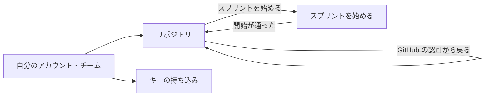

# #2186 の設計: 入出力の契約とテスト設計

頭の文書は [issue-2186-design.md](issue-2186-design.md) にある。ここには入出力の契約（画面向けの経路・ランナー向けの経路・他の子課題へ公開する関数・ランナーの翻訳・契約の 2 点の変更・画面・環境変数）とテスト設計を置く。

## 入出力の契約

### 画面向けの経路

機械可読な正は `factory/contracts/openapi/runs.yaml`（新しく作る。`npm run lint:contracts` で検査する）で、本節の表から起こす。どの経路も `Authorization: Bearer <access token>` を要り、`resolveFromRequest` でアカウントを解決する（他人のアカウントは #2170 の I18 と同じ 403）。エラーの本文は `{"error": {"code", "message"}}`。

| 経路 | 入力 | 成功 | 失敗 |
| --- | --- | --- | --- |
| `GET /accounts/{a}/github/install-url` | — | 200 `{url}`（`https://github.com/apps/<GITHUB_APP_SLUG>/installations/new`） | 403 |
| `GET /accounts/{a}/github/authorize-url` | — | 200 `{url}`。App の利用者の認可の URL で、`state` は利用者とアカウントを署名した 10 分の JWT | 403（持ち主でない） |
| `POST /accounts/{a}/github/candidates` | `{code, state}`（認可の戻り） | 200 `{proof, candidates: [{repository_id, full_name, installation_id, registered}]}`。`proof` は候補の証明（10 分） | 400 `invalid_request`（`state` の署名・期限・利用者の違い、`code` を換えられない）・403 |
| `GET /accounts/{a}/repositories` | — | 200 `{repositories: [{repository_id, full_name, installation_id, registered_at, active_sprint_runs}]}` | 403 |
| `POST /accounts/{a}/repositories` | `{proof, repository_id}` | 201 登録の 1 行 | 400（証明の署名・期限・利用者の違い）・403（証明に無い ID、または登録の直前の確かめで導入が届かない。I33）・409 `repository_exists`（I32） |
| `DELETE /accounts/{a}/repositories/{repository_id}` | — | 204 | 403・404 `repository_not_found`・409 `repository_in_use`（I36） |
| `GET /accounts/{a}/model-credential` | — | 200 `{registered, kind, updated_at, external_id}`。`kind`・`updated_at` は未登録なら `null`。`external_id` は常に返す（秘密でない） | 403 |
| `PUT /accounts/{a}/model-credential` | `{kind: "anthropic_api_key", api_key: 1〜512 字}` か `{kind: "aws_role", role_arn: ^arn:aws[a-z-]*:iam::\d{12}:role/.+$, region: ^[a-z]{2}(-[a-z]+)+-\d$}` | 200 上と同じ形（値を返さない） | 400・403・503 `credential_unavailable` |
| `DELETE /accounts/{a}/model-credential` | — | 204（無くても 204） | 403・503 |
| `POST /accounts/{a}/repositories/{r}/issue-candidates` | `{exclude?: [番号]}`（選び直しで外す番号） | 200 `{source: "ranking" \| "recent", milestone, candidates: [{number, title, selected, reason}], note}`。`note` は AI が選べなかったときの理由 | 403・404 |
| `POST /accounts/{a}/sprint-runs` | `{repository_id, issues: [1〜20 件の番号]}` | 201 `{sprint_run_id, state: "starting"}` | 400 `invalid_issues`（`details.numbers` に開いていない・Pull Request・別のリポジトリの番号）・403・404・409 `limits_exceeded`（`details.reasons` は `judgeLimits` の `reasons`）・409 `model_credential_missing`・409 `installation_unreachable` |
| `GET /accounts/{a}/sprint-runs?repository_id=` | — | 200 `{sprint_runs: [{sprint_run_id, repository_id, issues, state, failure_reason, created_at}]}`（新しい順 50 件） | 403 |
| `POST /accounts/{a}/sprint-runs/{id}/cancel` | — | 200 `{state}`（`cancelled` か、停止を待つ `running`） | 403・404・409 `already_finished` |

- **持ち主だけの経路**（登録・外す・認可の URL・候補・キーの 3 つ）は、席を持つだけの利用者に 403 `forbidden` を返す。他人のアカウントと同じ本文である
- 開始と取り消しは席を持つ人なら通る（要求の前提 4）
- 開始の確かめの順は、課題（400）→ 登録の有無（404）→ キー（409）→ 導入（409）→ 使える量（409）。使える量を最後に見るのは、上限の判定のトランザクションに外部の呼び出しを挟まないためである

### ランナー向けの経路

`handlers/run-jobs.ts` の `handler`（API Gateway の認可は付けず、Lambda の中で `verifyRunJobToken` で確かめる）。token のジョブが終わりの状態なら 403。401・403 の本文は受け口と同じ（I30）。

| 経路 | 入力 | 成功 | 失敗 |
| --- | --- | --- | --- |
| `POST /run-jobs/github-token` | — | 200 `{token, expires_at}`。その実行のリポジトリ 1 つに絞った導入の token（権限は決定 6 の表と同じ） | 401・403・409 `installation_unreachable`・503 |
| `POST /run-jobs/state` | `{op: "put" \| "get"}` | 200 `{url, expires_at}`（15 分の署名つき URL。鍵は `sprint-runs/<sprint_run_id>/ndf-state.tar.gz`）。`get` で保存が無ければ 404 `state_not_found` | 401・403・503 |

ランナーはこの 2 つと #2173 の答えの経路を、`INGEST_URL` と同じ origin に置かれた経路として呼ぶ（決定 8）。

### 他の子課題へ公開する関数

`factory/api/src/index.ts` から export する。

| 名前 | 入力 | 出力 | 失敗 |
| --- | --- | --- | --- |
| `requestResume({sprintRunId, approvalRequestId})` | #2173 が答えを保存した後に呼ぶ | `Promise<{jobId}>`。`START=resume` のジョブを作り起動する | `ResumeRejectedError`（`code` が `not_found` / `not_awaiting_approval` / `sprint_run_busy`）。`sprint_run_busy` は前のジョブの停止の知らせを待っている間で、#2173 は時間をおいて呼び直す |
| `claimLocalRunJob(accountId)` | #2189 が手元のランナーの受け取りで呼ぶ | `Promise<{instruction: RunJobInstruction, token} \| null>`。最も古い `pending` の `local` のジョブを `running` にして返す | 保存の失敗は投げる |
| `reportLocalRunJobEnded(jobId)` | #2189 が手元のランナーの終わりか心拍の切れで呼ぶ | `Promise<void>`。停止の知らせと同じ処理 | 知らないジョブは何もしない |
| `cancelSprintRun(ctx, sprintRunId)` | 画面の経路と同じ処理 | `Promise<{state}>` | `already_finished` |

`local` のジョブの token は置き場に書かず、`claimLocalRunJob` の応答で 1 回だけ返す（渡し方は全体の契約の「実行の形態」のとおり受け取りの応答）。

### 実行ジョブの指示の作り方

形は受け口の仕様の「実行ジョブの指示の定義」のまま変えない。値の出所だけを決める。

| 入力 | 値 |
| --- | --- |
| `SPRINT_RUN_ID`・`JOB_ID` | `crypto.randomUUID()` からハイフンを除いた 32 字 |
| `REPO` | 実行の `repo` |
| `NDF_VERSION` | 開始で決めた版。`NDF_CHANNEL` が `main` なら `plugin.json` の `version`（例 `10.26.1`。ランナーはタグ `ndf--v10.26.1` を入れる）、`develop` なら `<version>@<コミットの SHA 40 字>`（決定 3） |
| `ISSUES` | 実行の `issues` をカンマで結ぶ（`new` だけ） |
| `INGEST_TOKEN_SECRET_ARN` | ジョブごとに作る `ndf-factory/run-jobs/<job_id>`。ジョブが終わりの状態へ移るときに消す |
| `EXECUTION_MODE`・`MODEL_CREDENTIAL_SECRET_ARN` | 実行の写し。`byok` だけキーの `secret_arn` |

### ランナーの翻訳

ランナーは NDF の書くファイルを 2 秒ごとに読み、伸びた分を事象にする。`seq` はジョブの中で 1 から増やし、送った `seq` と読んだ位置を作業のディレクトリへ書いておく（送り直しで同じ冪等の鍵を使うため）。

| 事象 | NDF の何から | 規則 |
| --- | --- | --- |
| `job.started` | 導入を終えた時点 | `ndf_version` は `NDF_VERSION`、`start` は `START` |
| `phase.changed` | `sprint.json` の今の計画が変わった・`progress.jsonl` の `step` の行が新しい計画を指した | フェーズの名前は計画の名前から番号を除いたもの（`5-impl-2171` → `impl`）。課題は計画の名前の番号 |
| `step.recorded` | `progress.jsonl` の `kind: step` の行 | `exit`・`seconds`・`summary`（JSON の文字列なら `summary` の値）。行や報告に Pull Request の URL があり `REPO` のものなら `pull_request` を付け、ほかのリポジトリの URL は付けない |
| `attention` | `progress.jsonl` の `kind: attention` の行 | `reason`・`summary` をそのまま |
| `usage.recorded` | conductor と各ステップの claude の stream-json の `result` の `modelUsage` | モデルごとに 1 件。token は入力・出力に cache の読み書きを足す（#2170 の数え方）。`cost_usd` は `costUSD` |
| `gate.reached` | conductor の最後の作業の報告が `結果: 判断が要る` | 種類は `sprint.json` の承認の欄で決める（設計 PR がありゲート 1 が未承認 → `gate1`、ゲート 2 が未承認で本番の前 → `gate2`、ほか → `decision`）。`material` は承認資料のファイル、無ければ報告の本文 |
| `decision.delegated` | #2206 の代わりの判断の記録 | 置き場は #2206 が決める。決まるまで何も送らない |
| `job.finished` | 終わり方 | 判断が要る → `gate`、報告が `完了` → `done`、`できなかった` → `stopped`、取り込み・導入・状態の保存・復元・conductor の異常な終わり → `failed` |

- **256 KiB を超える事象は `gate.reached` の `material` だけを切り詰める。** 末尾に `\n\n（ここから先を切り詰めた。全文は <pr_url> にある）`（`pr_url` が `null` なら `（ここから先を切り詰めた。元の大きさ <n> バイト）`）を足し、JSON にしたバイト数が 262,144 以下になる最長の位置で、UTF-8 の文字の境目で切る
- **送り直しは 5xx と接続の失敗だけ**で、1・2・4・8 秒…最大 60 秒の間を置き、同じ事象のまま 30 分まで続ける。4xx は送り直さず、`attention` を出さずにランナーの標準エラーへ 1 行書いて次へ進む（`job.finished` の 4xx だけは終了コード 1）

### ランナーの手順と形態ごとの claude

| 手順 | 中身 |
| --- | --- |
| 1. 導入の token | `POST /run-jobs/github-token`。gh の設定ファイルへ書き、git は `gh auth git-credential` を使う。50 分ごとに取り直して書き換える（環境変数に置かない） |
| 2. 取り込み | `REPO` を作業のディレクトリへ clone する |
| 3. NDF の導入 | `NDF_MARKETPLACE` を `NDF_VERSION` の ref で追加し、`ndf` を入れる。入った版が `NDF_VERSION` と違えば `failed` |
| 4. 状態の復元（`resume`） | `POST /run-jobs/state`（`get`）で取り、追跡しないパスだけを戻す。追跡するパスを含めば捨てて `failed`（I42） |
| 5. 答えの記録（`resume`） | #2173 の経路から答えを読み、ゲートは `sprint-state.py gate <sprint> <名前> --by user --outcome <approved \| rejected> --what <本文>`、判断は本文を conductor の指示にする |
| 6. conductor | `claude -p --output-format stream-json` を `/ndf:development-workflow` と課題（`new`）か、`sprint-state.py next` の引継ぎの文（`resume`）で起こす。正確な引数は実装で打って決める |
| 7. 終わり | 状態を `put` で保存 → `gate.reached`（あれば）→ `job.finished`。`SIGTERM` では何も送らず 1 で終わる（実行の制御が `failed` を書く） |

| 形態 | claude の呼び方 |
| --- | --- |
| `managed` | `CLAUDE_CODE_USE_BEDROCK=1`・`AWS_REGION` は `BEDROCK_REGION`。資格はタスクの役割の権限（ECS が渡す） |
| `byok`（API キー） | `MODEL_CREDENTIAL_SECRET_ARN` を読み、`ANTHROPIC_API_KEY` を claude の子の環境にだけ置く |
| `byok`（ロール） | 置き場の `role_arn`・`region`・`external_id` で `AssumeRole` し、`CLAUDE_CODE_USE_BEDROCK=1` と一時の資格で呼ぶ。更新は `awsCredentialExport` の設定（未確認の表） |

### 契約の 2 点の変更（確定仕様を直す）

| 変更 | 受け口の仕様・全体の契約で直す所 | 互換性 |
| --- | --- | --- |
| token の本体に `repo`（`owner/name`。必須）を足し、`signRunJobToken` の `claims` に `repo`、`VerifiedRunJob` に `repo` を足す。`step.recorded` の `pull_request.repo` を小文字にして token の `repo` の小文字と照らし、違えば 403（I37） | 「実行ジョブの token」の表・I31・「出所ごとの照合」の `runner` の行 | 発行は実行の制御だけで、本番へ出ていないため移行は無い。`repo` の無い token は `malformed` |
| 種類 `decision.delegated` を足す。`payload` は `question`（1〜4,000 字）・`answer`（1〜4,000 字）・`reason`（1〜4,000 字）・`category`（文字列か `null`。止めたときの `metadata.source`）。書けるのは `runner` だけ | 「進捗の事象の種類と受け口」の表・`payload` の表・I26 | 種類を足すだけで既存の種類の形は変わらないため `schema_version` は 1 のまま |

### 画面

| 画面 | 経路 | 何をする場所か |
| --- | --- | --- |
| リポジトリ | `/accounts/:accountId/repositories` | 導入の案内・「GitHub で確かめる」・候補から登録・登録の一覧と外す・リポジトリごとのスプリントの実行の状態（失敗の理由つき） |
| キーの持ち込み | `/accounts/:accountId/model-credential` | 種類の選択・API キーかロールの ARN と地域の入力・保存・消去・外部 ID（写すボタン）と信頼の設定の例 |
| スプリントを始める | `/accounts/:accountId/repositories/:repositoryId/sprints/new` | AI が選んだ候補と理由・外す・番号で足す・「AI に選び直させる」・開始 |

| 画面 | 項目 | 型 | 必須 | 上限 | 満たさないときの表示 |
| --- | --- | --- | --- | --- | --- |
| キーの持ち込み | API キー | 文字列（伏せて入力） | `anthropic_api_key` で必須 | 512 字 | 「API キーを入力してください」 |
| キーの持ち込み | ロールの ARN | 文字列 | `aws_role` で必須 | 2,048 字 | 「IAM のロールの ARN の形で入力してください」 |
| キーの持ち込み | 地域 | 文字列 | `aws_role` で必須 | 32 字 | 「AWS の地域の名前で入力してください」 |
| スプリントを始める | 足す番号 | 1 以上の整数 | 任意 | 選んだ課題は 20 件まで | API の `invalid_issues` の番号を「開いている課題ではありません」で出す |

| 状態 | 出すもの |
| --- | --- |
| 読み込み中・403・5xx | #2170 の画面と同じ（「読み込み中」・「このアカウントを見る権限がありません」・「時間をおいてやり直してください」） |
| 登録が 0 件 | 「まだリポジトリがありません」と導入の案内 |
| 候補が 0 件・AI が選べない | `note` を出し、番号で足す欄だけを出す |
| 開始の 409 | `limits_exceeded` は「同時に動かせるスプリントは <limit> 本までです（今 <current> 本）」、ほかは API の `message` |
| 持ち主でない席の人 | 登録・外す・キーの操作を出さない（API も 403） |

### 環境変数（`factory/.env.example` に名前だけを足す）

| 名前 | 使う側 | 意味 |
| --- | --- | --- |
| `RUNS_TABLE_NAME` | API・制御 | 登録・キー・枠・実行・ジョブの表 |
| `RUN_STATE_BUCKET` | ランナー向けの API | NDF の状態の置き場 |
| `RUN_JOB_TOKEN_SIGNING_KEY_SECRET_ARN` | 制御 | 発行の鍵（Ed25519 の秘密鍵の JWK と `kid`） |
| `RUN_JOB_TIMEOUT_SECONDS`・`RUN_JOB_TOKEN_TTL_SECONDS` | 制御 | 打ち切りの時間（既定 28800）と token の期限（既定 32400）。期限が時間以下なら設定の誤り（I41） |
| `RUNNER_CLUSTER_ARN`・`RUNNER_SUBNET_IDS`・`RUNNER_SECURITY_GROUP_IDS` | 制御 | `RunTask` の宛先 |
| `RUNNER_BYOK_TASK_DEFINITION_ARN` | 制御 | `byok` のタスク定義（`RUNNER_TASK_DEFINITION_ARN` は `managed`。決定 11） |
| `INGEST_URL` | 制御 | 指示の `INGEST_URL` に写す値 |
| `GITHUB_APP_SLUG`・`GITHUB_APP_CLIENT_ID`・`GITHUB_APP_CLIENT_SECRET_ARN` | 取り込み | 導入の URL と、App の利用者の認可 |
| `CANDIDATE_MODEL_ID` | 課題の候補 | 理由を作る Bedrock のモデル |

## テスト設計

ECS・Secrets Manager・S3・GitHub・Bedrock は口の偽物で動かす。token は `createRunJobTokenKit`、表は偽の保存で条件つきの書き込みを再現する。

| 受け入れ条件・不変条件 | どの振る舞いで縛るか | どう壊したら落ちるべきか |
| --- | --- | --- |
| AC1 | 偽の GitHub が返した導入の対象のうち、利用者の届くものだけが候補に出る | 利用者の届かないリポジトリも候補に出すと落ちる |
| AC2・I33 | 証明に無い ID・届かない導入の登録が 403 で行が増えない | 証明の照合を外すと落ちる |
| AC3・I32 | 同じ ID の 2 回目と同時の 2 本が 409 で 1 行 | 条件つきの書き込みを外すと落ちる |
| AC4・I36 | 終わりの状態でない実行があると 409、終われば 204 | 枠の条件を外すと落ちる |
| AC5 | 他人のアカウントへの 3 つの経路が #2170 と同じ 403 の本文 | 解決を通さない経路を足すと落ちる |
| AC6 | 2 種類の保存・差し替え・消去と、応答が 4 項目だけ | 応答に `secret_arn` か値を載せると落ちる |
| AC7・I38 | テストのキーの値が、すべての応答・ログ・事象・`RunTask` の環境変数に無い。ARN は自分のアカウントのジョブにだけ載る | 指示に値か別のアカウントの ARN を載せると落ちる |
| AC8 | 外部 ID がアカウントごとに違い、`AssumeRole` に付く。偽の STS が断ると `failed` | 外部 ID を省くか固定値にすると落ちる |
| AC9 | 順位の表のあるリポジトリで候補に理由が付き、表が無ければ新しい順。Bedrock が失敗すると `note` | 理由の無い候補を返すと落ちる |
| AC10 | 外す・足す・選び直しが通り、開いていない番号・Pull Request は 400 | 番号の確かめを外すと落ちる |
| AC11・I35 | 上限ちょうどで 409 と `reasons`、1 少なければ通る。`managed` は月の token も照らす | 承認待ちを数から外すと落ちる |
| AC12 | `byok` でキーが無いと 409。`local` は `RunTask` を呼ばず `claimLocalRunJob` で受け取れる | `local` で ECS を呼ぶと落ちる |
| AC13 | 偽の GitHub が導入を断ると 409 で実行が増えない | 開始の確かめを外すと落ちる |
| AC14 | 開始で実行と `new` のジョブができ `RunTask` が 1 回。失敗で両方 `failed`、枠が戻る | 失敗で枠を戻さないと落ちる |
| AC15・I8 | `job.finished`（`gate`）の後の停止で `awaiting_approval`、再開で `resume` と依頼の ID を持つジョブ。承認待ちでない実行の再開は 409 | 停止を待たずに承認待ちへ移すと落ちる |
| AC16・AC17・I37 | 別のリポジトリの Pull Request の `step.recorded` が 403 で `pr_ref` 0 件、同じリポジトリ（大文字違いを含む）は 202 | 照合を外すか大文字を区別すると落ちる |
| AC18 | 偽の #2206 の記録から `decision.delegated` が 1 件ずつ送られ、契約の検査を通る | 記録が無いときに事象を作ると落ちる |
| AC19・I9 | 動くジョブがある間の再開の要求（同時の 2 本を含む）は 1 本だけ通る | `current_job_id` の条件を外すと落ちる |
| AC20・I40 | ランナーの `job.finished` が無い停止で `control` の `failed` が 1 件、ある停止では書かない。同じ知らせの 2 回目は何もしない | 先に読まずに書くと落ちる |
| AC21・I8 | 見回りが打ち切りの時間を過ぎたジョブに `StopTask` し、`failed`（`timeout`） | 見回りが時刻を見ないと落ちる |
| AC22・I41 | token の `exp` が時間より長く、別のジョブの `job_id` の事象は 403。期限が時間以下の設定は断る | 期限を時間と同じにすると落ちる |
| AC23 | 取り消しで `StopTask` が呼ばれ、停止の後に `cancelled` で枠が減る。承認待ちはその場で `cancelled` | 取り消しで枠を減らさないと落ちる |
| AC24・I39 | 2 本目のジョブの `NDF_VERSION` が 1 本目と同じ。ランナーは入った版が違えば `failed` | 再開で版を読み直すと落ちる |
| AC25 | 実際のスプリントの記録（m2171 の状態ディレクトリを写したもの）を入れると、7 種類が契約の検査を通る。5xx の後は同じ冪等の鍵で送り直す | `seq` を送り直しで進めると落ちる |
| AC26 | 300 KiB の承認資料が 256 KiB 以下に切られ、案内が残り、受け口が 202 | 切った後のバイトを数えないと落ちる |
| AC27 | 代役の #2173 の答えから、ゲートは `sprint-state.py gate --by user` の記録、判断は conductor の指示になる | ゲートの記録を書かずに続けると落ちる |
| AC28 | 保存した状態を別の作業のディレクトリで戻し、conductor が同じ計画から続く | 状態の保存を省くと落ちる |
| AC29 | 3 つの呼び方ごとに claude の子の環境が決まり、アクセスキーが環境変数とイメージに無い | `managed` で `ANTHROPIC_API_KEY` を置くと落ちる |
| AC30・I43 | 偽の時計で 50 分を進めると導入の token を取り直す。ランナーの定義と環境に秘密鍵の変数が無い | 取り直しを止めると落ちる |
| AC31・I43 | 送れたら 0、`job.finished` が送れなければ 1 | ほかの終了コードを返すと落ちる |
| AC32・I42 | 追跡する `.ndf/pace.json` を含む保存の復元が `failed` で、ファイルが変わらない | 追跡するパスを戻すと落ちる |
| AC33 | `python3 scripts/check-service-boundary.py` が 0 | `plugins/` から `factory/` を参照すると落ちる |
| AC34 | #2170 と #2171 の既存のテストが通る | 既存の照合を変えると落ちる |
| I34 | 開始・終わり・2 回目の終わりを並べた後、枠の数が終わりの状態でない実行の数と等しい | 終わりで条件を外すと 2 回減って落ちる |
