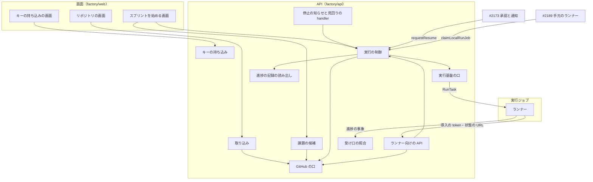
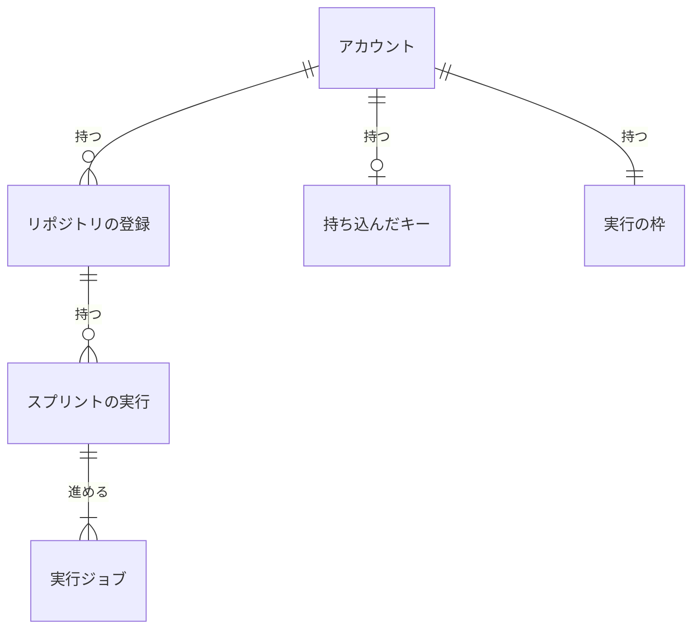
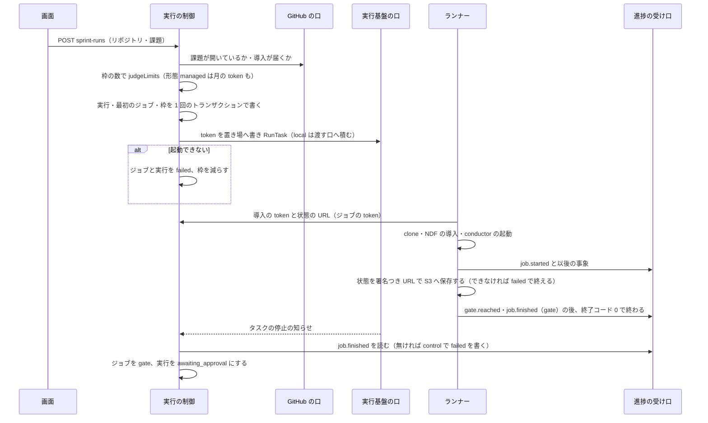
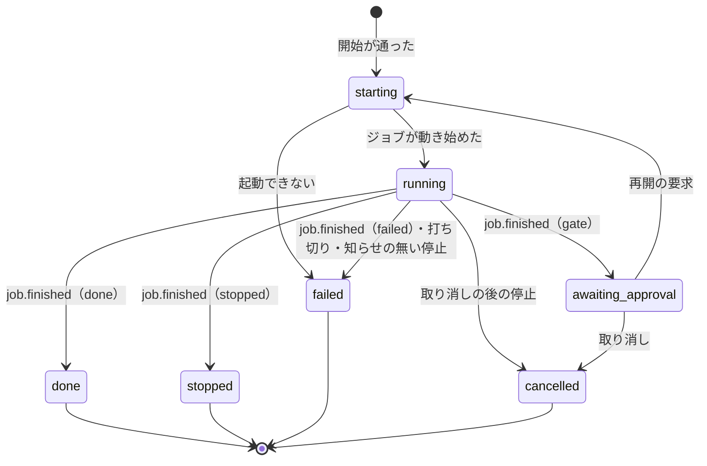

# NDF Factory: 自分の GitHub のリポジトリを登録し、Web からスプリントを始めて並列に流せる（#2186）

## 目的

- **何が壊れているか**: Neural Development Factory には、リポジトリを取り込む口も、スプリントを動かすランナーも、実行ジョブを起動して終わりを受け取る制御も無い。#2171 の受け口と token の検証は、送り手がいないまま置かれている
- **誰が困るか**: CLI のセッションの前にいられない開発者。スプリントは人が端末で起動し、承認の答えを待つ間も手元のセッションを開けておく必要がある
- **直すと何が成り立つか**: 利用者が自分のリポジトリを登録し、AI が選んだ課題でスプリントを Web から始め、上限までの本数を並列に流せる。承認の依頼で実行ジョブは終わり、答えで新しいジョブが続ける

## 適用範囲

- **働く範囲**: このリポジトリの `factory/`（`api`・`web`・新しい `runner`・`contracts`）と、確定仕様 2 本の契約の 2 点。プラグイン（`plugins/`）は変わらない
- **プロジェクトごとに違うもの**: 取り込んだリポジトリの起点・テスト・配布・進め方は、ランナーの中の NDF がそのリポジトリの `.ndf/` から読む。サービスは設定も引数も持たない。サービス自身の値（打ち切りの時間・token の期限・チャネル）は環境変数で受ける
- **当たるモード**: `standard`

## あるべき姿の根拠

| 根拠 | 種類 | 何を示すか |
| --- | --- | --- |
| 実行ジョブ 1 本分（承認から次の承認まで）の所要は、過去 7 本のスプリントで最大 18,031 秒（m1914 のゲート 1 からゲート 2 まで、課題 4 件）、ほかは 5,385〜8,637 秒（下の「打ち切りの時間の実測」） | 実測 | 打ち切りの時間を 8 時間にする（決定 4） |
| GitHub App の導入の token は 1 時間で切れる（GitHub の文書「Generating an installation access token for a GitHub App」） | 外部の一次情報 | ランナーへ token を渡し直す口が要る（決定 7） |
| ロールを第三者に引き受けさせるときは、サービスが顧客ごとに作った外部 ID を信頼の条件にする（AWS IAM の文書「The confused deputy problem」） | 外部の一次情報 | 外部 ID をアカウントごとにサービスが作る（決定 10） |
| ECS の `RunTask` の `overrides` は全体で 8,192 字が上限（Amazon ECS API Reference の `TaskOverride`） | 外部の一次情報 | 実行ジョブの指示に本文を載せない（確定仕様のまま） |
| 「承認ゲート以外のユーザー問い合わせは原則hookで止めてAIが判断するように強制する」（利用者、2026-10-31。#2206） | 利用者の指示の原文 | 代わりの判断を承認の依頼にせず、進捗の事象で見せる（決定 2） |

要求と受け入れ条件は #2186 の本文にある（コピーは `issues/issue-2186-requirements.md`）。この文書は「どう作るか」だけを扱う。入出力の契約とテスト設計は [issue-2186-design-contracts.md](issue-2186-design-contracts.md)、決定の記録は [issue-2186-design-decisions.md](issue-2186-design-decisions.md) にある。サービス全体の形は確定仕様 [ndf-factory-service-boundary.md](../docs/specifications/ndf-factory-service-boundary.md)（以下「全体の契約」）、受け口と token は [ndf-factory-contracts-and-progress.md](../docs/specifications/ndf-factory-contracts-and-progress.md)（以下「受け口の仕様」）にあり、この設計は両方を契約 2 点（#2216・#2206）だけ直す。

## ドメインモデル

### コンテキスト

| コンテキスト | 何の語が 1 つの意味に決まるか |
| --- | --- |
| Neural Development Factory（`ndf-factory`） | リポジトリの登録・キーの持ち込み・スプリントの実行・実行ジョブ・実行の枠・打ち切りの時間・課題の候補 |
| NDF の開発ワークフロー（`ndf-workflow`） | スプリント・承認ゲート・conductor・`sprint.json`・`progress.jsonl`・作業の報告 |

`ndf-workflow` が上流、`ndf-factory` が下流の**腐敗防止層**（全体の契約のまま）。翻訳はランナーだけが持つ。GitHub と AWS は外部の系で、取り込み（GitHub）と実行の制御（ECS・Secrets Manager・S3）が口の裏で自分の語へ変える。

### 集約

| 集約 | 持ち主（書き換えてよいもの） | 根 | エンティティ | 値オブジェクト |
| --- | --- | --- | --- | --- |
| リポジトリの登録 | 取り込み（`factory/api/src/repositories/`） | 登録 | — | GitHub のリポジトリ（数の ID・`owner/name`）・導入の識別子 |
| 持ち込んだキー | キーの持ち込み（`factory/api/src/credentials/`） | アカウントのキー | — | 種類（API キー・ロール）・置き場の ARN・外部 ID |
| スプリントの実行 | 実行の制御（`factory/api/src/runs/`） | スプリントの実行 | 実行ジョブ | 状態・課題の並び・NDF の版・実行の形態の写し・ジョブの結果 |
| 実行の枠 | 実行の制御（`factory/api/src/runs/`） | アカウントの枠 | — | 終わりの状態でない数（アカウント全体・リポジトリごと） |
| 進捗の記録 | 進捗の受け口（#2171。照合 1 つを足す） | スプリントの実行の識別子ごとの列 | 進捗の事象 | 種類に `decision.delegated` を足す |

- **ほかの集約は識別子で参照する。** スプリントの実行は登録を `repository_id` で、アカウントを `account_id` で指す
- **1 つの処理で書き換える集約は 1 つ。例外はスプリントの実行と実行の枠の 2 つだけ**で、開始と終わりの状態への移りを 1 つのトランザクションで書く。分けると同時の 2 本の開始が上限を超える（決定 5）。登録は書かず、条件で確かめるだけにする
- 課題の候補は保存しない（画面へ返して捨てる値）

### 不変条件

全体の契約の I8・I9 と、受け口の仕様の I31 に続けて番号を振る。

| # | 集約 | 条件 | 破れたときの扱い |
| --- | --- | --- | --- |
| I8 | スプリントの実行 | 承認の依頼が出た実行ジョブは終わり、答えを待つ間に動く実行ジョブは無い。打ち切りの時間を超えて動く実行ジョブも無い | 見回りが止め、`failed` にする |
| I9 | スプリントの実行 | 1 つのスプリントの実行で、終わりの状態でない実行ジョブは 1 つまで | 2 つ目の作成は条件で失敗し 409 |
| I32 | リポジトリの登録 | 1 つのアカウントに同じリポジトリ（数の ID）の登録は 1 つ | 409 `repository_exists` |
| I33 | リポジトリの登録 | 登録は、GitHub が「導入の対象」かつ「利用者の身元が導入へ届く」と返したリポジトリにだけできる | 403 `forbidden` で書かない |
| I34 | 実行の枠 | 枠の数は、そのアカウント（とリポジトリ）の終わりの状態でないスプリントの実行の数に等しい | 開始と終わりの移りで同じトランザクションで増減する。条件で失敗したら書かない |
| I35 | 実行の枠 | 開始が通るのは、枠の数を `judgeLimits` に渡して許されたときだけ | 409 `limits_exceeded` と `reasons` |
| I36 | リポジトリの登録 | 枠の数が 0 でないリポジトリの登録は外せない | 409 `repository_in_use` |
| I37 | 進捗の記録 | `step.recorded` の Pull Request の `repo` は、token の `repo` と大文字と小文字を問わず等しい（#2216） | 403 で `pr_ref` を残さない |
| I38 | 持ち込んだキー | キーの値は、応答・ログ・進捗の事象・実行ジョブの指示に出ない。指示に載るのは置き場の ARN だけで、そのアカウントの実行ジョブにだけ載る | 値を返す経路を持たない |
| I39 | スプリントの実行 | NDF の版と実行の形態は開始で決まり、以後の実行ジョブはすべて同じ値を持つ | 再開のジョブは実行の値を写すだけで、読み直さない |
| I40 | スプリントの実行 | 実行ジョブの `job.finished` は進捗の記録に 1 件だけある | ランナーの分が先にあれば実行の制御は書かない（`<job_id>:finished` の鍵） |
| I41 | スプリントの実行 | 実行ジョブの token の期限は、打ち切りの時間より長い | 起動の設定の読み込みで断り、ジョブを作らない |
| I42 | — （ランナー） | ランナーは取り込んだリポジトリの追跡するファイル（`.ndf/` を含む）を、状態の復元で上書きしない | 復元は追跡しないパスだけを書き、追跡するパスを含む保存は捨てて `failed` |
| I43 | — （ランナー） | ランナーは GitHub App の秘密鍵を受け取らず、終了コードは 0（`job.finished` を送った）か 1 だけ | 秘密鍵の変数をランナーの定義に持たない |

### ドメインイベント

番号は要求の E1〜E18 を引き継ぐ。

| # | イベント | 発生元 | 受け手 |
| --- | --- | --- | --- |
| E1 | 利用者が GitHub App を導入した | GitHub（画面の案内から） | 取り込み（候補の一覧） |
| E2 | リポジトリを登録した | 取り込み | 実行の制御（開始で登録を確かめる） |
| E3 | リポジトリの登録を外した | 取り込み | 実行の制御（以後の開始が 403） |
| E4 | 持ち込んだキーを保存した・消した | キーの持ち込み | 実行の制御（`byok` の開始で有無を見る） |
| E5 | AI が課題の候補を選んだ | 課題の候補（API の中） | 画面 |
| E6 | スプリントの実行を始めた | 実行の制御 | 実行の枠（増やす）・E7 |
| E7 | 実行ジョブの token を発行した | 実行の制御（`signRunJobToken`） | ランナー（置き場から読む） |
| E8 | 実行ジョブを起動した | 実行の制御（ECS か渡す口） | ランナー |
| E9 | 取り込みと NDF の導入を終え、版を固定した | ランナー | 進捗の受け口（`job.started`） |
| E10 | 進捗の事象を送った | ランナー | 進捗の受け口 |
| E11 | 代わりの判断を送った | ランナー（#2206 の記録を読む） | 進捗の受け口（`decision.delegated`）→ #2172 |
| E12 | 承認の依頼が出て実行ジョブが終わった | ランナー（`gate.reached`・`job.finished`（`gate`）） | #2173・実行の制御（停止の知らせで承認待ちへ移す） |
| E13 | 再開の要求を受けた | #2173（`requestResume`） | 実行の制御 |
| E14 | `resume` のジョブが答えを読み NDF へ書いた | ランナー | conductor |
| E15 | 実行ジョブが終わった | ランナー（`job.finished`） | 実行の制御（停止の知らせで読む） |
| E16 | `job.finished`（`control`）を直に書いた | 実行の制御（`appendControlEvent`） | 進捗の受け口の列 |
| E17 | 打ち切りの時間を超えたジョブを止めた | 見回り | ECS → E16 |
| E18 | スプリントの実行を取り消した | 実行の制御（利用者の操作） | ECS → E16、実行の枠（減らす） |

### 用語

| 用語 | 意味 | 用語集への反映 |
| --- | --- | --- |
| 実行の枠 | アカウントとリポジトリごとに、終わりの状態でないスプリントの実行を数えた値。開始で増え、終わりの状態への移りで減る | 追加 |
| 見回り | 実行の制御が 5 分ごとに動き、打ち切りの時間を過ぎたジョブを止め、停止の知らせを取りこぼしたジョブを終わらせる処理 | 追加 |
| 代わりの判断 | #2206 の hook が問い合わせを止めた後に、AI が自分で下した判断。問い・選んだ答え・理由を持ち、進捗の事象 `decision.delegated` で残る | 追加 |
| 候補の証明 | GitHub で確かめた登録の候補を、取り込みが署名して 10 分だけ有効にした値。登録の要求はこれを持って来る | 追加 |

## 機能一覧

| # | 機能 | 誰が使うか |
| --- | --- | --- |
| F1 | GitHub App の導入へ案内し、導入の対象で身元の届くリポジトリを候補に出す | チームの持ち主・個人の利用者 |
| F2 | リポジトリを登録する・外す・一覧で見る | 登録と外しは持ち主、一覧は席を持つ人 |
| F3 | Anthropic API キーか AWS のロールを保存・差し替え・消去し、登録済みかを見る | 持ち主 |
| F4 | AI が選んだ課題の候補を理由つきで見て、外す・足す・選び直させる | 席を持つ人 |
| F5 | スプリントを始める・取り消す・リポジトリごとの実行の状態を見る | 席を持つ人 |
| F6 | 実行ジョブを起動し、終わりを受け取り、打ち切りの時間で止める | 実行の制御（自動） |
| F7 | 承認の答えで再開する | #2173 |
| F8 | 形態 `local` の実行ジョブを手元のランナーへ渡す | #2189 |
| F9 | 実行ジョブの中で取り込み・NDF の導入・conductor の起動・翻訳と送信・状態の保存と復元を行う | ランナー |
| F10 | 他のリポジトリの Pull Request の申告を拒む（#2216） | 進捗の受け口 |

## 構成要素

| 要素 | 場所 | 責務 |
| --- | --- | --- |
| GitHub の口 | `factory/api/src/github/` | App の JWT（秘密鍵は `GITHUB_APP_PRIVATE_KEY_SECRET_ARN`）・導入の token の作成（1 リポジトリに絞る）・利用者の認可（App のクライアント）・課題とマイルストーンの読み出し。差し替えのできる型の口で、テストは偽物 |
| 取り込み | `factory/api/src/repositories/`・`routes/repositories.ts` | 候補の一覧と候補の証明・登録・外し・一覧（F1・F2）。I32・I33・I36 |
| キーの持ち込み | `factory/api/src/credentials/`・`routes/credentials.ts` | 保存・差し替え・消去・外部 ID（F3）。値は Secrets Manager にだけ書く（I38） |
| 課題の候補 | `factory/api/src/runs/candidates.ts` | 棚卸しの順位の表か新しい順の課題を読み、Bedrock の claude で採否と理由を作る（F4、決定 9） |
| 実行の制御 | `factory/api/src/runs/`・`routes/sprint-runs.ts` | 開始の判定・枠・token の発行・起動・停止の知らせの処理・見回り・取り消し・再開の要求・渡す口（F5〜F8）。I8・I9・I34・I35・I39〜I41 |
| 実行基盤の口 | `factory/api/src/runs/ecs.ts` | `RunTask`・`StopTask`・`DescribeTasks` と、token の置き場の作成と削除。テストは偽物 |
| ランナー向けの API | `factory/api/src/runs/runner-api.ts`・`handlers/run-jobs.ts` | 実行ジョブの token で認証し、導入の token の渡し直しと状態の置き場の署名つき URL を返す（決定 7・8） |
| 停止の知らせと見回りの handler | `factory/api/src/handlers/run-control.ts` | EventBridge の ECS のタスクの状態の変化と、5 分ごとの起動を受ける |
| 進捗の記録の読み出し | `factory/api/src/progress/read.ts` | `job.finished` を冪等の鍵で読む・月の `usage.recorded` を足す。読むだけで、保存の型に書き換えを足さない |
| 受け口の照合 | `factory/api/src/progress/authorize.ts`・`run-job-token.ts` | token の `repo` の主張と `step.recorded` の照合（I37）。`decision.delegated` を `runner` の書ける種類へ足す |
| 契約 | `factory/contracts/schemas/progress-event.schema.json`・`openapi/runs.yaml` | `decision.delegated` の定義。画面とランナー向けの経路の OpenAPI |
| 画面 | `factory/web/src/pages/` | リポジトリ・キーの持ち込み・スプリントを始めるの 3 画面（契約の文書の「画面」） |
| ランナー | `factory/runner/`（新しい workspace） | F9。翻訳（`translate/`）・送信（`send.ts`）・状態（`state.ts`）・モデルの呼び方（`model.ts`）・起動（`main.ts`） |
| ランナーのイメージ | `factory/runner/Dockerfile` | Node 24・Python・uv・git・gh・claude の CLI。NDF を焼き込まない |

図には実行時の呼び出しを持つ要素だけを描き、契約とランナーのイメージは載せない。

**配置**: 画面向けの経路は既存の API の handler（`handlers/api.ts`）に足す。ランナー向けの API は Cognito の認証を通らないため、別の handler（`handlers/run-jobs.ts`、経路 `/run-jobs/*`）にする。停止の知らせと見回りは HTTP を持たない Lambda（`handlers/run-control.ts`）。ランナーは ECS Fargate のタスクで、形態 `managed` と `byok` で別のタスク定義を使う（決定 11）。

## データ構造

DynamoDB の 1 つの表（`RUNS_TABLE_NAME`）に置く。読み出しは強い整合で、GSI は候補を引くだけに使う。時系列の扱いは「今の値の上書き」で、過去は進捗の記録（事象の列）が持つ。上書きで失うのは状態の移りの時刻だけで、`job.*` の事象から作り直せる。

| 行 | `pk` | `sk` | `gsi1pk` / `gsi1sk` |
| --- | --- | --- | --- |
| リポジトリの登録 | `ACCOUNT#<account_id>` | `REPO#<repository_id>` | — |
| 持ち込んだキー | `ACCOUNT#<account_id>` | `CREDENTIAL` | — |
| 実行の枠（全体） | `ACCOUNT#<account_id>` | `ACTIVE` | — |
| 実行の枠（リポジトリ） | `ACCOUNT#<account_id>` | `ACTIVE#REPO#<repository_id>` | — |
| スプリントの実行 | `RUN#<sprint_run_id>` | `RUN` | `ACCOUNT#<account_id>` / `RUN#<created_at>` |
| 実行ジョブ | `JOB#<job_id>` | `JOB` | `ACTIVE_JOBS`（終わりの状態でない間だけ） / `<created_at>#<job_id>` |

| 行 | 列 | 型 | 空 | 意味 |
| --- | --- | --- | --- | --- |
| 登録 | `repository_id` | 数 | 不可 | GitHub のリポジトリの数の ID（改名で変わらない） |
| 登録 | `full_name` | 文字列 | 不可 | 登録の時点の `owner/name`。開始のたびに GitHub の値で上書きする |
| 登録 | `installation_id` | 数 | 不可 | 導入の識別子 |
| 登録 | `registered_by`・`registered_at` | 文字列 | 不可 | 登録した利用者の ID と時刻 |
| キー | `kind` | 文字列 | 不可 | `anthropic_api_key` / `aws_role` |
| キー | `secret_arn` | 文字列 | 不可 | 値の置き場（名前は `ndf-factory/model-credentials/<UUID>`。アカウントの ID を名前に入れない） |
| キー | `updated_at` | 文字列 | 不可 | 最後に保存した時刻 |
| 枠 | `count` | 数 | 不可 | 終わりの状態でないスプリントの実行の数（I34） |
| 実行 | `account_id`・`repository_id`・`repo` | 文字列・数・文字列 | 不可 | 属する先と、開始の時点の `owner/name`（token の `repo` の主張に使う） |
| 実行 | `state` | 文字列 | 不可 | `starting` / `running` / `awaiting_approval` / `done` / `stopped` / `failed` / `cancelled` |
| 実行 | `issues` | 数の並び | 不可 | 確かめた課題の並び |
| 実行 | `ndf_version`・`execution_mode` | 文字列 | 不可 | 開始で決めた値（I39） |
| 実行 | `current_job_id` | 文字列 | 可 | 終わりの状態でないジョブ。空は「動くジョブが無い」（I9 の条件に使う） |
| 実行 | `cancel_requested`・`failure_reason` | 真偽・文字列 | 可 | 取り消しの要求と、失敗の理由（`launch_failed` / `timeout` / `task_stopped` など） |
| 実行 | `created_by`・`created_at`・`updated_at`・`version` | — | 不可 | 作った利用者・時刻・楽観の版 |
| ジョブ | `sprint_run_id`・`seq`・`start`・`approval_request_id` | — | `approval_request_id` だけ可 | 属する実行・何本目か・`new` / `resume`・答えの出た依頼 |
| ジョブ | `state` | 文字列 | 不可 | `pending` / `running` / `gate` / `stopped` / `done` / `failed`（全体の契約の状態の図） |
| ジョブ | `runner_kind`・`task_arn`・`token_secret_arn` | 文字列 | `task_arn`・`token_secret_arn` は可 | `ecs` / `local`、ECS のタスク、token の置き場 |
| ジョブ | `started_at`・`finished_at`・`result` | 文字列 | 可 | 動き始めた時刻（見回りの起点）・終わった時刻・`job.finished` の結果 |

| 機能 | 登録 | キー | 枠 | 実行 | ジョブ | 進捗の記録 |
| --- | --- | --- | --- | --- | --- | --- |
| F2 登録・外す | C・D | — | R（外すときの条件） | — | — | — |
| F3 キー | — | C・U・D | — | — | — | — |
| F5 開始 | R（条件） | R | U | C | C | — |
| F5 取り消し | — | — | U | U | U | C（`control`） |
| F6 停止の知らせ・見回り | — | — | U | U | U | R・C（`control`） |
| F7 再開 | — | — | — | U | C | — |
| F8 渡す口 | — | — | — | U | U | — |
| F10 照合 | — | — | — | — | — | C |

## 処理の流れ

### 開始から承認待ちまで

### 再開・停止・見回り

- **再開**: #2173 が `requestResume` を呼ぶ。実行が `awaiting_approval` で `current_job_id` が空のときだけ、`START=resume` のジョブを作って起動する（I9）。ランナーは状態を S3 から戻し、答えを #2173 の経路から読み、ゲートなら `sprint-state.py gate --by user` を書き、判断なら本文を conductor への指示にして続ける
- **停止の知らせ**: タスクの `startedBy` に `job_id` を入れ、知らせからジョブを引く。`RUNNING` の知らせでジョブを `running`（`started_at` を書く）、実行を `running` にする。`STOPPED` の知らせでは、`job.finished` を進捗の記録から冪等の鍵で読み、無ければ `appendControlEvent`（`failed`）を書いてから結果に従って移す。同じ知らせの 2 回目は、ジョブが終わりの状態なので何もしない
- **見回り**（5 分ごと）: `ACTIVE_JOBS` を引き、① `running` で `started_at` から打ち切りの時間を過ぎたら `StopTask`（理由 `timeout`）、② ECS で止まっているか見つからないタスクのジョブは停止の知らせと同じ処理、③ `pending` のまま 15 分を過ぎたジョブは `failed`（`launch_failed`）にする。形態 `local` のジョブは ① の代わりに直に `failed` を書く
- **取り消し**: `cancel_requested` を立て、動くジョブがあれば `StopTask` し、停止の知らせで `cancelled` へ移す。動くジョブが無ければその場で `cancelled` にする

**終わりの状態（`done`・`stopped`・`failed`・`cancelled`）への移りは、実行の行の `state` が終わりの状態でないことを条件にし、同じトランザクションで 2 つの枠を 1 ずつ減らす。** 2 回目の移りは条件で失敗し、枠を 2 回減らさない（I34）。

### 打ち切りの時間の実測

過去のスプリントの `progress.jsonl`（`.ndf/tmp/sprint-*/`）の時刻を、30 分を超える間（承認の待ち）で区切り、実行ジョブ 1 本に当たる区間の秒を出した。

| スプリント | 開始〜ゲート 1 | ゲート 1〜ゲート 2 | ゲート 2〜完了 |
| --- | --- | --- | --- |
| m1426a | 3,115 | 8,571 | — |
| m1914 | 2,249 | 18,031 | 782 |
| m2087 / m2087b | 842 | 7,192 / 5,385 | 1,027 |
| m2169 | 1,662 | 6,623 | 960 |
| m2170 | 1,594 | 8,262 | 1,315 |
| m2171 | 1,262 | 8,637 | 790 |

最大は 18,031 秒（5.0 時間）で、打ち切りの時間はその 1.5 倍を時間へ切り上げた 8 時間（28,800 秒）にする。token の期限は打ち切りの時間に起動と停止の時間（1 時間）を足した 9 時間にする（決定 4）。

## 非機能の実現方式

| 大項目 | 要求の条件 | 実現方式 | 確かめ方 |
| --- | --- | --- | --- |
| 可用性 | 停止の知らせを取りこぼしたジョブは見回りで拾われ、`job.finished` の無いまま残る実行ジョブが打ち切りの時間を過ぎて残らない | 見回りが `ACTIVE_JOBS` を 5 分ごとに引き、止まったタスクと時間を過ぎたタスクを終わらせる | 知らせを捨てた偽の実行基盤で、見回り 1 回の後にジョブが終わりの状態で `job.finished` が 1 件あること |
| 性能・拡張性 | 使える量の上限（10）までを同時に流せ、ジョブ同士は clone と S3 の置き場を分ける | 実行ごとに別のタスクと clone。状態の鍵は `sprint-runs/<sprint_run_id>/` で、ランナーは署名つき URL でだけ触る（タスクの役割に S3 の権限を持たせない） | 10 本の開始が通り 11 本目が 409。別の実行の鍵の URL を求めると 403 |
| 運用・保守性 | 打ち切りの時間・token の期限・チャネルを環境変数で変えられる | `RUN_JOB_TIMEOUT_SECONDS`（既定 28800）・`RUN_JOB_TOKEN_TTL_SECONDS`（既定 32400）・`NDF_CHANNEL`（既定 `main`） | 値を変えた環境で見回りと token の `exp` が従うこと。期限が時間以下なら起動の設定で断ること（I41） |
| セキュリティ | 秘密は ARN だけで渡り、ランナーに長く使える鍵を渡さず、値が応答・ログ・事象に出ない | App の秘密鍵は API だけが読み、ランナーへは 1 リポジトリに絞った 1 時間の導入の token を渡す。token の置き場はジョブの終わりで消す。キーの置き場の名前は推せない UUID | ログ・応答・事象・`RunTask` の環境変数に、テストのキーと秘密鍵の値が無いこと |
| システム環境 | TypeScript。ランナーのコンテナは Python と uv を持つ | `factory/runner/` を npm の workspace にし、イメージは Node 24 に Python・uv・git・gh・claude を足す | `npm run check` と、イメージの中で `claude --version`・`uv --version` が通ること |

## 決定の記録

決定の記録は [issue-2186-design-decisions.md](issue-2186-design-decisions.md) にある。

## 設計の結果

| 課題 | 扱い | 取り込み先 | 触るファイル |
| --- | --- | --- | --- |
| #2186 | 実装する | — | `factory/api/src/`、`factory/web/src/`、`factory/runner/`、`factory/contracts/`、`factory/package.json`、`factory/package-lock.json`、`factory/.env.example`、`factory/README.md`、`docs/specifications/ndf-factory-service-boundary.md`、`docs/specifications/ndf-factory-contracts-and-progress.md` |
| #2216 | 取り込む | #2186 | — |

## 未確認のまま残ること

| 項目 | 内容 |
| --- | --- |
| マーケットプレイスの導入で ref を指せるか | `claude plugin marketplace add` がタグかコミットを指せるかを実装の前に打って確かめる。指せなければ、そのコミットを clone した一時のディレクトリをコンテナの中だけで追加する（決定 3） |
| Claude Code の AWS の資格の更新 | 形態 `byok` のロールはロールの連鎖で 1 時間で切れる。`awsCredentialExport` の設定で更新できるかを実装で打って確かめる。できなければ 1 時間を超えるジョブは `byok` のロールで落ちる |
| `managed` のタスクの役割の悪用 | 取り込んだリポジトリのコードがタスクの役割で Bedrock を直に呼ぶと、`usage.recorded` に載らない費用が出る。全体の契約の決定 13 が受け入れた形で、この課題では塞がない |
| 実環境の形 | EventBridge の ECS の知らせの形・`RunTask` の `startedBy` の上限・GitHub App の利用者の認可の応答は、インフラが入った後のリリース後テストで確かめる |
| #2206 の記録の置き場 | ランナーは `decision.delegated` の翻訳を口の裏に置き、#2206 の設計が置き場を決めるまで何も送らない（前提 9） |
| #2173 の答えの経路 | 経路の形は #2173 が決める。ランナーは `INGEST_URL` と同じ origin の経路を呼ぶ前提で、代役で確かめる（決定 8） |
