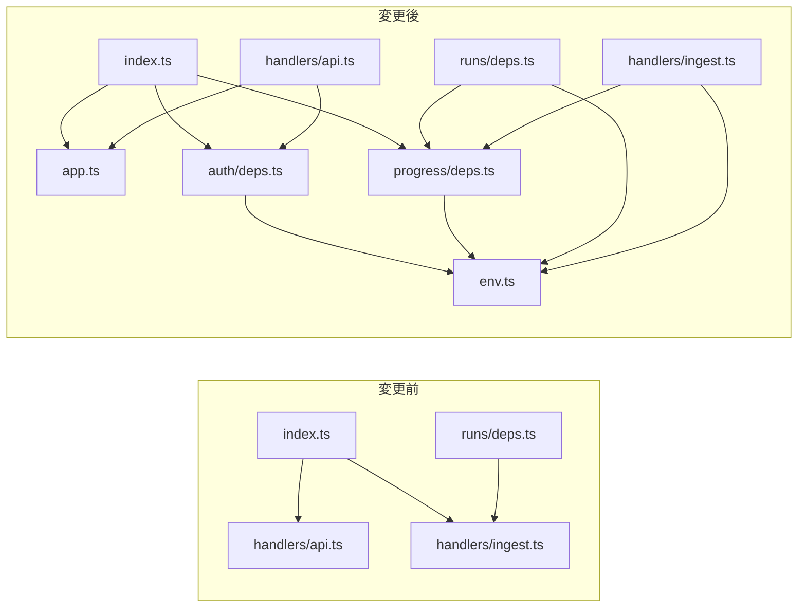
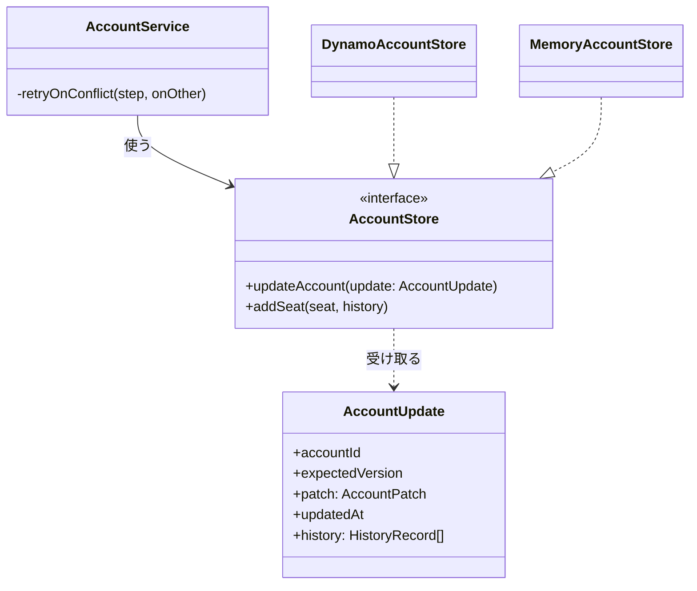
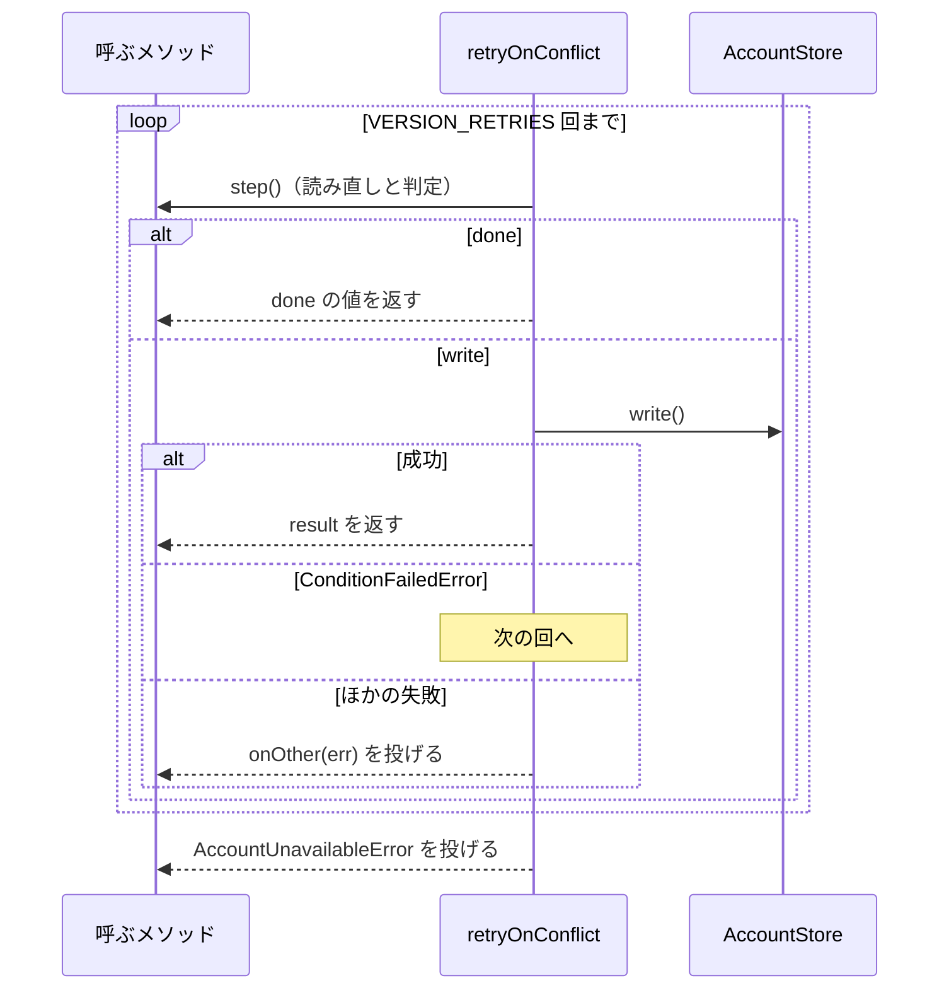
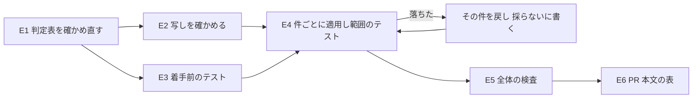

# factory/: 見送ったリファクタリングの提案 20 件を片付け、同じ役割の関数を 1 か所へ寄せる（#2199）

## 目的

- **何が壊れているか**: #2170 の cross-refactoring（PR #2192）が `factory/` のリファクタリングの提案 20 件（R01〜R20）を時間（`budget`）で見送り、どの課題にも残っていない。その後に重複が広がり、2026-10-31 の `develop`（ee32e92f）では `requireEnv` が 4 か所、ログインの確認が 6 画面にある
- **誰が困るか**: 同じ `factory/api/`・`factory/web/` に足していく子課題（#2171・#2172・#2173・#2174・#2189）の実装者と、その cross-refactoring。重複を写して広げ、同じ提案を毎回出し直しては時間で見送る
- **直すと何が成り立つか**: 20 件のそれぞれが「適用した」か「採らない（理由つき）」に決まり、同じ役割の関数の定義が `factory/` の中で 1 か所になる。HTTP の応答・OpenAPI の契約・DynamoDB の行の形・画面の表示は変わらない

## 適用範囲

- **働く範囲**: このリポジトリの `factory/api/src`・`factory/web/src` と `scripts/tests/test_check_markdown_links.py` だけ。配布物（`plugins/`）には届かない
- **プロジェクトごとに違うもの**: 無し（`factory/` の内部の関数の置き場と引数の形だけを変える）
- **当たるモード**: `standard`。要求と受け入れ条件があり、対象には既存のテスト（`factory/` の vitest 19 ファイル・pytest 46 件）がある

## あるべき姿の根拠

| 根拠 | 種類 | 何を示すか |
| --- | --- | --- |
| PR #2192 のリファクタリング計画のコメント「見送った提案」の 20 行（理由はすべて `budget`）と、提案の結果ファイル（`/tmp/ndf-worktrees/devbasex--ai-plugins/rf2192/work/.cross_refactoring/{claude,codex,kiro}-propose-rf2192-result.json`）の `rationale` と `plan` | 実測（記録の読み取り） | 各件の兆候と、提案した手順。この設計の判定表の出所 |
| 2026-10-31 の `develop`（ee32e92f）で `grep -rn "function requireEnv" factory/api/src` が 4 行（`handlers/api.ts`・`handlers/github-oidc.ts`・`handlers/ingest.ts`・`runs/deps.ts`） | 実測 | PR #2192 の後に写しが 2 つ増えた（要求の前提 1） |
| 同じ日の `grep -rn 'Navigate to="/login"' factory/web/src/pages` が 6 行、`grep -rn "onFailure(err)" factory/web/src` が 13 行 | 実測 | 画面の重複も PR #2192 の後に足された 3 画面（`RepositoriesPage`・`ModelCredentialPage`・`NewSprintPage`）へ写っている |
| 同じ日の `factory/api/src/github-oidc/app.ts` に `clientCredentials`・`exchangeGithubCode`・`issueIdToken` があり、POST /token の本体は 24 行 | 実測 | R07 の兆候は PR #2192 の I-001 で消えている（要求の前提 2） |
| `factory/api/src/index.ts` が `./handlers/api.ts` と `./handlers/ingest.ts` を import し、どちらも読み込みの時点で `export const handler = handle(...)` を組み立てる | 実測（コードの読み取り） | 公開の入口が Lambda の入口を読む向き（R02）。`runs/deps.ts` も `handlers/ingest.ts` を読む |
| 着手前の `uv run --frozen --project . --all-extras pytest scripts/tests/test_check_markdown_links.py -q` が `46 passed` | 実測（2026-10-31） | 受け入れ条件 5 の「変更の前の件数」 |

要求と受け入れ条件は #2199 の本文にある（コピーは [issue-2199-requirements.md](issue-2199-requirements.md)）。この文書は「どう作るか」だけを扱う。

## ドメインモデル

### コンテキスト

| コンテキスト | 何の語が 1 つの意味に決まるか |
| --- | --- |
| Neural Development Factory（`ndf-factory`） | アカウント・席・履歴・実行の形態・プラン（`factory/api/src/accounts/`）、GitHub の仲立ち（`github-oidc/`）、画面（`factory/web/`） |
| NDF の cross-refactoring（`ndf-cross-refactoring`） | 見送った提案・リファクタリング計画（R01〜R20 の出所） |

関係は**順応者**である。この変更は `ndf-cross-refactoring` が残した見送った提案を、その語と兆候の分類（duplication など）のまま受け取り、`ndf-factory` の構造を直す。`ndf-cross-refactoring` の側は何も変えない。

### 集約

**集約は変えない。** 持ち主と境界をそのまま保ち、持ち主の内部の関数の置き場だけを変える。

| 集約 | 持ち主（書き換えてよいもの） | 根 | エンティティ | 値オブジェクト |
| --- | --- | --- | --- | --- |
| アカウント | `AccountService`（`accounts/service.ts`）。保存は `AccountStore` の契約を通す | アカウント（`AccountRecord`） | 席（`SeatRecord`）・利用者（`UserRecord`） | プラン・実行の形態・席の種類・履歴の行（`HistoryRecord`） |

### 不変条件

この変更が守る条件である。I1〜I4 は既存の振る舞いをそのまま保つ条件、I5・I6 はこの変更で新しく成り立たせる構造の条件である。

| # | 集約 | 条件 | 破れたときの扱い |
| --- | --- | --- | --- |
| I1 | — | HTTP の応答（状態コード・本文・エラーの文言）と画面の表示が変更の前と同じ | その件を戻し、表の扱いを「採らない（適用すると振る舞いが変わる）」にする |
| I2 | アカウント | DynamoDB へ送る `TransactItems` の項目の並び・キー・属性・条件式・プレースホルダの名前（`:plan`・`:mode` など）が変更の前と同じ | その件を戻す（C3 に当たる変更を入れない） |
| I3 | アカウント | どの書き込みも履歴の行を同じトランザクションで足す（既存の I20）。条件の失敗は `ConditionFailedError`、それ以外の失敗は今と同じ型で呼ぶ側へ届く | その件を戻す |
| I4 | — | 認証（`auth/verify.ts`・`github-oidc/`）と認可（`auth/resolve.ts`）の判定が変更の前と同じ | その件を戻す（C2 に当たる変更を入れない） |
| I5 | — | 「適用した」件の同じ役割の関数・定数の定義が `factory/` の中で 1 か所にある | 残った写しを寄せるまで実装の Pull Request を出さない |
| I6 | — | `factory/api/src` の `handlers/` の外のコード（テストを除く）が `handlers/` を import しない | import を移した先へ替えるまで出さない |

### ドメインイベント

要求の E1〜E6 を引き継ぐ。どれも実装の工程の中の出来事で、受け手は次の手順と実装の Pull Request の本文である。

| # | イベント | 発生元 | 受け手 |
| --- | --- | --- | --- |
| E1 | 20 件のそれぞれが今の `develop` に残っているかを確かめた | 実装担当（この設計の判定表を実装の開始時の `develop` で確かめ直す） | E2・E4 |
| E2 | 同じ役割の写しを PR #2192 の後のファイルから拾った | 実装担当（判定表の「写し」の列） | E4・E6 |
| E3 | 着手前のテストが通った | 実装担当 | E4（基準の件数） |
| E4 | 各件を適用したか、採らないと決めた | 実装担当 | E5・E6 |
| E5 | 全体の検査が通った | 実装担当 | E6 |
| E6 | 20 件と写しの扱いを 1 つの表として Pull Request の本文に残した | 実装担当 | 承認ゲート 2 で見る人 |

### 用語

| 用語 | 意味 | 用語集への反映 |
| --- | --- | --- |
| 見送った提案 | cross-refactoring のリファクタリング計画の「見送った提案」の表の 1 行。ここでは PR #2192 の R01〜R20 | 変えない（`ndf-cross-refactoring` の既存の語のまま） |
| 同じ役割の写し | R01〜R20 の対象と同じ処理・同じ判断を、別の場所に書き写したもの。要求の S3 が対象に含める | 追加（`ndf-factory`） |
| 保存の契約 | `AccountStore` の interface と、その引数・失敗の型（`AccountPatch`・`AccountUpdate`・`ConditionFailedError`）。DynamoDB とメモリの 2 つの実装が満たす | 追加（`ndf-factory`） |

## 機能一覧

利用者から見た振る舞いは変えない。この変更が作る「使える形」を並べる。

| # | 機能 | 誰が使うか |
| --- | --- | --- |
| F1 | 20 件の扱い（適用した・採らない）と写しの扱いを 1 つの表で読む | 承認ゲート 2 で見る人 |
| F2 | 環境変数の読み取り・API の入口の組み立て・保存の契約・再試行を、1 か所の定義から使う | 子課題（#2171・#2172・#2173・#2174・#2189）の実装者 |
| F3 | 後の cross-refactoring が R01〜R20 と同じ提案を出さない | cross-refactoring の提案の担当 |

## 20 件の判定表

**この表が実装の Pull Request の本文の表（受け入れ条件 1）の下書きになる。** 「今の状態」は 2026-10-31 の `develop`（ee32e92f）で確かめた。実装の開始時に `develop` が進んでいれば、E1 として確かめ直す。

| # | 対象 | 今の状態 | 扱い | 直し方（1 か所にまとめる場所） | 同じ役割の写し（S3） |
| --- | --- | --- | --- | --- | --- |
| R01 | `routes/teams.ts#registerTeams` | 席の種類の検証と文言が `teams.ts` に直書き、`accounts.ts` に定数 | 適用する | `routes/body.ts` の `readSeatType(value)`。`SEAT_TYPE_MESSAGE` も移す | `routes/accounts.ts` の 2 か所 |
| R02 | `index.ts#depsFromEnv` | `index.ts` が `handlers/api.ts`・`handlers/ingest.ts` を読む | 適用する | 決定 1 | `runs/deps.ts` → `handlers/ingest.ts` |
| R03 | `github-oidc/app.ts#githubJson` | `/token` と `/userinfo` が `/user` の取得と ID の検証を 2 回書く | 適用する | `createGithubOidcApp` の中の `githubUser(accessToken)`（取れなければ `null`） | 無し |
| R04 | `accounts/store.ts#DynamoAccountStore.transact` | 6 つの書き込みが履歴の行の展開を末尾に書く | 適用する | 決定 3（R09 と同じ直し方） | 無し |
| R05 | `web/pages/TeamPage.tsx#TeamPage` | 席の種類の `<option>` が 3 か所 | 適用する | 決定 8 の `SeatTypeOptions`（`pages/parts.tsx`） | `NewTeamPage.tsx` |
| R06 | `accounts/service.ts#AccountService.setExecutionMode` | 版の競合の再試行のループが 4 つ | 適用する | 決定 4 の `retryOnConflict` | `changeSeat`・`removeSeat`・`setPlan` |
| R07 | `github-oidc/app.ts#createGithubOidcApp (POST /token handler)` | I-001 で 3 つの関数へ抽出済み | 採らない（兆候がすでに無い） | — | — |
| R08 | `accounts/store.ts#AccountStore` | 保存の契約と DynamoDB の実装が同居し、`memory-store.ts`・`service.ts` が `store.ts` から失敗の型を読む | 適用する | 決定 5 の `accounts/port.ts` | 無し |
| R09 | `accounts/store.ts#DynamoAccountStore` | R04 と同じ兆候 | 適用する | 決定 3 | 無し |
| R10 | `accounts/store.ts#DynamoAccountStore.updateAccount` | `AccountPatch` の項目ごとに `if` が 1 本 | 適用する | 項目 → 列の名前・プレースホルダの表 `PATCH_COLUMNS` を回す。プレースホルダは `:plan`・`:mode` のまま（I2） | 無し |
| R11 | `accounts/service.ts#AccountService.addSeat` | 書き込みの失敗の読み替えが `addSeat`・`createTeam` にある | 適用する | 決定 4 の `writeOr` | `createTeam` |
| R12 | `auth/verify.ts#verifyAuthorization` | 1 つの関数に Bearer の取り出し・検証・IdP の判定・sub の確認 | 適用する | モジュール内の `idpFromUsername(username)`。判定の順序は変えない（I4） | 無し |
| R13 | `routes/accounts.ts#registerAccounts` | 「チームなら席を読み、詳細の本文を作る」が 2 経路 | 適用する | `routes/views.ts` の `accountDetailBody(accounts, ctx, account)` | `routes/teams.ts` の POST /teams |
| R14 | `web/pages/AccountPage.tsx#AccountPage` | token が無ければログインへ移す確認が 6 画面 | 適用する | 決定 7 の `RequireLogin`（`context.tsx`、`App.tsx` で包む） | `RepositoriesPage`・`ModelCredentialPage`・`NewSprintPage` |
| R15 | `web/pages/TeamPage.tsx#TeamPage.act / AccountPage / ExecutionModeView / NewTeamPage` | 「呼んで、失敗なら画面の文を出す」が 12 か所 | 適用する | 決定 7 の `useAttempt`（`context.tsx`） | `RepositoriesPage`・`ModelCredentialPage`・`NewSprintPage` |
| R16 | `scripts/tests/test_check_markdown_links.py#test_link_targets_extracts_html_and_excludes_images` | スクリプトの読み込みの 4 行が 11 回 | 適用する | 同じファイルの関数スコープの fixture。テストの関数の数と入力・期待値の組は変えない | 無し |
| R17 | `accounts/service.ts#AccountService.hist` | 6 つの位置引数（8 か所から呼ぶ） | 適用する | 決定 6（`hist` を消し、`HistoryRecord` の名前つきのオブジェクトで書く） | 無し |
| R18 | `accounts/store.ts#AccountStore.updateAccount` | 5 つの位置引数が契約・2 つの実装・2 つの呼び出しに並ぶ | 適用する | 決定 5 の `AccountUpdate` | 無し |
| R19 | `accounts/store.ts#seatItem` | `USER#`・`ACCOUNT#` の直書きが 9 か所（鍵の関数 3 つの中と `listMemberships` の切り出しを含む） | 適用する | `store.ts` の鍵の頭の定数と `userPk`・`accountPk`。`listMemberships` の切り出しも同じ定数を使う | 無し |
| R20 | `handlers/github-oidc.ts#requireEnv` | 同じ定義が 4 つ | 適用する | 決定 2 の `src/env.ts` | `handlers/api.ts`・`handlers/ingest.ts`・`runs/deps.ts` |

適用する 19 件・採らない 1 件。実装で適用してテストが落ちた件は戻し、扱いを「採らない（適用するとテストが落ちる）」にして落ちた理由を書く（E4）。

**写しとして含めなかった候補**（E2。含めない理由を実装の Pull Request の表の下にも写す）:

| 候補 | 含めない理由 |
| --- | --- |
| `runs/dynamo-table.ts` の `accountPk` | 実行の表の鍵で、アカウントの表の鍵（R19）とは別の表の設計 |
| `runs/control.ts` の `SLOT_RETRIES` の再試行 | 実行の枠の取り合いで、アカウントの版の競合（R06）とは別の集約 |
| `NewSprintPage.tsx` の送信の失敗（`limit_exceeded`・`invalid_issues` で文を分ける） | 失敗の種類ごとに文を変えるため、R15 の「失敗を画面の文へ変えるだけ」と同じ役割でない |
| 3 つの保存の条件の失敗の判定（`accounts/store.ts`・`progress/store.ts`・`runs/dynamo-table.ts`） | R04 は履歴の行の展開の重複で役割が違う。#2275 として起票した |
| 秘密を 1 回だけ読むキャッシュ（`runs/deps.ts`・`handlers/ingest.ts`・`handlers/github-oidc.ts`） | R20 は環境変数の読み取りで役割が違う。#2276 として起票した |
| 画面の「`error` なら `role="alert"`、読み込み前は『読み込み中』」の 2 行 | R14 の提案の手順はログインの確認だけを対象にする。2 行は画面ごとに準備の条件が違い、まとめると画面ごとの条件を引数で渡すだけになる |

## 構成要素

| 要素 | 責務 | 件 |
| --- | --- | --- |
| `factory/api/src/env.ts`（新規） | `requireEnv(name)`。無ければ `環境変数 <name> がありません` を投げる（今の文言のまま） | R20 |
| `factory/api/src/app.ts`（新規） | `createApiApp`・`jsonLogger`・`webOriginFromEnv`・`LogEntry`・`Logger` を `handlers/api.ts` から移す | R02 |
| `factory/api/src/auth/deps.ts`（新規） | `depsFromEnv`（`AuthDeps` を 1 回だけ作る）を `handlers/api.ts` から移す | R02 |
| `factory/api/src/progress/deps.ts`（新規） | `progressStoreFromEnv` を `handlers/ingest.ts` から移す | R02 |
| `factory/api/src/handlers/api.ts`・`ingest.ts`・`github-oidc.ts` | Lambda の `handler` の配線だけを持つ。`handler` の名前と置き場は変えない（インフラが束ねる入口のため） | R02・R20 |
| `factory/api/src/index.ts` | import を `app.ts`・`auth/deps.ts`・`progress/deps.ts` へ替える。export する名前と形は変えない | R02 |
| `factory/api/src/runs/deps.ts` | `requireEnv` を `env.ts` から、`progressStoreFromEnv` を `progress/deps.ts` から読む | R02・R20 |
| `factory/api/src/accounts/port.ts`（新規） | 保存の契約: `AccountStore`・`AccountPatch`・`AccountUpdate`・`ConditionFailedError`。AWS SDK を読まない | R08・R18 |
| `factory/api/src/accounts/store.ts` | DynamoDB の実装だけを持つ。`transact(items, history)`・`PATCH_COLUMNS`・鍵の頭の定数 | R04・R09・R10・R18・R19 |
| `factory/api/src/accounts/memory-store.ts` | `port.ts` から契約を読み、`updateAccount(update)` へ合わせる | R08・R18 |
| `factory/api/src/accounts/service.ts` | `retryOnConflict`・`writeOr` を持ち、4 つの再試行と 2 つの読み替えを置き換える。`hist` を消す | R06・R11・R17・R18 |
| `factory/api/src/routes/body.ts`・`views.ts`・`accounts.ts`・`teams.ts` | `readSeatType`（`body.ts`）と `accountDetailBody`（`views.ts`）を使う | R01・R13 |
| `factory/api/src/github-oidc/app.ts` | `githubUser` を使う | R03 |
| `factory/api/src/auth/verify.ts` | `idpFromUsername` を使う | R12 |
| `factory/web/src/context.tsx` | `RequireLogin`・`useAttempt` を足す | R14・R15 |
| `factory/web/src/App.tsx` | ログインが要る 6 つの経路の `element` を `RequireLogin` で包む | R14 |
| `factory/web/src/pages/*.tsx` | ログインの確認と `try`/`catch` を消し、`SeatTypeOptions`（`parts.tsx`）を使う | R05・R14・R15 |
| `scripts/tests/test_check_markdown_links.py` | 読み込みの fixture を足し、11 のテストが使う | R16 |

R02 の依存の向き（API のコード。テストと、向きを変えない依存は省く）:



`handlers/github-oidc.ts` も `env.ts` を読む（図の横幅のため省いた）。

### パッケージ・モジュール構成

新しく置くファイルと、契約の置き場が変わるファイルだけを示す。

```text
factory/api/src/
├── env.ts                 # 新規: requireEnv
├── app.ts                 # 新規: createApiApp・jsonLogger・webOriginFromEnv
├── index.ts               # handlers/ を読まない
├── auth/
│   └── deps.ts            # 新規: depsFromEnv
├── progress/
│   └── deps.ts            # 新規: progressStoreFromEnv
├── accounts/
│   ├── port.ts            # 新規: AccountStore・AccountPatch・AccountUpdate・ConditionFailedError
│   ├── store.ts           # DynamoDB の実装だけ
│   └── memory-store.ts
└── handlers/              # Lambda の handler の配線だけ（名前と置き場は変えない）
factory/web/src/
├── context.tsx            # RequireLogin・useAttempt を足す
└── pages/parts.tsx        # SeatTypeOptions を足す
```

## 構造

保存の契約とアカウントのサービスの、変える型だけを示す。



- `AccountUpdate` のフィールドは今の 5 つの位置引数と同じ名前・型・必須性にする（R18）
- `ConditionFailedError` は `port.ts` に 1 つだけ定義し、`store.ts` は再公開しない。両方の実装とサービスの `instanceof` が同じクラスを見る（I3）
- `retryOnConflict` の `step` は、読み直しと判定をして `{ done: T }`（書かずに終わる）か `{ write: () => Promise<void>; result: T }`（書いて終わる）を返す。`onOther` は条件以外の書き込みの失敗を何へ変えるかで、既定は `AccountUnavailableError`、`setPlan` は受けた誤りをそのまま返す
- `writeOr(write, onCondition)`（モジュール内の関数）は、条件の失敗なら `onCondition()` を投げ、それ以外は `AccountUnavailableError` を投げる。`createTeam` は `onCondition` に `AccountUnavailableError` を渡す（今の `catch` がすべての失敗を `AccountUnavailableError` にするため）
- `ensureUser` は条件の失敗のあとに利用者を読み直すため、`writeOr` を使わない

## 処理の流れ

`retryOnConflict` の 1 回の呼び出し（R06）。`step` の中で投げた誤り（`ForbiddenError`・`ConflictError`・`PlanError`・席が無い）は、書き込みの前の判定なのでそのまま呼ぶ側へ届く。読み替えるのは `write` の失敗だけである。



実装の順序（E1〜E6）。各件はコミットを分け、件ごとに範囲のテストを流してから次へ進む。



**件の順序は、置き場を作る件を先にする。** R20（`env.ts`）→ R02（`app.ts`・`deps.ts`）→ R08・R18（`port.ts`）→ R04・R09・R10・R19（`store.ts`）→ R06・R11・R17（`service.ts`）→ R01・R13 → R03・R12 → 画面（R05・R14・R15）→ R16。後の件が前の件の置き場を使うためである。構成要素の表の各行は「件」の列の番号で、この順序のどこかに入る（R07 は採らないため入らない）。

## 非機能の実現方式

| 大項目 | 条件（要求） | 実現方式 |
| --- | --- | --- |
| 運用・保守性 | 同じ役割の関数の定義を 1 か所にする | 判定表の「直し方」の場所に置き、写しを消す。テスト設計の I5 の行の検索で確かめる |
| セキュリティ | 認証・認可の振る舞いを変えない（C2） | R03・R12 は抽出だけで、判定の条件と順序を変えない。`verify.test.ts`・`github-oidc/app.test.ts`・`handlers/api.test.ts` の既存の期待値で縛る。差分は承認ゲート 2 で人が見る |
| 移行性 | DynamoDB のキーと属性の形を変えない（C3 に当たる変更を含まない） | R04・R09・R10・R19 は `TransactItems` の並びと属性名を変えない。`store.test.ts` の既存の期待値（鍵・GSI の鍵・条件式・プレースホルダ）で縛る |

## 決定の記録

### 決定 1: 公開の入口が Lambda の入口を読まないよう、handlers/ を handler の配線だけにする

`index.ts` は `depsFromEnv` だけでなく `createApiApp` も `handlers/api.ts` から、`progressStoreFromEnv` を `handlers/ingest.ts` から読む。`depsFromEnv` だけを移しても、残りの 2 つが同じ向きを残す。そこで `createApiApp` と付随する型・関数を `src/app.ts` へ、`depsFromEnv` を `auth/deps.ts` へ、`progressStoreFromEnv` を `progress/deps.ts` へ移し、`handlers/*.ts` は `handler` の組み立てだけにする。置き場の名前は既存の `runs/deps.ts`（環境変数から依存を作る）と `progress/app.ts`・`github-oidc/app.ts`（Hono の app を組む）に揃える。

提案どおり `depsFromEnv` だけを `src/deps.ts` へ移す形は採らない。`createApiApp` と `progressStoreFromEnv` の向きが残り、後の cross-refactoring が同じ兆候を出し直す。

根拠: Value 6 / Value 7（MVV 版 3）

### 決定 2: 環境変数の読み取りの規則を 1 か所にするため、requireEnv を src/env.ts に置く

4 つの写しは文言まで同じで、API・受け口・GitHub の仲立ち・実行の制御の 4 つのコンテキストから使う。どれか 1 つのコンテキストの下（`auth/deps.ts` など）に置くと、ほかのコンテキストがそのコンテキストを読む向きが生まれるため、`src/` の直下に置く。

根拠: Value 6（MVV 版 3）

### 決定 3: 履歴を同じトランザクションで足す規則（I20）を 1 か所で守るため、transact が履歴を受け取る

R04 と R09 は同じ兆候（6 つの書き込みが末尾に履歴の行の展開を書く）を別の提案元が出したもので、1 つの変更で両方が消える。`transact(items, history)` が履歴を `put` の列へ変えて `items` の後ろに付ける。`TransactItems` の並び（業務の項目が先、履歴が後）は今と同じになる（I2）。`MemoryAccountStore` が `write` に履歴を受けて 1 か所で守っている形とも揃う。

`transact` を包む別のメソッドを足す形は採らない。書き込みの経路が 2 段になり、`transact` を直に呼ぶ書き込みを足すと規則を外れられる。

根拠: Value 6（MVV 版 3）

### 決定 4: 版の競合の再試行と書き込みの失敗の読み替えを、AccountService の 2 つの関数に寄せる

再試行のループは `setExecutionMode`・`setPlan`（R06）に加えて、同じ形の `changeSeat`・`removeSeat` にもあり、4 つを `retryOnConflict` にする。書き込みの前の判定で投げる誤りはそのまま届き、`write` の失敗だけを読み替える必要があるため、`step` は判定の結果として「書かずに終わる」か「書いて終わる」を返す形にする（「構造」の節）。再試行しない書き込み（`addSeat`・`createTeam`）は `writeOr` にする（R11）。

提案の、`attempt` が番兵の値（`RETRY`）を返す形は採らない。判定の誤りと書き込みの誤りを `attempt` の中で分ける `try` が呼ぶ側ごとに残り、重複が消えない。

根拠: Value 6（MVV 版 3）

### 決定 5: 保存の契約を DynamoDB の実装から分けるため、accounts/port.ts に置き、updateAccount の引数を 1 つにまとめる

`memory-store.ts` と `service.ts` は `ConditionFailedError` のために `store.ts` を実行時に読み、DynamoDB を使わない経路でも AWS SDK を読み込む（R08）。契約を `accounts/port.ts` へ移す。置き場の名前は既存の `github/port.ts`（GitHub の口の型）に揃える。同じ変更で `updateAccount` の 5 つの位置引数を `AccountUpdate` にする（R18）。契約を一度に変えるため、2 つの実装と 2 つの呼び出しを 1 回で直せる。

契約を `accounts/model.ts` へ置く形は採らない。`model.ts` は値の型と判定の関数（`isPlan` など）を持ち、保存の契約を混ぜると変わる理由が 2 つになる。`store.ts` に再公開を残す形も採らない。読む側が 2 つの置き場のどちらを使うかが揃わなくなる。

根拠: Value 6 / Value 8（MVV 版 3）

### 決定 6: 履歴の before と after を取り違えないよう、hist を消して名前つきのオブジェクトで書く

`hist` は 6 つの位置引数を `HistoryRecord` のフィールドへ並べ替えるだけの関数で、`before` と `after` の取り違えを型で防げない。呼び出し側で `HistoryRecord` のオブジェクトを書けば、フィールドの名前が取り違えを防ぐ。

`hist(fields: HistoryRecord)` へ引数の形を変える形は採らない。受けたものをそのまま返す関数が残るだけになる。

根拠: Value 6（MVV 版 3）

### 決定 7: 画面ごとのログインの確認と失敗の表示を、context.tsx の 2 つに寄せる

ログインの確認（R14）は 6 画面、失敗を画面の文へ変える `try`/`catch`（R15）は 12 か所にあり、PR #2192 の後に足した 3 画面にも写っている。確認は `RequireLogin` にして `App.tsx` の経路で包み、画面から `hasToken` の判定を消す。包まれた画面は token があるときだけ描かれるため、画面の中の「token が無ければ読まない」条件も消せる。失敗の表示は `useAttempt()` が返す `attempt(op, show)` にする。`attempt` は `useFailureHandler` を使い、401 ならログインへ移って `show(null)`、ほかは画面の文を `show` へ渡す。**`attempt` は `useCallback` で同じ関数を返す。** `useEffect` の依存に入るため、描くたびに変わると読み込みが繰り返される。

`App.test.tsx` はすべての画面を `App` の経路から描くため、確認を経路へ移しても既存のテストが同じ振る舞いを縛る。

根拠: Value 6（MVV 版 3）

### 決定 8: 席の種類の選択肢だけを 1 か所にし、select の属性は画面に残す

3 つの `<select>` は `aria-label`・値・変えたときの処理がそれぞれ違い、同じなのは `<option>` の並びだけである。`parts.tsx` に `SEAT_TYPES` と `SeatTypeOptions` を置き、`MODE_LABELS` から `<option>` を作る既存の形に揃える。

`select` ごと部品にする形は採らない。画面ごとに違う 3 つの属性を引数で渡すだけになる。

根拠: Value 6（MVV 版 3）

### 決定 9: 既存のテストを振る舞いの基準にし、提案が求めた現状固定テストは足さない

提案のうち R05・R07・R09 の手順は、適用の前に現状固定テストを足すとしていた。今の `store.test.ts` は `transact` を通る書き込み（利用者の作成・席の追加と外し・アカウントの更新）の `TransactItems` の並びと鍵を、`App.test.tsx` は席の操作の画面を、`github-oidc/app.test.ts` は `/token` を既に縛る。共通の関数へ寄せた後もこれらのテストが同じ経路を通るため、要求の「新しいテストは足さない（既存のテストが届かないときだけ足す）」に従い足さない。実装で既存のテストが届かない共通の関数が見つかったときだけ足す。

テストの呼び出しの形は変わる。`store.test.ts` の `updateAccount` の呼び出し（R18）、`ConditionFailedError` の import の置き場（R08）、`createApiApp` の import の置き場（`handlers/api.test.ts`・`routes/factory.test.ts`、R02）である。どれも `expect(...)` の右辺を変えず、実装の Pull Request の表の行に理由を書く（受け入れ条件 6）。

根拠: Value 1 / Value 10（MVV 版 3）

### 決定 10: 実装の差分を factory/ と R16 のテストに限るため、確定仕様の構成要素の表は確定仕様化で直す

`docs/specifications/ndf-factory-accounts-and-plans.md` の構成要素の表は、API の入口（ログ・CORS・中間処理）を `handlers/api.ts`、保存を `accounts/store.ts` としている。決定 1・5 の後はこの 2 行が実装と食い違う。受け入れ条件 8 は `factory/` の外の差分を `scripts/tests/test_check_markdown_links.py` に限るため、この 2 行は実装の Pull Request で直さず、#2199 の確定仕様化（`plan-to-spec`）で `app.ts`・`accounts/port.ts` の行とともに直す。

根拠: Value 7（MVV 版 3）

## テスト設計

| 受け入れ条件・不変条件 | どの振る舞いで縛るか | どう壊したら落ちるべきか |
| --- | --- | --- |
| 受け入れ条件 1・2 | 実装の Pull Request の本文の表が R01〜R20 の 20 行をそろえ、扱いが「適用した」か「採らない」、採らない理由が 4 つのどれか | 行が欠ける・理由が `budget` の行がある → E6 の数え直しで止まる |
| 受け入れ条件 3・I5 | `grep -rn "function requireEnv" factory/api/src` が 1 行。ほかの件は判定表の場所で数える: `standard か premium` がテストの外で 1 行（`routes/body.ts`）、`onFailure(err)` が `factory/web/src` で 1 行（`NewSprintPage` の分岐）、`Navigate to="/login"` が `factory/web/src/pages` で 0 行、`<option value="standard"` が `factory/web/src` で 0 行、`VERSION_RETRIES` が `service.ts` で 2 行（定数と `retryOnConflict`）、`historyItem` が `store.ts` で 2 行（定義と `transact`）、`this.hist(` が 0 行 | 写しを 1 つ残すと、その行の数が増える |
| 受け入れ条件 4・I1 | `npm --prefix factory ci --no-audit --no-fund --silent && npm --prefix factory run check` が 0 で終わる（既存の vitest・`tsc --noEmit`・spectral） | 応答・表示・エラーの文言を変えると既存の vitest が落ちる |
| 受け入れ条件 5 | `uv run --frozen --project . --all-extras pytest scripts/tests/test_check_markdown_links.py -q` が 0 で終わり、通った件数が 46 以上 | fixture がテストごとに新しいモジュールを作らない形（モジュールのスコープ）に変わると、テストの間で状態が漏れうる。テストの関数を減らすと件数が減る |
| 受け入れ条件 6 | `git diff origin/develop...HEAD -- 'factory/**/*.test.ts' 'factory/**/*.test.tsx'` の `-` の行に `expect(` の右辺を変える行が無い | 期待値を書き換えて通すと差分に現れる |
| 受け入れ条件 7・8 | `git diff --stat origin/develop...HEAD` が `factory/contracts/`・`plugins/` と、`factory/` と `scripts/tests/test_check_markdown_links.py` の外のコードを含まない | 範囲の外を変えると一覧に現れる |
| I2 | `store.test.ts` の既存の期待値（鍵・GSI の鍵・条件式・`:expected`・`:next`・`:plan`・`:mode`・履歴の行が最後） | プレースホルダの名前を変える・履歴を業務の項目より先に並べると落ちる |
| I3 | `service.test.ts` の「版の競合が 3 回続けば保存の失敗を返す」と、`handlers/api.test.ts` の「書き込みが失敗したら席も履歴も増えない」「既に席がある → 409」 | `retryOnConflict` が条件以外の失敗を再試行する・`setPlan` の失敗を包む・`writeOr` が 409 を返さないと落ちる |
| I4 | `verify.test.ts`・`github-oidc/app.test.ts` の既存の期待値 | IdP の判定の順序・`/token` の `invalid_grant`・`/userinfo` の 401 を変えると落ちる |
| I6 | `grep -rln 'from "\.\{1,2\}/handlers/' factory/api/src --include=*.ts` から `*.test.ts` を除いて 0 件（今は `index.ts`・`runs/deps.ts`・`testing/app.ts` の 3 件） | `index.ts` に `handlers/` の import を残すと 1 件になる |

## 設計の結果

| 課題 | 扱い | 取り込み先 | 触るファイル |
| --- | --- | --- | --- |
| #2199 | 実装する | — | `factory/api/src/`、`factory/web/src/`、`scripts/tests/test_check_markdown_links.py` |

## 未確認のまま残ること

| 項目 | 内容 |
| --- | --- |
| 実装の進め方（要求の未決 2） | cross-refactoring で行うか、実装計画どおりに直接行うかは `implementation-plan` が決める。この設計は判定表と直し方を決めたので、直接行えば提案の出し直しと予算の見積りが要らない |
| 着手の順位（要求の未決 1） | #2171 の実装より前に行うかは棚卸しが決める。後になるほど写しが増え、判定表の「写し」の列を E1 で確かめ直す量が増える |
| `develop` が進んだときの判定表 | 2026-10-31 の ee32e92f で確かめた。実装の開始までに子課題がマージされれば、E1 で 20 件と写しを数え直す |
| インフラが束ねる入口 | private リポジトリのインフラは `handlers/*.ts` の `handler` を束ねる。名前と置き場を変えないため影響しない見込みだが、インフラの定義はこのリポジトリから読めない（#2200） |
