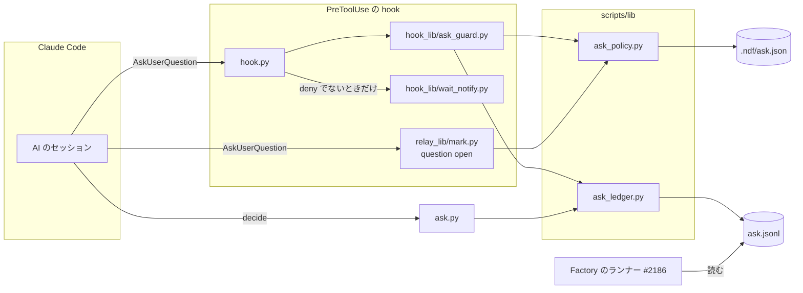
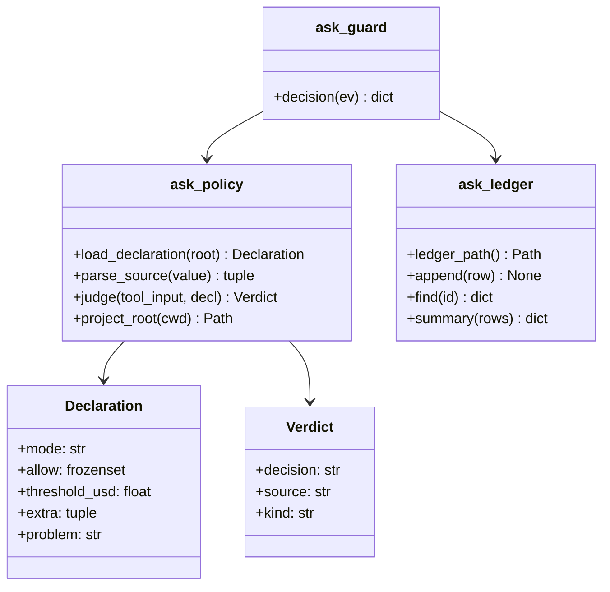
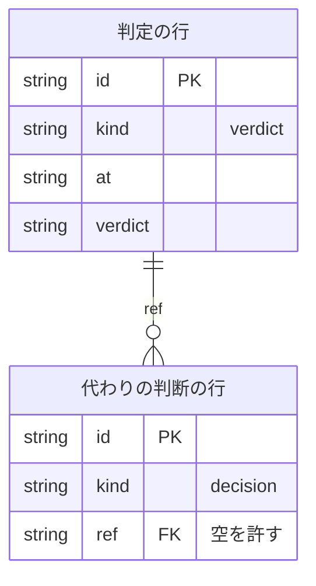
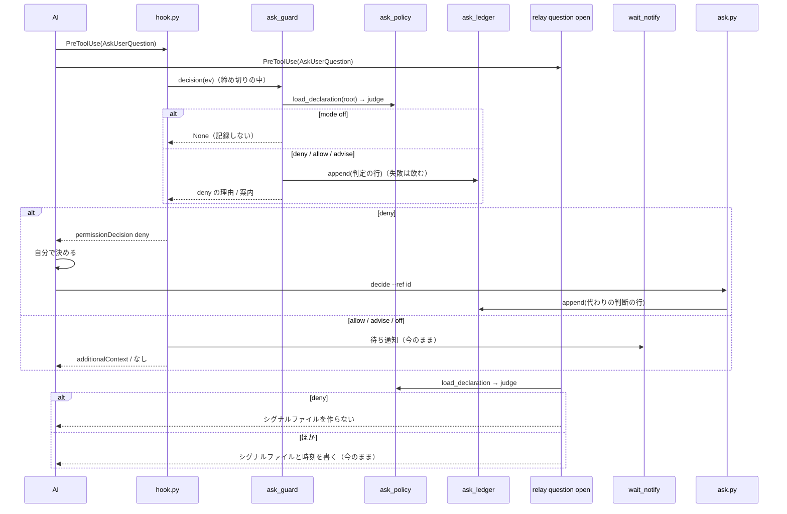

# hook: 承認ゲートの外の問い合わせを止め、AI が決められない問いだけを人へ回す（#2206）

## 目的

- **何が壊れているか**: 承認ゲート（設計 PR のマージ・本番系へ届く操作）の外で AI が出す `AskUserQuestion` を止める仕組みが無い。`hook.py` は `AskUserQuestion` を Slack の待ち通知にだけ使い、判定しない
- **誰が困るか**: 利用者と conductor。AI が自分で決められる問いでセッションが止まる。Factory（#2186 のランナー）では問い合わせ 1 件ごとに実行ジョブが終わり、人の答えまでスプリントが止まる（確定仕様 `ndf-factory-service-boundary.md` の I8）
- **直すと何が成り立つか**: 区分（`metadata.source`）の無い問いは hook が止め、AI は理由を記録して自分で決めて続ける。人に届くのは、承認ゲートと、宣言（`.ndf/ask.json`）が許した区分の問いと、共通原則の C1〜C8・プロジェクトの P の行（レッドライン）の承認だけになる

## 適用範囲

- **働く範囲**: 配布先のリポジトリでも働く（hook は NDF の配布物）。宣言が無いリポジトリでも既定（`enforce`・組み込みの 4 区分）で働く。止めるのは Claude Code だけで、Codex・Kiro CLI・agy の扱いは決定 7 のとおり
- **プロジェクトごとに違うもの**: 宣言 `.ndf/ask.json`（働き方・人へ回す区分・費用のしきい値・プロジェクトが足す区分）で受ける。引数では受けない
- **当たるモード**: `standard`。既定の振る舞い（hook）と Skill の手順と承認ゲートの問い方を変えるため、承認ゲート 1 を人が見る

## あるべき姿の根拠

| 根拠 | 種類 | 何を示すか |
| --- | --- | --- |
| 利用者の依頼（2026-10-31）「承認ゲート以外のユーザー問い合わせは原則hookで止めてAIが判断するように強制する」「どうしても判断が不可能な場合(金銭的コストがかかるなど)の場合のみ、AskUserQuestionを出して判断を求めます」 | 利用者の指示の原文 | 止める側を既定にし（宣言が無くても `enforce`）、人へ回すのを区分のある問いだけにする |
| Claude Code 2.1.314 の本体の `AskUserQuestion` の入力定義に `metadata.source`（説明 `Optional identifier for the source of this question`、利用者に表示しない）がある（要求の前提 1、2026-10-31） | 外部の一次情報 | 区分を AI が付け、hook は中身を読まずに区分だけを見る形（決定 1）が成り立つ |
| token の guard（`hook_lib/token_guard.py` の `deny`）が `permissionDecision: "deny"` と理由で Tool を止め、理由が AI へ返っている | 実測（既存の振る舞い） | 同じ出力の形で `AskUserQuestion` を止められる（要求の前提 2） |
| relay の `question open`（`relay_lib/mark.py` の `cmd_question`）は PreToolUse の別の hook で、問いのシグナルファイルと時刻（`asked.json`）を書き、差し戻しの判定（`prose_wait_reason`）がそれを読む | 実測（コードの読み取り） | 止めた問いにシグナルファイルを残すと差し戻しが抑えられるため、relay も同じ判定を読む（決定 4） |

要求と受け入れ条件は #2206 の本文にある（コピーは [issue-2206-requirements.md](issue-2206-requirements.md)）。この文書は「どう作るか」だけを扱う。問い合わせの手順の見直し（AC13）の一覧は [issue-2206-design-asking-sites.md](issue-2206-design-asking-sites.md) に分けた。

## ドメインモデル

### コンテキスト

| コンテキスト | 何の語が 1 つの意味に決まるか |
| --- | --- |
| NDF の開発ワークフロー（`ndf-workflow`） | 問い合わせの区分・問い合わせの宣言・代わりの判断・問い合わせの記録・承認ゲート・レッドライン |
| Neural Development Factory（`ndf-factory`） | 判断（`gate.reached` の種類）・ランナー・実行ジョブ |

`ndf-workflow` が上流、`ndf-factory` が下流で、関係は**公開された言語**である。下流のランナー（#2186）は問い合わせの記録の 1 行の形（下の「データ構造」）を読むだけで、`ndf-workflow` は下流の要求を受けて形を変えない。Claude Code は外部の系で、`ndf-workflow` が**順応者**として `AskUserQuestion` の入力と PreToolUse の出力の形をそのまま使う。

### 集約

| 集約 | 持ち主（書き換えてよいもの） | 根 | エンティティ | 値オブジェクト |
| --- | --- | --- | --- | --- |
| 問い合わせの宣言 | 利用者（`.ndf/ask.json` を手で書く）。NDF は読むだけ | 宣言 | — | 働き方（`mode`）・許す区分の集合（`allow`）・費用のしきい値・足す区分（`extra[]`）・読めなかった箇所 |
| 問い合わせの判定（1 回の `AskUserQuestion` への判定） | `lib/ask_policy.py` の `judge` | 判定 | — | 区分・判定の値（`deny` / `allow` / `advise`）・判定の理由の種類 |
| 問い合わせの記録 | `lib/ask_ledger.py`（追記だけ） | 記録のファイル | 判定の行・代わりの判断の行（`id` で識別） | 時刻・セッション・作業ディレクトリ・問いの文 |

判定は宣言を値として受け取り、宣言を書き換えない。代わりの判断の行は判定の行を `ref`（判定の行の `id`）でだけ指す。1 回の hook の起動が書き換えるのは記録への 1 行の追記だけである。

### 不変条件

| # | 集約 | 条件 | 破れたときの扱い |
| --- | --- | --- | --- |
| I1 | 問い合わせの判定 | 区分が `ndf-gate:1`・`ndf-gate:2` なら、どの宣言でも `deny` にならない | テストが落ちる（AC2） |
| I2 | 問い合わせの判定 | 区分が `ndf-ask:redline:<番号>`（`<番号>` は `C1`〜`C8`・`P<数>`・`R<数>`）なら、どの宣言でも `deny` にならない | テストが落ちる（AC5） |
| I3 | 問い合わせの判定 | `mode` が `enforce` のとき、区分が無い・形に合わない・許す区分（`allow` と `extra[].name`）に無い問いは `deny`、ある問いは `allow` になる | テストが落ちる（AC1・AC3） |
| I4 | 問い合わせの宣言 | 宣言が無い・読めない・形が誤っているとき、`enforce` と組み込みの 4 区分としきい値 `0` で判定し、読めなかったときはその箇所を判定に添える | テストが落ちる（AC4・AC7） |
| I5 | 問い合わせの判定 | `mode` が `off` なら hook は何も出さず記録も書かない。`advise` なら `deny` を出さない | テストが落ちる（AC8） |
| I6 | 問い合わせの判定 | 判定は問いの文と選択肢を読まない。区分と宣言が同じなら、問いの文が違っても判定は同じ | テストが落ちる（要求の「含まない」） |
| I7 | 問い合わせの判定 | 同じ入力と宣言に対し、hook の判定と relay の `question open` の判定は同じ値になる（`deny` の問いに relay はシグナルファイルを作らない） | テストが落ちる（決定 4） |
| I8 | 問い合わせの判定 | 宣言の読み込み・記録の書き込み・判定の内部のどの失敗でも、締め切りを過ぎても、hook は終了コード 0 で `deny` を出さない | テストが落ちる（AC11） |
| I9 | 問い合わせの記録 | hook の判定 1 回につき判定の行が 1 行だけ追記され、既にある行は書き換えない | テストが落ちる（AC9・非機能の運用） |
| I10 | 問い合わせの記録 | 代わりの判断の行は、`ref` があれば記録にある判定の行の `id` を指し、`ref` が無ければ問いを持つ（手順に従って AI が先に決めた場面。決定 9）。どちらでも問い・答え・理由を空にしない | `ask.py decide` が終了コード 1 で行を書かない（AC10） |
| I11 | 問い合わせの記録 | 行が持つ項目は「データ構造」の表の列だけで、hook の入力のほかの欄（`transcript_path`・環境変数・選択肢）を写さない | テストが落ちる（非機能のセキュリティ） |
| I12 | 問い合わせの判定 | `deny` の問いでは Slack の待ち通知を送らない。`allow`・`advise` の問いと、ほかの事象の通知は今のまま | テストが落ちる（AC15・決定 5） |

### ドメインイベント

| # | イベント | 発生元 | 受け手 |
| --- | --- | --- | --- |
| E1 | AI が `AskUserQuestion` を呼んだ | AI（Claude Code のセッション） | `hook.py` と relay の `question open`（PreToolUse） |
| E2 | hook が `.ndf/ask.json` を読んだ | `lib/ask_policy.py` の `load_declaration` | `judge` |
| E3 | hook が問い合わせを通した | `hook_lib/ask_guard.py` | Claude Code（問いを出す）・待ち通知・relay（シグナルファイルを作る） |
| E4 | hook が問い合わせを止めた | `hook_lib/ask_guard.py` | AI（理由と案内を受け取る） |
| E5 | hook が判定を記録に書いた | `lib/ask_ledger.py` | 振り返り・Factory のランナー（#2186） |
| E6 | AI が止めた理由を受け取り、自分で判断した | AI | — （E7 で記録に残る） |
| E7 | AI が判断と理由を記録した | `scripts/ask.py decide` | 振り返り・Factory のランナー |
| E8 | 利用者が通った問い合わせに答えた | 利用者 | AI・relay の `question close`（PostToolUse） |
| E9 | 振り返りで区分の使い方を見直した | `scripts/ask.py summary` を読む振り返り | 宣言の書き手（利用者） |

### 用語

| 用語 | 意味 | 用語集への反映 |
| --- | --- | --- |
| 問い合わせの区分 | `AskUserQuestion` の `metadata.source` に AI が付ける値。`ndf-gate:<番号>`・`ndf-ask:redline:<番号>`・`ndf-ask:<名前>` の 3 つの形 | 意味の変更（レッドラインの形を足す） |
| 問い合わせの宣言 | `.ndf/ask.json`。人へ回してよい区分と hook の働き方をプロジェクトごとに書く | 変更なし（要求で追加済み） |
| 代わりの判断 | hook が止めた後か、手順が「AI が決める」とした場面で AI が自分で下した判断。問い・答え・理由を記録する | 意味の変更（手順で決めた場面を含める） |
| 問い合わせの記録 | `ask.jsonl`。hook の判定の行と代わりの判断の行を追記だけで持つ | 追加 |

## 機能一覧

| # | 機能 | 誰が使うか |
| --- | --- | --- |
| F1 | 区分の無い・許されない問いを止め、理由・記録の手段・人へ回してよい区分を AI へ返す | AI |
| F2 | 承認ゲート・レッドライン・許された区分の問いを人へ通し、費用のしきい値を案内する | AI と利用者 |
| F3 | 宣言でプロジェクトごとに働き方・区分・しきい値を変える | 利用者 |
| F4 | 代わりの判断を記録する | AI |
| F5 | 判定と代わりの判断を区分ごと・判定ごとに数える | 振り返り・Factory のランナー |
| F6 | Skill とエージェントの手順が、区分を付けて問うか自分で決めて記録する | AI |
| F7 | relay の差し戻しの文が区分の付け方を案内する | AI（relay の下のセッション） |
| F8 | ランタイムごとの扱いを利用者向けの文書で示す | 利用者 |

## 構成要素

| 要素 | 責務 |
| --- | --- |
| `scripts/lib/ask_policy.py`（新規） | 宣言の読み取りと検証（`load_declaration`）、区分の解析、判定（`judge`）。標準ライブラリだけで書き、ファイルを読む以外の副作用を持たない |
| `scripts/lib/ask_ledger.py`（新規） | 記録の置き場（`ledger_path`）、1 行の追記（`append`）、`id` での引き当て（`find`）、集計（`summary`） |
| `scripts/hook_lib/ask_guard.py`（新規） | `judge` の結果から hook の出力（`deny` の理由・`additionalContext` の案内）を作り、判定の行を追記する。追記の失敗は飲む |
| `scripts/hook.py`（変更） | PreToolUse の `AskUserQuestion`（`--runtime claude`）を締め切りの中で `ask_guard` へ渡す。`deny` のときは待ち通知を呼ばない。docstring の表に行を足す |
| `scripts/ask.py`（新規） | 副命令 `decide`（代わりの判断の行を書く）と `summary`（数える）。出力は統一の JSON レポート |
| `scripts/relay_lib/mark.py`（変更） | `cmd_question("open")` が入力の JSON を `judge` に掛け、`deny` ならシグナルファイルと時刻を書かない。`WAIT_REASON` に区分の付け方を足す |
| `scripts/relay_lib/version_dir.py`（変更） | 複製へ写す `LIB_FILES` に `lib/ask_policy.py` を足す |
| `skills/development-workflow/references/asking.md`（新規） | 問い合わせの区分の正本: 人へ回す区分・AI が決める例・区分の付け方・`ask.py decide` の打ち方・宣言の形 |
| Skill・エージェントの本文（変更） | 問い合わせの手順を区分つきか代わりの判断へ書き換える（一覧は [asking-sites](issue-2206-design-asking-sites.md)） |
| `docs/ndf-plugin-reference.md`・`plugins/ndf/README.md`（変更） | ランタイムごとの扱い（AC12）と宣言の置き場の案内 |
| `docs/glossary/glossary.json`・`docs/glossary.md`（変更） | 用語の表の 3 語の反映 |



図に含めない要素は `relay_lib/version_dir.py`（複製へ写すファイルの一覧）・`asking.md`・Skill とエージェントの本文・利用者向けの文書・用語集で、どれも処理の流れに現れない。

パッケージの置き場:

```text
plugins/ndf/scripts/
├── hook.py                     変更
├── ask.py                      新規
├── hook_lib/ask_guard.py       新規
├── lib/ask_policy.py           新規（relay の複製にも入る）
├── lib/ask_ledger.py           新規
├── relay_lib/mark.py           変更
├── relay_lib/version_dir.py    変更
└── tests/test_ask_*.py         新規
plugins/ndf/skills/development-workflow/references/asking.md   新規
```

## 構造



`Verdict.kind` は判定の理由の種類で、`gate`・`redline`・`allowed`・`missing`（区分が無い）・`malformed`（形に合わない）・`not-allowed`（許す区分に無い）・`off` のどれかを持つ。`decision` は `kind` と `mode` から決まる（`off` → 出力なし、`missing`・`malformed`・`not-allowed` → `enforce` で `deny`・`advise` で `advise`、ほか → `allow`）。

## データ構造

### 宣言 `.ndf/ask.json`

| 項目 | 型 | 無いとき | 意味と検証 |
| --- | --- | --- | --- |
| `version` | 整数 | 読めない扱い | `1` だけを受ける（真偽値は不可） |
| `mode` | 文字列 | `enforce` | `enforce` / `advise` / `off` |
| `allow` | 文字列の配列 | 4 つすべて | `cost`・`irreversible`・`human-action`・`legal` の部分集合。空配列は「組み込みの区分は 1 つも許さない」で、無いときと区別する |
| `cost.threshold_usd` | 0 以上の数 | `0` | この額以下の費用は AI が決める。hook は額を比べず、案内に載せる |
| `extra[]` | `{name, description}` の配列 | 無し | `name` は `^[a-z0-9][a-z0-9-]*$` で、組み込みの 4 つと `redline` に重ならない。`description` は空でない文字列 |

形が 1 か所でも誤っていれば宣言全体を既定に置き換え、`problem` に最初の誤りの箇所（`version`・`allow[2]` のような項目の名前）を入れる（決定 6）。宣言の場所は、作業ディレクトリから上へ `.git`（ファイルかディレクトリ）を持つ最初のディレクトリの `.ndf/ask.json` である（決定 8）。

### 問い合わせの記録 `ask.jsonl`

置き場は `${NDF_MVV_STATE_DIR:-~/.local/state/ndf}/ask.jsonl`（承認ゲートの差し戻しの記録 `gate-rejections.jsonl` と同じ置き場。決定 2）。1 行 1 件の JSON で、追記だけを行う（履歴保持型。行を書き換えない）。



| 列 | 型 | 判定の行 | 代わりの判断の行 | 意味 |
| --- | --- | --- | --- | --- |
| `v` | 整数 | 許さない | 許さない | 行の形の版。`1` |
| `kind` | 文字列 | `verdict` | `decision` | 行の種類 |
| `id` | 文字列 | 許さない | 許さない | 12 桁の 16 進（`uuid4` の先頭） |
| `at` | 文字列 | 許さない | 許さない | UTC の ISO 8601（秒まで） |
| `session` | 文字列 | 空を許す | 空を許す | hook の入力の `session_id`。空は「入力に無かった」。代わりの判断の行は `ref` の行から写し、`ref` が無ければ空 |
| `cwd` | 文字列 | 許さない | 許さない | 作業ディレクトリの絶対パス |
| `runtime` | 文字列 | `claude` | — | 判定したランタイム |
| `source` | 文字列 | 空を許す | — | `metadata.source` の値。空は「区分が無い」 |
| `verdict` | 文字列 | `deny` / `allow` / `advise` | — | 判定の値（`off` は行を書かない） |
| `reason` | 文字列 | `Verdict.kind` | 許さない | 判定の行は理由の種類、代わりの判断の行は AI の理由の文 |
| `mode` | 文字列 | 許さない | — | 判定に使った働き方 |
| `decl_problem` | 文字列 | 空を許す | — | 宣言を読めなかった箇所。空は「読めた・無かった」 |
| `questions` | 文字列の配列 | 許さない | — | `questions[].question` の文だけ（選択肢は写さない） |
| `ref` | 文字列 | — | 空を許す | 指す判定の行の `id`。空は「手順が AI に決めさせた場面で、止めた行が無い」 |
| `question` | 文字列 | — | 許さない | 決めた問い。`ref` があり省いたときは判定の行の `questions` を改行でつないだもの |
| `answer` | 文字列 | — | 許さない | 選んだ答え |

`—` はその種類の行に列を置かないことを表す。

| 機能 | 宣言 | 判定の行 | 代わりの判断の行 |
| --- | --- | --- | --- |
| F1・F2 判定 | R | C | — |
| F4 代わりの判断 | — | R | C |
| F5 数える | — | R | R |

移行: 新しいファイルで、既存の記録は変えない。保存の期間は決めず、消すのは利用者である（ほかの記録と同じ）。

## 入出力の契約

### hook（PreToolUse・`AskUserQuestion`・Claude Code）

| 項目 | 内容 |
| --- | --- |
| 入力 | 標準入力の JSON。読む欄は `tool_name`・`tool_input.metadata.source`・`tool_input.questions[].question`・`session_id`・`cwd` だけ |
| 出力（`deny`） | `{"hookSpecificOutput": {"hookEventName": "PreToolUse", "permissionDecision": "deny", "permissionDecisionReason": <理由>}}` |
| 出力（`allow`・`advise`） | `{"hookSpecificOutput": {"hookEventName": "PreToolUse", "additionalContext": <案内>}}`。`permissionDecision` を書かない（利用者の許可の扱いを変えない） |
| 出力（`off`・失敗） | 何も出さない |
| 終了コード | 常に 0 |
| 互換性 | 区分の無い問いが止まる（公開インタフェースの変更）。`mode: "off"` で今の振る舞いへ戻る。ほかの Tool の判定は変わらない |

`deny` の理由は次の順に並べる（AC1・AC6・AC7）。

1. 止めた理由（区分が無い / 形に合わない / 宣言が許していない、と `source` の値）
2. 「自分で決め、理由を記録して続ける。迷い・情報不足・好みの違いは人へ回す理由にならない」
3. 記録の手段: `python3 "<scripts の絶対パス>/ask.py" decide --ref <id> --answer "<選んだ答え>" --reason "<理由>"`
4. 人へ回してよい区分の一覧（`ndf-gate:1`・`ndf-gate:2`・`ndf-ask:redline:<番号>`・許された組み込みの区分・`extra` の `name` と `description`）と正本 `asking.md` の場所
5. 「`<しきい値>` USD 以下の費用は AI が決める」
6. 宣言を読めなかったときだけ「`.ndf/ask.json` を読めなかった（`<箇所>`）。既定で判定した」

`allow` の案内は 5 と 6 と、レッドライン以外で通したときは「区分 `<source>` で人へ回した。区分の当てはめが誤っていれば取り下げて自分で決める」を持つ。`advise` の案内は `deny` の理由と同じ文に「`advise` のため止めていない」を先頭に足す。

### `ask.py`

| 副命令 | 入力 | 出力（標準出力の統一 JSON レポート） | 終了コード |
| --- | --- | --- | --- |
| `decide` | `--answer`（必須）・`--reason`（必須）・`--ref <id>`・`--question <文>`。`--ref` も `--question` も無ければ誤り | `status: ok`、`items` に書いた行 1 件 | 0。引数の誤り・`--ref` が記録に無く `--question` も無い・答えか理由が空・書けない → 1（`status: error` と理由） |
| `summary` | `--since <ISO 8601>`（任意）・`--cwd <パス>`（任意。前方一致） | `metrics` に `verdict`（`deny`/`allow`/`advise` の件数）・`source`（区分ごとの件数）・`decision`（`ref` あり/なしの件数）・`unanswered`（止めた行のうち代わりの判断が無いもの） | 0。記録が無ければ 0 件で 0 |

`decide` の引数の値は 1 つの語として受け、改行を含んでよい（`argparse` がそのまま受ける）。

## 処理の流れ



hook と relay の hook は Claude Code が並べて起動するため、順序は保証されない。どちらも同じ宣言と入力から同じ判定を出す（I7）ため、順序に依らない。締め切りを過ぎたときは `ask_guard` の結果を捨てて通し（I8）、relay の側は締め切りを持たずに判定する。このとき relay は `deny` と判定してシグナルファイルを作らないが、問いは出る。シグナルファイルが無いときの relay の振る舞いは、Esc で取り消した問いと同じ（Stop で消えるシグナルファイルが初めから無い）で、差し戻しが 1 回余分に起こりうる。

## 非機能の実現方式

| 大項目 | 要求の条件 | 実現方式 | 確かめ方 |
| --- | --- | --- | --- |
| 性能・拡張性 | `AskUserQuestion` の判定は hook の既存の締め切りの中で終わる。`.ndf/ask.json` の読み込みと記録の追記を足しても、既存の締め切りの値を変えない | 判定は `_guards` の `Deadline` の中で打ち、外部のコマンド（`git`）を呼ばない。根は親を辿って `.git` を探す（決定 8）。追記は 1 行を 1 回の `write` で行い、ロックを取らない | テストで `hook.py` の 1 回の所要を測り、`DEADLINE_SECONDS` を変えていないことを `deadline.py` の差分で見る |
| 運用・保守性 | 記録は追記だけで、振り返りで区分ごと・判定ごとに件数を数えられる形にする | `ask.jsonl` に `kind`・`verdict`・`source` を列で持ち、`ask.py summary` が数える | `summary` のテストで区分ごと・判定ごとの件数を見る |
| セキュリティ | 記録には問いの文と答えだけを書き、hook の入力の他の欄（環境変数・トランスクリプトの中身）を写さない | 行を列の一覧から作り（I11）、入力の辞書を写さない | `transcript_path` と選択肢を入れた入力で、行の鍵が表の列だけかを見る |
| システム環境 | 判定は hook の環境の python（`lib/hook_python.py`）で動き、新しい依存のパッケージを足さない | `ask_policy`・`ask_ledger` は標準ライブラリだけで書く。relay の複製は system の `python3` で同じ `ask_policy` を読む | `pyproject.toml` の差分が無いこと。relay の複製の import のテスト |

## 決定の記録

### 決定 1: 中身を当て推量しないため、区分は AI が `metadata.source` に付け、hook は区分の形と宣言だけを見る

区分の形は `ndf-gate:<1|2>`・`ndf-ask:redline:<番号>`・`ndf-ask:<名前>` の 3 つにする。hook は問いの文も選択肢も読まない（I6）。誤った区分で通る問いは記録に残り、振り返りで `summary` の区分ごとの件数から見直す。

問いの文から区分を推す案は採らない。語の一致では誤判定が避けられず、止めた理由を AI が直せない。

根拠: Value 4 / Value 3（MVV 版 3）

### 決定 2: 共通原則の承認を宣言で緩めないため、レッドラインの問いは `ndf-ask:redline:<番号>` の外せない区分にする

`<番号>` は `C1`〜`C8`・`P<数>`・`R<数>` で、hook は形だけを見て `.ndf/mvv.*` を読まない。レッドラインに当たる操作は `irreversible`・`human-action` より先にこの区分を使う（例: 強制 push は `redline:C4`、秘密の登録は `redline:C1`）。`irreversible`・`human-action` は、レッドラインに当たらない操作（外部の人へのメール・二要素認証の入力など）だけに使う。番号を区分に入れるのは、どの行の承認かを記録の列で数えられるようにするためである。

`redline` を `allow` の値にする案は採らない。宣言から外せる値として見え、共通原則の「AI の解釈で緩めない」と食い違う。

根拠: C1〜C8 / P1 / Value 2（MVV 版 3）

### 決定 3: スプリントの外の問いも同じ場所で数えるため、記録は状態の置き場の `ask.jsonl` 1 本にする

置き場は `${NDF_MVV_STATE_DIR:-~/.local/state/ndf}/ask.jsonl` で、判定の行と代わりの判断の行を同じファイルに持つ。Factory のランナーは実行ジョブの中で同じパスを読み、`session` と `at` で自分の実行の行を選ぶ（翻訳と送信は #2186）。

スプリントの `progress.jsonl` へ書く案は採らない。hook はプランの状態ディレクトリを知らず、スプリントの外の問い（単発の Skill・対話）が残らない。リポジトリの中（`.ndf/`）へ書く案も採らない。記録が差分に混ざり、利用者の設定の置き場（C7）を機械が書くことになる。

根拠: Value 5 / Value 7（MVV 版 3）

### 決定 4: 止めた問いで relay の差し戻しが抑えられないよう、relay の `question open` も同じ判定関数を呼ぶ

判定を `lib/ask_policy.py` の純粋な関数に置き、`hook_lib/ask_guard.py` と `relay_lib/mark.py` の両方が呼ぶ。relay は `deny` の問いにシグナルファイル（`question`）と時刻（`asked.json`）を書かない。`ask_policy` は relay の複製にも入れる（`LIB_FILES`）。

relay の hook を `hook.py` へまとめる案は採らない。relay の hook は `NDF_RELAY_DIR` があるときだけ system の `python3` で動き、`hooks/claude.json` の 2 つの入口と PostToolUse の `question close` の組を組み直すことになり、この課題の範囲を超える。

根拠: Value 6（MVV 版 3）

### 決定 5: 出ない問いで利用者を呼ばないため、`deny` の問いでは Slack の待ち通知を送らない

`hook.py` の `dispatch` は `ask_guard` が `deny` を返したときだけ `wait_notify.hook` を呼ばない。`allow`・`advise`・`off` と、Stop・Notification・PermissionRequest の通知は変えない（AC15）。

根拠: Value 2（MVV 版 3）

### 決定 6: 宣言の誤りで止める側が緩まないよう、宣言は 1 か所でも誤れば全体を既定に置き換える

正しい項目だけを読む案は採らない。`mode` が読めて `allow` だけが誤ったとき、どの区分を許すかが書き手の意図と食い違ったまま動く。既定は `enforce` で、誤りは理由と案内に箇所で出るため、書き手は次の問いで気づく。

根拠: Value 2 / Value 3（MVV 版 3）

### 決定 7: 確かめていない hook の経路を配らないため、hook で止めるのは Claude Code だけにし、ほかの 3 つは手順の規則で守る

手元の版（2026-10-31）で確かめた結果と扱いは次のとおりで、`docs/ndf-plugin-reference.md` の hook の節と `plugins/ndf/README.md` の待ち通知の節に同じ表を置く（AC12）。

| ランタイム | 問い合わせの Tool | hook で止められるか | 扱い |
| --- | --- | --- | --- |
| Claude Code 2.1.314 | `AskUserQuestion`（`metadata.source` を持つ） | 止められる（PreToolUse の `deny`） | 止める |
| Codex CLI 0.164.0 | `request_user_input`（`codex features list` で `default_mode_request_user_input` が `under development`・`false`。exec では使えないと本体の文にある） | 確かめていない（PreToolUse が発火するか、区分の欄があるか） | 対象外。手順の規則（`asking.md`）だけで守る |
| agy 1.4.7 | `ask_question`（本体の文字列） | 確かめていない（PreToolUse の `toolCall.name` と、拒否の理由がモデルへ届くか） | 対象外。手順の規則だけで守る |
| Kiro CLI 2.34.0 | 見つからない（組み込みの Tool の名前に無く、MCP の elicitation だけ） | — | 対象外（止める対象が無い） |

Skill の本文は 4 ランタイムで同じものが配られるため、`asking.md` の規則（区分に当たらない問いは出さず、決めて `ask.py decide --question` で記録する）はどのランタイムでも同じ手順として読まれる。hook の無いランタイムでは、区分に当たる問いを本文か各 Tool で出し、区分の名前を問いの先頭に書く。

Codex と agy の PreToolUse の matcher に問い合わせの Tool を足す案は採らない。発火と理由の届き方を確かめないまま配ると、止まらない・理由が届かず同じ問いを繰り返すのどちらかを利用者の環境で初めて知る。確かめた後に足す。

根拠: Value 3 / Value 5（MVV 版 3）

### 決定 8: 締め切りの中で終えるため、宣言のある根は `git` を呼ばずに親を辿って決める

作業ディレクトリから親へ辿り、`.git`（worktree ではファイル）を持つ最初のディレクトリを根とする。worktree では worktree の `.ndf/ask.json` を読む。見つからなければ作業ディレクトリを根とする。

`git rev-parse --show-toplevel` を呼ぶ案は採らない。hook の 1 回の締め切り 3.5 秒を worktree の guard と分け合い、子のプロセスの起動の費用が毎回かかる。

根拠: Value 4（MVV 版 3）

### 決定 9: 手順で決めた場面の判断も同じ記録で数えるため、`ask.py decide` は `--ref` を省いて `--question` で書ける

Skill の手順を「AI が決めて理由を記録する」に書き換えた箇所（[asking-sites](issue-2206-design-asking-sites.md)）は、hook に止められる前に AI が決める。この判断も `decide` で同じ記録へ残し、`summary` は `ref` の有無で分けて数える。

代わりの判断の記録を作業の報告にだけ書く案は採らない。単発の Skill と対話のセッションには作業の報告が無く、数えられない。

根拠: Value 3 / Value 7（MVV 版 3）

### 決定 10: 区分の付け方を 1 か所で持つため、正本を `development-workflow/references/asking.md` に置き、`decision-request` と `AUTHORING.md` から指す

承認ゲートの問い方（`approval-request.md`）・判断の求め方（`decision-request`）・Skill の書き方（`AUTHORING.md` の「実行前確認」）は、どれも区分の表を写さずに `asking.md` を指す。

`decision-request` に正本を置く案は採らない。`decision-request` は材料の示し方を持つ Skill で、hook の宣言の形と`decide` のコマンドは開発ワークフローの規約である。

根拠: Value 7 / Value 6（MVV 版 3）

## テスト設計

| 受け入れ条件・不変条件 | どの振る舞いで縛るか | どう壊したら落ちるべきか |
| --- | --- | --- |
| AC1・I3 | 宣言が無い・`enforce` のとき、`metadata` の無い入力で `hook.py` が `deny` を出し、理由に止めた理由・自分で決める案内・`decide --ref <id>` のコマンド・区分の一覧が入る | 区分の無い問いを通すように壊す。理由から`decide` のコマンドを抜く |
| AC2・I1 | `allow: []` の `enforce` で `ndf-gate:1`・`ndf-gate:2` が `deny` にならない。`ndf-gate:3` は `deny` | ゲートの区分を `allow` に依らせる |
| AC3・I3 | `allow: ["cost"]` で `ndf-ask:cost` と `extra` の名前は通り、`ndf-ask:legal` と未知の名前は `deny` | `extra` を読まない。`allow` を無視する |
| AC4・I4 | `allow` を省いた宣言で 4 区分が通る | 省いたときを空配列と同じに扱う |
| AC5・I2 | `allow: []` でも `ndf-ask:redline:C4`・`ndf-ask:redline:P1` が通る。`ndf-ask:redline`（番号なし）・`ndf-ask:redline:C9` は `deny` | レッドラインを `allow` に依らせる。番号の形を見ない |
| AC6 | `deny` の理由と `allow` の案内に `cost.threshold_usd` の値（既定 `0`）が入る | しきい値を案内から抜く。既定を `0` 以外にする |
| AC7・I4 | 宣言が無い・JSON でない・`version` が `2`・`allow` に未知の値のとき既定で判定し、読めなかったときは理由に箇所が入る | 誤った宣言を部分的に読む。箇所を出さない |
| AC8・I5 | `off` で出力が空・記録が増えない。`advise` で `deny` を出さず、`deny` になる入力に同じ案内を `additionalContext` で返す | `off` で記録を書く。`advise` で `deny` を出す |
| AC9・I9 | 判定 1 回で記録が 1 行増え、`at`・`session`・`cwd`・`source`・`verdict`・`questions` を持つ | 行を書き換える。2 行書く |
| AC10・I10 | `decide --ref <id>` が `ref` と問い・答え・理由を持つ行を書く。無い `id` で `--question` も無ければ 1 | `ref` を写さない。空の理由を受ける |
| AC11・I8 | 宣言の読み込み・追記・判定のそれぞれで例外を起こしても、締め切りを短くして過ぎさせても、終了コード 0 で `deny` が出ない | 例外を外へ出す。失敗を `deny` に倒す |
| AC12 | 文書の確認（文言のテストは書かない） | — |
| AC13 | 一覧の箇所の書き換えはレビューで見る（文言のテストは書かない） | — |
| AC14 | `WAIT_REASON` を返す既存のテストが通り、文が `ndf-gate:` を含む | 差し戻しの文を返さない |
| AC15・I12 | 既存の hook・relay・待ち通知のテストが通る。`deny` の問いで `wait_notify.hook` が呼ばれず、`allow` で呼ばれる | `deny` でも通知を呼ぶ。ほかの Tool で `ask_guard` を呼ぶ |
| I6 | 区分と宣言が同じで問いの文だけが違う 2 つの入力が同じ判定になる | 問いの文の語で判定を変える |
| I7 | 同じ入力と宣言で、`deny` のとき relay の `question open` がシグナルファイルと `asked.json` を作らず、`allow` のとき作る | relay が判定を読まない |
| I11 | `transcript_path`・選択肢・`metadata` のほかの鍵を入れた入力で、記録の行の鍵が表の列だけ | 入力の辞書を写す |

## 設計の結果

| 課題 | 扱い | 取り込み先 | 触るファイル |
| --- | --- | --- | --- |
| #2206 | 実装する | — | `plugins/ndf/scripts/hook.py`、`plugins/ndf/scripts/ask.py`、`plugins/ndf/scripts/hook_lib/`、`plugins/ndf/scripts/lib/`、`plugins/ndf/scripts/relay_lib/`、`plugins/ndf/scripts/tests/`、`plugins/ndf/skills/`、`plugins/ndf/agents/`、`plugins/ndf/README.md`、`docs/ndf-plugin-reference.md`、`docs/glossary/glossary.json`、`docs/glossary.md` |

## 未確認のまま残ること

| 項目 | 内容 |
| --- | --- |
| `deny` の後の画面 | 対話のセッションで `AskUserQuestion` を `deny` したとき、問いの画面が出ずに理由が AI へ返ることは token の guard の振る舞いからの推しで、`AskUserQuestion` では確かめていない。リリース後テストで見る（要求の検証手段） |
| `deny` の後の PostToolUse | `deny` した Tool では PostToolUse（relay の `question close`）が起きない前提で決定 4 を置いた。起きてもシグナルファイルを消すだけで害は無い |
| 区分の当てはめの誤り | AI が区分を広く付けると問いが人へ回り続ける。件数は `summary` で見え、振り返りで見直す（E9） |
| Codex・agy の問い合わせの Tool | `request_user_input`・`ask_question` で PreToolUse が発火するか、拒否の理由がモデルへ届くかは対話で起動しないと確かめられず、確かめていない（決定 7）。確かめた後に matcher へ足す |
| Factory のランナーの読み方 | `ask.jsonl` から事象への翻訳と、`session` で行を選ぶ形は #2186 の設計が決める |
