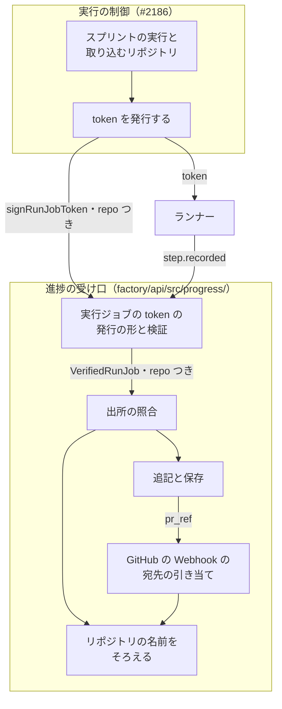
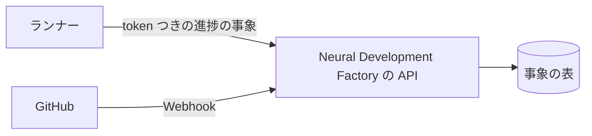
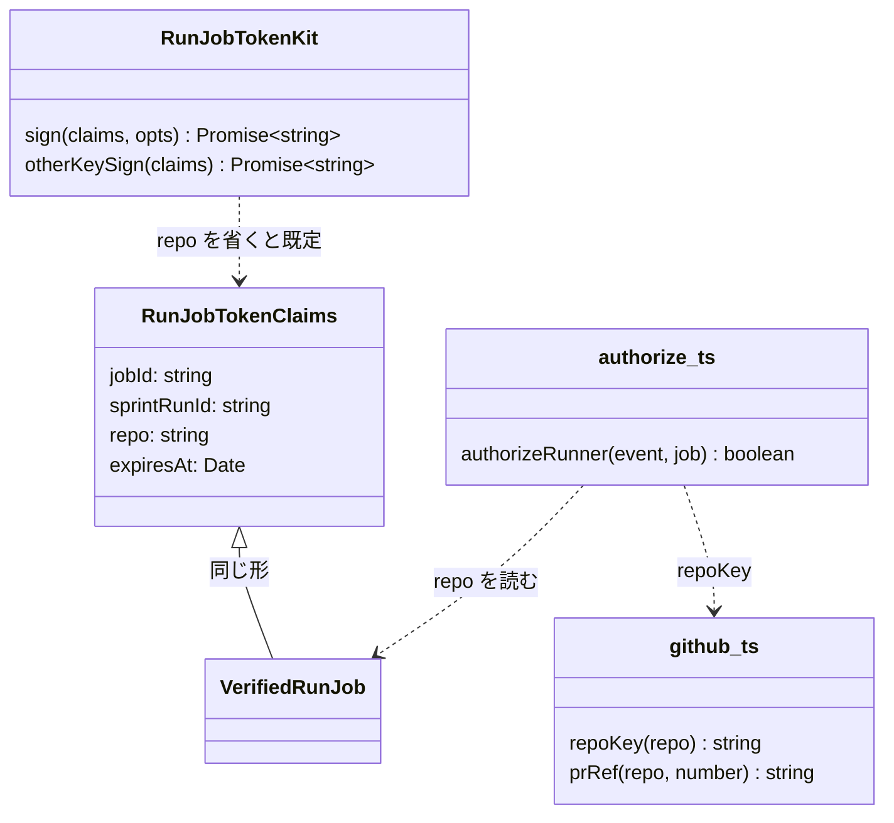
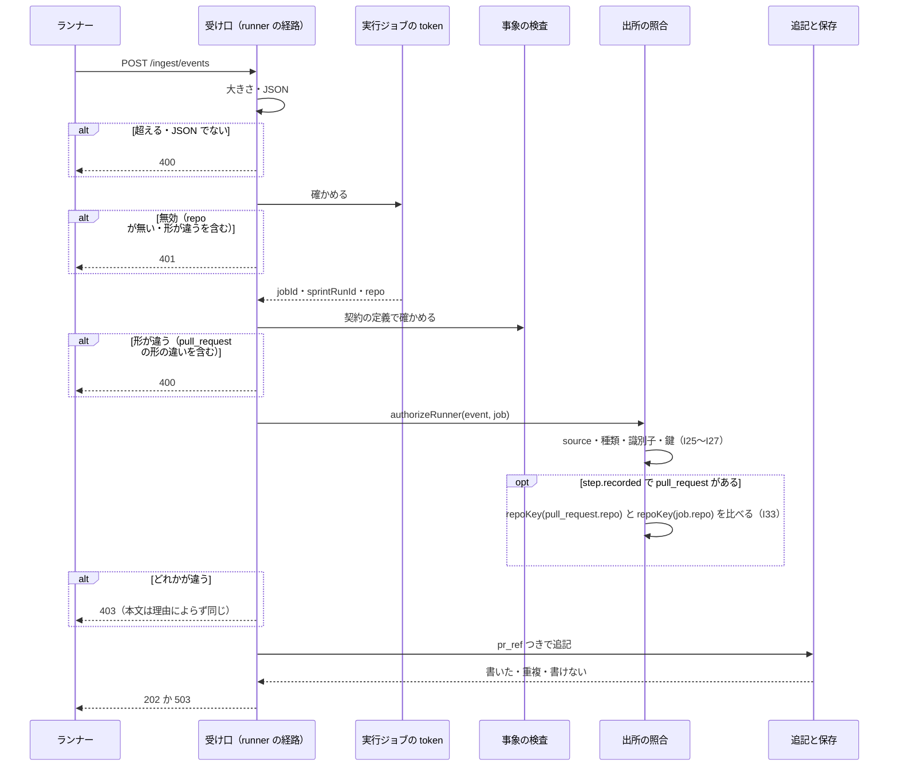

# 進捗の受け口: ランナーが申告する Pull Request を、その実行ジョブに許可したリポジトリのものだけに限る（#2216）

## 目的

- **何が壊れているか**: 進捗の受け口は、正しい実行ジョブの token を持つランナーが `step.recorded` で申告した Pull Request を、リポジトリを確かめずに `pr_ref` として残す。関係の無いリポジトリの Pull Request を申告すると、その `pr.updated`・`ci.updated`（GitHub の Webhook）が申告した側のスプリントの実行へ結び付く
- **誰が困るか**: ほかの利用者。自分のリポジトリの Pull Request と CI の状態が、別のアカウントのスプリントの実行の進捗に見える（いまは factory/ を本番へ出していないため、影響を受けた利用者はいない）
- **直すと何が成り立つか**: 実行ジョブの token が、そのジョブの取り込むリポジトリ（`owner/name`）を運ぶ。受け口は申告された Pull Request のリポジトリを token の値と照らし、違えば 403 で残さない。結び付けられる Pull Request は、そのジョブのリポジトリのものに限られる

## 適用範囲

- **働く範囲**: このリポジトリの `factory/`（Neural Development Factory の API の進捗の受け口と、実行ジョブの token の発行の形と検証）だけで働く。プラグインの配布物（`plugins/`）は変わらない
- **プロジェクトごとに違うもの**: 無し（照らすリポジトリの値は、実行の制御（#2186）が実行ジョブごとに token へ入れる。設定も引数も足さない）
- **当たるモード**: `standard`（認可の規則を変える。共通原則 C2）

## あるべき姿の根拠

| 根拠 | 種類 | 何を示すか |
| --- | --- | --- |
| [PR #2209](https://github.com/devbasex/ai-plugins/pull/2209) のクロスレビューの指摘（major）「`step.recorded` の `pull_request` が、その実行に許可されたリポジトリの参照であることを照合してから `pr_ref` を登録してください」 | 外部の一次情報（レビューの指摘） | 申告の値だけで `pr_ref` を置く今の形が、認可の欠けとして指摘されたこと |
| 確定仕様 [ndf-factory-service-boundary.md](../docs/specifications/ndf-factory-service-boundary.md) の実行ジョブの指示 `REPO`（`owner/name`・必須）と ER 図「リポジトリの登録 \|\|--o{ スプリントの実行」 | 外部の一次情報（確定仕様） | 1 つの実行ジョブが取り込むリポジトリはちょうど 1 つで、token を発行する実行の制御がその値を持つこと |
| 確定仕様 [ndf-factory-contracts-and-progress.md](../docs/specifications/ndf-factory-contracts-and-progress.md) の背景「期限より前の取り消しは実行ジョブの状態（#2186 の集約）を読むことになるため持たない」 | 外部の一次情報（確定仕様） | 受け口の照合は token だけで閉じ、ほかの集約を読まない形が既に選ばれていること |

要求と受け入れ条件は [#2216](https://github.com/devbasex/ai-plugins/issues/2216) の本文にある（コピーは [issues/issue-2216-requirements.md](issue-2216-requirements.md)）。この文書は「どう作るか」だけを扱う。

## ドメインモデル

### コンテキスト

| コンテキスト | 何の語が 1 つの意味に決まるか |
| --- | --- |
| Neural Development Factory（`ndf-factory`） | 実行ジョブの token・進捗の事象・Pull Request の参照・スプリントの実行・リポジトリの登録 |

変更は 1 つのコンテキストの中で閉じる。GitHub は外部の系で、受け口が腐敗防止層として Webhook を翻訳する関係は変えない。

### 集約

| 集約 | 持ち主（書き換えてよいもの） | 根 | エンティティ | 値オブジェクト |
| --- | --- | --- | --- | --- |
| 進捗の記録 | 進捗の受け口（`factory/api/src/progress/`） | スプリントの実行の識別子ごとの列 | 進捗の事象 | 種類・発生の時刻・冪等の鍵・出所・Pull Request の参照 |
| スプリントの実行と実行ジョブ | 実行の制御（#2186） | スプリントの実行 | 実行ジョブ | 取り込むリポジトリ（`owner/name`） |

**進捗の記録はスプリントの実行を読まない。** 取り込むリポジトリは実行の制御が token へ署名して渡し、受け口は token の値だけで照らす（決定 1）。集約の間は token という値で渡り、受け口からスプリントの実行の表への読み出しは生まれない。

**実行ジョブの token は集約ではなく、実行の制御が発行して受け口が確かめる値である。** 形（claim の並び）は進捗の受け口の側（`run-job-token.ts`）が持ち、この変更で `repo` を 1 つ足す。

### 不変条件

確定仕様の I25〜I31 に続けて番号を振る。I31 は意味を変える。

| # | 集約 | 条件 | 破れたときの扱い |
| --- | --- | --- | --- |
| I31（変更） | 進捗の記録 | 実行ジョブの token は `account_id` を運ばない。運ぶのは実行ジョブ・スプリントの実行・取り込むリポジトリ・期限の 4 つだけである。token の値・署名の鍵・Webhook の秘密は応答・ログ・事象に出ない | `signRunJobToken` の `claims` は 4 つの鍵だけを型で受ける。ログは決まった 4 列だけにする |
| I32 | 進捗の記録 | 実行ジョブの token は取り込むリポジトリ（`repo`、`owner/name` の形）を必ず運ぶ | 無い・形が違う token は無効（`malformed`）で、受け口はどの種類の事象も 401 で保存しない |
| I33 | 進捗の記録 | `runner` の経路で残る `step.recorded` が `payload.pull_request` を持つなら、その `repo` は token の `repo` と大文字と小文字を区別せずに一致する | 403（I30 の本文）で保存しない。`pr_ref` も置かない |

### ドメインイベント

要求の番号を引き継ぐ。E1〜E3 は #2186 が起こし、この変更は E3 の token の中身と E5・E6 の照合を決める。

| # | イベント | 発生元 | 受け手 |
| --- | --- | --- | --- |
| E1 | 利用者がリポジトリを登録した | 取り込み（#2186） | 実行の制御（#2186） |
| E2 | スプリントの実行を始めた（登録したリポジトリに結び付いた） | 実行の制御（#2186） | 実行の制御（E3） |
| E3 | 実行ジョブの token を発行した（`repo` に E2 のリポジトリを入れる） | 実行の制御（#2186）が `signRunJobToken` で作る | ランナー |
| E4 | ランナーが `pull_request` つきの `step.recorded` を送った | ランナー（#2186・#2189） | 進捗の受け口 |
| E5 | 受け口が token を確かめた（`repo` が無ければ 401） | 実行ジョブの token の検証 | 出所の照合（E6） |
| E6 | 受け口が `pull_request.repo` を token の `repo` と照らした（違えば 403） | 出所の照合 | 追記（E7） |
| E7 | 事象を `pr_ref` つきで追記した | 進捗の記録の保存 | GitHub の Webhook の宛先の引き当て（E8）・一覧と詳細（#2172） |
| E8 | GitHub の Webhook を `pr_ref` で宛先のスプリントの実行へ結び付けた | 受け口の `github` の経路 | 一覧と詳細（#2172） |

### 用語

| 用語 | 意味 | 用語集への反映 |
| --- | --- | --- |
| 実行ジョブの token | 実行の制御が実行ジョブ 1 つごとに発行する、期限つきの token。そのジョブのスプリントの実行にだけ進捗の事象を書け、Pull Request の参照はそのジョブの取り込むリポジトリのものだけを残せる。承認の依頼の答えを読める | 意味の変更（`ndf-factory`） |

## 機能一覧

| # | 機能 | 誰が使うか |
| --- | --- | --- |
| F1 | 実行ジョブの token に、そのジョブの取り込むリポジトリを入れて発行する | 実行の制御（#2186） |
| F2 | 取り込むリポジトリを持たない token を無効として拒む | 進捗の受け口・承認と通知（#2173） |
| F3 | 申告された Pull Request のリポジトリが token のものと違う `step.recorded` を拒む | 進捗の受け口（ランナーの送信に当たる） |

## 構成要素

| 要素 | 場所 | 変えること |
| --- | --- | --- |
| 実行ジョブの token | `factory/api/src/progress/run-job-token.ts` | `RunJobTokenClaims` に `repo` を足し、`signRunJobToken` は本体の claim `repo` に入れる。検証は `requiredClaims` に `repo` を足し、形を契約の `RepoFullName` の `pattern`（`progressEventSchema` の `$defs` から読む）で確かめ、違えば `malformed`。`VerifiedRunJob` は `repo` を持つ |
| 出所の照合 | `factory/api/src/progress/authorize.ts` | `authorizeRunner` に I33 を足す。`step.recorded` で `payload.pull_request` があるときだけ、`repoKey(pull_request.repo) === repoKey(job.repo)` を求める |
| GitHub の翻訳 | `factory/api/src/progress/github.ts` | リポジトリの名前を比べる形にそろえる関数 `repoKey`（小文字にする）を置き、`prRef` もこれを使う。照合と `pr_ref` が同じ規則で名前をそろえる |
| テストの token の道具 | `factory/api/src/testing/run-job-tokens.ts` | `sign` と `otherKeySign` の `claims` に `repo` を任意で受け、省くと `TEST_RUN_JOB_REPO`（`owner/name`）を入れる。`withExpiry` が `repo` を落とさずに渡す |
| 受け口のテストの道具 | `factory/api/src/testing/ingest.ts` | `runner` が token を作るとき、`opts.repo` を受けて渡す（省くと既定） |
| 受け口の OpenAPI | `factory/contracts/openapi/ingest.yaml` | `POST /ingest/events` の 403 の説明に「Pull Request のリポジトリが token のものと違う」を足す（本文の形は変えない） |
| 確定仕様（受け口） | `docs/specifications/ndf-factory-contracts-and-progress.md` | 「実行ジョブの token」の表に `repo`、「出所ごとの照合」の `runner` の行に I33、不変条件の表に I31 の変更と I32・I33、背景の「GitHub の Webhook の宛先は…」の段落に照合の理由、テスト観点の `runner` の照合と実行ジョブの token の行 |
| 確定仕様（全体の契約） | `docs/specifications/ndf-factory-service-boundary.md` | 受け口の認証の表の `runner` の行に「`step.recorded` の Pull Request のリポジトリが token のものと一致すること」、#2186 の行の提供する契約に「token の `repo` は実行ジョブの指示の `REPO` と同じ値」 |
| 用語集 | `docs/glossary/glossary.json`・`docs/glossary.md` | 「実行ジョブの token」の意味を変える（この設計の変更で直す） |

図は実行時に動く要素だけを描く。テストの道具 2 つ・OpenAPI・確定仕様 2 つ・用語集は図に含めない。

**文脈**: 外部との出入りは変わらない。ランナーは実行ジョブの token つきで `POST /ingest/events` へ送り、GitHub は Webhook を `POST /ingest/github` へ送る。

**配置**: 変わらない。照合は受け口の Lambda の中で token の値だけを使い、DynamoDB への読み出しを足さない。

## 構造

`VerifiedRunJob` は今どおり `RunJobTokenClaims` の別名である。`repo` を足すと、#2173 が `verifyRunJobToken` で受ける値にも `repo` が増える（読まなくても壊れない）。

## 入出力の契約

| 項目 | 内容 |
| --- | --- |
| 置き場所 | `factory/contracts/openapi/ingest.yaml`（経路と応答）、実行ジョブの token の形は確定仕様の「実行ジョブの token」と `run-job-token.ts` |
| 変わる約束 | (1) `POST /ingest/events` は、`payload.pull_request.repo` が token の `repo` と違う `step.recorded` に 403 を返す。本文は今の 403 と同じ `{"error": {"code": "forbidden", "message": "この事象を書く権限がありません"}}`（I30）。(2) 実行ジョブの token の本体に `repo`（`owner/name`、必須）が増え、無い token は無効（401）になる。(3) `signRunJobToken(claims, key)` の `claims` が `{ jobId; sprintRunId; repo; expiresAt }` になる |
| 互換性の扱い | 旧い token（`repo` なし）とは互換を持たない（前提 3。本番へ出しておらず、`signRunJobToken` を呼ぶ #2186 は未実装）。`pull_request` を持たない事象・ほかの種類・`api`・`github` の経路・`appendControlEvent` の応答と保存は変わらない |
| 検査の手段 | `cd factory && npm run check`（契約の lint・型検査・全テスト） |

**token の `repo` に入れる値は、実行ジョブの指示の `REPO` と同じ値である。** 発行する実行の制御（#2186）が両方を同じリポジトリの登録から作る。ランナーは `REPO` を clone し、その Pull Request を申告するため、正しく動くランナーの申告は常に一致する。

| 部分 | 鍵 | 値 |
| --- | --- | --- |
| 本体（足す） | `repo` | 取り込むリポジトリ（`owner/name`。`^[A-Za-z0-9_.-]+/[A-Za-z0-9_.-]+$`）。実行ジョブの指示の `REPO` と同じ |

## 処理の流れ

照合の順序は今どおり、大きさと JSON（400）→ token（401）→ 契約の定義（400）→ 出所の照合（403）→ 追記である。`repo` の有無は token の段（401）で、Pull Request のリポジトリは照合の段（403）で見る。

## 非機能の実現方式

| 大項目 | 要求の条件 | 実現方式 | 確かめ方 |
| --- | --- | --- | --- |
| セキュリティ | 照合に使うリポジトリの値は、ランナーが書き換えられない出所（サービスが署名した token か、サービスの表）から得る。ランナーの申告した値だけで許可を決めない。token の値・鍵をログ・応答・例外の文に出さない（既存の決まり） | 照合の値は Ed25519 で署名された token の本体の `repo` から得る。書き換えれば署名が合わず 401 になる。失敗の文とログの列は今のままで、`repo` の値も出さない | 別の鍵で作った `repo` つきの token が 401、`repo` を変えた申告が 403 で保存 0 件、ログが 4 列だけで応答に `repo` の値が無いことをテストで見る |
| 性能・拡張性 | 案 B を採る場合、照合の読み出しは `pull_request` つきの `step.recorded` 1 件につき高々 1 回で、ほかの事象では読まない | 案 B を採らないため、読み出しは 0 回である（決定 1）。照合は token の値どうしの文字列の比較だけ | 照合の関数が保存の口を受け取らない形（型）で縛る |

## 決定の記録

### 決定 1: 照合のために受け口がほかの集約を読まないよう、取り込むリポジトリを実行ジョブの token の claim で運ぶ

実行の制御（#2186）は実行ジョブを起動するとき、実行ジョブの指示の `REPO` と token を同じスプリントの実行から作るため、token にリポジトリを入れる費用は 1 つの値だけである。署名された値はランナーが書き換えられず、受け口は今と同じく token だけで照合を閉じられる。確定仕様は期限より前の取り消しを「#2186 の集約を読むことになるため」持たないと決めており、照合のためにスプリントの実行を読む形はその判断と食い違う。

受け口がスプリントの実行からリポジトリを引いて照らす形は採らない。#2186 の表の形が決まるまで読み出しの口を作れず、事象 1 件ごとに読み出しと 503 の経路が増える。

要求の未決 1 はこの決定を #2186 の設計に置いていた。#2186 はまだ設計に入っておらず、token の形は発行の形（`signRunJobToken`）と検証を持つこの側が決めるため、ここで決め、#2186 は `repo` を入れて発行する（承認ゲート 1 で利用者が確かめる）。

根拠: Value 6 / Value 4 / C2（MVV 版 3）

### 決定 2: 照らせない token を残さないため、`repo` を必須の claim にし、無い token は 401 にする

`repo` を持たない token は、今の発行の形（`signRunJobToken` の型が `repo` を要る）では作られない。`sprint_run_id` と同じく必須の claim にすれば、無い・形が違う token は検証の段で `malformed` になり、受け口と #2173 で同じ扱いになる。要求の受け入れ条件 4 が求める「202 にならず保存しない」を、照合の分岐を増やさずに満たす。

`repo` を任意にし、`pull_request` つきの `step.recorded` のときだけ 403 にする形は採らない。照らせない token が有効なまま残り、照合の側に「claim が無い」分岐が増える。旧い token との互換は前提 3 のとおり持たない。

根拠: Value 6 / C2（MVV 版 3）

### 決定 3: 照合と `pr_ref` が同じ規則で名前をそろえるよう、小文字にする関数を `github.ts` に 1 つだけ置く

GitHub はリポジトリの名前の大文字と小文字を区別せず、`pr_ref` は既に `owner/name` を小文字にそろえる。照合が別の書き方で名前をそろえると、照合を通った申告の `pr_ref` が Webhook の宛先と合わない食い違いが起こりうる。`repoKey` を `prRef` と照合の両方が使う。token の `repo` の形は契約の `RepoFullName` の `pattern` を読んで確かめ、正規表現を写さない。

根拠: Value 6（MVV 版 3）

### 決定 4: 照合の単位をリポジトリの名前（`owner/name`）にし、GitHub のリポジトリの識別子にしない

事象の `pull_request` が運ぶのは `repo`（`owner/name`）と番号だけで、識別子で照らすには進捗の事象の契約とランナーの申告を変えることになる。名前で照らすと、実行ジョブの途中でリポジトリを改名したときその後の申告は 403 になり、Pull Request の参照は残らない。改名の後でも `pr_ref` は既に合わなくなる（確定仕様の運用の節）ため、照合が新しく失わせる情報は無い。次の実行ジョブの token は、実行の制御がリポジトリの登録から作り直す。

要求の未決 2 は #2186 の設計に置いたままにする。#2186 が識別子で照らすと決めたときは、token の `repo` と事象の契約を同じ変更で替える。

根拠: Value 1 / Value 10（MVV 版 3）

### 決定 5: #2171 の設計の決定 7 を、`pr_ref` を「token のリポジトリと照らした申告」から置く形へ書き換える

#2171 の決定 7 は、宛先のスプリントの実行を知るのが Pull Request を作ったランナーだけであることから、`pr_ref` をランナーの申告で置くと決めた。この理由は変わらず、申告で置く形も残す。変えるのは、申告の `repo` が token のリポジトリと一致するときだけ置くことである。確定仕様の背景の段落にこの条件と理由（申告だけで置くと、正しい token を持つランナーが関係の無いリポジトリの Pull Request を自分の実行へ結び付けられる）を書き足す。

根拠: Value 7 / C2（MVV 版 3）

## テスト設計

| 受け入れ条件・不変条件 | どの振る舞いで縛るか | どう壊したら落ちるべきか |
| --- | --- | --- |
| 受け入れ条件 1・I33 | `repo` が `org-a/repo-a` の token で、`pull_request.repo` が `org-b/repo-b` の `step.recorded` を送ると、403 と I30 の本文が返り、事象の表に 1 件も増えない | 照合を外す・`pull_request.repo` でなく `job.repo` だけを見る・比較を `pr_ref` を置いた後に行うと落ちる |
| 受け入れ条件 2 | 受け入れ条件 1 の後に `org-b/repo-b` の `pull_request` の Webhook を送ると、202 で `pr.updated` が残らない | 拒んだ事象の `pr_ref` を表へ書くと落ちる |
| 受け入れ条件 3 | `pull_request.repo` が `org-a/repo-a` と `Org-A/Repo-A` のどちらでも 202 で残り、`pr_ref` は `org-a/repo-a#<番号>`。token の `repo` を `Org-A/Repo-A` で発行しても同じ | 比較で大文字と小文字を区別する・照合と `prRef` で別のそろえ方をすると落ちる |
| 受け入れ条件 4・I32 | `repo` を持たない・形の違う `repo` を持つ token は検証で `malformed` になり、`pull_request` つきの `step.recorded` もほかの種類も 401 で保存 0 件 | `requiredClaims` から `repo` を外す・形を確かめないと落ちる |
| 受け入れ条件 5 | 決定 1 で受け口がほかの集約を読まないため、この条件は対象が無い。テストを書かない | — |
| 受け入れ条件 6 | `pull_request` を持たない `step.recorded`・ほかの `runner` の種類・`api`・`github` の経路・`appendControlEvent` の既存のテストが、テストの token の道具の既定の `repo`（`owner/name`）で変わらずに通る | 既定の `repo` を入れ忘れる・`withExpiry` が `repo` を落とすと既存のテストが 401 で落ちる |
| 受け入れ条件 7・I30 | 照合で落ちた 403 の本文がほかの 403 と同じで、応答とログに token の `repo` の値が現れない | 理由ごとの文言を返す・`repo` をログの列に足すと落ちる |
| 受け入れ条件 8 | 形の違う `pull_request`（`repo` が `owner/name` の形でない）は、token の `repo` と違っても 400。`repo` の無い token と形の違う本文の組は 401 | 照合を契約の定義の検査より先に行う・token の検証より先に行うと落ちる |
| 受け入れ条件 9 | 確定仕様の照合の規則・I32・I33・決定 7 の書き換えは文書の変更で、テストを書かない（`.md` の文言を照合するテストは書かない）。参照切れは `npm run check` と指示書のチェックが見る | — |
| 受け入れ条件 10 | `cd factory && npm run check` が 0 で終わる | — |
| I31（変更） | 発行した token の本体の鍵が `aud`・`exp`・`iat`・`iss`・`repo`・`sprint_run_id`・`sub` だけで、`account_id` を `claims` に渡すと型の検査で落ち、渡しても載らない | `account_id` を載せる・`repo` を載せ忘れると落ちる（既存のテストの鍵の並びに `repo` を足す） |

受け入れ条件 5 は案 B を採る場合の条件で、決定 1 で案 B を採らないため消す。この事実は確定仕様化（`plan-to-spec`）で受け入れ条件の結果として残す。

## 設計の結果

| 課題 | 扱い | 取り込み先 | 触るファイル |
| --- | --- | --- | --- |
| #2216 | 実装する | — | `factory/api/src/progress/run-job-token.ts`、`factory/api/src/progress/authorize.ts`、`factory/api/src/progress/github.ts`、`factory/api/src/testing/run-job-tokens.ts`、`factory/api/src/testing/ingest.ts`、`factory/api/src/progress/run-job-token.test.ts`、`factory/api/src/progress/app.test.ts`、`factory/contracts/openapi/ingest.yaml`、`docs/specifications/ndf-factory-contracts-and-progress.md`、`docs/specifications/ndf-factory-service-boundary.md` |

## 未確認のまま残ること

| 項目 | 内容 |
| --- | --- |
| #2186 の設計との整合 | 決定 1 は #2186 の設計に置かれていた選択を先に決めた。#2186 の設計が token の `repo` を `REPO` と同じ値で入れることを、#2186 の承認ゲート 1 で確かめる |
| 改名の扱い | 決定 4 は名前で照らす。改名を追う形（識別子で照らす）は #2186 の設計の未決 2 のまま残る |
| 実環境での確認 | 本番へ出した後、2 つのリポジトリを登録したアカウントで、片方の実行ジョブのランナーがもう片方の Pull Request を申告しても進捗の画面に出ないことを、リリース後テストで確かめる（#2186・#2172 の後） |
