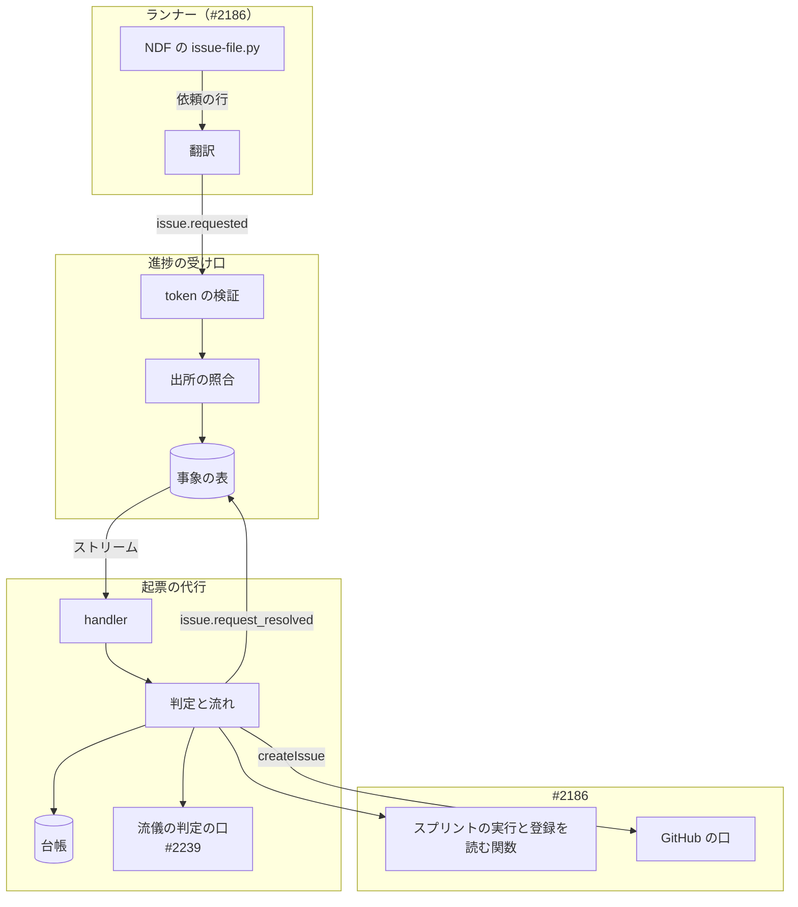
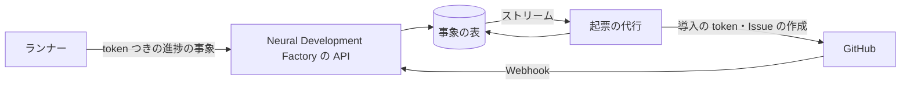
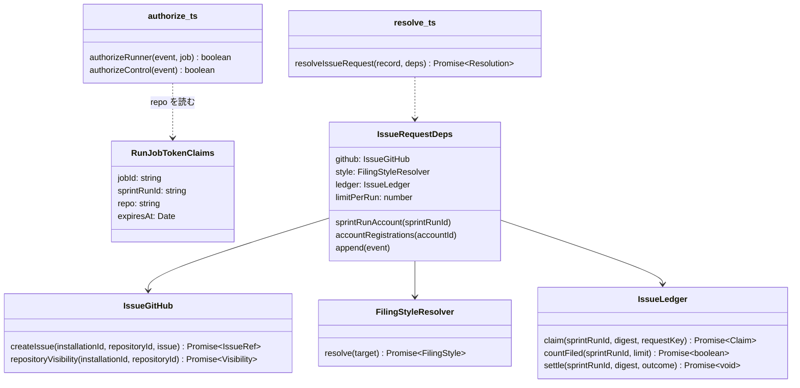
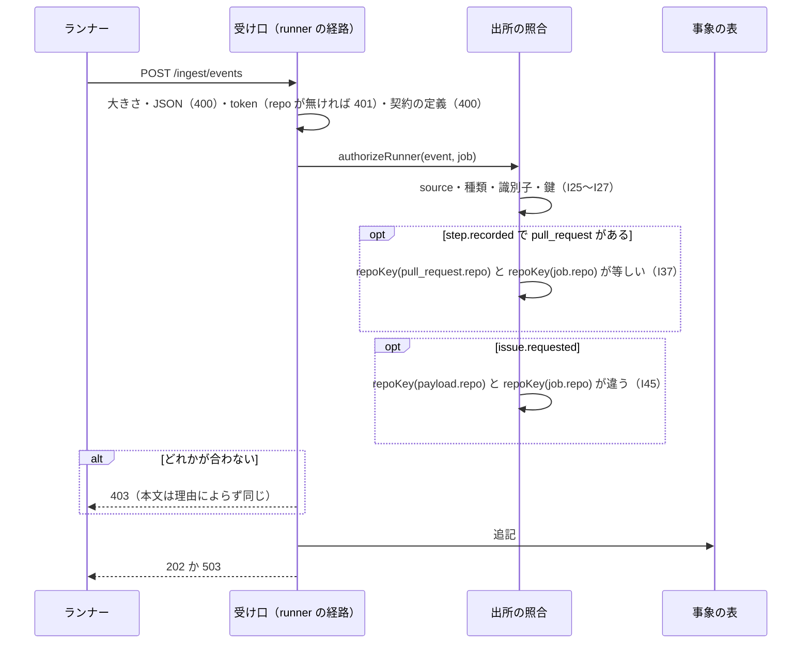
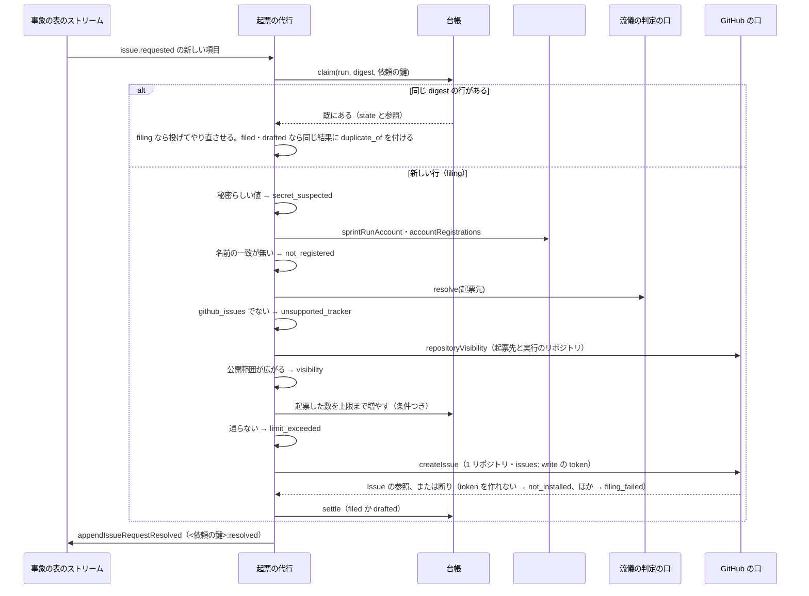

# 進捗の受け口: ランナーが申告する Pull Request をその実行のリポジトリに限り、別のリポジトリの修正はサービスが起票するか下書きを人へ回す（#2216）

## 目的

- **何が壊れているか**: 進捗の受け口は、正しい実行ジョブの token を持つランナーが `step.recorded` で申告した Pull Request を、リポジトリを確かめずに `pr_ref` として残す。関係の無いリポジトリの Pull Request を申告すると、その `pr.updated`・`ci.updated`（GitHub の Webhook）が申告した側のスプリントの実行へ結び付く
- **何が足りないか**: 申告をその実行のリポジトリに限ると、実行ジョブの中で別のリポジトリの修正が要るとわかったとき、それを相手先へ届ける経路が無い。ランナーの token は 1 リポジトリに絞られており、広げると上の照合の意味が無くなる
- **誰が困るか**: ほかの利用者（自分の Pull Request と CI の状態が、別のアカウントの進捗に見える）と、スプリントを流す利用者（別のリポジトリの直すべき点が実行ジョブの中で失われる）。いまは factory/ を本番へ出していないため、影響を受けた利用者はいない
- **直すと何が成り立つか**:
  - 実行ジョブの token が、そのジョブの取り込むリポジトリ（`owner/name`）を運ぶ。受け口は申告された Pull Request のリポジトリを token の値と照らし、違えば 403 で残さない
  - ランナーは別のリポジトリへの起票を、進捗の事象 `issue.requested` として依頼するだけにする。サービスは依頼を読み、同じアカウントが登録し GitHub App を入れたリポジトリなら、1 リポジトリと Issues の書き込みだけに絞った token で起票する。そうでない先は起票せず、下書きを人へ回す。どちらにしたかは事象 `issue.request_resolved` に残る

## 適用範囲

- **働く範囲**: このリポジトリの `factory/`（API の進捗の受け口・実行ジョブの token・起票の代行・ランナーの翻訳）と、NDF の `plugins/ndf/scripts/issue-file.py` の 1 つの分岐（ランナーの中でだけ働く）
- **プロジェクトごとに違うもの**: 起票の件数の上限（環境変数 `ISSUE_REQUEST_LIMIT_PER_RUN`、既定 10）。相手先の流儀は #2239 が判定する
- **当たるモード**: `standard`（認可の規則と、利用者に代わって外へ書く条件を変える。共通原則 C2）

## あるべき姿の根拠

| 根拠 | 種類 | 何を示すか |
| --- | --- | --- |
| [PR #2209](https://github.com/devbasex/ai-plugins/pull/2209) のクロスレビューの指摘（major）「`step.recorded` の `pull_request` が、その実行に許可されたリポジトリの参照であることを照合してから `pr_ref` を登録してください」 | 外部の一次情報（レビューの指摘） | 申告の値だけで `pr_ref` を置く今の形が、認可の欠けとして指摘されたこと |
| 利用者の差し戻しと答え（[#2216](https://github.com/devbasex/ai-plugins/issues/2216) の本文の「依頼（原文）」、2026-10-31） | 利用者の指示 | 申告を限るのは良い。別のリポジトリの修正はサービスが代わりに起票し、権限の無い先は下書きを人へ回す。ランナーの token は広げない。流儀の判定は #2239 |
| 確定仕様 [ndf-factory-service-boundary.md](../docs/specifications/ndf-factory-service-boundary.md) の実行ジョブの指示 `REPO`（`owner/name`・必須）と ER 図「リポジトリの登録 \|\|--o{ スプリントの実行」 | 外部の一次情報（確定仕様） | 1 つの実行ジョブが取り込むリポジトリはちょうど 1 つで、token を発行する実行の制御がその値を持つこと |
| 確定仕様 [ndf-factory-contracts-and-progress.md](../docs/specifications/ndf-factory-contracts-and-progress.md) の背景「期限より前の取り消しは実行ジョブの状態（#2186 の集約）を読むことになるため持たない」 | 外部の一次情報（確定仕様） | 受け口の照合は token だけで閉じ、ほかの集約を読まない形が既に選ばれていること |
| #2186 の設計（[PR #2236](https://github.com/devbasex/ai-plugins/pull/2236)）の決定 1・6・7 と I37 | 関連の設計 | token の `repo` の主張と照合（I37）を #2186 も前提にしていること。App の権限に Issues の読み書きがあり、導入の token は 1 リポジトリに絞って作ること |
| GitHub の文書「Create an installation access token for an app」（`POST /app/installations/{installation_id}/access_tokens` の `repository_ids` と `permissions`） | 外部の一次情報 | 導入の token を、リポジトリと権限の両方で導入より狭く作れること |
| NDF の `out-of-scope` の `references/issue-target.md` と `issue-file.py create` | このリポジトリの手順 | NDF は別のリポジトリへの起票を「他のリポジトリへの公開」として、承認資料を書いて止まる（終了コード 10）。人に問えない起動では人へ戻す |

要求と受け入れ条件は [#2216](https://github.com/devbasex/ai-plugins/issues/2216) の本文にある（コピーは [issues/issue-2216-requirements.md](issue-2216-requirements.md)）。この文書は「どう作るか」だけを扱う。決定の記録は [issues/issue-2216-design-decisions.md](issue-2216-design-decisions.md) にある。

## ドメインモデル

### コンテキスト

| コンテキスト | 何の語が 1 つの意味に決まるか |
| --- | --- |
| Neural Development Factory（`ndf-factory`） | 実行ジョブの token・進捗の事象・Pull Request の参照・スプリントの実行・リポジトリの登録・起票の依頼・起票の依頼の結果・起票の代行・下書き |
| NDF の開発ワークフロー（`ndf-workflow`） | 範囲外の課題の起票・起票先・開発対象リポジトリ |

`ndf-workflow` が上流、`ndf-factory` が下流の腐敗防止層（全体の契約のまま）。NDF の「起票先が開発対象リポジトリと別」という記録を、ランナーが `issue.requested` へ翻訳する。GitHub は外部の系で、起票の代行は #2186 の GitHub の口を通してだけ書く。

### 集約

| 集約 | 持ち主（書き換えてよいもの） | 根 | エンティティ | 値オブジェクト |
| --- | --- | --- | --- | --- |
| 進捗の記録 | 進捗の受け口（`factory/api/src/progress/`） | スプリントの実行の識別子ごとの列 | 進捗の事象 | 種類（`issue.requested`・`issue.request_resolved` を足す）・Pull Request の参照・起票した Issue の参照 |
| 起票の依頼の台帳 | 起票の代行（`factory/api/src/issue-requests/`） | スプリントの実行ごとの台帳 | 依頼（中身の要約値ごと） | 状態（`filing`・`filed`・`drafted`）・起票した数 |
| スプリントの実行と実行ジョブ | 実行の制御（#2186） | スプリントの実行 | 実行ジョブ | 取り込むリポジトリ（`owner/name`） |
| リポジトリの登録 | 取り込み（#2186） | 登録 | — | GitHub のリポジトリ（数の ID・`owner/name`）・導入の識別子 |

- **進捗の記録はスプリントの実行を読まない。** 取り込むリポジトリは実行の制御が token へ署名して渡し、受け口は token の値だけで照らす（決定 1）。起票の依頼も、受け口は token と事象だけで受け付け、登録を読まない（決定 6）
- **起票の代行は、ほかの集約を読むだけで書かない。** スプリントの実行（アカウントを知る）と登録（導入を知る）は #2186 の公開する関数で読む。書くのは自分の台帳と、進捗の記録への直の追記（`issue.request_resolved` だけ）である
- **1 つの処理で書き換える集約は 1 つ。** 台帳の依頼の行と起票した数の行は同じ集約で、1 つのトランザクションで書く（決定 10）

### 不変条件

確定仕様の I25〜I31 と、#2186 の I32〜I43 に続けて番号を振る。I37 は #2186 の設計が先に置いた番号をそのまま使う。I26 と I31 は意味を変える。

| # | 集約 | 条件 | 破れたときの扱い |
| --- | --- | --- | --- |
| I26（変更） | 進捗の記録 | 出所ごとに書ける種類は決まっている。`runner` は `issue.requested` を足し、`control` は `job.finished` と `issue.request_resolved` の 2 つになる | 403 で保存しない（`appendControlEvent` 系は `forbidden`） |
| I31（変更） | 進捗の記録 | 実行ジョブの token は `account_id` を運ばない。運ぶのは実行ジョブ・スプリントの実行・取り込むリポジトリ・期限の 4 つだけである。token の値・署名の鍵・Webhook の秘密・起票に使う導入の token は応答・ログ・事象に出ない | `signRunJobToken` の `claims` は 4 つの鍵だけを型で受ける。ログは決まった 4 列だけにする |
| I37 | 進捗の記録 | `runner` の経路で残る `step.recorded` が `payload.pull_request` を持つなら、その `repo` は token の `repo` と大文字と小文字を区別せずに一致する | 403（I30 の本文）で保存しない。`pr_ref` も置かない |
| I44 | 進捗の記録 | 実行ジョブの token は取り込むリポジトリ（`repo`、`owner/name` の形）を必ず運ぶ | 無い・形が違う token は無効（`malformed`）で、受け口はどの種類の事象も 401 で保存しない |
| I45 | 進捗の記録 | `runner` の経路で残る `issue.requested` の `repo` は、token の `repo` と大文字と小文字を区別せずに違う | 403 で保存しない |
| I46 | 起票の依頼の台帳 | サービスが Issue を作るのは、依頼の実行が属するアカウントの登録のうち名前の一致するものがあり、その導入で token を作れ、流儀の判定が GitHub Issues を返し、公開範囲が広がらず、秘密らしい値が無く、起票した数が上限より少ないときだけである | どれかが欠ければ起票せず、`drafted` と理由を残す |
| I47 | 起票の依頼の台帳 | 起票に使う導入の token は、起票先の 1 リポジトリ（数の ID）と `issues: write` だけで作り、GitHub の口の中で 1 回使って捨てる。保存しない・返さない・ランナーへ渡さない | GitHub の口の型が token を返さない（`createIssue` は Issue の参照だけを返す） |
| I48 | 起票の依頼の台帳 | 1 つのスプリントの実行で、起票先・題・本文の等しい依頼から作る Issue は 1 件までで、どの依頼にも結果はちょうど 1 件ある | 台帳の行を条件つきで書いてから GitHub を呼ぶ。結果の冪等の鍵は `<依頼の鍵>:resolved` |
| I49 | 起票の依頼の台帳 | 1 つのスプリントの実行で `filed` の数は上限（`ISSUE_REQUEST_LIMIT_PER_RUN`）以下 | 数の行の条件つきの増加が通らなければ起票せず `drafted`（`limit_exceeded`） |
| I50 | 進捗の記録 | 結果の理由と応答は、ほかのアカウントの登録の有無を明かさない | 未登録と「ほかのアカウントだけが登録」を同じ理由 `not_registered` にする |

### ドメインイベント

要求の番号を引き継ぐ。E1〜E3 は #2186 が起こし、この変更は E3 の token の中身と、E5・E6・E10 の照合と、E11〜E14 を決める。

| # | イベント | 発生元 | 受け手 |
| --- | --- | --- | --- |
| E1 | 利用者がリポジトリを登録した | 取り込み（#2186） | 実行の制御・起票の代行（判定で読む） |
| E2 | スプリントの実行を始めた | 実行の制御（#2186） | 実行の制御（E3） |
| E3 | 実行ジョブの token を発行した（`repo` に E2 のリポジトリを入れる） | 実行の制御（`signRunJobToken`） | ランナー |
| E4 | ランナーが `pull_request` つきの `step.recorded` を送った | ランナー | 進捗の受け口 |
| E5 | 受け口が token を確かめた（`repo` が無ければ 401） | 実行ジョブの token の検証 | 出所の照合 |
| E6 | 受け口が `pull_request.repo` を token の `repo` と照らした（違えば 403） | 出所の照合 | 追記（E7） |
| E7 | 事象を `pr_ref` つきで追記した | 進捗の記録の保存 | GitHub の Webhook の宛先の引き当て（E8）・一覧と詳細（#2172） |
| E8 | GitHub の Webhook を `pr_ref` で宛先へ結び付けた | 受け口の `github` の経路 | 一覧と詳細（#2172） |
| E9 | ランナーが `issue.requested` を送った | ランナー（NDF の書き出した依頼を翻訳） | 進捗の受け口 |
| E10 | 受け口が依頼を記録した（起票先が token の `repo` と同じなら 403） | 出所の照合と追記 | 起票の代行（事象の表のストリーム） |
| E11 | 起票の代行が起票してよいかを判定した | 起票の代行 | E12 か E13 |
| E12 | 起票先へ Issue を作った | 起票の代行（GitHub の口） | GitHub |
| E13 | 下書きを人へ回した | 起票の代行 | 承認と通知（#2173 の知らせ）・一覧と詳細（#2172） |
| E14 | `issue.request_resolved` を直に追記した | 起票の代行（`appendIssueRequestResolved`） | 一覧と詳細（#2172）・承認と通知（#2173、`drafted` のとき） |

### 用語

| 用語 | 意味 | 用語集への反映 |
| --- | --- | --- |
| 実行ジョブの token | 実行の制御が実行ジョブ 1 つごとに発行する、期限つきの token。そのジョブのスプリントの実行にだけ進捗の事象を書け、Pull Request の参照はそのジョブの取り込むリポジトリのものだけを残せる。承認の依頼の答えを読める | 意味は変えない（前回の変更のまま） |
| 起票の依頼 | 実行ジョブの中で NDF が別のリポジトリへの起票を決めたとき、ランナーが進捗の事象 `issue.requested` でサービスへ送る依頼。起票先・題・本文を持ち、ランナーは自分では起票しない | 追加 |
| 起票の依頼の結果 | 起票の依頼 1 件ごとに 1 件残る進捗の事象 `issue.request_resolved`。サービスが起票した Issue の参照か、下書きへ回した理由を持つ | 追加 |
| 起票の代行 | 記録された起票の依頼を読み、起票してよい先へはサービスが 1 リポジトリと Issues の書き込みだけに絞った導入の token で起票し、そうでない先は下書きを人へ回す、サービスの処理 | 追加 |
| 下書き（起票の依頼） | サービスが起票しなかった起票の依頼の題と本文。人が相手先の流儀に沿って起票するために回る | 追加 |

## 機能一覧

| # | 機能 | 誰が使うか |
| --- | --- | --- |
| F1 | 実行ジョブの token に、そのジョブの取り込むリポジトリを入れて発行する | 実行の制御（#2186） |
| F2 | 取り込むリポジトリを持たない token を無効として拒む | 進捗の受け口・承認と通知（#2173） |
| F3 | 申告された Pull Request のリポジトリが token のものと違う `step.recorded` を拒む | 進捗の受け口 |
| F4 | 別のリポジトリへの起票の依頼を受け付けて記録する（実行のリポジトリ宛ては拒む） | 進捗の受け口（ランナーの送信に当たる） |
| F5 | 依頼を判定し、起票してよい先へ起票する | 起票の代行（自動） |
| F6 | 起票しない依頼を下書きとして人へ回し、結果を残す | 起票の代行 → #2173・#2172 |
| F7 | NDF の別のリポジトリへの起票を、ランナーの中では依頼として書き出す | NDF（`issue-file.py create`）→ ランナー |

## 構成要素

| 要素 | 場所 | 変えること |
| --- | --- | --- |
| 実行ジョブの token | `factory/api/src/progress/run-job-token.ts` | `RunJobTokenClaims` に `repo` を足し、`signRunJobToken` は本体の claim `repo` に入れる。検証は `requiredClaims` に `repo` を足し、形を契約の `RepoFullName` の `pattern`（`progressEventSchema` の `$defs` から読む）で確かめ、違えば `malformed`。`VerifiedRunJob` は `repo` を持つ |
| 出所の照合 | `factory/api/src/progress/authorize.ts` | `WRITABLE_TYPES` の `runner` に `issue.requested`、`control` に `issue.request_resolved` を足す。`authorizeRunner` に I37 と I45 を足す。`authorizeControl` は種類ごとに鍵の形を見る（`issue.request_resolved` は `<job_id>:<seq>:resolved` で、`payload.request_key` が `<job_id>:<seq>`） |
| GitHub の翻訳 | `factory/api/src/progress/github.ts` | 名前をそろえる関数 `repoKey`（小文字にする）を置き、`prRef`・照合・起票の代行の要約値が使う |
| 直の追記 | `factory/api/src/progress/append.ts`・`factory/api/src/index.ts` | `appendIssueRequestResolved(event)` を足して export する。`appendControlEvent` と同じく、契約の検査・`control` の照合・追記の 3 つを通り、受けるのは `issue.request_resolved` だけ |
| 契約 | `factory/contracts/schemas/progress-event.schema.json`・`openapi/ingest.yaml` | 種類 `issue.requested` と `issue.request_resolved` を足す（「入出力の契約」）。403 の説明に 2 つの照合を足す |
| 起票の代行 | `factory/api/src/issue-requests/`（新規）: `resolve.ts`（判定と流れ）・`ledger.ts`（台帳）・`secrets.ts`（秘密らしい値）・`style.ts`（流儀の判定の口）・`ports.ts`（読む口と GitHub の口の型） | 依頼 1 件を判定し、起票するか下書きにし、結果を追記する（「処理の流れ」）。ほかの集約と GitHub は型の口で受け、テストは偽物 |
| 起票の代行の handler | `factory/api/src/handlers/issue-requests.ts`（新規） | 事象の表の DynamoDB Streams のうち `type` が `issue.requested` の新しい項目を受け、1 件ずつ `resolveIssueRequest` を呼ぶ。ストリームとフィルタの定義はインフラ（private） |
| GitHub の口（#2186） | `factory/api/src/github/` | `createIssue(installationId, repositoryId, { title, body })` と `repositoryVisibility(installationId, repositoryId)` を足す。`createIssue` は `repository_ids: [repositoryId]`・`permissions: { issues: "write" }` で token を作り、その場で Issue を作って捨てる（I47） |
| ランナーの翻訳（#2186） | `factory/runner/src/translate/` | 翻訳の表に `issue.requested` の 1 行を足す。ランナーは `NDF_ISSUE_REQUEST_FILE` を作業のディレクトリの外の決まったパスに置いて conductor へ渡し、伸びた行を事象にする |
| NDF の起票 | `plugins/ndf/scripts/issue-file.py` | `create` で起票先が開発対象リポジトリと別、かつ環境変数 `NDF_ISSUE_REQUEST_FILE` があるとき、承認資料を書かずにそのファイルへ 1 行を足し、`ok`（`items[].result` が `requested`）で 0 を返す（決定 7） |
| 確定仕様 | `docs/specifications/ndf-factory-contracts-and-progress.md`・`ndf-factory-service-boundary.md` | token の表・照合の表・種類の表・不変条件・背景（決定 5 と 6 の理由）・テスト観点。全体の契約の事象の種類と受け手の表に 2 行 |
| 用語集 | `docs/glossary/glossary.json`・`docs/glossary.md` | 4 語を足す（この設計の変更で直す） |

図は実行時に動く要素だけを描く。契約・確定仕様・用語集は図に含めない。

**文脈**: 外部との出入りは 1 つ増える。起票の代行が GitHub の REST（導入の token の作成と Issue の作成）を呼ぶ。

**配置**: 起票の代行は受け口と別の Lambda で、事象の表のストリームから起動する。受け口の Lambda の読み出しと GitHub への呼び出しは増えない。

## 構造

`FilingStyleResolver` の既定は常に `{ tracker: "github_issues", template: null }` を返す（決定 8）。#2239 が同じ型の中身を替える。`sprintRunAccount` と `accountRegistrations` は #2186 が `index.ts` から公開する関数を渡す。

## データ構造

起票の代行の台帳は DynamoDB の 1 つの表（`ISSUE_REQUESTS_TABLE_NAME`）に置く。読み出しは強い整合で、GSI は持たない。時系列は「今の値の上書き」で、過去は進捗の記録（`issue.requested` と `issue.request_resolved`）が持つ。上書きで失うのは `filing` の時刻だけで、結果の事象の `at` から足りる。

| 行 | `pk` | `sk` | 列 |
| --- | --- | --- | --- |
| 依頼 | `RUN#<sprint_run_id>` | `ISSUE#<digest>` | `state`（`filing` / `filed` / `drafted`）・`request_key`（最初の依頼の冪等の鍵）・`issue_repo`・`issue_number`・`issue_url`（`filed` のとき）・`reason`（`drafted` のとき）・`attempted_at`（Issue の作成の要求を出す直前に書く。決定 10）・`updated_at` |
| 起票した数 | `RUN#<sprint_run_id>` | `FILED_COUNT` | `count`（I49） |

`digest` は `{"repo": repoKey(repo), "title": title, "body": body}` を鍵の順にそろえた JSON の sha256 である（NDF の `issue-file.py` の提示の要約値と同じ作り方で、ラベルを含めない）。

| 機能 | 依頼の行 | 数の行 | 進捗の記録 | スプリントの実行・登録 |
| --- | --- | --- | --- | --- |
| F4 受け付け | — | — | C（`issue.requested`） | — |
| F5 起票 | C・U | U | C（`issue.request_resolved`） | R |
| F6 下書き | C・U | — | C（`issue.request_resolved`） | R |

## 入出力の契約

| 項目 | 内容 |
| --- | --- |
| 置き場所 | `factory/contracts/schemas/progress-event.schema.json`（事象）・`factory/contracts/openapi/ingest.yaml`（経路と応答）。実行ジョブの token の形は確定仕様の「実行ジョブの token」と `run-job-token.ts` |
| 変わる約束 | (1) `POST /ingest/events` は、`payload.pull_request.repo` が token の `repo` と違う `step.recorded` と、`payload.repo` が token の `repo` と同じ `issue.requested` に 403 を返す。本文は今の 403 と同じ（I30）。(2) 実行ジョブの token の本体に `repo`（必須）が増え、無い token は 401。(3) 種類が 2 つ増える。(4) `appendIssueRequestResolved` を export する |
| 互換性の扱い | 旧い token とは互換を持たない（前提 3）。種類を足すだけで既存の種類の形は変わらないため `schema_version` は 1 のまま。`pull_request` を持たない事象・既存のほかの種類・`api`・`github` の経路・`appendControlEvent` の応答と保存は変わらない |
| 検査の手段 | `cd factory && npm run check`（契約の lint・型検査・全テスト） |

**token の `repo` に入れる値は、実行ジョブの指示の `REPO` と同じ値である。** 発行する実行の制御（#2186）が両方を同じスプリントの実行から作る。

| 種類 | 出所 | `payload` | 主な受け手 |
| --- | --- | --- | --- |
| `issue.requested` | `runner` | `repo`（`RepoFullName`。起票先）・`title`（1〜256 字）・`body`（1〜50,000 字） | 起票の代行・#2172 |
| `issue.request_resolved` | `control`（起票の代行が直に書く） | `request_key`（依頼の冪等の鍵）・`outcome`（`filed` / `drafted`）・`issue`（`{repo, number, url}`。`filed` のときだけ必須、`drafted` では持たない）・`reason`（`drafted` のときだけ必須。下の表）・`duplicate_of`（同じ中身の最初の依頼の鍵か `null`） | #2172・#2173（`drafted` のとき） |

| `reason` | いつ |
| --- | --- |
| `not_registered` | 依頼の実行のアカウントの登録に、名前が `repoKey` で一致するものが無い（ほかのアカウントだけが登録している場合も同じ。I50） |
| `not_installed` | 登録はあるが、その導入で起票先に絞った token を作れない（App を外した・導入の対象から外した） |
| `unsupported_tracker` | 流儀の判定が GitHub Issues 以外を返した（#2239 の後に起こる） |
| `visibility` | 起票先が公開で、実行のリポジトリが非公開（決定 11） |
| `secret_suspected` | 題か本文に秘密らしい値がある（決定 12） |
| `limit_exceeded` | 起票した数が上限に達している |
| `filing_failed` | GitHub が Issue の作成を断った・応答が無い・前の試みが途中で止まった |

**`issue.requested` の冪等の鍵は `runner` のほかの種類と同じ `<job_id>:<seq>` である。** `issue.request_resolved` の鍵は `<依頼の鍵>:resolved`、`job_id` は依頼の `job_id`、`sprint_run_id` は依頼と同じにする。鍵の表は鍵だけで一意を見るため、依頼 1 件に結果は 1 件しか残らない（I48）。

**ランナーの翻訳の 1 行**（#2186 の「ランナーの翻訳」の表へ足す）:

| 事象 | NDF の何から | 規則 |
| --- | --- | --- |
| `issue.requested` | `NDF_ISSUE_REQUEST_FILE` の 1 行（`{"repo", "title", "body"}` の JSON） | 値をそのまま写す。題か本文が上限を超える行は送らず、`attention`（`reason` は `issue_request_too_large`）にする |

## 処理の流れ

### 受け付け

照合の順序は今どおり、大きさと JSON（400）→ token（401）→ 契約の定義（400）→ 出所の照合（403）→ 追記である。

### 起票の代行

- **判定の順序は、外へ出す前に安く確かめられるものから並べる。** 秘密の検査は GitHub も表も読まない。数の増加は起票の直前に置き、起票しなかった依頼で枠を使わない。`limit_exceeded` の前に数を増やし、GitHub が断ったら同じトランザクションの外で 1 つ戻す
- **読み出しの失敗（#2186 の関数・GitHub の 5xx の可視性の読み出し）は投げてやり直させる。** 行は `filing` のまま残り、やり直しの 1 回目は自分の行を `filing` として読む。そのため claim は「同じ `request_key` の `filing` なら続きから進める」とし、ほかの `request_key` の `filing` なら投げる
- **Issue の作成の要求を出した後の失敗はやり直さない。** GitHub が作ったのに応答が届かなかった場合に 2 件目を作らないためで、`filing_failed` の下書きにする（決定 10）
- **下書きは結果の事象で人へ回る。** #2173 は `outcome` が `drafted` の `issue.request_resolved` を知らせとして扱い、#2172 は依頼の題と本文を下書きとして見せる（決定 9）

## 非機能の実現方式

| 大項目 | 要求の条件 | 実現方式 | 確かめ方 |
| --- | --- | --- | --- |
| セキュリティ | 照合の値はランナーが書き換えられない出所から得る。token と鍵をログ・応答・例外の文に出さない。起票に使う token は 1 リポジトリと Issues の書き込みだけで、保存せず、ランナーへ渡さない。起票する先は依頼の実行のアカウントが登録し App を入れたリポジトリだけ | 照合の値は Ed25519 で署名された token の `repo`。起票の判定はサービスの表（実行と登録）だけを読み、依頼の値はリポジトリの名前を引く鍵にしか使わない。導入の token は GitHub の口の中で作って使い、型が外へ返さない（I47）。本文はログに出さず、ログの列は種類・鍵・結果・理由だけ | 別の鍵の token が 401、`repo` を変えた申告が 403。偽の GitHub の口で token の作成の要求が `repository_ids` 1 つと `issues: write` だけ。結果の事象・ログに token と本文が無い |
| 性能・拡張性 | 受け口は依頼の受け付けで GitHub を呼ばず、ほかの集約を読まない。照合の読み出しは増やさない | 受け口の照合は token と事象の値どうしの比較だけ。起票は別の Lambda がストリームから行う | 照合の関数が保存の口を受け取らない形（型）で縛る |
| 可用性 | 起票の処理が失敗しても、依頼の記録と実行ジョブの進行は止まらない | 受け付けは記録で 202 を返して終わる。ランナーは結果を待たない | 起票の代行の偽物が投げても受け口のテストが 202 のまま |

## 決定の記録

[issues/issue-2216-design-decisions.md](issue-2216-design-decisions.md) にある。

## テスト設計

| 受け入れ条件・不変条件 | どの振る舞いで縛るか | どう壊したら落ちるべきか |
| --- | --- | --- |
| 受け入れ条件 1・I37 | `repo` が `org-a/repo-a` の token で、`pull_request.repo` が `org-b/repo-b` の `step.recorded` が 403 と I30 の本文で、事象の表に 1 件も増えない | 照合を外す・`pr_ref` を置いた後に比べると落ちる |
| 受け入れ条件 2 | 1 の後の `org-b/repo-b` の Webhook が 202 で `pr.updated` を残さない | 拒んだ事象の `pr_ref` を書くと落ちる |
| 受け入れ条件 3 | `org-a/repo-a` と `Org-A/Repo-A` のどちらでも 202、`pr_ref` は小文字。token を `Org-A/Repo-A` で発行しても同じ | 大文字と小文字を区別する・照合と `prRef` で別のそろえ方をすると落ちる |
| 受け入れ条件 4・I44 | `repo` の無い・形の違う token は `malformed` で、どの種類も 401 で保存 0 件 | `requiredClaims` から外す・形を確かめないと落ちる |
| 受け入れ条件 5 | 決定 1 で受け口がほかの集約を読まないため対象が無い。テストを書かない | — |
| 受け入れ条件 6 | 既存のテストが、テストの token の道具の既定の `repo` で変わらずに通る | 既定の `repo` を入れ忘れる・`withExpiry` が `repo` を落とすと落ちる |
| 受け入れ条件 7・I30 | 照合で落ちた 403 の本文がほかの 403 と同じで、`repo` の値が応答とログに無い | 理由ごとの文言を返すと落ちる |
| 受け入れ条件 8 | 形の違う `pull_request`・`issue.requested`（題が 257 字・本文が空）は token と違っても 400 | 照合を契約の検査より先にすると落ちる |
| 受け入れ条件 11 | `org-b/repo-b` 宛ての `issue.requested` が 202 で 1 件残る | `runner` の書ける種類に足し忘れると落ちる |
| 受け入れ条件 12・I45 | `org-a/repo-a`・`ORG-A/repo-a` 宛てが 403 で保存 0 件 | 比較の向きを逆にする・大文字と小文字を区別すると落ちる |
| 受け入れ条件 13・I46 | 偽の登録と GitHub の口で、`createIssue` が依頼の題と本文で 1 回呼ばれ、結果が `filed` と Issue の参照を持つ | 名前で引かずに依頼の値を導入へ渡す・結果を書かないと落ちる |
| 受け入れ条件 14・I47 | 偽の GitHub の口が受けた token の作成の要求が、起票先の数の ID 1 つと `{ issues: "write" }` だけ。結果・ログに token の値が無い。ランナー向けの token の `repo` は 1 つのまま | 権限を省く（導入のすべての権限になる）・`repository_ids` を省くと落ちる |
| 受け入れ条件 15・I50 | 登録が無い・ほかのアカウントだけが登録・token を作れない、の 3 つで `createIssue` が呼ばれず、結果が `drafted` と `not_registered` / `not_registered` / `not_installed` | ほかのアカウントの登録を引く・理由を分けると落ちる |
| 受け入れ条件 16・I48 | 同じ中身の依頼を別の `seq`・別のジョブで 2 件流すと `createIssue` は 1 回、2 件目の結果は同じ Issue の参照と `duplicate_of`。同じ依頼を 2 回流すと結果は 1 件 | 台帳を見ずに起票する・結果の鍵を依頼ごとにしないと落ちる |
| 受け入れ条件 17・I49 | 上限 2 にして中身の違う依頼を 3 件流すと、3 件目が `limit_exceeded` で `createIssue` は 2 回。2 件目で GitHub が断ると数が戻り、3 件目は起票される | 数を判定の前に増やしたまま戻さない・条件なしで増やすと落ちる |
| 受け入れ条件 18 | 本文に `AKIA` で始まる 20 字・PEM の始まりの行・`ghp_` の token の形を含む依頼が `secret_suspected` で、ログの列に本文が無い | 題を見ない・ログへ本文を出すと落ちる |
| 受け入れ条件 19 | 既定の流儀の判定の口が `github_issues` とテンプレート無しを返し、偽の口が `redmine` を返すと `unsupported_tracker` | 判定の口を通らずに起票すると落ちる |
| 受け入れ条件 9・20 | 確定仕様の書き換えは文書の変更で、テストを書かない（`.md` の文言を照合するテストは書かない） | — |
| 受け入れ条件 10 | `cd factory && npm run check` が 0 で終わる | — |
| 公開範囲（決定 11） | 起票先が公開・実行のリポジトリが非公開で `visibility`、両方とも非公開・両方とも公開・起票先だけ非公開では起票する | 向きを逆にすると落ちる |
| 途中で止まった試み（決定 10） | 行が同じ `request_key` の `filing` のまま流し直すと続きから進み、`attempted_at` があれば作り直さず `filing_failed` | 印を見ずに作り直すと落ちる |
| NDF の分岐（F7） | `NDF_ISSUE_REQUEST_FILE` があり起票先が別のとき、ファイルに 1 行増え、承認資料を書かず 0。変数が無いときと起票先が同じときは今どおり | 変数が無いのに書き出すと落ちる（pytest、`plugins/ndf/scripts/tests/`） |
| I31（変更） | token の本体の鍵が `aud`・`exp`・`iat`・`iss`・`repo`・`sprint_run_id`・`sub` だけ | `account_id` を載せると落ちる |

## 設計の結果

| 課題 | 扱い | 取り込み先 | 触るファイル |
| --- | --- | --- | --- |
| #2216 | 実装する | — | `factory/api/src/progress/`（`run-job-token.ts`・`authorize.ts`・`github.ts`・`append.ts` とテスト）、`factory/api/src/index.ts`、`factory/api/src/issue-requests/`（新規）、`factory/api/src/handlers/issue-requests.ts`（新規）、`factory/api/src/testing/run-job-tokens.ts`・`ingest.ts`、`factory/contracts/schemas/progress-event.schema.json`・`openapi/ingest.yaml`、`plugins/ndf/scripts/issue-file.py` とテスト、`docs/specifications/ndf-factory-contracts-and-progress.md`・`ndf-factory-service-boundary.md` |
| #2186 | 取り込み先の作業として渡す | #2186 | GitHub の口の 2 関数、スプリントの実行と登録を読む 2 関数の export、ランナーの翻訳の 1 行と `NDF_ISSUE_REQUEST_FILE` |
| #2239 | 流儀の判定の口の中身を渡す | #2239 | `factory/api/src/issue-requests/style.ts` の中身（判定は NDF と 1 か所で共有する形を #2239 が決める） |
| #2173・#2172 | 受け手を渡す | #2173・#2172 | `drafted` の結果の知らせ（#2173）、依頼と結果の見せ方（#2172） |

## 未確認のまま残ること

| 項目 | 内容 |
| --- | --- |
| #2186 の設計との整合 | 不変条件の番号（I37 と I44 以降）・GitHub の口の 2 関数・読む 2 関数・ランナーの翻訳の 1 行は、#2186 の設計（PR #2236）がこの形で受けることを #2186 の承認ゲート 1 で確かめる |
| 改名の扱い | 照合も登録の引き当ても名前で行う。改名を追う形は #2186 の設計の未決 2 のまま残る |
| ストリームの形 | DynamoDB Streams のフィルタと、失敗したときの再試行の回数と行き先はインフラ（private）が決める。この設計は「投げればやり直す」だけを前提にする |
| 上限の値 | `ISSUE_REQUEST_LIMIT_PER_RUN` の 10 は実測に基づかない。本番の結果の事象で `limit_exceeded` の数を見て見直す |
| 実環境での確認 | 本番へ出した後、2 つのリポジトリを登録したアカウントで、照合と起票と下書きの 3 つをリリース後テストで確かめる（#2186・#2172・#2173 の後） |
