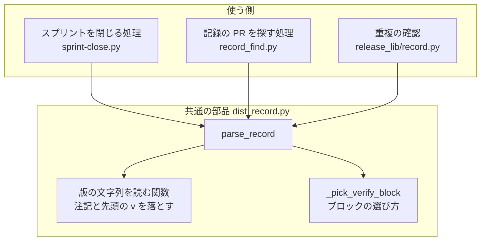
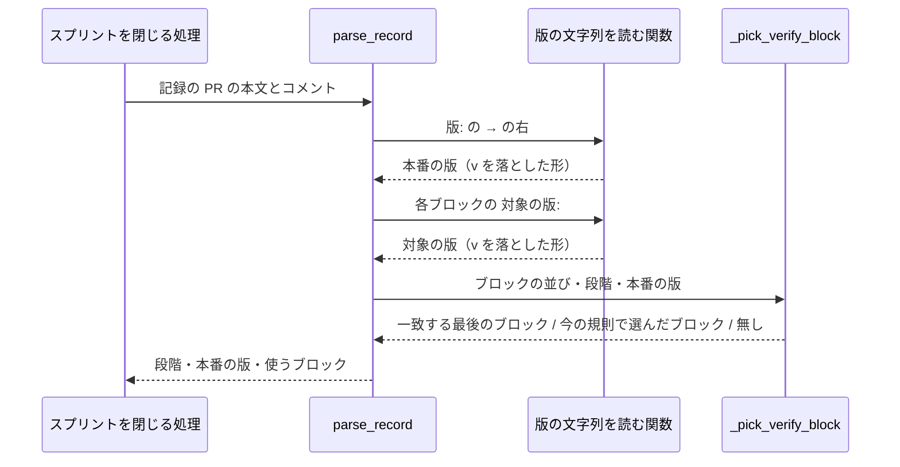

# リリース記録の読み取り: 先頭に v を付けた版を、v を付けない版と同じ版として読む（#2225）

## 目的

- **今どうなっているか**: リリース後テストの記録に `対象の版: v10.26.1（…）` と先頭に `v` を付けて書くと、スプリントを閉じる処理（`sprint-close.py --with-verification`）がそのブロックを読まず、全条件が合格でも課題を開いたまま残し、理由に「本番の版のリリース後テストの記録が無い」と返す。PR #2218（#2171）と PR #2195（#2170）で起きている
- **誰に効くか**: リリース後テストの記録を書く人と AI、スプリントを閉じる工程を回す利用者
- **変えると何が成り立つか**: 先頭の `v` の有無だけが違う版は同じ版として読まれ、合格した課題が閉じ、受け入れ条件に印が付く。読み取った本番の版は常に `v` を付けない形で返る

## 適用範囲

- **働く範囲**: NDF を使うすべてのリポジトリの、リリース記録の読み取り（スプリントを閉じる処理と、リリース記録の重複の確認）
- **プロジェクトごとに違うもの**: 無し（リリース記録とリリース後テストの記録の形は NDF が 1 つに決めている）
- **当たるモード**: `standard`

## あるべき姿の根拠

| 根拠 | 種類 | 何を示すか |
| --- | --- | --- |
| STD1（SemVer の FAQ） | 外部の一次情報 | `v1.2.3` は版の番号ではなく、`v` は「版の番号である」ことを示す慣用の接頭辞である。版としての値は `1.2.3` |
| STD2（PEP 440 の正規化） | 外部の一次情報 | 先頭の 1 文字の `v` はすべての目的で無視し、正規化した形から落とす。`v` の有無だけが違う版は同じ版とみなす |
| PR #2218・PR #2195 の記録で、修正の前の `sprint-close.py --record-pr <PR> --with-verification --dry-run` が理由「本番の版のリリース後テストの記録が無い」を返す | 実測（課題 #2225 の本文、2026-11-05） | 実際の記録 2 件が、先頭の `v` だけを理由に読まれていない |

要求と受け入れ条件は #2225 の本文にある（コピーは `issues/issue-2225-requirements.md`）。この文書は「どう作るか」だけを扱う。

## ドメインモデル

### コンテキスト

| コンテキスト | 何の語が 1 つの意味に決まるか |
| --- | --- |
| NDF のリリース（`ndf-release`） | リリース記録・リリース後テストの記録・本番の版・対象の版・版の表記の揺れ |

変更はこのコンテキストの中だけに収まる。スプリントを閉じる処理とリリース記録の重複の確認は、リリース記録を読む共通の部品（`plugins/ndf/scripts/lib/dist_record.py`）の戻り値だけを使い、記録の行を自分で読まない。

### 集約

| 集約 | 持ち主（書き換えてよいもの） | 根 | エンティティ | 値オブジェクト |
| --- | --- | --- | --- | --- |
| リリース記録の読み取りの結果 | リリース記録を読む共通の部品（`dist_record.parse_record`） | 読み取りの結果（段階・本番の版・スプリントの PR・使うリリース後テストのブロック） | リリース後テストのブロック | 本番の版・対象の版 |

記録そのもの（PR の本文とコメント）は書く側（`release`・`release-verification`）が持ち、この変更は書き換えない。

### 不変条件

| # | 集約 | 条件 | 破れたときの扱い |
| --- | --- | --- | --- |
| I1 | リリース記録の読み取りの結果 | 本番の版と対象の版は、先頭の小文字の `v` 1 文字を落とした形で持つ。`v` の後が数字でないときは落とさない | 読み取りの単体テストが落ちる |
| I2 | リリース記録の読み取りの結果 | 本番の版と、`v` を落とした後の対象の版が一致しないブロックは、本番の検証に使わない | 読み取りの単体テストが落ちる |
| I3 | リリース記録の読み取りの結果 | 本番の版に一致するブロックが無いときは、最後のリリース記録より後で、対象の版が版数でない最後のブロックを使う。段階が「配布なし」なら、最後のリリース記録より後の最後のブロックを使う | 読み取りの単体テストが落ちる |

### ドメインイベント

| # | イベント | 発生元 | 受け手 |
| --- | --- | --- | --- |
| E1 | リリース記録を記録の PR へ書いた | `release`（`release-steps.py record`） | スプリントを閉じる処理、リリース記録の重複の確認 |
| E2 | リリース後テストの記録をコメントで投稿した | `release-verification` | スプリントを閉じる処理 |
| E3 | 本番の版と対象の版を、先頭の `v` を落としてから比べた | リリース記録を読む共通の部品（`parse_record`） | スプリントを閉じる処理（E4 の判定へ渡す） |
| E4 | 一致したブロックの合否の表で、課題を閉じるかを判定した | スプリントを閉じる処理（`sprint-close.py`） | 課題とボード（`--dry-run` では書かない） |

E3 だけが変わる。E1・E2・E4 の振る舞いは変えない。

### 用語

| 用語 | 意味 | 用語集への反映 |
| --- | --- | --- |
| 対象の版 | リリース後テストの記録の `対象の版:` の行に書く版。全角の括弧から後ろは注記として読まない。先頭の小文字の `v` の有無は同じ版として扱う | 要求の工程で追加済み（`ndf-release`）。この設計では変えない |
| 本番の版 | リリース記録の `版:` の行の `→` の右に書く版。読み取った値は先頭の `v` を付けない形にそろえる | 要求の工程で追加済み（`ndf-release`）。この設計では変えない |
| 版の表記の揺れ | 同じ版を指す書き方の違いのうち、読み取りが吸収するもの。先頭の小文字の `v` の有無だけを指す | 要求の工程で追加済み（`ndf-release`）。この設計では変えない |

## 外部の調査

| 種類 | 調べるか | 理由 |
| --- | --- | --- |
| 標準・仕様 | 調べる | 版の先頭の `v` を版の一部とみなすかは、版の表記の標準が定めている |
| 主要な製品 | 調べない | 比べる相手は製品の振る舞いではなく版の表記の規則であり、標準と、その規則を実装したライブラリで足りる |
| ライブラリとサービス | 調べる | 版の文字列を正規化する既存のライブラリ（リポジトリが依存しているものを含む）で置き換えられるかを決める |

### 標準・仕様

| # | 標準・仕様 | 何を定めているか | 設計への反映 | 出典 |
| --- | --- | --- | --- | --- |
| STD1 | Semantic Versioning 2.0.0 の FAQ「Is "v1.2.3" a semantic version?」 | `v1.2.3` は semantic version ではない。先頭の `v` は英語圏で版の番号を示す慣用の接頭辞である | 版としての値は `v` を落とした形とし、読み取りの結果は `v` を付けない形で返す（I1） | https://semver.org/ （2026-11-05） |
| STD2 | PEP 440（Version specifiers）の正規化「Preceding v character」 | 版の前に 1 文字の `v` を置いてよい。この文字はすべての目的で無視し、正規化した形から落とす。`v` の有無だけが違う版は同じ版とみなす | 落とすのは先頭の 1 文字の `v` だけとし、比べる前に両側を同じ規則で正規化する（I1・I2） | https://packaging.python.org/en/latest/specifications/version-specifiers/ （2026-11-05） |

### ライブラリとサービス

| # | 候補 | 版 | ライセンス | 最後のリリースの日付 | 終了のアナウンス | 要件を満たすか | 出典 |
| --- | --- | --- | --- | --- | --- | --- | --- |
| LIB1 | `packaging`（`packaging.version.Version`） | 26.3（PyPI の最新）。リポジトリの固定は 26.2 | Apache-2.0 OR BSD-2-Clause | 2026-08-04 | 無し | 満たさない。`v` は落ちるが PEP 440 の形へ書き換えるため、`10.17.69-dev.1` が `10.17.69.dev1` になり、本番の版を記録の表記のまま返せない | https://pypi.org/project/packaging/ （2026-11-05）、`/work/ai-plugins/.venv/bin/python -c "import packaging.version as v; print(v.Version('v10.17.69-dev.1'))"` → `10.17.69.dev1`（2026-11-05） |
| LIB2 | `semver`（Python、`semver.Version.parse`） | 3.1.0（PyPI の最新。リポジトリの固定も 3.1.0） | BSD License | 2026-09-12 | 無し | 満たさない。`v10.26.1` を `is not valid SemVer string` で拒む。リポジトリでは追加の依存（`versions`）に入っており、共通の部品から必ず読める状態でもない | https://pypi.org/project/semver/ （2026-11-05）、同じ Python で `semver.Version.parse('v10.26.1')` → 例外（2026-11-05）、`pyproject.toml` の `versions = ["semver==3.1.0"]` |
| LIB3 | `node-semver`（npm の `semver`） | 未確認 | ISC（GitHub の About 欄） | 未確認 | 無し（README に記載なし） | 満たさない。先頭の `=` と `v` を落とす規則（`clean`）は STD2 と同じ形だが、Node.js のライブラリで Python の部品から呼べない。README は `v` を落とす扱いを SemVer 1.0.0 との互換のためと書く | https://github.com/npm/node-semver （2026-11-05） |

### 確かめられなかったこと

| 対象 | 試した手段 | 結果と理由 |
| --- | --- | --- |
| `node-semver` の最新版と最後のリリースの日付 | https://www.npmjs.com/package/semver | HTTP 403（取得の拒否）。版と日付は LIB3 の判定（言語が合わない）に影響しない |

調べた量: 候補 5 件・取得の試み 6 回。

## 機能一覧

| # | 機能 | 誰が使うか |
| --- | --- | --- |
| F1 | 先頭に `v` を付けた対象の版のリリース後テストを、本番の版の検証として読む | スプリントを閉じる工程（`sprint-close.py --with-verification`） |
| F2 | 先頭に `v` を付けた本番の版を、`v` を付けない形で返す | スプリントを閉じる工程、リリース記録の重複の確認（`release-steps.py record`） |

## 構成要素

| 要素 | 責務 | 変更 |
| --- | --- | --- |
| リリース記録を読む共通の部品（`plugins/ndf/scripts/lib/dist_record.py`） | 版の文字列を読む関数が、全角の括弧の注記を落とした後に、先頭の `v` を落とす（`v` の後が数字のときだけ）。本番の版（`_read_dist_block`）と対象の版（`_verify_blocks`）の両方がこの関数を通る | 変える |
| ブロックの選び方（同じファイルの `_pick_verify_block`） | 完全一致で比べる規則はそのまま。比べる値が両側とも正規化済みになる | 変えない |
| 受け入れ条件の版ごとの判定（同じファイルの `verify_block_for_base`） | 基底の版の比べ方（`v?` を許す正規表現）はそのまま。対象の版が正規化済みになっても同じブロックを返す | 変えない |
| スプリントを閉じる処理（`plugins/ndf/scripts/sprint-close.py`、`sprint_close_lib/record_find.py`） | 読み取りの結果を使うだけ | 変えない |
| リリース記録の重複の確認（`plugins/ndf/scripts/release_lib/record.py` の `exists`） | 読み取った本番の版と、書こうとする版（`v` を付けない）を比べるだけ | 変えない |
| 読み取りの単体テスト（`plugins/ndf/scripts/tests/test_release_record.py`） | 受け入れ条件 1〜6 と不変条件 I1〜I3 を縛る | 足す |

図には読み取りの経路だけを描く。変えない受け入れ条件の版ごとの判定（`verify_block_for_base`）と、読み取りの単体テストは図に含めない。下の処理の流れはスプリントを閉じる処理から呼んだときを描き、記録の PR を探す処理と重複の確認も同じ順で `parse_record` を呼ぶ。

### 呼び出し元の一覧

`grep -rn "parse_record" plugins/ndf/scripts --include=*.py | grep -v tests/`（2026-11-05、このブランチ）の結果から、定義の行を除いた呼び出しは次の 3 か所である。

| 呼び出し元 | 読む値 |
| --- | --- |
| `plugins/ndf/scripts/sprint-close.py:211` | 段階・スプリントの PR・使うブロック |
| `plugins/ndf/scripts/sprint_close_lib/record_find.py:117` | 段階・スプリントの PR |
| `plugins/ndf/scripts/release_lib/record.py:82` | 段階・本番の版・スプリントの PR |

本番の版を読むのは `release_lib/record.py:83` の重複の確認だけである（`grep -rn '\["version"\]' plugins/ndf/scripts --include=*.py | grep -v tests/` の結果で、ほかの行は `plugin.json` などの別の値を読む）。要求の前提 3 が挙げる「プランの版の差し込み」は、リリース記録の `版:` の行を読まない。`grep -rn '"版: ' plugins/ndf/scripts --include=*.py | grep -v tests/`（2026-11-05）で、`dist_record.py` の外に当たるのは `experimental/resume.py:152` だけで、これは引き継ぎの文書へ別の `版:` の行を書く側である。プランの版の差し込みの既存のテストは、受け入れ条件 6 の確かめとしてテストの全体の実行に含める。

## 処理の流れ

版の文字列を読む関数の規則:

| 入力（`版:` の右、または `対象の版:` の右） | 返す値 |
| --- | --- |
| `10.26.1` | `10.26.1` |
| `v10.26.1（2026-10-31 08:52 JST に…）` | `10.26.1` |
| `v10.17.69-dev.1` | `10.17.69-dev.1` |
| `main c427284（2026-10-01 12:00）` | `main c427284`（先頭が `v` でないので変えない） |
| `V10.26.1` | `V10.26.1`（大文字は落とさない。要求の前提 1） |

## 決定の記録

### 決定 1: 比べる側ごとに規則を写さないため、先頭の v を落とす規則を版の文字列を読む関数 1 か所に置く

本番の版と対象の版は、同じ関数（全角の括弧の注記を落とす関数）を通って読まれている。`v` を落とす規則をこの関数に足せば、両側が同じ規則で正規化され、ブロックの選び方（`_pick_verify_block`）とリリース記録の重複の確認は変えずに済む。読み取りの結果の本番の版も `v` を付けない形になり、要求の前提 3 を満たす。

比べる箇所（`_pick_verify_block` の `b["ver"] == version`）だけで `v` を落とす形は採らない。読み取りの結果の本番の版に `v` が残り、重複の確認が `v` を付けない版と比べて食い違う。

根拠: Value 7 / Value 8（MVV 版 5）

### 決定 2: 記録の表記のまま版を返すため、既存の版のライブラリを使わず 1 つの正規表現で落とす

`packaging`（LIB1）は `v` を落とすが、版を PEP 440 の形へ書き換え、開発版の `10.17.69-dev.1` を `10.17.69.dev1` にする。本番の版を記録の表記のまま返す要求（前提 3）と、`v` を付けない記録の読み取り結果を変えない受け入れ条件 6 を満たさない。`semver`（LIB2）は `v` 付きの版を拒み、追加の依存のため共通の部品から必ず読めるとは限らない。`node-semver`（LIB3）は Python から呼べない。

規則は STD2 に倣い、先頭の 1 文字の小文字の `v` を、後ろが数字のときだけ落とす（`^v(?=\d)`）。`main c427284` のような版数でない対象の版は変わらず、今の選び方（I3）がそのまま働く。

- 作り方: 自前で作る・標準に倣う
- 比べた候補: STD1 / STD2 / LIB1 / LIB2 / LIB3

根拠: Value 5 / Value 6（MVV 版 5）

### 決定 3: 書き手の手順を増やさないため、リリース後テストの記録の書き方は変えず、読む側だけで吸収する

`v` を付けないよう書き手へ求める規則を足すと、書き手が守らなかったときに今と同じ不具合が残る。読む側で吸収すれば、書き手の手順（`release-verification` の「出力物」）は今のままで、既に書かれた PR #2218・PR #2195 の記録もそのまま読める。

根拠: Value 5（MVV 版 5）

## テスト設計

| 受け入れ条件・不変条件 | どの振る舞いで縛るか | どう壊したら落ちるべきか |
| --- | --- | --- |
| 受け入れ条件 1・I1 | `版: 10.26.0 → 10.26.1` と `対象の版: v10.26.1（注記）` の記録で、`parse_record` がそのブロックを返す | 対象の版の `v` を落とさないように戻すと落ちる |
| 受け入れ条件 2・I1 | `版: v10.26.0 → v10.26.1` と `対象の版: 10.26.1` の記録で、同じブロックを返し、本番の版が `10.26.1` である | 本番の版の `v` を落とさない、または比べる箇所だけで落とすように壊すと落ちる |
| 受け入れ条件 3 | `版:` の出した版が `10.17.69-dev.1`、`対象の版: v10.17.69-dev.1` で、そのブロックを返す | `v` を落とす規則が開発版の接尾辞まで削る・書き換えるように壊すと落ちる |
| 受け入れ条件 4・I2 | 本番の版 `10.17.68` と `対象の版: v10.17.69-dev.1` だけの記録で、使うブロックが無い | `v` を落とした後の比べ方を基底の版の一致や前方の一致に緩めると落ちる |
| 受け入れ条件 5・I3 | 本番の版に一致するブロックが無く、`対象の版: main c427284` のブロックが最後のリリース記録より後にあるとき、そのブロックを返す。段階が「配布なし」の記録は最後のリリース記録より後の最後のブロックを返す | `v` 付きの版数を版数でないと判定する、または `main` の先頭を削るように壊すと落ちる（既存のテスト `test_an_unversioned_release_test_after_the_record_is_used` を含む） |
| 受け入れ条件 6 | 書く側の `format_record` が組んだ記録を `parse_record` で読み、本番の版が `v` を付けない元の値と一致する。重複の確認の既存のテストが通る | `v` を付けない版を書き換える（例: 先頭の数字を削る）ように壊すと落ちる |
| I1（大文字・数字でない後続） | `V10.26.1` と `main c427284` は読み取りで変わらない | 大文字も落とす、または `v` の後が数字でなくても落とすように壊すと落ちる |
| 受け入れ条件 7・8 | 修正したブランチの作業ディレクトリで `sprint-close.py --record-pr 2218 --with-verification --dry-run` と `--record-pr 2195` を打ち、#2171・#2170 の行の理由が「本番の版のリリース後テストの記録が無い」でない | 手動確認（マージ前）。課題とボードは書き換えない |

## 設計の結果

| 課題 | 扱い | 取り込み先 | 触るファイル |
| --- | --- | --- | --- |
| #2225 | 実装する | — | `plugins/ndf/scripts/lib/dist_record.py`、`plugins/ndf/scripts/tests/test_release_record.py` |

## 未確認のまま残ること

| 項目 | 内容 |
| --- | --- |
| 前提 1 の外の書き方 | 大文字の `V`・タグ名（`ndf--v10.26.1`）で書いた対象の版は、修正の後も読まれず、理由「本番の版のリリース後テストの記録が無い」が返る。実際に書かれた例は見つかっていない（要求の前提 1）。理由の文の言い換えは #2340 で扱う |
