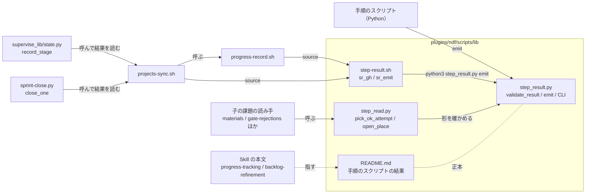
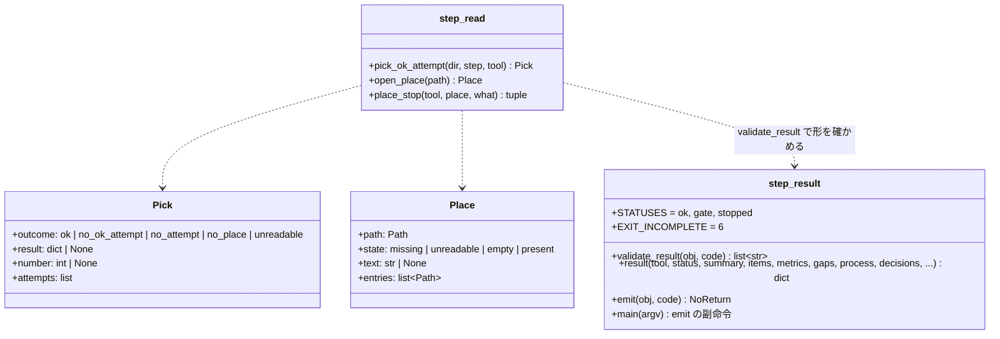
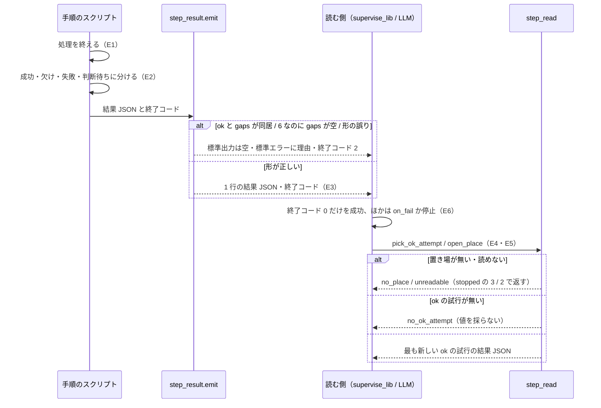
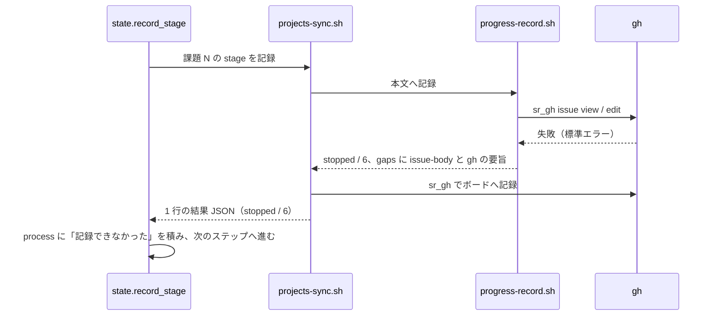

# 手順のスクリプトの結果: 欠け・未収束・未記録を ok と読ませず、過程と判断を同じ形で残す（#2227）

## 目的

- **何が壊れているか**: 結果 JSON の状態は `ok` / `gate` / `stopped` の 3 つで「終わったが欠けが残る」を表す項目が無く、子の 7 件（#2143・#2079・#2129・#2157・#2183・#671・#1849）が欠け・未収束・未記録を `ok` で返す。読む側も、落ちた試行の値や置き場の無いことを「0 件」として読む。シェルのスクリプトはこの形式を通らない
- **誰が困るか**: 自律で回す工程（プラン・supervisor・conductor）と、承認ゲート 2 で承認資料を読む利用者。間違った成功の上に後続の工程が積み上がる
- **直すと何が成り立つか**: `ok` は「成功し、目標に届き、欠けが無い」ときだけになり、`emit` が破れた結果を出さない。読む側は `ok` の試行だけを採り、置き場の無いことを 0 件と分けて返す。結果 JSON から何を実行し、何を根拠に決め、何が欠けたかを追える

## 適用範囲

- **働く範囲**: NDF を入れたすべてのリポジトリ（`plugins/ndf/scripts/lib/` は配布先にも残る）。結果 JSON を読むのは同じ版の `plugins/ndf` の中だけで、`factory/` は読まない（要求の前提 4）
- **プロジェクトごとに違うもの**: 無し（形式と読む規則はどのリポジトリでも同じ。置き場のパスは呼ぶ側が引数で渡す）
- **当たるモード**: `standard`

## あるべき姿の根拠

| 根拠 | 種類 | 何を示すか |
| --- | --- | --- |
| 「全ての工程で統一ルールに基づくレポートを JSON で出し、過程・判断・結果が分かるようにする」（2026-10-31 の方針の 3 点目。起票者の要約） | 利用者の指示の原文（の要約） | 形式を 1 つにし、過程・判断・結果の項目を持たせる |
| `supervise_lib/steps.py` の `RunStep` は終了コード 0 だけを成功とし（197 行）、`worker_steps.py` は `status == "ok"` だけを成功とする（98 行） | 実測（コードの読み取り） | 状態を 3 つのまま `stopped` で返せば、既存の読み手を変えずに成功と読まれない |
| `release_lib/materials.py` の `last_result` は番号の最大の `.out` を `status` を見ずに返す（116〜134 行） | 実測（コードの読み取り） | 試行の選び方が読む側ごとに書かれ、落ちた試行の値が採られる |
| `progress-record.sh` は `gh issue view` / `gh issue edit` の失敗を `|| exit 0` で畳む。`supervise_lib/state.py` の `record_stage` は記録のスクリプトの結果を読み捨てる | 実測（コードの読み取り） | 未記録が呼ぶ側に届かない |
| 終了コード 5 は `handoff.py` が別の意味で使い、6 はどこも使っていない（`grep` で `exit 6` / `SystemExit(6)` / `= 6` が 0 件） | 実測 | 新しい終了コードに 6 を充てられる |

要求と受け入れ条件は #2227 の本文にある（コピーは `issues/issue-2227-requirements.md`）。この文書は「どう作るか」だけを扱う。

## ドメインモデル

### コンテキスト

| コンテキスト | 何の語が 1 つの意味に決まるか |
| --- | --- |
| NDF の開発ワークフロー（`ndf-workflow`） | 結果 JSON・試行・欠けの残る結果・結果の置き場・欠け・過程の項目・判断の項目 |

1 つのコンテキストに収まる。結果 JSON の形は `lib/README.md` の「手順のスクリプトの結果」を公開された言語として、書く側（手順のスクリプト）と読む側（`supervise_lib`・承認資料の組み立て・LLM）が互いに独立して変わる。

### 集約

| 集約 | 持ち主（書き換えてよいもの） | 根 | エンティティ | 値オブジェクト |
| --- | --- | --- | --- | --- |
| 結果 JSON | 手順のスクリプト 1 本（形の検査は `lib/step_result.py` の `validate_result` / `emit` だけが行う） | 結果 JSON | — | 状態と終了コードの組・項目（`items`）・欠け（`gaps`）・過程の項目（`process`）・判断の項目（`decisions`） |
| 試行 | `supervise_lib` の `RunState`（`NN-<ステップ>.out` を書く。この課題では変えない） | 試行 | — | 番号・ステップの名前・結果 JSON |
| 読み取りの結果 | `lib/step_read.py`（読むだけで、試行も置き場も書き換えない） | 採った試行 / 開いた置き場 | — | 採り方の結果（`Pick.outcome`）・置き場の状態（`Place.state`） |

試行は結果 JSON を ID（番号とステップの名前）で指し、読み取りの結果は試行を番号で指す。読み取りの結果が試行を書き換える経路は持たない。

### 不変条件

| # | 集約 | 条件 | 破れたときの扱い |
| --- | --- | --- | --- |
| I1 | 結果 JSON | `status` が `ok` なら `gaps` は無いか空である | `validate_result` が誤りを返し、`emit` は標準出力へ何も出さず理由を標準エラーへ出して終了コード 2 |
| I2 | 結果 JSON | 終了コード 6（欠けが残る）は `status` が `stopped` で、`gaps` が 1 件以上のときだけ | 同上 |
| I3 | 結果 JSON | `gaps` / `process` / `decisions` の各要素はオブジェクトで、決めた鍵（下の「入出力の契約」）を空でない文字列で持つ | 同上 |
| I4 | 結果 JSON | 読む側が成功とするのは `status` が `ok`（終了コード 0）だけである。6 を含め、ほかの値・終了コードを成功と読まない | `supervise_lib` は `on_fail` へ回すか止まる。新しい値を足しても判定は変えない |
| I5 | 読み取りの結果 | 試行から値を採るのは `status` が `ok` の試行だけで、その中で番号の最も大きいものを採る | `ok` の試行が無ければ値を返さず `Pick.outcome` で理由を返す（落ちた試行の値を返さない） |
| I6 | 読み取りの結果 | 置き場が存在しない・読めないことと、置き場はあるが材料が 0 件であることを別の値で返す | 存在しない・読めないときに 0 件・「無し」を返さない。呼ぶ側はそれぞれ終了コード 3・2 の `stopped` で返す |
| I7 | 結果 JSON | 対象のシェルのスクリプト（`progress-record.sh`・`projects-sync.sh`）は 1 回の呼び出しで結果 JSON を 1 行だけ出し、その行は `validate_result` を通る。中の `gh` が失敗したら `ok` でなく、`gh` の標準エラーの要旨を `summary` か `gaps` / `items` の `reason` に入れ、終了コードは 0 以外 | 共通の手段（`sr_emit`）が形を確かめ、破れていれば終了コード 2 |

### ドメインイベント

| # | イベント | 発生元 | 受け手 |
| --- | --- | --- | --- |
| E1 | 手順のスクリプトが処理を終えた | 手順のスクリプト | 同じスクリプトの結果の組み立て（E2） |
| E2 | 結果を、成功・収束 / 欠けの残る結果 / 失敗 / 判断待ちのどれかに分けた | 手順のスクリプト | `validate_result`（I1〜I3 を照らす） |
| E3 | 結果 JSON を 1 行出し、状態に合った終了コードで終えた | `emit` / `sr_emit` | `supervise_lib`（ステップの成否）・LLM・承認資料の組み立て |
| E4 | 読む側が結果の置き場を開いた | `step_read.open_place` / `pick_ok_attempt` | 呼んだ読み手（I6） |
| E5 | 読む側が採る試行を選んだ | `step_read.pick_ok_attempt` | 呼んだ読み手（I5） |
| E6 | 読む側が次の工程へ進んだか、止まった | `supervise_lib`・LLM | プランの次のステップ・フェーズレポート |

### 用語

| 用語 | 意味 | 用語集への反映 |
| --- | --- | --- |
| 結果 JSON | 手順のスクリプトが返す 1 行の JSON。`status` と終了コードで読み、成功は `ok` だけ | 意味の変更（`ndf-workflow`。成功は `ok` だけと足す） |
| 試行 | 同じステップを流し直したときの 1 回ごとの実行と、その結果 JSON。プランの実行の記録の `NN-<ステップ>.out` の 1 つが 1 試行に当たる | 意味の変更（`ndf-workflow`。要求の時点の語「状態ディレクトリ」は relay の語と衝突するため、プランの実行の記録と言い換える） |
| 欠けの残る結果 | 手順は終わったが、出すはずの材料・記録の一部が無いか、目標（収束など）に届かなかった結果。`stopped` と終了コード 6 と `gaps` で返す | 意味の変更（`ndf-workflow`。返す形を足す） |
| 結果の置き場 | 読む側が結果 JSON や材料を探す場所（プランの実行の記録・記録のファイル）。置き場が無いことと、材料が 0 件であることを分けて扱う | 意味の変更（`ndf-workflow`。同上の言い換え） |
| 欠け | 結果 JSON の `gaps` の 1 件。出すはずだったのに出せなかった材料・記録、届かなかった目標を、種類・名前・理由で書く | 追加（`ndf-workflow`、コード `gaps`） |
| 過程の項目 | 結果 JSON の `process`。スクリプトが実行したこと（コマンド・操作）と、その結果の要旨を順に並べる | 追加（`ndf-workflow`、コード `process`） |
| 判断の項目 | 結果 JSON の `decisions`。スクリプトが決めたことと、その根拠を並べる | 追加（`ndf-workflow`、コード `decisions`） |

## 機能一覧

| # | 機能 | 誰が使うか |
| --- | --- | --- |
| F1 | 結果 JSON に欠け・過程・判断の項目を書き、`ok` と欠けの同居を形の誤りとして止める | 手順のスクリプト（Python・シェル） |
| F2 | 欠けの残る結果を `stopped` と終了コード 6 で返す | 手順のスクリプト |
| F3 | 同じステップの試行から `ok` の最も新しい試行だけを採る | 承認資料の組み立て（#2129 の `materials`）・振り返りの集計 |
| F4 | 置き場が無い・読めない・0 件・材料ありを分けて返す | 記録を数える読み手（#2183 の `gate-rejections.py count` ほか） |
| F5 | シェルのスクリプトから同じ形の結果 JSON を出し、`gh` の失敗の理由を載せる | `progress-record.sh`・`projects-sync.sh` |
| F6 | 進捗記録の失敗をプランを止めずに結果へ残す | `supervise_lib` の `record_stage`・`sprint-close.py` |

## 構成要素

| 要素 | 責務 |
| --- | --- |
| `plugins/ndf/scripts/lib/README.md` の「手順のスクリプトの結果」 | 結果 JSON の全項目・状態と終了コードの表・`ok` の条件・過程と判断と結果を書く項目・読む側の規則の正本（変える） |
| `plugins/ndf/scripts/lib/step_result.py` | 形の検査（`validate_result`）に I1〜I3 と終了コード 6 を足す。`result()` が `gaps` / `process` / `decisions` を受ける。シェルから呼ぶ CLI（`emit` の副命令）を足す（変える） |
| `plugins/ndf/scripts/lib/step_read.py` | 試行の選び方（`pick_ok_attempt`）と置き場の開き方（`open_place`）。読むだけで書かない（作る） |
| `plugins/ndf/scripts/lib/step-result.sh` | シェルのスクリプトが source する関数 `sr_gh`（`gh` を走らせ、失敗の要旨を残す）と `sr_emit`（`step_result.py emit` を呼ぶ）（作る） |
| `plugins/ndf/scripts/progress-record.sh` | 本文の記録の成否を結果 JSON で返す。錠の内側で走った結果を外側の 1 行へまとめる（変える） |
| `plugins/ndf/scripts/projects-sync.sh` | `progress-record.sh` の結果とボードの記録の成否を 1 行の結果 JSON にまとめる（変える） |
| `plugins/ndf/scripts/supervise_lib/state.py` の `record_stage` | 記録のスクリプトの結果 JSON を読み、`ok` でなければプランの実行の結果の `process` へ残す。プランは止めない（変える） |
| `plugins/ndf/scripts/sprint-close.py` の `close_one` | `projects-sync.sh` の出力の `NOTE` の行ではなく結果 JSON を読み、`ok` でなければ `notes` へ載せる（変える） |
| `plugins/ndf/skills/progress-tracking/SKILL.md` の「何もしない条件」 | 記録できなかったときの返し方を、終了コード 0 から結果 JSON の状態へ書き換え、呼ぶ側は止まらずに報告へ載せると定める（変える） |
| `plugins/ndf/skills/backlog-refinement/SKILL.md` の終了コードの表 | `status` の列を外し、状態の意味は正本を指す（変える） |



### シェルのスクリプトの対象（要求の未決 3）

| スクリプト | 対象か | 理由 |
| --- | --- | --- |
| `progress-record.sh` | 対象 | `gh` の失敗を `exit 0` へ畳む（#671） |
| `projects-sync.sh` | 対象 | Skill の本文と references の 27 個の文書とプランの `記録` から呼ばれ、ボードの失敗を `NOTE:` の行と終了コード 0 で返す |
| `pr-body-decisions.sh` | 対象外 | 読めないときを 2 で返し 0 へ畳まない（冒頭の「2 を 0 へ畳まない」）。標準出力は本文の節（`render`）と差分（`check`）というデータで、結果 JSON に替えると読み手（`supervise_lib/pr.py`）が壊れる |
| `stage-check.sh` | 対象外 | Skill の本文から呼ばれるのは `report` だけで、その出力は報告へ貼るデータである。`record` は Skill の本文からもプランからも呼ばれない |
| `resolve.sh` | 対象外 | 出力はパス 1 行のデータで、見つからなければ 0 以外で終わる（呼ぶ側は `|| exit 3`） |
| hook・statusline（`worktree-session.sh`・`worktree-guard.sh`・`token-guard.sh`・`ensure-retention.sh`・`statusline*.sh`） | 対象外 | 要求の前提 1 |
| 起動の補助（`launch-*.sh`・`critique*.sh`・`wait-review.sh`・`rotate-pr.sh`）、worktree の準備（`worktree-setup.sh` ほか）、`fetch-pr-comments.sh`・`install-official-skills.sh` | 対象外 | 結果を `status` で読ませるスクリプトではない（起動結果は `monitor.py` の結果が持ち、ほかは出力そのものがデータか、利用者が手で打つ補助）。形を合わせるかは要求の未決 2 の書き足しと同じく後の変更で決める |

## 構造



`Pick` と `Place` は値オブジェクトで、作った後に変えない（`dataclass(frozen=True)`）。

## 入出力の契約

### 結果 JSON の項目（`lib/README.md` の表へ足す行）

| 項目 | 必須 | 形 | 意味 |
| --- | --- | --- | --- |
| `gaps` | いいえ | オブジェクトの配列。各要素は `kind` / `name` / `reason`（空でない文字列） | 欠け。出すはずだったのに出せなかった材料・記録、届かなかった目標。無い・空なら「欠けは無い」と書き手が述べたことになる |
| `process` | いいえ | オブジェクトの配列。各要素は `run` / `result`（空でない文字列） | 過程。実行したこと（コマンド・操作）と結果の要旨を、実行した順に |
| `decisions` | いいえ | オブジェクトの配列。各要素は `decision` / `basis`（空でない文字列） | 判断。決めたことと、その根拠（読んだ値・規則・設定） |

各要素は決めた鍵のほかに鍵を持ってよい（`items` と同じ扱い）。結果（何ができたか）は今の `summary` / `items` / `metrics` が持ち、何が欠けたかは `gaps` が持つ。README の表は 3 つの問いと項目の対応を 1 行ずつ持つ（過程 → `process`、判断 → `decisions`、結果 → `summary` / `items` / `metrics` / `gaps`）。

### `ok` の条件と終了コード（README の表へ足す規則）

- `ok` を返してよいのは、手順が成功し、目標（収束など）に届き、`gaps` が空のときだけである
- 欠けが残るときは `stopped` と終了コード 6 で返し、`gaps` に 1 件以上を書く。人か LLM の判断を待つなら、今までどおり `gate`（10〜29）で返し、`gaps` を添えてよい
- 未記録（書くはずの記録を書けなかった）は欠けとして返す。置き場が無い・読めないは、欠けではなく前提の欠け（3）・読めない（2）で返す（I6）
- 既存の値（0・1・2・3・4・10〜19・20〜29・69・75）の意味は変えない

| 終了コード | status | 意味（足す行） |
| --- | --- | --- |
| 6 | `stopped` | 欠けが残る。手順は終わったが、`gaps` に書いた材料・記録・目標が欠けた。「0 件」「一致」と読まない（値の持ち主は `step_result.py` の `EXIT_INCOMPLETE`） |

### 試行の選び方: `step_read.pick_ok_attempt(dir, step, tool) -> Pick`

| 項目 | 内容 |
| --- | --- |
| 入力 | `dir`: プランの実行の記録のディレクトリ（`Path`）。`step`: ステップの id。`tool`: 採る結果 JSON の `tool` |
| 読むもの | `dir` の `NN-<step>.out`。各ファイルの最後の、`tool` が一致し `validate_result` を通る結果 JSON を、その試行の結果とする |
| 出力（採れた） | `outcome="ok"`、`result` に番号の最も大きい `ok` の試行の結果 JSON、`number` にその番号 |
| 出力（採れない） | `result=None`。`outcome` は、ディレクトリが無い → `no_place`、読めない → `unreadable`、`.out` が無い → `no_attempt`、`ok` の試行が無い → `no_ok_attempt` |
| `attempts` | 全試行の（番号, `status`）の組。結果 JSON の無い試行は `status` を `"none"` にする。報告に落ちた試行を書くために使う |
| 失敗の形 | 例外を投げない。読めない個々の `.out` はその試行の `status` を `"none"` にして続ける |

### 置き場の開き方: `step_read.open_place(path) -> Place` と `place_stop`

| `Place.state` | 条件 | 呼ぶ側の返し方 |
| --- | --- | --- |
| `missing` | `path` が存在しない | `place_stop` が `stopped` の結果 JSON を返す。終了コード 3（前提が無い）。summary に「<what> の置き場が無い: <path>」 |
| `unreadable` | 存在するが読めない（権限・デコード・ディレクトリの列挙の失敗） | 同じく終了コード 2 |
| `empty` | ファイルが空（空白だけを含む）か、ディレクトリに項目が無い | `place_stop` は `None` を返す。呼ぶ側は 0 件として `ok` を返してよい（`metrics` に件数 0） |
| `present` | 材料がある | `place_stop` は `None`。`text`（ファイル）か `entries`（ディレクトリ）を読む |

`place_stop(tool, place, what)` は `(dict, code)` の組か `None` を返し、呼ぶ側はそのまま `emit` に渡す。置き場が設定で任意のもの（宣言が無ければ使わない）では、`open_place` を呼ぶ前に宣言の有無で分け、`missing` を欠けとも前提の欠けとも読まない（例: `.ndf/projects.json` が無い → ボードを使わないリポジトリ）。

### シェルからの出力: `step_result.py emit` と `step-result.sh`

```text
python3 "$LIB/step_result.py" emit --tool <名前> --status <ok|gate|stopped> --summary <文> [--code N]
    [--item KIND NAME RESULT REASON]... [--gap KIND NAME REASON]...
    [--process RUN RESULT]... [--decision DECISION BASIS]... [--metric KEY VALUE]...
    [--next 文] [--presentation-path パス]
```

| 項目 | 内容 |
| --- | --- |
| 入力 | 値は 1 つずつ別の引数で受ける（区切り文字を持たない）。`--item` の `REASON` は空文字を許し、空なら `reason` を置かない。`--metric` の値は整数に読めれば整数、ほかは文字列 |
| 出力（成功） | 組み立てた結果 JSON を 1 行出し、`--code`（省けば状態の既定）で終える。中身は Python の `emit` と同じ |
| 失敗の形 | 形の誤り（I1〜I3、状態と終了コードの不一致）→ 何も出さず終了コード 2。引数の誤り → argparse の 2 |
| `sr_emit "$@"` | 上のコマンドを打ち、その終了コードでシェルを終える。`python3` が無ければ理由を標準エラーへ出して 2 で終える |
| `sr_gh <gh の引数>...` | `gh` を走らせ、標準出力はそのまま通す。失敗したら標準エラーの要旨（改行を空白にし先頭 300 文字。`step_result.gh_json` と同じ長さ）を変数 `SR_GH_ERR` に残し、`gh` の終了コードを返す。`gh` が無ければ `SR_GH_ERR` に「gh が無い」を入れて 127 を返す |
| 互換性 | `progress-record.sh`・`projects-sync.sh` の標準出力が「#N 進行 = X」の 1 行から結果 JSON の 1 行に変わる。読み手は同じ版の中（`state.py`・`sprint-close.py`・Skill の本文を読む LLM）だけで、同じ変更で直す |

### `progress-record.sh` / `projects-sync.sh` の返し方

| 場合 | `status` / 終了コード | 載せる所 |
| --- | --- | --- |
| 記録した・変える内容が無かった | `ok` / 0 | `items` に `{kind: "issue-body", name: "#N", result: "recorded" か "unchanged"}`、ボードは `result: "recorded"` か宣言が無ければ `"not_declared"` |
| 引数の誤り（知らない工程名・引数不足） | `stopped` / 2 | `summary`（今と同じ 2） |
| `gh` が無い | `stopped` / 3 | `summary` に「gh が無い」。通過記録は今までどおり積む（`process` に残す） |
| 本文・ボードのどれかを書けなかった（`gh` の失敗・錠を取れない・問い合わせの上限・ボードにアイテムが無く追加もできない） | `stopped` / 6 | 書けなかったものを 1 件ずつ `gaps` に。`reason` に `SR_GH_ERR` か錠・上限の理由 |
| 何も書けなかった（本文もボードも失敗し、通過記録も積めなかった） | `stopped` / 1 | `summary` に先頭の理由、`gaps` に各々 |

`projects-sync.sh` は `progress-record.sh` の結果 JSON を捕まえて自分の `items` / `gaps` / `process` へ移し、標準出力へは自分の 1 行だけを出す。`progress-record.sh` が錠の内側でもう 1 度自分を走らせるときも、外側が内側の 1 行を捕まえてまとめる。

## 処理の流れ



進捗記録はプランを止めない。



`sprint-close.py` の `close_one` も `record_stage` と同じく `projects-sync.sh` の結果 JSON を読み、`ok` でなければ `notes` へ載せて課題を閉じる処理を続ける。図に含めない構成要素は、処理を持たない文書（`lib/README.md`・`progress-tracking` と `backlog-refinement` の本文）である。

## 非機能の実現方式

| 大項目 | 条件 | 実現方式 |
| --- | --- | --- |
| 運用・保守性 | 形式の正本は 1 か所、形の検査は 1 か所、試行の選び方・置き場の区別を Skill ごとに書き分けない | 正本は `lib/README.md`、検査は `step_result.validate_result`、読む規則は `step_read.py` の 2 関数だけに置く。シェルは `step-result.sh` が Python の `emit` を呼び、JSON を自前で組まない。状態と終了コードの表を持つ文書が `lib/README.md` だけであることを、`status` と `終了コード` を同じ見出し行に持つ表を `grep` して確かめる |
| 移行性 | 読み手は同じ版の中で直す | 状態の値を増やさず、新しい終了コード 6 は `stopped` に属するため、終了コード 0 だけを成功とする既存の読み手はそのまま成功と読まない。出力の形が変わる 2 本のシェルの読み手（`state.py`・`sprint-close.py`）は同じ変更で直す |

## 決定の記録

### 決定 1: 既存の読み手を変えずに成功と読ませないため、欠けの残る結果を新しい状態ではなく `stopped` と終了コード 6 と `gaps` で表す

`supervise_lib` は終了コード 0 だけを、`worker_steps` は `status == "ok"` だけを成功とする。`stopped` に属する新しい終了コードなら、どの読み手も今のまま失敗の側へ回し（受け入れ条件 9）、プランは `on_exit` で 6 だけを別の行き先へ回せる（未収束を judge へ渡すなど）。新しい状態の値（`incomplete` など）は採らない。`status == "stopped"` で止まる・`status` の 3 値で分岐する読み手（Skill の本文の表と LLM）が新しい値を止めずに通し、すべての読み手を同時に直す必要が出る。終了コード 1 の使い回しも採らない。失敗と欠けをプランの `on_exit` で分けられない。

根拠: Value 6 / Value 4（MVV 版 3）

### 決定 2: 規則が守られたかを書き手任せにしないため、`ok` と欠けの同居を `validate_result` で形の誤りとして止める

README に規則を書くだけでは、`ok` に欠けを添えた結果がそのまま出る。`emit` が通さなければ、間違った成功は終了コード 2 の「読めない」に変わり、読む側は進まない（受け入れ条件 3）。終了コード 6 にも `gaps` を 1 件以上求め、理由の書かれない「欠け」を出させない。

根拠: Value 4 / Value 3（MVV 版 3）

### 決定 3: この課題で形と共通の手段を先に固めるため、過程・判断・欠けの項目を任意にし、既存のスクリプトへの書き足しは子と後の変更へ回す

必須にすると、`step_result` を import する 65 本の Python のファイルと、結果を丸ごと照らす既存のテストが同時に変わり、受け入れ条件 8（成功時の出力は今と同じ）と要求の「含まない」に反する。任意の項目なら、子の 7 件がそれぞれの直しの中で `gaps` を書き、`ok` を誤って返す箇所から先に埋まる（要求の未決 2）。`gaps` が無いことは「書き手が欠けは無いと述べた」と読み、その述べ方が誤っていれば子の課題の再現の手順が落とす。

根拠: Value 10 / Value 1（MVV 版 3）

### 決定 4: 試行の選び方と置き場の区別を読む側ごとに書かないため、`lib/step_read.py` に 2 つの関数として置く

`release_lib/materials.last_result` のように読む側が自前で `.out` を選ぶと、`status` を見ない読み方が別の場所にまた生まれる。`step_result.py` は書く側の形を持ち、配布物のすべての手順のスクリプトが import するため、ディレクトリを読む処理を混ぜず、別のモジュールにする。`release_lib` や `supervise_lib` に置く案は採らない。`lib/README.md` の「置いてよいもの」のとおり、Skill に属さない部品は `lib/` に置く。既存の `last_result` の置き換えは #2129 で行う。

根拠: Value 6（MVV 版 3）

### 決定 5: 終了コードを増やさないため、置き場が無い・読めないことを既存の 3・2 で返し、0 件だけを `ok` にする

置き場の無いことは「前提が無い（対象のファイル）」、読めないことは「読めない。0 件と読まない」と、既存の表がすでに意味を持つ。新しい値を足すと、同じ意味の値が 2 つになる。設定で任意の置き場（宣言が無ければ使わない）は、`open_place` の前に宣言で分け、無いことを欠けにしない。

根拠: Value 8 / Value 6（MVV 版 3）

### 決定 6: 形の検査を 2 か所に持たないため、シェルは `step_result.py` の CLI を `step-result.sh` 経由で呼び、JSON を自前で組まない

`jq` や `printf` で JSON を組むと、エスケープと形の検査をシェルの側にもう 1 つ持つことになり、`validate_result` と食い違う。対象の 2 本はすでに `python3` を使っている（本文の差し替え）。値は 1 つずつ別の引数で渡し、区切り文字を持たせない。

根拠: Value 6 / Value 4（MVV 版 3）

### 決定 7: 進捗記録を理由に開発の工程を止めず、かつ未記録を隠さないため、記録のスクリプトは `ok` 以外を返し、呼ぶ側は止まらずに結果へ残す

`progress-tracking` の「進行管理が理由で開発の工程を止めない」は残す。止めない判断は呼ぶ側が持ち、スクリプトは事実（書けなかった）を `stopped` / 6 と `gaps` で返す。`record_stage` はプランの実行の結果の `process` へ、`sprint-close.py` は `notes` へ載せ、Skill の本文から打つ LLM は作業の報告の「見つけたもの」へ載せる。スクリプトが止める判断まで持つ案（記録の失敗でプランを止める）は採らない。ボードの一時的な上限で開発が止まり、間違った成功より止まらない害の方が大きくなる。`.ndf/projects.json` が無いことは欠けにしない（ボードを使わないと決めたリポジトリ）。

根拠: Value 2 / Value 4（MVV 版 3）

### 決定 8: 結果の形を `status` で読ませないスクリプトへ形を広げないため、シェルの対象を `progress-record.sh` と `projects-sync.sh` の 2 本にする

要求の前提 3 が例に挙げた `pr-body-decisions.sh` は、読めないときを 2 で返し 0 へ畳まず、標準出力が本文の節というデータである。結果 JSON へ替えると `supervise_lib/pr.py` の `render` の読み方が壊れ、間違った成功は今も起きていない。ほかのシェルも出力がデータか、hook か、利用者が手で打つ補助である（構成要素の「シェルのスクリプトの対象」）。

根拠: Value 1 / Value 10（MVV 版 3）

### 決定 9: 形式の写しを 1 か所へ寄せるため、`status` と終了コードの対応を持つ表は `lib/README.md` だけに置く

Skill の本文が持ってよいのは、そのスクリプトの終了コードごとの「次の手」までで、状態の意味は正本を指す。今これに当たるのは `backlog-refinement` の表だけで、`status` の列を外す。`external-ai` の表は `metrics.result` の語彙ごとの次の手で、状態と終了コードの対応ではないため残す。

根拠: Value 7 / Value 8（MVV 版 3）

## テスト設計

| 受け入れ条件・不変条件 | どの振る舞いで縛るか | どう壊したら落ちるべきか |
| --- | --- | --- |
| 受け入れ条件 1・決定 9 | `status` と `終了コード` を同じ見出し行に持つ表を `plugins/ndf` の `.md` から `grep` すると `lib/README.md` だけが出る（実装の検証で打つ。`.md` の文言を照らすテストは書かない） | `backlog-refinement` の表に `status` の列を残すと 2 件出る |
| 受け入れ条件 2・I1 | `ok` に `gaps` を 1 件添えた結果を `validate_result` へ渡すと誤りが返る | I1 の検査を外すと誤りが空になる |
| 受け入れ条件 3・I1 | 同じ結果を `emit` すると標準出力は空、標準エラーに理由、終了コード 2 | `emit` が誤りを無視して出すと標準出力に行が出る |
| I2 | `stopped` / 6 で `gaps` が空なら誤り、1 件なら通る。`ok` / 6・`gate` / 6 は不一致の誤り | 6 を `code_matches` の `stopped` に入れ忘れると正しい結果が 2 になる。`gaps` の件数を見ないと空でも通る |
| I3 | `gaps` の要素に `reason` が無い・空・文字列でない、`process` の要素がオブジェクトでないと誤り | 要素の鍵を見ないと通る |
| 受け入れ条件 4・I5 | 番号 1 が `ok`・2 が `stopped` → 1 の結果を返す。全試行が `stopped` → `result` が無く `no_ok_attempt`。`.out` が無い → `no_attempt`。ディレクトリが無い → `no_place`。別の `tool` の行は採らない | 番号の最大を `status` を見ずに採ると 2 の値が返る |
| 受け入れ条件 5・I6 | ファイルとディレクトリのそれぞれで、無い → `missing` と `place_stop` の 3、読めない → `unreadable` と 2、空 → `empty` と `None`、ある → `present` | 無いときに `empty` を返すと 0 件と区別できない |
| 受け入れ条件 6・I7 | 偽の `gh` が失敗するとき、`progress-record.sh` と `projects-sync.sh` は 1 行の結果 JSON を出し、それが `validate_result` を通り、`status` が `ok` でなく、`gaps` か `summary` に偽の `gh` の標準エラーの文が入り、終了コードは 0 以外 | `|| exit 0` を残すと終了コード 0 になる。標準エラーを捨てると理由が入らない |
| I7（1 行） | 錠の内側で走らせても、`projects-sync.sh` から呼んでも、標準出力の結果 JSON は 1 行だけ | 内側の行をそのまま流すと 2 行になる |
| 決定 7 | `record_stage` は記録のスクリプトが `stopped` / 6 を返してもプランを次のステップへ進め、プランの実行の結果の `process` に記録できなかった工程が残る | 結果を読み捨てると `process` に残らない。終了コードで止めるとプランが止まる |
| 決定 7（sprint-close） | `projects-sync.sh` が `stopped` を返すと `close_one` の `notes` に理由が載り、課題は閉じる | `NOTE` の行だけを読むと結果 JSON の理由が落ちる |
| 受け入れ条件 8 | 成功し欠けの無い場合、既存の手順のスクリプトの `status` と終了コードは今と同じ（既存のテスト全体） | 既定の終了コードや `result()` の出力を変えると既存のテストが落ちる |
| 受け入れ条件 9・I4 | run のステップが終了コード 6 で終わると、`supervise_lib` は成功と読まず `on_fail` へ回す（`on_fail` が無ければ止まる）。`on_exit` に `"6"` があればその行き先へ回る | 0 以外を成功とする判定へ変えると次のステップへ進む |
| 受け入れ条件 7 | 子の 7 件が閉じていることを、スプリントの終わりに `gh issue view` で見る（この課題ではテストを書かない） | — |

## 設計の結果

| 課題 | 扱い | 取り込み先 | 触るファイル |
| --- | --- | --- | --- |
| #2227 | 実装する | — | `plugins/ndf/scripts/lib/README.md`、`plugins/ndf/scripts/lib/step_result.py`、`plugins/ndf/scripts/lib/step_read.py`、`plugins/ndf/scripts/lib/step-result.sh`、`plugins/ndf/scripts/progress-record.sh`、`plugins/ndf/scripts/projects-sync.sh`、`plugins/ndf/scripts/supervise_lib/state.py`、`plugins/ndf/scripts/sprint-close.py`、`plugins/ndf/skills/progress-tracking/SKILL.md`、`plugins/ndf/skills/backlog-refinement/SKILL.md`、`plugins/ndf/scripts/tests/`、`docs/glossary/glossary.json`、`docs/glossary.md` |

## 未確認のまま残ること

| 項目 | 内容 |
| --- | --- |
| プランの実行の結果の `process` の置き場 | `record_stage` が積む先（`RunState` が持つ結果のどこへ足すか）は実装で `supervise.py run` の結果の組み立てを読んで決める。フェーズレポートへ届くかはリリース後テストで見る |
| Skill の本文から打った `projects-sync.sh` の出力 | 27 個の文書からの呼び出しで、LLM が 1 行の結果 JSON の `stopped` を報告へ載せるかは、本文を変えずに `progress-tracking` の規則だけで足りるかを実装後の 1 回の実行で確かめる |
| 子の 7 件の読み手の移し替え | `materials.last_result`（#2129）・`gate-rejections.py count`（#2183）ほかが `step_read` へ移るのは子の課題で、この課題の時点では旧い読み方が残る |
| `handoff.py` の終了コード 4・5 | 共通の表と違う意味で返し、`emit` を通らない。#2241 で扱う |
| `python3` が無い環境 | 対象の 2 本は今も `python3` で本文を差し替えており、無ければ結果 JSON を出せず `sr_emit` が 2 で終える。今の「何もせず 0」から変わる |
