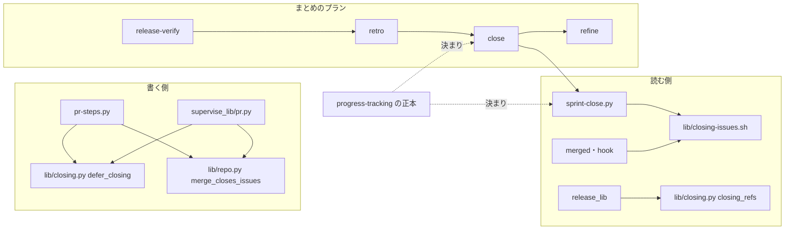
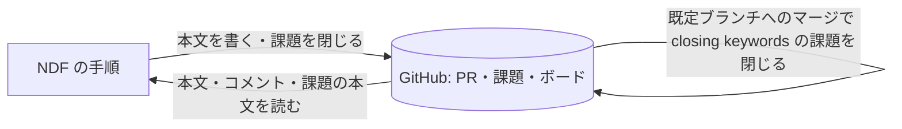
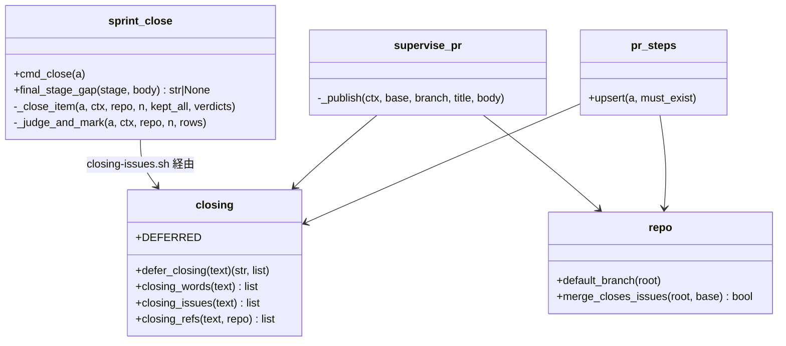
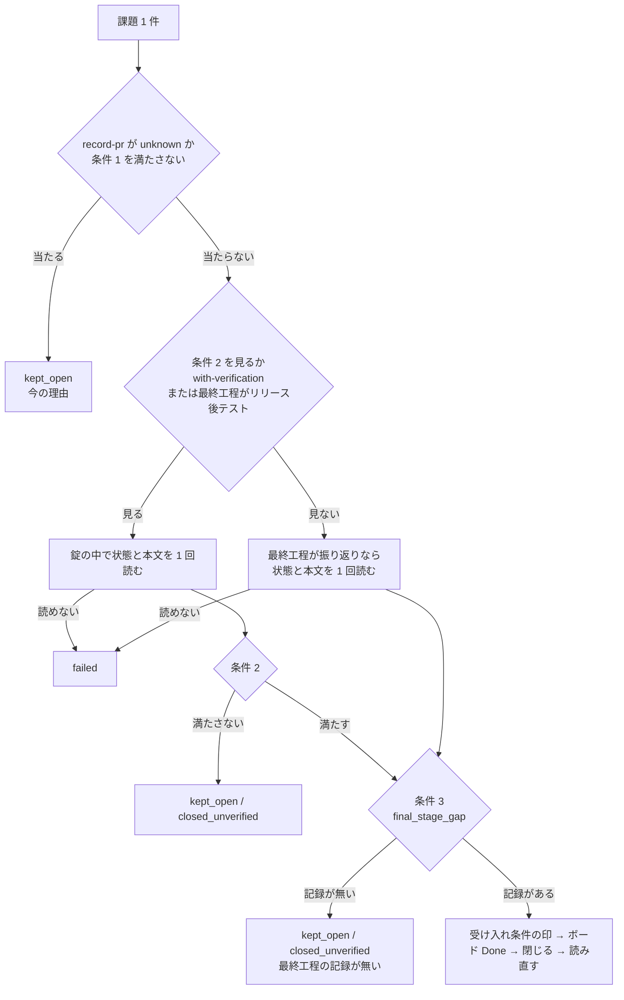
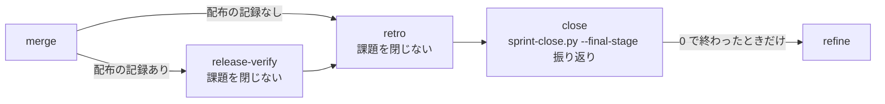
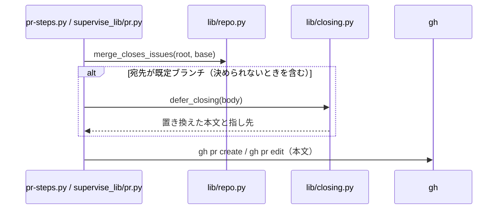

# sprint-close: 課題を最終工程の記録を確かめてから閉じ、既定ブランチ宛の PR のマージでは閉じない（#2228）

## 目的

- **何が壊れているか**: 課題が工程の途中で閉じる。`sprint-close.py` は工程の通過を見ず、まとめのプランは振り返りの前に閉じる（#2119）。既定ブランチ宛の Pull Request は本文の closing keywords で、マージの時点に GitHub が閉じる（#2082）
- **誰が困るか**: 棚卸しと振り返りで課題の一覧を読む人と AI。閉じた課題は棚卸しの対象から外れ、不合格の条件や通っていない工程が見えなくなる（s2086 の #2086）
- **直すと何が成り立つか**: NDF のどの経路で閉じても、閉じた課題はその実行の最終工程の記録を持つ。閉じる時点の決まりは `progress-tracking` の 1 か所、判定は `sprint-close.py` の 1 か所にそろう

## 適用範囲

- **働く範囲**: 配布先のリポジトリでも働く。`sprint-close.py`・まとめのプラン・`pr-steps.py`・プランの pr のステップはプラグインの配布物である
- **プロジェクトごとに違うもの**: 既定ブランチと開発の起点（`.ndf/worktree.json` の `base_branch`）は git と設定から読む。最終工程は呼ぶ側が引数 `--final-stage` で渡す
- **当たるモード**: 5 つのモードすべて。最終工程はモードと経路で変わる（`light` は配布、振り返りを通る経路は振り返り、振り返りを通らない `operation` はリリース後テストか配布）

## あるべき姿の根拠

| 根拠 | 種類 | 何を示すか |
| --- | --- | --- |
| s2086 で `sprint-close.py --record-pr 2109 --prs 2092,2088,2090` が #2086 をリリース後テストの前に閉じ、その後のリリース後テストで受け入れ条件 10 が不合格になったが閉じたまま残った（#2119） | 実測 | 呼ぶ側の手順の並びに頼ると、並びを 1 つ書き違えただけで閉じる |
| volareinc/carmo-screening の PR 344 の本文の `Closes #342` で、マージの時刻（2026-10-19T10:07:23Z）に #342 が閉じ、受け入れ条件 11 件が未チェックのまま残った（#2082） | 実測 | 既定ブランチ宛の本文に closing keywords が残ると、NDF の判定より先に GitHub が閉じる |
| #2086・#2216・#2227・#2229 の本文に `振り返り: https://github.com/devbasex/ai-plugins/pull/<番号>#issuecomment-<識別子>` の行があり、#2086 の行は記録の PR（2109）と違う PR（2110）を指す（2026-10-31 に `gh issue view` で確かめた） | 実測 | 振り返りの記録の有無は、記録の PR ではなく課題の本文から課題ごとに読める |
| 同じ 4 件と #2172 の本文の `## 進行` の `モード:` は `—` である（同上） | 実測 | 課題の本文のモードからは最終工程を決められない |
| GitHub は既定ブランチへのマージのときだけ本文の closing keywords で課題を閉じる（`lib/closing-issues.sh` の冒頭の説明と、`develop` 宛のこのリポジトリで課題がマージで閉じない今の運用） | 実測 | 書き換えるのは宛先が既定ブランチの Pull Request だけでよい |

要求と受け入れ条件は #2228 の本文にある（コピーは [issue-2228-requirements.md](issue-2228-requirements.md)）。この文書は「どう作るか」だけを扱う。
決定の記録は [issue-2228-design-decisions.md](issue-2228-design-decisions.md) に分けた。子の #2082・#2119 の設計もこの文書が持つ。

## ドメインモデル

### コンテキスト

| コンテキスト | 何の語が 1 つの意味に決まるか |
| --- | --- |
| 工程（`ndf-workflow`） | 最終工程・最終工程の記録・スプリント課題・閉じる予定の参照・閉じる条件 |
| GitHub（外部の系） | closing keywords・既定ブランチ・課題の状態（OPEN / CLOSED） |

工程が下流、GitHub が上流の関係で、工程の側が**腐敗防止層**を置く。GitHub の closing keywords は「既定ブランチへマージしたら閉じる」という上流の規則で、工程の「最終工程の後に閉じる」を壊す。PR の本文を書く手順は `lib/closing.py` の `defer_closing` を通し、既定ブランチ宛の本文では closing keywords を工程の語（閉じる予定の参照）へ翻訳する。読む側は 2 つの形を同じスプリント課題として読む。

### 集約

| 集約 | 持ち主（書き換えてよいもの） | 根 | エンティティ | 値オブジェクト |
| --- | --- | --- | --- | --- |
| 課題の閉じ方 | `sprint-close.py`（課題の状態・ボードの `Done`・受け入れ条件の印） | スプリント課題（`(リポジトリ, 番号)`） | — | 最終工程・最終工程の記録・判定の結果（`result` / `reason`） |
| 閉じる指定 | `lib/closing.py` の `defer_closing`（本文の閉じる指定の形を決める唯一の関数。`pr-steps.py` と `supervise_lib/pr.py` は通して書くだけ） | Pull Request の本文 | — | closing keywords・閉じる予定の参照 |
| まとめのプラン | `supervise_lib/sprint_close_steps.py` と `sprint.py` の `close_plan` | プラン | ステップ | ステップの並び（`next`） |

課題の閉じ方は閉じる指定を ID（課題の参照）でだけ読む。まとめのプランは課題の閉じ方を `sprint-close.py` の起動でだけ使い、閉じてよいかを自分で判定しない。

### 不変条件

| # | 集約 | 条件 | 破れたときの扱い |
| --- | --- | --- | --- |
| I1 | 課題の閉じ方 | 課題を閉じ、ボードを `Done` にするのは、その課題の最終工程の記録があるときだけである | 閉じない。`kept_open` と、通っていない工程の名前を含む `reason` で返す |
| I2 | 課題の閉じ方 | 最終工程の記録を読む置き場（課題の本文）を読めないとき、記録があるとは読まない | 閉じない。`failed` と打ち直しの `cmd` で返し、`status` は `stopped`（終了コード 1） |
| I3 | 課題の閉じ方 | `--final-stage` を省いたときの最終工程は `振り返り`（最も後ろ）である。省いても閉じる条件は緩まない | — （既定値で守る） |
| I4 | 課題の閉じ方 | 最終工程が `リリース後テスト` のとき、閉じる条件 2（リリース後テストの行がすべて合格）を `--with-verification` の有無にかかわらず見る | 閉じない（今の条件 2 の扱い） |
| I5 | 課題の閉じ方 | `--record-pr 0` と `--record-pr unknown` の今の扱いは変わらない。`unknown` は最終工程の記録を読まずにすべて `kept_open` で返す | — |
| I6 | まとめのプラン | `next` のつながりで、`close` は `retro` の後、`refine` の前にある。`retro` と `release-verify` の指示は課題を閉じない | プランを組む関数のテストで落ちる |
| I7 | 閉じる指定 | 宛先が既定ブランチ（既定ブランチを決められないときを含む）の Pull Request を NDF の手順で書くと、本文に closing keywords が残らず、置き換えた指し先は同じ課題を指す閉じる予定の参照になる | — （書く前に `defer_closing` を通す） |
| I8 | 閉じる指定 | 宛先が既定ブランチでない Pull Request の本文は書き換えない | — |
| I9 | 閉じる指定 | 閉じる予定の参照は GitHub の closing keywords を含まない | `closing_words` が一致を返したらテストで落ちる |
| I10 | 課題の閉じ方 | スプリント課題は closing keywords・閉じる予定の参照・`--issues` の和であり、閉じる予定の参照が指す課題を参照だけの課題にしない | — |

### ドメインイベント

| # | イベント | 発生元 | 受け手 |
| --- | --- | --- | --- |
| E1 | 課題の Pull Request・スプリントの Pull Request がマージされた | 承認ゲート 2 の後のマージ（`merge-when-green`） | GitHub（既定ブランチ宛でも閉じる予定の参照では閉じない。I7） |
| E2 | 配布を終え、配布の記録を記録の PR に置いた | `release`・`release-steps.py record` | `sprint-close.py`（閉じる条件 1） |
| E3 | リリース後テストの結果を記録した | `release-verification` | `sprint-close.py`（閉じる条件 2） |
| E4 | 振り返りの記録を投稿し、課題の本文に辿る経路の行を足した | `retrospective` | `sprint-close.py`（閉じる条件 3） |
| E5 | 課題ごとに最終工程の記録を判定した | `sprint-close.py` | 結果 JSON の読み手（プランの `close` のステップ・conductor・Skill の担当） |
| E6 | 判定を通った課題のボードを `Done` にし、閉じた | `sprint-close.py` | ボードの自動化・`backlog-refinement` |
| E7 | 棚卸しを始めた | プランの `refine`・工程表の次の工程 | `backlog-refinement` |

### 用語

| 用語 | 意味 | 用語集への反映 |
| --- | --- | --- |
| 最終工程 | 棚卸しの前にその実行で最後に通る工程。振り返りを通るなら振り返り、通らずリリース後テストを通るならリリース後テスト、どちらも通らなければ配布 | 意味の変更（`ndf-workflow`。配布の場合を足す） |
| 最終工程の記録 | 最終工程を終えたことを示す、GitHub に残った記録。配布は配布の記録の `段階:`、リリース後テストはその課題の行、振り返りは課題の本文の `振り返り: <コメントの URL>` の行 | 追加（`ndf-workflow`） |
| 閉じる予定の参照 | Pull Request の本文に `最終工程の後に閉じる: #<番号>` と書く形。GitHub は閉じず、`sprint-close.py` がスプリント課題として集める | 追加（`ndf-workflow`） |
| スプリント課題 | 「スプリントを閉じる」が閉じる対象にする課題。スプリントの Pull Request の本文の closing keywords と閉じる予定の参照が指す課題と、`--issues` で渡した課題の和 | 意味の変更（`ndf-workflow`。閉じる予定の参照を足す） |

## 機能一覧

| # | 機能 | 誰が使うか |
| --- | --- | --- |
| F1 | 課題ごとに最終工程の記録を確かめ、無ければ閉じずに理由を返す | まとめのプランの `close`・最終工程を担う Skill の担当・conductor |
| F2 | 呼ぶ側が最終工程を引数で渡す（省けば振り返り） | 同上 |
| F3 | まとめのプランを「リリース後テスト → 振り返り → 課題を閉じる → 棚卸し」の順に組む | `supervise.py new close` を打つ conductor |
| F4 | 既定ブランチ宛の Pull Request の本文の closing keywords を閉じる予定の参照へ置き換える | `/ndf:pr`（`pr-steps.py`）とプランの pr のステップ |
| F5 | 閉じる予定の参照をスプリント課題として集める | `sprint-close.py`・`merged`・工程の飛ばしの検知の hook・リリースの材料 |

## 構成要素

| 要素 | 責務 |
| --- | --- |
| `scripts/sprint-close.py` | 引数 `--final-stage` を受け、課題ごとに閉じる条件 3（最終工程の記録）を判定する。判定の関数 `final_stage_gap(stage, body)` はこのファイルに置く（読み手が 1 つのため `lib` に置かない。決定 6） |
| `scripts/lib/closing.py` | 閉じる予定の参照の形（`DEFERRED`）を持つ。`defer_closing(text)` が closing keywords を置き換え、`closing_issues` / `closing_refs` / `closing_numbers` が 2 つの形をどちらも読む。`closing_words` は closing keywords だけを読む（コミットの検査のため） |
| `scripts/lib/closing-issues.sh` | 閉じる予定の参照も取り出す。出力の形（`<リポジトリ>\t<番号>`）は変えない |
| `scripts/lib/repo.py` | `merge_closes_issues(root, base)`: 宛先が既定ブランチか、既定ブランチを決められないときに真 |
| `scripts/pr-steps.py` | `upsert` で、宛先（新しく作るなら `--base` か起点、既存なら `baseRefName`）が `merge_closes_issues` に当たれば本文を `defer_closing` に通す。置き換えた指し先を `metrics.deferred_closing` に載せる |
| `scripts/supervise_lib/pr.py` | `_publish` で同じ判定と置き換えを行ってから `gh pr create` / `gh pr edit` へ渡す |
| `scripts/supervise_lib/sprint_close_steps.py`・`sprint.py`・`release_templates.py` | まとめのプランの並びを `merge →（release-verify）→ retro → close → refine` にする。`close` は `--final-stage 振り返り` を明示し、`retro` の指示に「課題を閉じない（次の close が閉じる）」を足す |
| `tests/fixtures/supervise-contract/plans/close/4-close.json` | まとめのプランの契約の写しを新しい並びに合わせる |
| `skills/progress-tracking/SKILL.md` の「スプリントを閉じる」 | 閉じる時点の正本。閉じる条件 3・`--final-stage` の値と呼ぶ Skill の対応・閉じる予定の参照・プランの並びを持つ |
| `skills/pr/SKILL.md` の「closing keywords は本文だけに書く」 | 既定ブランチ宛では NDF の手順が置き換えることを書き、閉じる時点は正本を指す |
| `skills/release-verification/SKILL.md`・`retrospective`・`release`・`merged` と `development-workflow` の references（`pace.md`・`loop.md`・`stage-completeness.md`・`glossary.md`） | 閉じる時点・順序・閉じる条件の写しを外し、正本を指す。順序の説明の文を新しい並びに直す |
| `docs/glossary/glossary.json`・`docs/glossary.md` | 用語の表の 4 語を反映し、`glossary.py render` で作り直す |



図に含めない要素: 契約の写し（`4-close.json`）・正本を指すように付け替える Skill と references・用語集。どれも呼び出しの関係を持たない。

### システムの文脈



配置は変わらない。どの要素も conductor・supervisor・worker が動く機械の上で起動され、状態は GitHub に置く（手元の通過記録・プランの状態ディレクトリを判定に使わない。決定 1）。

## 構造

触る関数とその関係（Python のモジュールを型として描く）。



## 入出力の契約

### `sprint-close.py`

```text
sprint-close.py --record-pr <PR番号|0|unknown> [--final-stage 配布|リリース後テスト|振り返り]
                [--prs 1,2] [--issues 3,4] [--with-verification] [--label …] [--dry-run] [--root <dir>] [--repo <owner/name>]
```

| 項目 | 変更後 |
| --- | --- |
| `--final-stage` | 新しい引数。値は 3 つ。省けば `振り返り`。それ以外の値は呼び出しの誤り（終了コード 3） |
| 閉じる条件 3 | 最終工程ごとに、その課題の最終工程の記録を見る（下の表）。条件 1・2 の後に判定する |
| `items[].reason`（条件 3 を満たさない） | `最終工程（<工程>）の記録が無い: <何が無いか>`。`result` は `kept_open`。既に閉じていれば `closed_unverified`（開き直さない。今の条件 2 と同じ扱い） |
| 課題の本文を読めない | `result: failed`・`reason: 本文を読めない（最終工程の記録を確かめられない）`・`cmd` は同じ呼び出し。`status: stopped`・終了コード 1（今の `failed` の扱い） |
| `metrics.final_stage` | 新しい値。判定に使った最終工程 |
| `decisions` | 1 件足す。`{"decision": "最終工程を <工程> として判定した", "basis": "--final-stage <値>（省略時は振り返り）"}` |
| 終了コード | 0 / 1 / 2 / 3 の意味は変えない |

| 最終工程 | 最終工程の記録 | 読む置き場 |
| --- | --- | --- |
| `配布` | 閉じる条件 1（最後の配布の記録の `段階:` が `本番` か `配布なし`。`--record-pr 0` は満たす） | 記録の PR（今と同じ） |
| `リリース後テスト` | 閉じる条件 2（`--with-verification` を付けたのと同じ判定） | 記録の PR（今と同じ） |
| `振り返り` | 課題の本文に、行頭から `振り返り: https://github.com/<所有者>/<リポジトリ>/(issues|pull)/<番号>#issuecomment-<識別子>` の行が 1 つ以上ある | 課題の本文（`gh issue view --json state,body`） |

### `pr-steps.py create` / `update`

| 項目 | 変更後 |
| --- | --- |
| 本文 | 宛先が `merge_closes_issues` に当たれば、`Closes #12` などを `最終工程の後に閉じる: #12` へ置き換えてから送る。指し先の字面（`#12`・`owner/repo#12`・課題の URL）は変えない |
| `metrics.deferred_closing` | 新しい値。置き換えた指し先の字面の配列（置き換えなければ空） |
| `items` | 置き換えたら `{"kind": "closing", "name": "<指し先>", "result": "deferred"}` を指し先ごとに足す |
| `metrics.closing_issues_in_body` | 2 つの形の指し先をどちらも載せる |
| `status` | 置き換えは `ok` のまま（欠けではない） |

### 閉じる予定の参照の形

```text
最終工程の後に閉じる: <指し先>
```

`<指し先>` は closing keywords と同じ 3 つ（`#<番号>`・`<所有者>/<リポジトリ>#<番号>`・課題の URL）。`:` の前後の空白は 0 個以上を許す。1 つの指し先に 1 つ書く（closing keywords と同じ規則）。

## 処理の流れ

### `sprint-close.py` の課題 1 件の判定



条件 3 は条件 2 と同じ 1 回の本文の読みを使う（`gh` の呼び出しを増やさない）。印を書くのは条件 3 も満たしたときだけで、条件 3 を満たさない課題の本文は書かない。`--dry-run` は判定まで行い、書かない。

### まとめのプランの並び



### Pull Request の本文を送る



## 非機能の実現方式

| 大項目 | 実現方式 |
| --- | --- |
| 運用・保守性 | 閉じる時点の決まりは `progress-tracking` の「スプリントを閉じる」だけが持つ。判定は `sprint-close.py` の `final_stage_gap` と既存の条件 1・2 だけに置き、まとめのプランと Skill の本文は `--final-stage` の値を渡すだけにする。閉じる指定の形は `lib/closing.py` だけが持ち、`closing-issues.sh` は同じ形を読む（2 つの読み手が同じ結果を返すことをテストで縛る） |
| 移行性 | 同じ版で呼ぶ側（まとめのプラン・Skill の本文）も直す。利用者の手での移行は要らない。この版より前に振り返りを通った課題は既に本文に辿る経路の行を持つ（#2216・#2227・#2229 で確かめた）ため、そのまま閉じられる。行を持たずに開いている課題は `kept_open` で残り、`next` が「振り返りを通すか、確かめて手で閉じる」を示す（決定 4） |

## 決定の記録

[issue-2228-design-decisions.md](issue-2228-design-decisions.md) に分けた。

## テスト設計

| 受け入れ条件・不変条件 | どの振る舞いで縛るか | どう壊したら落ちるべきか |
| --- | --- | --- |
| 受け入れ条件 1 | 文書の参照はチェックスクリプトと `grep` で見る（文言を照合するテストは書かない） | — （マージ前に `grep` で、閉じる条件と順序を持つ文書が正本の 1 か所であることを見る） |
| 受け入れ条件 2・I1・I3 | 本文に辿る経路の行が無い課題で、`--final-stage` を省いて打つと、`--with-verification` の有無の両方で `kept_open` と「振り返り」を含む `reason` が返り、閉じる・ボードを書く `gh` の呼び出しが無い | 既定値を `配布` にする・条件 3 を `--with-verification` の経路だけで見る・ボードを判定の前に書く |
| 受け入れ条件 3・I2 | 課題の本文の読みが失敗すると `failed`・`status: stopped`・終了コード 1 になる | 読めないときに記録ありと読む・`kept_open` で `ok` を返す |
| 受け入れ条件 4・I4・I5 | 辿る経路の行があり、行がすべて合格の課題で印・`Done`・閉じるが今と同じ順で起きる。`--record-pr 0` で辿る経路の行があれば閉じる。`unknown` では本文を読まずにすべて `kept_open` | 条件 3 を条件 2 より前に置いて印を書かない・`unknown` で本文を読む |
| I4 | `--final-stage リリース後テスト` で `--with-verification` を付けずに打つと、不合格の行を持つ課題が閉じない | 最終工程の値を条件 2 に結び付けない |
| 受け入れ条件 5・I6 | 振り返りを通るまとめのプランの `next` をたどった `id` の並びが `release-verify → retro → close → refine`（記録なしでは `retro → close → refine`）。`retro` と `release-verify` の指示に閉じない旨がある | `close` の `next` を `retro` に戻す・`merge` の `next` を `close` にする |
| 受け入れ条件 6 | `light` を含むどのモードで組んでも、`close` は最後の工程のステップ（`retro`）の後、`refine` の前にある | モードで並びを分けて `close` を `retro` の前に置く |
| 受け入れ条件 7・I7・I9 | 既定ブランチと起点が同じ一時のリポジトリで `pr-steps.py create` / `update` を流すと、`gh` に渡る本文に closing keywords が無く、閉じる予定の参照が同じ指し先で残る。既定ブランチを決められない構成でも同じ。置き換えた本文に `closing_words` が何も返さない | 置き換えを `create` だけにする・既存の PR の宛先を見ない・印の語に `close` を含める |
| 受け入れ条件 7（プランの経路） | `supervise_lib/pr.py` の `_publish` が既定ブランチ宛で `gh` に渡す本文に closing keywords が無い | `_publish` で置き換えを通さない |
| 受け入れ条件 8・I10 | 閉じる予定の参照だけを持つ PR で `sprint-close.py --prs <番号> --dry-run` を打つと、その課題が `would_close`（辿る経路の行があるとき）で、参照だけの課題にも終了コード 2 にもならない。`closing-issues.sh` と `closing.closing_refs` が同じ本文から同じ指し先を返す | `closing-issues.sh` だけに形を足す・参照だけの課題の除外に新しい形を入れない |
| 受け入れ条件 9・I8 | 起点が既定ブランチと違う構成（宛先 `develop`）では、本文が書き換わらず、`sprint-close.py` が closing keywords から課題を集める（既存のテストが通る） | 宛先を見ずに常に置き換える |
| 受け入れ条件 10 | 子の課題で確かめる | — |
| 受け入れ条件 11 | リリース後テストで、最初のスプリントの課題の `closedAt` が本文の辿る経路の行が指すコメントの投稿時刻より後であることを見る | — |

## 設計の結果

| 課題 | 扱い | 取り込み先 | 触るファイル |
| --- | --- | --- | --- |
| #2228 | 実装する | — | `plugins/ndf/scripts/sprint-close.py`、`plugins/ndf/scripts/lib/closing.py`、`plugins/ndf/scripts/lib/closing-issues.sh`、`plugins/ndf/scripts/lib/repo.py`、`plugins/ndf/scripts/pr-steps.py`、`plugins/ndf/scripts/supervise_lib/`、`plugins/ndf/scripts/supervise.py`、`plugins/ndf/scripts/tests/`、`plugins/ndf/skills/progress-tracking/SKILL.md`、`plugins/ndf/skills/pr/SKILL.md`、`plugins/ndf/skills/release-verification/SKILL.md`、`plugins/ndf/skills/retrospective/SKILL.md`、`plugins/ndf/skills/release/SKILL.md`、`plugins/ndf/skills/merged/SKILL.md`、`plugins/ndf/skills/development-workflow/references/`、`docs/glossary/glossary.json`、`docs/glossary.md` |
| #2082 | 取り込む | #2228 | — |
| #2119 | 取り込む | #2228 | — |

## 未確認のまま残ること

| 項目 | 内容 |
| --- | --- |
| 前の実行の辿る経路の行 | 前のスプリントで振り返りを通り、閉じずに次のスプリントへ持ち越した課題は、前の行を持ったまま次の振り返りの前に条件 3 を満たす。条件 1・2 は今の配布の記録で見るため、リリース後テストを飛ばして閉じることは無い。行の指すコメントの投稿時刻と配布の記録の時刻を比べるかは、実際に起きた件数で決める |
| 辿る経路の行の中身 | 行の URL のコメントが実在するか・振り返りの記録の形かは読まない（課題ごとに `gh` を 1 回増やすため。決定 7） |
| `--with-verification` を付け忘れた振り返りの経路 | 振り返りの経路で `--with-verification` を省くと、条件 2 を見ずに閉じる（今と同じ）。順序はプランが守るが、不合格の行を持つ課題が閉じうる。範囲外の課題 #2293 として起票した |
| `closing-issues.sh` の日本語の一致 | `grep -E` が利用者の locale（`C` を含む）で `最終工程の後に閉じる` をバイト列として一致させるかを、実装で走らせて確かめる |
| 利用者が GitHub の画面で本文を書き直したとき | NDF の手順を通らない書き込みは置き換えない（要求の対象範囲の外） |
