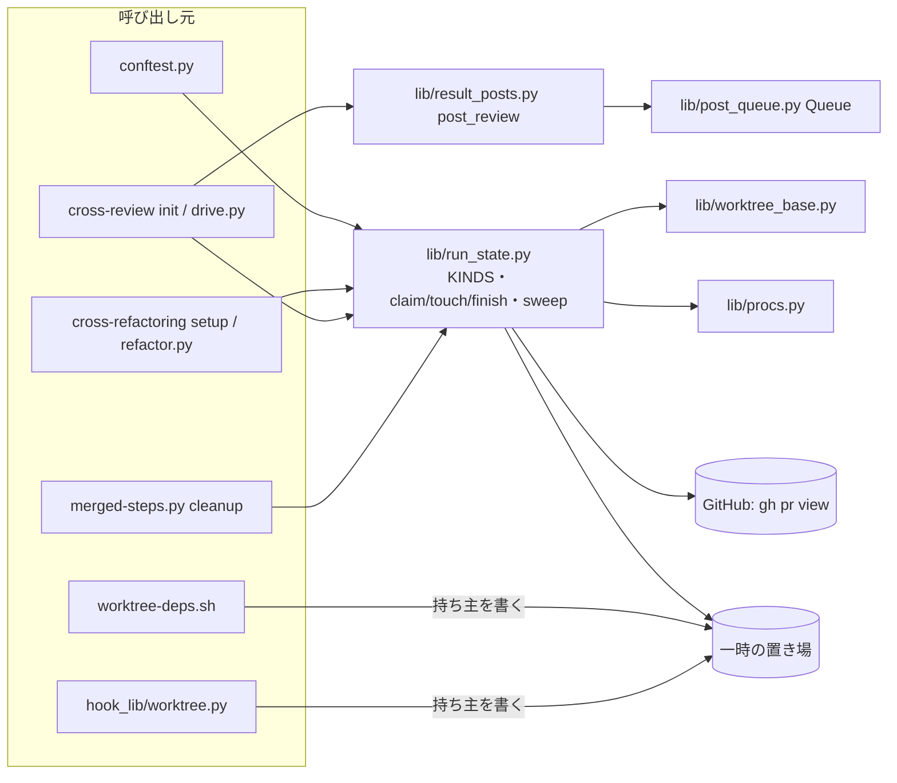
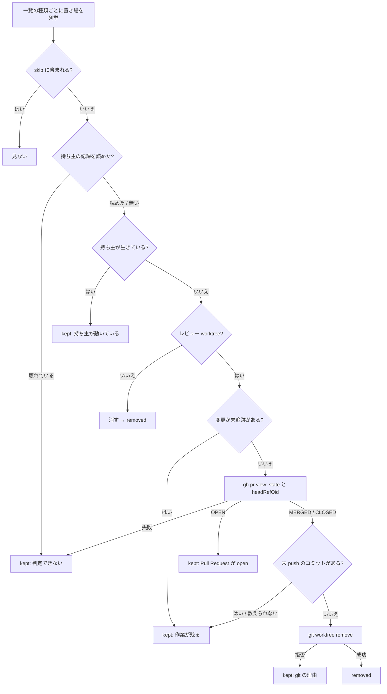
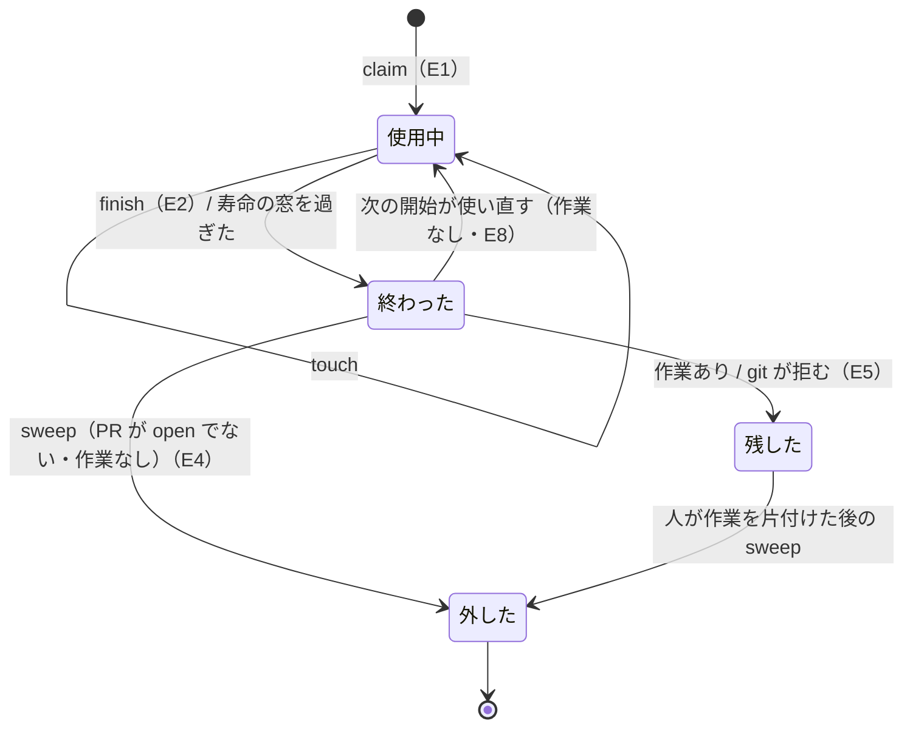
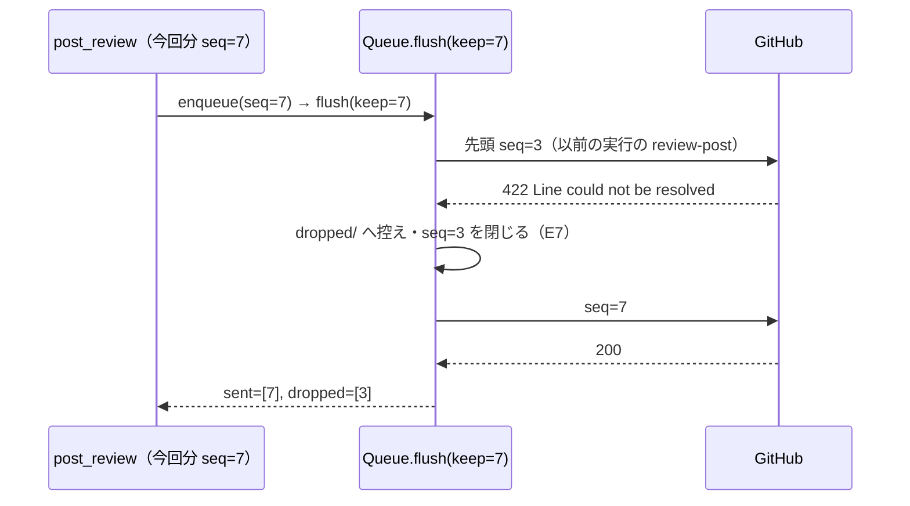

# 実行をまたいで残る状態: 持ち主と寿命を記録し、終わった実行の残骸を次の実行で片付ける（#2229）

## 目的

- **何が壊れているか**: NDF の実行が残す状態（レビュー worktree・状態ファイル・一時ファイル・投稿キューの項目）に持ち主と寿命が無い。merged は `pr<n>` しか外さず `rf<n>` が残り（#1680）、`ndf-worktree-*.json`・`ndf-deps.*`・`fix-pr<n>-*`・`ndf-tests-*` は誰も消さない。投稿キューの先頭に前の実行の 422 の項目が残ると、次の実行の review が止まり続ける（#2084）
- **誰が困るか**: 並行して cross-review・cross-refactoring・merged を回す conductor と利用者。ホストのディスクが埋まり（2026-10-23）、手で片付ける側は実行中のものを消すおそれがある
- **直すと何が成り立つか**: 残る状態の種類ごとに持ち主と寿命が 1 か所の一覧に決まり、持ち主の終わった状態は次の cross-review・cross-refactoring・merged が自動で外す。生きている実行の状態と作業の残る worktree は外さず、理由を結果の `items` に出す。前の実行の位置エラーの項目は待ち行列から外れ、今回分の投稿を止めない

## 適用範囲

- **働く範囲**: 配布先のリポジトリでも働く（`plugins/ndf/scripts/` と cross-review・cross-refactoring・merged の配布物）。片付けるレビュー worktree は、実行したリポジトリの slug の下（`<NDF_WORKTREE_BASE>/<slug>/`）だけである。一時ファイルはリポジトリに依らず、システムの一時の置き場（`tempfile.gettempdir()`）の下を見る
- **プロジェクトごとに違うもの**: 無し（一時の置き場は今までどおり `NDF_WORKTREE_BASE` → `tempfile.gettempdir()` で決まる。要求の前提 6）。寿命の窓は設定にしない（決定 4）
- **当たるモード**: `standard`。既定で働く後片付けの振る舞いと、投稿キューの失敗の扱い（結果の契約）を変える

## あるべき姿の根拠

| 根拠 | 種類 | 何を示すか |
| --- | --- | --- |
| 2026-10-31 の手元の `/tmp`: `/tmp/ndf-worktrees/devbasex--ai-plugins/` に `rf2152`・`rf2178`・`rf2192`・`rf2209` が残り、`ndf-worktree-*.json` 79 件・`ndf-tests-*` 36 件・`ndf-deps.*` が残る | 実測 | 持ち主の終わった状態を誰も消していない |
| `rf2152/` の中は `claude`・`codex`・`kiro`・`work` の 4 つで、どれも `.git` が本体の `worktrees/` を指す（登録済みの worktree） | 実測 | `rf<n>` は worktree を束ねる親ディレクトリで、外すのは中の worktree を 1 つずつ外してから親を消す形になる（決定 3） |
| 一時の git リポジトリで確かめた `git worktree remove`（`--force` なし）の振る舞い: 無視されたファイルだけなら成功（0）、未追跡のファイルがあれば拒む（128）、detached の HEAD に未 push のコミットがあっても成功（0） | 実測（2026-10-31） | 未 push のコミットは git が守らないため、外す前に自分で数える（決定 3・I4） |
| `lib/post_queue.py` の `_NOT_DROPPED_KINDS = ("review-post",)` と `result_posts.post_review` の `ours_failed`: 位置エラーで退避するのは今回分だけで、先頭にある他の項目は誰も外さない | 実測（コードの読み取り） | #2084 の止まりは「他人の項目を決める者がいない」ことから起きる（決定 5） |
| `merged-steps.py cleanup` は一時の置き場を自分で組み（`os.environ.get("NDF_WORKTREE_BASE") or …`）、`lib/worktree_base.worktree_parent` を使わない。外し方は「退避して `--force`」 | 実測（コードの読み取り） | 置き場の解決と外し方を共通の層へ寄せる（決定 1） |

要求と受け入れ条件は #2229 の本文にある（コピーは [issue-2229-requirements.md](issue-2229-requirements.md)）。この文書は「どう作るか」だけを扱う。

## ドメインモデル

### コンテキスト

| コンテキスト | 何の語が 1 つの意味に決まるか |
| --- | --- |
| NDF の worktree（`ndf-worktree`） | 残る状態・状態の持ち主・状態の寿命・以前の実行・持ち主の記録・寿命の窓・片付け |
| NDF の cross-review（`ndf-cross-review`） | 投稿キュー・項目・位置エラー・控え（`dropped/`）・今回分 |
| NDF の cross-refactoring（`ndf-cross-refactoring`） | `rf<n>`・書き込み用の作業ディレクトリ（`work`） |

関係は**顧客 / 供給者**である。`ndf-worktree` の共通の層（新しい `lib/run_state.py`）が供給者で、持ち主の記録の書き方・生存の判定・片付けを提供する。cross-review・cross-refactoring・merged は顧客で、開始と終わりに記録を書き、片付けを呼ぶだけで、判定の規則を自分で持たない。投稿キューの項目の扱いは `ndf-cross-review` の中で閉じ、`ndf-worktree` は投稿キューを片付けない（一覧に載せるだけ）。

### 集約

| 集約 | 持ち主（書き換えてよいもの） | 根 | エンティティ | 値オブジェクト |
| --- | --- | --- | --- | --- |
| 状態の一覧 | `lib/run_state.py` の `KINDS`（コードの定数） | 一覧 | — | 種類（名前・置き場の形・持ち主・寿命・片付ける時点・作るスクリプト） |
| 持ち主の記録（残る状態 1 つにつき 1 つ） | 記録の `run` と同じ実行だけが書く（`touch` / `finish`）。別の実行が書いてよいのは、記録が無いか以前の実行（終わった・寿命の窓の外）の記録を `claim` で引き継ぐときだけ（I12）。片付けは読んで、状態と一緒に消すだけ | 記録 | — | 実行の識別子・開始・最後に動いた時刻・終わった時刻・プロセス（pid と開始時刻） |
| 片付け（1 回） | `lib/run_state.py` の `sweep` | 片付けの結果 | 結果の 1 件（状態 1 つ） | `removed` / `kept`・理由・置き場・種類 |
| 投稿キュー | `lib/post_queue.py` の `Queue` | 待ち行列 | 項目（連番 `seq` で識別） | 試行の結果（`sent` / `skipped` / `dropped` / `unsent`）・控え |

片付けは持ち主の記録を書き換えない。持ち主の記録はほかの集約を識別子（Pull Request の番号・実行の識別子）でだけ指す。1 回の片付けは状態 1 つごとに判定し、外す・残すを決める（ほかの状態の判定へ結果を持ち越さない）。

### 不変条件

| # | 集約 | 条件 | 破れたときの扱い |
| --- | --- | --- | --- |
| I1 | 状態の一覧 | NDF のスクリプト（`plugins/ndf` のテストを除く）が一時の置き場（`gettempdir()`・`TMPDIR`・`worktree_parent()`・`mktemp`）の下へ作るものは、一覧のどれかの種類の「作るスクリプト」に載る。各行は置き場・持ち主・寿命・片付ける時点を持つ | テストが落ちる（AC1） |
| I2 | 片付け | 持ち主が生きている状態（記録が終わっておらず寿命の窓の中、またはプロセスが生きている）は外さない。Pull Request がマージ済みでも同じ | `kept` と理由「持ち主の実行が動いている」を出す（AC8・AC9） |
| I3 | 片付け | open の Pull Request のレビュー worktree は外さない | `kept` と理由「Pull Request が open」（AC7） |
| I4 | 片付け | 追跡ファイルの未コミットの変更・NDF の状態でない未追跡のファイル・未 push のコミットを持つレビュー worktree は外さない。片付けは `--force` も `-D` も使わない | `kept` と理由（数とパスの先頭 5 件）（AC10） |
| I5 | 片付け | 判定の材料が読めない（記録が壊れている・Pull Request の状態の照会が失敗した・git が失敗した）状態は外さない | `kept` と理由「判定できない: …」（要求の前提 4） |
| I6 | 片付け | 見た状態 1 つにつき結果の 1 件がちょうど 1 つ出る。1 つの状態の失敗は、ほかの状態の片付けを止めない | テストが落ちる（AC16・非機能の運用） |
| I7 | 片付け | GitHub への照会はレビュー worktree 1 本につき Pull Request の照会 1 回まで。一時ファイルの判定では GitHub を呼ばない | テストが落ちる（非機能の性能） |
| I8 | 投稿キュー | 先頭の `review-post` の項目が今回分でなく、位置エラー（422 と `could not be resolved`）で拒まれたら、控え（`dropped/`）を書いて待ち行列から外し、後ろを送り続ける | テストが落ちる（AC11・AC12） |
| I9 | 投稿キュー | 先頭の項目の失敗が上限か一時の失敗なら、外さずにそこで止まる（`waitable` が真）。位置エラーでない恒久の失敗の `review-post` も、今までどおりそこで止まる | テストが落ちる（AC13・AC14） |
| I10 | 投稿キュー | 今回分が位置エラーで拒まれたら、自分の流しで拒まれたときも、別の実行の流しが控えへ外したときも、総評へ移して送り直す。外された今回分を「積んだまま（`queued`）」と報告しない | テストが落ちる（決定 5） |
| I11 | 持ち主の記録 | 以前の実行（記録が終わっているか、寿命の窓を過ぎた）が残したレビュー worktree は、作業が無ければ次の開始が使い直す。作業（I4 の 3 つ）があれば消さず、開始を止めて理由を返す | 開始が終了コード 1 と理由で止まる（AC15） |
| I12 | 持ち主の記録 | 終わっていない窓の中の記録を持つレビュー worktree は、記録の `run` と同じ実行（開始に `--run <id>` で渡す）だけが続きとして使う。違う実行・`--run` の無い開始は、同期も記録の更新もせずに止まる。`touch` / `finish` も記録の `run` と渡した `run` が一致するときだけ書く | 開始が終了コード 1 と理由「別の実行 <run> が動いている」で止まる。`touch` / `finish` は書かずに `False` と理由を返し、呼び出し元が止まる |

### ドメインイベント

| # | イベント | 発生元 | 受け手 |
| --- | --- | --- | --- |
| E1 | 実行が残る状態を作り、持ち主を記録した | cross-review の `init`・cross-refactoring の `setup`・セッションの hook・`worktree-deps.sh` | 片付け（生存の判定で読む） |
| E2 | 実行が終わった | cross-review の `drive.py` の終わり（`finish`）・cross-refactoring の `report`・プロセスの終わり | 片付け（記録の終わった時刻か、プロセスの不在で読む） |
| E3 | Pull Request がマージされた、または閉じられた | 人か conductor（merged を通るとは限らない） | 片付け（Pull Request の照会で読む） |
| E4 | 片付けが、持ち主の終わった状態を外した | `run_state.sweep_states`（merged の `cleanup`・cross-review の開始・cross-refactoring の開始・テストのセッションの終わり） | 呼び出し元の結果の `items`（`removed`） |
| E5 | 片付けが、持ち主の生きている状態・作業の残る状態を残した | `run_state.sweep_states` | 呼び出し元の結果の `items`（`kept` と理由） |
| E6 | 次の実行が、以前の実行が積んだ投稿の項目を送り、GitHub が位置エラーで拒んだ | `Queue.flush` | `Queue.flush`（E7 を起こす） |
| E7 | その項目を待ち行列から外し、控えに残した | `Queue.flush` | `post_review`（今回分なら総評へ移して送り直す）・流しの結果の `dropped` |
| E8 | 次の実行が、以前の実行の残したレビュー worktree を見つけた | cross-review の `init`・cross-refactoring の `setup` | 開始の判定（使い直す / 止める。I11） |

### 用語

| 用語 | 意味 | 用語集への反映 |
| --- | --- | --- |
| 持ち主の記録 | 残る状態ごとに、作った実行が書く記録。実行の識別子・開始・最後に動いた時刻・終わった時刻、またはプロセス（pid と開始時刻）を持つ。片付けが持ち主の生存を判定するために読む（#2229） | 追加（`ndf-worktree`） |
| 寿命の窓 | 持ち主の記録が終わっていなくても、最後に動いた時刻からこの時間を過ぎた実行を終わったとみなす長さ。24 時間（#2229） | 追加（`ndf-worktree`） |
| 片付け | 状態の一覧に従い、持ち主の終わった残る状態を外し、残したものと理由を返す処理（`run_state.sweep_states`）。git が拒めば止まる操作だけで行う（#2229） | 追加（`ndf-worktree`） |

## 機能一覧

| # | 機能 | 誰が使うか |
| --- | --- | --- |
| F1 | 状態の一覧（種類ごとの置き場・持ち主・寿命・片付ける時点・作るスクリプト）と、一覧に無い種類を落とすテスト | NDF の開発者・片付け |
| F2 | 持ち主の記録を書く（開始・動いた・終わった） | cross-review・cross-refactoring・セッションの hook・`worktree-deps.sh` |
| F3 | 片付け（持ち主の生存・Pull Request の状態・作業の有無を判定し、外すか残すかを決めて結果を返す） | merged の `cleanup`・cross-review と cross-refactoring の開始・テストのセッションの終わり |
| F4 | merged の `cleanup` で `rf<n>` を `pr<n>` と同じく外す | merged |
| F5 | 開始が以前の実行のレビュー worktree を見つけたとき、使い直すか、作業があれば止める | cross-review の `init`・cross-refactoring の `setup` |
| F6 | 投稿キューで、今回分でない位置エラーの `review-post` を控えへ外して後ろを送る。外された今回分を取り戻す | `post_review`・流し直し（`reflush`・`post_queue.py flush`） |

## 構成要素

| 要素 | 責務 |
| --- | --- |
| `scripts/lib/run_state.py`・`run_owner.py`・`run_state_kinds.py`（新規） | 状態の一覧 `KINDS`（`run_state_kinds.py`）、持ち主の記録の読み書き（`run_owner.py` の `claim_owner` / `touch_owner` / `finish_owner`。開始が共有する `adopt_owner`・`run_args`・`mark_owner`）、生存の判定（`run_owner.alive`）、レビュー worktree の外し方（`remove_review_worktree`）、開始の片付けと判定（`begin_review`）、片付け（`sweep_states`）。`python3 run_state.py sweep [--root <dir>] [--tmp-only]` で単独でも呼べ、統一の JSON（`tool: run-state`）を返す |
| `scripts/lib/worktree_base.py` | 変えない。一時の置き場の解決の唯一の場所として `run_state` と merged から使う |
| `scripts/merged-steps.py` | `cleanup` の置き場の解決を `worktree_base.worktree_parent` へ替える。PR ごとに `pr<n>` と `rf<n>` を `run_state.remove_review_worktree` で外し、最後に `run_state.sweep_states` を呼んで結果を `items` へ足す |
| `skills/cross-review/scripts/review_lib/commands/init.py`・`workspace.py` | 開始で `run_state.sweep_states` を呼ぶ。既存の `pr<n>` を見つけたら持ち主の記録と `--run` で「同じ実行の続き / 別の実行が動いている / 以前の実行」を分け、別の実行が動いていれば止め（I12）、以前の実行で作業があれば止める（I11）。作ったら `run_owner.adopt_owner` で記録を書く |
| `skills/cross-review/scripts/drive.py` | 起動のたびに `touch`、終わり（`finish` の段）で `finish` を呼ぶ。開始の片付けの結果を自分の結果の `items` へ載せる |
| `skills/cross-refactoring/scripts/refactor_lib/commands/setup.py`・`refactor.py` | `setup` で `sweep`（結果を `setup` の出力の `items` へ載せる）・`claim`・既存の `rf<n>/work` の判定（I11）。`refactor.py` の起動のたびに `touch`、`report` で `finish` |
| `scripts/hook_lib/worktree.py` | セッションの状態ファイルに持ち主（ランタイムのプロセスの pid と開始時刻）を書く。記録の無い既存のファイルには、次に読んだときに足す |
| `scripts/worktree-deps.sh` | `ndf-deps.*` の中に持ち主のファイル（自分の pid）を書く |
| `conftest.py`（リポジトリの直下と `plugins/ndf/`） | テストのセッションの終わりに `run_state.sweep_states(tmp_only=True, kinds=("test-tmp",))` を呼ぶ |
| `scripts/lib/post_queue.py` | `Queue.flush(keep=None)` を足す。`keep` でない位置エラーの `review-post` を控えへ外して続ける。`Queue.outcome(seq)` で項目の最後の状態を返す |
| `scripts/lib/result_posts.py` | `post_review` が `flush(keep=seq)` を呼び、今回分が外されたら `outcome` で見つけて総評へ移して送り直す |



## データ構造

### 状態の一覧（`run_state.KINDS`）

AC1 の「1 か所の一覧」はこのコードの表である（決定 2）。確定仕様は実装の後に `plan-to-spec` がこの表を指して書き、写さない。

| 種類（`kind`） | 置き場 | 持ち主 | 寿命（外してよくなる条件） | 片付ける時点 |
| --- | --- | --- | --- | --- |
| `review-worktree`（`pr<n>`） | `<base>/<slug>/pr<n>` と記録 `<base>/<slug>/pr<n>.owner.json` | cross-review の実行 | 持ち主が終わり（I2）、Pull Request が open でなく（I3）、作業が無い（I4） | merged の `cleanup`・`sweep` |
| `review-worktree`（`rf<n>`） | `<base>/<slug>/rf<n>/{work,<ランタイム>}` と記録 `<base>/<slug>/rf<n>.owner.json` | cross-refactoring の実行 | 同上。中の worktree がすべて外れたときだけ `rf<n>` を消す | 同上 |
| `session-state` | `<tmp>/ndf-worktree-<session>.json`（中の `owner`） | ランタイムのセッション | 持ち主のプロセスが居ない。記録が無ければ最終更新から寿命の窓を過ぎた | `sweep` |
| `deps-work` | `<tmp>/ndf-deps.XXXXXX/`（中の `owner`） | `worktree-deps.sh` のプロセス | 持ち主のプロセスが居ない（cmdline に `worktree-deps.sh` を含む pid が無い）。記録が無ければ寿命の窓 | `sweep` |
| `fix-files` | `<tmp>/fix-pr<n>-*`（`CROSS_REVIEW_TMP_DIR` が無いときの置き場） | fix の実行 | 最終更新から寿命の窓を過ぎた | `sweep` |
| `test-tmp` | `<tmp>/ndf-tests-*` | テストのセッション | 最終更新から寿命の窓を過ぎた | `sweep`・テストのセッションの終わり |
| `post-item` | 耐久の記録（種類 `posts`）と `pending/dropped/` | 積んだ実行 | 送った・既投稿・控えへ外した・取り下げた | `Queue.flush`（`sweep` は扱わない） |
| `stale-copy` | `<base>/<slug>/*.stale-<時刻>`・`work.stale-<時刻>` | 退避した開始 | 片付けない（現リポジトリの worktree でない中身で、何を持つか分からない） | — |

`<base>` は `worktree_base.worktree_parent()`、`<tmp>` は `tempfile.gettempdir()`。I1 のテストを通すために、この課題の対象の外で一時の置き場へ作るもの（`ndf/` の下の Skill の置き場・`ndf-stages`・`ndf-guards`・`ndf-checks`・`ndf-usage` など）も、寿命「片付けない（この課題の対象外）」の行として載せる。行の粒度は実装で決める。

### 持ち主の記録

レビュー worktree の記録（`<base>/<slug>/{pr,rf}<n>.owner.json`。worktree の外に置く。決定 3）:

```json
{
  "version": 1,
  "kind": "review-worktree",
  "tool": "cross-review",
  "pr": 2233,
  "run": "3b1f0c9e-…",
  "started_at": "2026-10-31T01:00:00Z",
  "seen_at": "2026-10-31T02:10:00Z",
  "finished_at": null
}
```

| キー | 書く者・時点 | 読む者 |
| --- | --- | --- |
| `run` | `claim`（開始で、記録が無いか以前の実行の記録のとき新しく作る。以前の実行の記録は上書きして引き継ぐ） | 開始の判定（同じ実行の続きか）・`touch` / `finish` の照合 |
| `seen_at` | `touch`（`drive.py`・`refactor.py` の起動ごと。記録の `run` と一致するときだけ） | 生存の判定（寿命の窓） |
| `finished_at` | `finish`（E2。記録の `run` と一致するときだけ） | 生存の判定 |

`claim(path, *, tool, pr) -> str` は新しい `run` を返し、開始が出力（`RUN=<id>`）と状態ファイル（`run`）へ載せる。`touch(path, run)`・`finish(path, run) -> tuple[bool, str | None]` は記録の `run` と違えば書かずに `(False, 理由)` を返す。`drive.py`・`refactor.py` は状態ファイルの `run` を渡し、`False` なら終了コード 1 で止まる（引き継がれた後の古い実行が、新しい実行の記録を書き換えない）。

プロセスが持ち主の記録（`session-state` の `owner`・`deps-work` の `owner`）: `{"pid": 123, "started": 1761872400.12}`。`started` は `procs.start_time(pid)`。読むときは pid が生きていて開始時刻が一致すれば生きているとする（pid の使い回しを除く）。`deps-work` はシェルから書くため `started` を持たず、`procs.cmdline_contains(pid, "worktree-deps.sh")` で使い回しを除く。

**生存の判定**（`run_owner.alive(record, now)`）: 終わった時刻がある → 終わった。無く、`seen_at`（無ければ `started_at`、記録が無ければ状態の最終更新の時刻）が寿命の窓の中 → 生きている。窓を過ぎた → 終わった。記録が壊れている → 判定できない（I5 で残す）。

## 入出力の契約

### `run_state.sweep_states`

```text
sweep(root: Path | None, *, kinds: Iterable[str] | None = None, tmp_only: bool = False,
      skip: Iterable[Path] = (), now: float | None = None) -> list[dict]
```

| 引数 | 意味 |
| --- | --- |
| `root` | リポジトリの中のディレクトリ。slug と `git worktree list` をここから読む。`None` か `tmp_only` ならレビュー worktree を見ない |
| `kinds` | 見る種類を絞る（テストのセッションの終わりは `("test-tmp",)`） |
| `skip` | 呼び出し元が今使う状態（開始する実行の `pr<n>`・`rf<n>`）。見ない。結果にも出さない |

結果の 1 件（merged の `items` と同じ形。キーは今までの `kind`・`name`・`result`・`reason` だけ）:

```json
{"kind": "worktree", "name": "/tmp/ndf-worktrees/devbasex--ai-plugins/rf2152/work", "result": "removed"}
{"kind": "session-state", "name": "/tmp/ndf-worktree-abc.json", "result": "kept", "reason": "持ち主のプロセス 4123 が動いている"}
```

| `kind` | いつ出るか |
| --- | --- |
| `worktree` | レビュー worktree 1 本（`rf<n>` の中の worktree は 1 本ずつ）。今までの値を使う |
| `run-dir` | 中の worktree をすべて外した後の `rf<n>` のディレクトリと記録 |
| `session-state` / `deps-work` / `fix-files` / `test-tmp` | 一時の状態 1 つ（`fix-files` は `fix-pr<n>-` の組で 1 件） |

`result` は `removed` か `kept` だけ（新しい値を足さない）。見た状態はすべて 1 件ずつ出す（I6）。寿命に届いていない一時ファイルも `kept` と理由「寿命の窓の中（最終更新 <時刻>）」で出し、持ち主が生きている状態は I2 の理由で出す。`skip` に入れた状態だけは見ないため出さない。

単独の起動 `python3 run_state.py sweep [--root <dir>] [--tmp-only]` は `{"tool": "run-state", "status": "ok", "summary": "…", "items": [...], "metrics": {"removed": N, "kept": M}}` を 1 行で出し、終了コード 0。引数が読めなければ 2。

### `run_state.remove_review_worktree`

```text
remove_review_worktree(root, path: Path, pr: int, pr_state: dict | None) -> tuple[bool, str | None]
```

順に見て、最初に当たった理由で `(False, 理由)` を返す: 登録済みの worktree でない → detached でない → 追跡ファイルの未コミットの変更 → NDF の状態（`.cross_review/`・`.cross_refactoring/`・`CROSS_REVIEW_TMP_DIR`）以外の未追跡のファイル → 未 push のコミット（`git rev-list --count HEAD --not --remotes <headRefOid>` が 1 以上。`headRefOid` は `pr_state` から。オブジェクトが無ければ判定できない）。どれにも当たらなければ NDF の状態のディレクトリを消してから `git worktree remove <path>`（`--force` なし）を打ち、拒まれたら git の出力の先頭 300 文字を理由にする。

### `merged-steps.py cleanup`

引数・終了コード・`status` は変えない。`items` に、PR ごとの `rf<n>` の `worktree` / `run-dir` の行と、`sweep` の行が足される。既存の `metrics` のキーの数え方は変えず、`sweep` の行は `swept_removed`・`swept_kept` で別に数える。`pr<n>` の外し方は「退避して `--force`」から `remove_review_worktree` へ替わる（決定 3）。開発 worktree（`_remove_pr_worktrees`）の外し方は変えない。

### 開始（cross-review の `init`・cross-refactoring の `setup`）

| 見つけたもの | 振る舞い |
| --- | --- |
| 記録が無いか、以前の実行（終わった・窓の外）で、作業が無い | 今までどおり同期して使い直し、`claim` で新しい `run` を書く |
| 以前の実行で、作業（I4 の 3 つ）がある | 消さずに終了コード 1 で止め、理由（どの作業か・数・パス）と「手で確かめて外すか、続きの実行なら記録を戻す」の案内を出す |
| 終わっていない窓の中の記録で、開始に渡した `--run` が記録の `run` と一致する（同じ実行の続き） | 今までどおり（`init` の再開の経路。未 push のコミットは巻き戻さない） |
| 終わっていない窓の中の記録で、`--run` が無いか一致しない（別の実行が動いている） | 同期も `claim` もせず、記録も書き換えずに終了コード 1 で止め、理由「別の実行 <run> が動いている（最後に動いた時刻）」と「その実行の続きなら `--run <run>` を渡す。終わっていれば寿命の窓を過ぎるか `finish` の後に開始する」の案内を出す（I12） |

今までの `init` は、以前の実行の追跡ファイルの変更を `reset --hard` で捨てていた。この変更で止まる側へ替わる（AC15）。

### 投稿キュー

| 呼び出し | 変わること |
| --- | --- |
| `Queue.flush(keep: int \| None = None) -> FlushResult` | 試行が位置エラーで、項目の `kind` が `review-post` で、`seq != keep` なら、`_aside` で控えを書き、状態 `dropped` で閉じて次へ進む。`FlushResult.dropped` に載る。`keep` を渡さない呼び出し（`reflush`・`post_queue.py flush`）は、位置エラーの `review-post` をすべて外す |
| `Queue.outcome(seq) -> str \| None` | 新規。その連番の項目の最後の状態（`queued` / `sent` / `skipped` / `dropped` / `withdrawn`）と、`dropped` なら控えの項目。無ければ `None` |
| `post_review(...)` | `flush(keep=seq)` を呼ぶ。今回分が送れず、`outcome(seq)` が `dropped` で位置エラーなら、自分の流しで拒まれたときと同じく総評へ移して積み直す。`ReviewOutcome` の形は変えない |

## 処理の流れ

### 片付け（`sweep`）の判定



未 push のコミットの判定は `headRefOid` が要るため、照会の後に行う。照会は 1 本につき 1 回。一時ファイルの種類は「作業」と照会の枝を通らない。

### レビュー worktree の状態



### 投稿キューの流し



今回分が位置エラーで拒まれたとき（`seq == keep`）は、今までどおり先頭で止まり、`post_review` が総評へ移して積み直す。

### 呼び出しの時点

| 時点 | 呼ぶもの | `skip` |
| --- | --- | --- |
| merged の `cleanup` の終わり（PR ごとの片付けの後・`git worktree prune` の前） | `sweep(root)` | 無し |
| cross-review の `init`（worktree を用意する前） | `sweep(root)` | 開始する `pr<n>` |
| cross-refactoring の `setup`（`work` を用意する前） | `sweep(root)` | 開始する `rf<n>` |
| テストのセッションの終わり | `sweep(None, kinds=("test-tmp",), tmp_only=True)` | 無し |

## 非機能の実現方式

| 条件 | 実現方式 |
| --- | --- |
| 運用・保守性（1 件ずつ置き場・`removed` / `kept`・理由が出る） | `sweep` の結果を呼び出し元の `items` へそのまま足す（I6）。`kept` の理由は数とパスの先頭 5 件を含め、人が手で外す前に読める |
| 性能・拡張性（照会はレビュー worktree 1 本に 1 回まで） | 照会は持ち主の生存と作業（変更・未追跡）の判定の後に行い、`rf<n>` の中の worktree は `rf<n>` で 1 回の照会を共有する。一時ファイルの判定は時刻とプロセスだけを見る（I7） |
| システム環境（Linux と macOS） | 置き場は `worktree_base.worktree_parent()` と `tempfile.gettempdir()` だけで決める。プロセスの判定は `lib/procs.py`（psutil）を使い、`/proc` を直に読まない |

## 決定の記録

### 決定 1: 判定の規則を 1 つにするため、持ち主・寿命・片付けを新しい共通の層 `lib/run_state.py` に置く

cross-review・cross-refactoring・merged・テストの 4 か所が同じ判定を使う。各所に書くと、`pr<n>` と `rf<n>` で外し方が分かれた今の不具合（#1680）を繰り返す。`worktree_base.py` は置き場の解決だけを持つ小さな部品のまま残し、`run_state` から使う。

要求の修正レイヤーの「`lib/worktree_base.py` に掃除を寄せる」は採らない。片付けは一時ファイルとセッションの状態も扱い、worktree の置き場の解決とは責務が違う。

根拠: Value 6 / Value 5（MVV 版 3）

### 決定 2: 一覧と判定がずれないよう、状態の一覧をコードの表（`run_state.KINDS`）に置く

片付けとテストが同じ表を読むため、表を足さずに状態を作るとテストが落ちる（I1）。確定仕様は表を指して書き、写さない。

文書（確定仕様）に一覧を置く形は採らない。コードと文書の 2 か所になり、文書の更新を検査できない。

根拠: Value 7 / Value 4（MVV 版 3）

### 決定 3: 作業を消さないため、レビュー worktree は `--force` を使わずに外し、未 push のコミットは自分で数え、持ち主の記録は worktree の外に置く

実測では `git worktree remove` は detached の HEAD の未 push のコミットを守らない。外す前に `HEAD --not --remotes <headRefOid>` を数える。squash でマージされ head のブランチが消えた Pull Request でも、`headRefOid` を加えれば未 push と取り違えない。merged の `pr<n>` の「未追跡のファイルを退避して `--force`」の経路は、レビュー worktree では `remove_review_worktree` に替える。未追跡のファイルは同期の掃除で毎ラウンド消えるため、残っていれば人が置いたものとみなして残す。記録を worktree の外（`pr<n>.owner.json`）に置くのは、レビュー対象のリポジトリの `.gitignore` に頼らずに未追跡の判定から外すためと、worktree を外した後も残す・消すを同じ場所で扱うためである。

開発 worktree（`.worktrees/<ブランチ名>`）の外し方は変えない（要求の「含まない」）。

根拠: C3 / C4 / Value 1（MVV 版 3）

### 決定 4: 判定の手段を 1 つの規則にそろえるため、生存は「記録の終わり・最後に動いた時刻と 24 時間の寿命の窓・プロセスの生存」で決める

cross-review と cross-refactoring の実行は、LLM の判断の地点で止まるたびにプロセスが終わるため、プロセスの生存では実行の生存を読めない。記録の終わった時刻と、起動ごとに更新する `seen_at` で読む。異常終了で終わった時刻が書かれない実行は、窓を過ぎれば終わったとみなす。窓は 24 時間の 1 つにし、`fix-files`・`test-tmp`・記録の無い既存の残骸にも同じ値を使う。セッションと `worktree-deps.sh` はプロセスが実行そのものなので、pid と開始時刻（`deps-work` は cmdline）で読む。

Pull Request の状態だけで判定する形は採らない（AC8: マージ済みでも動いている実行の状態を消さない）。窓を `.ndf/` の設定にする形も採らない。値を変えたい利用例がまだ無い。

根拠: Value 5 / Value 1（MVV 版 3）

### 決定 5: 前の実行の項目で止まらないため、位置エラーの `review-post` は「今回分でなければ控えへ外す」を待ち行列の層で決め、外された今回分は持ち主が記録から取り戻す

位置エラーは送り直しても変わらない。今回分なら持ち主の `post_review` が総評へ移して送り直せるが、他の項目は決める者がいないため先頭に残り続ける。`Queue.flush(keep=seq)` で今回分だけを呼び出し元へ返し、他は控え（`dropped/`）へ外す。並行する別の実行の新しい項目を先に外してしまっても、その持ち主は `Queue.outcome(seq)` で外されたことを知り、総評へ移して送り直すため、項目は失われない（AC14 の「今の扱い」を変える理由）。

外した項目を総評へ移す形は採らない。以前の実行の指摘ファイルが残っている保証が無く、組み直せない。控えは人が読める形で残る。

根拠: Mission / Value 6（MVV 版 3）

### 決定 6: 常駐のプロセスを置かないため、片付けは cross-review と cross-refactoring の開始、merged の `cleanup`、テストのセッションの終わりで呼ぶ

要求の前提 3 の時点に、テストのセッションの終わり（`ndf-tests-*` の作り手）を足す。セッションの終わりの hook は全ランタイムに無いため使わない。片付けの失敗（例外）は呼び出し元を止めず、`kept` の 1 件として返す。

根拠: Value 2 / Value 5（MVV 版 3）

## テスト設計

| 受け入れ条件・不変条件 | どの振る舞いで縛るか | どう壊したら落ちるべきか |
| --- | --- | --- |
| AC1・I1 | NDF のスクリプトが一時の置き場へ作るものが、すべて `KINDS` のどれかの「作るスクリプト」に載る。各行が置き場・持ち主・寿命・時点を持つ | 一時の置き場へ書く新しいスクリプトを `KINDS` に載せずに足すと落ちる。行から寿命を消すと落ちる |
| AC2・F4 | マージ済みの PR で `cleanup` を打つと、作業の無い `rf<n>` の中の worktree が `git worktree list` とディレクトリから消え、`items` に `removed` で出る | `cleanup` が `rf<n>` を見ないように戻すと落ちる |
| AC3・I3 | merged を通らずに閉じた PR（偽の `gh` が `CLOSED` / `MERGED`）の作業の無い `pr<n>`・`rf<n>` が、`sweep` の後に無い | 照会の結果を見ずに残すと落ちる |
| AC4・I2 | 持ち主のプロセスが居ない `ndf-worktree-*.json` が `sweep` の後に無く、居るものは残る | pid の生存を見ずに時刻だけで消すと落ちる |
| AC5 | `trap` が走らずに止められた `worktree-deps.sh` の `ndf-deps.*` が `sweep` の後に無い | 持ち主のファイルを書かないように戻すと落ちる |
| AC6 | 寿命の窓を過ぎた `fix-pr<n>-*`・`ndf-tests-*` が `sweep` とテストのセッションの終わりの後に無く、窓の中のものは残る | 窓を見ずに全部消すと落ちる |
| AC7・I3 | open の PR の `pr<n>`・`rf<n>` は、持ち主が終わっていても残り、`kept`「Pull Request が open」 | 照会を `MERGED` 扱いに固定すると落ちる |
| AC8・I2 | 終わっていない窓の中の記録を持つ `pr<n>` は、PR がマージ済みでも残り、`kept` と理由が出る | 生存の判定を飛ばすと落ちる |
| AC9・I2 | 生きているプロセスの `session-state`・`deps-work` は別の `sweep` で消えない | 開始時刻の一致を見ないと、使い回された pid の記録で落ちる |
| AC10・I4 | 追跡ファイルの変更・未追跡のファイル・未 push のコミット（detached に 1 つ足す）を持つレビュー worktree は残り、`kept` と理由。どの経路も `--force` / `-D` を打たない | 未 push の判定を消すと（実測どおり git が外すため）落ちる。偽の `git` の記録に `--force` が現れると落ちる |
| AC11・I8 | 先頭に以前の実行の `review-post`（偽の `gh` が 422 position）があるとき、今回分の review が送れ、`failed` が偽、先頭は `dropped/` に控えが残る（既存の `test_a_position_rejection_of_an_earlier_item_is_not_taken_as_ours` をこの形へ書き換える） | `flush` が `review-post` を飛ばさないように戻すと落ちる |
| AC12・I8 | AC11 の後にもう一度 `post_review` を呼ぶと、同じ項目の 422 が起きない | 控えを書いても待ち行列から閉じないと落ちる |
| AC13・I9 | 先頭の項目が 429・5xx で送れないとき、外れず `waitable` が真 | 一時の失敗も外すと落ちる |
| AC14・I9 | 位置エラーでない 422・400・404 の `review-post` では今までどおり止まる。他の実行の未試行の項目は送られる | 位置エラーの判定を 422 だけにすると落ちる |
| I10 | 今回分を `keep` 無しの `flush` で外させた後の `post_review` が、総評へ移して送り、`queued` を返さない | `outcome` を見ないと落ちる |
| AC15・I11 | 以前の実行の記録を持つ作業の無い `pr<n>`・`rf<n>/work` で開始が成功し、作業のあるものでは終了コード 1 と理由で止まり、中身が残る | 今までの `reset --hard` へ戻すと落ちる |
| I5 | 壊れた記録・照会の失敗・git の失敗のどれでも `kept`「判定できない」 | 例外で `sweep` 全体が止まると落ちる |
| I6 | 見た状態 1 つにつき 1 件（寿命の窓の中の一時ファイルも `kept` と理由で 1 件）。1 件の失敗の後もほかが片付く | 途中の例外で以降の結果が消えると落ちる。窓の中の状態を結果から外すと落ちる |
| I12 | 窓の中の記録を持つ `pr<n>` で、`--run` 無し・違う `--run` の開始は終了コード 1 で止まり、worktree の HEAD と記録が変わらない。一致する `--run` では再開する。違う `run` の `touch` / `finish` は記録を変えない | `--run` を見ずに続きと扱うと落ちる |
| I7 | `sweep` 1 回で照会がレビュー worktree の数（`rf<n>` は 1 つ）以下、一時ファイルだけの `sweep` では 0 回 | 照会を判定の先頭に移すと回数で落ちる |
| AC16 | `plugins/ndf` 一式が通り、`cleanup` の `items` のキーと `result` の値が今までの集合に収まる | 新しい `result` の値を足すと落ちる |

## 設計の結果

| 課題 | 扱い | 取り込み先 | 触るファイル |
| --- | --- | --- | --- |
| #2229 | 実装する | — | `plugins/ndf/scripts/lib/run_state.py`、`plugins/ndf/scripts/merged-steps.py`、`plugins/ndf/scripts/lib/post_queue.py`、`plugins/ndf/scripts/lib/result_posts.py`、`plugins/ndf/scripts/hook_lib/worktree.py`、`plugins/ndf/scripts/worktree-deps.sh`、`plugins/ndf/skills/cross-review/scripts/`、`plugins/ndf/skills/cross-refactoring/scripts/`、`plugins/ndf/conftest.py`、`conftest.py`、`plugins/ndf/scripts/tests/` |
| #2084 | 取り込む | #2229 | — |
| #2085 | 取り込む | #2229 | — |

## 未確認のまま残ること

| 項目 | 内容 |
| --- | --- |
| セッションのランタイムのプロセスの見つけ方 | hook の親をたどって最初に当たるランタイムの名前（`claude`・`codex`・`kiro-cli`・`agy`）で決める。Codex・Kiro CLI・agy の実際のプロセス名は実装で確かめる。見つからなければ記録を書かず、寿命の窓で判定する |
| 寿命の窓 24 時間の妥当性 | 収束ループが修正待ちで 24 時間を超えて止まり、その間に Pull Request が閉じられると、作業の無い worktree が外れる。再開の `init` は worktree を作り直す経路を持つが、作り直しで状態（`.cross_review/`）が失われる。実測は配布の後のリリース後テストで見る |
| 対象外の一時の置き場 | `ndf/` の下の Skill の置き場・`ndf-stages`・`ndf-guards`・`ndf-checks`・`ndf-usage` は I1 のために一覧へ「片付けない」で載せるが、持ち主と寿命は決めていない。#2243 で扱う |
| `stale-copy` | 退避した残骸（`*.stale-<時刻>`）は片付けない。中身が現リポジトリの worktree でないため判定の材料が無い |
