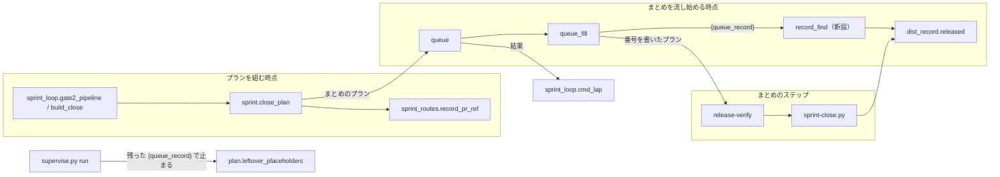
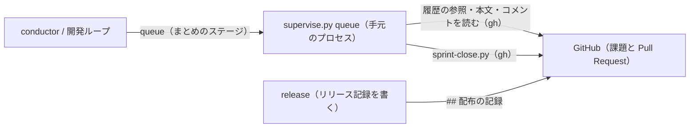
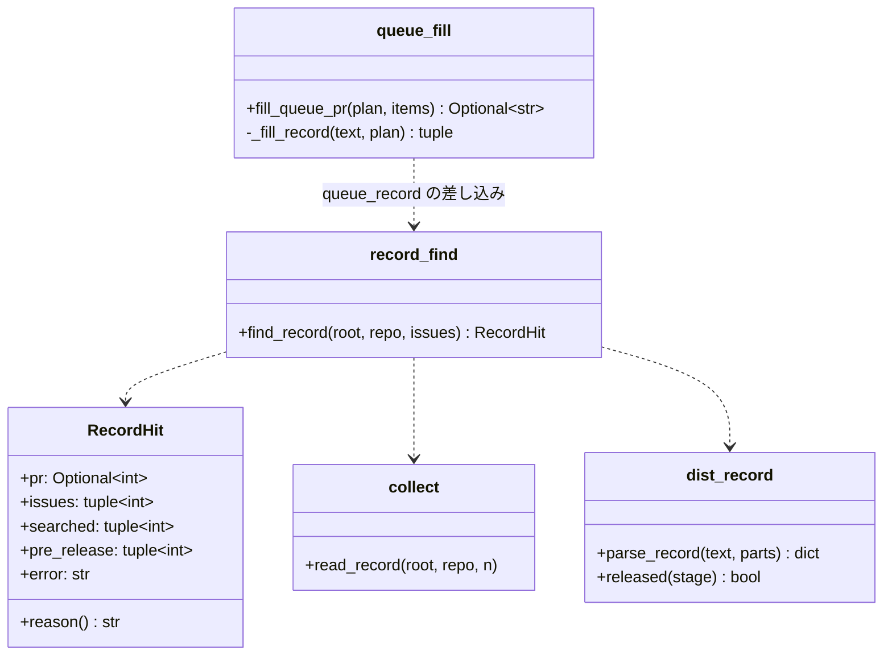
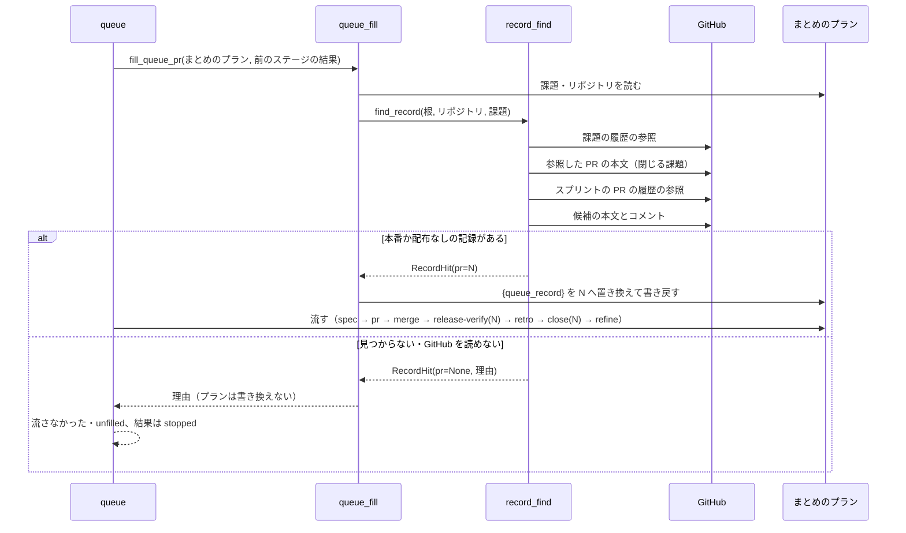
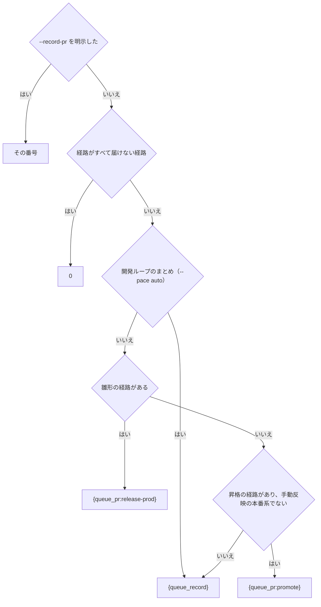

# まとめの close: どのリリースの経路でも、まとめを流す時点でリリース記録の PR を見つけて課題を閉じる（#2230）

## 目的

- **何が壊れているか**: まとめ（`supervise.py new close`・`new sprint` のまとめのステージ）のプランが、リリース記録の PR をプランを組む時点で決める。merge・手で届ける・検証の環境だけ・手動反映の本番系の経路では、組む時点に記録の PR が無いので `--record-pr unknown` を組み、課題が閉じないまま ok で返る（#2044）。開発ループの承認ゲート 2 の後のまとめは、検査のスプリント PR を記録の PR として受け取る（#2121 の問題 1）
- **誰が困るか**: 本番まで届けたスプリントの課題を毎回手で閉じる利用者と、配布済みの課題が開いたまま次の周回で選び直される開発ループ
- **直すと何が成り立つか**: どの経路でも、まとめを流し始める時点にリリース記録の PR を見つけ、リリース後テストと close が同じ PR を受け取る。見つからなければまとめは流れずに止まり、探した課題と PR を理由に載せる

## 適用範囲

- **働く範囲**: 配布先のリポジトリでも働く（`plugins/ndf/scripts/` のまとめの組み立て・queue の差し込み・開発ループ）
- **プロジェクトごとに違うもの**: リリースの経路は今と同じく宣言（`.ndf/supervise.json` の `release.form`・`.ndf/project.json` の `delivery`）から決まる。記録を探すときに読むのは GitHub の課題と Pull Request の参照だけで、新しい設定と引数は足さない
- **当たるモード**: `pace: fast` / `pace: auto` のまとめ（`new close`）と、開発ループ（`sprint-state.py loop`）の周回のまとめ。`normal` のスプリントはまとめのプランを持たないため当たらない

## あるべき姿の根拠

| 根拠 | 種類 | 何を示すか |
| --- | --- | --- |
| 課題 #2089 の履歴の参照（`gh api repos/devbasex/ai-plugins/issues/2089/timeline` の `cross-referenced`）が PR #2091・#2102・#2103・#2110・#2126・#2128・#2137・#2138 を返し、本文が `Closes #2089` を持つのは #2103 だけだった。#2103 の履歴の参照は #2120・#2126 を返し、#2126 の最後のリリース記録が `段階: 本番` と `スプリント: PR #2098 / #2102 / #2103 / …` を持つ | 実測（2026-11-01） | 課題 → 課題を閉じるスプリントの PR → それを参照する PR の 2 段で、記録を置いた PR に届く |
| 同じ実測で、#2138 のリリース記録（`段階: 本番`）の `スプリント:` に #2128（#2089 を参照するが閉じない確定仕様化の PR）が入っていた | 実測（2026-11-01） | 「課題を参照する PR」で絞ると後のスプリントの記録を選ぶ。「課題を閉じる PR」で絞る必要がある |
| `release` の「出力物」が、PR を作らない形ではスプリントの最後にマージした PR へ、それ以外はリリースの PR へ `## 配布の記録` を置き、`スプリント:` の行にスプリントの PR を並べると決めている（`plugins/ndf/skills/release/SKILL.md`） | 既存の形 | どの経路でも記録は Pull Request にあり、スプリントの PR を番号で指す |
| #2121 の再現（10.21.0 の `gate2_pipeline` に `values.pr = 2103` を渡すと `build_close` に `record_pr=2103` が渡る） | 実測（2026-10-25） | 開発ループの今の形は検査の PR を記録の PR として渡す |

要求と受け入れ条件は #2230 の本文にある（コピーは `issues/issue-2230-requirements.md`）。この文書は「どう作るか」だけを扱う。

## ドメインモデル

### コンテキスト

| コンテキスト | 何の語が 1 つの意味に決まるか |
| --- | --- |
| 開発の工程（`ndf-workflow`） | まとめのプラン・queue の差し込み・記録の PR・開発ループの周回 |
| リリース（`ndf-release`） | リリース記録（`## 配布の記録` のブロックと、その `段階:`・`スプリント:` の行） |

開発の工程がリリースの順応者である。まとめはリリース記録の形（`lib/dist_record.py`）をそのまま読み、形を変えない。

### 集約

| 集約 | 持ち主（書き換えてよいもの） | 根 | エンティティ | 値オブジェクト |
| --- | --- | --- | --- | --- |
| まとめのプラン | 組み立ては `supervise_lib/sprint.close_plan`。組んだ後に書き換えてよいのは `supervise_lib/queue_fill` の差し込みの置き換えだけ（今の規則、#2079） | まとめのプラン（`close.json`） | ステップ（`release-verify`・`close`） | 記録の PR の参照 |
| リリース記録 | `release`（`release-steps.py record`・手で行う `/ndf:release`）。この変更は読むだけ | 記録を置いた PR | `## 配布の記録` のブロック | 段階・スプリントの PR の並び |
| 開発ループの周回 | `lib/sprint_loop` | 周回（`lap`） | — | 周回の結果（完了 / 失敗） |

### 不変条件

| # | 集約 | 条件 | 破れたときの扱い |
| --- | --- | --- | --- |
| I1 | まとめのプラン | 組んだまとめのプランは `--record-pr unknown` を持たない | 組み立ての単体テストで落とす |
| I2 | まとめのプラン | 記録の PR の参照が `0` でないとき、`release-verify` のステップと `close` のステップは同じ参照を持つ | 組み立ての単体テストで落とす |
| I3 | まとめのプラン | `{queue_record}` を解決できない（記録が見つからない・GitHub を読めない）ときは、プランを書き換えずに流さず、理由にまとめの課題と探した PR を載せる | queue の結果が `stopped` になり、まとめは流れない |
| I4 | まとめのプラン | `{queue_record}` が採る記録は、`段階:` が本番か配布なしのものだけである | 本番の前の記録だけなら見つからない扱い（I3） |
| I5 | まとめのプラン | `{queue_record}` が採る記録は、`スプリント:` の PR のどれかが、本文の closing keywords か閉じる予定の参照でまとめの課題を指すものだけである | ほかのスプリントの記録は候補から外す |
| I6 | まとめのプラン | 開発ループを使わない起動で、雛形の経路は `{queue_pr:release-prod}`、昇格の経路は `{queue_pr:promote}` を今と同じ形で組む | 組み立ての単体テストで落とす |
| I7 | まとめのプラン | 届けない経路だけのスプリントは `0`、`--record-pr <番号>` を明示した `new close` はその番号を組む | 組み立ての単体テストで落とす |
| I8 | 開発ループの周回 | 差し込みを埋められずに流さなかった計画がある周回は、完了で締めない | 周回を失敗で締める |

### ドメインイベント

| # | イベント | 発生元 | 受け手 |
| --- | --- | --- | --- |
| E1 | まとめのプランを組んだ（記録の PR は `{queue_record}` などの参照として持つ） | `close_plan`（`new sprint`・`new close`、開発ループの `build_close`） | queue |
| E2 | 本番のリリースを終え、リリース記録を Pull Request に残した | 雛形・昇格のプラン、手で行う `/ndf:release` | GitHub（E4 が読む） |
| E3 | まとめのステージを流し始めた | queue | `queue_fill` |
| E4 | 記録の PR を解決した | `queue_fill`（`{queue_pr:…}` か `{queue_record}`） | まとめのプラン（参照を番号へ置き換える） |
| E5 | 記録の PR が見つからず、まとめが止まった | `queue_fill` | queue の結果（`stopped`）、開発ループの `loop lap` |
| E6 | リリース後テストのステップが記録の PR を受け取った | まとめのプランの `release-verify` | `/ndf:release-verification` |
| E7 | まとめの close が記録の PR を `--record-pr` に受けて課題を閉じた | まとめのプランの `close` | `sprint-close.py` |

### 用語

| 用語 | 意味 | 用語集への反映 |
| --- | --- | --- |
| 記録の PR | リリース記録（`## 配布の記録`）を置いた Pull Request。まとめの close が `--record-pr` に受け、リリース後テストが記録を書く先 | 追加（`ndf-workflow`） |
| 記録の置き場が分からない | まとめの close が読むリリース記録の Pull Request が分からない状態。`sprint-close.py --record-pr unknown` で渡し、課題を開いたまま残す。この版からまとめのプランは組まず、手で打つ入口と前の版で組んだプランだけが渡す | 意味の変更（`ndf-workflow`） |

## 機能一覧

| # | 機能 | 誰が使うか |
| --- | --- | --- |
| F1 | merge・手で届ける・検証の環境だけ・手動反映の本番系の経路のまとめが、流し始める時点にリリース記録の PR を見つけて close へ渡す | `pace: fast` / `auto` でスプリントを閉じる conductor |
| F2 | 開発ループの周回のまとめが、本番のリリース記録の PR を見つけて close へ渡す | 開発ループ |
| F3 | 記録の PR が見つからないとき、まとめを流さずに止め、探した課題と PR を理由に出す | conductor と利用者 |
| F4 | 記録の PR を見つけたとき、リリース後テストのステップが同じ PR を受け取る | `/ndf:release-verification` |

## 構成要素

| 要素 | 責務 |
| --- | --- |
| `sprint_close_lib/record_find.py`（新設） | まとめの課題から GitHub の参照を辿り、本番か配布なしの段階のリリース記録を置いた PR を 1 本決める。探した課題と PR と、本番の前の記録だけがあった PR を返す。GitHub を読めなければ理由を返す |
| `supervise_lib/queue_fill.py` | 差し込み `{queue_record}` を、計画の `課題` と `リポジトリ` から `record_find` で解決した番号で置き換える。解決できなければ計画を書き換えずに理由を返す |
| `supervise_lib/plan.py` | 置き換わらずに残った差し込みの検出（`QUEUE_NAMED`）に `{queue_record}` を入れる。説明（差し込みの規則）に `{queue_record}` を足す |
| `supervise_lib/sprint_routes.py` | `record_pr_ref` が、雛形と昇格の経路（開発ループを除く）は今の `{queue_pr:…}`、届けない経路だけなら `0`、それ以外は `{queue_record}` を返す。`RECORD_UNKNOWN` を消し、`has_record` は `0` でなければ真にする |
| `supervise_lib/sprint.py` | `close_plan` は変えない（`has_record` の意味が変わり、`{queue_record}` のときも `release-verify` を置く） |
| `lib/sprint_loop.py` | `gate2_pipeline` が `values.pr` を `build_close` へ渡さない。`cmd_lap` が差し込みを埋められずに流さなかった計画（`unfilled`）を失敗として数える |
| `lib/sprint_loop_gate.py` | `build_close` の `record_pr` 引数を消す |
| `lib/dist_record.py` | リリース記録の段階が本番か配布なしかの判定（`released`）を 1 つ持つ。`sprint-close.py` と `record_find` が同じ判定を使う |
| `sprint-close.py` | 閉じる条件の判定で `released` を使う（振る舞いは変えない）。`--record-pr unknown` の受け付けと振る舞いは変えず、説明から「`sprint_routes.py` が渡す」を外す |
| `skills/development-workflow/references/pace.md` | スプリントの終わりの `--record-pr` の説明を `{queue_record}` に直す |
| `skills/progress-tracking/SKILL.md` | `--record-pr unknown` の説明に、まとめのプランは組まないことを足す |
| `docs/glossary/glossary.json` と `docs/glossary.md` | 用語の表の 2 行を反映する（この設計の変更に含める） |



図には文書（`pace.md`・`progress-tracking`・用語集）を含めない。

### システムの文脈と配置



解決は queue のプロセスの中で、まとめのプランを流す前に 1 回行う。GitHub へは今の `gh` の呼び出し（`lib/gh_call.py`）で読むだけで、書かない。

### パッケージ・モジュール構成

```text
plugins/ndf/scripts/
├── sprint_close_lib/
│   ├── collect.py          # read_record・_read_sprint_pr（変えない。record_find が使う）
│   └── record_find.py      # 新設: find_record
├── supervise_lib/
│   ├── plan.py             # QUEUE_NAMED と説明
│   ├── queue_fill.py       # {queue_record} の置き換え
│   ├── sprint_routes.py    # record_pr_ref・has_record
│   └── sprint.py           # close_plan（変えない）
├── lib/
│   ├── dist_record.py      # released
│   ├── sprint_loop.py      # gate2_pipeline・cmd_lap
│   └── sprint_loop_gate.py # build_close
└── sprint-close.py         # released を使う
```

## 構造



`RecordHit` は値オブジェクトで、`pr` が `None` のとき `reason()` が理由の文を返す。`searched` は記録を読んだ PR、`pre_release` は記録はあるが段階が本番の前だった PR、`error` は GitHub を読めなかったときの理由である。

## 入出力の契約

### 差し込み `{queue_record}`（追加）

| 項目 | 書くこと |
| --- | --- |
| 名前 | `{queue_record}`。計画の JSON のどこに書いてもよい（コマンドとプロンプトの両方） |
| 入力 | 計画の `課題`（整数の並び。空なら解決できない）と `リポジトリ`（`gh` を打つ作業場所。無ければ計画の置き場） |
| 出力（成功） | 計画の中の `{queue_record}` をすべて、記録の PR の番号（10 進の文字列）で置き換えて書き戻す |
| 失敗の形 | 計画を書き換えず、`差し込みを埋める前の計画の結果が見つからない: {queue_record}（<理由>）` を返す。queue はその計画を `流さなかった`・`unfilled` にし、queue の結果は `stopped` になる（今の `{queue_pr:…}` と同じ）。理由は「課題 #a #b を閉じる PR #x #y と、それを参照する PR #p #q を読んだが、本番か配布なしの段階のリリース記録が無い」の形で、本番の前の記録だけがあれば「（本番の前の記録だけ: PR #r）」を足す。GitHub を読めなければ「GitHub を読めない: <gh の出力の先頭>」 |
| `run` で流したとき | 置き換わらずに残った `{queue_record}` を `leftover_placeholders` が拾い、コマンドのステップを打たずに止まる（今の `{queue_pr:…}` と同じ） |
| 互換性 | 新しい差し込みで、既存の差し込みの意味は変えない |

記録の PR を決める規則（`find_record`）:

| 順 | すること |
| --- | --- |
| 1 | まとめの課題ごとに、課題の履歴の参照（`cross-referenced`）のうち Pull Request のものを集める |
| 2 | 1 の PR のうち、本文の closing keywords か閉じる予定の参照（`lib/closing.closing_refs`）がまとめの課題を指すものを、スプリントの PR とする |
| 3 | 候補を、スプリントの PR と、スプリントの PR の履歴の参照のうち Pull Request のものの和にする |
| 4 | 候補ごとに本文とコメントを読み（`read_record`）、最後のリリース記録（`parse_record`）を取る |
| 5 | `スプリント:` の PR が 2 のスプリントの PR を 1 本以上含み、段階が本番か配布なし（`released`）の記録だけを残す |
| 6 | 残った中で、記録を置いたコメントの識別子が最も大きいもの（本文に置いた記録は 0 として数え、同じなら PR の番号の大きいもの）を採る |

### まとめのプランの `close` と `release-verify` のステップ（変わる）

| 起動 | 経路 | 今 | この変更の後 |
| --- | --- | --- | --- |
| `new sprint` / `new close`（開発ループの外） | 雛形 | `{queue_pr:release-prod}` | 変えない |
| 同上 | 昇格（手動反映の本番系を除く） | `{queue_pr:promote}` | 変えない |
| 同上 | 届けない経路だけ | `0`（`release-verify` なし） | 変えない |
| 同上 | merge・手で届ける・検証の環境だけ・手動反映の本番系 | `unknown`（`release-verify` なし） | `{queue_record}`（`release-verify` を置く） |
| `new close --record-pr <番号>` | どれでも | その番号 | 変えない |
| 開発ループ（`new close --pace auto`） | 届けない経路だけ | `0` | 変えない |
| 同上 | それ以外 | 最初の組み立ては経路と同じ参照、承認ゲート 2 の後は `values.pr` の番号 | `{queue_record}` |

`close` のステップは `sprint-close.py --record-pr <参照> --issues <課題> --final-stage 振り返り --with-verification` の形のまま、`release-verify` のプロンプトは「配布の記録は Pull Request #<参照> にある」の形のままで、参照だけが変わる。

### `sprint-close.py --record-pr`（変えない）

`<PR番号|0|unknown>` を今のまま受け、`unknown` は今と同じく課題を理由つきの `kept_open` で返して終了コード 0 で終わる。まとめのプランは `unknown` を組まないため、`unknown` を渡すのは手で打つ入口と、この版より前に組んだまとめのプランだけになる。

## 処理の流れ

まとめのステージを流し始める時点の流れ（通常の起動・開発ループで同じ）:



まとめのプランを組む時点の参照の決め方（明示の番号は `close_plan`、それ以外は `record_pr_ref`）:



開発ループの承認ゲート 2 の後は、`gate2_pipeline` が `build_close` を `record_pr` なしで呼び、組んだまとめのプランは `{queue_record}` を持つ。続きの 1 行（`run <本番> --from <ステップ> && queue <残り> --then <まとめ> && wait && loop lap`）の中で、まとめのステージを流し始める時点に解決する。解決できずにまとめを流さなかったら、`loop lap` が周回を失敗で締める（I8）。

## 非機能の実現方式

| 大項目 | 要求の条件 | 実現方式 | 確かめ方 |
| --- | --- | --- | --- |
| 運用・保守性 | 記録の PR の解決は 1 か所で行い、経路ごと（通常の起動・開発ループ）に別の解決の関数を持たない（Value 6） | GitHub から探す解決は `record_find.find_record` の 1 つだけにし、通常の起動と開発ループのどちらも差し込み `{queue_record}` を通して呼ぶ。段階の判定は `dist_record.released` を `sprint-close.py` と共有する | `find_record` の呼び手が `queue_fill` だけであることを検索で確かめる。通常の起動と開発ループのまとめのプランがどちらも `{queue_record}` を持つことを単体テストで確かめる |
| 移行性 | 実行中のスプリントで、この版より前に組んだまとめのプラン（`--record-pr unknown` を持つもの）は、今の振る舞い（閉じずに ok）のまま流れてよい。組み直しは求めない | `sprint-close.py` の `unknown` の受け付けと振る舞いを変えない（決定 6）。`{queue_record}` を持たない計画では、`queue_fill` は GitHub を読まない | `sprint-close.py --record-pr unknown --issues <N>` の既存のテストが変わらずに通る |

## 決定の記録

### 決定 1: どの経路でも同じ手段で記録の PR を見つけるため、まとめの課題から GitHub の参照を辿ってリリース記録を探す

merge・手で届ける経路では、記録の PR を作るのが人の `/ndf:release` で、どのプランもその番号を持たない。記録は必ず Pull Request にあり、`スプリント:` の行でスプリントの PR を番号で指すため、課題 → スプリントの PR → それを参照する PR の 2 段で届く（#2089 で実測）。記録を書く手順も記録の形も変えずに済む。

queue の `{queue_pr:<名>}` の探し場所を広げる案は、記録の PR を持つプランが無い merge・手で届ける経路を解けない。手で行うリリースのステージに記録の PR の番号を書き留めるステップを足す案は、人が行う手順に書き留めの操作を増やし、書き忘れたときに見つからない。

根拠: Value 6 / Value 5 / Value 2（MVV 版 3）

### 決定 2: 別のスプリントの記録を選ばないため、本番か配布なしの段階で、`スプリント:` の PR がまとめの課題を閉じる記録だけを採る

課題を参照するだけの PR で絞ると、後のスプリントで同じ課題に触れた確定仕様化の PR を通じて、後のスプリントの記録を選ぶ（#2089 では #2128 を通じて #2138 を選ぶ）。閉じる PR に絞ると #2126 だけが残る。段階を本番か配布なしに限るのは、`sprint-close.py` が閉じてよいとする段階と同じにするためで、開発版の記録だけがある時点では見つからない扱いにして止める。

本番の前の記録も採って close に判定させる案は、close が「本番への配布の前」で課題を開いたまま ok で返り、親 #2227 の「未記録を ok で返さない」に反する。

根拠: Value 6（MVV 版 3）

### 決定 3: 解決の時点を 1 つにするため、queue の差し込み `{queue_record}` として、まとめのステージを流し始める時点に 1 回解決する

プランの中で値を後のステップへ渡す手段は queue の差し込みだけで、`{queue_pr:…}` と同じ所で解決すれば、リリース後テストと close が同じ番号を受け取る（I2）。見つからないときにまとめ全体を流さないのは、本番へ届いていないスプリントで確定仕様化と振り返りを先に進めないためである。

まとめのプランの先頭に記録を探すステップを置く案は、ステップの出力を後のステップのコマンドとプロンプトへ渡す手段が無い。`sprint-close.py` に探させる案は、その前のリリース後テストが番号を受け取れない。

根拠: Value 4 / Value 6（MVV 版 3）

### 決定 4: 雛形と昇格の経路の今の振る舞いを保つため、開発ループの外ではその 2 つの経路に `{queue_pr:…}` を残す

この 2 つの経路は記録の PR をプランが持ち、今の形で解けている（受け入れ条件 6）。GitHub を読む回数も増やさない。

すべての経路を `{queue_record}` にそろえる案は、受け入れ条件 6（プランの内容が変わらない）に反する。

根拠: Value 1（MVV 版 3）

### 決定 5: 開発ループのまとめが承認ゲートの有無で解けたり解けなかったりしないよう、経路にかかわらず `{queue_record}` を組む

開発ループの承認ゲート 2 の後のまとめは、本番のプランを `run --from` で流した後の別の queue にあり、本番のプランとも別のディレクトリにあるため、`{queue_pr:release-prod}` を解けない。`{queue_record}` は queue とディレクトリに依らずに解ける。止まった記録の `values.pr` は判定に渡した検査のスプリント PR で、記録の PR ではないため渡さない。

承認ゲート 2 の後だけ `{queue_record}` にする案は、同じ周回のまとめのプランが承認ゲートを通ったかで 2 通りになる。`{queue_pr:…}` の探し場所を周回の外のプランへ広げる案は、queue の契約を広げ、前の周回のプランを読むおそれがある。

根拠: Value 6（MVV 版 3）

### 決定 6: 前の版で組んだプランをそのまま流せるよう、`sprint-close.py --record-pr unknown` の受け付けと振る舞いを変えない

まとめのプランは `unknown` を組まなくなる（I1）が、実行中のスプリントにはこの版より前に組んだプランが残る（非機能の条件の移行性）。手で打つ入口としても残る。`unknown` を ok で返すかどうかは、結果の共通形式を決める親 #2227 で扱う。

受け付けをやめる案と止まる値にする案は、前の版で組んだプランを流すと呼び出しの誤りか止まりになり、移行性の条件に反する。

根拠: Value 2 / Value 1（MVV 版 3）

### 決定 7: 記録が見つからない周回を完了と数えないため、開発ループは差し込みを埋められずに流さなかった計画を失敗として締める

今の `cmd_lap` は `流さなかった` を失敗に数えない。前のステージの失敗で後ろを流さなかったときは前のステージの結果が失敗を表すが、差し込みを埋められなかったまとめは前のステージがすべて完了のため、周回が完了で締まる（受け入れ条件 4 の「完了にならない」に反する）。`unfilled` の印は queue が今も残しているため、その印で数える。

根拠: Value 6（MVV 版 3）

## テスト設計

| 受け入れ条件・不変条件 | どの振る舞いで縛るか | どう壊したら落ちるべきか |
| --- | --- | --- |
| 受け入れ条件 1・5 / I1 | merge・手で届ける・検証の環境だけ・手動反映の本番系の経路で `new close` が組むまとめの `close` のステップが `--record-pr {queue_record}` を持ち、`unknown` を持たない | `record_pr_ref` が `unknown` を返すように戻すと落ちる |
| 受け入れ条件 3 / I2 | 上の経路と開発ループで、まとめのプランが `release-verify` を持ち、そのプロンプトと `close` のコマンドが同じ参照を持つ | `has_record` が `{queue_record}` を偽とするように壊すと落ちる |
| 受け入れ条件 1・3 | `{queue_record}` を持つプランを `fill_queue_pr` に通すと、`find_record` が返した番号で `release-verify` と `close` の両方が置き換わる | 置き換えを 1 か所だけにすると落ちる |
| 受け入れ条件 4 / I3 | `find_record` が見つからない・GitHub を読めないを返すと、`fill_queue_pr` が計画を書き換えずに理由を返し、理由にまとめの課題と読んだ PR が入る。queue の結果が `stopped` になる | 見つからないときに `0` で埋めるように壊すと落ちる |
| I3 | `{queue_record}` が残ったプランを `run` で流すと、コマンドのステップを打たずに止まる | `QUEUE_NAMED` から `{queue_record}` を外すと落ちる |
| I4 | 候補の最後の記録が `段階: 検証` だけなら見つからない扱いになり、理由に本番の前の記録の PR が載る | `released` を通さずに採るように壊すと落ちる |
| I5 / 決定 2 | 課題を参照するが閉じない PR が `スプリント:` に入った、後のスプリントの記録を採らない（#2089 の #2126 と #2138 の形） | スプリントの PR の絞り込みを「参照する PR」に緩めると落ちる |
| 決定 2 | 同じスプリントの記録が本文とコメントの両方にあれば、コメントの識別子が最も大きい記録の PR を採る | 並びを PR の番号だけにすると落ちる |
| 受け入れ条件 6 / I6 | 雛形と昇格の経路の `new close` が組むまとめのプランが、変更の前と同じ内容になる | 開発ループの外でも `{queue_record}` を組むように壊すと落ちる |
| 受け入れ条件 7 / I7 | 届けない経路だけなら `--record-pr 0` で `release-verify` を持たない。`--record-pr <番号>` を明示するとその番号を組む | 明示した番号を無視すると落ちる |
| 受け入れ条件 2 | 開発ループの承認ゲート 2 の後の `gate2_pipeline` が組むまとめのプランが、止まった記録の `values.pr` でなく `{queue_record}` を持つ | `values.pr` を `build_close` へ渡すように戻すと落ちる |
| 受け入れ条件 4 / I8 | 差し込みを埋められずに流さなかったまとめを含む `done` を `loop lap` に渡すと、周回が失敗で締まる | `unfilled` を数えないように戻すと落ちる |
| 受け入れ条件 8 | 開発ループを使わない起動の既存のテスト（雛形・昇格・届けない経路のまとめ、`sprint-close.py` の `unknown`）が変わらずに通る | 既存のテストの期待値を書き換えないと通らない変更を入れると落ちる |

## 設計の結果

| 課題 | 扱い | 取り込み先 | 触るファイル |
| --- | --- | --- | --- |
| #2230 | 実装する | — | `plugins/ndf/scripts/sprint_close_lib/record_find.py`、`plugins/ndf/scripts/supervise_lib/queue_fill.py`、`plugins/ndf/scripts/supervise_lib/plan.py`、`plugins/ndf/scripts/supervise_lib/sprint_routes.py`、`plugins/ndf/scripts/lib/sprint_loop.py`、`plugins/ndf/scripts/lib/sprint_loop_gate.py`、`plugins/ndf/scripts/lib/dist_record.py`、`plugins/ndf/scripts/sprint-close.py`、`plugins/ndf/scripts/tests/`、`plugins/ndf/skills/development-workflow/references/pace.md`、`plugins/ndf/skills/progress-tracking/SKILL.md` |

## 未確認のまま残ること

| 項目 | 内容 |
| --- | --- |
| 実際の周回での解決 | merge か手で届ける経路のスプリントを 1 本流し、まとめが記録の PR を見つけて課題を閉じること・記録を置かずに流すと止まることは、リリース後テストで確かめる（要求の「検証手段」の手動確認） |
| GitHub の呼び出しの回数 | 課題 1 件・スプリントの PR 1 本の #2089 では、履歴の参照 2 回・本文 8 回・記録の読み取り 3 回の 13 回だった。課題の多いスプリントでの回数と所要は実装の後に測る |
| 同じ課題が 2 つのスプリントで閉じられたとき | 前のスプリントで閉じる PR を出したが閉じずに持ち越した課題は、2 つのスプリントの記録が候補に残り、コメントの識別子の大きい後の記録を採る。前のスプリントのまとめを後から流し直すと後の記録を読む。今の運用で起きるかは確かめていない |
| リリース PR がスプリントの PR を番号で指さない形 | `release` の手順は `スプリント:` の行に番号を書くため参照が残る。手で書いた記録が番号を書かなかったときは見つからない扱いで止まる |
