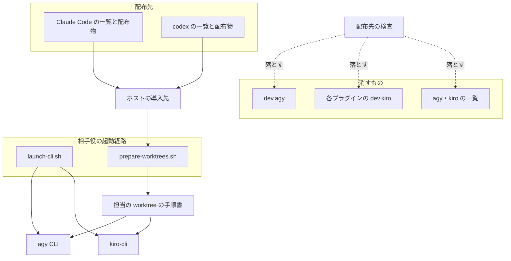
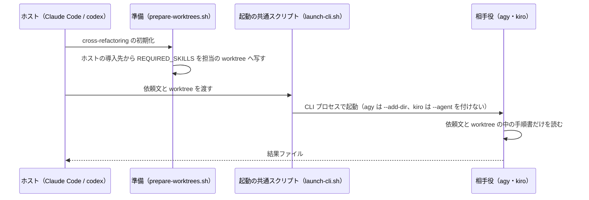
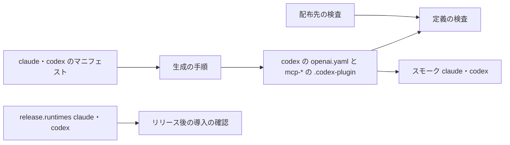

# 配布: Claude Code と codex へすべてのプラグインを配り、agy・kiro は cross 系の相手役としてだけ呼ぶ（#2231）

## 目的

- **何が壊れているか**: NDF とマーケットプレイスのプラグインを 4 つのランタイム（Claude Code・codex・kiro・agy）へ配っている。agy・kiro のためだけに、導入物（`plugins/ndf/dev.agy/`・ndf と playwright-kit と mcp-* 10 個の `dev.kiro/`）・その生成と検査・スモークテスト・リリース後の導入の確認を保ち、agy・kiro だけで起きる不具合（agy の本文の切り詰め #2163、Kiro の導入の確認の版の誤り #1889 など）が増え続ける
- **誰が困るか**: NDF を保守する開発者（agy・kiro の差分を吸収する層を保つ）。agy・kiro が NDF の工程で担うのは cross-review / cross-refactoring の相手役だけで、配った Skill は相手役の経路で使われない
- **直すと何が成り立つか**: 配布先は Claude Code と codex の 2 つになり、どちらにもすべてのプラグインとすべての Skill が今と同じ形で届く。agy・kiro には何も配らず、cross-review / cross-refactoring は今と同じ起動の経路で agy・kiro を相手役として呼ぶ

## 適用範囲

- **働く範囲**: このリポジトリの配布物（`plugins/` の agy・kiro 向けの部分）と、それを組み立てる・確かめるスクリプト・テスト・CI・リリースの宣言（`.ndf/supervise.json`・`.ndf/pace.json`）・文書。利用者の手元では、この変更を含む版から agy・kiro 向けの新しい版が届かなくなる
- **プロジェクトごとに違うもの**: 無し（配布先は NDF の配布物が持ち、利用者のリポジトリの設定では変えない。相手役に使えるランタイムは今どおり `.ndf/runtimes.json` が決める）
- **当たるモード**: `standard`

## あるべき姿の根拠

| 根拠 | 種類 | 何を示すか |
| --- | --- | --- |
| 「claude とcodexのみ、すべてのpluginを配布することとします。agy、kiroは配布せず、cross系で呼ばれるだけ。」（2026-10-31、承認ゲート 1） | 利用者の指示の原文（会話。#2231 の本文の先頭に引用） | 配布先は Claude Code と codex だけで、どちらにもすべてのプラグインを配る。agy・kiro は相手役だけ |
| `plugins/ndf/scripts/lib/launch-cli.sh` は agy を `agy --dangerously-skip-permissions --output-format json …`、kiro を `kiro-cli chat --no-interactive --trust-all-tools …` で起動し、`--agent ndf` もプラグインの導入先も指さない | 実測（コードを読んだ） | 相手役の agy・kiro は、agy・kiro へ配った導入物（`dev.agy/`・`.kiro/agents/ndf.json`）を読まない |
| `plugins/ndf/skills/cross-review/scripts/launch-reviewer.sh` の `render_review_prompt` はレビュー担当の依頼文を Skill を読まずに完結させる。`plugins/ndf/skills/cross-refactoring/scripts/prepare-worktrees.sh` は `REQUIRED_SKILLS`（`refactoring`・`tdd-cycle`・`quality-gates`）を**ホストの導入先**から担当の worktree（kiro は `.kiro/skills`、agy は `.agents/skills`）へ写す | 実測（コードを読んだ） | 相手役が読む手順書はホスト（Claude Code・codex）の導入先から来る。agy・kiro への配布を止めても、相手役の経路は変わらない |
| `plugins/ndf/dev.agy/install-hooks.sh` は `bash ./scripts/<名前>` を導入先（既定 `~/.gemini/config/plugins/ndf`）の絶対パスへ書き換えて `~/.gemini/config/hooks.json` へ差し込む。`plugins/ndf/dev.kiro/install.sh` は利用者の clone の `plugins/ndf/skills/` へ symlink を張り、`.kiro/agents/ndf.json` の hook は clone の `plugins/ndf/scripts/worktree-guard.sh`・`worktree-session.sh`・`wait-notify.py --runtime kiro` を指す | 実測（コードを読んだ） | 既に導入した agy の手元は導入先の写しだけで動き、リポジトリから `dev.agy/` を消しても切れない。kiro の手元は clone の共通のスクリプトを呼ぶため、それを残せば動き続ける（決定 4） |
| ruleset「protect main and develop」の必須のチェックに `runtime-smoke (kiro)`・`runtime-smoke (agy)` がある（`gh api repos/devbasex/ai-plugins/rulesets/22332172`、2026-10-31） | 実測 | スモークの matrix から 2 つを外すと、ruleset を直すまで結果の返らない必須のチェックが残る（決定 6） |

要求と受け入れ条件は #2231 の本文にある（コピーは `issues/issue-2231-requirements.md`）。この文書は「どう作るか」だけを扱う。受け入れ条件の番号は本文の「受け入れ条件（方針の変更の後）」の 1〜6 を指す。

## ドメインモデル

### コンテキスト

| コンテキスト | 何の語が 1 つの意味に決まるか |
| --- | --- |
| 配布（`ndf-distribution`） | 配布先・マニフェスト・導入物・リリースの対象ランタイム |
| cross 系の参加（`cross-review-participants`） | ホスト・相手役・担当の worktree へ写す手順書（`REQUIRED_SKILLS`） |

cross 系の参加が顧客、配布が供給者の関係（顧客 / 供給者）。cross 系は「ホストの導入先に要る Skill」を宣言し、配布はホスト（Claude Code・codex）へその宣言を満たす一覧を配る。相手役のランタイムへの配布は、cross 系の宣言に含まれない。

### 集約

| 集約 | 持ち主（書き換えてよいもの） | 根 | エンティティ | 値オブジェクト |
| --- | --- | --- | --- | --- |
| 配布先 | マニフェストのファイル名（`plugins/*/manifests/<ランタイム>-skills.txt`）・導入物のディレクトリ（`dev.agy/`・`dev.kiro/`）・`.ndf/supervise.json` の `release.runtimes` | 配布先のランタイムの集合（claude・codex） | — | ランタイムの名前 |
| Claude Code と codex の配布物 | `plugins/ndf/manifests/{claude,codex}-skills.txt`・`.claude-plugin/`・`.codex-plugin/`・`hooks/`・`plugins/playwright-kit/manifests/`。**この変更では変えない** | 各プラグインの `plugin.json` | Skill の参照 | 版数・Skill の数 |
| 相手役の起動経路 | `launch-cli.sh`・`launch-reviewer.sh`・`cross-refactoring/scripts/`・`lib/auth.py`・`lib/runtime_policy.py`。**この変更では変えない** | 起動の共通スクリプト（`launch-cli.sh`） | 担当 | ランタイムの名前・CLI の引数 |
| 必須のチェック | ruleset（利用者が承認ゲート 2 で直す）と `.ndf/project.json` の `required_checks` | ruleset | チェック | チェックの名前 |

### 不変条件

| # | 集約 | 条件 | 破れたときの扱い |
| --- | --- | --- | --- |
| I1 | 配布先 | どのプラグインにも `agy-skills.txt`・`kiro-skills.txt`・`dev.agy/`・`dev.kiro/` が無く、`release.runtimes` は `claude`・`codex` の部分集合である | 新しい pytest（`scripts/tests/test_distribution_runtimes.py`）が落ちる |
| I2 | Claude Code と codex の配布物 | `claude-skills.txt`（49 行）・`codex-skills.txt`（45 行）・各 `.codex-plugin/plugin.json`・`plugins/ndf/hooks/codex.json`・playwright-kit の `claude-skills.txt`・`codex-skills.txt` が変更前と同じである | 実装の PR の差分に現れる。`build-runtime-plugins.sh --check`・`validate-runtime-plugins.sh`・既存の pytest（`test_codex_skill_policies.py` など）が通る |
| I3 | 相手役の起動経路 | agy・kiro を相手役にする起動（`launch-cli.sh` の `agy` / `kiro` の分岐、`prepare-worktrees.sh` の `skill_dir_for`）が変更前と同じに動く | 既存の pytest（`test_lib_launch_cli_runtimes.py`・`cross-review/tests/test_launch_cli_runtimes.py`・`test_launch_agy.py`・`cross-refactoring/tests/test_launch_agy_phases.py`・`test_prepare_worktrees.py`）が落ちる |
| I4 | 配布先 | 既に導入した kiro の手元の hook が呼ぶ共通のスクリプト（`plugins/ndf/scripts/worktree-guard.sh`・`worktree-session.sh`・`wait-notify.py`・`hook.py` の `--runtime kiro`）が残る | 既存の pytest（`worktree/tests/test_guard.py` の `test_kiro_fs_write_is_normalized` など kiro の入力を見るもの）が落ちる |
| I5 | 必須のチェック | ワークフローのジョブと ruleset の必須のチェックが一致する | `required-checks-check`（`scripts/check-required-checks.py`）が落ちる |

### ドメインイベント

| # | イベント | 発生元 | 受け手 |
| --- | --- | --- | --- |
| E1 | 配布先を Claude Code と codex に決めた | 利用者の指示（承認ゲート 1、2026-10-31） | 実装（E2・E3） |
| E2 | agy・kiro 向けの一覧・導入物・生成・検査・スモーク・リリースの対象を外した | 実装 | CI（I1・I2・I5） |
| E3 | ruleset の必須のチェックから `runtime-smoke (kiro)`・`runtime-smoke (agy)` を外した | 利用者（承認ゲート 2） | `required-checks-check`（I5） |
| E4 | 新しい版を配った。agy・kiro 向けの版は届かなくなった | リリース | 既に導入した agy・kiro の利用者（README・CHANGELOG の案内） |
| E5 | Claude Code をホストにした cross-review / cross-refactoring で、agy・kiro が相手役として結果を返した | `/ndf:cross-review`・`/ndf:cross-refactoring` | リリース後テスト（受け入れ条件 3） |
| E6 | 直す必要が無くなった open の課題を棚卸しで閉じた | `/ndf:backlog-refinement` | 課題の一覧（「配布を止めると要らなくなる課題」の表を材料にする） |

### 用語

| 用語 | 意味 | 用語集への反映 |
| --- | --- | --- |
| 配布先のランタイム | マーケットプレイスのプラグインを導入できる形で届けるランタイム。この変更の後は Claude Code と codex で、相手役のランタイムとは別に決まる | 追加 |
| 相手役 | cross-review のレビュー担当、cross-refactoring の提案・実装の担当として、ホストから CLI プロセスで起動されるランタイム | なし（#2231 の要求のコミットで追加済み。意味を変えない） |
| マニフェスト | `plugins/ndf/manifests/<ランタイム>-skills.txt`。ランタイムごとに配る Skill の一覧で、配布の唯一の基準（playwright-kit も同じ形の `plugins/playwright-kit/manifests/` を持つ） | なし（同上） |
| ホスト | 収束ループを起動している CLI のランタイム | なし（既存の語。意味を変えない） |

## 機能一覧

| # | 機能 | 誰が使うか |
| --- | --- | --- |
| F1 | Claude Code と codex へ、すべてのプラグインとすべての Skill を今と同じ形で配る（変えない） | Claude Code・codex の利用者 |
| F2 | Claude Code・codex をホストにした cross-review / cross-refactoring で、agy・kiro が相手役を務める（変えない） | Claude Code・codex の利用者 |
| F3 | agy・kiro の導入物が配布物へ戻ったら CI が落とす | NDF の開発者 |
| F4 | 既に agy・kiro へ導入した利用者が、配布の終了を知り、手元を残すか消すかを自分で選べる（README・CHANGELOG の案内） | 既存の agy・kiro の利用者 |

## 構成要素

| 要素 | 責務 | 変え方 |
| --- | --- | --- |
| マニフェスト（`plugins/ndf/manifests/`・`plugins/playwright-kit/manifests/`） | 配布先ごとの Skill の一覧 | `agy-skills.txt`・`kiro-skills.txt`（ndf）と `kiro-skills.txt`（playwright-kit）を消す。claude・codex は変えない（I2） |
| agy の導入物（`plugins/ndf/dev.agy/`） | agy へ渡すプラグインの木 | ディレクトリごと消す（`plugin.json`・`skills/`・`scripts` のリンク・`agents/` 11 本・`hooks.json`・`install-hooks.sh`） |
| kiro の導入物（`plugins/ndf/dev.kiro/`・`plugins/playwright-kit/dev.kiro/`・`plugins/mcp/mcp-*/dev.kiro/` 10 個） | 利用者のリポジトリの `.kiro/` へ配置する | ディレクトリごと消す |
| 生成の手順（`scripts/build-runtime-plugins.sh`・`scripts/lib/agy_agents.py`） | マニフェストから導入物を作る | agy の Skill のリンクとエージェント定義の写し、mcp-* の kiro の installer の生成を外す。`agy_agents.py` を消す。codex の生成（`agents/openai.yaml`・mcp-* の `.codex-plugin`）は変えない |
| 定義の検査（`scripts/validate-runtime-plugins.sh`・`scripts/lib/validate_manifests.py`・`scripts/check-skill-frontmatter.py`・`scripts/check-doc-staleness.py`・`scripts/ci-heavy-skip.py`・`scripts/check-skill-repo-assumptions.py`・`scripts/check-cross-skill-refs.py`） | 版数・Skill 数・一覧の予算・文書の古さの突き合わせ | `dev.agy/plugin.json`・`hooks.json` の検査、Kiro・agy の一覧の予算、ランタイムの名前の表から agy・kiro を外す。相手役の名前（`claude,codex,kiro` の起動の例など）を見る規則は相手役の経路の記述として残す |
| 配布先の検査（新しい pytest `scripts/tests/test_distribution_runtimes.py`） | I1 | 足す |
| ランタイムのスモークテスト（`scripts/runtime-smoke-test.sh`・`scripts/runtime-smoke-latest.py`・`tests/runtime-smoke/`・`.github/workflows/runtime-plugin-smoke*.yml`・`runtime-plugin-authenticated-smoke.yml`） | 導入できることを確かめる | `--runtime` と matrix から `kiro`・`agy` を外す。`Containerfile.{agy,kiro}`・`adapters/{agy,kiro}.sh`・`assertions/assert-kiro-agent.sh` を消し、`cli-versions.env` の `KIRO_*`・`AGY_*` の行を消す。claude・codex の確認は変えない |
| agy・kiro の導入物だけを見るテスト | 生成物の形を固定する | 消す: `scripts/tests/` の `test_agy_agents.py`・`test_agy_distribution.py`・`test_agy_install_hooks.py`・`test_agy_listing_budget.py`・`test_validate_agy_manifest.py`・`test_kiro_installer_project.py`・`test_kiro_mcp_installer_tools.py`・`agy_build_helpers.py`、`plugins/ndf/skills/worktree/tests/test_agy_hooks.py`、`plugins/mcp/mcp-serena/tests/test_serena_lsp_kiro.py`。一部だけ見るもの（`worktree/tests/test_hook_wiring.py`・`plugins/ndf/scripts/tests/test_hook_deadline.py` の `dev.kiro/install.sh` を読む分など）はその部分を外す |
| リリースの宣言と導入の確認（`.ndf/supervise.json`・`.ndf/pace.json`・`plugins/ndf/scripts/release-verification-steps.py`・`plugins/ndf/scripts/release-steps.py`） | リリースの対象ランタイムと版数を持つ箇所 | `release.runtimes` を `["claude", "codex"]` に、`pace.json` の `verify` の `--runtimes` を `claude,codex` にする。`verify_kiro`・`compare_kiro` と `--runtimes` の `kiro` を外し、既定を `claude,codex` にする。版数を持つ箇所から `dev.agy/plugin.json` を外す |
| 必須のチェック（ruleset・`.ndf/project.json` の `required_checks`） | マージを塞ぐチェックの一覧 | `runtime-smoke (kiro)`・`runtime-smoke (agy)` を外す。ruleset は利用者が承認ゲート 2 で直す（決定 6） |
| 既存の kiro の手元が呼ぶ共通のスクリプト（`plugins/ndf/scripts/hook.py`・`hook_lib/worktree.py`・`worktree-guard.sh`・`worktree-session.sh`・`wait-notify.py`） | Claude Code・codex と共有する hook の入口 | 振る舞いは変えない（決定 4）。結線先を `dev.kiro/install.sh`・`dev.agy/hooks.json` と書くコメントだけを「既に導入した手元のため」へ直す |
| 文書（`AGENTS.md`・`CLAUDE.md`・`KIRO.md`・`README.md`・`plugins/ndf/README.md`・`plugins/playwright-kit/README.md`・`plugins/mcp/mcp-*/README.md`・`docs/ndf-plugin-reference.md`・`docs/versioning-and-distribution.md`・`docs/plugin-development-guide.md`・`docs/project-overview.md`・`docs/glossary.md`・`plugins/ndf/skills/AUTHORING.md`・`tests/runtime-smoke/README.md`・`CHANGELOG.md`） | 配布の説明 | 「4 ランタイムへ配る」前提を「Claude Code と codex へ配り、agy・kiro は相手役」へ書き換える。kiro・agy の導入の手順を消す。`KIRO.md` は相手役としての kiro の説明へ縮める（決定 7）。`plugins/ndf/docs/kiro-cli.md` は消す |

**変えないもの:** 相手役の起動経路（I3）、`plugins/ndf/skills/external-ai/`（`references/cli-agy.md`・`cli-kiro.md` を含む）、`lib/auth.py` の認証確認、`.ndf/runtimes.json` の扱い、`scripts/token-usage.py` の kiro・agy の使用量の読み取り（相手役の使用量）、`.ndf/worktree.json` の `.kiro/`（相手役の設定を置く場所）、Skill の本文と Skill のスクリプトに残るホストとしての kiro・agy の分岐（決定 5）。

### 図



図に含めないもの: 文書・スモークテスト・リリースの宣言（どれも配布先の 2 つだけを書き写す先）と、変えない共通の hook の入口。

### 置き場所

```text
plugins/
├── ndf/
│   ├── manifests/{agy,kiro}-skills.txt   # 消す
│   ├── dev.agy/                          # 消す
│   ├── dev.kiro/                         # 消す
│   ├── docs/kiro-cli.md                  # 消す
│   └── scripts/release-*.py              # kiro と dev.agy の分を外す
├── playwright-kit/
│   ├── manifests/kiro-skills.txt         # 消す
│   └── dev.kiro/                         # 消す
└── mcp/mcp-*/dev.kiro/                   # 10 個とも消す
scripts/
├── build-runtime-plugins.sh              # agy・kiro の生成を外す
├── lib/agy_agents.py                     # 消す
├── lib/validate_manifests.py             # dev.agy の検査を外す
├── runtime-smoke-test.sh                 # kiro・agy を外す
├── script-structure-allow/plugins__ndf__dev.kiro__install.sh--lines.json  # 消す
└── tests/test_distribution_runtimes.py   # 新設（I1）
tests/runtime-smoke/                      # agy・kiro の像・adapter・確認を消す
.github/workflows/runtime-plugin-*.yml    # matrix から kiro・agy を外す
.ndf/{supervise,pace,project}.json        # kiro・agy を外す
```

## 処理の流れ

### 相手役として起動されるとき（変えない）



**agy・kiro へ配った導入物は、この流れのどこにも現れない。** そのため配布を止めても相手役の振る舞いは変わらない（受け入れ条件 3 は既存の pytest とリリース後テストで確かめる）。

### 配布物を組み立てて確かめる流れ



実装の順序: 導入物と一覧の削除 → 生成の手順（`--check` が通る形へ） → 定義の検査と配布先の検査 → テストの削除と縮小 → スモークと CI → リリースの宣言と導入の確認 → 文書と CHANGELOG。ruleset の変更は承認ゲート 2 で利用者が行い、その後に `required-checks-check` が通る。

## 非機能の実現方式

| 大項目 | 要求の条件 | 実現方式 | 確かめ方 |
| --- | --- | --- | --- |
| 運用・保守性 | agy・kiro のためだけに保つものを減らす | 導入物・生成・検査・スモーク・テストを消す | 実装の PR に、消したファイル数と行数（`git diff --shortstat develop`）、CI のスモークのジョブ数（4 → 2）を書く |
| 移行性 | 既に agy・kiro へ導入した利用者の手元を消さない | 決定 4。手元が呼ぶ共通のスクリプトを残し、README・CHANGELOG に配布の終了と消し方を書く | 実装で、一時の HOME・一時のリポジトリに変更前の版を agy・kiro へ入れ、変更後の clone で kiro の hook が動くことと、README の消し方のコマンドを打って結果を確かめる |
| システム環境 | 相手役に使う CLI の版の下限は変えない | `launch-cli.sh` の起動の形と `lib/auth.py` を変えない | 差分に現れないことを見る |

### 既に導入した利用者の手元

| ランタイム | 手元に残るもの | この変更の後どうなるか | README に書く案内 |
| --- | --- | --- | --- |
| agy | `~/.gemini/config/plugins/ndf`（導入の写し）と `~/.gemini/config/hooks.json` の `ndf-worktree` の項目 | 写しの絶対パスを指すため、そのまま動く。新しい版は届かない（`agy plugin install <clone>/plugins/ndf/dev.agy` は新しい clone では対象が無く失敗する） | 配布の終了と最後の版。消すときは、写しが残るうちに最後の版のタグの `install-hooks.sh --uninstall` で `hooks.json` の項目を外し、`agy plugin uninstall ndf` を打つ |
| kiro | `.kiro/skills/` の symlink（利用者の clone を指す）・`.kiro/steering/ndf-policies.md`・`.kiro/prompts/` の 6 本・`.kiro/agents/ndf.json`（hook が clone の共通のスクリプトを指す）と、mcp-* の installer が書いた設定 | clone を新しい版へ進めても、Skill の実体と共通のスクリプトが残るためそのまま動く。installer は無くなり、打ち直すと「ファイルが無い」で止まる | 配布の終了と最後の版。残したい利用者は clone を最後の版のタグへ固定できる。消すときのパスとコマンド（`ndf.json` を既定のエージェントにした利用者は `kiro-cli agent set-default kiro_default` で戻してから消す） |

## 決定の記録

### 決定 1: 配布先を利用者の指示どおり Claude Code と codex に限るため、agy・kiro 向けの一覧・導入物・リリースの対象をすべて外す

`plugins/ndf/manifests/agy-skills.txt`・`kiro-skills.txt`、`plugins/playwright-kit/manifests/kiro-skills.txt`、`plugins/ndf/dev.agy/`、ndf・playwright-kit・mcp-* 10 個の `dev.kiro/` を消し、それを作る・確かめる生成・検査・スモーク・テストと、`.ndf/supervise.json` の `release.runtimes`・`.ndf/pace.json` の導入の確認から kiro を外す（「構成要素」の表）。

前の版のこの設計は「codex・agy・kiro へ cross 系をホストとして回せる 8 本だけを配る」（前の決定 1）と「codex・agy・kiro をホストにした cross 系を保証の内に残す」（前の決定 2）を推した。利用者は承認ゲート 1 で次の 2 点を覆した。

- **8 本を配る案は採らない。** 8 本は agy・kiro をホストとして回すための一覧だった。利用者は agy・kiro を「cross系で呼ばれるだけ」とし、ホストとしての使い方を残さない。相手役に要る Skill は 0 本である（「あるべき姿の根拠」の 2・3 行目）ため、agy・kiro に配るものは無い
- **codex も絞る案は採らない。** 利用者は codex を Claude Code と同じ配布先にし、すべてのプラグインを配るとした（決定 2）
- **一覧を空のファイルにして導入物の枠を残す案も採らない。** 中身の無い導入物のために生成・検査・スモークを保つことになり、減らしたい費用が残る

この変更は配布物の取得元を変える操作（P1）に当たる。利用者の指示（承認ゲート 1）と承認ゲート 2 の承認で行う。要求の前の版の未決 1（配る Skill の一覧）・未決 2（ホストの扱い）は、この決定で解消する。

根拠: 利用者の指示（2026-10-31）/ P1 / Value 1・Value 6（MVV 版 3）

### 決定 2: codex の利用者が今と同じものを受け取るため、codex の配布物は変えない

`codex-skills.txt`（45 行）、`plugins/ndf/.codex-plugin/plugin.json`、`plugins/ndf/hooks/codex.json`（開始時のモデル学習の停止 `training-optout.py` を含む）、codex 向けの生成物（`skills/*/agents/openai.yaml`）、mcp-* 10 個の `.codex-plugin/`、playwright-kit の `codex-skills.txt` を変えない（I2）。前の版の設計が持っていた例外（`cherry-pick-pr`・`deploy` の `openai.yaml` の削除）は無くなる。

codex のマニフェストを Claude Code の 49 行へ揃える案は採らない。利用者の指示は「配布は縮めない」で、増やすことは求めていない。差の 4 本（`install-wrapper`・`official-skills-autoloader`・`restart`・`statusline`）は今も codex へ配っていない Skill で、この変更の範囲に無い。

根拠: 利用者の指示（2026-10-31）/ 判断の範囲は目の前の変更に限る（共通原則）

### 決定 3: 相手役の結果を変えないため、agy・kiro を呼ぶ起動経路はコードも引数も変えない

`plugins/ndf/scripts/lib/launch-cli.sh`、`plugins/ndf/skills/cross-review/scripts/launch-reviewer.sh`、`plugins/ndf/skills/cross-refactoring/scripts/`（`launch-cli.sh`・`prepare-worktrees.sh`・`refactor_lib/`）、`lib/auth.py`、`lib/runtime_policy.py`、`external-ai` の Skill を触らない（I3）。cross-review の既定の母集合（claude・codex・kiro とホスト、agy は `--include agy`）も変えない。

相手役の名前を見る検査の規則（`check-skill-repo-assumptions.py` の `claude,codex,kiro` など）は、起動の例として残るものがあるため、検査を直すときに相手役の経路の記述を落とさないかを個別に見る。

根拠: 受け入れ条件 3 / Value 2（MVV 版 3）

### 決定 4: 既に導入した agy・kiro の利用者の手元を壊さないため、手元を消す操作をせず、手元が呼ぶ共通のスクリプトを残し、配布の終了と消し方を案内する

扱いは「放置して動かし続け、案内する」にする。

- **消さない。** installer・スクリプト・リリースの工程のどれも、利用者の `~/.gemini/`・`.kiro/` に触れない（要求の前提・C6）
- **動かし続ける。** agy の手元は導入の写しだけで動くため、何もしなくても動く。kiro の手元の hook は clone の `plugins/ndf/scripts/worktree-guard.sh`・`worktree-session.sh`・`wait-notify.py --runtime kiro` を呼ぶ。これらは Claude Code・codex と共有するため残り、`hook.py`・`hook_lib/worktree.py`・`wait-notify.py` の kiro の分岐も残す（I4）
- **案内する。** `plugins/ndf/README.md` と `CHANGELOG.md` に、agy・kiro への配布を終えたこと・最後に配った版（この変更を含む版の 1 つ前）・手元を残すときの固定のしかた・消すときのコマンド（「既に導入した利用者の手元」の表）を書く。コマンドは書く前に一時の HOME で打って確かめる

共通のスクリプトの kiro の分岐を消す案は採らない。clone を進めた kiro の利用者で、プロンプトを送るたびに hook が失敗する。手元を消す移行スクリプトを配る案も採らない。利用者の手元を消す操作で、配布を止める版から実行の手段（installer）も無くなる。分岐をいつ消すかは決めず、棚卸しで利用の実態を見て決める。

根拠: C6 / 上位の原則（人を守る）/ Value 2（MVV 版 3）

### 決定 5: 変更の範囲を配布物に限るため、Skill の本文と Skill のスクリプトに残るホストとしての kiro・agy の分岐はこの変更で消さない

例: `plugins/mcp/mcp-redash/scripts/redash-mcp-config.js` の `syncKiroAgent`、`statusline`・`worktree`・`official-skills-autoloader` の本文の Kiro の記述、cross-review の `docs/01-state-and-review.md` のホストの導入先の候補（`.kiro/skills`・`~/.gemini/config/plugins/ndf`）。どれも Claude Code・codex へ配る Skill の中にあり、agy・kiro へ配らなくなった後は使われない。

一緒に消す案は採らない。相手役としての kiro・agy の記述（担当の worktree の `.kiro/skills`、`.agents/skills`）と同じファイルに並び、取り違えると受け入れ条件 3 を壊す。Skill の本文の変更は Claude Code・codex の利用者に届く変更でもあり、配布先を絞るこの変更と分けて確かめる方が戻しやすい。残る分岐は「配布を止めると要らなくなる課題」の #2058 とあわせて棚卸しで扱う。

根拠: 判断の範囲は目の前の変更に限る（共通原則）/ Value 1（MVV 版 3）

### 決定 6: マージを塞ぐチェックを実在するジョブと一致させるため、ruleset の必須のチェックから `runtime-smoke (kiro)`・`runtime-smoke (agy)` を外す操作は承認ゲート 2 で利用者が行う

実装の PR はスモークの matrix と `.ndf/project.json` の `required_checks` から 2 つを外す。ruleset は利用者が承認ゲート 2 で直す（`scripts/required-checks-allow.json` の `awaiting` の 2 件と同じ扱い）。直すまでは、実装の PR で 2 つのチェックの結果が返らず、`required-checks-check` は ruleset とジョブの食い違いを出す。

matrix に `kiro`・`agy` を残して何もしないジョブにする案は採らない。確かめていないものを通ったと見せる。ruleset を実装の担当が直す案も採らない。マージできる条件を変えるリポジトリの設定の変更で、適用の前に利用者の確認を経る。

根拠: Value 2（承認を 2 回に寄せる）/ C2（誰が何をできるかが変わる）（MVV 版 3）

### 決定 7: 指示書の置き場を保つため、`KIRO.md` は消さずに相手役としての kiro の説明へ縮め、`plugins/ndf/docs/kiro-cli.md` は消す

`KIRO.md` は指示書のチェック（`.ndf/instructions.json`）が読む 3 つの指示書の 1 つで、受け入れ条件 4 が「2 ランタイム配布＋相手役 2 つの構成を書く」対象に挙げる。導入の手順を消し、kiro は配布先ではなく相手役として起動されること・起動の形の正本（`external-ai` の `references/cli-kiro.md`）を書く。`plugins/ndf/docs/kiro-cli.md` は kiro へ導入する利用者向けの手引きで、読み手がいなくなるため消し、参照を張り替える。

`KIRO.md` を消す案は採らない。指示書のチェックの設定と #1968 の扱いまで変えることになり、範囲を広げる。

根拠: 受け入れ条件 4 / Value 7（正本は 1 か所）（MVV 版 3）

### 決定 8: 配布先の正しさを機械で保つため、agy・kiro の導入物が戻ったら落ちる pytest を置き、agy・kiro の導入物だけを見るテストは消す

`scripts/tests/test_distribution_runtimes.py` は、`plugins/` の下に `agy-skills.txt`・`kiro-skills.txt`・`dev.agy/`・`dev.kiro/` が無いこと、`.ndf/supervise.json` の `release.runtimes` が `claude`・`codex` の部分集合であることを確かめる（I1）。消すテストは「構成要素」の表のとおりで、消したものの形を固定するテストは見る対象が無くなる。

`build-runtime-plugins.sh --check` だけに任せる案は採らない。生成の手順から agy・kiro の部分を消すと、手で足した `dev.kiro/` を見る者がいなくなる。

根拠: Value 4 / Value 3（MVV 版 3）

## テスト設計

| 受け入れ条件・不変条件 | どの振る舞いで縛るか | どう壊したら落ちるべきか |
| --- | --- | --- |
| 受け入れ条件 1・I1 | `test_distribution_runtimes.py` が導入物と一覧の不在と `release.runtimes` を確かめる。`build-runtime-plugins.sh --check`・`validate-runtime-plugins.sh` が agy・kiro の生成物を求めずに通る | `plugins/mcp/mcp-notion/dev.kiro/install.sh` を 1 つ戻すと落ちる。`release.runtimes` に `kiro` を足すと落ちる |
| 受け入れ条件 2・I2 | `git diff develop -- plugins/ndf/manifests/codex-skills.txt plugins/*/.codex-plugin plugins/mcp/*/.codex-plugin plugins/ndf/hooks/codex.json plugins/playwright-kit/manifests/codex-skills.txt` が空で、`build-runtime-plugins.sh --check` が通る。リリース後に `release-verification-steps.py verify-install --runtimes claude,codex` が通る | codex の生成を消すと `--check` か codex のスモークが落ちる |
| 受け入れ条件 3・I3 | 既存の pytest（I3 の行の 5 本）が変更前と同じに通る。リリース後テストで、新しい版を入れた環境から `/ndf:cross-review <PR> --include agy` と `/ndf:cross-refactoring <PR>` を 1 回ずつ回し、agy・kiro の結果ファイルが揃う | `launch-cli.sh` の `kiro` の分岐を消すと既存の pytest が落ちる。NO_RESULT が出たら失敗として記録する |
| I4 | `worktree/tests/test_guard.py` の kiro の入力のテストが通る。installer を読むテスト（`test_hook_wiring.py`・`scripts/tests/test_hook_deadline.py` の `dev.kiro/install.sh` の分）は外す | `hook.py` の `RUNTIMES` から `kiro` を消すと落ちる |
| 受け入れ条件 4 | `check-markdown-links.py --root .`・`instructions-check.py --root .`・`check-doc-staleness.py` が通る。文言を照合するテストは書かない（`AGENTS.md`） | 消した `plugins/ndf/docs/kiro-cli.md` への参照を残すとリンク検査が落ちる |
| 受け入れ条件 5・I5 | スモークの matrix が `[claude, codex]` で通り、ruleset を直した後に `required-checks-check` が通る | matrix に `kiro` を残すと、消した adapter が無くて落ちる |
| 受け入れ条件 6 | 「配布を止めると要らなくなる課題」の表が実装の PR の本文に写る | — |
| 退行 | `uv run --frozen --project . --all-extras pytest . -q -n 4` と `claude plugin validate .` が通る | — |

## 配布を止めると要らなくなる課題

受け入れ条件 6 の材料である。`gh issue list --state open --search "agy in:title,body"`（`kiro`・`Antigravity` も同じ）で拾った 31 件から選んだ。閉じるかは棚卸し（`/ndf:backlog-refinement`）が決める。実装の PR では閉じない。

| 課題 | 扱いの案 | 理由 |
| --- | --- | --- |
| #2163 agy が NDF の Skill 5 本の本文を先頭 24000 バイトで切る | 閉じる | agy へ Skill を配らない。相手役の agy は担当の worktree の手順書を依頼文の明示パスで読み、Skill として読み込まない |
| #1889 verify-install の Kiro は `--plugins` を見ず ndf の版を読む | 閉じる | `release-verification-steps.py` の `verify_kiro` を消す。関連の #1756 は kiro に限らないため残る |
| #2058 mcp-redash の設定スクリプトが Kiro の `default.json` を tools 無しで作る | 閉じる | Kiro へ mcp-redash を配らない。`syncKiroAgent` の残りを消すかは決定 5 のとおり棚卸しで決める |
| #2115 ndf-plugin-reference を 4 ランタイムの今の構成に揃える | 閉じる候補 | 受け入れ条件 4 で `docs/ndf-plugin-reference.md` を 2 ランタイムの構成へ書き直す。残る食い違いがあるかを棚卸しで見る |

残すもの（agy・kiro に触れるが、相手役の経路か配布と関わらない）: #1603・#1981（相手役の agy の出力の形とモデル）、#1735・#2093（相手役の起動を含むテストの揺れ）、#1960（相手役へ渡す手順書の量）、#1968（`KIRO.md` は指示書として残る。決定 7）、#690（リポジトリの description と topics は 4 ランタイムを前提にしており、閉じずに中身を 2 ランタイムへ直す）、#694・#715・#1142・#1571・#1957・#1979・#1983・#2028・#2049・#2071・#2164・#2176・#2205・#2228・#2288・#158・#2168（本文で agy・kiro に触れるが主題が別）、#2296（MVV の改訂）。

## 設計の結果

| 課題 | 扱い | 取り込み先 | 触るファイル |
| --- | --- | --- | --- |
| #2231 | 実装する | — | `plugins/ndf/manifests/`、`plugins/ndf/dev.agy/`、`plugins/ndf/dev.kiro/`、`plugins/ndf/docs/kiro-cli.md`、`plugins/ndf/scripts/release-verification-steps.py`、`plugins/ndf/scripts/release-steps.py`、`plugins/ndf/scripts/hook_lib/worktree.py`、`plugins/ndf/scripts/progress-record.sh`、`plugins/ndf/skills/worktree/tests/`、`plugins/ndf/skills/release-verification/SKILL.md`、`plugins/ndf/skills/AUTHORING.md`、`plugins/ndf/README.md`、`plugins/playwright-kit/manifests/`、`plugins/playwright-kit/dev.kiro/`、`plugins/playwright-kit/README.md`、`plugins/mcp/`、`scripts/build-runtime-plugins.sh`、`scripts/validate-runtime-plugins.sh`、`scripts/lib/`、`scripts/check-skill-frontmatter.py`、`scripts/check-doc-staleness.py`、`scripts/ci-heavy-skip.py`、`scripts/check-skill-repo-assumptions.py`、`scripts/check-cross-skill-refs.py`、`scripts/runtime-smoke-test.sh`、`scripts/runtime-smoke-latest.py`、`scripts/script-structure-allow/`、`scripts/tests/`、`tests/runtime-smoke/`、`.github/workflows/`、`.ndf/supervise.json`、`.ndf/pace.json`、`.ndf/project.json`、`AGENTS.md`、`CLAUDE.md`、`KIRO.md`、`README.md`、`CHANGELOG.md`、`docs/ndf-plugin-reference.md`、`docs/versioning-and-distribution.md`、`docs/plugin-development-guide.md`、`docs/project-overview.md`、`docs/glossary.md` |

## 未確認のまま残ること

| 項目 | 内容 |
| --- | --- |
| プロジェクト MVV との食い違い | Mission（Claude Code / Codex / Kiro / agy のどれを使うチームにも開発工程を届ける）が、2 ランタイムへの配布と食い違う。改訂は #2296 で扱う。利用者の指示は MVV より上位のため、この設計は改訂を待たずに進める |
| ruleset の必須のチェックの変更（決定 6） | 承認ゲート 2 で利用者が `runtime-smoke (kiro)`・`runtime-smoke (agy)` を外すまで、実装の PR の 2 つのチェックは結果を返さない |
| 既に導入した利用者の手元が動き続けるか（決定 4） | コードを読んで判断した。agy の写しで hook が動き続けること、clone を進めた kiro で hook が動き続けること、README の消し方のコマンドは、実装で一時の HOME と一時のリポジトリに変更前の版を入れて確かめる |
| 相手役が今と同じ結果を返すか（受け入れ条件 3） | 起動の経路をコードで読み、配布物を使わないと判断した。実物はリリース後テストで確かめる |
| ホストとしての kiro・agy の分岐の扱い（決定 5） | Skill の本文とスクリプトに残る分岐を、いつ・どの課題で消すかは決めていない。棚卸しで決める |
| 確定仕様の記述 | `docs/specifications/`（`ndf-knowledge-and-kiro.md` など）の kiro・agy の導入の記述は、リリース後の確定仕様化で直す。この変更の実装では触らない |
