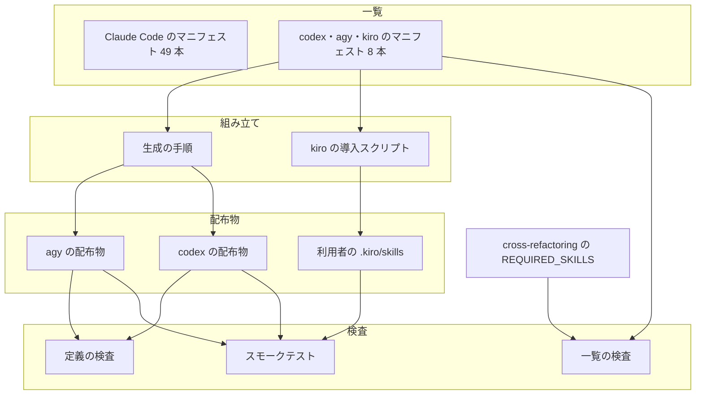
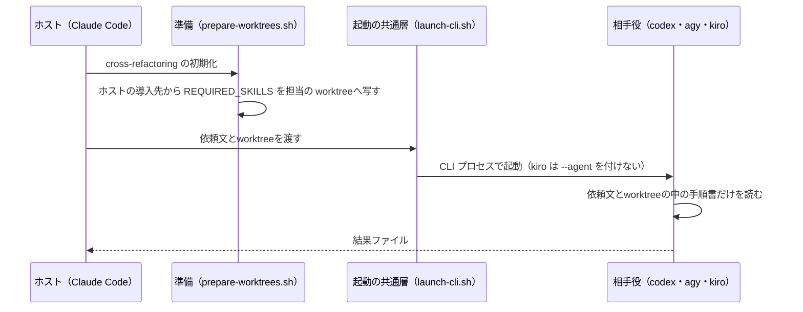
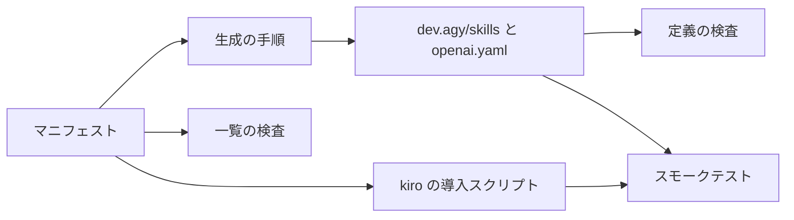

# 配布の縮小: codex・agy・kiro へは cross-review と cross-refactoring を回せる 8 本の Skill だけを配る（#2231）

## 目的

- **何が壊れているか**: NDF は codex 45 本・agy 45 本・kiro 46 本の Skill を、Claude Code（49 本）とほぼ同じ形で配っている。ランタイムごとの差分を吸収する層（agy のエージェント定義の写し・kiro の steering とエージェント定義の生成）・スモークテスト・ランタイムだけで起きる不具合（agy の本文の切り詰め #2163 など）が増え続ける
- **誰が困るか**: NDF を保守する開発者（同じ機能を 4 通りに保つ）と、codex・agy・kiro の利用者（手順の後半が届かない Skill を受け取る）
- **直すと何が成り立つか**: codex・agy・kiro へ配るのは cross-review と cross-refactoring を回すのに要る 8 本だけになり、エージェント定義・hook・steering・プロンプトの写しを持たない。Claude Code をホストにした cross-review / cross-refactoring で、codex・agy・kiro は相手役として今と同じ結果を返す

## 適用範囲

- **働く範囲**: このリポジトリの配布物（`plugins/ndf/` の codex・agy・kiro 向けの部分）と、それを組み立てる・確かめるスクリプトとテスト。NDF を導入した利用者の手元では、次の版を導入したときに効く
- **プロジェクトごとに違うもの**: 無し（配る Skill の一覧は NDF の配布物が持ち、利用者のリポジトリの設定では変えない）
- **当たるモード**: `standard`

## あるべき姿の根拠

| 根拠 | 種類 | 何を示すか |
| --- | --- | --- |
| 「codex・agy・kiro へは、cross-review / cross-refactoring に要る Skill 以外を配布しない」（2026-10-31） | 利用者の指示の原文（起票者が #2231 の本文へ引用） | 配るのは cross 系に要る Skill だけで、それ以外は配らない |
| `plugins/ndf/skills/cross-review/scripts/launch-reviewer.sh` の `render_review_prompt` は、レビュー担当の依頼文を Skill を読まずに完結させる | 実測（コードを読んだ） | 相手役としてのレビュー担当は、配った Skill を 1 本も使わない |
| `plugins/ndf/skills/cross-refactoring/scripts/prepare-worktrees.sh` は `REQUIRED_SKILLS`（`refactoring`・`tdd-cycle`・`quality-gates`）を**ホストの導入先**（`SKILLS_ROOT`）から担当の worktreeへ写し、`launch-cli.sh` は写した先のパスを依頼文に書く | 実測（コードを読んだ） | 相手役としての提案・実装の担当も、相手役のランタイムへ配った Skill を使わない。3 本が要るのはホストの側である |
| `plugins/ndf/scripts/lib/launch-cli.sh` は kiro を `kiro-cli chat --no-interactive --trust-all-tools` で起動し、`--agent ndf` を付けない | 実測（コードを読んだ） | 相手役の kiro は、installer が作るエージェント定義（`.kiro/agents/ndf.json`）を読まない |
| `agy plugin validate` に 8 本の Skill と `plugin.json`・`scripts` だけの木を渡すと `skills 8 · agents 0 · … ✔ Validation passed with 1 warning`（警告は `cross-refactoring` の本文 33517 バイトの切り詰め）。`plugin.json` だけの木も `✔ Validation passed` | 実測（agy 1.4.7、2026-10-31） | エージェント定義と hook を外した agy の配布物は検証を通る |

要求と受け入れ条件は #2231 の本文にある（コピーは `issues/issue-2231-requirements.md`）。この文書は「どう作るか」だけを扱う。

## ドメインモデル

### コンテキスト

| コンテキスト | 何の語が 1 つの意味に決まるか |
| --- | --- |
| 配布（`ndf-distribution`） | マニフェスト・ランタイムの配布物・配る Skill の数 |
| cross 系の参加（`cross-review-participants`） | ホスト・相手役・担当の worktreeへ写す手順書（`REQUIRED_SKILLS`） |

cross 系の参加が顧客、配布が供給者の関係（顧客 / 供給者）。cross 系が「ホストの導入先に要る Skill」（`REQUIRED_SKILLS` と Skill の境界をまたぐ参照）を宣言し、配布はその宣言を満たす一覧を配る。配布は cross 系の宣言を書き換えない。

### 集約

| 集約 | 持ち主（書き換えてよいもの） | 根 | エンティティ | 値オブジェクト |
| --- | --- | --- | --- | --- |
| 配る Skill の一覧 | `plugins/ndf/manifests/*-skills.txt`（人が設計を通して書く） | ランタイムごとのマニフェスト | — | Skill の名前 |
| agy の配布物 | `scripts/build-runtime-plugins.sh`（`dev.agy/skills/` のリンク）と `dev.agy/plugin.json` | `dev.agy/` | Skill のリンク | 版数・Skill の数（description） |
| codex の配布物 | `scripts/build-runtime-plugins.sh`（`agents/openai.yaml`）と `.codex-plugin/plugin.json` | `.codex-plugin/plugin.json` | Skill の参照 | 版数・Skill の数（description） |
| kiro の導入物 | `plugins/ndf/dev.kiro/install.sh` | 利用者のリポジトリの `.kiro/skills/` | Skill のリンク | — |
| 担当の worktreeへ写す手順書 | cross-refactoring（`refactor_lib/vocabulary.py` の `REQUIRED_SKILLS`）。**この変更では変えない** | `REQUIRED_SKILLS` | — | Skill の名前 |

### 不変条件

| # | 集約 | 条件 | 破れたときの扱い |
| --- | --- | --- | --- |
| I1 | 配る Skill の一覧 | codex・agy・kiro の 3 つのマニフェストは同じ集合で、決定 1 の 8 本と一致する | pytest が落ちる（CI の `pytest`） |
| I2 | 配る Skill の一覧 | `cross-refactoring` を載せるマニフェストは `REQUIRED_SKILLS` の 3 本をすべて載せる | pytest が落ちる。ホストの導入先からworktreeへ写せず、提案が語彙の外になって全件降格する |
| I3 | 配る Skill の一覧 | Skill の境界をまたぐ参照と共同配布の組（`cross-review`↔`cross-refactoring`、`cross-review`→`fix`、`/ndf:external-ai` を指す Skill→`external-ai`）が、どのマニフェストでも欠けない | 既存の pytest と `scripts/check-cross-skill-refs.py` が落ちる |
| I4 | agy の配布物 | `dev.agy/skills/` の並びは `agy-skills.txt` と一致し、`dev.agy/agents/`・`dev.agy/hooks.json`・`dev.agy/install-hooks.sh` は無い | `build-runtime-plugins.sh --check` とスモークが落ちる |
| I5 | kiro の導入物 | `install.sh` が利用者のリポジトリへ作るのは `.kiro/skills/` のリンクだけで、steering・プロンプト・エージェント定義を作らない | `install.sh` を一時ディレクトリで走らせるテストとスモークが落ちる |
| I6 | 配る Skill の一覧 | `claude-skills.txt` と Claude Code の配布物（`.claude-plugin/`・`agents/`・`hooks/claude.json`・`skills/` の中身）は変わらない | 差分に現れる。既存の pytest が通る |
| I7 | agy・codex の配布物 | `plugin.json` の description の Skill 数がマニフェストの行数と一致する | `scripts/validate-runtime-plugins.sh` が落ちる（既存の検査） |

### ドメインイベント

| # | イベント | 発生元 | 受け手 |
| --- | --- | --- | --- |
| E1 | 相手役に要る Skill の一覧を決めた | この設計（決定 1）。承認ゲート 1 で利用者が確かめる | 実装（E2・E3） |
| E2 | 3 つのマニフェストを一覧に合わせて絞った | 実装（マニフェストの書き換え） | `build-runtime-plugins.sh`・`install.sh`・検査（I1〜I4・I7） |
| E3 | `dev.agy/`・`dev.kiro/` から要らないエージェント・hook・steering を外した | 実装 | スモークテスト（I4・I5） |
| E4 | 利用者が新しい版を codex・agy・kiro へ導入した | リリースと利用者の更新 | README の移行の手順（非機能の移行性） |
| E5 | Claude Code をホストにした cross-review で、codex・agy・kiro がレビュー担当として結果ファイルを返した | `/ndf:cross-review` | リリース後テスト（受け入れ条件 8） |
| E6 | Claude Code をホストにした cross-refactoring で、codex・agy・kiro が提案・実装の担当として結果を返した | `/ndf:cross-refactoring` | リリース後テスト（受け入れ条件 8） |
| E7 | 直す必要が無くなった open の課題を棚卸しで閉じた | `/ndf:backlog-refinement` | 課題の一覧（「配布を絞ると要らなくなる課題」の表を材料にする） |

### 用語

| 用語 | 意味 | 用語集への反映 |
| --- | --- | --- |
| 相手役 | cross-review のレビュー担当、cross-refactoring の提案・実装の担当として、ホストから CLI プロセスで起動されるランタイム | 追加（#2231 の要求のコミットで反映済み） |
| マニフェスト | `plugins/ndf/manifests/<ランタイム>-skills.txt`。ランタイムごとに配る Skill の一覧で、配布の唯一の基準 | 追加（#2231 の要求のコミットで反映済み） |
| ホスト | 収束ループを起動している CLI のランタイム | なし（既存の語。意味を変えない） |

## 機能一覧

| # | 機能 | 誰が使うか |
| --- | --- | --- |
| F1 | codex・agy・kiro へ 8 本の Skill だけを配る | codex・agy・kiro の利用者 |
| F2 | codex・agy・kiro をホストにして cross-review / cross-refactoring を回す（決定 2） | codex・agy・kiro の利用者 |
| F3 | Claude Code をホストにした cross-review / cross-refactoring で、codex・agy・kiro が相手役を務める（変えない） | Claude Code の利用者 |
| F4 | 配布から外れた Skill・hook・エージェント定義を、利用者が自分の手元から消せる（README の手順） | 既に導入した codex・agy・kiro の利用者 |
| F5 | マニフェストが 8 本の一覧から外れたら CI が落とす | NDF の開発者 |

## 配る Skill の一覧

**8 本は、2 つの根（`cross-review`・`cross-refactoring`）から、ホストとして回すときに実行・読み込みで辿る Skill を集めたものである。** 文書の「関連」の節だけで指す Skill は辿らない（`pr-review`・`issue-plan-strategy`・`pr`・`development-workflow`・`release-verification`）。ただし `external-ai` は、既存の共同配布の規則（I3）が `/ndf:external-ai` を指す Skill に同梱を求めるため含める（決定 1）。

| Skill | なぜ要るか | 出所 | 本文のバイト数 |
| --- | --- | --- | --- |
| `cross-review` | 根 | 利用者の指示 | 20415 |
| `cross-refactoring` | 根 | 利用者の指示 | 34260 |
| `fix` | cross-review の収束ループが指摘を直す手順（本文で 28 回指す）。`review_lib/github.py` が `fix/scripts` を読む | `scripts/check-cross-skill-refs.py` の例外 #344 | 17516 |
| `out-of-scope` | 範囲外と判断した指摘を起票する手順（`cross-review/docs/03-review-output.md`）。`fix` も 2 回指す | 本文の手順 | 8781 |
| `refactoring` | `REQUIRED_SKILLS`。ホストの導入先からworktreeへ写す | `refactor_lib/vocabulary.py` | 9923 |
| `tdd-cycle` | 同上 | 同上 | 9415 |
| `quality-gates` | 同上 | 同上 | 13430 |
| `external-ai` | `cross-review` の本文が CLI 起動の差分の正本として指す。`test_external_ai_codistribution.py` が同梱を求める | I3 | 16016 |

数: 8 本。変更前は codex 45・agy 45・kiro 46 で、減る数は codex 37・agy 37・kiro 38 である。

## 構成要素

| 要素 | 責務 | 変え方 |
| --- | --- | --- |
| マニフェスト（codex・agy・kiro） | ランタイムごとに配る Skill の一覧 | 8 行にする。3 つとも同じ並び |
| マニフェスト（Claude Code） | Claude Code へ配る Skill の一覧 | 変えない（I6） |
| agy の配布物（`dev.agy/`） | agy へ渡すプラグインの木 | `agents/`（11 本）・`hooks.json`・`install-hooks.sh` を外す。`plugin.json`・`skills/`（生成）・`scripts`（リンク）は残す。表は下の「agy の配布物の中身」 |
| codex の配布物（`.codex-plugin/plugin.json`） | codex へ渡す Skill の参照と hook の置き場 | `skills` を 8 本にし、description の数を直す。`hooks`（`hooks/codex.json`）は変えない（決定 5） |
| kiro の導入スクリプト（`dev.kiro/install.sh`） | 利用者のリポジトリの `.kiro/` へ配置する | `.kiro/skills/` のリンクだけを作る形に縮める。steering・プロンプト・エージェント定義の生成と、旧 `default.json` の移行を外す。`dev.kiro/prompts/`（6 本）と `dev.kiro/agents/` を消す。表は下の「kiro の導入物の中身」 |
| 生成の手順（`scripts/build-runtime-plugins.sh`） | マニフェストから `dev.agy/skills/` のリンクと codex の `agents/openai.yaml` を作る | agy のエージェント定義の写しを作る部分（`sync_agy_agents`）を外す。codex の `openai.yaml` は既存の同期が外れた Skill の分（`cherry-pick-pr`・`deploy`）を消す |
| 定義の検査（`scripts/validate-runtime-plugins.sh`・`scripts/lib/validate_manifests.py`） | 版数・Skill 数・形の突き合わせ | agy のエージェント定義と hook を前提にした検査を外す |
| 一覧の検査（新しい pytest） | 3 つのマニフェストが 8 本の一覧と一致すること（I1）と、`REQUIRED_SKILLS` を載せること（I2） | 足す。`scripts/tests/test_refactoring_codistribution.py` は I2 に含まれるため消す |
| ランタイムのスモークテスト（`scripts/runtime-smoke-test.sh`・`tests/runtime-smoke/assertions/*`・`.github/workflows/runtime-plugin-smoke*.yml`） | 導入できることを確かめる | codex・agy・kiro の導入先の Skill の並びがマニフェストと一致することを見る。agy のエージェント定義・hook、kiro のエージェント定義・既定エージェントの切り替え・steering の確認を外す |
| ランタイム向けのテスト（`scripts/tests/` の agy・kiro・codex の配布物を見るもの） | 生成物の形を固定する | 外したもの（エージェント定義・hook・steering・プロンプト）だけを見るテストは消す。残る生成物を見るテストは 8 本の前提へ直す |
| 文書（`AGENTS.md`・`plugins/ndf/README.md`・`plugins/ndf/docs/kiro-cli.md`・`docs/ndf-plugin-reference.md`・`docs/versioning-and-distribution.md`・`docs/plugin-development-guide.md`・`CLAUDE.md` の「NDF の Skill 構成」） | 配布の説明 | 「4 ランタイムへほぼ同じ Skill を配る」前提を外し、codex・agy・kiro は 8 本だけであることと、一覧の正本がマニフェストであることを書く。移行の手順を README に書く |
| hook の入口（`plugins/ndf/scripts/hook.py` の kiro の分岐）と hook のスクリプト（`worktree-guard.sh`・`worktree-session.sh`） | 既に導入した利用者の手元の hook から呼ばれる | 変えない（決定 4） |

### agy の配布物の中身

受け入れ条件 3 の「何を残したかと理由」の表である。

| 物 | 扱い | 理由 |
| --- | --- | --- |
| `dev.agy/plugin.json` | 残す。description を 8 本へ直す | 取得元の登録と版数の置き場。外すと配布の経路が変わる（P1） |
| `dev.agy/skills/`（リンク） | 残す。8 本にする | 配る Skill の本体 |
| `dev.agy/scripts`（`../scripts` へのリンク） | 残す | `cross-review` と `cross-refactoring` のスクリプトがプラグインの根の `scripts/lib/`（`launch-cli.sh`・`review_criteria.py` など）を読む。既に導入した利用者の `~/.gemini/config/hooks.json` が指す `scripts/worktree-guard.sh` もここにある |
| `dev.agy/agents/`（11 本） | 外す | cross 系は担当を CLI プロセスで起動し、エージェント定義を使わない |
| `dev.agy/hooks.json` | 外す | 唯一の hook は worktree の案内で、編集を拒まない（`AGENTS.md`）。cross 系はworktreeの中で動き、案内を要さない |
| `dev.agy/install-hooks.sh` | 外す | 差し込む `hooks.json` が無くなる |

### kiro の導入物の中身

| 物 | 扱い | 理由 |
| --- | --- | --- |
| `.kiro/skills/` のリンク | 残す。8 本にする | Kiro CLI は組み込みの規則で `.kiro/skills/` を読む（`install.sh` の注記。エージェントの選択に依らない） |
| 再導入のときに、前の導入が張ったリンクのうち今の checkout を指すものを外す処理 | 残す | 既存の振る舞い。利用者が installer を打ったときだけ働き、別の場所を指す利用者のリンクは残す |
| `.kiro/steering/ndf-policies.md` の生成 | 外す | 生成元の `ndf-policies` を配らない。cross 系はこの常時指示を要さない |
| `.kiro/prompts/` への 6 本の写し（`dev.kiro/prompts/`） | 外す | `fix.md` 以外は配らない Skill の入口で、`fix` は Skill として呼べる |
| `.kiro/agents/ndf.json` の生成（`dev.kiro/agents/ndf.json.template`）と `--set-default` | 外す | 相手役の kiro は `--agent ndf` を付けずに起動する。ホストとしても組み込みの規則で Skill を読める |
| 旧 `.kiro/agents/default.json` の移行 | 外す | エージェント定義を作らないため、移行の先が無い |
| `--with-slack`・`--with-codex` | 外す。渡されたら「この版では何もしない」と 1 行出して続ける（決定 6） | エージェント定義の hook と MCP の設定を切り替えるフラグで、切り替える先が無い |

### 図



図に含めないもの: 文書（説明を書き写す先）・ランタイム向けのテスト（スモークと同じ生成物を見る）と、変えない hook の入口・Claude Code の配布物。

### 置き場所

```text
plugins/ndf/
├── manifests/
│   ├── codex-skills.txt        # 8 行へ
│   ├── agy-skills.txt          # 8 行へ
│   └── kiro-skills.txt         # 8 行へ
├── .codex-plugin/plugin.json   # skills を 8 本へ
├── dev.agy/
│   ├── plugin.json             # description を直す
│   ├── scripts -> ../scripts   # 残す
│   ├── skills/                 # 生成。8 本へ
│   ├── agents/                 # 消す
│   ├── hooks.json              # 消す
│   └── install-hooks.sh        # 消す
├── dev.kiro/
│   ├── install.sh              # Skill のリンクだけへ縮める
│   ├── agents/                 # 消す
│   └── prompts/                # 消す
└── skills/{cherry-pick-pr,deploy}/agents/openai.yaml   # 生成の同期が消す
scripts/
├── build-runtime-plugins.sh    # sync_agy_agents を外す
├── lib/validate_manifests.py   # agy のエージェント・hook の検査を外す
├── runtime-smoke-test.sh
└── tests/test_partner_manifests.py   # 新設（I1・I2）
tests/runtime-smoke/assertions/       # agy・kiro の確認を絞る
```

## 処理の流れ

### 相手役として起動されるとき（変えない）



**相手役のランタイムへ配った Skill は、この流れのどこにも現れない。** そのため 8 本へ絞っても、相手役の振る舞いは変わらない（受け入れ条件 8 はリリース後テストで確かめる）。

### ホストとして回すとき（決定 2）

codex・agy・kiro の利用者が `/ndf:cross-review`（ランタイムごとの呼び方）を `--host codex` などで回すと、ホストの導入先にある 8 本が使われる。`cross-refactoring` の準備はホストの導入先（`SKILLS_ROOT`）から `REQUIRED_SKILLS` を写すため、I2 が破れると止まる。

### 配布物を組み立てて確かめる流れ



実装の順序: マニフェスト → 生成の手順と生成物 → kiro の導入スクリプト → 検査とテスト → スモーク → 文書。生成物はマニフェストから作るため、マニフェストより先に直さない。

## 非機能の実現方式

| 大項目 | 要求の条件 | 実現方式 | 確かめ方 |
| --- | --- | --- | --- |
| 運用・保守性 | codex・agy・kiro へ配る Skill の数が、変更前（codex 45・agy 45・kiro 46）から減り、減った数を実装の PR に実測で書く（Value 3）。ランタイムのスモークテストの所要（秒）を変更の前後で実装の PR に書く | マニフェストを 8 行にする。スモークは外した確認（agy のエージェント・hook、kiro のエージェント・既定の切り替え・steering）を落とす | `wc -l plugins/ndf/manifests/*-skills.txt` を変更の前後で打つ。`bash scripts/runtime-smoke-test.sh --runtime <名前>` の所要を前後で測り、実装の PR に書く |
| 移行性 | 既に codex・agy・kiro へ NDF を入れた利用者が新しい版へ更新したとき、配布から外れた Skill が手元でどうなるか（消える / 残る）をランタイムごとに確かめ、残る場合の消し方を README に書く。こちらから利用者の手元を消さない（C6） | 下の「ランタイムごとの手元の振る舞い」の表をもとに、README に消し方を書く。installer とスクリプトは利用者の手元の残りを消さない（kiro の installer が今の checkout を指す自分のリンクを外す既存の振る舞いだけを残す） | 実装で、一時の HOME・一時のリポジトリに旧版を入れてから新版へ更新し、残るものを数える。README の消し方のコマンドは書く前に打って確かめる |
| システム環境 | 対象のランタイムは今と同じ（Claude Code・Codex・Kiro CLI・agy）。相手役の起動に使う CLI の版の下限は変えない | `tests/runtime-smoke/cli-versions.env` と `launch-cli.sh` の起動の形を変えない | 差分に現れないことを見る。CI のスモークが 4 ランタイムで通る |

### ランタイムごとの手元の振る舞い

| ランタイム | 新しい版へ更新したときに外れた Skill がどうなるか | 出所 | 残るものの消し方（README に書く） |
| --- | --- | --- | --- |
| codex | 版ごとのディレクトリへ導入し、`plugin.json` の `skills` が指す Skill だけを読む。外れた Skill は読まれない | `docs/versioning-and-distribution.md` の「ランタイムごとの取得と導入」（版ごとの実体）。**外れた Skill が一覧から消えることは実装で実測する** | 実測で残ると分かったときだけ書く |
| agy | `agy plugin install` は上書きするが、取得元から消えたファイルは残る（agy 1.1.26 で実測済み）。外した Skill・エージェント定義・`hooks.json` が残る | 同上の節 | `agy plugin uninstall ndf` の後に入れ直す。`install-hooks.sh` で `~/.gemini/config/hooks.json` へ差し込んだ `ndf-worktree` の項目は残る（指す先のスクリプトは配布物に残るため動き続ける）。消すコマンドを書く |
| kiro | installer を打ち直すと、今の checkout を指す `.kiro/skills/` のリンクのうちマニフェストから外れたものが外れる（既存の振る舞い）。`.kiro/steering/ndf-policies.md`・`.kiro/prompts/` の 6 本・`.kiro/agents/ndf.json` は残る | `install.sh` の `remove_managed_skill_links` | 残る 3 種のパスと消すコマンドを書く。`ndf.json` を既定のエージェントにした利用者は、既定を戻してから消す（消すと既定が存在しないエージェントを指す） |

## 決定の記録

### 決定 1: 利用者の指示の字面に沿うため、codex・agy・kiro へ配る Skill を cross 系をホストとして回せる 8 本にする

配るのは `cross-review`・`cross-refactoring`・`fix`・`out-of-scope`・`refactoring`・`tdd-cycle`・`quality-gates`・`external-ai` の 8 本で、3 つのランタイムで同じ一覧にする（「配る Skill の一覧」の表）。利用者の指示は「cross-review / cross-refactoring に要る Skill 以外を配布しない」で、2 つの Skill を配ることを前提に読める。2 つを動かすには、実行と読み込みで辿る 6 本が要る。

相手役に要る Skill は 0 本である（「あるべき姿の根拠」の 2〜4 行目）。0 本にする案は採らない。指示が名指す 2 つの Skill まで配らなくなり、codex・agy・kiro の利用者が cross 系を回す手段が無くなる。`cross-review` と `cross-refactoring` の 2 本だけにする案も採らない。`fix` と `REQUIRED_SKILLS` が欠け、ホストとして回すと準備で止まる（I2・I3）。`external-ai` は「関連」の節で指されるだけだが、既存の共同配布の規則（#286）が同梱を求めるため含める。規則を「関連」の節で緩める案は、配布の規則を 1 本の Skill のために変えることになるため採らない。

この一覧は承認ゲート 1 で利用者が確かめる（要求の未決 1）。0 本を選ぶなら、マニフェストを空にし、`dev.agy/scripts` と kiro の導入スクリプトも外す差分になる。

根拠: 利用者の指示（2026-10-31）/ Value 1 / Value 6（MVV 版 3）

### 決定 2: 決定 1 の 8 本が使える範囲を明確にするため、codex・agy・kiro をホストにした cross-review と cross-refactoring は保証の内に残す

要求の前提 2（起票者の推定 S7）は「codex・agy・kiro をホストにする使い方は保証しない」だった。決定 1 の 8 本はホストとして回すための一覧であり、保証の外に置くと 8 本を配る理由が無くなる。cross 系以外の NDF の工程（supervise・relay・承認ゲート・リリース）を codex・agy・kiro から回す使い方は、保証の外になる。

前提 2 のまま保証の外に置く案は、決定 1 で 0 本を選んだときにだけ成り立つ。承認ゲート 1 で決定 1 と組で決める（要求の未決 2）。

根拠: 利用者の指示（2026-10-31）/ Vision（MVV 版 3）

### 決定 3: 一覧の正しさを機械で保つため、3 つのマニフェストが 8 本の一覧と一致することを pytest で縛る

新しい pytest に 8 本の一覧を 1 つ置き、3 つのマニフェストがそれと一致すること（I1）と、`cross-refactoring` を載せるマニフェストが `REQUIRED_SKILLS`（`vocabulary.py` から読む）を載せること（I2）を確かめる。I2 は既存の `test_refactoring_codistribution.py`（`refactoring` だけを見る）を含むため、そちらを消す。

2 つの根から参照を辿って一覧を機械で導く案は採らない。「関連」の節の案内と手順の参照を文面で分けられず、導いた集合に `pr-review` などが混ざる。一覧をマニフェストのほかに検査にも置くのは、マニフェストが配布の入力で、検査の一覧が設計で決めた範囲の写しという別の役割を持つためである。

根拠: Value 4 / Value 3（MVV 版 3）

### 決定 4: 既に導入した利用者の手元を壊さないため、hook の入口とスクリプトは配布物に残す

kiro の旧 installer が作った `.kiro/agents/ndf.json` は `plugins/ndf/scripts/hook.py --runtime kiro` を、agy の `install-hooks.sh` が差し込んだ項目は `scripts/worktree-guard.sh` を呼ぶ。こちらからは利用者の手元を消さない（C6・要求の前提 5）ため、呼ばれる先を残し、利用者が README の手順で消すまで今と同じに動かす。`hook.py` の kiro の分岐は Claude Code と共有する入口にあり、残しても codex・agy・kiro の配布物は増えない。

hook の入口の kiro の分岐を消す案は採らない。手元に `ndf.json` が残る利用者で、プロンプトを送るたびに hook が失敗する。

根拠: C6 / Value 2（MVV 版 3）

### 決定 5: 要求の範囲と利用者の保護を保つため、codex の hook（`hooks/codex.json`）は変えない

要求が hook を外す対象として挙げるのは `dev.agy/`・`dev.kiro/` で、codex の hook は対象範囲に無い。codex の hook には、ChatGPT のアカウントのモデル学習を切る開始時の処理（`training-optout.py`）がある。相手役の codex にリポジトリの中身を渡す利用者の情報を守る処理で、効率より上位の原則（人を守る）に当たる。

codex の hook のうち worktree の案内と待ち通知だけを外す案は、要求の範囲を広げるため、この変更では採らない。

根拠: 上位の原則（人を守る）/ C1 / 判断の範囲は目の前の変更に限る（共通原則）

### 決定 6: 利用者の手を止めないため、kiro の installer は外したフラグを受け取っても止まらない

`--set-default`・`--with-slack`・`--with-codex` を渡されたら、「この版では何もしない」と 1 行出して続ける。利用者のスクリプトや手順書がフラグ付きで installer を呼んでいても、更新で止まらない。

知らないフラグとして終了コード 2 で止める案は採らない。更新した利用者の導入の手順が、配る Skill の中身と関係の無い理由で止まる。

根拠: Value 2（MVV 版 3）

### 決定 7: 配布の経路を変えないため、agy と codex の `plugin.json` と kiro の installer は残す

配る Skill が減っても、取得元の登録・導入の操作・版数の置き場は今のままにする。agy・codex のプラグインを取得元から外す、kiro の installer を消すといった変更は、配布物の取得元を変える操作（P1）に当たり、この要求の範囲に無い。

根拠: P1 / Value 1（MVV 版 3）

## テスト設計

| 受け入れ条件・不変条件 | どの振る舞いで縛るか | どう壊したら落ちるべきか |
| --- | --- | --- |
| 受け入れ条件 1・I1 | 3 つのマニフェストの集合が 8 本の一覧と一致する | どれかのマニフェストへ `release` を 1 行足すと落ちる。`fix` を 1 行消しても落ちる |
| 受け入れ条件 2・I2 | `cross-refactoring` を載せるマニフェストは `REQUIRED_SKILLS` をすべて載せる。`REQUIRED_SKILLS` は `vocabulary.py` から読む | `tdd-cycle` をマニフェストから消すと落ちる。`REQUIRED_SKILLS` に Skill を足してマニフェストに足さないと落ちる |
| I3 | 既存の共同配布のテスト（`test_cross_review_codistribution.py`・`test_external_ai_codistribution.py`）と `check-cross-skill-refs.py` が 8 本の一覧で通る | `external-ai` をマニフェストから消すと落ちる |
| 受け入れ条件 3・I4 | `build-runtime-plugins.sh --check` が通り、`dev.agy/skills/` の並びがマニフェストと一致し、`agents/`・`hooks.json`・`install-hooks.sh` が無い | `dev.agy/agents/` に 1 本残すとスモークか検査が落ちる。マニフェストに無いリンクを `dev.agy/skills/` に足すと `--check` が落ちる |
| 受け入れ条件 4・I5 | 一時ディレクトリで `install.sh --project <dir> --yes` を打つと、`.kiro/` の下に Skill のリンク 8 本だけができる。外したフラグを渡しても終了コード 0 で続く | steering を生成する処理を残すと落ちる。`--with-codex` で終了コード 2 を返すように戻すと落ちる |
| 受け入れ条件 5・I7 | `claude plugin validate .`・`check-skill-frontmatter.py`・`instructions-check.py --root .`・`validate-runtime-plugins.sh` が通る | `dev.agy/plugin.json` の description の数を 45 のまま残すと落ちる |
| 受け入れ条件 6 | 文書の参照切れと古い記述を既存の検査（`check-doc-staleness.py` など）が見る。文言を照合するテストは書かない（`AGENTS.md`） | — |
| 受け入れ条件 7 | スモークが codex・agy・kiro の導入先の Skill の並びをマニフェストと突き合わせ、配らない Skill を求めない | 導入先に 9 本目が残ると落ちる。スモークが `playwright-planning` 以外の配らない Skill の存在を求めていたら落ちる（求めないことを CI の通過で見る） |
| 受け入れ条件 8 | リリース後テストで、新しい版を入れた環境から `/ndf:cross-review <PR>`（`--include agy`）と `/ndf:cross-refactoring <PR>` を 1 回ずつ回し、codex・agy・kiro の結果ファイルが揃う | NO_RESULT が出たら失敗として記録する |
| 受け入れ条件 9 | 「配布を絞ると要らなくなる課題」の表が実装の PR の本文に写る | — |
| 受け入れ条件 10・I6 | `claude-skills.txt` と Claude Code の配布物に差分が無く、`uv run --frozen --project . --all-extras pytest . -q -n 4` が通る | `claude-skills.txt` を触ると差分のレビューで見える |

## 配布を絞ると要らなくなる課題

受け入れ条件 9 の材料である。閉じるかは棚卸し（`/ndf:backlog-refinement`）が決める。実装の PR では閉じない。

| 課題 | 扱いの案 | 理由 |
| --- | --- | --- |
| #1574 NDF の Python スクリプトの内部 AI 呼び出しで、Codex ホスト時は Codex CLI を既定にする | 閉じる | 内部で AI を呼ぶ工程（supervise など）を codex へ配らなくなり、Codex をホストにして回す経路が無くなる（決定 2） |
| #2115 ndf-plugin-reference: 文書の記述を 4 ランタイムの今の構成に揃える | 閉じる候補 | 受け入れ条件 6 で `docs/ndf-plugin-reference.md` を新しい配布に合わせて書き直す。残る食い違いがあるかを棚卸しで見る |
| #2163 agy が Skill 5 本の本文を先頭 24000 バイトで切る | 残す（対象が 5 本から 1 本へ減る） | 8 本のうち `cross-refactoring`（33517 バイト）が切られる（agy 1.4.7 で実測）。ほかの 4 本は配らなくなる |
| #1981・#1603 agy の出力の形・実際に動いたモデルを確かめる | 残す | 相手役の起動の経路で使う |
| #2006 codex のスモークの codex_home の警告 | 残す | スモークは残る |
| #750・#1411 相手役の codex の結果・利用上限の誤判定 | 残す | 相手役の振る舞いで、配布と関わらない |
| #1889 verify-install の Kiro が ndf の版を読む | 残す | ndf 以外のプラグイン（playwright-kit）で起きる |
| #1968 KIRO.md の変更が承認資料に載らない | 残す | 指示書のチェックの問題で、配る Skill と関わらない |
| #2058 mcp-redash が Kiro の default.json を作る | 残す | mcp-* は対象範囲の外 |

## 設計の結果

| 課題 | 扱い | 取り込み先 | 触るファイル |
| --- | --- | --- | --- |
| #2231 | 実装する | — | `plugins/ndf/manifests/`、`plugins/ndf/.codex-plugin/plugin.json`、`plugins/ndf/dev.agy/`、`plugins/ndf/dev.kiro/`、`plugins/ndf/skills/cherry-pick-pr/agents/`、`plugins/ndf/skills/deploy/agents/`、`scripts/build-runtime-plugins.sh`、`scripts/validate-runtime-plugins.sh`、`scripts/lib/validate_manifests.py`、`scripts/runtime-smoke-test.sh`、`tests/runtime-smoke/`、`.github/workflows/`、`scripts/tests/`、`AGENTS.md`、`CLAUDE.md`、`plugins/ndf/README.md`、`plugins/ndf/docs/kiro-cli.md`、`docs/ndf-plugin-reference.md`、`docs/versioning-and-distribution.md`、`docs/plugin-development-guide.md` |

## 未確認のまま残ること

| 項目 | 内容 |
| --- | --- |
| 配る Skill の一覧（要求の未決 1）とホストの扱い（未決 2） | 決定 1・2 の推奨（8 本・ホストを保証の内に残す）は要求の前提 2 と食い違う。承認ゲート 1 で利用者が 8 本か 0 本かを決める |
| プロジェクト MVV との食い違い（要求の未決 4） | Mission（4 つのランタイムのどれを使うチームにも開発工程を届ける）と Vision（どのリポジトリでも同じ工程が通る）が、codex・agy・kiro へは cross 系だけを届ける配布と食い違う。利用者の指示は MVV より上位のため設計は進めたが、MVV の改訂を起こすかは承認ゲート 1 で利用者が決める |
| codex で外れた Skill が手元の一覧から消えるか（要求の未決 3 の codex の分） | 版ごとのディレクトリへ導入する仕組みから「消える」と読んだが、実測していない。実装で一時の `CODEX_HOME` に旧版を入れてから更新して確かめる |
| kiro の組み込みの既定エージェントが `.kiro/skills/` を読むか | `install.sh` の注記（組み込みの規則が Skill を読む）を根拠にしたが、`--agent` を付けない `kiro-cli chat` で 8 本が一覧に出ることは実測していない。実装のスモークで確かめ、読まないと分かれば決定を戻して人へ戻す |
| codex の `.codex-plugin/plugin.json` を 8 本にしたときの codex の導入 | 本数を減らした形で `codex plugin add` が通ることは実測していない。CI のスモーク（codex）で確かめる |
| 相手役が 8 本へ絞った後も今と同じ結果を返すか（受け入れ条件 8） | 起動の経路をコードで読んで、配った Skill を使わないと判断した。実物の確認はリリース後テストで行う |
| スモークの所要の前後 | 実装の PR で測る（非機能の運用・保守性） |
