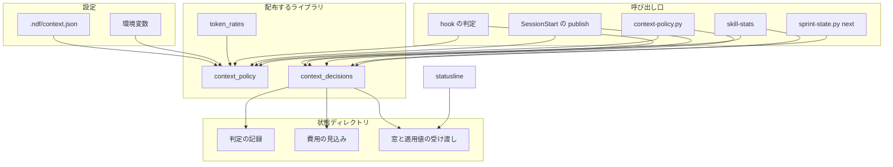
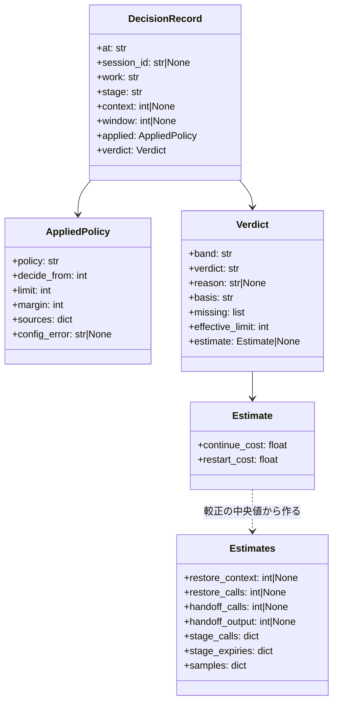
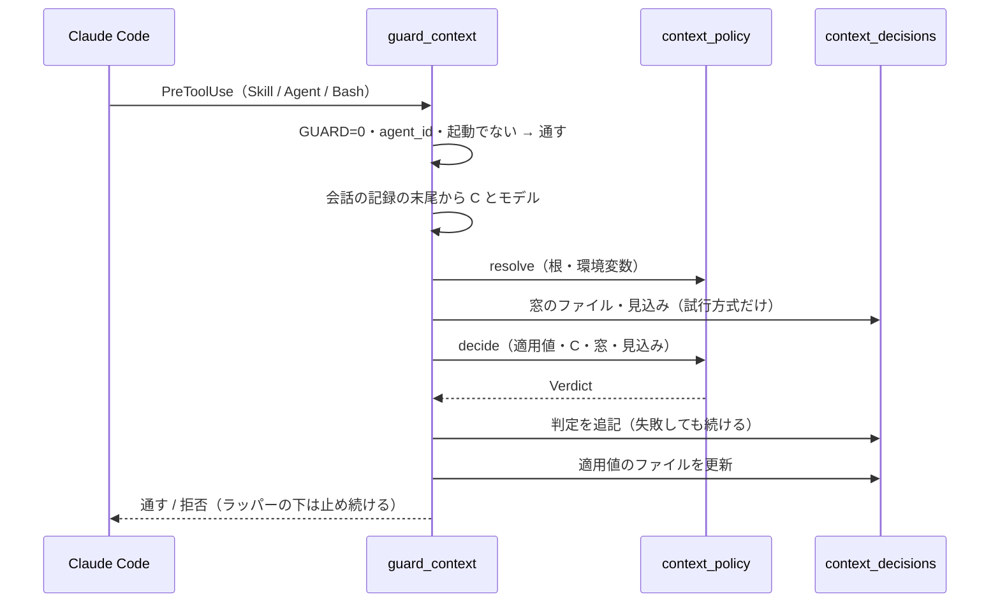
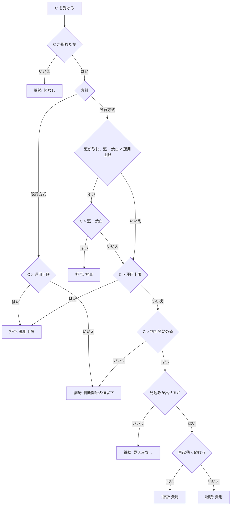

# NDF の再起動の方針: 試行方式を選ぶと工程境界で継続か再起動かを容量と費用で決め、現行方式と比べられる（#2262）

## 目的

- **今どうなっているか**: conductor は文脈が 200K を超えると次の工程へ入れず（hook）、4 つのカットポイントでは文脈の量に関わらず `ndf-next` を出して会話を切る。1M の窓のモデルでも同じで、切るたびに引継ぎの作成と復元の再読込が掛かる。止める値は hook と skill-stats が 200K、statusline が 500K（窓 200K 以下は 150K）で、3 か所が別々に持つ
- **誰に効くか**: NDF でスプリントを回す利用者（conductor の費用と時間）と、再起動の方式を比べて既定を決める NDF の開発者
- **変えると何が成り立つか**: 設定で試行方式を選ぶと、工程境界で容量・運用上限・費用から継続か再起動かをスクリプトが決め、判定と再起動・復元の費用が記録に残る。現行方式と同じ物差しで比べてから既定を決められる。選ばない利用者の判定は変わらない

## 適用範囲

- **働く範囲**: 配布先のどのリポジトリでも働く。判定の hook は Claude Code だけで、Codex は `context-window.md` の規約で同じ判断をする
- **プロジェクトごとに違うもの**: 方針と値は `.ndf/context.json`（チーム）と環境変数 `NDF_CONTEXT_POLICY`（個人）で受ける。費用の見込みはそのリポジトリの記録から較正し、ai-plugins の値を既定に埋め込まない
- **当たるモード**: `standard`

## あるべき姿の根拠

| 根拠 | 種類 | 何を示すか |
| --- | --- | --- |
| 「一律 200K での再起動を見直し、品質を保って再起動・引継ぎ・復元の費用と時間を減らす」（#2262 の依頼。起票者がまとめた文で、確かなのはこの向きだけ） | 利用者の指示 | 変える向き。数値と方式は起票者の推定（要求の S1〜S11）で、承認ゲート 1 で確かめる |
| conductor の文脈: 2026-09-20 以降の全プロジェクトで最大 68 万、ai-plugins の 30 日で平均 41 万・45 件中 37 件が 20 万超（#827、`context-window.md` の表） | 実測 | 200K は守られておらず、切るたびの再読込が費用の大半を占める |
| `token_guard.py` の `NDF_CONTEXT_LIMIT` 既定 200000、`skill-stats.py` の `DEFAULT_WINDOW_LIMIT = 200000`、`statusline.sh` の `WARN_TOKENS=500000`（窓 200K 以下は 150000）（2026-11-02 に develop で読んだ） | 実測（コード） | 同じ量を 3 か所が別の値で持つ |
| `statusline.sh` は `~/.claude/ndf-statusline.sh` へ写して動く（`statusline-switch.sh`）。hook の入力に窓の大きさは無く、statusline の入力の `context_window.context_window_size` にだけある | 実測（コード） | statusline はプラグインのライブラリを読めず、窓の大きさは statusline からしか取れない |
| キャッシュの単価の正本は配布しない `scripts/token-usage.py` の `READ_RATES` / `WEIGHTS` にある | 実測（コード） | 配布する hook が費用を計算するには、単価を配布物へ移す必要がある |

要求と受け入れ条件は #2262 の本文にある（コピーは `issues/issue-2262-requirements.md`）。この文書は「どう作るか」だけを扱う。

## ドメインモデル

### コンテキスト

| コンテキスト | 何の語が 1 つの意味に決まるか |
| --- | --- |
| NDF の開発ワークフロー（`ndf-workflow`） | 再起動の方針・現行方式・試行方式・判断開始の値・運用上限・容量の余白・再起動の理由・復元の区間・引継ぎの区間・境界の判定・作業の識別子・費用の見込み・適用値 |
| ラッパー（`ndf-relay`） | 変えない。`ndf-next` のブロックとラッパーの直接の子の判定（`relay_notice`）を今のまま使う |

`ndf-relay` とは公開された言語の関係である。ワークフローは `ndf-next` のブロック（形は `context-window.md` の「新しい会話で戻す」）だけを渡し、ラッパーは方針を知らない。

### 集約

| 集約 | 持ち主（書き換えてよいもの） | 根 | エンティティ | 値オブジェクト |
| --- | --- | --- | --- | --- |
| 適用値 | `lib/context_policy.py` の `resolve` | 1 つのセッション・作業ディレクトリに当たる適用値 | — | 方針・判断開始の値・運用上限・容量の余白・値ごとの出所・壊れた設定の印 |
| 境界の判定の記録 | `lib/context_decisions.py`（追記だけ） | 判定 1 件 | — | 判定（継続 / 再起動 / 拒否）・帯・理由・欠けた値・コンテキスト量・窓・実効の上限・費用の見込み・作業の識別子・セッション |
| 費用の見込み | `context-policy.py calibrate` | リポジトリごとの見込み | — | 復元の量の中央値・復元の呼び出し数・引継ぎの呼び出し数と出力・工程ごとの呼び出し数とキャッシュ切れの数・標本数 |
| セッションの窓 | `statusline.sh` | セッション 1 つの窓の観測 | — | 窓の大きさ・モデル |

作業ごとの集計（受け入れ条件 12）は記録と会話の記録から導く読み取りの結果で、保存しない。

### 不変条件

| # | 集約 | 条件 | 破れたときの扱い |
| --- | --- | --- | --- |
| I1 | 適用値 | 方針を指定しないとき、適用値は現行方式（運用上限 200,000、容量を使わない）で、hook の判定と拒否の文面は今と同じである | 既存の `test_token_guard*.py` と I1 のテストが落ちる |
| I2 | 適用値 | 適用値を解決する関数は 1 つで、hook・statusline・skill-stats は同じ入力から同じ方針と値を得る（statusline は公開したファイル経由） | 3 つの読み口の一致のテストが落ちる |
| I3 | 適用値 | 優先順位は CLI 引数 > 環境変数 > `.ndf/context.json` > 既定。`NDF_CONTEXT_GUARD=0` なら方針に関わらず判定も記録もしない | 優先順位のテストが落ちる |
| I4 | 適用値 | 判断開始の値 ≤ 運用上限。設定が破れば設定を壊れたものとして現行方式の既定で動き、壊れたことを出力に示す | 解決は現行方式を返し、`config_error` を持つ |
| I5 | 境界の判定の記録 | 試行方式の帯は C ≤ 判断開始の値で継続、判断開始の値 < C ≤ 運用上限で費用の見込み、C > 運用上限で拒否 | 境界の値のテストが落ちる |
| I6 | 境界の判定の記録 | 試行方式で窓が取れたとき、窓 − 容量の余白 が運用上限より小さければ、その値を超えた C を理由「容量」で拒否する | 小さい窓のテストが落ちる |
| I7 | 境界の判定の記録 | 取れない値を推測で埋めない。C が取れなければ止めない。窓が取れなければ容量を使わず、記録の「欠けた値」に書く。費用の見込みが出せなければ判断の帯は継続にする（運用上限だけで決める） | 値の欠けのテストが落ちる |
| I8 | 境界の判定の記録 | 判定は LLM もネットワークも呼ばない。読むのは会話の記録の末尾 200 行と小さな JSON と `git` の根の解決だけ | 判定の関数が純粋関数でなくなり、テストが副作用を検出する |
| I9 | 境界の判定の記録 | 記録の書き込みに失敗しても判定（止める / 通す）は変わらない | 書けない置き場のテストが落ちる |
| I10 | 境界の判定の記録 | `agent_id` を持つ呼び出し（サブエージェント）は判定も記録もしない。supervisor のスイッチポイント（`guard_supervisor_cut`）は方針に関わらず今のまま | 既存のテストと方針つきのテストが落ちる |
| I11 | 境界の判定の記録 | ラッパーの直接の子では、拒否（理由が運用上限・容量・費用のどれでも）を判定が変わるまで止め続ける。外では同じ起動の 2 度目を 1 度だけ通す | 繰り返し拒否のテストが落ちる |
| I12 | 境界の判定の記録 | 既存の行を書き換えない。方針の無い過去の記録は現行方式（200,000）として読み、そう読んだことを出力に示す | 集計と skill-stats のテストが落ちる |
| I13 | 費用の見込み | 1 回の API 呼び出しを集計の 2 つの区分へ数えない（同じ `message.id` は 1 回、帳簿にある `claude -p` のセッションは帳簿だけから数える） | 二重計上のテストが落ちる |
| I14 | 費用の見込み | 取れなかった品質の値と自動圧縮の回数を 0 にせず「不明」と出す | 集計のテストが落ちる |
| I15 | 適用値 | モデル名と窓の大きさは方針を選ばない（窓は容量の判定にだけ使う） | 1M の窓で方針が現行方式のままであることのテストが落ちる |

### ドメインイベント

| # | イベント | 発生元 | 受け手 |
| --- | --- | --- | --- |
| E1 | 適用する方針と値を解決した | `context_policy.resolve`（SessionStart の `publish`・hook・skill-stats・`context-policy.py resolve`） | hook の判定・statusline（公開したファイル）・skill-stats |
| E2 | 現在のコンテキスト量と実行環境の容量を取得した | hook（会話の記録の末尾と、statusline が書いた窓のファイル） | E3 |
| E3 | 継続 / 再起動を理由つきで判定した | `context_policy.decide` | E4・E5 |
| E4 | 判定を記録した | `context_decisions.append` | E8・費用の見込みの較正 |
| E5 | 次の工程への進入を止め、`ndf-next` の案内を出した | hook（拒否の文面） | conductor（E6） |
| E6 | 引継ぎを始め、引継ぎ文書を作った / 更新した | conductor（文書を書き始める前に `context-policy.py record --event 引継ぎ開始` で引継ぎの区間の起点を記録し、書いた後に `sprint-state.py next` が再起動を記録する） | E7・境界の判定の記録（印「引継ぎ開始」と判定「再起動」） |
| E7 | 次のセッションが引継ぎ文書から状態を再確認した（復元の区間が終わった） | 新しいセッションの conductor（引継ぎ文書を読み、課題・PR・通過記録で状態を再確認し終えた直後に `context-policy.py record --event 復元完了` を打つ）。入口の Skill（`development-workflow`）の読み込みと hook の判定は E7 にしない。hook を使わないので、hook の無いランタイム（Codex）でも同じ形で記録できる | 費用の見込み（復元の量の標本） |
| E8 | 作業ごとに費用・秒・再起動・自動圧縮・品質を集計した | `context-policy.py report` | 利用者・E9・`calibrate` |
| E9 | 比較実験の結果を報告し、既定の変更の採否を示した | 利用者と conductor（リリース後テストと振り返り） | 課題のコメント（自動化しない） |

### 用語

| 用語 | 意味 | 用語集への反映 |
| --- | --- | --- |
| 再起動の理由 | 工程境界で会話を切った・止めたときの理由。容量・運用上限・費用・独立性・手動と、現行方式のカットポイントの 6 つ | 意味の変更（カットポイントを足す） |
| 境界の判定 | 工程の起動 1 回ごとに出す継続 / 再起動 / 拒否と、その帯・理由・使った値の組。1 件ずつ記録に残る | 追加 |
| 適用値 | 優先順位を当てて解決した、そのセッションで効く方針・判断開始の値・運用上限・容量の余白と、それぞれの出所 | 追加 |
| 作業の識別子 | 複数のセッションを 1 つの作業として結ぶ鍵。起動の引数かスプリントに含まれる課題番号の組（`#829 #830`） | 追加 |
| 費用の見込み | 判断の帯で、続けた場合と再起動した場合の次の工程までの費用を、記録から較正した中央値で比べた値 | 追加 |
| 引継ぎの区間 | conductor が引継ぎ文書を書き始める前に記録した「引継ぎ開始」の時点から、そのセッションの最後の行まで | 追加 |
| 復元の区間 | 用語集のとおり。測るときの終わりは、conductor が引継ぎ文書と状態の再確認を終えて記録した「復元完了」の時点（入口の Skill の読み込みと hook の判定は終わりに使わない） | 変更なし |

## 機能一覧

| # | 機能 | 誰が使うか |
| --- | --- | --- |
| F1 | 方針（現行方式 / 試行方式）と値を設定・環境変数で選び、解決した適用値と出所を見る | 利用者 |
| F2 | 工程の起動のたびに、方針と値で継続 / 拒否を決める（試行方式では容量と費用の見込みも使う） | conductor（hook が働く） |
| F3 | 試行方式では、カットポイントで `ndf-next` を出さずに次の工程を起動し、独立性・手動のときだけ自分で切る | conductor |
| F4 | 判定と再起動を 1 件ずつ記録する | hook・`sprint-state.py next`・conductor |
| F5 | statusline の警告の色を、試行方式では適用値で決める | 利用者 |
| F6 | skill-stats の「割る候補」を、記録に残った方針と値で決める | 利用者・振り返り |
| F7 | 作業の識別子で複数のセッションを結び、区分ごとの token・秒・再起動・自動圧縮・品質を集計する | 利用者・比較実験 |
| F8 | 記録から費用の見込みを較正する | `sprint-state.py next`（再起動の記録のたび）・利用者 |

## 構成要素

| 要素 | 責務 |
| --- | --- |
| 適用値の解決と判定（`plugins/ndf/scripts/lib/context_policy.py`、新規） | `resolve(root, env, cli)`: 既定・`.ndf/context.json`（`decl.py` で開く）・環境変数・CLI 引数を優先順位で重ね、`AppliedPolicy` を返す。壊れた設定は現行方式に寄せて `config_error` を持たせる。`decide(applied, context, window, estimate, model)`: 純粋関数で `Verdict` を返す（帯・判定・理由・欠けた値・実効の上限）。`cost(...)`: 決定 5 の式 |
| 判定の記録と集計（`plugins/ndf/scripts/lib/context_decisions.py`、新規） | 状態ディレクトリ（決定 12）の解決、判定の記録の追記と読み取り、見込みのファイルの読み書き、窓と適用値の受け渡しのファイルの読み書き、作業ごとの集計（区分・重複の除去・不明の扱い） |
| 単価の正本（`plugins/ndf/scripts/lib/token_rates.py`、新規） | `READ_RATES` / `READ_RATE_DEFAULT` / `WEIGHTS` と `read_rate(model)`。`scripts/token-usage.py` から移し、`token-usage.py` は import する |
| 方針の CLI（`plugins/ndf/scripts/context-policy.py`、新規） | `resolve`・`publish`（SessionStart）・`record`・`calibrate`・`report` の 5 つの副命令（入出力の契約） |
| hook の判定（`plugins/ndf/scripts/hook_lib/token_guard.py` の `guard_context`、変更） | 起動の判定を `resolve` と `decide` に置き換え、判定を記録する。現行方式の文面は変えず、試行方式の拒否（容量・費用）の文面を足す。`guard_supervisor_cut` は変えない |
| SessionStart の登録（`plugins/ndf/hooks/claude.json`、変更） | `context-policy.py publish` を足す。適用値を受け渡しのファイルへ書き、設定が壊れていれば 1 行を出す |
| statusline（`plugins/ndf/scripts/statusline.sh`、変更） | 窓の大きさとモデルを受け渡しのファイルへ書く（変わったときだけ）。適用値のファイルの方針が試行方式なら、メインの使用量を判断開始の値を超えたら黄、実効の上限を超えたら赤にする。それ以外とサブエージェントの行は今のまま |
| skill-stats（`plugins/ndf/skills/skill-stats/scripts/skill-stats.py`、変更） | 「割る候補」の上限を記録ごとに決める（決定 14）。`--window-limit` の既定を「指定なし」にし、指定されたときだけ全記録へ当てる。方針の記録が無かった記録の数を出力に出す |
| スプリントの再起動の記録（`plugins/ndf/scripts/sprint-state.py` の `next`、変更） | `ndf-next` を出すときに `context_decisions` へ判定「再起動」を記録し、`calibrate` を呼ぶ。`--reason` で理由を受ける（既定は決定 11） |
| 規約（`development-workflow` の `references/context-window.md`・`work-vessels.md`・`relay.md`・`SKILL.md`、`statusline` と `skill-stats` の `SKILL.md`、変更） | 2 つの方針、カットポイントの意味（試行方式では判断できる境界）、帯と容量と費用の式の参照、初期値が実験の値であること、優先順位、Codex での扱い、記録と集計の読み方、引継ぎ文書を書き始める前の「引継ぎ開始」と状態の再確認を終えた後の「復元完了」の印を打つ手順（`relay.md`） |
| 設定と環境変数の契約（`plugins/ndf/contracts/settings/context.json.json`・`contracts/env/NDF_CONTEXT_POLICY.json`・`contracts/entrypoints/` の新しい CLI、新規） | 置き場（`worktree`）・キー・読む箇所の宣言 |



### 配置と依存

| 実行の単位 | どこで動くか | 読む | 書く |
| --- | --- | --- | --- |
| hook（PreToolUse・SessionStart） | Claude Code のプロセスが起こす python | 会話の記録の末尾・`.ndf/context.json`・環境変数・見込み・窓のファイル | 判定の記録・適用値のファイル・ガードの印（今の `guards/`） |
| statusline | `~/.claude/ndf-statusline.sh`（プラグインの外に写した bash と jq） | 適用値のファイル | 窓のファイル |
| CLI（`context-policy.py`・`sprint-state.py`・`skill-stats.py`） | Bash の Tool か利用者の端末 | 設定・記録・会話の記録・使用量の帳簿 | 判定の記録（`record`）・見込み（`calibrate`） |

hook の無いランタイム（Codex）では、conductor が `context-policy.py resolve` で方針を読み、規約に従う（決定 11）。

### パッケージ構成

```text
plugins/ndf/
├── contracts/
│   ├── env/NDF_CONTEXT_POLICY.json            # 新規
│   └── settings/context.json.json             # 新規
├── hooks/claude.json                          # SessionStart に publish を足す
├── scripts/
│   ├── context-policy.py                      # 新規の CLI
│   ├── hook_lib/token_guard.py                # guard_context を置き換える
│   ├── lib/
│   │   ├── context_policy.py                  # 新規: resolve・decide・cost
│   │   ├── context_decisions.py               # 新規: 記録・見込み・受け渡し・集計
│   │   └── token_rates.py                     # 新規: 単価の正本
│   ├── sprint-state.py                        # next で再起動を記録する
│   ├── statusline.sh                          # 窓を書き、適用値を読む
│   └── tests/                                 # 新しいテスト
└── skills/
    ├── development-workflow/references/      # context-window.md・work-vessels.md・relay.md
    ├── skill-stats/scripts/skill-stats.py
    └── statusline/SKILL.md
scripts/token-usage.py                         # token_rates を import する
```

## 構造



`AppliedPolicy`・`Verdict`・`Estimate` は不変（`dataclass(frozen=True)`）。`Estimates` はファイルの中身をそのまま持つ。

## データ構造

状態を上書きして過去を失わないよう、判定は 1 件 1 行の追記にする。見込みは記録から作り直せる導出値なので上書きでよい。受け渡しのファイルはセッションの今の値だけを持つ（過去は判定の記録が持つ）。

### 状態ディレクトリ

`NDF_CONTEXT_DIR` → `${XDG_STATE_HOME}/ndf/context` → `~/.local/state/ndf/context` の順に決める（決定 12）。

| ファイル | 中身 | 書く | 読む | 保持 |
| --- | --- | --- | --- | --- |
| `decisions/<owner>__<repo>.jsonl` | 判定の記録（1 行 1 件、追記だけ） | hook・`record`・`sprint-state.py next` | `report`・`calibrate`・skill-stats | 消さない（使用量の帳簿と同じ） |
| `estimates/<owner>__<repo>.json` | 費用の見込み | `calibrate` | hook | 上書き |
| `sessions/<session_id>.window.json` | `{"window": <int>, "model": "<id>", "at": "<UTC>"}` | statusline | hook | 7 日で消す（今の `guards/` と同じ規則） |
| `sessions/<session_id>.applied.json` | 適用値（`AppliedPolicy` の JSON） | `publish`・hook | statusline | 同上 |

`<owner>__<repo>` は `usage_ledger.repo_key` で作る。git の外は `_local` にする。

### `.ndf/context.json`（新規。チームの設定、`worktree` の置き場）

```json
{"version": 1, "policy": "trial", "trial": {"decide_from": 200000, "limit": 400000}, "margin": 50000}
```

| キー | 型 | 無いとき | 壊れているとき |
| --- | --- | --- | --- |
| `version` | 1 | 1 とみなす | 1 以外はファイル全体を壊れたものとする |
| `policy` | `"current"` / `"trial"` | `"current"` | 全体を壊れたものとする |
| `trial.decide_from` / `trial.limit` | 正の整数 | 200000 / 400000 | 同上。`decide_from > limit` も同じ（I4） |
| `margin` | 0 以上の整数 | 50000 | 同上 |

現行方式の運用上限（200000）は設定に持たず、`NDF_CONTEXT_LIMIT` だけで変える（今と同じ）。

### 判定の記録の 1 行

| 列 | 型 | 空の値の意味 |
| --- | --- | --- |
| `schema` | 1 | — |
| `at` | UTC の ISO 8601 | — |
| `runtime` | `claude` / `codex` | — |
| `source` | `hook` / `record` / `sprint-state` | — |
| `session_id` / `transcript` | 文字列 | `null`: 書き手がセッションを知らない（`record`・`sprint-state`） |
| `model` | 文字列 | `null`: 記録の末尾にモデルが無い |
| `work` | 作業の識別子（`#829 #830`） | `""`: 課題番号が取れない。集計は同じセッションの前の行の値で補う |
| `event` | `判定` / `引継ぎ開始` / `復元完了` | — |
| `stage` | `skill:<名>` / `agent:<description の先頭語>` / `plan` / `cut` | `null`: 印（`引継ぎ開始` / `復元完了`） |
| `policy` / `decide_from` / `limit` / `margin` / `sources` | 適用値 | — |
| `config_error` | 文字列 | `null`: 設定は正しいか無い |
| `context` / `window` / `effective_limit` | 整数 | `null`: 取れない（`missing` に名前が入る） |
| `band` | `継続帯` / `判断帯` / `上限超` / `容量超` | `null`: 判定しない（`record`） |
| `verdict` | `継続` / `拒否` / `再起動` | `null`: 印（`引継ぎ開始` / `復元完了`） |
| `reason` | 再起動の理由の 6 つ | `null`: 継続 |
| `basis` | `判断開始の値以下` / `費用` / `見込みなし` / `値なし` | 継続のときだけ |
| `estimate` | `{"continue": <float>, "restart": <float>}` | `null`: 判断帯でない・見込みなし |
| `missing` | 取れなかった値の名前の列 | `[]` |
| `relay` / `passed_once` | 真偽 | — |

### CRUD

| 機能 | 適用値 | 判定の記録 | 費用の見込み | セッションの窓 | 使用量の帳簿・会話の記録 |
| --- | --- | --- | --- | --- | --- |
| F1 解決と表示 | 作る（`resolve`・`publish` は書く） | — | — | — | — |
| F2 hook の判定 | 作る・書く | 作る | 読む | 読む | 会話の記録の末尾を読む |
| F4 再起動の記録 | 作る | 作る | — | — | — |
| F5 statusline | 読む | — | — | 作る・更新 | — |
| F6 skill-stats | 作る（`--window-limit` の無い記録の既定） | 読む | — | — | 会話の記録を読む |
| F7 集計 | — | 読む | — | — | 読む |
| F8 較正 | — | 読む | 作る・更新 | — | 読む |

## 入出力の契約

### `context-policy.py`（新規の CLI）

| 副命令 | 入力 | 出力（成功） | 失敗の形 |
| --- | --- | --- | --- |
| `resolve [--root <dir>] [--policy current\|trial]` | 作業ディレクトリ・環境変数 | 統一 JSON（`tool: context-policy`、`items` に適用値と値ごとの出所、`config_error`） | 0: 解決した（壊れた設定でも 0 で、`status: warn`）。2: 引数の誤り |
| `publish` | SessionStart の入力（標準入力の JSON の `session_id`・`cwd`） | 適用値のファイルを書く。設定が壊れていれば 1 行を標準出力へ出す | 常に 0（hook を落とさない） |
| `record --verdict 再起動 --reason <理由> --work <識別子> [--runtime claude\|codex] [--context <n>]` | 理由と識別子 | 1 行を追記し、統一 JSON で返す | 0: 書いた。1: 書けなかった。2: 理由が 6 つ以外 |
| `record --event 引継ぎ開始\|復元完了 --work <識別子> [--runtime claude\|codex]` | 印と識別子 | 印の 1 行（`event` が印、`verdict` は `null`）を追記し、統一 JSON で返す。`session_id` は取れなければ `null` で、集計は同じ作業の識別子のセッションのうち `at` を時間の範囲に含むものへ割り当てる | 0: 書いた。1: 書けなかった。2: 印が 2 つ以外 |
| `calibrate [--days 30]` | 判定の記録・会話の記録・使用量の帳簿 | 見込みのファイルを書き、標本数を返す | 0: 書いた（標本が足りない値は `null`）。1: 書けなかった |
| `report --work <識別子> \| --all [--since <日付>] [--format json\|table]` | 同上 | 作業ごとの区分（conductor・NDF が起動した分・引継ぎの区間・復元の区間）の token（入力・出力・キャッシュの読込・書込 5 分・1 時間）と秒、換算の費用、再起動の回数（理由ごと）、自動圧縮の回数、品質の値、方針の記録が無かった行の数 | 0: 集計した（0 件でも 0）。2: 引数の誤り |

**互換性**: 新規なので既存の呼び出しは無い。

### 環境変数と CLI 引数

| 名前 | 意味 | 変わるか |
| --- | --- | --- |
| `NDF_CONTEXT_POLICY` | `current` / `trial`。設定より強い。ほかの値は無視して出所に `ignored` を残す | 新規 |
| `NDF_CONTEXT_LIMIT` | 適用中の方針の運用上限を上書きする。試行方式で判断開始の値より小さければ、判断開始の値も同じ値に下げる | 意味を「方針の運用上限」へ広げる。現行方式では今と同じ |
| `NDF_CONTEXT_GUARD=0` | 判定も記録もしない | 変えない |
| `NDF_CONTEXT_DIR` | 状態ディレクトリ（テストと、置き場を明示したいとき） | 新規 |
| `skill-stats --window-limit <n>` | 指定したときだけ、全記録の「割る候補」の上限にする。指定しなければ記録ごとの方針で決める | 既定の扱いが変わる（数値の意味は同じ） |

### hook の出力

| 場面 | 出力 |
| --- | --- |
| 現行方式で上限超 | 今と同じ拒否の文面（ラッパーの下と外の 2 通り） |
| 試行方式で上限超 | 今の文面の「上限 {limit}」の後に「（再起動の方針: 試行方式、理由: 運用上限）」を足す |
| 試行方式で容量超 | 理由を「容量（窓 {window} − 余白 {margin} = {effective}）」にした同じ形の拒否 |
| 試行方式の判断帯で再起動が安い | 理由を「費用（続ける {continue} / 再起動 {restart}、入力の単価に換算）」にした同じ形の拒否 |
| 設定が壊れている | 判定は現行方式で行い、そのセッションで 1 度だけ `additionalContext` で壊れた箇所を知らせる |

## 処理の流れ

図は hook の判定と帯の判定の 2 つだけを描く。`publish`・statusline・`sprint-state.py next`・`calibrate`・`report`・skill-stats の順序は下の 2 つの表が、配置は構成要素図が持つ。規約・契約・`token_rates`（`context_policy` の `cost` が読む定数）は処理の順序を持たないため図に含めない。

### 工程の起動の判定（hook）



C が取れないときは判定「継続」・`basis: 値なし` を記録して通す（I7）。1 度だけ通す印（今の `context-<sid>.json`）の扱いは今のまま、拒否の理由に関わらず同じ鍵で効く。

### 帯の判定（`decide`）



### カットポイントと再起動の記録

| 方針 | カットポイントで conductor がすること | 記録 |
| --- | --- | --- |
| 現行方式 | 引継ぎ文書を書き始める前に `context-policy.py record --event 引継ぎ開始` を打ち、今のとおり `ndf-next` を出す（`sprint-state.py next`） | 印「引継ぎ開始」の後、`next` が判定「再起動」・理由「カットポイント」を書く。直前の 30 分以内に同じ作業の識別子の拒否があれば、その理由を引き継ぐ |
| 試行方式 | `ndf-next` を出さずに次の工程を起動する。hook が判定する。独立性（独立した視点が要るレビューを親の文脈ごと新しくしたい）か手動（利用者の指示）のときだけ、`next --reason 独立性\|手動` で切る。拒否の後と自分で切るときは、引継ぎ文書を書き始める前に `record --event 引継ぎ開始` を打つ | hook が「継続」か「拒否」を書く。拒否の後に切ったら `next` が拒否の理由を引き継いで「再起動」を書く |

`next` は記録の後に `calibrate` を呼ぶ（失敗しても `ndf-next` は出す）。再開したセッションの conductor は、引継ぎ文書を読み、課題・PR・通過記録で状態を再確認し終えた直後（最初の工程を起動する前）に `record --event 復元完了` を打つ（E7。手順は `relay.md` の再開の手順に書く）。2 つの印は Bash の Tool で打つため、hook の無い Codex でも同じに記録できる。Codex の conductor は C を読めないため、試行方式を選んでいても現行方式のカットポイントで切る（取れない値で判定しない。I7）。

### 集計の区分（`report`）

| 区分 | どの呼び出しか |
| --- | --- |
| 復元の区間 | 最初の入力が `ndf-next` の中身（引継ぎ文書のパスを含む）のセッションで、最初の行からそのセッションの「復元完了」の印まで。入口の Skill の読み込みと hook の判定は終わりに使わない |
| 引継ぎの区間 | 「引継ぎ開始」の印から、そのセッションの最後の行まで（印が複数あれば最後の印が起点） |
| conductor | 作業に結ばれたセッションの会話の記録の、上の 2 つに入らない呼び出し |
| NDF が起動した分 | そのセッションのサブエージェントの記録と、セッションの時間の範囲にある使用量の帳簿の行 |

印が無いセッション（印を打つ前の記録・打ち忘れ）は、その区間を拒否や再起動の判定から推して埋めず「不明」にし、その呼び出しは conductor に数え、印の無かったセッションの数を出力に出す（I7・I14）。

区分は時刻で排他に割り当てる。会話の記録の同じ `message.id` の行は 1 回だけ数え、帳簿にある `claude -p` のセッションの会話の記録は読まない（I13）。自動圧縮は会話の記録の圧縮の境界の行を数え、形が読めなければ「不明」にする（未確認のまま残ること）。

品質の値は次だけを出す。取れないものは「不明」（I14）。

| 値 | 出所 |
| --- | --- |
| 工程のやり直し | 同じ作業の識別子で、同じ `stage` の判定「継続」が 2 度以上ある数 |
| レビュー後の修正量 | 判定の記録からは取れない。比較実験の手順（受け入れ条件 17）で出所を決め、`report` は「不明」を出す |
| 要件の漏れ | 同上 |

## 非機能の実現方式

| 大項目 | 実現方式 |
| --- | --- |
| 性能・拡張性 | 判定は工程の起動の時だけ働く（今と同じ選別の後）。読むのは会話の記録の末尾 200 行・`.ndf/context.json`・見込みと窓の小さな JSON と `git rev-parse` 1 回。会話の記録の全体の走査は `calibrate` と `report` だけが行い、hook は行わない（決定 6） |
| 運用・保守性 | 判定ごとに帯・理由・使った値・欠けた値・見込みを 1 行で残し、`report` と `jq` で後から読める |
| 移行性 | 設定が無ければ現行方式で、移行の手順は要らない。方針の列の無い行は現行方式（200,000）として読み、`report` と skill-stats が数を示す |
| システム環境 | Claude Code は hook で判定する。Codex は規約で判断し、C が読めないため試行方式でも現行方式のカットポイントで切る。窓は statusline が書いたときだけ使い、モデル名から推さない |

## 決定の記録

### 決定 1: チームと個人のどちらでも選べるよう、方針を `.ndf/context.json` と環境変数 `NDF_CONTEXT_POLICY` で受ける

要求の前提 7 のとおり新しいファイルを置き、置き場は `worktree`（チームの設定。git が追跡する）にする。比較実験はリポジトリ単位で回すため、チームで同じ方針を共有できる形が要る。個人で試すときは環境変数で上書きでき、チームの設定を書き換えずに済む。既存の `pace.json` へ項目を足す案は、進め方の許可と意味が違い、読む箇所が混ざるため採らない。個人の設定（`main` の置き場）だけにする案は、チームで条件を揃えた比較ができないため採らない。

根拠: Value 5 / Value 3 / C7（MVV 版 4）

### 決定 2: 互換を保つため、優先順位を CLI 引数 > 環境変数 > 設定 > 既定にし、`NDF_CONTEXT_LIMIT` を「適用中の方針の運用上限」として残す

`NDF_CONTEXT_LIMIT` を現行方式でだけ効かせると、試行方式で上限を変える手段が設定の書き換え（C7）だけになる。適用中の方針の運用上限へ当てれば、現行方式では今と同じ意味で、試行方式でも同じ変数で上限を変えられる。判断開始の値が上回ったら同じ値へ下げ、I4 を破らない。`NDF_CONTEXT_GUARD=0` は判定も記録も止め、今の「止める手段」の意味を保つ。

根拠: Value 2 / Value 5（MVV 版 4）

### 決定 3: 窓の大きさに関わらず同じ量を空けるため、容量の余白を固定の 50,000 token にする

余白で受けたいのは次の工程の起動・ツールの結果・引継ぎ文書の作成で、どれも窓の大きさでなく作業の量で決まる。窓に対する比にすると、1M の窓では余白が大きすぎ、200K の窓では足りない。50,000 は実験の初期値で、引継ぎの区間の実測（`report`）で見直す。比の案は上の理由で採らない。

根拠: Value 3 / Value 10（MVV 版 4）

### 決定 4: 既定の振る舞いを変えないため、容量と費用の判定は試行方式だけに当てる

要求の受け入れ条件 1 は、方針を指定しないとき 200,000 で今と同じ判定を求める。容量を現行方式にも当てると、窓 200K のモデルで 150,000 から止まり、条件 1 を破る。現行方式の statusline の表示（500K / 150K）も同じ理由で変えない（決定 9）。

根拠: Vision / Value 2（MVV 版 4）

### 決定 5: 判断帯で LLM を呼ばずに決めるため、次の工程までの費用を `work-vessels.md` の考え方で比べる式にする

単位は入力の単価を 1 とした換算（`token_rates`）。C は今の文脈、r は読込の倍率（モデルで引く）、w は 1 時間の書込の倍率、Q は復元の量（再起動したセッションの「復元完了」の印の直前の呼び出しの文脈の量の中央値）、q は復元の区間の呼び出し数、h と H は引継ぎの区間（「引継ぎ開始」の印から）の呼び出し数と出力の中央値、k と m は次の工程の呼び出し数とキャッシュが切れる回数の中央値（`stage` ごと）である。

- 続ける: `k·r·C + m·w·C`
- 再起動: `h·r·C + 5·H + w·Q + q·r·Q + k·r·Q + m·w·Q`

再起動が続けるより小さいときに拒否する。工程の出力は両方に同じだけ掛かるので入れない。`work-vessels.md` の委譲の式（`(C − P)(rk + wm) > wP + R`）は 1 つの作業を外へ出す式で、会話の全体を替えるときの引継ぎと復元の費用を持たないため、そのまま流用しない。各値の標本が 3 未満なら見込みを出さず、判断帯は継続にする（運用上限が品質の側を守る）。標本が無いときに再起動へ寄せる案は、試行方式が初回から現行方式と同じ振る舞いになり、比べる材料が溜まらないため採らない。

根拠: Value 4 / Value 3（MVV 版 4）

### 決定 6: hook を記録の末尾を読むだけに保つため、見込みを `calibrate` が較正したファイルから読む

見込みには会話の記録の全体の走査が要り、hook の中で行うと起動のたびに遅くなる。較正は新しい標本が増える時点、つまり再起動を記録したとき（`sprint-state.py next`）に呼び、利用者も手で打てる。SessionStart で較正する案は、起動のたびに数十の会話の記録を読むため採らない。

根拠: Value 4（MVV 版 4）

### 決定 7: 区切りの違うセッションを 1 つの作業として結ぶため、作業の識別子を課題番号の組にする

hook が起動の引数から、`sprint-state.py next` がスプリントの課題から、同じ形（番号の昇順・空白区切り）で作れる。引継ぎ文書の名は最初の再起動まで存在せず、ラッパーのセッションの組はラッパーを使わない利用者に無いため採らない。番号が取れない行（プランの起動）は、同じセッションの前の行の値で補う。

根拠: Value 5 / Value 7（MVV 版 4）

### 決定 8: statusline がプラグインの外で動くため、状態ディレクトリのファイルで窓と適用値を受け渡す

statusline は `~/.claude/ndf-statusline.sh` に写して動き、プラグインのライブラリと版のディレクトリを知らない。適用値は `publish`（SessionStart）と hook が `sessions/<sid>.applied.json` へ書き、statusline は jq で読むだけにする。窓は statusline だけが取れるので、statusline が `sessions/<sid>.window.json` へ書き、hook が読む。statusline が `.ndf/context.json` を jq で読む案は、優先順位の解決が 2 か所になるため採らない（I2）。

根拠: Value 6 / Value 7（MVV 版 4）

### 決定 9: 表示の意味を分けて保つため、statusline の現行方式の色とサブエージェントの行は変えない

現行方式の 500K / 150K は「窓に対して危険な水準」を示す表示の警告で、hook の止める上限（200K）とは意味が違う。この違いを `statusline` の `SKILL.md` と `context-window.md` に書く（受け入れ条件 8）。試行方式では、試す値が見えないと比較の材料にならないため、判断開始の値で黄、実効の上限で赤にする。サブエージェントは hook の判定の外（I10）なので、行の色は方針で変えない。現行方式の表示を 200K に揃える案は、選ばない利用者の表示を変えるため、この課題では採らない。

根拠: Value 2 / Value 8（MVV 版 4）

### 決定 10: 配布する hook が費用を計算できるよう、単価の正本を `plugins/ndf/scripts/lib/token_rates.py` へ移す

正本は配布しない `scripts/token-usage.py` にあり、hook から読めない。写すと正本が 2 つになる。移して `token-usage.py` から import し、`work-vessels.md` の「倍率の正本」の参照を新しい場所へ書き換える。

根拠: Value 6 / Value 7（MVV 版 4）

### 決定 11: 試行方式でカットポイントを判断できる境界にするため、conductor は `ndf-next` を出さずに次の工程を起動し、hook に判定させる

conductor は自分の文脈の量を読めないため、カットポイントで自分では決められない。次の工程の起動は必ず hook を通るので、そこで判定すれば判断が 1 か所に集まる。conductor が自分で切るのは、hook が数えない理由（独立性・手動）のときだけにする。`sprint-state.py next` の `--reason` の既定は、現行方式では「カットポイント」、試行方式では「手動」で、直前の拒否があればその理由を引き継ぐ。承認ゲートの前に `ndf-next` を出さない規則、動いているプランと supervisor の報告を待つ規則、引継ぎ文書に保留を残す規則は、どちらの方針でも変えない（受け入れ条件 14）。

根拠: Value 4 / Value 2（MVV 版 4）

### 決定 12: hook と Bash と statusline が同じ場所を読み書きするため、状態ディレクトリを `CLAUDE_PLUGIN_DATA` に依らずに決める

`CLAUDE_PLUGIN_DATA` は hook には渡り、statusline には渡らない。今の `guards/` の順を使うと書き手と読み手で置き場が分かれる。`NDF_CONTEXT_DIR` → `XDG_STATE_HOME` → `~/.local/state` の順にする。

根拠: Value 5（MVV 版 4）

### 決定 13: 同じ呼び出しを 2 度数えないため、区分を時刻で排他に割り当て、記録の出所ごとに数える側を 1 つに決める

会話の記録は 1 回の応答を内容のブロックごとに複数の行へ分け、同じ `usage` を持つ。`message.id` で 1 回にまとめる。`claude -p` で起こしたセッションは使用量の帳簿と自分の会話の記録の両方に現れるため、帳簿にあるセッションの会話の記録は読まない。

根拠: Value 3（MVV 版 4）

### 決定 14: 「割る候補」を記録の方針で決めるため、サブエージェントの記録を親のセッションの判定の記録へ結ぶ

サブエージェントの記録は親の会話の記録の下（`<親>/subagents/`）にあり、親のセッション ID が分かる。そのセッションの最後の判定の記録の運用上限を、その記録の上限にする。判定の記録が無ければ現行方式の 200,000 とし、その数を出力の `meta` に出す。`--window-limit` を指定したときは全記録へ当て、今の使い方を保つ。

根拠: Value 3 / Value 6（MVV 版 4）

## テスト設計

| 受け入れ条件・不変条件 | どの振る舞いで縛るか | どう壊したら落ちるべきか |
| --- | --- | --- |
| 条件 1・I1 | 設定も環境変数も無いとき、200,001 で拒否（ラッパーの下は止め続け、外は 2 度目を通す）、200,000 で通す。拒否の文面が今と同じ | 既定を試行方式にする・文面に方針の語を足す・容量を現行方式に当てる |
| 条件 2・I2 | 試行方式の設定で、hook の上限・`publish` が書く適用値（statusline が読む）・skill-stats の上限が同じ値になり、設定を消すと 3 つとも現行方式へ戻る | どれか 1 つが自分で既定値を持つ |
| 条件 3 | 試行方式で 199,999 のままカットポイントの次の工程を起動すると hook が通し、判定「継続」を記録する | 試行方式でカットポイントの起動を止める |
| 条件 4・I15 | 窓 1,000,000 とモデル名 `[1m]` を与えても、設定が無ければ方針は現行方式 | 窓かモデル名で方針を選ぶ |
| 条件 5・I5 | 試行方式の初期値で 200,000 は継続、200,001 と 400,000 は判断帯、400,001 は拒否。仕様の表の値と `context_policy` の既定の定数が同じ | 比較を `>=` にする・定数を 2 か所に持つ |
| 条件 6・I6 | 窓 300,000・余白 50,000 で、250,001 を理由「容量」で拒否し、250,000 は帯の判定へ進む | 容量を見ない・余白を引かない |
| 条件 7・I7 | 会話の記録が無いとき通す。窓のファイルが無いとき容量を使わず `missing` に `window` が入る。見込みのファイルが無いとき判断帯は継続・`basis: 見込みなし` | 取れない値を 0 や既定の窓で埋める |
| 条件 8・I3 | `--window-limit` > `NDF_CONTEXT_POLICY` / `NDF_CONTEXT_LIMIT` > 設定 > 既定の順で効き、適用値の `sources` が出所を示す | 順を入れ替える |
| 条件 9 | `NDF_CONTEXT_GUARD=0` で、方針に関わらず判定も記録もしない。`NDF_CONTEXT_LIMIT=150000` が試行方式の判断開始の値も 150,000 へ下げる | GUARD を試行方式で無視する |
| 条件 10・I8 | `decide` と `cost` は同じ入力に同じ出力を返し、ネットワークと子プロセスを使わない。見込みの標本が 3 未満なら `estimate` は `null` | 判定の中で外部を呼ぶ |
| 条件 11 | hook の判定 1 回で 1 行が増え、モデル・ランタイム・方針・値・工程・C・判定・理由・作業の識別子を持つ | 列を落とす |
| 条件 12・I13 | 同じ `message.id` を 3 行持つ会話の記録と、帳簿にもあるセッションを含む組で、合計が 1 回分になる。区分の合計が全体と一致する | 行ごとに数える・帳簿と会話の記録の両方から数える |
| 条件 12（印の記録） | `record --event 引継ぎ開始` と `record --event 復元完了` がそれぞれ 1 行を追記し、`event` に印、`verdict` と `stage` に `null` を持つ。印が 2 つ以外なら終了コード 2 で書かない | 印の行に判定や工程を入れる・知らない印を書く |
| 条件 12（印による区切り） | 同じセッションで「復元完了」の印の位置を前後へ動かすと、復元の区間と conductor の境目がその印の位置で変わる。「引継ぎ開始」の印が 2 つあるとき、引継ぎの区間は最後の印から最後の行まで | 入口の Skill の読み込みや hook の判定で区切る・最初の印を起点にする |
| 条件 12・I7・I14（印の無いセッション） | 印の無いセッションでは、その区間が「不明」になり、その呼び出しは conductor に数えられ、印の無かったセッションの数が出力に出る | 拒否や再起動の判定の位置から区間を推して埋める・印の無いセッションを数えない |
| 条件 12（`session_id` の無い印） | `session_id` が `null` の印を、同じ作業の識別子のセッションのうち `at` を時間の範囲に含むものへ割り当てる | 作業の識別子だけで別のセッションへ割り当てる・印を捨てる |
| 条件 13・I12 | 方針の列の無い記録を 200,000 で判定し、その数を出力に出す。試行方式の記録は 400,000 で判定する | 古い記録を読み飛ばす・一律の上限を使う |
| 条件 13・I14 | 品質の値と自動圧縮が取れないとき「不明」になる | 0 を出す |
| 条件 14・I11 | 試行方式でラッパーの下、費用の拒否が続く間は同じ起動を止め続け、外では 2 度目を通す。承認ゲートと引継ぎ文書の規則は規約の変更に含めない（手動確認） | 費用の拒否だけ 1 度通す |
| 条件 15・I10 | `agent_id` のある起動は判定も記録もしない。`guard_supervisor_cut` の既存のテストが通る | サブエージェントを判定する |
| 条件 16 | 既存の `test_token_guard*.py`・statusline・skill-stats のテストが変更なしで通る | — |
| 条件 17・18 | 自動テストにしない（リリース後テストと振り返り） | — |
| I4 | `decide_from > limit` の設定で `config_error` を持つ現行方式になり、`publish` が 1 行を出す | 壊れた値をそのまま使う |
| I9 | 記録の置き場に書けないとき、判定（拒否 / 通す）が書ける場合と同じ | 書けないと通す・止める |

## 設計の結果

| 課題 | 扱い | 取り込み先 | 触るファイル |
| --- | --- | --- | --- |
| #2262 | 実装する | — | `plugins/ndf/scripts/lib/context_policy.py`、`plugins/ndf/scripts/lib/context_decisions.py`、`plugins/ndf/scripts/lib/token_rates.py`、`plugins/ndf/scripts/context-policy.py`、`plugins/ndf/scripts/hook_lib/token_guard.py`、`plugins/ndf/hooks/claude.json`、`plugins/ndf/scripts/statusline.sh`、`plugins/ndf/scripts/sprint-state.py`、`plugins/ndf/skills/skill-stats/`、`plugins/ndf/skills/statusline/SKILL.md`、`plugins/ndf/skills/development-workflow/`、`plugins/ndf/contracts/`、`plugins/ndf/scripts/tests/`、`scripts/token-usage.py` |

確定仕様（`docs/specifications/ndf-token-waits-and-context-cut.md`・`ndf-context-window-metrics.md`）は実装の後に `plan-to-spec` が直す。

## 未確認のまま残ること

| 項目 | 内容 |
| --- | --- |
| 自動圧縮の行の形 | 会話の記録で自動圧縮の境界を示す行の形を、この設計では確かめていない。実装（`tdd-cycle`）で実物の記録から確かめ、読めなければ「不明」を出す |
| 自動圧縮が始まる量 | Claude Code が自動圧縮の閾値を外へ出すかを確かめていない。出さない限り容量は窓の大きさだけで決める |
| statusline の入力の `session_id` | statusline の入力が `session_id` を持つことを、実装で実物の入力から確かめる。無ければ窓の受け渡しは `transcript_path` の名から作る |
| 作業の識別子の食い違い | 起動の引数とスプリントの課題の組が食い違うと、同じ作業が 2 つに分かれる。集計で分かれた数を見て、続くなら別の課題にする |
| 品質の値の出所 | レビュー後の修正量と要件の漏れの出所は、比較実験の前（受け入れ条件 17）に決める |
| 初期値 | 判断開始の値 200K・運用上限 400K・余白 50,000 は実験の初期値で、品質が落ちる境目の実測ではない（要求の前提 2）。採るかは承認ゲート 1 で利用者が決める |
| 比較実験の対象と件数 | 実装の配布の後に利用者が決める（要求の未決） |
