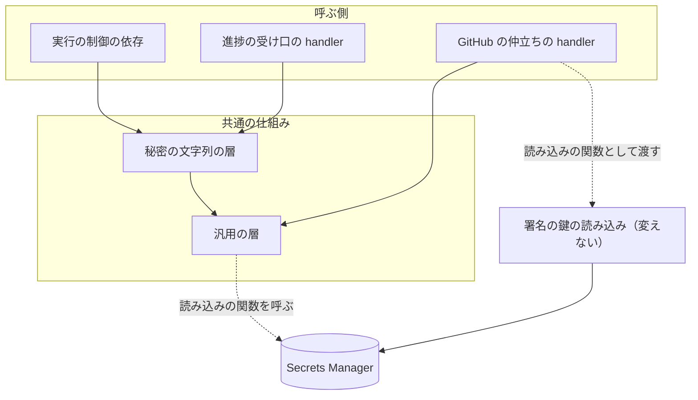
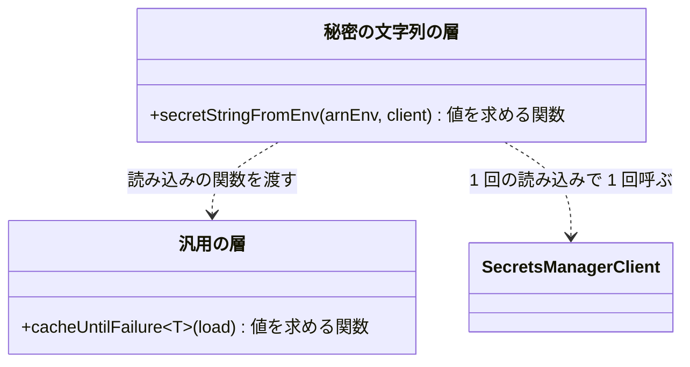
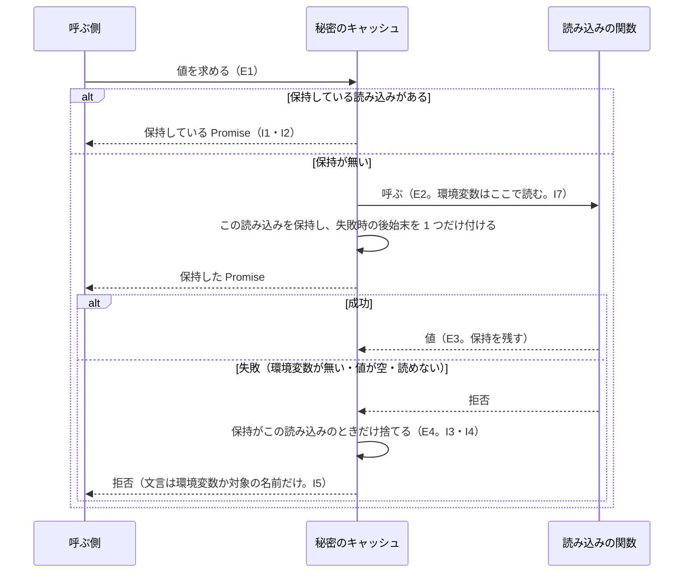
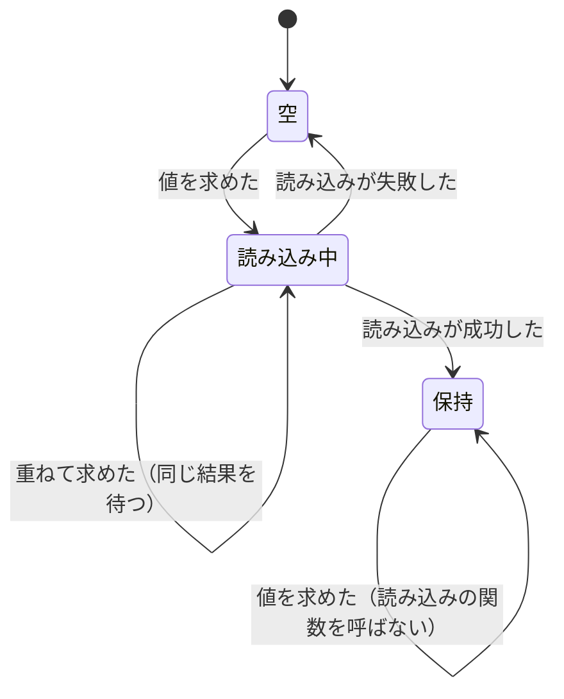

# factory/api: 秘密のキャッシュを 1 つの共通の仕組みにまとめる（#2276）

## 目的

- **今どうなっているか**: Secrets Manager の秘密を「1 回だけ読み、読めなければ次の要求で読み直す」処理が、3 か所に別々に書かれている。実行の制御の依存・進捗の受け口・GitHub の仲立ちである。読み直しの規則を変えるときは 3 か所を直す必要がある。実行の制御の依存のコピーには、古い失敗の後始末が新しい読み込みの保持を消しうる順序の穴がある（「決定 3」）
- **誰に効くか**: Factory の API（`factory/api`）を直す開発者と、秘密を読む Lambda を足す子課題（#2173 の通知・#2174 の決済）
- **変えると何が成り立つか**: 保持と読み直しの規則が 1 か所にだけあり、3 か所と今後の Lambda はそれを呼ぶだけで同じ規則が効く

## 適用範囲

- **働く範囲**: このリポジトリの `factory/api/src` だけ。NDF の配布物（`plugins/`）は参照しない
- **プロジェクトごとに違うもの**: 無し（Factory のサービスの内部の部品で、利用者のプロジェクトへ配らない）
- **当たるモード**: `standard`

## あるべき姿の根拠

| 根拠 | 種類 | 何を示すか |
| --- | --- | --- |
| LIB2（p-memoize の README） | 外部の一次情報 | 非同期の結果を保持する部品は「拒否された Promise を保持しない」「同時の呼び出しは 1 回の実行を共有する」の 2 つを規則として持つ。この設計の不変条件 I2・I3 と同じ形である |
| `factory/api/src/runs/deps.ts:26`・`src/handlers/ingest.ts:14`・`src/handlers/github-oidc.ts:20` | 実測（コードの読み取り、2026-11-05 の `design/issue-2276`） | 3 か所が同じ規則を別々の書き方で持つ。うち 2 か所は環境変数が無いときに拒否でなく同期の例外を投げる |

要求と受け入れ条件は #2276 の本文にある（コピーは [issues/issue-2276-requirements.md](issue-2276-requirements.md) ）。この文書は「どう作るか」だけを扱う。

## ドメインモデル

### コンテキスト

| コンテキスト | 何の語が 1 つの意味に決まるか |
| --- | --- |
| Neural Development Factory（`ndf-factory`） | 秘密のキャッシュ・GitHub の仲立ち・進捗の受け口・実行の制御 |

1 つのコンテキストの中の変更で、コンテキストマップの関係は宣言しない。

### 集約

| 集約 | 持ち主（書き換えてよいもの） | 根 | エンティティ | 値オブジェクト |
| --- | --- | --- | --- | --- |
| 秘密のキャッシュ | 共通の仕組み（秘密のキャッシュのモジュール）だけ。呼ぶ側は値を求めるだけで、保持を書き換えない | 保持している読み込み（読み込み中か、成功した読み込みの 1 つ。無いこともある） | — | 秘密の文字列・署名の鍵の組（どちらも読んだ後は変えない） |

1 つの秘密（または鍵の組）ごとに 1 つのキャッシュを作る。キャッシュどうしは互いを参照しない。

### 不変条件

| # | 集約 | 条件 | 破れたときの扱い |
| --- | --- | --- | --- |
| I1 | 秘密のキャッシュ | 読み込みが成功した後は、何回求めても読み込みの関数は 1 回だけ呼ばれ、同じ値が返る | テストで落とす（受け入れ条件 6） |
| I2 | 秘密のキャッシュ | 読み込み中に重ねて求めたとき、新しい読み込みを始めず、同じ結果を待つ | テストで落とす（受け入れ条件 7） |
| I3 | 秘密のキャッシュ | 失敗した読み込みは保持に残らず、次の要求で読み直す。環境変数が無い・値が空・読み込みの関数が同期で例外を投げる場合も同じ | テストで落とす（受け入れ条件 8） |
| I4 | 秘密のキャッシュ | 失敗した読み込みの後始末は、その読み込み自身が保持されているときだけ保持を捨てる。後から始まった読み込みの保持を消さない | テストで落とす（「決定 3」） |
| I5 | 秘密のキャッシュ | 失敗の例外の文言は、環境変数の名前か読む対象の名前だけを含み、秘密の値を含まない | テストで落とす（受け入れ条件 9） |
| I6 | 秘密のキャッシュ | 呼ぶ側が拒否を受け取って処理した後、共通の仕組みの内部に処理されない拒否を残さない | テストで落とす（受け入れ条件 10） |
| I7 | 秘密のキャッシュ | ARN の環境変数は、最初に秘密を求めた時点で読む。キャッシュを作る時点では読まない | テストで落とす（受け入れ条件 11） |

### ドメインイベント

| # | イベント | 発生元 | 受け手 |
| --- | --- | --- | --- |
| E1 | 秘密の読み込みを求めた | 呼ぶ側（実行の制御・進捗の受け口・GitHub の仲立ち） | 秘密のキャッシュ |
| E2 | Secrets Manager から秘密を読んだ | 秘密のキャッシュ（渡された読み込みの関数） | 秘密のキャッシュ |
| E3 | 読んだ値を保持し、以後の要求へ同じ値を返した | 秘密のキャッシュ | 呼ぶ側 |
| E4 | 失敗した読み込みの保持を捨てた | 秘密のキャッシュ | 秘密のキャッシュ（次の E1 で E5 へ進む）と、例外を受け取る呼ぶ側 |
| E5 | 次の要求で読み直した | 秘密のキャッシュ | Secrets Manager（渡された読み込みの関数） |

いずれも 1 つの Lambda の実行環境の中の関数呼び出しで、永続化も配信もしない。

### 用語

| 用語 | 意味 | 用語集への反映 |
| --- | --- | --- |
| 秘密のキャッシュ | Secrets Manager から読んだ値を Lambda の実行環境の中で保持する `factory/api/` の仕組み。成功した値は以後も同じ値を返し、失敗した読み込みは捨てて次の要求で読み直す | 追加（要求の変更で反映済み。この設計で意味を変えない） |

## 外部の調査

| 種類 | 調べるか | 理由 |
| --- | --- | --- |
| 標準・仕様 | 調べない | Lambda の実行環境の中の値の保持に、公開の仕様・規格は無い。Secrets Manager の呼び出しの形は既存のコードが使う AWS SDK の API のまま変えない |
| 主要な製品 | 調べる | AWS が Lambda で秘密を保持する手段として何を出しているかを比べる |
| ライブラリとサービス | 調べる | 自前で書く前に、保持と読み直しを持つ既存のライブラリと AWS の提供物を比べる |

### 主要な製品

| # | 製品 | どう解いているか | 設計への反映 | 出典 |
| --- | --- | --- | --- | --- |
| PRD1 | AWS Parameters and Secrets Lambda Extension | Lambda のレイヤーとして足す拡張が秘密を保持し、関数は SDK を使わずに実行環境の中のローカルの HTTP の経路から読む。保持の期間と時間切れは拡張の環境変数で設定する | 採らない。レイヤーの追加と環境変数の追加がインフラの定義の変更に当たり、要求の「含まない」（インフラの定義の変更）に入る（「決定 1」） | https://docs.aws.amazon.com/secretsmanager/latest/userguide/retrieving-secrets_lambda.html （2026-11-05、HTTP 200） |

### ライブラリとサービス

| # | 候補 | 版 | ライセンス | 最後のリリースの日付 | 終了のアナウンス | 要件を満たすか | 出典 |
| --- | --- | --- | --- | --- | --- | --- | --- |
| LIB1 | `@aws-lambda-powertools/parameters`（Secrets Manager の取得を含む） | 2.36.0 | MIT-0 | 2026-10-06 | 無し | 一部。保持は時間で切れる（既定 5 秒、`maxAge` で変える）。成功の後は 1 回だけ読む規則（受け入れ条件 6）にするには時間切れを止める指定が要り、失敗時に保持を捨てるか・同時の要求を 1 回にまとめるかは確かめられなかった | https://registry.npmjs.org/@aws-lambda-powertools/parameters ・ https://docs.aws.amazon.com/powertools/typescript/latest/features/parameters/ （2026-11-05） |
| LIB2 | `p-memoize` | 9.0.0 | MIT | 2026-10-15 | 無し | 満たす。拒否された Promise を保持せず、同時の呼び出しは 1 回の実行を共有する。ただし引数ごとに保持を分ける部品で、引数の無い 1 つの値には仕組みが余る。Node.js 22 以上を求める | https://registry.npmjs.org/p-memoize （2026-11-05） |
| LIB3 | `@aws-sdk/client-secrets-manager`（既存の依存） | `^3.1160.0`（`factory/api/package.json`） | Apache-2.0 | 確かめていない | 確かめていない | 秘密を読む呼び出しだけを持ち、保持はしない。読み込みの関数の中でそのまま使う | `factory/api/package.json` （2026-11-05） |

### 確かめられなかったこと

| 対象 | 試した手段 | 結果と理由 |
| --- | --- | --- |
| LIB1 が失敗した取得の保持を捨てるか・同時の取得を 1 回にまとめるか | https://docs.aws.amazon.com/powertools/typescript/latest/features/parameters/ の本文の検索（`maxAge`・`cache`） | 本文に該当の記述を見つけられなかった。ソースは読んでいない |
| LIB3 の最後のリリースの日付・ライセンス | 試していない | 既存の依存で、使い方を変えないため取得しなかった |

調べた量: 候補 4 件・取得の試み 7 回。

## 機能一覧

| # | 機能 | 誰が使うか |
| --- | --- | --- |
| F1 | 任意の読み込みの関数の結果を、成功したら保持し、失敗したら捨てて読み直す | 秘密や鍵を読む `factory/api` のコード（GitHub の仲立ちの署名の鍵の組・今後の Lambda） |
| F2 | ARN の環境変数の名前を受け、Secrets Manager の秘密の文字列を F1 の規則で読む | 実行の制御の依存・進捗の受け口・今後の Lambda |

## 構成要素

| 要素 | 責務 |
| --- | --- |
| 秘密のキャッシュの汎用の層（新設） | 読み込みの関数を受け、保持・同時の要求の共有・失敗時の破棄（I1〜I4・I6）を引き受ける。値の型を問わない |
| 秘密の文字列の層（新設） | ARN の環境変数の名前と Secrets Manager のクライアントを受け、最初の要求の時点で環境変数を読み、秘密の文字列を返す読み込みの関数を汎用の層へ渡す。環境変数が無い・値が空のときの例外の文言（I5・I7）を持つ |
| 実行の制御の依存（変える） | GitHub App のクライアントの秘密・秘密鍵・実行ジョブの token の発行の鍵の 3 件を、秘密の文字列の層から得る。自前の保持の関数を消す |
| 進捗の受け口の handler（変える） | GitHub App の Webhook の秘密を、依存を作る時点で秘密の文字列の層から得る。モジュールの変数と読み込みの関数を消す |
| GitHub の仲立ちの handler（変える） | 署名の鍵の組を、既存の鍵の読み込み（変えない）を汎用の層で包んで得る。モジュールの変数を消す |



### ファイルの置き場

配置は変わらない。3 つの呼ぶ側は今と同じ Lambda で動き、共通の仕組みは各 Lambda のバンドルへ一緒に入る。

```text
factory/api/src/
├── secret-cache.ts          # 新設: 汎用の層と秘密の文字列の層
├── secret-cache.test.ts     # 新設: 不変条件 I1〜I7 の単体テスト
├── runs/deps.ts             # 変える: 自前の保持の関数を消し、秘密の文字列の層を呼ぶ
└── handlers/
    ├── ingest.ts            # 変える: モジュールの変数と読み込みの関数を消す
    └── github-oidc.ts       # 変える: 署名の鍵の組の保持の変数を消す
```

## 構造



| 型・関数 | 形 | 責務 |
| --- | --- | --- |
| `cacheUntilFailure<T>(load: () => Promise<T>): () => Promise<T>` | 新設 | 返す関数を呼ぶたびに、保持している読み込みがあればそれを返し、無ければ `load` を呼んで保持する。`load` が同期で投げた例外も、返す Promise の拒否にする |
| `secretStringFromEnv(arnEnv: string, client?: SecretsManagerClient): () => Promise<string>` | 新設 | `cacheUntilFailure` に「`requireEnv(arnEnv)` で ARN を読み、`GetSecretValueCommand` を送り、`SecretString` が空なら `${arnEnv} の秘密が読めません` で投げる」読み込みの関数を渡す。`client` を省くと 1 つ作る |
| `secretOnce`（`runs/deps.ts`） | 削除 | `secretStringFromEnv` に置き換わる |
| `webhookSecretFromEnv` とモジュールの変数（`handlers/ingest.ts`） | 削除 | 依存の `webhookSecret` に `secretStringFromEnv("GITHUB_APP_WEBHOOK_SECRET_ARN")` を渡す |
| 署名の鍵の組のモジュールの変数（`handlers/github-oidc.ts`） | 削除 | 依存の `keys` に `cacheUntilFailure(() => loadSigningKeys(requireEnv("GITHUB_OIDC_SIGNING_KEY_SECRET_ARN")))` を渡す |

呼ぶ側の次の型は、どれも `() => Promise<…>` のままで変わらない。

- GitHub App の設定の `clientSecret`・`privateKeyPem`
- 進捗の受け口の依存の `webhookSecret`
- GitHub の仲立ちの依存の `keys`

## 処理の流れ



保持の状態は次の 3 つで、描いていない遷移は起こらない。



「保持」から「空」への遷移は無い。成功した値は Lambda の実行環境が終わるまで保持する（今の振る舞いのまま。秘密の更新への追随は要求の範囲外）。

## 非機能の実現方式

| 大項目 | 要求の条件 | 実現方式 | 確かめ方 |
| --- | --- | --- | --- |
| 性能・拡張性 | Lambda の 1 つの実行環境あたりの Secrets Manager の呼び出しの回数は、成功した後は秘密ごとに 1 回のまま変わらない（受け入れ条件 6・7） | 秘密ごとに 1 つのキャッシュを作り、成功した読み込みと読み込み中の Promise を保持して返す。時間で切れる保持にしない | 受け入れ条件 6・7 の単体テスト |
| 運用・保守性 | 秘密を読む Lambda を足すとき、共通の仕組みを呼ぶだけで同じ規則が効く（受け入れ条件 1・4） | 文字列の秘密は `secretStringFromEnv` の 1 行、文字列以外は `cacheUntilFailure` に読み込みの関数を渡す 1 行で済む形にする | 受け入れ条件 1〜3 の検索と差分の確認 |
| セキュリティ | 秘密の値をログ・例外の文言・応答に出さない（受け入れ条件 9）。認証と認可の振る舞いを変えない（前提 4） | 共通の仕組みはログを書かない。自分で作る例外の文言は環境変数の名前だけを入れる。署名の鍵の読み込みと Webhook の署名の検証のコードは変えない | 受け入れ条件 9 の単体テストと、既存のテスト（受け入れ条件 12） |

## 決定の記録

### 決定 1: 依存とインフラを増やさないため、秘密のキャッシュを `factory/api` の中の小さな関数として自前で作る

求める規則は「成功を保持する」「同時の要求を 1 回にまとめる」「失敗を捨てる」の 3 つで、関数 1 つの十数行で書ける。LIB2 は規則を満たすが、引数ごとに保持を分ける仕組みと依存の追加が、引数の無い 1 つの値には余る。

LIB1 は時間で切れる保持が既定で、成功の後 1 回だけ読む今の規則に合わせる指定が要り、失敗時の振る舞いを確かめられなかった。PRD1 はレイヤーの追加がインフラの定義の変更に当たり、要求の範囲外である。いずれも採らない。

- 作り方: 自前で作る
- 比べた候補: PRD1 / LIB1 / LIB2 / LIB3

根拠: Value 7 / スプリント Value 6（MVV 版 5・スプリント MVV 44cd096d）

### 決定 2: 呼ぶ側が値の型に応じて選べるよう、汎用の層と秘密の文字列の層の 2 つを 1 つのモジュールに置く

GitHub の仲立ちは文字列でなく鍵の組を保持するため、型を問わない汎用の層が要る。実行の制御の依存・進捗の受け口・今後の Lambda は ARN の環境変数から文字列を読むだけで、その形を毎回組まないよう秘密の文字列の層を足す。置き場は `factory/api/src/secret-cache.ts` とし、環境変数を読む `src/env.ts` と並べる。handler の配線だけを持つ `handlers/` の外に置く（#2199 の R02 の決定）。

2 つの層を別のファイルに分けることは採らない。秘密の文字列の層は汎用の層を呼ぶ数行で、分けると読み手が規則を追うファイルが増える。

根拠: Value 7（MVV 版 5）

### 決定 3: 後から始まった読み込みの保持を消さないため、失敗の後始末は自分の読み込みが保持されているときだけ保持を捨てる

実行の制御の依存の今のコピーは、呼ぶたびに失敗時の後始末を足し、後始末は無条件に保持を捨てる。読み込み中に 2 回求めた後でその読み込みが失敗すると、1 つ目の後始末の後に呼ぶ側が読み直しを始め、続いて 2 つ目の後始末がその新しい読み込みの保持を捨てる。読み直しの読み込みが 2 回始まり、同時の要求を 1 回にまとめる規則（I2）が読み直しの時点で崩れる。共通の仕組みでは、後始末を読み込みを始めたときに 1 つだけ付け、保持が同じ読み込みのときだけ捨てる（I4）。

この順序の穴はコードの読み取りから推したもので、実際に起きたかは確かめていない（「未確認のまま残ること」）。

根拠: Value 7（MVV 版 5）

### 決定 4: 環境変数が無いときも同じ規則で読み直すため、読み込みの関数が同期で投げた例外を拒否として返す

今の 3 か所は、ARN の環境変数が無いと `requireEnv` が同期で例外を投げ、Promise を返さない。呼ぶ側はどれも `await` の中で呼ぶため応答は変わらないが、規則の上では「失敗は拒否として返り、次の要求で読み直す」に 1 つの例外ができる。共通の仕組みは同期の例外も拒否にし、受け入れ条件 8 を 1 つの経路で満たす。

根拠: Value 7（MVV 版 5）

### 決定 5: コピーごとに違う文言をやめるため、秘密の文字列が空のときの例外の文言を `<環境変数の名前> の秘密が読めません` にそろえる

進捗の受け口の今の文言「Webhook の秘密が読めません」は `GITHUB_APP_WEBHOOK_SECRET_ARN の秘密が読めません` に変わる。受け口はこの例外を 503 のエラーに置き換え、文言を応答に出さない（`src/progress/app.ts:136`、要求の前提 3）。

文言を検査する既存のテストは無い。`grep -rn "秘密が読めません" factory/api/src` の結果は 2 件（`runs/deps.ts:30`・`handlers/ingest.ts:18`）である。どちらもこの変更で書き換える箇所で、テストのファイルには現れない。

根拠: Value 7（MVV 版 5）

### 決定 6: 認証の経路の変更を保持の置き場だけに留めるため、署名の鍵の読み込みは変えずに汎用の層で包む

署名の鍵の読み込み（`src/github-oidc/keys.ts` の `loadSigningKeys`）は、秘密の文字列を読んで鍵の組へ変える処理と、その文言「署名の鍵が読めません」を持つ。これを秘密の文字列の層へ書き換えると、要求の前提 4（鍵の中身・検証の規則を変えない）の外に出る範囲が増える。保持だけを汎用の層へ移す。

秘密の文字列が空かを確かめる 1 行は、署名の鍵の読み込みと実行ジョブの token の公開鍵の読み込み（要求の「含まない」）にも残る。どちらも保持を持たない 1 回の読み込みで、この課題の対象の「保持して読み直す処理」ではないため寄せない。

根拠: Value 7 / Value 3（MVV 版 5）

## テスト設計

| 受け入れ条件・不変条件 | どの振る舞いで縛るか | どう壊したら落ちるべきか |
| --- | --- | --- |
| 受け入れ条件 1 | 保持と読み直しの定義が `src/secret-cache.ts` にだけあり、3 か所がそれを呼ぶ | 3 か所のどれかに自前の保持を残すと、差分の確認と受け入れ条件 3 の検索で見つかる |
| 受け入れ条件 2 | `grep -n GetSecretValueCommand factory/api/src/handlers/*.ts` が 0 件 | 進捗の受け口に Secrets Manager の呼び出しを残すと 1 件以上になる |
| 受け入れ条件 3 | 2 つの handler に、秘密か鍵の読み込みの結果を保持するモジュールの変数が無い（差分を読む） | 保持の変数を残すと差分の確認で見つかる |
| 受け入れ条件 4・5 | 汎用の層は文字列でない値（オブジェクト）も同じ規則で保持する。GitHub の仲立ちの依存の `keys` は汎用の層を通る | 汎用の層を文字列だけの型にすると型検査で落ちる |
| 受け入れ条件 6・I1 | 成功の後に何回求めても、読み込みの関数の呼び出しは 1 回で、同じ値が返る | 求めるたびに読み込みの関数を呼ぶように壊すと落ちる |
| 受け入れ条件 7・I2 | 1 回目の読み込みが終わる前に 2 回目を求めても、読み込みの関数は 1 回で、両方が同じ結果を受け取る | 読み込み中の Promise を保持せず、成功した値だけを保持するように壊すと落ちる |
| 受け入れ条件 8・I3 | 失敗の要求には拒否が返り、次の要求で読み込みの関数がもう一度呼ばれ、成功すればその値が返る。環境変数が無いとき・`SecretString` が空のとき・読み込みの関数が同期で投げたときも同じ | 拒否した Promise を保持に残すと落ちる。同期の例外を拒否にしないと、呼び出しが Promise を返さずに落ちる |
| I4 | 読み込み中に 2 回求め、その読み込みが失敗した直後に読み直したとき、読み直しの読み込みは 1 回だけ呼ばれる | 後始末を呼ぶたびに足し、無条件に保持を捨てるように壊すと、読み込みの関数が余分に呼ばれて落ちる |
| 受け入れ条件 9・I5 | 環境変数が無いとき・値が空のときの例外の文言は環境変数の名前を含み、秘密の値を含まない | 文言に読んだ値を入れるように壊すと落ちる |
| 受け入れ条件 10・I6 | 呼ぶ側が拒否を受け取った後、`unhandledRejection` が起きない | 後始末を付けずに保持だけ捨てる形、または後始末の Promise に拒否を残す形に壊すと落ちる |
| 受け入れ条件 11・I7 | 秘密の文字列の層を作った後に環境変数を設定しても、最初の要求でその値を読む | 作る時点で環境変数を読むように壊すと落ちる |
| 受け入れ条件 12 | `cd factory && npm ci && npm run check -w api` が終了コード 0 | 呼ぶ側の型を変えると型検査で、既存の振る舞いを変えると既存のテストで落ちる |

## 設計の結果

| 課題 | 扱い | 取り込み先 | 触るファイル |
| --- | --- | --- | --- |
| #2276 | 実装する | — | `factory/api/src/secret-cache.ts`、`factory/api/src/secret-cache.test.ts`、`factory/api/src/runs/deps.ts`、`factory/api/src/handlers/ingest.ts`、`factory/api/src/handlers/github-oidc.ts` |

## 未確認のまま残ること

| 項目 | 内容 |
| --- | --- |
| 「決定 3」の順序の穴が実際に起きたか | コードの読み取りから推した。実装の I4 のテストで、今のコピーの形では読み込みの関数が余分に呼ばれることを先に確かめる（`tdd-cycle`） |
| AWS 上の Lambda で秘密を読めるか | 単体テストは読み込みの関数を差し替える。実際の Secrets Manager からの読み込みは、Factory の配布の後の確認で見る（要求の「検証手段」） |
| LIB1 の失敗時の振る舞い | 確かめていない。採らない理由は時間切れの既定とインフラ以外の点（依存の追加）でも成り立つ |
