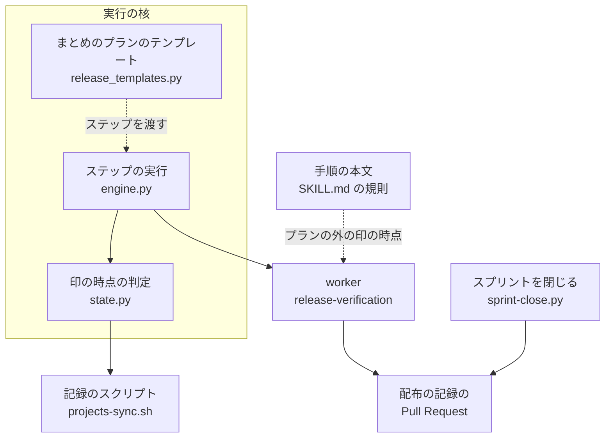
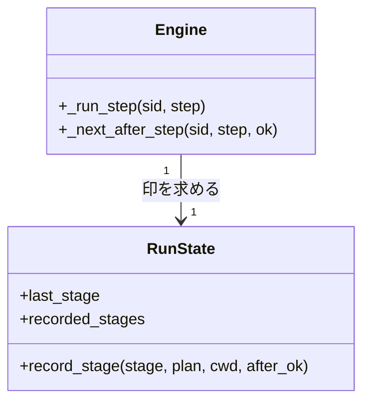
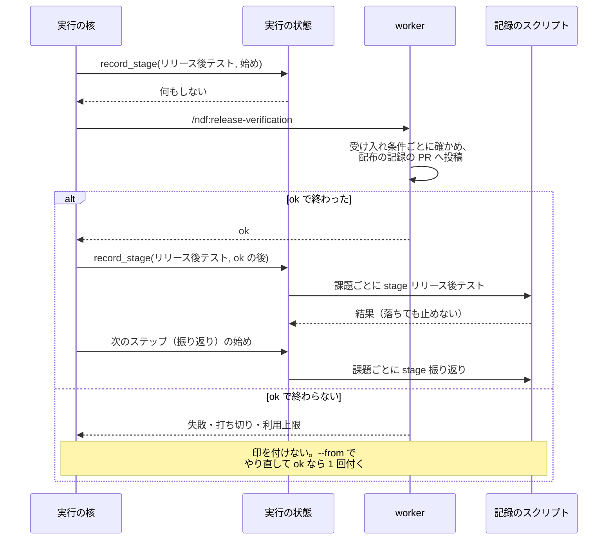

# プランの実行の核: 「リリース後テスト」の進行の印を、記録を投稿したステップが ok で終わった後に付ける（#2288）

## 目的

この文書に出るプランは 2 種類ある。

| プラン | 何をするか |
| --- | --- |
| まとめのプラン（`supervise.py new close`） | スプリントの仕上げで、`merge →（配布の記録があれば）release-verify → retro → close → refine` を順に流す。`release-verify` のステップ（stage「リリース後テスト」）で worker が `/ndf:release-verification` を通す |
| 本番の配布のプラン（`release-prod`） | 本番へ配布し、`verify` のステップで版の導入だけを確かめる（stage は「配布」。受け入れ条件 1・2 で済み） |

- **今どうなっているか**: 課題の本文の「進行」の「リリース後テスト」の印は、まとめのプランの `release-verify` のステップを始めた時点で付く。受け入れ条件ごとの記録（配布の記録の Pull Request への `## リリース後テスト`）は、そのステップの終わり近くで投稿される。スプリント m26-3（マイルストーン 26 の 3 番目のスプリント。ndf v10.27.6 を https://github.com/devbasex/ai-plugins/pull/2351 で配布）では印が 07:59、記録はその後だった（#2288 の本文の「リリース後テストの取り直し」）。ステップが落ちても印は残る
- **誰に効くか**: 課題の進行の印を見て「確かめ終わったか」を判断する人（conductor と利用者）。m26-1 では conductor が印を見て済んだと扱った（要求の「何を見つけたか」）。スプリントを閉じる工程（`sprint-close.py`）は印でなく記録を読むため、振る舞いは変わらない（E5）
- **変えると何が成り立つか**: 「リリース後テスト」の印は、記録を投稿するステップが ok で終わった後にだけ付く。ステップが ok で終わらなければ印は付かず、やり直して ok で終われば 1 回だけ付く。worker が記録を投稿し終えてから ok を返す限り、印が付いていれば配布の記録の Pull Request に記録がある
- **約束が及ばない経路**: worker が投稿せずに ok を返す経路が 2 つある（「未確認のまま残ること」の 2・3）。この変更は ok の意味を変えないため、その 2 つでは記録が無いまま印が付きうる。どちらでもスプリントを閉じる工程は記録を読んで課題を残す（受け入れ条件 3）ため、確かめていない課題は閉じない。経路を塞ぐのは、ok を返す条件をそろえる #2337（結果の契約をそろえ、失敗・未収束・判定できないを ok で返す経路を無くす）と、番号が 0 のときにステップを置く条件を直す #2408 である（受け入れ条件の外）

## 適用範囲

- **働く範囲**: NDF を使うすべてのリポジトリ。プランの実行の核（`plugins/ndf/scripts/supervise_lib/`）と、`release-verification` の手順の本文で働く
- **プロジェクトごとに違うもの**: 無し。印を後へ回す工程の名前は工程表の行名で、プロジェクトごとに変わらない
- **当たるモード**: `standard`（リリース後テストを通るすべてのモードに効く）

## あるべき姿の根拠

| 根拠 | 種類 | 何を示すか |
| --- | --- | --- |
| #2288 の受け入れ条件 5〜7 と、要求の前提 2「受け入れ条件 5 の文言は変えず、印を付ける時点を直して満たす」 | 利用者の指示（承認ゲート 1、つまり設計 Pull Request のマージで確かめる要求） | 印の時点をステップの ok の後へ移す |
| https://github.com/devbasex/ai-plugins/pull/2328#issuecomment-6551490972 （2026-11-01 の取り直し。印 07:59、記録はステップの中で後から投稿） | 実測 | 今の印は記録より先に付く |
| `plugins/ndf/scripts/supervise_lib/engine.py` の `_run_step` が、ステップを流す前に `state.py` の `record_stage` を呼ぶ | 一次情報（コード） | 印を付けるのは実行の核の 1 か所である |
| `plugins/ndf/skills/release-verification/SKILL.md` の「モードごとの要否」の最後の段落「この工程に入ったら進捗記録 … を 1 行打つ」 | 一次情報（手順の本文） | プランの外でも、印は工程の始めに付く |

要求と受け入れ条件は #2288 の本文にある（コピーは `issues/issue-2288-requirements.md`）。この文書は「どう作るか」だけを扱う。

## ドメインモデル

### コンテキスト

| コンテキスト | 何の語が 1 つの意味に決まるか |
| --- | --- |
| 開発の工程（`ndf-workflow`） | 工程・進捗記録・通過工程・リリース後テスト・ステップ |

1 つのコンテキストに収まる。

### 集約

| 集約 | 持ち主（書き換えてよいもの） | 根 | エンティティ | 値オブジェクト |
| --- | --- | --- | --- | --- |
| プランの実行の状態 | プランの実行の核（`supervise_lib/state.py` の `RunState`） | 実行の状態 | 今のステップの記録 | 最後に記録した工程・記録した工程の一覧 |
| 課題の進行 | 記録のスクリプト（`projects-sync.sh`・`progress-record.sh`） | 課題の本文の「進行」の節 | 工程の行 | 印と時刻 |

印を付ける時点はプランの実行の状態が決め、印の書き込みは記録のスクリプトが行う。プランの実行の状態は課題の進行を
書き換えず、記録のスクリプトを呼ぶだけである（ほかの集約は課題の番号で参照する）。この変更は書式を変えないため、
課題の進行の集約は変えない。

### 不変条件

| # | 集約 | 条件 | 破れたときの扱い |
| --- | --- | --- | --- |
| I1 | プランの実行の状態 | stage が「リリース後テスト」のステップでは、印はステップが ok で終わった後にだけ付き、始めた時点では付かない | 起こさない（実装で防ぐ）。テストで縛る |
| I2 | プランの実行の状態 | ステップが ok で終わらなければ（失敗・承認ゲートで止まる・遅れでの打ち切り・利用上限・認証の欠け）、「リリース後テスト」の印は付かない | 起こさない。テストで縛る |
| I3 | プランの実行の状態 | 1 回の実行（`--from` の再開を含む）で、同じ工程の印は 1 回だけ付く | 起こさない。既存の振る舞い（#1485「スプリントの雛形が単発の工程にある手順を落としてプランを組む」の受け入れ条件 4 で入った、同じ工程を 2 度記録しない規則）をそのまま使う |
| I4 | プランの実行の状態 | 「リリース後テスト」以外の工程の印は、今と同じくステップを始めた時点で付く | 起こさない。既存のテストで縛る |
| I5 | プランの実行の状態 | 印の書き込みが落ちても、プランを止めない（結果 JSON の `process`、つまり進行の記録で書けなかったものの一覧に残して先へ進む） | 既存の振る舞い（#2227「全工程の結果を統一した JSON レポートにする」）をそのまま使う |

### ドメインイベント

| # | イベント | 発生元 | 受け手 |
| --- | --- | --- | --- |
| E1 | 本番の配布のプランが、版の導入だけを確かめた（`verify` のステップ、stage は「配布」） | 本番のプラン | 仕上げのフェーズのキュー（受け入れ条件 1・2 で済み。変えない） |
| E2 | まとめのプランが、stage「リリース後テスト」のステップを始めた | プランの実行の核 | worker（`/ndf:release-verification`）。**この時点では記録のスクリプトを呼ばない** |
| E3 | worker が受け入れ条件ごとに確かめ、配布の記録の Pull Request へ `## リリース後テスト` を投稿した | worker | プランの実行の核（ステップの結果として受ける） |
| E4 | 課題の本文の進行の「リリース後テスト」に印が付いた | プランの実行の核が E3 の後のステップの ok を受けて記録のスクリプトを呼ぶ | 課題を読む人・通過記録 |
| E5 | スプリントを閉じる工程が、記録を読んで課題を閉じるか残した | まとめのプランの close のステップ（E3 の記録だけを読み、E4 の印の有無に依らない。変えない） | conductor（閉じた・残した結果を受ける。印を読む E4 の受け手とは別の読み方） |

### 用語

| 用語 | 意味 | 用語集への反映 |
| --- | --- | --- |
| 進捗記録 | 工程に入った時点で 1 回打つ記録。リリース後テストだけは、受け入れ条件ごとの記録を投稿してその工程を終えた時点で打つ。課題の本文の「進行」も同じ 1 回で更新される | 意味の変更（`ndf-workflow`。`docs/glossary/glossary.json` へ反映済み） |

要求の「用語」の表と用語集は、同じ表記の語で別の対象を指す。この文書ではその語を使わず、
「版の導入だけを確かめるステップ（`verify`）」と書く。

| 置き場 | その語が指す対象 |
| --- | --- |
| 要求の「用語」の表 | `release-verification-steps.py verify-install` が版の導入を確かめること |
| 用語集 | `.ndf/pace.json` の `verify` のコマンドを走らせること |

## 機能一覧

| # | 機能 | 誰が使うか |
| --- | --- | --- |
| F1 | まとめのプランで、stage「リリース後テスト」のステップが ok で終わった後に、課題ごとに「リリース後テスト」の印を付ける | プランの実行の核（読み手は課題を見る人） |
| F2 | stage「リリース後テスト」のステップが ok で終わらないときは印を付けず、やり直して ok で終わったときに 1 回だけ付ける | プランの実行の核 |
| F3 | プランの外で `release-verification` を通すときも、記録を投稿した後に印を付ける | `/ndf:release-verification` を呼ぶ supervisor と利用者 |

## 構成要素

| 要素 | 責務 | 変更 |
| --- | --- | --- |
| `supervise_lib/state.py` の `RunState.record_stage` | 工程が変わったら課題ごとに印を付ける。**印をステップの ok の後へ回す工程の集合（定数。要素は「リリース後テスト」の 1 つ）を持ち、呼ばれた時点（始め / ok の後）と工程から、今付けるかを決める** | 変える |
| `supervise_lib/engine.py` の `Engine._run_step` と `Engine._next_after_step` | ステップの始めに印を求める（今と同じ）。**ok の分岐（`if ok:`）でも、同じステップの工程の印を求める** | 変える |
| `supervise_lib/release_templates.py` の `release_verify_step` | まとめのプランの `release-verify` の worker への指示。**「進捗記録は打たない（プランが ok の後に打つ）」を指示へ足す** | 変える |
| `skills/release-verification/SKILL.md` の「モードごとの要否」 | 印の時点。**「工程に入ったら打つ」を「プランの外で通すときは記録を投稿した後に打つ。プランのステップとして起動され、起動指示が打たないと言うときは打たない」へ変える**（決定 5） | 変える |
| `skills/progress-tracking/SKILL.md` の「呼び方」の表の `stage` の行・`references/excerpt.md`・`skills/development-workflow/references/agent-layers.md` の supervisor の規則 3・`skills/development-workflow/references/glossary.md` の「進捗記録」の行 | 「工程に入った時点で打つ」という規則の本文。**リリース後テストだけが記録の投稿の後に打つ、という例外を書き足す** | 変える |
| `supervise_lib/release_templates.py` の `_release_verify_steps` | 本番の `verify` を stage「配布」で記録する（受け入れ条件 1・2） | 変えない |
| `sprint-close.py` | 記録を読んで課題を閉じる（受け入れ条件 3） | 変えない |
| `projects-sync.sh`・`progress-record.sh` | 印の書き込み | 変えない |

## 構造

型は増やさない。`RunState.record_stage` に、呼ばれた時点を表す引数を 1 つ足す。

| 呼ぶ時点 | `after_ok` | 工程が「リリース後テスト」 | 工程がそれ以外 |
| --- | --- | --- | --- |
| ステップの始め（`_run_step`） | 偽 | 何もしない（最後に記録した工程も変えない） | 今と同じく印を付ける |
| ok の分岐（`_next_after_step` の `if ok:`） | 真 | 今と同じ規則（同じ工程を 2 度記録しない）で印を付ける | 何もしない |

ok の分岐は、承認ゲート（終了コード 10〜19）・承認ゲートとして数えない終わり・`on_exit`（プランの JSON で終了コードごとの行き先を決める欄）・スキップの分岐より後にある。
これらの分岐では印を求めない。失敗（`on_fail`、つまり失敗したときの行き先の欄へ回る・止まる）・遅れでの打ち切り・利用上限・認証の欠けは
ok の分岐を通らない。

## 処理の流れ

図に含めない要素: まとめのプランのテンプレート（`release_templates.py`。ステップの指示を作るだけで、流れの中では動かない）・手順の本文（`SKILL.md` の規則。プランの外の経路）・スプリントを閉じる工程（`sprint-close.py`。変えない）。

`--from` での再開は、記録した工程の一覧を耐久ステップ（出力を SQLite へ記録する単位。記録があれば再開で流し直さない）の出力から組み直す（`RunState.replay`）。ok で終わらなかった
ステップの工程は一覧に入っていないため、やり直して ok で終わったときに 1 回だけ印が付く（I3）。

## 決定の記録

### 決定 1: 記録より先に印が付かないよう、印を後へ回す工程を実行の核の定数で持つ

印を付けるのは実行の核の 1 か所（`record_stage`）であり、そこで工程の名前から時点を決めれば、どのプランの
どのステップでも同じ規則になる。工程の名前は工程表の行名で、プロジェクトごとに変わらない。

プランの JSON のステップに印の時点の欄を足す形は採らない。要求の「影響」が公開インタフェース（プランの JSON の形）を
変えないと定めており、テンプレートの外で組んだプランが欄を付け忘れると印が先に付く。

定数の要素は工程表（`development-workflow` の `workflow-common.sh` の `WF_STAGE_MATRIX`）の行名と同じ文字列でなければ働かない。
一致はテストで縛る（テスト設計の「決定 1」の行）。

根拠: Value 6「根本原因の場所で直す」・Value 5「どのプロジェクトでも使える形を保つ」（`.ndf/mvv.md` の MVV 版 4。以下同じ）

### 決定 2: 印の書き手を 1 つにするため、プランの中の worker には進捗記録を打たせない

まとめのプランの `release-verify` で worker が手順の本文に従って印を付けると、ステップが ok で終わる前に印が付く。
そのため I1・I2 が破れる。worker への指示に「進捗記録は打たない（プランが ok の後に打つ）」を足し、プランの中の書き手を
実行の核だけにする。

worker の指示を変えずに実行の核と worker の両方で打つ形は採らない。worker が記録を投稿した後にステップが落ちると、
印だけが残る。

根拠: Value 4「決まった手順はスクリプトに、判断と中身は AI に」・Value 6「根本原因の場所で直す」

### 決定 3: プランの外でも印と記録が食い違わないよう、手順の本文の印の時点を「記録を投稿した後」へ変える

supervisor や利用者が `/ndf:release-verification` を直接通すときは、実行の核を通らない。手順の本文が「工程に入ったら
打つ」と定めたままだと、プランの外では印が記録より先に付く。進捗記録の規則にも、リリース後テストだけの例外として
同じ時点を書く。規則の置き場は `progress-tracking` の本文・抜粋・supervisor の規則・用語集である。
プランの中で起動されたときの扱いは決定 5 が決める。

根拠: Value 6「根本原因の場所で直す」・Value 8「語は 1 語 1 意味」

### 決定 4: 要求の未決 1（ほかの工程にも広げるか）は広げず、印を後へ回す工程は「リリース後テスト」の 1 つに限る

ほかの工程（振り返りなど）の印は「工程に入った」ことを表す。途中で止まった実行の現在地を残すため、始めに付けている
（`progress-tracking` の「呼び方」）。「リリース後テスト」の印だけが、スプリントを閉じる判断の前に「確かめ終わった」と
読まれる。広げるかは、#2338（1 回の実行を識別子 1 つで追える記録とログにそろえる）の設計で決める。広げるときは決定 1 の定数へ
工程を足すだけで済む。

根拠: Value 1「まず届ける」・Value 10「費用 > 速さ > 品質の順で決める」

### 決定 5: worker への起動指示と手順の本文が食い違ったら、起動指示を優先する

決定 2 はプランの中の worker に「打たない」と指示し、決定 3 は手順の本文を「記録を投稿した後に打つ」へ変える。
プランの中の worker は両方を読むため、どちらに従うかを決めておく。

- **優先**: ステップの起動指示（`release_verify_step` が組む指示）が手順の本文に優先する。worker は起動指示の手順に従い、
  手順の本文はその不足を補うだけである（`agents/worker.md` の「手順は起動指示の「手順」に従う」と同じ向き）
- **本文にも書く**: 手順の本文の印の規則は「プランの外で通すときは記録を投稿した後に打つ。プランのステップとして起動され、
  起動指示が打たないと言うときは打たない」と書く。本文だけを読んでも、プランの中で打たない場合があると分かる

本文だけを「打たない」に変える形は採らない。プランの外では実行の核が印を付けないため、印が付かなくなる。

根拠: Value 4「決まった手順はスクリプトに、判断と中身は AI に」・Value 8「語は 1 語 1 意味」

## テスト設計

| 受け入れ条件・不変条件 | どの振る舞いで縛るか | どう壊したら落ちるべきか |
| --- | --- | --- |
| 受け入れ条件 1・2 | テンプレートが組む本番と開発版のプランで、`verify` の stage が「配布」である（既存のテスト） | `_release_verify_steps` の stage を「リリース後テスト」に変えると落ちる |
| 受け入れ条件 3 | 記録の無い配布の記録の Pull Request で `sprint-close.py --with-verification --dry-run` が課題を `kept_open` にする（既存のテスト） | 記録が無いのに閉じると落ちる |
| 受け入れ条件 4 | 退行の確認だけ。まとめのプランの `release-verify` の指示が、手動確認の項目を行として載せることを求めている（既存のテスト） | 指示から手動確認の行の要求を消すと落ちる |
| 受け入れ条件 5 | マージ前は受け入れ条件 6・7 のテストで代える。リリース後に、課題の進行の時刻と記録のコメントの時刻を比べる | — （リリース後テストで確かめる） |
| 受け入れ条件 6・I1 | 記録のスクリプトを差し替えたプランで、stage「リリース後テスト」のステップの中身が動いた後に、その工程の印が付く（呼ばれた順を見る） | ステップの始めに印を付けると落ちる |
| 受け入れ条件 7・I2 | 同じステップが失敗・承認ゲート・遅れでの打ち切り・利用上限で終わると、「リリース後テスト」の印が付かない | ok で終わらなかったときにも印を付けると落ちる |
| 受け入れ条件 7・I3 | 落ちた後に `--from` で同じステップをやり直して ok で終わると、印が 1 回だけ付く | 記録した工程の一覧を組み直さずに 2 度付けると落ちる。やり直しでも付かないと落ちる |
| 受け入れ条件 8・I4 | 「リリース後テスト」以外の工程の印は、そのステップの中身が動く前に付く（既存のテストに、呼ばれた順の確認を足す） | すべての工程を ok の後へ回すと落ちる |
| I5 | 記録のスクリプトが落ちても、ok の後の印でもプランを止めず `process` に残す | ok の後の印の失敗でプランが止まると落ちる |
| 決定 1 | 印を後へ回す工程の定数の各要素が、工程表の工程名として `workflow-common.sh` の `wf_is_stage` を通り、まとめのプランの `release-verify` のステップの stage（`release_verify_step` が組む値）と一致する | 定数か工程表の行名かテンプレートの stage のどれか 1 つだけを改名すると落ちる |
| 決定 2・決定 5 | まとめのプランの `release-verify` の指示に、進捗記録を打たないことが含まれる（テンプレートの出力の検査） | 指示から外すと落ちる |

決定 3・決定 5 の手順の本文の変更は `.md` の文言なので、照合するテストを書かない（`AGENTS.md` の DON'T）。参照切れは既存の
検査が見る。

## 設計の結果

| 課題 | 扱い | 取り込み先 | 触るファイル |
| --- | --- | --- | --- |
| #2288 | 実装する | — | `plugins/ndf/scripts/supervise_lib/state.py`、`plugins/ndf/scripts/supervise_lib/engine.py`、`plugins/ndf/scripts/supervise_lib/release_templates.py`、`plugins/ndf/scripts/tests/`、`plugins/ndf/skills/release-verification/SKILL.md`、`plugins/ndf/skills/progress-tracking/`、`plugins/ndf/skills/development-workflow/references/agent-layers.md`、`plugins/ndf/skills/development-workflow/references/glossary.md` |

#2356（進行の「リリース後テスト」の印が、記録を投稿するステップの開始で付き、記録より先になる）は受け入れ条件 6・7 と同じ振る舞いを指す（要求の前提 3「同じ変更で両方を満たす」）。この表に載せるかは、要求の未決 2（#2356 を同じ Pull Request で閉じるか、この課題へまとめて閉じるか）のとおり棚卸しが決める。

## 未確認のまま残ること

| 項目 | 内容 |
| --- | --- |
| 1. ok の後に印を付けた直後にプロセスが落ちたとき | 耐久ステップの出力が書かれる前に落ちると、`--from` の再開がステップを流し直し、印をもう一度打つ。同じ工程の 2 度目の記録は課題の本文で同じ結果になる（`test_progress_record_stages.py` の `test_a_stage_recorded_twice_reports_the_same`）が、時刻が後ろへずれる。今の始めの印にも同じ性質がある |
| 2. worker が投稿せずに ok で終わったとき | ステップの ok は worker の報告で決まる。投稿に失敗したことを worker が ok で返すと印が付く（「目的」の約束が及ばない経路）。そのときもスプリントを閉じる工程は記録を読んで課題を残す（受け入れ条件 3）。失敗を ok で返す経路を無くすのは #2337 の範囲 |
| 3. 配布の記録の番号が実行の時点で 0 になるとき | 参照 `{queue_pr:release-prod}` は、本番のプランが Pull Request を持たずに完了すると実行の時点で `0` に置き換わる（`queue_fill.py` の `_fill_prs`）。`release-verify` の指示は「番号が 0 なら何もせずに終える」と定めるため、ステップは ok で終わり、記録が無いまま印が付く。ステップを置く条件の問題であり（「目的」の約束が及ばない経路）、この変更の範囲の外として #2408（まとめのプランの release-verify が、配布の記録の番号が 0 になっても流れて ok で終わる）に起票した。実際のスプリントでこの経路を通った記録は未確認 |
| 4. 受け入れ条件 5 | リリース後に、この変更を含む版の後の最初のスプリントで、課題の進行の時刻と記録のコメントの時刻を比べて確かめる |
