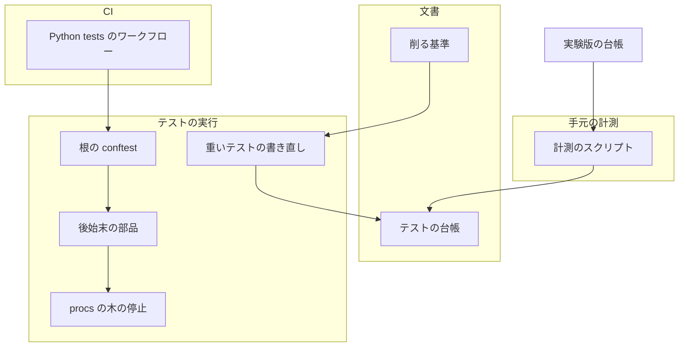
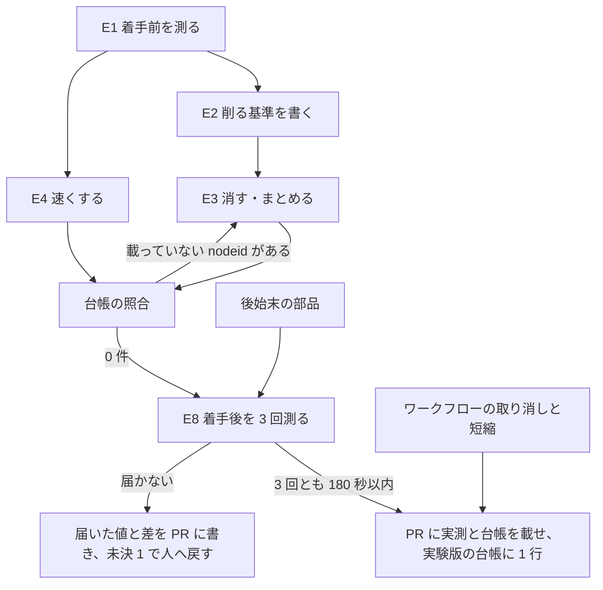
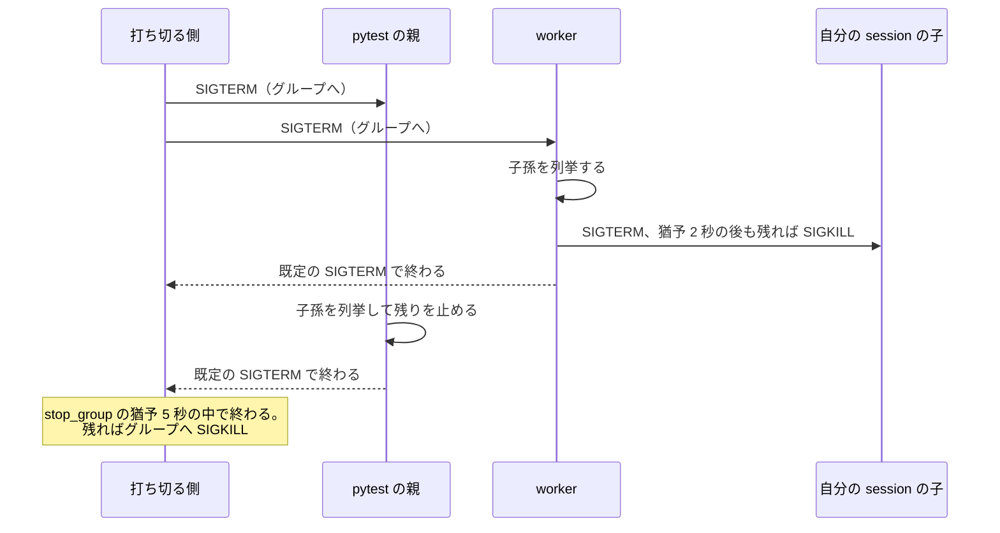
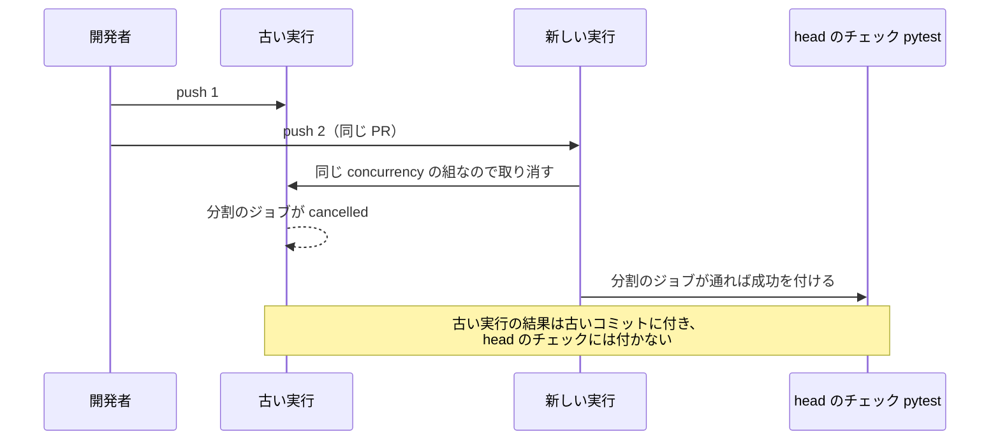

# 全体テスト: 手元と PR の CI の両方で 3 分以内に終わり、打ち切ってもプロセスを残さない（#2291）

## 目的

- **何が壊れているか**: 手元の全体テストが約 9 分、PR の `Python tests` が 10 分を超える。上限で打ち切ると、テストが自分の session で起こした子が残る
- **誰が困るか**: テストを使う工程（cross-refactoring の着手前のテスト・最終ゲート・完了判定）を回す conductor と、PR の CI を待つ開発者
- **直すと何が成り立つか**: 全体テストが 180 秒以内に終わり、工程の時間の枠を本来の作業に回せる。打ち切っても worktree を書き換え続けるプロセスが残らない

## 適用範囲

- **働く範囲**: このリポジトリ（ai-plugins）のテストと CI だけ。配布する NDF の振る舞い（`test-run.py` の結果 JSON・終了コード・打ち切りの手順）は変えない
- **プロジェクトごとに違うもの**: 無し（このリポジトリのテストと `.github/workflows/pytest.yml` だけを変える）
- **当たるモード**: `standard`

## あるべき姿の根拠

| 根拠 | 種類 | 何を示すか |
| --- | --- | --- |
| 「手元の全体テストを 3 分以内にする」「あまり意味のないテストは徹底的に削る」「PR の pytest の所要時間を 3 分以内にする」 | 利用者の指示の原文 | 目標の秒と、削ることを先に置く方針 |
| 2026-10-30 の手元の全体テスト: 10,483 件・各テストの所要の合計 2,003 秒。0.3 秒以上のテスト 1,366 件で 1,646 秒（82%）、0.3 秒未満の 9,117 件で 357 秒 | 実測（`reports/20261030-150005/report.md` を集計） | 時間は少数の重いテストに集まり、軽いテストを消しても 3 分に届かない |
| 2026-10-31 の pytest 以外の suite: script-structure 29.6 秒・lint 11.0 秒・factory の `npm ci` 15.7 秒と `check` 17.1 秒（load average 15.8。参考値） | 実測（この設計を書くときに測った） | pytest に回せる秒の見当 |
| `supervise.py --help` の起動 0.43 秒・`relay.py --help` 0.24 秒・素の python 0.015 秒（load average 約 17） | 実測（同上） | 子のプロセスでスクリプトを起こすテスト 1 件ごとに、起動だけで 0.2〜0.4 秒かかる |

要求と受け入れ条件は #2291 の本文にある（コピーは `issues/issue-2291-requirements.md`）。この文書は「どう作るか」だけを扱う。

## ドメインモデル

### コンテキスト

| コンテキスト | 何の語が 1 つの意味に決まるか |
| --- | --- |
| NDF の開発ワークフロー（`ndf-workflow`） | 全体テスト・範囲テスト・全体テストの実測。この変更はこのリポジトリの全体テストの中身と CI だけを変え、語の意味は変えない |

### 集約

| 集約 | 持ち主（書き換えてよいもの） | 根 | エンティティ | 値オブジェクト |
| --- | --- | --- | --- | --- |
| 全体テストの実測の記録 | 計測のスクリプト（実験版） | 1 回の計測 | suite ごとの実行 | 開始時の load average・suite ごとの秒・壁時計・件数・各テストの所要の合計・遅いテストの表 |
| テストの台帳 | 実装の担当（`issues/issue-2291-test-ledger.md`） | 着手前に既定の実行で走っていたテストの集合 | テスト 1 件（nodeid） | 処置（消した・まとめた・速くした・そのまま）・当たった基準・守るテスト・着手前後の秒 |
| テストのプロセスの木 | 根の conftest が読み込む後始末の部品 | pytest のプロセス（親・xdist の worker） | テストが起こした子孫のプロセス | 止める契機（SIGTERM・終了） |
| PR の CI の実行 | `.github/workflows/pytest.yml` | 1 つの PR の `Python tests` の実行 | 分割のジョブ・集約のジョブ `pytest` | 取り消しの単位（PR の番号） |

### 不変条件

| # | 集約 | 条件 | 破れたときの扱い |
| --- | --- | --- | --- |
| I1 | テストの台帳 | 着手前に既定の実行で走っていたテストは、着手後も走るか、台帳に当たった基準と守るテスト（または守らなくてよい理由）つきで載る | 台帳の照合が終了コード 1 で落ち、載っていない nodeid を出す |
| I2 | テストの台帳 | 着手前に既定の実行で走っていたテストが、着手後に skip・deselect に変わらない | 台帳の照合が終了コード 1 で落ち、変わった nodeid を出す |
| I3 | 全体テストの実測の記録 | 受け入れ条件 1 の判定に使う計測は、開始時の 1 分の load average が CPU の数以下である | その計測を「参考」として残し、判定に数えない |
| I4 | テストのプロセスの木 | pytest のどのプロセスが SIGTERM で止められても、テストが起こした子孫は 10 秒以内に 0 件になる。自分の session を作った子と、親が先に終わった孫も数える | 後始末の部品のテストが落ちる |
| I5 | PR の CI の実行 | 同じ PR の `Python tests` は、新しい push の後に古い実行が進み続けない | 取り消しの確かめ（受け入れ条件 9）が落ちる |
| I6 | PR の CI の実行 | 集約のジョブの名前 `pytest` と、分割のジョブの失敗・取り消しを失敗として返す判定は変わらない | `required-checks-check` か受け入れ条件 9 の確かめが落ちる |
| I7 | テストの台帳 | テストの対象のコード（プラグインの振る舞い）を変えない。変えてよいのはテスト・テストの道具・根の conftest・CI・文書・実験版だけである | 差分のパスの確かめが落ちる。必要になったら止めて人へ戻す |

### ドメインイベント

| # | イベント | 発生元 | 受け手 |
| --- | --- | --- | --- |
| E1 | 着手前の遅いテストの表と件数・合計時間を測った | 計測のスクリプト | テストの台帳（着手前の集合）・E2・E4 |
| E2 | 削る基準を文書にした | 実装の担当（`docs/plugin-development-guide.md`） | E3・テストを後から書く開発者 |
| E3 | 基準に当たるテストを消した・まとめた | 実装の担当 | テストの台帳 |
| E4 | 遅いテストを速くした | 実装の担当 | テストの台帳 |
| E5 | 全体テストを上限で打ち切った | `test-run.py whole --limit`・cross-refactoring の着手前のテスト | テストのプロセスの木（SIGTERM） |
| E6 | 打ち切った全体テストのプロセスがすべて止まった | 後始末の部品 | 打ち切った側（`stop_group` の猶予の中で終わる） |
| E7 | CI の pytest が新しい push で走り直し、同じ PR の古い実行が止まった | GitHub Actions の concurrency | 必須のチェック `pytest`（新しい実行の結果だけが head に付く） |
| E8 | 着手後の全体テストを 3 回測った | 計測のスクリプト | 実装の PR（受け入れ条件 1・2）・テストの台帳の照合 |

### 用語

| 用語 | 意味 | 用語集への反映 |
| --- | --- | --- |
| 全体テスト | 用語集のとおり。この変更では `.ndf/project.json` の `test.suites` の全部 | 変更なし |
| 全体テストの実測 | 用語集のとおり | 変更なし |
| 着手前のテスト | 用語集のとおり | 変更なし |

## 機能一覧

| # | 機能 | 誰が使うか |
| --- | --- | --- |
| F1 | テストを削る基準を読んで、テストを書く・消すときに当てる | テストを書く開発者と AI |
| F2 | 全体テストを前提 1〜3 の条件で測り、件数・所要・遅いテストの表を得る | 実装の担当（着手前・着手後） |
| F3 | 着手前後のテストの集合を照らし、台帳に載っていない消えたテストと skip に変わったテストを出す | 実装の担当・レビュー |
| F4 | 全体テストが 180 秒以内に終わる（消す・まとめる・速くする） | テストを使う工程と開発者 |
| F5 | 全体テストを打ち切っても、テストが起こしたプロセスが残らない | テストを使う工程と開発者 |
| F6 | PR の `Python tests` が 180 秒以内に結果を出し、新しい push で古い実行が止まる | PR を待つ開発者と merge-when-green |

## 構成要素

| 要素 | 責務 |
| --- | --- |
| 削る基準（`docs/plugin-development-guide.md` の「検証とテスト」に節を足す） | 決定 2 の 6 つの基準と、消すときに台帳へ残すもの。実装の細部の判定は `tdd-cycle` の `references/test-quality.md` を指し、写さない |
| 計測のスクリプト（`plugins/ndf/scripts/experimental/whole-test-timing.py`、実験版） | `measure`: load average を読み、宣言の suite を順に流して秒を測り、pytest の junit から件数・合計・遅いテストの上位 30 件・ファイルの上位 10 本・nodeid ごとの結果を JSON に書く。`diff`: 着手前後の JSON と台帳を照らす（I1・I2） |
| テストの台帳（`issues/issue-2291-test-ledger.md`） | 着手前後の実測・遅いテストの表と処置・消したテストの 1 件ごとの基準と守るテスト。PR 本文の上限を避けて置き、PR 本文から指す |
| 後始末の部品（`scripts/pytest_child_cleanup.py`、根の `conftest.py` が `pytest_plugins` で読む） | pytest の親と各 worker を子の回収役にし、付け替わって終わった孫を回収し、SIGTERM と終了の時点で子孫を止める。止めるのは `plugins/ndf/scripts/lib/procs.py` の `child_pids` と `stop_tree` で、`child_pids(os.getpid(), recursive=False)` の各 pid へ `stop_tree` をかけ、自分の pid には送らない |
| 重いテストの書き直し（`plugins/ndf/scripts/tests/`・`plugins/ndf/skills/*/tests/`・`scripts/tests/`） | 決定 3 の 3 つの手段で、遅いテストを消す・まとめる・速くする |
| `Python tests` のワークフロー（`.github/workflows/pytest.yml`） | PR ごとの取り消し（決定 5）と、準備の短縮（決定 6）。分割の数・集約のジョブは変えない |
| 実験版の台帳（`docs/ndf-experiments.md`） | 計測のスクリプトの 1 行（使った結果と行き先） |

型は足さない。計測のスクリプトと後始末の部品は関数だけでできており、クラス図の対象が無い。

## 処理の流れ

### 実装の順序

**後始末の部品は着手前の計測より先に入れてよい。** 計測が高負荷で打ち切られたときに子が残らないようにするためで、テストの件数と所要には効かない。

### 打ち切ったときの後始末

- 親だけが SIGTERM を受けたとき（`kill -TERM <親の pid>`、受け入れ条件 7）は、worker は SIGTERM を受けない。親が子孫の木（worker とその子孫）をまとめて止める
- 子の回収役にしてあるため、親（中継など）が先に終わった孫は init ではなく最も近い pytest のプロセスへ付け替わり、列挙から漏れない
- 付け替わった孫が終わると、その pytest のプロセスが回収しない限りゾンビとして残る。ゾンビはグループの存否（`os.killpg(pgid, 0)`）と `os.kill(pid, 0)` を成功させるため、打ち切る側の `stop_group` が猶予の 5 秒を毎回待ち切る。そこで各プロセスは SIGCHLD を受けるたびに、自分が起こした覚えの無い直接の子のゾンビだけを回収する（決定 4）
- 正常に終わったとき（`pytest_unconfigure`）も、各プロセスは残った子孫を止める。テストが止め忘れた子を次のテストへ持ち越さない
- 子の回収役にできない環境（Linux 以外）では何もしない。テストの結果は変えない

### PR の CI

`main` / `develop` への push は取り消さない（マージ後の確認の記録をコミットごとに残す）。push の実行は実行ごとに別の組（`github.run_id`）へ入れ、同じ組で待っている前の実行が取り消されないようにする（決定 5）。

## 入出力の契約

### 計測のスクリプト

| 副命令 | 入力 | 出力 | 終了コード |
| --- | --- | --- | --- |
| `measure --root <dir> --out <JSON>` | `.ndf/project.json` の `test.suites` | NDF の結果の形（`tool`・`status`・`summary`・`items`・`metrics`）。`metrics` に `load_average_1m`・`cpus`・`reference`（load average が CPU の数を超えた）・`wall_seconds`・suite ごとの `seconds` と終了コード・`tests`・`sum_seconds`・`skipped`。`items` に遅いテストの上位 30 件とファイルの上位 10 本。`--out` へ nodeid ごとの結果と秒を書く | 0: 全 suite が通った / 1: どれかが落ちた / 2: 宣言か junit を読めない |
| `diff --before <JSON> --after <JSON> --ledger <md>` | 2 つの `--out` と台帳 | 消えた nodeid のうち台帳の表に無いもの・skip に変わった nodeid・着手前後の件数と合計 | 0: どちらも 0 件 / 1: どちらかがある / 2: 読めない |

- 壁時計は最初の suite の起動から最後の suite の終了までで、`uv` の仮想環境を作る時間は含めない（前提 3）。suite のコマンドは宣言のまま流し、足すのは何も無い
- 1 本あたりの秒は junit の `time`（準備・本体・後始末の和）を使う。受け入れ条件 3 の `pytest --durations=30` と同じ並びを、計測をやり直さずに得るためである（決定 7）

### 後始末の部品

| 契機 | 振る舞い |
| --- | --- |
| 起動（`pytest_configure`） | 親と各 worker を子の回収役にする。`subprocess.Popen` と `os.fork` を包み、自分が起こした pid を記録し始める。SIGCHLD の扱いを置く |
| SIGCHLD | 直接の子（`child_pids(os.getpid(), recursive=False)`）のうち、ゾンビで、かつ自分が起こした pid の記録に無いものだけを `os.waitpid(pid, os.WNOHANG)` で 1 つずつ回収する。`os.waitpid(-1, ...)` は使わない（`subprocess.Popen` や `os.fork` の呼び手が待つ終了コードを横取りする） |
| SIGTERM | 直接の子（`child_pids(os.getpid(), recursive=False)`）の各 pid へ `stop_tree` をかけ、自分の pid には送らない（`stop_tree` は pid 自身とそのグループも止めるため、自分へ向けると自分の SIGTERM の扱いへ入り直すか、自分を SIGKILL で止める）。止める pid が複数あるときは、猶予の 2 秒を pid ごとに順に待たず、各 pid の `stop_tree(pid, grace=2)` をスレッドで並べて呼び、全部の終わりをまとめて待つ（`stop_group` の猶予 5 秒に収める。`stop_tree` と同じ役割の関数は作らない）。その後、既定の SIGTERM の扱いへ戻して自分へ送り直す。終了の仕方は今と同じ |
| 終了（`pytest_unconfigure`） | SIGTERM と同じ呼び方で残った子孫を止め、記録に無いゾンビを回収し、包んだ `subprocess.Popen` と `os.fork`・SIGCHLD の扱いを元へ戻す |

## 非機能の実現方式

| 大項目 | 要求の条件 | 実現方式 | 確かめ方 |
| --- | --- | --- | --- |
| 性能・拡張性 | 手元の全体テストが 180 秒以内（受け入れ条件 1） | 決定 1 の予算で、各テストの所要の合計を減らす（決定 2・3） | 計測のスクリプトの `measure` を load average 8 以下で 3 回 |
| 性能・拡張性 | PR の pytest の CI が 180 秒以内（受け入れ条件 8） | 手元と同じ削減に、uv のキャッシュで準備を縮める（決定 6） | 実装の PR の 3 回の run を `gh run view <番号> --json startedAt,jobs` で読む |
| 運用・保守性 | 打ち切ったテストのプロセスが残らない（受け入れ条件 6・7） | 後始末の部品（決定 4） | `test-run.py whole --limit 30` と `kill -TERM` の後、10 秒後に `pgrep -f <worktree のパス>` が 0 件 |
| 運用・保守性 | 削る基準が文書にあり、後からテストを書く側が参照できる（受け入れ条件 4） | `docs/plugin-development-guide.md` の節（決定 2） | 台帳の各行の基準の番号が節の番号と一致する |
| システム環境 | 並列の数は `-n 4` のまま。ほかの作業と並んでもメモリを使い切らない | 並列の数を変えない。重い準備の共有はプロセスごとに 1 つまで（決定 3） | 宣言の `command` の差分が無いこと |

## 決定の記録

### 決定 1: 3 分に入る道筋を先に数で持つため、suite ごとに秒の予算を割り、pytest は各テストの所要の合計を約 460 秒へ減らす

pytest 以外の 3 つの suite は、高負荷の下で計 73 秒、CI の経過時間で計 55 秒かかる。着手前の計測（E1）で負荷 8 以下の値を得て、pytest の予算を「180 秒 − 3 つの suite の秒」と決める。3 つの suite が 50 秒なら pytest は 130 秒で、収集の固定の秒を 15 秒とみると、`-n 4` で各テストの所要の合計を約 460 秒（今の 2,003 秒の 23%）にする。2026-10-30 の実測では 0.3 秒未満の 9,117 件だけで 357 秒あるため、0.3 秒以上の 1,366 件（1,646 秒）のほとんどを消すか 0.3 秒未満にしなければ届かない。そこで「0.3 秒以上のテストとして残してよいのは合計 120 秒まで」を実装の目安にし、その枠は CLI の配線を確かめる代表の起動に使う。予算は余白を足さずに置く。

pytest 以外の suite（script-structure など）を速くする作業は、E1 の値で予算が足りないと分かったときだけ行う。先に手を付けると、効きの大きい pytest より前に時間を使う。

根拠: Value 3 / Value 10（MVV 版 3）

### 決定 2: テストを書く側が後から当てられるよう、削る基準を 6 つにして `docs/plugin-development-guide.md` に置く

基準は #2204 の 5 つ（重複・消えた機能の残骸・`.md` の文言の固定・実装の細部の固定・総当たり）に、6 つ目「suite・CI のジョブが既に走らせる検査を、テストの中でもう一度走らせる」を足す。`scripts/tests/test_check_script_structure.py::test_repository_matches_its_allow_list`（8.1 秒）は suite `script-structure` と同じ検査をリポジトリ全体へ流しており、重複の基準では「同じ経路を別の名前で」に読めず漏れるためである。置き場は、テストの書き方の案内がある開発ガイドの「検証とテスト」とする。`AGENTS.md` には置かない。`AGENTS.md` は判断の基準だけを持ち、全セッションが毎回読むため、6 つの基準と台帳の書き方は重い。実装の細部の固定の判定（「振る舞いを変えずに実装を書き換えたら落ちるか」）は NDF の `tdd-cycle` の `references/test-quality.md` が持つので、節はそこを指して写さない。

総当たりの基準は「代表の組み合わせで足りる」とだけ書かず、代表の選び方を「分岐ごとに 1 つ・境界の両側」と書く。選び方が無いと、どこまで削ってよいかを毎回議論することになる。

根拠: Value 7 / Value 8（MVV 版 3）

### 決定 3: 確かめる振る舞いを弱めずに速くするため、手段を 3 つに絞り、テストの対象のコードは変えない

手段は次の 3 つとする。(1) 待ちの値を、対象のコードが既に持つ環境変数で縮める（例: 中継の `NDF_RELAY_QUIET`・`NDF_RELAY_POLL`）。(2) 1 つの CLI の配線（引数・終了コード・結果 JSON）は代表の数件の起動で確かめ、分岐はプロセスの中で関数を呼んで確かめる。スクリプトの起動だけで 1 件 0.2〜0.4 秒かかり、分岐の数だけ起動すると予算に入らない。(3) git のリポジトリのような重い準備は、プロセスごとに 1 度作って複製する。

テストの対象のコードを速くする案（`supervise.py` の import を遅らせて起動を縮めるなど）は採らない。要求の対象範囲が対象のコードの変更を外しており、利用者の CLI の振る舞いに触れる変更をテストの短縮と同じ PR に混ぜることになる。3 つの手段で 180 秒に届かないときは、届いた値と差を PR に書き、未決 1 に従って人へ戻す。その報告に、起動の短縮を次の候補として添える。

根拠: Value 1 / Value 10（MVV 版 3）

### 決定 4: NDF を通さない打ち切りでも子を残さないため、後始末を根の conftest が読む部品に置き、pytest の各プロセスを子の回収役にする

子が残るのは、テストが自分の session で起こした子がプロセスグループの外に出るためで、打ち切る側（`test_triage.run_command`・`refactor_lib.process.run_with_timeout`）はグループにしかシグナルを送れない。グループの外の子を知っているのはテストを走らせる pytest のプロセスだけなので、後始末を pytest の側に置く。打ち切る側はどちらも SIGTERM を先に送り 5 秒待つため、pytest の側の後始末はその猶予の中で終わる。Linux の子の回収役（`PR_SET_CHILD_SUBREAPER`）にするのは、`launch-cli.sh` の `setsid` のように親がすぐ終わる起動でも、孫が init へ付け替わって列挙から漏れないようにするためである。止める処理は `lib/procs.py` の `child_pids` と `stop_tree` を使い、同じ役割の関数を作らない。`stop_tree(pid)` は pid 自身とそのグループも止めるため、自分の pid へは向けず、`child_pids(os.getpid(), recursive=False)` の各 pid へかけ、複数あればスレッドで並べてまとめて待つ。

子の回収役にすると、付け替わった孫が終わったときの回収も pytest のプロセスの役目になる。回収しないとゾンビが残り、`stop_group` のグループの存否の判定と `os.kill(pid, 0)` が成功し続けるため、打ち切る側が猶予の 5 秒を毎回待ち切り、既存の `test_lib_test_triage.py::test_a_timed_out_shell_command_takes_its_children_down` も落ちる。そこで SIGCHLD を受けるたびに、直接の子のゾンビを回収する。回収するのは自分が起こした覚えの無い pid だけに限り、`os.waitpid(-1, ...)` で全部を回収しない。全部を回収すると、`subprocess.Popen` の `wait` や、テストが `os.fork` の後に呼ぶ `os.waitpid(pid, ...)` の終了コードを横取りし、ECHILD で取り違える。自分が起こした pid は、`subprocess.Popen`（`subprocess.run` と `asyncio` の子プロセスもここを通る）と `os.fork`（テストが直接呼ぶ。`multiprocessing` の fork もここを通る）を包んで記録する。

NDF の打ち切る側にも子孫を止める処理を足す案は採らない。受け入れ条件 7 が求める NDF を通さない打ち切りでは効かず、pytest の側と同じ役割を 2 か所に持つことになる。テストごとに後始末する案も採らない。1 万件のテストごとに子孫を列挙すると、それだけで所要が増える。

根拠: Value 6（MVV 版 3）

### 決定 5: 同じ PR で古い CI の実行を進めないため、`Python tests` に PR の番号ごとの concurrency を置き、集約のジョブの判定は変えない

組は、`pull_request` のときは `<ワークフロー名>-<PR の番号>`、それ以外（`main` / `develop` への push など）のときは `<ワークフロー名>-<github.run_id>` と実行ごとに一意にし、取り消しは `pull_request` のときだけ行う。`main` / `develop` への push はコミットごとの記録として最後まで回す。push の組を ref ごとにしない理由は、GitHub の concurrency が、同じ組に新しい実行が入ると、待っている前の実行を `cancel-in-progress: false` でも取り消すためである。マージが続くと途中のコミットの実行が回らず、コミットごとの記録が欠ける。集約のジョブ `pytest` の `if: always()` と、分割のジョブの取り消しを失敗として返す判定はそのまま残す。`if: ${{ !cancelled() }}` に変えると、取り消した実行で集約のジョブが skipped になり、GitHub は skipped の必須のチェックを成功として扱う。head のコミットの実行を手で取り消すと、テストを通さずにマージできる状態になる。古い実行の集約のジョブは古いコミットに結果を付け、head のコミットのチェックには付かない。

根拠: Value 2（MVV 版 3）

### 決定 6: CI の準備を縮めるため、uv をキャッシュつきで入れ、分割の数 2 は変えない

`pip install uv` と依存の取得を、uv の公式の導入の action のキャッシュで置き換える。分割の数を増やすと CI では速くなるが、要求が「並列の数を上げて 3 分に入れる」ことを行わないとしているため、変えない。手元と同じ削減で CI も縮むため、分割を増やさずに 180 秒を狙う。

根拠: Value 3 / Value 10（MVV 版 3）

### 決定 7: 着手前後を同じ手順で測るため、計測を実験版のスクリプトにし、台帳を PR 本文の外のファイルに置く

着手前と着手後で 4 回以上、同じ条件（load average・宣言の順・junit の集計）で測るため、手で組むと条件がずれる。呼んだときだけ働く補助のスクリプトなので実験版に置き、既定の振る舞いから参照しない。遅いテストの表は junit の `time` から作る。`--durations=30` を足して流すと宣言のコマンドが変わり、受け入れ条件 1 の計測と別の実行になるためである。消したテストは数百件になりうるため、台帳は `issues/issue-2291-test-ledger.md` に置き、PR 本文はそこを指す。

根拠: Value 4 / Value 9（MVV 版 3）

## テスト設計

| 受け入れ条件・不変条件 | どの振る舞いで縛るか | どう壊したら落ちるべきか |
| --- | --- | --- |
| 受け入れ条件 1・I3 | `measure` が宣言の順に suite を流し、最初の起動から最後の終了までを壁時計とし、開始時の load average が CPU の数を超えたら `reference` を立てる | 宣言の順を入れ替えて流す・load average を読まずに `reference` を偽にすると落ちる |
| 受け入れ条件 2 | `measure` の `tests`・`sum_seconds`・`wall_seconds` が junit と時計から出る。`diff` が着手前後の件数と合計を並べる | junit の skip を件数から外し忘れる・`time` の和を取り違えると落ちる |
| 受け入れ条件 3 | `measure` の `items` に、1 本あたりの秒の長い順の上位 30 件と、ファイルごとの合計の上位 10 本が出る | 並びを昇順にする・ファイルの合計を件数で数えると落ちる |
| 受け入れ条件 4・I1 | `diff` が、着手前にあって着手後に無い nodeid のうち台帳の表に無いものを出し、終了コード 1 を返す | 台帳の行を 1 つ消す・パラメータつきの nodeid を基の名前に丸めて照らすと落ちる |
| 受け入れ条件 5・I2 | `diff` が、着手前に通った・落ちた nodeid のうち着手後に skip になったものを出し、終了コード 1 を返す | 既存のテストに skip の印を足すと落ちる |
| 受け入れ条件 6・I4 | 自分の session で sleep を起こすテストを含む小さな束を、NDF の打ち切る側で上限まで流して打ち切ると、10 秒後にその束のパスを含むプロセスが 0 件 | 後始末の部品を読み込まない・子の回収役にしない（親が先に終わる孫が残る）と落ちる |
| 受け入れ条件 7・I4 | 同じ束を pytest（`-n 2`）で流し、親だけに SIGTERM を送ると、10 秒後に子孫が 0 件 | 後始末を worker にだけ置く（親だけが SIGTERM を受けると残る）と落ちる |
| 受け入れ条件 6・I4 | 後始末の部品を読み込んだまま、既存の `test_lib_test_triage.py::test_a_timed_out_shell_command_takes_its_children_down` が通る。`os.fork` の後に `os.waitpid(pid, 0)` で待つテストと `subprocess.Popen` の終了コードが変わらない | SIGCHLD で付け替わった孫を回収しない（ゾンビで猶予を待ち切る）・`os.waitpid(-1, ...)` で全部を回収する（終了コードを横取りする）と落ちる |
| 受け入れ条件 6・I4 | SIGTERM の後始末が自分の pid を止める対象に入れず、直接の子が 2 つあっても 5 秒以内に終わる | `stop_tree(os.getpid())` と書く・猶予を pid ごとに順に待つと落ちる |
| 受け入れ条件 9・I5 | `main` / `develop` への push を続けて 2 回行うと、2 つの run がどちらも最後まで回る | push の組を ref ごとにする（待っている前の実行が取り消される）と落ちる |
| 受け入れ条件 8 | 実装の PR の 3 回の run で、開始から `pytest` の結果までが 180 秒以内 | 手元の削減が CI に効いていない・準備が縮んでいないと超える |
| 受け入れ条件 9・I5 | 実行中に空のコミットを push すると、古い run の分割のジョブが cancelled になり、head の `pytest` は新しい run の結果になる | `cancel-in-progress` を外すと古い実行が残る |
| 受け入れ条件 10・I6 | 必須のチェックがすべて通り、`required-checks-check` が集約のジョブの名前を見つける | 集約のジョブの名前を変えると落ちる |
| I7 | 実装の PR の差分のパスが、テスト・テストの道具・根の conftest・後始末の部品・ワークフロー・文書・実験版・`issues/` だけ | `plugins/ndf/scripts/` のテストでないファイルを変えると、差分のパスの確かめで見つかる |

## 設計の結果

| 課題 | 扱い | 取り込み先 | 触るファイル |
| --- | --- | --- | --- |
| #2291 | 実装する | — | `conftest.py`、`scripts/pytest_child_cleanup.py`、`scripts/tests/`、`plugins/ndf/scripts/tests/`、`plugins/ndf/skills/cross-refactoring/tests/`、`plugins/ndf/skills/cross-review/tests/`、`plugins/ndf/skills/worktree/tests/`、`plugins/ndf/skills/development-workflow/tests/`、`plugins/ndf/scripts/experimental/`、`.github/workflows/pytest.yml`、`docs/plugin-development-guide.md`、`docs/ndf-experiments.md`、`issues/issue-2291-test-ledger.md` |
| #2204 | 取り込む | #2291 | — |
| #2154 | 取り込む | #2291 | — |

#2285 は 2 項目目だけをこの課題で扱い、1 項目目が残るため表に載せない（要求の前提 4）。

## 未確認のまま残ること

| 項目 | 内容 |
| --- | --- |
| 予算の値 | pytest 以外の suite の秒と収集の固定の秒は高負荷の下の値しか無い。負荷 8 以下の値は E1 で決まり、決定 1 の「約 460 秒」はそこで置き換わる |
| 3 つの手段で届くか | 0.3 秒以上の 1,366 件をどこまで消せるか・速くできるかは、ファイルごとに読むまで分からない。届かなければ未決 1 で人へ戻す（決定 3） |
| 取り消した実行の結論 | concurrency で取り消した run で、`if: always()` の集約のジョブが走って失敗を古いコミットに付けたとき、run の `conclusion` が `cancelled` になるかは実行して確かめる。`failure` になったら、受け入れ条件 9 の確かめ方との食い違いとしてゲート 2 で人へ戻し、集約の判定は緩めない（決定 5） |
| worker の SIGCHLD の扱い | Python はシグナルの扱いを主スレッドでしか置けない。xdist の worker で `pytest_configure` とテストの本体が主スレッドで走り、SIGCHLD の扱いが置けて、`stop_group` の待ちの間に呼ばれるかは実行して確かめる。置けなければ、上の既存のテストが落ちる形で実装の中で見つかる（決定 4） |
| CI の 180 秒 | 分割の数を変えずに届くかは、実装の PR の run で初めて分かる。届かなければ未決 1 と同じ扱いで人へ戻す |
| 未決 2・3 | #2154 を取り込むか（受け入れ条件 8・9）と、#2285 の 1 項目目を残す扱いは、承認ゲート 1 で利用者が決める |
