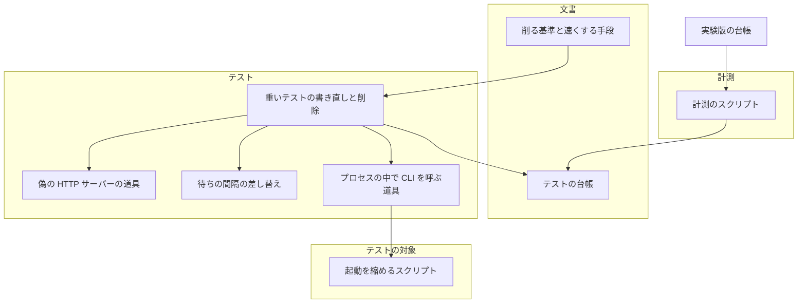
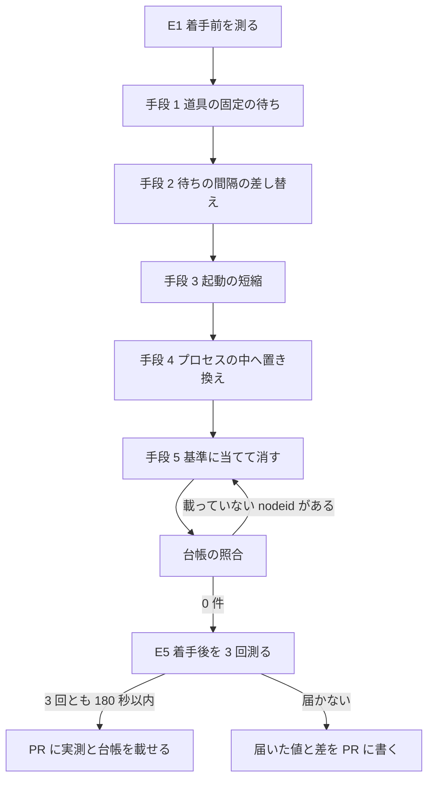

# 全体テスト: 守る振る舞いを弱めずに所要を縮め、届いた値と 180 秒までの差を数で示す（#2309）

## 目的

- **今どうなっているか**: 手元の pytest は 12,938 件・各テストの所要の合計 3,388 秒で、壁時計は 2 つに分けて流して計 891 秒かかる。目標の 180 秒には、pytest を約 134 秒以下にする必要がある（要求の前提 3）
- **誰に効くか**: テストを使う工程（cross-refactoring の着手前のテスト・最終ゲート・完了判定）を回す conductor と、テストを書く開発者と AI
- **変えると何が成り立つか**: 確かめる振る舞いを弱めない手段で所要を縮め、意味の薄いテストを削る基準（#2204）に当てて消す。届いた値と 180 秒までの残りの差を、手段ごとの実測で示す。この設計の見込みでは 180 秒に届かない（決定 1）

## 適用範囲

- **働く範囲**: このリポジトリ（ai-plugins）のテストと、テストが起動する NDF のスクリプトの起動の部分。スクリプトの利用者から見える振る舞い（引数・標準出力・結果 JSON・終了コード・書くファイル）は変えない（要求の前提 4）
- **プロジェクトごとに違うもの**: 無し（このリポジトリのテスト・テストの道具・文書だけを変える。起動の短縮はリリースした NDF のすべての利用先で同じに効く）
- **当たるモード**: `standard`

## あるべき姿の根拠

| 根拠 | 種類 | 何を示すか |
| --- | --- | --- |
| 「手元の全体テストを 3 分以内にする」「あまり意味のないテストは徹底的に削る」 | 利用者の指示の原文（2026-10-31） | 目標の秒と、削ることを先に置く方針 |
| pytest を 2 つに分けて流した結果（2026-11-10 08:52〜09:08 JST、開始時の load average 2.05 と 6.07）: `plugins/ndf/scripts/tests` が 7,142 件・578.8 秒、残りが 5,800 件・312.0 秒。junit の集計で 12,938 件・合計 3,388.1 秒。0.1 秒未満の 8,055 件で 225.6 秒、0.3 秒以上の 2,514 件で 2,755.8 秒 | 実測（この設計を書くときに測った） | 時間は 0.3 秒以上の 2,514 件に集まる。壁時計と合計の比は 0.263 で、pytest を 134 秒にするには合計を約 510 秒にする必要がある |
| 1 件ごとの後始末で 0.50 秒待つテストが 263 件ある。偽の HTTP サーバーの止め方が、標準ライブラリの既定の問い合わせ間隔 0.5 秒を待ち切る | 実測（`cProfile` で `socketserver` の `shutdown` まで辿った）・STD1 | テストの道具だけを直して約 130 秒が縮む |
| `test_supervise.py` と `test_supervise_queue.py`（計 252.6 秒）の内訳: 永続ワークフローの部品の問い合わせの待ち 41.8 秒（17%）、子のプロセスで supervise を起こす結合のテスト 68.8 秒（27%）、SQLite の書き込みの確定 14.6 秒 | 実測（`cProfile`、2026-11-10） | supervise を使うテスト群（1,600 件・944.5 秒）は、待ちの間隔と子のプロセスの起動に時間を使う |
| スクリプトの `--help` の起動の秒（5 回の平均）: `parallel.py` 809 ms・`supervise.py` 418 ms・`release-steps.py` 334 ms・`sprint-state.py` 260 ms・`test-run.py` 237 ms・`glossary.py` 193 ms。素の python は 16 ms。`supervise.py` の 338 ms と `parallel.py` の 422 ms は import で、大きいのは永続ワークフローの部品（`dbos`）0.41 秒と、その下の `sqlalchemy`・`pydantic`・`tabulate`・`markdown_it` | 実測（`python3 -X importtime`） | 起動の大半は、その起動で使わない部品の import である |

要求と受け入れ条件は #2309 の本文にある（コピーは `issues/issue-2309-requirements.md`）。#2204 の受け入れ内容は要求の受け入れ条件 2・3・6・8 に入っている。この文書は「どう作るか」だけを扱う。

## ドメインモデル

### コンテキスト

| コンテキスト | 何の語が 1 つの意味に決まるか |
| --- | --- |
| NDF の開発ワークフロー（`ndf-workflow`） | 全体テスト・着手前のテスト・範囲テスト。この変更はこのリポジトリの全体テストの中身と、テストが起動するスクリプトの起動の部分だけを変え、語の意味は変えない |

### 集約

| 集約 | 持ち主（書き換えてよいもの） | 根 | エンティティ | 値オブジェクト |
| --- | --- | --- | --- | --- |
| テストの台帳 | 実装の担当（`issues/issue-2309-test-ledger.md`） | 着手前と着手後の nodeid の集合 | 消した・まとめた・置き換えたテストの行 | 当たった基準の番号・守るテストの名前・処置 |
| 全体テストの実測の記録 | 計測のスクリプト（`plugins/ndf/scripts/experimental/whole-test-timing.py`） | 1 回の計測 | suite ごとの結果 | 開始時の load average・壁時計・件数・合計・遅いテストの表 |
| 削る基準と速くする手段 | `docs/plugin-development-guide.md` の「テストを削る基準」 | 節 | 基準の行・手段の行 | 基準の番号 |
| スクリプトの起動 | 起動を縮めるスクリプト（決定 4 の 6 本）と、その下の部品 | 1 回の起動 | — | 引数・標準出力・結果 JSON・終了コード・書くファイル |

### 不変条件

| # | 集約 | 条件 | 破れたときの扱い |
| --- | --- | --- | --- |
| I1 | テストの台帳 | 着手前に既定の実行で走っていたテストは、着手後も走るか、台帳に処置・基準の番号（置き換えたものは「置き換え」）・守るテスト（または守らなくてよい理由）つきで載る | 計測のスクリプトの `diff` が終了コード 1 で落ち、載っていない nodeid を出す |
| I2 | テストの台帳 | 着手前に既定の実行で走っていたテストが、着手後に skip・deselect に変わらない | `diff` が終了コード 1 で落ち、変わった nodeid を出す |
| I3 | 全体テストの実測の記録 | 受け入れ条件 1 の判定に使う計測は、開始時の 1 分の load average が CPU の数（8）以下である | その計測を「参考」として残し、判定に数えない |
| I4 | スクリプトの起動 | 起動を縮めたスクリプトは、着手前と同じ引数に対して同じ標準出力・結果 JSON・終了コードを返し、同じファイルを書く | 既存のテストが落ちる。落ちたら起動の短縮を戻す |
| I5 | テストの台帳 | 台帳の基準の番号は、すべて削る基準の文書の表にある番号である | 実装の PR のレビューで照らす。表に無い番号の行は基準を文書へ足すか、消すのをやめる |
| I6 | 削る基準と速くする手段 | 実装で使った速くする手段は、すべて文書の手段の一覧にある | 同上。一覧に無い手段は文書へ足す |
| I7 | テストの台帳 | 並列の数（`-n 4`）と宣言の pytest のコマンドは着手前と同じである | `.ndf/project.json` の差分が出たら戻す |

### ドメインイベント

| # | イベント | 発生元 | 受け手 |
| --- | --- | --- | --- |
| E1 | 着手前の全体テストの件数・合計・壁時計・遅いテストの表と、スクリプトの起動の秒を測った | 計測のスクリプト（`measure`・`startup`） | テストの台帳（着手前の集合）・E2・E3・E4 |
| E2 | 削る基準に当たるテストを消した・まとめた | 実装の担当 | テストの台帳 |
| E3 | 子のプロセスを起こすテストを、プロセスの中のテストへ置き換えた。テストの道具の固定の待ちと、プロセスの中の待ちの間隔を縮めた | 実装の担当 | テストの台帳 |
| E4 | テストの対象のスクリプトの起動を縮めた | 実装の担当 | スクリプトの起動（I4 を既存のテストで確かめる）・テストの台帳 |
| E5 | 着手後の全体テストを 3 回測った | 計測のスクリプト | 実装の PR（受け入れ条件 1・2・5）・`diff` の照合 |

### 用語

| 用語 | 意味 | 用語集への反映 |
| --- | --- | --- |
| 全体テスト | 用語集のとおり。この変更では `.ndf/project.json` の `test.suites` の 13 個すべて | 変更なし |
| 着手前のテスト | 用語集のとおり | 変更なし |
| 範囲テスト | 用語集のとおり | 変更なし |

## 外部の調査

| 種類 | 調べるか | 理由 |
| --- | --- | --- |
| 標準・仕様 | 調べる | 偽の HTTP サーバーの止め方と、import を遅らせる言語の仕組み（Python の言語仕様）が設計の形を決める |
| 主要な製品 | 調べない | テストの所要の配分はこのリポジトリのテストの中身で決まり、他の製品の解き方を比べても予算が決まらない。並列の配り方（pytest-xdist）はライブラリとして調べる |
| ライブラリとサービス | 調べる | スクリプトをテストのプロセスの中で走らせる既存のプラグインと、並列の配り方の選択肢がある |

### 標準・仕様

| # | 標準・仕様 | 何を定めているか | 設計への反映 | 出典 |
| --- | --- | --- | --- | --- |
| STD1 | Python 標準ライブラリ `socketserver` の `serve_forever(poll_interval=0.5)` と `shutdown()` | 止める要求を `poll_interval` 秒ごとに見る。`shutdown()` は止まるまで待つ | 偽の HTTP サーバーを起動するテストの道具で、問い合わせの間隔を縮める（決定 2） | https://docs.python.org/3/library/socketserver.html （2026-11-10） |
| STD2 | PEP 810（明示的な遅延 import。Status: Final、Python-Version: 3.15） | `lazy import` の構文で、名前を最初に使うときに読み込む | 手元とテストの Python は 3.13 と 3.14 で使えない。関数の中での import で同じ効果を得る（決定 4） | https://peps.python.org/pep-0810/ （2026-11-10） |
| STD3 | Python 標準ライブラリ `importlib.util.LazyLoader` | モジュールの属性に最初に触れるまで読み込みを遅らせる。`exec_module()` を持つ読み込み手に限る | 決定 4 で比べた。採らない | https://docs.python.org/3/library/importlib.html （2026-11-10） |

### ライブラリとサービス

| # | 候補 | 版 | ライセンス | 最後のリリースの日付 | 終了のアナウンス | 要件を満たすか | 出典 |
| --- | --- | --- | --- | --- | --- | --- | --- |
| LIB1 | pytest-console-scripts（`script_runner` の in-process モード） | 1.4.1 | MIT | 2023-05-31 | 無し（分類は `Development Status :: 4 - Beta`） | 部分的。Python のスクリプトをテストのプロセスの中で走らせ、結果を `subprocess.run` に似た形で返す。シェルのスクリプトは子のプロセスでだけ走る。依存が 1 つ増える | https://pypi.org/pypi/pytest-console-scripts/json ・ https://raw.githubusercontent.com/kvas-it/pytest-console-scripts/master/README.md （2026-11-10） |
| LIB2 | このリポジトリの `plugins/ndf/scripts/tests/inproc.py`（#2291 で作った） | — | このリポジトリと同じ | — | 無し | 満たす。スクリプトの `main(argv)` をテストのプロセスの中で呼び、`subprocess.run` と同じ形（`returncode`・`stdout`・`stderr`）で返す。18 本のテストのファイルが使っている | `grep -rln inproc --include='test_*.py' plugins scripts`（2026-11-10） |
| LIB3 | pytest-xdist の `--dist worksteal` | 3.8.0 | MIT | 2025-07-01 | 無し | 部分的。所要の差が大きいテストで、終わりの偏りを他の worker が引き取る。宣言のコマンドを変える | https://pypi.org/pypi/pytest-xdist/json ・ https://raw.githubusercontent.com/pytest-dev/pytest-xdist/master/docs/distribution.rst （2026-11-10） |

### 確かめられなかったこと

| 対象 | 試した手段 | 結果と理由 |
| --- | --- | --- |
| pytest 全体を 1 本で流した壁時計 | `timeout 595` で計測の監査の部品を足して流した | 595 秒で打ち切られた（終了コード 143）。分けて流した 2 本の値（578.8 秒・312.0 秒）を使う |
| 子のプロセスの起動の数の、全体の内訳 | 監査の部品で `subprocess.Popen` を数えた | 打ち切られたため `plugins/ndf/scripts/tests` の一部と遅いファイル 10 本だけを数えた。全体の内訳は E1 で取り直す |

調べた量: 候補 6 件・取得の試み 9 回。

## 機能一覧

| # | 機能 | 誰が使うか |
| --- | --- | --- |
| F1 | 全体テストを要求の前提 1〜3 の条件で測り、件数・合計・壁時計・遅いテストの表を得る。着手前後のテストの集合を台帳と照らす | 実装の担当（着手前・着手後） |
| F2 | スクリプトの最小の起動を 10 回流し、中央値を得る | 実装の担当（受け入れ条件 7） |
| F3 | 削る基準に当たるテストを消す・まとめ、台帳に基準と守るテストを残す | 実装の担当・レビュー |
| F4 | テストの道具の固定の待ちと、プロセスの中の待ちの間隔を縮める | テストを使う工程と開発者 |
| F5 | 子のプロセスを起こすテストを、プロセスの中のテストへ置き換え、CLI の配線は代表の起動で残す | テストを使う工程と開発者 |
| F6 | テストの対象のスクリプトの起動を、利用者から見える振る舞いを変えずに縮める | テストを使う工程と、工程が打つ 1 回ごとの起動 |
| F7 | 削る基準と速くする手段を文書で読み、テストを書く・消すときに当てる | テストを書く開発者と AI |

## 構成要素

| 要素 | 責務 |
| --- | --- |
| 計測のスクリプト（`plugins/ndf/scripts/experimental/whole-test-timing.py`、実験版） | 既存の `measure` と `diff` をそのまま使う。`startup` を足し、渡したスクリプトの最小の起動を N 回流して中央値を出す（決定 7） |
| テストの台帳（`issues/issue-2309-test-ledger.md`） | 着手前後の実測・遅いテストの上位 30 件とファイルの上位 10 本の処置・起動の秒の前後・消した・まとめた・置き換えたテストの 1 件ごとの基準と守るテスト。PR の本文から指す |
| 偽の HTTP サーバーの道具（`plugins/ndf/scripts/tests/account_fake.py` と、`serve_forever` を呼ぶ 5 本のテストのファイル） | 問い合わせの間隔を縮め、後始末の 0.5 秒の待ちを無くす（決定 2） |
| 待ちの間隔の差し替え（`plugins/ndf/scripts/tests/conftest.py` のフィクスチャ） | プロセスの中で永続ワークフローを動かすテストで、問い合わせの間隔の値をテストの側で縮める。上限の宣言（`plugins/ndf/contracts/limits.json`）は変えない（決定 3） |
| 起動を縮めるスクリプト（`supervise.py`・`parallel.py`・`release-steps.py`・`sprint-state.py`・`test-run.py`・`glossary.py` と、その下の `supervise_lib/`・`release_lib/`・`lib/`） | その起動で使わない第三者の部品の import を、使う関数の中へ移す（決定 4） |
| プロセスの中で CLI を呼ぶ道具（`plugins/ndf/scripts/tests/inproc.py`） | 既存のまま使う。分岐を確かめるテストを、子のプロセスの起動からこの道具の呼び出しへ置き換える（決定 5） |
| 重いテストの書き直しと削除（`plugins/ndf/scripts/tests/`・`plugins/ndf/skills/*/tests/`・`plugins/playwright-kit/skills/*/tests/`・`scripts/tests/`） | 決定 6 の範囲で、消す・まとめる・置き換える・速くする |
| 削る基準と速くする手段（`docs/plugin-development-guide.md` の「テストを削る基準」） | 6 つの基準はそのまま。速くする手段を 3 つから 6 つにし、「テストの対象のコードを変えない」を起動の短縮に限って許す形へ書き直す（決定 4・8） |
| 実験版の台帳（`docs/ndf-experiments.md`） | 計測のスクリプトの行に、`startup` と #2309 で使った結果を足す |

型は足さない。計測のスクリプトとテストの道具は関数だけでできており、クラス図の対象が無い。

## 処理の流れ

### 実装の順序

手段は、見込みの秒が大きく、確かめる振る舞いへの影響が小さいものから入れる。手段を 1 つ入れるごとに、触ったファイルの範囲テストを流して通ることを確かめる。

- 基準に当てて消す（手段 5）は、どの手段の後にも行ってよい。ファイルを読んだときに基準に当たるテストを見つけたら、その場で台帳に載せて消す
- 手段 3 は、起動を縮めたスクリプトごとに、既存のテストを流して I4 を確かめる。落ちたらそのスクリプトの短縮を戻す（要求のイベント E4）
- 届かないとき、新しい課題は起こさない（要求の未決 1。設計承認ゲートで利用者が確かめる）

### 見込みの秒

着手前の合計 3,388 秒に対する、手段ごとの縮みの見込みである。幅は、全体の内訳を E1 で取り直すまで決まらない部分を表す。

| 手段 | 対象 | 縮みの見込み（合計の秒） | 見込みの出所 |
| --- | --- | --- | --- |
| 1. テストの道具の固定の待ち | 後始末で 0.5 秒待つ 263 件 | 120〜130 | 263 件 × 0.5 秒（実測） |
| 2. プロセスの中の待ちの間隔 | supervise を使うテスト群 1,600 件・944.5 秒 | 100〜150 | 問い合わせの待ちが 17%（実測）。間隔を 1/10 にした残り |
| 3. 起動の短縮 | 決定 4 の 6 本を子のプロセスで起こすテスト | 50〜120 | 1 回あたり 0.15〜0.7 秒（実測）× 起動の数（E1 で数える） |
| 4. プロセスの中へ置き換え | 子のプロセスで Python のスクリプトを起こすテスト（一部の計測で 1,652 件・1,199 秒） | 100〜200 | 起動 1 回あたりの秒 × 置き換える数。結合のテストの待ちは縮まない |
| 5. 基準に当てて消す | 遅いファイルの上位 30 本から | 50〜300 | ファイルを読むまで決まらない |
| 計 | | 420〜900 | |

計で合計は 2,490〜2,970 秒になり、壁時計と合計の比 0.263 で pytest は 650〜780 秒、全体テストは約 700〜830 秒と見込む。180 秒（pytest で約 134 秒、合計で約 510 秒）には届かない（決定 1）。

## 入出力の契約

### 計測のスクリプト

`measure` と `diff` の契約は #2291 のまま変えない（`issues/issue-2291-design.md` の「入出力の契約」）。足すのは `startup` だけである。

| 副命令 | 入力 | 出力 | 終了コード |
| --- | --- | --- | --- |
| `startup --root <dir> [--runs N] <スクリプトのパス>... [-- <引数>...]` | スクリプトのパス（`--root` からの相対）と、最小の起動の引数（既定は `--help`）。`--runs` の既定は 10 | NDF の結果の形（`tool`・`status`・`summary`・`items`・`metrics`）。`items` にスクリプトごとの中央値・最小・最大のミリ秒と終了コード。`metrics` に開始時の `load_average_1m`・`cpus`・`reference` | 0: すべてのスクリプトが起動できた / 1: 起動の終了コードが 1 回でも前の回と違った / 2: スクリプトが無い・読めない |

- 起動は `python3 <スクリプト> <引数>` を作業ディレクトリ `--root` で打ち、時間は打ってから終わるまでを測る
- 着手前と着手後で同じ引数・同じ回数で流し、両方の出力を台帳に載せる（受け入れ条件 7）

### 起動を縮めるスクリプト

引数・標準出力・結果 JSON・終了コード・書くファイルは変えない（I4）。変わるのは起動の秒だけである。

## 非機能の実現方式

| 大項目 | 要求の条件 | 実現方式 | 確かめ方 |
| --- | --- | --- | --- |
| 性能・拡張性 | 手元の全体テストが 180 秒以内（受け入れ条件 1） | 手段 1〜5 を見込みの大きい順に入れる。見込みでは届かない（決定 1） | `measure` を load average 8 以下で 3 回 |
| 運用・保守性 | テストの件数が減り、消したテストの対応が PR から追える（受け入れ条件 3）。削る基準が文書にある（受け入れ条件 6） | テストの台帳と `diff` の照合（決定 6）。速くする手段を文書へ足す（決定 8） | `diff` の終了コード 0 と、台帳の基準の番号・手段が文書の表にあること |
| システム環境 | 並列の数は `-n 4` のまま。ほかの作業と並んでもメモリを使い切らない | 宣言のコマンドを変えない（決定 1）。プロセスの中へ置き換えたテストは、読み込んだモジュールを worker ごとに 1 度だけ持つ | `.ndf/project.json` の差分が無いこと。`measure` の 3 回の間に、メモリの不足でテストが落ちないこと |

## 決定の記録

### 決定 1: 届かない目標へ手段を足し続けないため、手段ごとの見込みの秒を先に出し、見込みの大きい順に入れて、尽きたら届いた値で止める

180 秒に入れるには pytest の合計を 3,388 秒から約 510 秒へ 85% 減らす必要がある。0.1 秒未満の 8,055 件だけで 225.6 秒あり、残りの 4,883 件（3,162.5 秒）を約 285 秒にしなければならない。確かめる振る舞いを弱めない 5 つの手段の見込みは計 420〜900 秒で、pytest は 650〜780 秒に留まる。残りの時間は、本物のスクリプトと子のプロセスを起こし、実時間で待つ結合のテスト（supervise の queue と再開・中継・cross-review と cross-refactoring の駆動・worktree のテスト環境）にある。これらを単体のテストへ書き直して 180 秒に入れる作業は、確かめる振る舞いを弱めずに行えるかがファイルごとに読むまで分からず、1 回のスプリントの量に収まらない。そこで手段を見込みの大きい順に入れ、尽きたら届いた値と残りの差を PR に書き、受け入れ条件 1 を未達として残す（要求の未決 1）。新しい課題は起こさない。

並列の数を上げる・テストを既定の実行から外す・宣言の pytest のコマンドを変える（`--dist worksteal`（LIB3）を含む）は採らない。前の 2 つは要求が行わないとしている。`--dist worksteal` は並列の数を変えないが、宣言のコマンドが変わり、着手前と着手後を同じ並列の条件で比べる受け入れ条件 2 の比較が崩れる。終わりの偏りで縮むのは、最も長いテスト 1 件分（15 秒）を超えない。

根拠: Value 2 / Value 3 / Value 4（MVV 版 6）

### 決定 2: 後始末の固定の待ちを無くすため、偽の HTTP サーバーの問い合わせの間隔をテストの道具の側で縮める

偽の HTTP サーバーは `serve_forever()` を既定の `poll_interval=0.5` で回し、後始末の `shutdown()` が次の問い合わせまで待つ（STD1）。263 件が 1 件ごとに 0.5 秒を待ち、計約 130 秒になる。テストの道具（`account_fake.py` と `serve_forever` を呼ぶ 5 本のファイル）で間隔を縮める。テストの対象のコードは変わらず、確かめる振る舞いも変わらない。サーバーを worker ごとに 1 度だけ起こして使い回す形は採らない。テストごとに応答を差し替える道具を、テストの間で状態を持ち越さない形に作り直す必要があり、間隔を縮めるだけで同じ秒が縮む。

- 作り方: 標準に倣う
- 比べた候補: STD1

根拠: Value 1 / Value 3（MVV 版 6）

### 決定 3: 永続ワークフローの問い合わせの待ちを縮めるため、プロセスの中で走るテストでだけ待ちの間隔の値をテストの側で差し替え、上限の宣言は変えない

supervise を使うテスト群では、時間の 17% が永続ワークフローの部品の問い合わせの間隔（宣言の `durable.poll` 0.2 秒と `durable.wait-from-poll` 1 秒）の待ちである。プロセスの中で走るテストでは、テスト用のフィクスチャがこの 2 つの値を小さく差し替える。待ちの間隔は結果と順序を変えないため、確かめる振る舞いは弱まらない。上限の宣言を読む部品は、上書きの環境変数を持たないと決めている（`plugins/ndf/scripts/lib/limits.py` の冒頭）。テストのために環境変数を足すと、利用者が触れる設定の項目が増える。そのため子のプロセスで supervise を起こすテストには効かず、その分は手段 3・4 で縮める。

根拠: Value 1 / Value 6（MVV 版 6）

### 決定 4: 起動の秒を縮めるため、テストの対象のスクリプトのうち起動が 150 ms を超える 6 本で、その起動で使わない第三者の部品の import を使う関数の中へ移す

要求の未決 2 に対して、利用者から見える振る舞いを変えない起動の短縮に限って、テストの対象のスクリプトを変える案を採る。起動の大半はその起動で使わない部品の import（永続ワークフローの部品 0.41 秒など）で、テストの子のプロセスの起動だけでなく、工程が打つ 1 回ごとの起動にも同じ秒が効く。対象は `--help` の起動が 150 ms を超え、テストが子のプロセスで起こす 6 本（`parallel.py`・`supervise.py`・`release-steps.py`・`sprint-state.py`・`test-run.py`・`glossary.py`）とする。E1 で起動の数を数え、テストからの起動が無いスクリプトは対象から外す。移すのは `python3 -X importtime` で 20 ms を超える第三者の部品だけで、このリポジトリの部品の分け方は変えない。I4 は既存のテストで確かめ、落ちたらそのスクリプトの短縮を戻す。

言語の遅延 import（STD2）は Python 3.15 からで、手元の 3.13 と 3.14 で使えない。`importlib.util.LazyLoader`（STD3）は読み込み手を差し替える仕組みを各スクリプトの冒頭に足すことになり、関数の中での import より読み手に分かりにくい。

- 作り方: 自前で作る
- 比べた候補: STD2 / STD3

根拠: Value 1 / Value 7（MVV 版 6）

### 決定 5: 分岐を確かめるテストの子のプロセスの起動を無くすため、既存の `inproc.py` を使い、CLI ごとに代表の起動を 1〜3 件残す

`inproc.py`（LIB2）はスクリプトの `main(argv)` をテストのプロセスの中で呼び、`subprocess.run` と同じ形で返す。18 本のファイルが使っており、置き換えても読み手の側の書き方が変わらない。CLI の配線（引数の解釈・終了コード・結果 JSON の出力）は、CLI ごとに代表の起動を 1〜3 件だけ子のプロセスで残して確かめる。シェルのスクリプトと、子のプロセスとしての振る舞い（シグナル・プロセスグループ・標準入力の終わり）を確かめるテストは置き換えない。置き換えると振る舞いの確かめが弱まるテストは置き換えず、台帳に理由を書く（要求のイベント E3）。

pytest-console-scripts（LIB1）は同じことをプラグインとして持つが、依存が 1 つ増え、最後のリリースが 2023-05-31 である。既存の道具で足りる。

- 作り方: 自前で作る
- 比べた候補: LIB1 / LIB2

根拠: Value 6 / Value 7（MVV 版 6）

### 決定 6: 作業の量を 1 回の承認で読み切れる量に収めるため、書き直しと削除の対象を着手前の遅いファイルの上位 30 本と、手段 1〜3 が当たるファイルに限る

着手前の測り（2026-11-10）では、ファイルごとの合計の上位 30 本で計約 1,580 秒（全体の 47%）である。533 本のファイルをすべて読むと、台帳の行と差分がレビューで読み切れない量になる。上位 30 本は E1 の測りで決め直す。上位 30 本の外のファイルでも、手段 1〜3 は道具・フィクスチャ・テストの対象の側の変更で効くため、そのまま効く。削る基準に当たるテストを上位 30 本の外で見つけたときは、消して台帳に載せてよい。台帳の書き方と `diff` の照合は #2291 と同じにする。

根拠: Value 2 / Value 3（MVV 版 6）

### 決定 7: 起動の秒の前後を同じ手順で測るため、計測のスクリプトに `startup` を足す

受け入れ条件 7 は、6 本のスクリプトの起動を着手前と着手後に 10 回ずつ流した中央値を求める。手で組むと回数と引数がずれるため、計測のスクリプトに足す。計測のスクリプトは呼んだときだけ働く補助で実験版のまま置き、既定の振る舞いから参照しない。

根拠: Value 4 / Value 5 / Value 9（MVV 版 6）

### 決定 8: 後からテストを書く側が同じ手段を当てられるよう、速くする手段を文書で 6 つにし、テストの対象のコードを変えない決まりを起動の短縮に限って緩める

文書の手段は今 3 つ（環境変数で待ちを縮める・代表の起動と関数の呼び出しに分ける・重い準備を複製する）である。この課題で使う 3 つ（テストの道具の固定の待ちを縮める・プロセスの中で走るテストの待ちの間隔をテストの側で差し替える・テストの対象のスクリプトの起動を利用者から見える振る舞いを変えずに縮める）を足す。「テストを速くするためにテストの対象のコードを変えない」は、起動の短縮だけを例外にする形へ書き直す（要求の未決 2）。git のリポジトリの複製は手段に残すが、この課題では使わない。`git init` とコミット 1 回は 7 ms、`git status` は 1 ms で（2026-11-10 の実測）、時間の配分に効かない。

根拠: Value 7 / Value 8（MVV 版 6）

## テスト設計

| 受け入れ条件・不変条件 | どの振る舞いで縛るか | どう壊したら落ちるべきか |
| --- | --- | --- |
| 受け入れ条件 1・I3 | `measure` を load average 8 以下で 3 回流し、3 回とも全 suite が通り、壁時計と suite ごとの秒と開始時の load average が台帳に載る | load average が 8 を超えた計測を判定に数えると、台帳の `reference` の列と食い違う |
| 受け入れ条件 2 | 着手前と着手後の `measure` の `tests`・`sum_seconds`・`wall_seconds` が台帳に並ぶ | 着手前後で宣言のコマンドが違うと、台帳の比較の行に並べられない（I7） |
| 受け入れ条件 3・I1 | `diff` が、着手前にあって着手後に無い nodeid のうち台帳に無いものを出し、終了コード 1 を返す | 台帳の行を 1 つ消すと落ちる |
| 受け入れ条件 4・I2 | `diff` が、着手前に走って着手後に skip になった nodeid を出し、終了コード 1 を返す | 既存のテストに skip の印を足すと落ちる |
| 受け入れ条件 5 | 着手前の `measure` の `items` の上位 30 件とファイルの上位 10 本が、処置と着手後の秒つきで台帳に載る | 処置の列が空の行が残る |
| 受け入れ条件 6・I5・I6 | 台帳の基準の番号と、実装で使った手段が、すべて文書の表にある | 文書に無い番号・手段を台帳に書くと、レビューで照らしたときに見つかる |
| 受け入れ条件 7・I4 | 起動を縮めた 6 本の既存のテストが変更なしで通る。`startup` の着手前後の中央値が台帳に載る | 遅らせた import が、起動の経路で必要な部品を外すと、そのスクリプトの既存のテストが落ちる |
| `startup`（決定 7） | 渡したスクリプトを N 回起動し、中央値・最小・最大と終了コードを返す。終了コードが回ごとに違えば終了コード 1 | 回数を引数から読まない・中央値の代わりに平均を返すと落ちる |
| 決定 2 | 偽の HTTP サーバーを使うテストの後始末が 0.1 秒以内で終わる | 間隔を既定へ戻すと、そのテストの後始末が 0.5 秒になる（`--durations` の teardown の行で見つかる） |
| 決定 3 | 待ちの間隔を差し替えたテストが、差し替える前と同じ結果を確かめて通る | 差し替えのフィクスチャが上限の宣言のファイルを書き換えると、`git diff` に宣言の差分が出る |
| 受け入れ条件 8 | 実装の PR の必須のチェックがすべて通る | 置き換えたテストが CI の環境でだけ落ちる |
| I7 | 実装の PR の差分に `.ndf/project.json` が無い | 宣言のコマンドを変えると差分に出る |

## 設計の結果

| 課題 | 扱い | 取り込み先 | 触るファイル |
| --- | --- | --- | --- |
| #2309 | 実装する | — | `plugins/ndf/scripts/tests/`、`plugins/ndf/skills/cross-refactoring/tests/`、`plugins/ndf/skills/cross-review/tests/`、`plugins/ndf/skills/worktree/tests/`、`plugins/ndf/skills/backlog-refinement/tests/`、`plugins/ndf/skills/development-workflow/tests/`、`plugins/playwright-kit/skills/playwright-authoring/tests/`、`scripts/tests/`、`plugins/ndf/scripts/supervise.py`、`plugins/ndf/scripts/supervise_lib/`、`plugins/ndf/scripts/parallel.py`、`plugins/ndf/scripts/release-steps.py`、`plugins/ndf/scripts/release_lib/`、`plugins/ndf/scripts/sprint-state.py`、`plugins/ndf/scripts/test-run.py`、`plugins/ndf/scripts/glossary.py`、`plugins/ndf/scripts/lib/`、`plugins/ndf/scripts/experimental/`、`docs/plugin-development-guide.md`、`docs/ndf-experiments.md`、`issues/issue-2309-test-ledger.md` |
| #2204 | 取り込む | #2309 | — |

## 未確認のまま残ること

| 項目 | 内容 |
| --- | --- |
| 見込みの幅 | 手段 3〜5 の見込みは、全体の子のプロセスの起動の内訳（打ち切られて一部しか数えていない）と、上位 30 本のファイルの中身を読むまで決まらない。E1 で取り直し、台帳に手段ごとの実際の縮みを書く |
| 低い負荷の下の値 | この設計の測りは開始時の load average 2.05 と 6.07 で、ほかの設計の作業と並んでいた。E1 の値で見込みの表を置き換える |
| 起動の短縮で振る舞いが変わらないか | 6 本の既存のテストが、起動の経路のすべての引数の組を通しているかは未確認。通っていない経路で、遅らせた import が必要な場面に例外を出す危険が残る。リリース承認ゲートで人が差分を見る |
| 要求の未決 1〜3 | 届かないときの扱い・テストの対象のスクリプトを変えてよいか・pytest 以外の suite を 180 秒に含めるかは、設計承認ゲートで利用者が決める。この設計は 3 つとも要求の案のとおりに進める |
