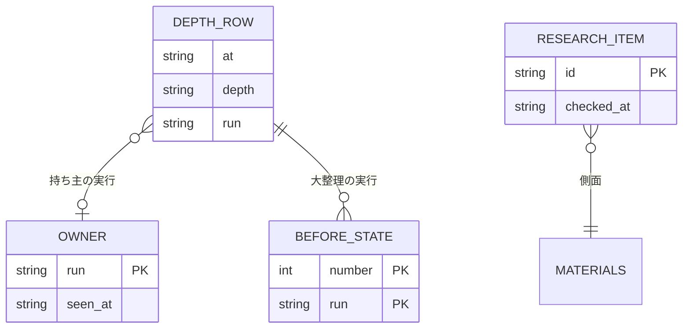

# backlog-refinement の 3 つの深さ: データ構造と入出力の契約（#2315）

[issue-2315-design.md](issue-2315-design.md) の「データ構造」と「入出力の契約」の節を分けたファイルである。語と不変条件（I1〜I13）は本体のドメインモデルにある。

## データ構造

時系列は事象の記録で持つ。深さの記録・付け直しの記録は行を足すだけで書き換えない（回数と戻しが過去の行から導けるため）。持ち主の宣言と調査の項目は今の状態だけを持つ（過去の持ち主は深さの記録の `owner` と `taken_from` に残り、調査は見直しが読んだ時点の `checked_at` を深さの記録の `research` に写す）。

### 深さの記録の行（`.ndf/backlog/depths.jsonl`）

| 列 | 型 | 空を許すか | 意味 |
| --- | --- | --- | --- |
| `at` | UTC の ISO 8601 | 許さない | 判定または棚卸しを終えた時刻 |
| `depth` | `diff` / `review` / `overhaul` | 許さない | 深さ |
| `event` | `ran` / `not_due` / `skipped` | 許さない | 行った・起動しなかった・起動したが持ち主になれず飛ばした |
| `trigger` | 文字列の配列 | 許す | 起動した条件（`count`・`open_growth`・`carry`・`no_issue`・`manual`・`created_over_closed`・`open_rising`・`cause_share`）。空は `not_due` |
| `values` | オブジェクト | 許さない | 判定に使った値（前の実行からの回数・open の件数・持ち越し・型の割合） |
| `loop`・`lap`・`sprint` | 文字列・整数 | 許す | 空は `--loop` の外（単独の起動） |
| `run` | 文字列 | 許す | 持ち主の実行の識別子。差分の棚卸しは空 |
| `open_before`・`open_after`・`closed`・`created` | 整数 | 許す | 空は `not_due` |
| `skipped_aspects` | `{aspect, reason}` の配列 | 許す | 飛ばした側面 |
| `cost`・`seconds` | 数 | 許す | 棚卸しのステップの費用と秒（調査を含まない） |
| `report` | パス | 許す | 統一 JSON レポートの置き場 |

回数は「最後の `depth: review` の `ran` の行より後の `depth: diff` の `ran` の行の数」で数える。`--loop` の外でもまとめのたびに 1 行が足るので、前提 1 の数え方がそのまま成り立つ。

### 持ち主の宣言（`.ndf/backlog/owner.json`、錠は `owner.json.lock`）

| 列 | 型 | 空を許すか | 意味 |
| --- | --- | --- | --- |
| `version`・`kind` | 1・`review-owner` | 許さない | 形 |
| `run` | 文字列 | 許さない | 実行の識別子 |
| `pid`・`host` | 整数・文字列 | 許さない | 持ち主のプロセス（`supervise.py` の queue か `research run` の自分） |
| `loop` | 文字列 | 許す | 空は単独の起動 |
| `what` | `research` / `review` / `overhaul` | 許さない | 今していること |
| `item` | 文字列 | 許す | 今の調査の項目。空は項目の外 |
| `started_at`・`seen_at` | UTC | 許さない | 始めた時刻・最後に動いた時刻 |
| `finished_at` | UTC | 許す | 空は終わっていない |
| `taken_from` | `{run, loop, seen_at}` | 許す | 空は引き取りでない |

### 調査の項目（`.ndf/backlog/research/<側面>--<対象>.json`）

| 列 | 型 | 空を許すか | 意味 |
| --- | --- | --- | --- |
| `id` | 文字列 | 許さない | `<側面>:<対象>`。側面は `needs.usage`・`needs.market`・`seeds.library`・`seeds.alternatives`・`seeds.environment`・`method.unused`・`method.hotspot`・`method.failures` |
| `checked_at` | UTC | 許さない | 調べ終えた時刻 |
| `sources` | `{kind: url\|path\|command, value}` の 1 つ以上 | 許さない | 出典 |
| `findings` | `{title, summary, kind: needs\|seeds\|prune\|quality}` の配列 | 許さない（0 件は空の配列） | 見つけたこと。起票の材料 |
| `cost`・`seconds`・`lap` | 数・整数 | `lap` は許す | 費用と秒・数えた周回 |
| `by` | `{run, loop}` | 許さない | 調べた持ち主 |

### 材料の宣言（`.ndf/project.json` の `materials`）

| キー | 中身 | 空・無いとき |
| --- | --- | --- |
| `product` | `{kind, users}`（Web サービス・ライブラリ・開発ツールなどと、使う人） | 調査の指示に種類を添えない |
| `needs.usage` | `[{name, command, scope: {aggregate_only: true, days, mask: [正規表現]}}]` | 利用の記録を読まない（前提 6） |
| `needs.market` | `[{name, url?, viewpoints}]` | 側面を飛ばす |
| `seeds.libraries` | `[{name, ecosystem, alternatives: [名前], viewpoints}]`（調べる依存は宣言したものだけ） | 側面を飛ばす |
| `seeds.environment` | `[{name, url?}]`（法令・ブラウザ・配布先の CLI など） | 側面を飛ばす |
| `deferred_milestones` | マイルストーンの題名の配列 | 見直しは後回しを除かない |
| `cause_types` | `[{id, name, defect}]`（`defect: false` は不具合でない型） | 用語集の「原因の型」A〜I。G・H は `defect: false` |
| `code_measures` | `[{name, command, types: [型の id]}]`（大整理の裏付け） | 裏付けを飛ばし、報告に書く |
| `failures` | 失敗の記録の置き場のパターン | 開発ループの記録（`.ndf/loop/*/loop.json`）だけを読む |

`aggregate_only` が `true` でない `needs.usage` の行は読まない（個票を読まない。対象範囲の「含まない」）。`mask` は出力を `claude -p` へ渡す前に当て、続けて `secret_redact` を通す。

### 棚卸しの設定（`.ndf/backlog.json` の `depths`）

| キー | 既定 | 意味 |
| --- | --- | --- |
| `review.every` / `overhaul.every` | 3 / 12 | 前の実行からの差分の棚卸しの回数 |
| `review.open_growth` | 0.3 | 前の見直しから open が増えた割合 |
| `review.carry_factor` | 10 | 持ち越しが候補の上限の何倍を超えたら起動するか |
| `review.issue_limit` | 5 | 1 回の見直しで起票する件数の上限 |
| `review.usd` / `review.seconds` | 6 / 1800 | 見直しのステップの費用と秒の上限。超えたら候補を古い順に残して持ち越す |
| `research.item_usd` / `research.item_seconds` / `research.grace` | 1 / 900 / 300 | 1 項目の上限・待ちが終わった後に今の項目を待つ秒 |
| `overhaul.streak` | 3 | 起票が完了を上回る・open が増える状態が何回の見直しで続いたら起動するか |
| `overhaul.cause_share` | 0.3 | 1 つの原因の型が、型の記録の不具合（`defect: false` を除く）に占める割合 |
| `owner.ttl` / `owner.beat` | 900 / 120 | 寿命の窓と生きている印の間隔（秒） |
| `labels` | `{needs: "needs", seeds: "seeds", policy: "policy"}` | 区別のラベル |

### 付け直しの記録（`.ndf/backlog/overhaul/<実行>/before.json`）

`[{number, parent: 番号|null, milestone: 題名|null, at}]`。`apply` が `reparent` の最初の書き込みの前に対象の全件を書く（I9）。同じディレクトリに `snapshot.json`（固定した一覧）・`classes.json`（型の分類）・`counts.json`・`measures.json` を置く。

### 型の記録（`.ndf/backlog/causes.jsonl`）

`{number, type, sub: [型の id], at, depth}` の行を足すだけのファイル。見直しは前の見直しより後に起票された課題に、大整理は未完了の全件に型を付け、`upkeep.py causes record --classes <file>` で足す。同じ番号の行が複数あれば最後の行を採る。大整理の起動の判定（`cause_share`）が open の課題の最後の行から割合を数える。

### CRUD

| 機能 | 深さの記録 | 型の記録 | 持ち主の宣言 | 調査の記録 | 課題の一覧 | 付け直しの記録 | 材料の宣言 |
| --- | --- | --- | --- | --- | --- | --- | --- |
| F1 差分の棚卸し | C | — | — | — | RU | — | — |
| F2 起動の判定 | CR | R | R | — | R | — | — |
| F3 見直し | C | C | CRU | R | CRU | — | R |
| F4 待ち時間の調査 | — | — | CRU | CU | R | — | R |
| F6 材料の案 | — | — | — | — | — | — | C（欠けたキーだけ） |
| F8 大整理 | C | C | CRU | — | CRU | C | R |
| F9 戻し | — | — | — | — | U | R | — |

## 入出力の契約

どの副命令も結果は `step_result` の 1 行 JSON で、終了コードは 0 = ok / 10 = 判断が要る / 20 = 続きがある / 1 = 失敗 / 2 = 読めない / 3 = 前提が無い（既存の表）。新しい副命令と引数は `plugins/ndf/contracts/entrypoints/` の `upkeep.py` の項目に、新しいファイルは `files/` に、`materials`・`depths` のキーは `settings/` に足す（`check-ndf-contracts.py` が落とす）。

| 名前 | 入力 | 出力（成功） | 失敗の形 | 互換性 |
| --- | --- | --- | --- | --- |
| `upkeep.py candidates --depth diff\|review` | 既存の引数。`--depth` の既定は `diff` | 差分: 経路 `diff-path`・`diff-identifier`・`commit-subject`・`sub-issue`・`unscored`（そのスプリントで起票した課題）・`manual`。見直し: 後回しを除く open の全件（`--limit` は効かない） | 既存 | 無指定が差分の棚卸しになる（決定 2） |
| `upkeep.py depth due review\|overhaul` | `--loop`・`--lap`・`--no-issue`・`--manual` | 0 = 起動する（`metrics.trigger`）/ 30 = 起動しない（プランの実行条件の `skip_code`） | 記録が読めないときも 30 で返し、理由（`metrics.reason: unreadable`）を `not_due` の行に残す | 新設 |
| `upkeep.py depth record` | `--depth`・`--event`・`--trigger`・`--run`・`--report` | 0。1 行を足す | 2 | 新設 |
| `upkeep.py causes record` | `--classes <file>`（`[{number, type, sub}]`） | 0。行を足す | 2 = 型が `cause_types` に無い | 新設 |
| `upkeep.py owner claim` | `--what`・`--loop`・`--pid` | 0（`run`・`taken_from`）/ 10（`not_owner`。今の持ち主と最後に動いた時刻） | 3 = 錠を 5 秒で取れない | 新設 |
| `upkeep.py owner touch\|release` | `--run`・`--item` | 0 | 10 = 記録が別の実行のもの（引き取られた） | 新設 |
| `upkeep.py owner status` | — | 0（持ち主・生死・最後に動いた時刻） | — | 新設。`loop status` が載せる |
| `upkeep.py research plan` | `--since <前の見直しの at>` | 0（調べる項目・古い項目・`skipped_aspects`） | 2 = 材料の宣言が壊れている | 新設 |
| `upkeep.py research run` | `--until <完了のファイル>`・`--max-items`・`--queue <一覧>`・`--lap` | 0（調べた項目・費用と秒）/ 10（`not_owner`）/ 0 で `items` 空（空きが無い・項目が無い） | 1 = 項目の失敗（項目を書かずに次へ。3 回続けば止まる） | 新設 |
| `upkeep.py apply` | plan に `depth`・`owner` と action `create`（`{kind: needs\|seeds\|policy, title, body, sources, mvv_basis, labels, mvv_verdict}`）・`reparent`（`{number, parent, milestone}`）を足す | 既存に `created`・`not_created`・`rejected_create`・`reparented`・`revert_command` を足す | 3 = 深さが見直し・大整理で持ち主が一致しない。1 = 付け直しの途中の失敗（`revert_command` を必ず載せる） | 既存の plan は `depth: diff` として読む |
| `upkeep.py revert --run <実行>` | — | 0（戻した件数） | 1（戻せなかった番号の一覧） | 新設 |
| `upkeep.py overhaul snapshot\|count\|measure` | `--out`・`--snapshot <固定の一覧>`・`--classes` | 0（`counts`: 型ごとの件数・部品・マイルストーンの割合・月ごとの起票と完了。`measures`: 宣言ごとの値） | 2 | 新設 |
| `upkeep.py report --depth` | — | 既存に `depth`・`trigger`・`open_before`/`open_after`・`closed`・`created`・`order`（通った手順の順）・`skipped_aspects`・`not_created`・`root_cause`・`revert_command` | 既存 | 足すだけ |
| `project-mvv.py vet --kind issue --body F` | 課題の本文 | 0（従う）/ 10（反する疑い・判定できない） | 既存 | 種類を 1 つ足す |
| `sprint-state.py loop select` | 既存 | `no_issue` に当たり、前の周回の締めから見直しが無いとき: `status: review_first`・`next`（見直しのプランを流して選定をやり直すコマンド） | 既存 | 見直しの後も 0 件なら今までどおり `no_issue` で止まる |
| `sprint-state.py loop sprint` | 既存 | `metrics.research`（待ちと並べて背景で打つ `upkeep.py research run --until <完了のファイル>` の 1 行） | 既存 | 足すだけ |
| `project-decl.py measure` | 既存 | `materials.*` の `question` の項目（候補と根拠: README・依存の定義・解析の SDK） | 既存 | 手の値を変えない（既存の規則） |
