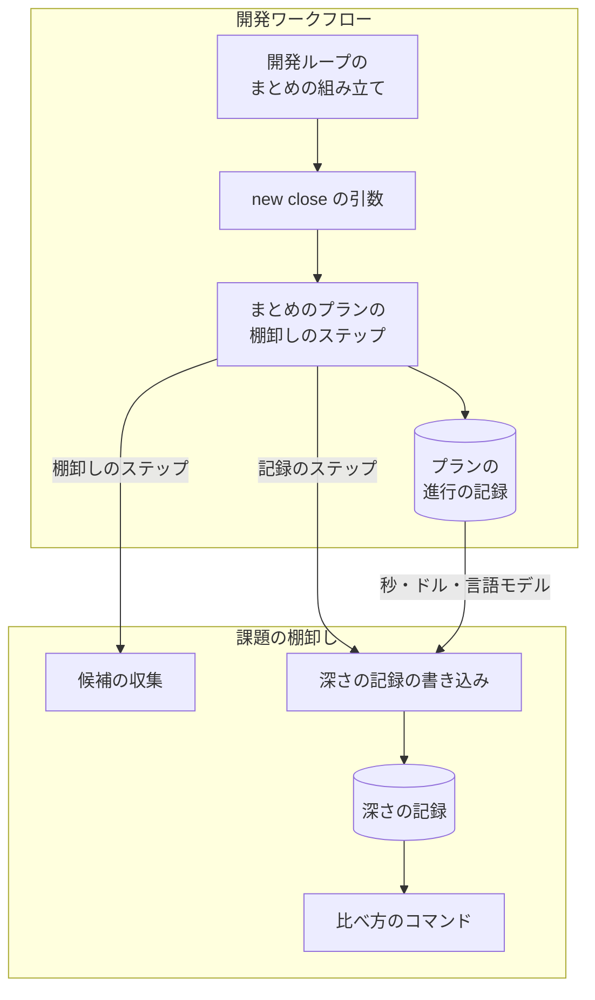
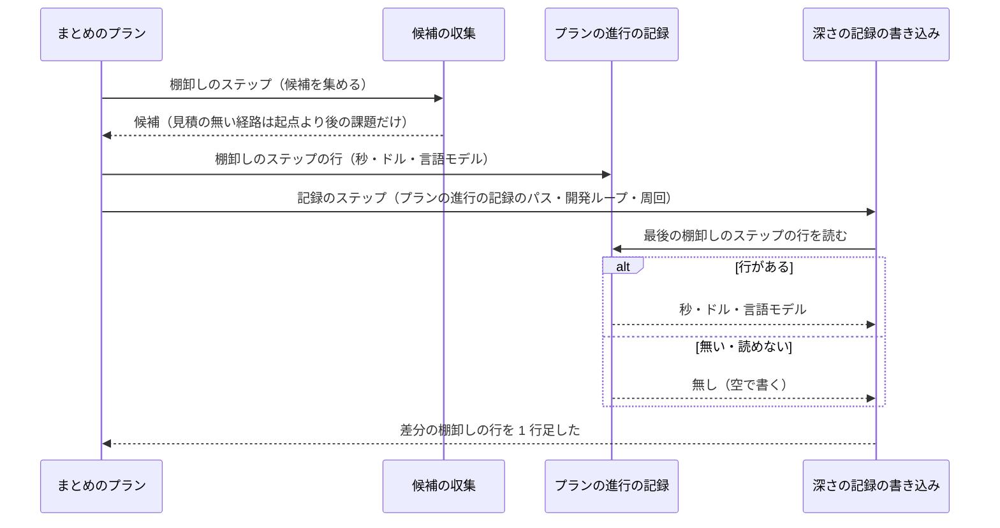

# 差分の棚卸し: 見積の段階をそのスプリントの課題だけに付け、縮んだ所要をコマンド 1 本で確かめる（#2315）

## 目的

- **今どうなっているか**: 毎スプリントの棚卸し（差分の棚卸し）は、3 つの深さに分けた後も 270〜346 秒・1.77〜2.19 ドルかかる。分ける前（206〜224 秒・1.41〜1.61 ドル）より長い。深さの記録の差分の棚卸しの行は秒・ドル・開発ループ・周回がどれも空で、比べるにはプランの進行の記録を手で探すしかない
- **誰に効くか**: 開発ループを回す利用者（周回ごとの待ち時間と費用）と、リリース後テストの担当（所要の比べ方）
- **変えると何が成り立つか**: 差分の棚卸しが見積の段階を付ける課題が、手順書の定めどおりそのスプリントで起票した課題だけになる。所要が分ける前より短くなる見込みが立つ。短くなったかを、深さの記録からコマンド 1 本で判定できる

## 適用範囲

- **働く範囲**: NDF を使うすべてのリポジトリ。候補の集め方と深さの記録の書き方は配布物の `upkeep.py` が持つ。比べる値（基準の秒・ドル・件数・言語モデル）はこのリポジトリの実測の値で、コマンドの引数で受ける
- **プロジェクトごとに違うもの**: 基準の秒とドル、比べる件数、言語モデルの名前。どれも比べ方のコマンドの引数で受け、既定に埋め込まない
- **当たるモード**: `standard`

## あるべき姿の根拠

| 根拠 | 種類 | 何を示すか |
| --- | --- | --- |
| 依頼の原文「このフェーズは sprint の終わりに毎回実行、では重すぎる」 | 利用者の指示の原文 | 毎スプリントの棚卸しを軽くすることが目的である |
| 差分の棚卸しの会話の記録 4 本の工程ごとの所要（決定 1 の表） | 実測 | 見積の段階を付ける工程は 21〜161 秒で、段階を付ける課題の数で伸び縮みする |
| 2026-11-05 の open の課題 246 件のうち、見積の無い経路に当たる課題 157 件（見積が無い 7 件・見積の後に要約値が変わった 150 件） | 実測 | 候補を集める処理は、深さを見ずに古い課題まで段階を付ける対象として渡している |
| 開発ループ lfactory3 周回 1 で段階を付けた 8 件は、どれも起点のタグ（ndf--v10.27.15、2026-11-03T19:04Z）より前に作られていた | 実測 | 手順書の定め（そのスプリントで起票した課題だけ）に揃えると、この周回で付ける課題は 0 件になる |

要求と受け入れ条件は #2315 の本文にある（コピーは [issues/issue-2315-requirements.md](issue-2315-requirements.md) ）。この文書は「どう作るか」だけを扱う。
3 つの深さそのものの仕様は、確定仕様の [ndf-backlog-refinement-depths.md](../docs/specifications/ndf-backlog-refinement-depths.md) にある。

## ドメインモデル

### コンテキスト

| コンテキスト | 何の語が 1 つの意味に決まるか |
| --- | --- |
| 課題の棚卸し（`ndf-issue-upkeep`） | 候補・見積の段階・深さの記録 |
| 開発ワークフロー（`ndf-workflow`） | 差分の棚卸し・開発ループ・周回・まとめのプラン・プランの進行の記録 |

関係は顧客 / 供給者である。課題の棚卸しが供給者で、深さの記録の行の形と比べ方のコマンドを決める。開発ワークフローは顧客で、
まとめのプランから深さの記録へ書くコマンドを組み、開発ループの名前と周回の番号を引数で渡す。
課題の棚卸しは、プランの進行の記録の行の形（supervise の進捗ログが定める `kind: step` の行）をそのまま読む。
順応者として読む部分はこの 1 つだけである。

### 集約

| 集約 | 持ち主（書き換えてよいもの） | 根 | エンティティ | 値オブジェクト |
| --- | --- | --- | --- | --- |
| 深さの記録 | 深さの記録の書き込み（`upkeep.py depth record`・`depth due`）。行を足すだけで、書き換えない | 深さの記録のファイル | 行（1 回の判定か実行） | 所要（秒・ドル）・範囲（開発ループ・周回・スプリント）・言語モデルの名前の並び |
| 候補 | 候補の収集（`upkeep.py candidates`） | 1 回の候補の結果 | 候補の課題 | 経路の集合・要約値 |

プランの進行の記録は開発ワークフローの集約で、持ち主は supervise のプランの実行である。この変更は読むだけで、書き換えない。

### 不変条件

| # | 集約 | 条件 | 破れたときの扱い |
| --- | --- | --- | --- |
| I1 | 深さの記録 | まとめのプランが書く差分の棚卸しの行の秒・ドルは、同じプランの進行の記録の最後の棚卸しのステップの行の秒・ドルと一致する | テストで落とす |
| I2 | 深さの記録 | プランの進行の記録が無い・読めない・棚卸しのステップの行が無いときも、差分の棚卸しの行は 1 行書かれ、秒・ドル・言語モデルは空になる | テストで落とす。行を欠かすと見直しの回数の数え方がずれる |
| I3 | 深さの記録 | 行の開発ループ・周回は、そのプランを組んだ開発ループの名前と周回の番号である。開発ループの外で組んだプランでは空である | テストで落とす |
| I4 | 候補 | 差分の棚卸しの候補に見積の無い経路で入る課題は、起点（`--since-ref`）の時刻より後に作られた課題だけである | テストで落とす |
| I5 | 候補 | 見直しの候補の集め方は変わらない（見積の無い経路は作られた時刻で絞らない） | テストで落とす |
| I6 | 深さの記録 | 比べ方のコマンドは、起点より後の差分の棚卸しの実行の行のうち、秒とドルがそろい、言語モデルが指定と一致する行を古い順に指定の件数だけ使う。件数に満たなければ判定しない | テストで落とす。終了コード 3 で保留を返す |

### ドメインイベント

| # | イベント | 発生元 | 受け手 |
| --- | --- | --- | --- |
| E1 | 差分の棚卸しの候補を集めた | 候補の収集 | 棚卸しの担当（区分と見積の段階を決める） |
| E2 | 差分の棚卸しのステップが終わり、秒・ドルがプランの進行の記録に書かれた | supervise のプランの実行 | 深さの記録の書き込み（次のステップ） |
| E3 | 差分の棚卸しの行が深さの記録に書かれた | 深さの記録の書き込み | 見直しと大整理の起動の判定・比べ方のコマンド |
| E4 | 変更の後の 3 回の行がそろい、中央値を基準と比べた | 比べ方のコマンド（リリース後テストの担当が打つ） | リリース後テストの判定 |

### 用語

| 用語 | 意味 | 用語集への反映 |
| --- | --- | --- |
| 差分の棚卸し | 毎スプリントの棚卸しの深さ。見積の段階を付けるのは、起点のタグより後に作られた課題だけである | 意味の変更（`ndf-workflow`。「そのスプリントで起票した課題」を起点のタグの時刻で決めると明記する） |
| 深さの記録 | 深さごとの起動の判定と実行を 1 行ずつ残す記録。差分の棚卸しの行は秒・ドル・言語モデルを持つ | 意味の変更（`ndf-issue-upkeep`。言語モデルを足す） |
| プランの進行の記録 | supervise のプランのステップごとの終了コード・秒・ドルを 1 行ずつ残す記録 | 変更なし（`ndf-workflow`） |

## 機能一覧

| # | 機能 | 誰が使うか |
| --- | --- | --- |
| F1 | 差分の棚卸しの候補で、見積の段階を付ける対象を起点のタグより後に作られた課題に絞る | 差分の棚卸しの担当（まとめのプランの棚卸しのステップ） |
| F2 | 差分の棚卸しの行へ、そのステップの秒・ドル・言語モデルをプランの進行の記録から写す | まとめのプラン |
| F3 | 差分の棚卸しの行へ、開発ループの名前と周回の番号を残す | 開発ループ |
| F4 | 差分の棚卸しの所要の中央値を基準と比べる | リリース後テストの担当 |

## 構成要素

| 要素 | 責務 |
| --- | --- |
| 候補の収集（`upkeep.py` の `cmd_candidates`） | 差分の棚卸しでは、見積の無い経路に入れる課題を作られた時刻が起点より後のものに絞る（F1） |
| 深さの記録の書き込み（`upkeep_depth.py` の `cmd_record`） | 新しい引数で受けたプランの進行の記録から、指定のステップの最後の行の秒・ドル・言語モデルを読み、行へ写す。読めなければ空で書く（F2） |
| 比べ方のコマンド（`upkeep_depth.py` の新しい `cmd_compare`） | 深さの記録から比べる行を選び、中央値・基準との差・判定を返す（F4） |
| まとめのプランの棚卸しのステップ（`sprint_close_steps.py` の `refine_steps`） | 深さの記録の書き込みのコマンドに、プランの進行の記録のパス・ステップの名前・開発ループ・周回を足す（F2・F3） |
| まとめのプランの引数（`new_args.py`） | `new close` が開発ループの名前と周回の番号を受ける（F3） |
| 開発ループのまとめの組み立て（`sprint_loop_gate.py` の `build_close`） | `new close` へ開発ループの名前と周回の番号を渡す（F3） |
| 手順書（`backlog-refinement` の `SKILL.md`）と `upkeep.py` の冒頭の説明 | 見積の無い経路の拾い方が深さで違うことと、比べ方のコマンドを書く |



手順書と冒頭の説明は呼び出しの関係を持たないため、図に含めない。

## データ構造

深さの記録（`.ndf/backlog/depths.jsonl`）の行の最上位の列は変えない。差分の棚卸しの実行の行で、値の入り方だけが変わる。
過去の行は書き換えない（行を足すだけの事象の記録のまま）。

| 列 | 型 | 空を許すか | 意味 |
| --- | --- | --- | --- |
| `seconds` | 数 | 許す | 棚卸しのステップの秒。空は「プランの進行の記録から読めなかった」か「開発ループの外で手で打った」。`--seconds` を渡せばその値を優先する |
| `cost` | 数 | 許す | 棚卸しのステップのドル。空の意味は `seconds` と同じ |
| `values.models` | 文字列の配列 | 許す（キーを置かない） | 棚卸しのステップで使った言語モデルの名前（プランの進行の記録の `models` のキーを名前の順に並べたもの）。キーが無いのは読めなかったとき |
| `loop` | 文字列 | 許す | 開発ループの名前。空は開発ループの外で組んだプラン |
| `lap` | 整数 | 許す | 周回の番号。空の意味は `loop` と同じ |

| 機能 | 深さの記録 | プランの進行の記録 | 候補の結果 |
| --- | --- | --- | --- |
| F1 | — | — | C |
| F2 | C | R | — |
| F3 | C | — | — |
| F4 | R | — | — |

既存の行の移行はしない。比べ方のコマンドは秒とドルが空の行を数えないため、変更の前の行は自然に外れる。

## 入出力の契約

### `upkeep.py depth record`（引数を足す）

| 項目 | 内容 |
| --- | --- |
| 入力（追加） | `--progress <パス>`（任意。プランの進行の記録）・`--step <ステップの id>`（任意。既定 `refine`） |
| 出力 | 変わらない（足した行を `items` に 1 つ返す） |
| 失敗の形 | プランの進行の記録が無い・読めない・行が無いときは、秒・ドル・言語モデルを空にして行を書き、終了コード 0 で返す（I2）。`items[0]` の行で空と分かる |
| 互換性 | `--progress` を渡さない既存の呼び出し（見直し・大整理の担当と、持ち主になれなかった記録）は今までどおり動く |

### `upkeep.py depth compare`（新しい）

```text
python3 upkeep.py depth compare --since-ref <配布した正式版のタグ> --seconds-under 206 --cost-under 1.41
                               [--count 3] [--model claude-opus-5-5] [--depth diff] [--root <dir>]
```

| 項目 | 内容 |
| --- | --- |
| 入力 | `--since-ref`（必須。この ref のコミットの時刻より後の行だけを使う）・`--seconds-under`・`--cost-under`（必須。基準）・`--count`（既定 3）・`--model`（任意。渡すと `values.models` がこの 1 つだけの行に限る）・`--depth`（既定 `diff`） |
| 出力 | 統一の結果の形の 1 行の JSON。`metrics` は `count`（そろった件数）・`needed`・`median_seconds`・`median_cost`・`baseline`（`{seconds, cost}`）・`delta`（`{seconds, cost}`。中央値 − 基準）・`judged`（真偽）。`items` は使った行（`at`・`sprint`・`loop`・`lap`・`seconds`・`cost`）と、外した行（`result: excluded`・`reason`: `no_usage` / `model`） |
| 失敗の形 | 0 = 秒とドルの中央値がどちらも基準を下回った / 1 = そろったが、どちらかが基準を下回らない / 3 = 件数に満たない（判定を保留。`metrics.count` にそろった件数）/ 2 = 深さの記録か ref を読めない |
| 互換性 | 新しいコマンドで、既存の呼び出し側は無い |

### `supervise.py new close`（引数を足す）

| 項目 | 内容 |
| --- | --- |
| 入力（追加） | `--loop <開発ループの名前>`・`--lap <周回の番号>`（どちらも任意） |
| 出力 | まとめのプランの深さの記録の書き込みのステップのコマンドに `--loop`・`--lap` が入る。渡さなければ入らない |
| 互換性 | 開発ループの外で人が組むプランは今までどおり動き、行の `loop`・`lap` は空のまま |

### 候補の収集（振る舞いの変更）

`candidates --depth diff` の見積の無い経路（`unscored`）は、課題の作られた時刻（`created_at`）が起点より後の課題だけを足す。
起点は `--since-ref` のコミットの時刻で、結果の `metrics.since` に出る。`--depth review` は変えない。結果の形は変わらない。

## 処理の流れ



棚卸しのステップが打ち切られても、プランは次の記録のステップへ進む（今の振る舞い）。打ち切られたステップの行もプランの進行の記録に
書かれるため、そのときの秒・ドルが写る。記録のステップから再開した（`run --from`）ときは、前の実行の最後の棚卸しの行が写る。

比べ方のコマンドはリリース後テストの担当が手で打つ。プランの流れには入らない。

## 非機能の実現方式

| 大項目 | 要求の条件 | 実現方式 | 確かめ方 |
| --- | --- | --- | --- |
| 性能・拡張性 | 差分の棚卸しの所要は、変更の後 3 回の中央値で 206 秒未満・1.41 ドル未満（受け入れ条件 17a） | 見積の段階を付ける課題を起点のタグより後に作られた課題に絞り、段階を付ける工程の往復を減らす（決定 1） | 配布の後、`depth compare --since-ref <配布した版のタグ> --seconds-under 206 --cost-under 1.41 --model claude-opus-5-5` が 0 を返す |
| 運用・保守性 | 所要を比べる値が深さの記録に残り、プランの進行の記録を手で探さずに比べられる（受け入れ条件 17b・17d） | 記録のステップがプランの進行の記録から秒・ドル・言語モデルを写し、比べ方のコマンドが深さの記録だけを読む（決定 2・決定 5） | 単体テスト（テスト設計の 17b・17d の行） |

## 決定の記録

### 決定 1: 課題の数で伸び縮みする工程を縮めるため、差分の棚卸しで見積の段階を付ける課題を起点のタグより後に作られた課題に絞り、ほかの作業は外さない

差分の棚卸しの会話の記録を、候補を確かめる工程・見積の段階を付ける工程・反映と報告の工程に分けて測った。
段階の工程の始まりは、順位の付け方の参照か見積のコマンドを初めて打った時点とした。反映の始まりは、反映の計画を初めて書いた時点とした。

| 周回 | 時期 | 全体 | 候補を確かめる | 見積の段階を付ける | 反映と報告 |
| --- | --- | ---: | ---: | ---: | ---: |
| l20261031 周回 2 | 分ける前 | 223 秒 | 89 秒 | 21 秒 | 113 秒 |
| lroot2 周回 2 | 分ける前 | 209 秒 | 35 秒 | 112 秒 | 61 秒 |
| lflow 周回 1 | 変更の後 | 315 秒 | 89 秒 | 161 秒 | 65 秒 |
| lfactory3 周回 1 | 変更の後 | 345 秒 | 183 秒 | 94 秒 | 68 秒 |

全体の約 7 割は言語モデルが応答を作る時間で、Tool の実行は 54〜103 秒である。往復の回数が所要を決める。見積の段階を付ける
工程は 21〜161 秒で、段階を付ける課題が多いほど往復が増える。増える往復は、順位の算出の打ち直し（4〜6 回）・
見積のコマンド・見積の入力の書き込みである。lfactory3 周回 1 では起点のタグより前に作られた 8 件すべてに段階を付けていた。絞ると、
この周回で付ける課題は 0 件になり、段階の工程の 94 秒の大半が要らなくなる。

候補を確かめる工程と反映と報告の工程は、差分の棚卸しの役目（誤りの訂正）そのものであり、外さない。lfactory3 周回 1 の
候補を確かめる工程（183 秒）は候補の中身で振れる値で、決定 1 では縮めない。3 回の中央値が基準を下回らないときは、
リリース後テストの担当がこの表と同じ分け方で内訳を測り、外す作業の案を添えて人へ戻す。手順書から作業を外すのは
人が確かめてから行う（要求の「境界」）。

候補の上限を下げる案は採らない。要求の前提 4 が達成として数えないと定めている。

根拠: Value 3 / Value 4（MVV 版 5）

### 決定 2: 秒・ドルを機械で写すため、記録のステップが同じプランの進行の記録を読む

記録のステップは、棚卸しのステップの直後に同じプランで流れる。run のステップのコマンドでは、
プランの状態のディレクトリ（`{state_dir}`）の置き換えを使える（`supervise_lib/steps.py` の `run_cmd`）。プランの進行の記録の行の形は確定仕様が定めているため、
深さの記録の書き込みがその行を読む。同じステップが 2 回流れた（打ち直した）ときは最後の行を採る。

supervise に「前のステップの秒・ドル」の置き換えを足す案は採らない。すべてのプランの実行の仕組みを変えることになり、
使う側はこの 1 か所しかない。棚卸しの担当に自分の秒・ドルを渡させる案も採らない。担当はステップが終わるまで自分の所要を知らない。
プランの進行の記録を読む既存の関数（所要の履歴の取り込み・見積もりの実績の取り込み）は使わない。
成功の行だけを選ぶ・実行ごとにまとめるなど選び方が違い、共有すると片方の条件がもう片方へ漏れる。

根拠: Value 5 / Value 7（MVV 版 5）

### 決定 3: 開発ループの名前と周回を残すため、開発ループが `new close` へ引数で渡す

開発ループはまとめのプランを組むときに名前と周回の番号を持っている（`build_close` の `rec["name"]`・`lap["n"]`）。引数で渡せば、
開発ループの外で人が組んだプランでは渡されず、行が空になる（受け入れ条件 17b-2）。

状態のディレクトリのパス（`.ndf/loop/<名前>/lap-<番号>/`）から読み取る案は採らない。パスの組み方は開発ループの内部の決まりで、
変わったときに黙って空か誤った値になる。

根拠: Value 6（MVV 版 5）

### 決定 4: 言語モデルが変わった回を機械で外すため、差分の棚卸しの行の `values` に言語モデルの名前を写す

要求の前提 3 は言語モデルが変わった周回を比べる 3 回に入れないと定める。プランの進行の記録の行は使った言語モデルごとの内訳（`models`）を持つため、
その名前の並びを写す。置き場は判定の値を入れる `values` にし、行の最上位の列は増やさない（要求の「影響」の「行の形は変わらない」）。

根拠: Value 4（MVV 版 5）

### 決定 5: 比べ方を 1 本のコマンドにするため、`depth compare` を足し、基準・件数・言語モデルは引数で受ける

基準の秒・ドルはこのリポジトリの実測であり、ほかのリポジトリでは別の値になる。既定に埋め込むと、ほかのリポジトリで意味の無い判定が
出る。使う行は起点より後の古い順に指定の件数とする。新しい順に取ると、行が増えるたびに判定が変わり、都合の良い回を選べてしまう。

秒とドルの両方が基準を下回ったときだけ 0 を返す。受け入れ条件 17a が両方を求めるためである。保留は既存の「正常な否定の結果」の
終了コード 3 で返し、基準を下回らない結果（1）と分ける。

根拠: Value 4 / Value 6（MVV 版 5）

### 決定 6: 起点の時刻を 1 つにするため、作られた時刻の比較は候補の収集が使う起点のコミットの時刻で行う

候補の収集は起点（`--since-ref`。手順書では前のリリースのタグ）のコミットの時刻を既に求めて差分の経路に使っている（`metrics.since`）。
見積の無い経路の絞り込みも同じ時刻を使い、経路ごとに起点がずれないようにする。タグを打った時刻はコミットの時刻より後で、
差は数秒から数分である。ndf--v10.27.18 では、コミットが 01:12:08Z、タグが 01:12:11Z だった。その間に作られた課題は差分の棚卸しで段階が付き、
見直しで付ける課題が減る側にずれる。

根拠: Value 7（MVV 版 5）

## テスト設計

| 受け入れ条件・不変条件 | どの振る舞いで縛るか | どう壊したら落ちるべきか |
| --- | --- | --- |
| 17b-1・I1 | 棚卸しのステップの行を 2 行（打ち直し）持つプランの進行の記録を渡して記録のステップのコマンドを打つと、行の秒・ドル・言語モデルが最後の行の値になる | 最初の行を採る・別のステップの行を採る・`--seconds` を渡したときにプランの進行の記録の値で上書きする |
| 17b-2・I3 | 開発ループの名前と周回を渡して組んだまとめのプランの記録のステップのコマンドに `--loop`・`--lap` が入り、渡さずに組んだプランには入らない。開発ループのまとめの組み立てが `new close` へ名前と周回を渡す | 引数を受けても捨てる・開発ループが渡し忘れる |
| 17b-3・I2 | プランの進行の記録が無い・壊れている・棚卸しの行が無いとき、行は 1 行書かれ、秒・ドルが空・`values.models` が無い・終了コード 0 | 読めないときに止まる（行を欠かす）・0 や空文字で埋める |
| 17c・I4 | 起点より前に作られ見積の無い課題と、起点より後に作られ見積の無い課題があるとき、差分の棚卸しの候補の見積の無い経路は後者だけを持つ | 絞り込みを外す・比較の向きを逆にする |
| 17c・I5 | 同じ入力で見直しの候補の見積の無い経路は両方を持つ | 絞り込みを深さによらず掛ける |
| 17d・I6 | 起点より前の行・秒の空の行・言語モデルの違う行を混ぜた深さの記録で、使う行が起点より後の古い順の 3 件になり、中央値と差が返る。2 件なら終了コード 3 で件数 2、基準を下回れば 0、片方でも下回らなければ 1 | 新しい順に取る・空の行を 0 として数える・言語モデルの指定を無視する・片方だけで 0 を返す |
| 17a | 手動確認（リリース後テスト）。配布の後、差分の棚卸しが 3 回通ったら非機能の表の確かめ方のコマンドを打つ | — |

## 設計の結果

| 課題 | 扱い | 取り込み先 | 触るファイル |
| --- | --- | --- | --- |
| #2315 | 実装する | — | `plugins/ndf/skills/backlog-refinement/scripts/upkeep.py`、`plugins/ndf/skills/backlog-refinement/scripts/upkeep_depth.py`、`plugins/ndf/skills/backlog-refinement/SKILL.md`、`plugins/ndf/skills/backlog-refinement/tests/`、`plugins/ndf/scripts/supervise_lib/sprint_close_steps.py`、`plugins/ndf/scripts/supervise_lib/new_args.py`、`plugins/ndf/scripts/lib/sprint_loop_gate.py`、`plugins/ndf/scripts/tests/`、`docs/glossary/glossary.json`、`docs/glossary.md` |

## 未確認のまま残ること

| 項目 | 内容 |
| --- | --- |
| 絞った後の中央値 | 決定 1 の見込みは、段階を付ける工程が消えたときの差し引きである（lfactory3 周回 1 で約 250 秒、lflow 周回 1 で約 155 秒）。基準の 206 秒を下回るかは、配布の後の 3 回で確かめる（受け入れ条件 17a）。下回らなければ決定 1 のとおり人へ戻す |
| 3 回がそろう日数 | 並行する開発ループの数による。リリース後テストの担当が配布の後に数える |
| 配布をまたいだ周回 | 起点のタグより後に終わった周回でも、古い版のプラグインで流れた周回は比べる行に入る。比べ方のコマンドは版を見ない。リリース後テストの担当は、使った行の `at` と配布の時刻を見比べる |
| 持ち越しの減り方 | 見積の無い経路の課題が差分の棚卸しの持ち越しに入らなくなり、行の `values.carry` が減る。見直しの起動の条件の 1 つ（持ち越しが上限の 10 倍を超える）が立ちにくくなる。見直しは回数の条件でも起動するため止まらないが、起動の間隔の変化は未確認 |
| 見積の後に要約値が変わった課題 | 見積の無い経路の 157 件のうち 150 件は、見積を付けた後に本文やラベルが変わった課題である（プランの進行の記録の追記も本文を変える）。差分の棚卸しからは外れるが、見直しでは引き続き段階を付け直す対象になる。見直しの所要は #2423 が持つ |
