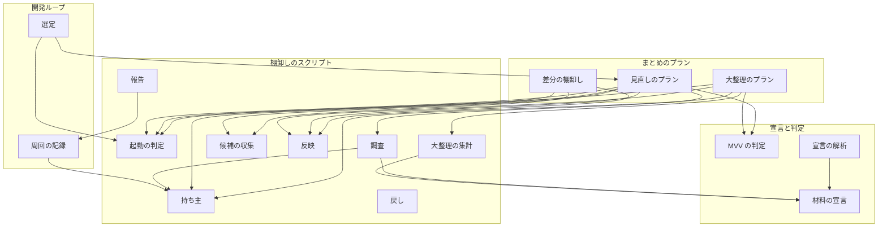
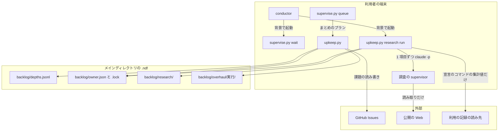
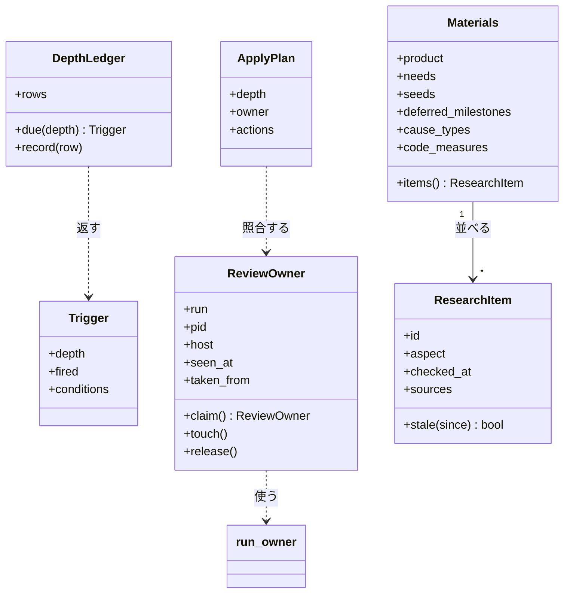
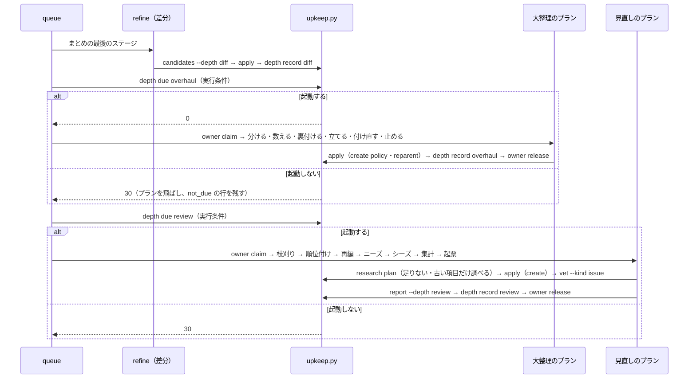
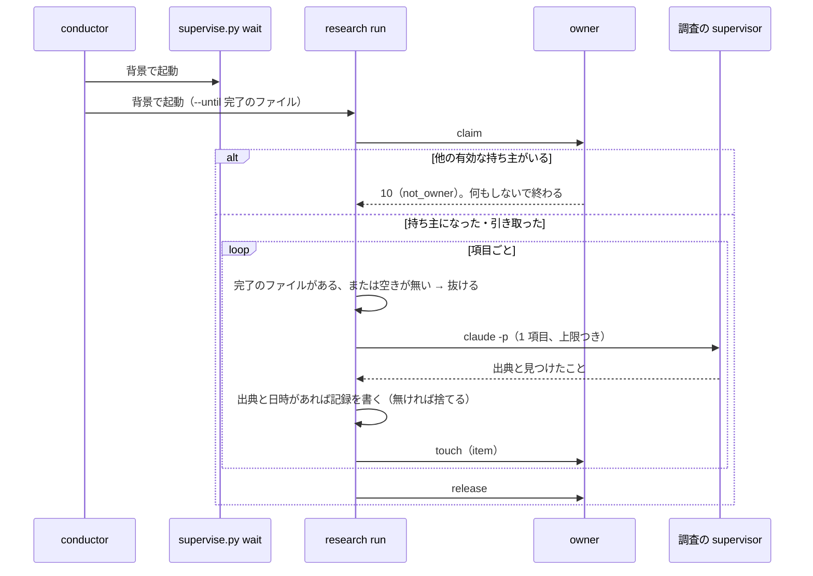
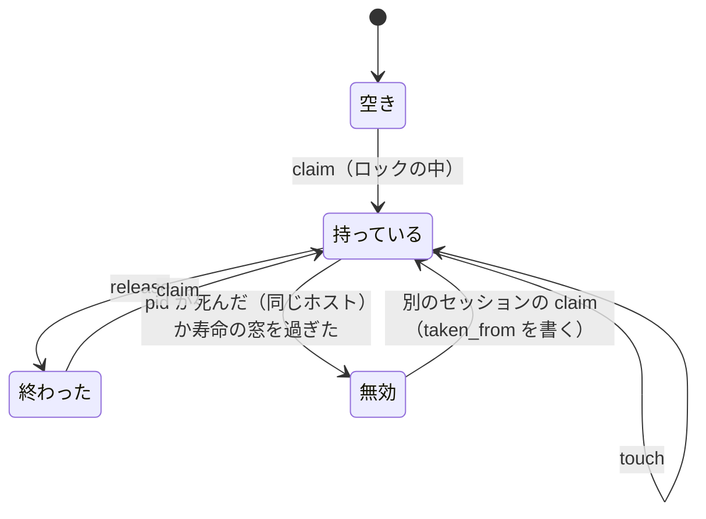

# backlog-refinement: 棚卸しを 3 つの深さで回し、ニーズとシーズの調査から課題を足せるようにする（#2315）

## 目的

- **今どうなっているか**: 課題を足す工程は `out-of-scope` と振り返りだけで、どちらも触っているコードの近くしか見ない。棚卸しは扱う 5 つを毎スプリント同じ重さで回し（206〜224 秒・1.41〜1.61 ドル）、1 回 10 件では持ち越しが約 160 件まで溜まった
- **誰に効くか**: NDF の開発ワークフローを使うすべてのプロジェクトの利用者と conductor
- **変えると何が成り立つか**: 毎スプリントは差分の棚卸しだけに軽くなる。数周回に 1 回の見直しが枝刈り・順位付けと、宣言した材料からのニーズ・シーズの起票を行い、十数周回に 1 回の大整理が根本原因を探して課題を組み直す

## 適用範囲

- **働く範囲**: NDF の配布物（`backlog-refinement`・開発ループ・`supervise.py new close`・`project-decl.py`・`project-mvv.py`）。配布先のリポジトリでも同じ流れで動く。課題の書き込みは GitHub Issues だけ（前提 8）
- **プロジェクトごとに違うもの**: 調査の材料・利用の記録を読むコマンドと範囲・後回しのマイルストーン・原因の型の一覧・コードの横断の計測は `.ndf/project.json` の `materials` で、頻度・閾値・件数の上限・寿命の窓は `.ndf/backlog.json` の `depths` で受ける。どちらも無くても動く
- **当たるモード**: `standard`

## あるべき姿の根拠

| 根拠 | 種類 | 何を示すか |
| --- | --- | --- |
| 依頼（2026-11-01）「既存issueの追従は毎sprint、優先順位の再評価、順位付け、マイルストーン再編、枝刈りは数回に一回など、グラデーションが必要」 | 利用者の指示の原文 | 棚卸しを頻度の違う深さに分けること |
| 依頼「後回し案件 の再評価はそれこそ十数回に1回程度で十分」「Issueレベルだけ見ていては解決できない根本原因を発見し、大胆な大整理を行う」 | 利用者の指示の原文 | 後回しの再評価を大整理に含め、十数回に 1 回にすること |
| 依頼「他のprojectもそのprojectの性質に基いて同じようなフローである必要があります」 | 利用者の指示の原文 | 流れは共通にし、材料をプロジェクトの宣言に置くこと |
| 開発ループ l20261031 の周回 2・3 の `refine` が 206〜224 秒・1.41〜1.61 ドル、周回 4 の持ち越しが約 160 件 | 実測（`laps.md`） | 毎周回の棚卸しが重く、それでも全体が追いつかないこと |
| 2026-10-31〜11-01 に 2 つのセッションが同じ周回を回し、同じ残りを 2 回起票した（#2309 と重複の #2310） | 実測 | 見直しの持ち主を 1 つに限る仕組みが要ること |

要求と受け入れ条件は #2315 の本文にある（写しは [issue-2315-requirements.md](issue-2315-requirements.md) ）。この文書は「どう作るか」だけを扱う。データ構造と入出力の契約は [issue-2315-design-contracts.md](issue-2315-design-contracts.md) 、決定の記録は [issue-2315-design-decisions.md](issue-2315-design-decisions.md) にある。

要求の未決のうち利用者が決める 3 つ（1 置き場・4 利用の記録の既定・5 もう 1 つのプロジェクト）は、この文書では推奨の案（決定 1・決定 9・未確認の 1 行目）で書き、承認ゲート 1 で確かめる。

## ドメインモデル

### コンテキスト

| コンテキスト | 何の語が 1 つの意味に決まるか |
| --- | --- |
| 棚卸し（`ndf-issue-upkeep`） | 深さ・候補・区分・見積の段階・調査の項目・付け直し・大方針 |
| 開発の工程（`ndf-workflow`） | 周回・まとめ・止まる条件・予算 |

棚卸しが供給者、開発ループが顧客の関係（顧客 / 供給者）。開発ループは棚卸しの「起動の判定」と「深さの記録」の結果だけを読み、深さの中身を知らない。

### 集約

| 集約 | 持ち主（書き換えてよいもの） | 根 | エンティティ | 値オブジェクト |
| --- | --- | --- | --- | --- |
| 深さの記録 | `upkeep.py depth` | 1 つのリポジトリの記録（`.ndf/backlog/depths.jsonl`） | 1 回の棚卸しの行 | 深さ・起動した条件・open の前後 |
| 見直しの持ち主の宣言 | `upkeep.py owner`（`run_owner` と `locks` の上） | 宣言（`.ndf/backlog/owner.json`） | — | 持ち主（実行の識別子・pid・ホスト・ループ名）・最後に動いた時刻・引き取り元 |
| 調査の記録 | `upkeep.py research` | 調査の項目（`.ndf/backlog/research/<項目>.json`） | — | 出典・調べた日時・見つけたこと・費用と秒 |
| 課題の一覧（GitHub） | `upkeep.py apply`（深さが見直し・大整理のときは持ち主の実行だけ） | 課題 | — | 本文・ラベル・マイルストーン・親 |
| 型の記録 | `upkeep.py causes record` | 1 つのリポジトリの記録（`.ndf/backlog/causes.jsonl`） | 課題ごとの型の行 | 主の型・従の型 |
| 付け直しの記録 | `upkeep.py apply`（`reparent`）と `upkeep.py revert` | 1 回の大整理（`.ndf/backlog/overhaul/<実行>/before.json`） | 課題ごとの前の状態 | 親・マイルストーン |
| 材料の宣言 | 人（`project-decl.py write` は欠けたキーへ案を書くだけ） | `.ndf/project.json` の `materials` | — | 側面ごとの読む先と範囲 |

### 不変条件

| # | 集約 | 条件 | 破れたときの扱い |
| --- | --- | --- | --- |
| I1 | 見直しの持ち主の宣言 | 有効な宣言は同時に 1 つだけ。宣言はロックの中でだけ作る・書き換える | 取れなかった側は `gate`（`not_owner`）で返し、自分の作業を続ける |
| I2 | 見直しの持ち主の宣言 | 宣言が有効なのは、終わった時刻が無く、最後に動いた時刻から寿命の窓の内で、かつ同じホストなら pid が生きているときだけ（別のホストの宣言は寿命の窓だけで判定する）。どれか 1 つが欠けたら無効（受け入れ条件 9・9a、状態遷移の「無効」） | 無効な宣言は次に取る側が引き取り、引き取り元を書く |
| I3 | 課題の一覧 | 深さが見直し・大整理の `apply` は、宣言の実行の識別子と一致する `--owner` を持つときだけ書く | 1 件も書かずに `stopped`・3 |
| I4 | 課題の一覧 | 1 回の見直しで作る課題は `depths.review.issue_limit` 件まで | 超えた分を作らず `not_created` に並べる |
| I5 | 課題の一覧 | 作る課題（`create`）は出典 1 つ以上・MVV の当たる所・区別のラベルを持つ | その action を `rejected_create` に並べて作らない |
| I6 | 課題の一覧 | MVV 判定が「従う」でない作る課題には `needs-decision` を付ける | 付けられなければ作らない |
| I7 | 調査の記録 | 項目のファイルは出典と調べた日時を持つときだけ書く（途中の結果は書かない） | 項目を書かず、次の機会に同じ項目から始める |
| I8 | 調査の記録 | 利用の記録は、宣言した `usage[].command` を範囲（期間・マスク）つきで打った出力だけを読む。宣言が無ければ読まない | 宣言の無い側面は `skipped`（材料なし（未宣言））にする |
| I9 | 付け直しの記録 | 付け直しの最初の書き込みの前に、対象すべての前の状態を書き終える | 前の状態を書けなければ 1 件も付け直さない |
| I10 | 課題の一覧 | 見直しの候補は後回しのマイルストーンの課題を含まない。差分の棚卸しの候補は含む | — |
| I11 | 深さの記録 | 棚卸しは 1 回に 1 行を足し、起動した条件（起動しなかった判定を含む）を持つ。行を書き換えない | — |
| I12 | 課題の一覧 | 差分の棚卸しは順位の表・前倒しと後ろ倒し・マイルストーンの設定・やらないの判断を反映しない | 該当の action を `wrong_depth` に並べて反映しない |
| I13 | 調査の記録 | 調査は、待っているプランが終わった後と、並列の上限に空きが無いときに新しい項目を始めない | — |

### ドメインイベント

| # | イベント | 発生元 | 受け手 |
| --- | --- | --- | --- |
| E1 | 差分の棚卸しを終えた | まとめの `refine` ステップ | `upkeep.py depth record` |
| E2 | 見直しの起動を判定した | `upkeep.py depth due review`（プランの実行条件） | 見直しのプラン・深さの記録 |
| E3 | 調査の項目を 1 つ調べ終えた | `upkeep.py research run` | 調査の記録・持ち主の宣言（最後に動いた時刻） |
| E4 | 待っていたプランが終わり、調査を止めた | `upkeep.py research run`（完了のファイルを見た） | 持ち主の宣言（終わった時刻） |
| E5 | 宣言の無い側面を飛ばした | `upkeep.py research plan` | 見直しの報告 |
| E6 | 見直しの持ち主になった | `upkeep.py owner claim` | 調査・見直し・大整理 |
| E7 | 持ち主を引き取った | `upkeep.py owner claim` | 宣言の `taken_from`・見直しの報告 |
| E8 | 枝刈り・順位付け・マイルストーンの再編を反映した | `upkeep.py apply --depth review` | 見直しの報告 |
| E9 | ニーズ・シーズの課題を起票した | `upkeep.py apply`（`create`） | 見直しの報告・E10 |
| E10 | 起票した課題の MVV 判定をした | `project-mvv.py vet --kind issue` | `apply`（`needs-decision` の付与）・開発ループの選定 |
| E11 | 見直しの報告を出し、持ち主を解放した | `upkeep.py report --depth review`・`owner release` | 深さの記録・周回の記録 |
| E12 | 大整理の起動を判定した | `upkeep.py depth due overhaul` | 大整理のプラン・深さの記録 |
| E13 | 原因の型で分け、数え、裏付けた | `upkeep.py overhaul count`・`overhaul measure` | 大整理の報告 |
| E14 | 大方針の Issue を起票した | `upkeep.py apply`（`create`、`kind: policy`） | E15 |
| E15 | 課題を柱の子へ付け直し、マイルストーンを組み直した | `upkeep.py apply`（`reparent`） | 付け直しの記録・大整理の報告 |
| E16 | 付け直しを戻した | `upkeep.py revert` | 大整理の記録 |
| E17 | 後回しの課題を前倒し・やらない・据え置きに分けた | `upkeep.py apply --depth overhaul` | 大整理の報告 |

### 用語

| 用語 | 意味 | 用語集への反映 |
| --- | --- | --- |
| 棚卸しの深さ | 1 回の棚卸しが扱う範囲。差分の棚卸し・見直し・大整理の 3 つ。`upkeep.py` の `--depth diff\|review\|overhaul` | 追加（`ndf-issue-upkeep`） |
| 調査の項目 | 調査を小さく分けた単位。側面と対象の組（例: `seeds.library:pytest`）。1 項目が 1 つの調査の記録になる | 追加（`ndf-issue-upkeep`） |
| 付け直しの記録 | 大整理が課題の親とマイルストーンを変える前に残す、課題ごとの前の状態。`upkeep.py revert` が読んで戻す | 追加（`ndf-issue-upkeep`） |
| 柱 | 大方針の子で、根本原因の仕組みごとに直す課題。#2335 では P0〜P8（#2336〜#2344） | 意味の変更（`ndf-workflow`） |
| 寿命の窓 | 持ち主の記録が終わっていなくても、最後に動いた時刻からこの時間を過ぎた実行を終わったとみなす長さ。レビュー worktree は 24 時間、見直しの持ち主は既定 15 分 | 意味の変更（`ndf-worktree`） |

要求の用語（差分の棚卸し・見直し・大整理・後回しの再評価・ニーズの調査・シーズの調査・調査の記録・材料の宣言・見直しの持ち主・大方針）は、要求の Pull Request で用語集へ足してある。

## 機能一覧

| # | 機能 | 誰が使うか |
| --- | --- | --- |
| F1 | まとめで差分の棚卸しだけを行う | 開発ループ・スプリントのまとめ |
| F2 | 回数と溜まり具合から見直し・大整理の起動を判定し、深さの記録に残す | 開発ループ・まとめのプラン |
| F3 | 見直しを決まった順（枝刈り → 順位付け → マイルストーンの再編 → ニーズ → シーズ → ホットスポットと失敗の集計 → 起票）で通す | 見直しのプラン・人（単独の起動） |
| F4 | 待ち時間に調査の項目を 1 つずつ調べ、調査の記録に書く | conductor（待ちと並べて起動する） |
| F5 | 見直しの持ち主を宣言・ロック・生きている印・引き取りで 1 つに限る | 調査・見直し・大整理 |
| F6 | 材料の宣言の案を解析で出し、人が確かめて書く | `project-decl.py`・人 |
| F7 | ニーズ・シーズの課題を出典・MVV の当たる所・ラベルつきで上限まで起票し、MVV 判定にかける | 見直し |
| F8 | 大整理（分ける → 数える → 裏付ける → 立てる → 付け直す → 止める）と後回しの再評価を行う | 大整理のプラン・人 |
| F9 | 付け直しを 1 つのコマンドで戻す | 人 |
| F10 | 選べる課題が尽きたとき、止まる前に見直しを 1 回挟む | 開発ループ |
| F11 | 見直し・大整理・調査の結果を統一 JSON レポートと周回の記録に出す | conductor・人 |

## 構成要素

| 要素 | 責務 | 新設 / 変更 |
| --- | --- | --- |
| Skill 本文（`backlog-refinement/SKILL.md`） | 深さの表と、深さごとに読む参照の案内。扱う 5 つを深さへ割り振る | 変更 |
| 深さの参照（`references/depths.md`・`review.md`・`research.md`・`overhaul.md`） | 起動の条件・見直しの順・調査の手順と材料の読み方・大整理の 6 手順 | 新設 |
| 候補の収集（`upkeep.py candidates --depth`） | 深さごとの経路で候補を集める（差分は 4 経路（機械の候補・担当が足す・親 issue・コミットの件名）とそのスプリントで起票した課題、見直しは後回しを除く open の全件） | 変更 |
| 起動の判定（`upkeep_depth.py`。`upkeep.py depth due\|record`・`causes record`） | 深さの記録と型の記録から回数と溜まり具合を数え、起動するかを返す。棚卸しごとに 1 行を足す。型の記録へ行を足す | 新設 |
| 持ち主（`upkeep_owner.py`。`upkeep.py owner claim\|touch\|release\|status`） | 宣言をロックの中で取り、寿命の窓と pid で生死を判定し、引き取る。部品は `run_owner`（窓を引数に取るよう変える）と `locks` | 新設 |
| 持ち主の記録の部品（`lib/run_owner.py`） | `alive` の寿命の窓を引数で受ける。pid とホストでの生死の判定を足す | 変更 |
| 調査（`upkeep_research.py`。`upkeep.py research plan\|run`） | 材料の宣言から調査の項目を並べ、古い項目と足りない項目を選ぶ。待ちの間に 1 項目ずつ `claude -p` で調べ、記録に書く。利用の記録は宣言のコマンドを範囲とマスクつきで打つ | 新設 |
| 反映（`upkeep.py apply`） | `create`（起票）と `reparent`（付け直し）の action を足す。深さの検査（I3・I12）・件数の上限（I4）・起票の形（I5）・付け直しの記録（I9）を持つ | 変更 |
| 戻し（`upkeep.py revert`） | 付け直しの記録から親とマイルストーンを戻す | 新設 |
| 大整理の集計（`upkeep_overhaul.py`。`upkeep.py overhaul snapshot\|count\|measure`） | 未完了の一覧の固定・型ごとの件数と部品とマイルストーンの割合と起票・完了の推移・宣言した計測の実行 | 新設 |
| 報告（`upkeep_report.py`） | 深さごとの報告の値（閉じた・起票した・open の前後・順位の変化・飛ばした側面・起動した条件・戻すコマンド） | 変更 |
| まとめのプラン（`supervise_lib/sprint_close_steps.py`） | `refine` を差分の棚卸しにし、後ろに大整理と見直しのプラン（実行条件つき）を足す | 変更 |
| 開発ループ（`lib/sprint_loop_select.py`・`sprint_loop_gate.py`・`sprint_loop_record.py`） | `no_issue` の前に見直しを 1 回挟む。周回の記録へ深さ・調査の費用と秒の行を足し、予算に数える。`loop sprint` が調査の起動のコマンドを返す。`loop status` が持ち主を出す | 変更 |
| MVV の判定（`project-mvv.py vet --kind issue`） | 課題の本文がプロジェクト MVV に従うかを判定する | 変更（種類を 1 つ足す） |
| 宣言の解析（`project-decl.py measure`・`write`） | `materials` の案を `question` の項目で出す。手の値を変えない | 変更 |
| 契約の一覧（`plugins/ndf/contracts/`） | 新しい設定のキー・受け渡しのファイル・入口の引数を宣言する | 変更 |
| 手順の文書（`development-workflow` の `loop.md`・`waiting.md`） | 周回の打つ順に調査の起動を、止まる条件に見直しを挟むことを書く | 変更 |



図の矢印は「呼ぶ・読む」を表す。`RVT`（戻し）は人が打ち、`APP` が書いた付け直しの記録を読むため、呼ぶ矢印を持たない。

### 文脈と配置



`.ndf/backlog/` はループの記録（`.ndf/loop/`）と同じくメインディレクトリに置き、コミットしない。複数の worktree と複数のセッションが同じメインディレクトリを見るため、持ち主の取り合いがここで決まる。調査の supervisor は外部へ書き込まない（前提 7）。

### 置き場所

```text
plugins/ndf/
├── skills/backlog-refinement/
│   ├── SKILL.md                         # 変更（深さの表・引数）
│   ├── references/
│   │   ├── depths.md                    # 新設（3 つの深さ・起動の条件・持ち主）
│   │   ├── review.md                    # 新設（見直しの 7 つの手順）
│   │   ├── research.md                  # 新設（調査の項目・材料・利用の記録の範囲）
│   │   └── overhaul.md                  # 新設（大整理の 6 手順・後回しの再評価・戻し）
│   ├── scripts/
│   │   ├── upkeep.py                    # 変更（--depth・depth・owner・research・overhaul・revert の副命令、apply の action）
│   │   ├── upkeep_depth.py              # 新設
│   │   ├── upkeep_owner.py              # 新設
│   │   ├── upkeep_research.py           # 新設
│   │   ├── upkeep_overhaul.py           # 新設
│   │   ├── upkeep_actions.py            # 新設（create・reparent・revert）
│   │   └── upkeep_report.py             # 変更
│   └── tests/fixtures/overhaul-20261101.json  # 新設（受け入れ条件 22 の固定の入力）
├── scripts/lib/run_owner.py             # 変更（窓の引数・pid とホスト）
├── scripts/lib/sprint_loop_*.py         # 変更
├── scripts/supervise_lib/sprint_close_steps.py  # 変更
├── scripts/project-mvv.py               # 変更（--kind issue）
├── scripts/project_lib/                 # 変更（materials の問い）
├── skills/development-workflow/schemas/project.schema.json  # 変更（materials）
└── contracts/                           # 変更（settings・files・entrypoints）
```

## 構造



`ApplyPlan` の `actions` は既存の課題の action に `create` と `reparent` を足す。`ReviewOwner` は `run_owner` の記録（`run`・`seen_at`・`finished_at`）に `pid`・`host`・`loop`・`taken_from` を足した形である。

## データ構造

データ構造（ER 図・ファイルごとの列・材料の宣言と設定のキー・CRUD）は [issue-2315-design-contracts.md の「データ構造」](issue-2315-design-contracts.md#データ構造) にある。

## 入出力の契約

副命令と引数の契約は [issue-2315-design-contracts.md の「入出力の契約」](issue-2315-design-contracts.md#入出力の契約) にある。

## 処理の流れ

### まとめと深さ



- 選定（`loop select`）が `review_first` を返したときは、同じ見直しのプランを `trigger: no_issue` で流してから選定をやり直す（決定 12）
- どちらのプランも最初のステップが `owner claim` で、持ち主になれない（10）ときは `skip_to` で `depth record --event skipped` のステップへ飛び、深さの記録に `skipped` の行を残して終わる
- 大整理を見直しより先に置く。両方が起動する周回では、組み直した後の課題で順位を付けるためである
- 大整理と見直しのプランは同じ queue の次のステージで流れ、`loop lap` はその後に周回を締める。プランの失敗は今のまとめの失敗と同じ扱い（周回の記録に残し、次の周回で `depth due` が同じ条件で再び起動する）
- 見直しの「集計」の手順は、前の見直しより後に起票された課題に原因の型を付け、`causes record` で型の記録へ足す（大整理の起動の判定の材料）
- 見直しのステップが `review.usd` か `review.seconds` に当たったら、手順 2A を止め、残りを `metrics.deferred` に古い順で載せて手順 3 へ進む

### 待ち時間の調査



- 空きは「queue の一覧の走っているプランの数 < `--max`」で判定する。空きが無ければ項目を始めず、間隔を置いて見直す（空きが出ないまま完了のファイルが出たら終わる）
- 完了のファイルが出たら新しい項目を始めない。今の項目は `research.grace` 秒まで待ち、過ぎたら止めて記録を書かない
- 生きている印は項目の区切りと `owner.beat` 秒ごとに書く（`claude -p` の待ちの間も、`run_ticking` の tick で書く）

処理の流れの図に現れない要素: Skill 本文・深さの参照・契約の一覧・手順の文書（工程が読む文書）、宣言の解析と戻し（人が流れの外で打つ）、持ち主の記録の部品（持ち主の中で使う）。

### 持ち主の状態



`持っている` から別のセッションの `claim` へ直接移る遷移は無い（I1・受け入れ条件 9a）。

### 大整理の 6 手順

| 手順 | 誰が | 何を |
| --- | --- | --- |
| 1 分ける | worker（件数で割る） | `overhaul snapshot` の未完了の全件（後回しを含む）を `cause_types` で主の型 1 つと従の型 0〜2 個に分け、`classes.json` に書く。分けられない課題は I |
| 2 数える | スクリプト | `overhaul count`（型ごとの件数・課題の集まる部品・マイルストーンごとの割合・月ごとの起票と完了） |
| 3 裏付ける | スクリプト | `overhaul measure`（`code_measures` のコマンドを打つ）。宣言が無ければ飛ばして報告に書く |
| 4 立てる | supervisor | 型の偏りと計測から、Issue 単位では直らない根本原因の有無を決める。あれば大方針（柱と受け入れ条件）の本文を書き、`vet --kind issue` にかける。従う以外は `needs-decision` で起票し、5・6 へ進まない（受け入れ条件 21） |
| 5 付け直す | スクリプト（`apply` の `reparent`） | 柱の子へ付け直し、マイルストーンを組み直す。前の状態を先に書く |
| 6 止める | supervisor | 大方針の本文に「設計が終わるまで該当の型の新しい課題を子として起票する」を書く |

後回しの再評価（E17）は手順 1 の後に、後回しのマイルストーンの課題を前倒し・やらない・据え置きに分け、既存の `apply`（マイルストーンの変更・やらない）で反映する。分けられない課題は据え置きにする。

## 非機能の実現方式

| 大項目 | 要求の条件 | 実現方式 | 確かめ方 |
| --- | --- | --- | --- |
| 性能・拡張性 | 毎スプリントの棚卸しの所要は今の実測より短い | 差分の棚卸しは 4 経路とそのスプリントの起票だけを見て、順位の表・移動・マイルストーン・やらないの判断を行わない。見直しは別のプランへ出す | 変更の後の周回の `depths.jsonl` の `cost`・`seconds` を、206〜224 秒・1.41〜1.61 ドルと比べる（受け入れ条件 17） |
| 性能・拡張性 | 調査は 1 回に 1〜数項目で、上限を持つ | 1 項目ごとに `item_usd`・`item_seconds`、1 回の待ちごとに `--max-items`（既定 3） | 上限を小さくした単体テストで、項目を止めて記録を書かないこと |
| 運用・保守性 | 起動した条件・飛ばした側面・引き取り・前の状態・調査の費用が記録に残る | `depths.jsonl`・`owner.json` の `taken_from`・`before.json`・周回の記録の `depth` と `research` の行 | 結合テストで各行が出ること |
| 移行性 | 新しい宣言と設定は無くても動く。付け直しは 1 つのコマンドで戻せる | すべての新しいキーに既定値を置き、`materials` が無ければ調査の側面をすべて飛ばす。`revert --run` | 宣言の無いリポジトリの結合テスト・戻しのテスト |
| セキュリティ | 利用の記録は宣言の範囲の外を読まず、秘密と個人情報を書かない | 利用の記録は `aggregate_only: true` の宣言のコマンドだけをスクリプトが打ち、`mask` と `secret_redact` を通した出力だけを `claude -p` へ渡す。調査の supervisor は利用の記録の読み先へ自分でつながない | 個票の宣言・秘密の形の出力を入れたテストで、読まない・伏せること |
| システム環境 | 調査の supervisor は並列の上限と資源の上限に数える | 空きの判定で queue の走っている本数を数え、調査は常に 1 本だけ | 空きが無い一覧を入れたテストで起動しないこと（受け入れ条件 6a） |

## 決定の記録

決定の記録は [issue-2315-design-decisions.md](issue-2315-design-decisions.md) にある。

## テスト設計

| 受け入れ条件・不変条件 | どの振る舞いで縛るか | どう壊したら落ちるべきか |
| --- | --- | --- |
| 1・I12 | `candidates --depth diff` が 4 経路とそのスプリントの起票だけを返し、`apply` が差分の深さで順位の表・移動・マイルストーン・やらないを `wrong_depth` にする | `no-milestone` の経路を差分に残す・`wrong_depth` の検査を外す |
| 2 | 見直しの報告の `order` が 7 つの手順の順で並ぶ | 手順を入れ替えても報告が通る |
| 3・I10 | 見直しの候補に後回しの課題が出ず、差分の候補には出る | 後回しの除外を差分にも当てる |
| 4・I11 | 回数・溜まり具合・既定と上書きの組で `depth due` の 0 / 30 と行の `trigger` | 回数を前の大整理から数える・`not_due` の行を書かない |
| 4a・F10 | `no_issue` の初回は `review_first`、見直しの後も 0 件なら `no_issue` で止まる | 毎回 `review_first` を返す（止まらない） |
| 5 | ループの外で `--depth review` を打つと `trigger: manual` で通る | `--loop` が無いと起動しない |
| 6・I13 | 完了のファイルが出た後と空きが無いときに項目を始めない。次の起動が残りの項目から始める | 完了のファイルを見ない・調べ終えた項目を再び調べる |
| 6a | 一覧の走っている本数が `--max` のとき `claude -p` を起動しない | 空きの判定を外す |
| 7・I7 | 記録に出典と日時が無ければ書かない。周回の記録の `research` 行と予算の和に費用が入る | 出典の無い記録を書く・予算に数えない |
| 8・I1 | 2 つのプロセスが同時に `owner claim` すると片方だけが 0 | 錠を外す |
| 9・I2 | 死んだ pid と寿命の窓を過ぎた宣言を引き取り、`taken_from` を書く | `taken_from` を書かない・生死を見ない |
| 9a | 生きていて窓の内の宣言は引き取らない | 窓を 0 にしても通る |
| 10 | フローとスクリプトにプロジェクトの名前・マイルストーン名・材料の値が無い（材料は宣言からだけ読む） | 既定値に ai-plugins の材料を置く |
| 11・I8・E5 | 宣言の無い側面が `skipped_aspects` に「材料なし（未宣言）」で載り、その側面の起票が 0 件 | 宣言が無い側面を調べる |
| 12・I8 | `aggregate_only` でない行・宣言の無いときは利用の記録を読むコマンドを打たない。`mask` に当たる値が記録に残らない | マスクを外す・個票の行を打つ |
| 13・I4・I5・I6 | 上限を超えた `create` が `not_created`、出典の無い `create` が `rejected_create`、従う以外が `needs-decision` つきで作られ、選定から外れる | 上限を数えない・ラベルを付けない |
| 14 | `seeds.libraries` の 1 行が「変化」と「競合」の 2 つの観点の指示になる | 競合の観点を落とす |
| 15 | 見直しの報告に 6 つの値（閉じた・起票した・open の前後・順位の変化・飛ばした側面と理由・起動した条件）が載る | 1 つでも欠けて通る |
| 16 | 手動確認: ai-plugins と Web サービスの宣言で見直しを 1 回ずつ通し、報告の `items` の出典が宣言の読み先だけである | — |
| 17 | 手動確認（リリース後テスト）: 周回の記録の差分の棚卸しの秒とドル | — |
| 18 | `depth due overhaul` が回数と 3 つの溜まり具合で起動し、後回しの再評価を含む | 型の割合を見ない |
| 19 | `overhaul count`・`measure` の値と、根本原因の有無の報告の形 | 型ごとの件数が分類と合わない |
| 20・I9・E16 | 付け直しの前に `before.json` が全件書かれ、途中の失敗で `revert_command` が出て、`revert` で元に戻る | 書き込みの後に前の状態を書く・戻しで親を外さない |
| 21 | 大方針が従う以外なら `reparent` へ進まない | 判定を見ずに付け直す |
| 22 | 固定の入力（`fixtures/overhaul-20261101.json`）と分類から `count` が A〜I の件数と部品の上位を返し、手動確認で柱と付け直しの一覧を #2335 と比べる | 固定の入力を読まない |
| 23・I3 | 持ち主でない `apply --depth review` と調査の過程が課題を書かない。`out-of-scope` と振り返りの起票はそのまま通る | 持ち主の照合を外す |
| 24 | `materials` と `depths` の無いリポジトリで、まとめが差分の棚卸しを通り、見直しは回数でだけ起動して側面をすべて飛ばし、止まらない | 宣言が無いと `stopped` で返す |

## 設計の結果

| 課題 | 扱い | 取り込み先 | 触るファイル |
| --- | --- | --- | --- |
| #2315 | 実装する | — | `plugins/ndf/skills/backlog-refinement/`、`plugins/ndf/scripts/lib/run_owner.py`、`plugins/ndf/scripts/lib/sprint_loop.py`、`plugins/ndf/scripts/lib/sprint_loop_gate.py`、`plugins/ndf/scripts/lib/sprint_loop_select.py`、`plugins/ndf/scripts/lib/sprint_loop_record.py`、`plugins/ndf/scripts/supervise_lib/sprint_close_steps.py`、`plugins/ndf/scripts/project-mvv.py`、`plugins/ndf/scripts/project_lib/`、`plugins/ndf/skills/development-workflow/`、`plugins/ndf/contracts/`、`docs/glossary.md`、`docs/glossary/glossary.json` |

## 未確認のまま残ること

| 項目 | 内容 |
| --- | --- |
| 利用者が決める 3 つ | 置き場（決定 1 の推奨: `backlog-refinement` の深さ）・利用の記録の既定（決定 9 の推奨: 宣言が無ければ読まない）・受け入れ条件 16 のもう 1 つのプロジェクト（推奨: `project-analysis.md` の例の carmo-system-console。Web サービスで、利用の記録の読み先を持つ）を承認ゲート 1 で確かめる |
| 頻度と閾値の値 | 見直し 3・大整理 12・open の増加 30%・型の割合 50% は今の 1 本のループ（4 周回）からの値で、見直しの 1 回の費用はまだ測っていない。実装後の最初の 3 回の見直しの `depths.jsonl` で見直す |
| 空きの判定の入力 | queue の一覧（`start_listing` が書く）が走っている本数を持つかを実装で確かめる。持たなければ一覧に足す |
| 別の clone のセッション | 持ち主の取り合いはメインディレクトリを共有するセッションの間でだけ成り立つ。別の clone で同じリポジトリを回すセッションとは取り合えない |
| 受け入れ条件 22 の分類の記録 | #2335 の分類の記録（課題ごとの型）はリポジトリに無い。固定の入力は 2026-11-01T04:23Z 時点の open を `createdAt`・`closedAt` から作り直し、分類は大整理の手順 1 でやり直して件数の差を報告に書く |
| #2342 との関係 | 持ち主は今の `run_owner`・`locks` の上に作る。#2342（持ち主の部品 `lib/lease.py`）が入ったら、その鍵の 1 つへ移す（決定 6） |
