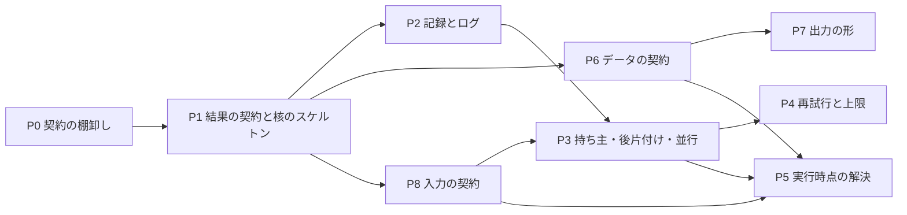

# #2335 の設計: 柱の順序と移し方

設計文書の本体は [issue-2335-design.md](issue-2335-design.md) 、決定の記録は [issue-2335-design-decisions.md](issue-2335-design-decisions.md) にある。

## 柱の順序と受け入れ条件の受け持ち（受け入れ条件 D4）

| 柱 | 前提にする柱 | 前提にする理由 | 受け持つ受け入れ条件 |
| --- | --- | --- | --- |
| P0 #2336 | — | 以後の柱は契約の一覧を正として読む | 0・1（検査と許可の一覧）・1a・12b（検査）・14 |
| P1 #2337 | P0 | 核のスケルトンは入口の id を契約の一覧から引く | 1（移す）・2・2a・2b・15・16 |
| P2 #2338 | P1 | 記録の書き口は核が実行の識別子を振った後に呼ぶ | 3・3a・13 |
| P6 #2339 | P1 | 型の読み書きは核の `ctx.read` / `ctx.write` を通す | 10・10a・10b・14 |
| P8 #2341 | P1 | 入力の解決は核の E2 | 12・12a・12b・13・14 |
| P7 #2340 | P6 | 結果とフェーズレポートの型が要る | 2b・11 |
| P3 #2342 | P8・P2 | 持ち主の鍵は解決した入力から作り、取り合いを記録へ書く | 4・4a・7 |
| P4 #2343 | P3 | 期限で打ち切った実行も持ち主の記録を返す | 5・5a |
| P5 #2344 | P6・P8・P3 | 参照はプランの型を読み、持ち主の記録を取った後に解決する | 6 |
| この課題 | すべて | — | 8・9 |

数え直すと、受け入れ条件 0〜16 のすべてと D1〜D5 の受け持ちがある（D1〜D5 はこの文書）。16 はすべての柱が満たす。

## 移す順序と大きさ

- **柱は「核の段を足す Pull Request」と「入口を移す Pull Request」に分ける。** 段の Pull Request は核と検査と契約の一覧の形だけを変え、許可の一覧は減らさない
- **入口を移す Pull Request は 1 つの部品ずつ**にする。部品の順は課題の集まる順（要求の「進め方」3）: supervise のプラン・judge・キュー → cross-refactoring → 課題を閉じる処理 → リリース → 外部 CLI の監視 → 使用量の帳簿 → 残り
- **P1 がすべての入口を `run_core.main` へ移す。** P2 以降は核の段と契約の行を足し、入口に残る重複（自前の再試行・持ち主・`argparse`）を消す。入口の本体を柱ごとに書き直さない
- **1 スプリントは 1 つの柱**で、その柱の段の Pull Request と、移す部品の Pull Request から成る。部品の Pull Request が 3 本を超える柱は、残りを同じ柱の次のスプリントへ送る（Value 10）

## 既存の課題の扱い

- **A〜F の 103 件は、属する柱のマイルストーン（28〜30）へ移す。** 選定の対象から外したまま別のループに拾われないようにするためである（決定 10）。進行中のスプリント（m26）の課題は閉じる処理の後に移す。移すのは P0 の最初の作業で、GitHub のマイルストーンの付け替えだけ（C8 に当たらない）
- **受け入れ条件 9 の基準値の記録は、P0 が `issues/issue-2335-classification.jsonl` に作る**（1 行 1 課題: 番号・主の型・従の型・理由の 1 文）。2026-11-01 の分類の記録はリポジトリに無いため、本文の手順（本文の先頭 2500 字から主の型を 1 つ）で 194 件を分類し直す。分類し直した割合が 82% と食い違えば、基準値を差し替えずに要求へ戻す

