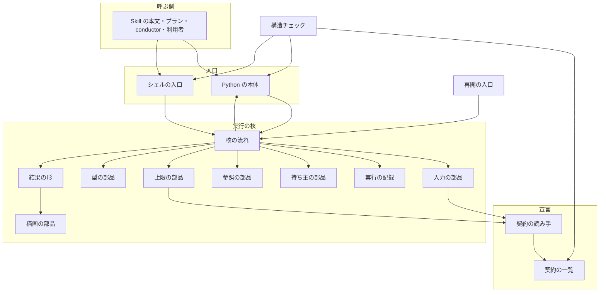
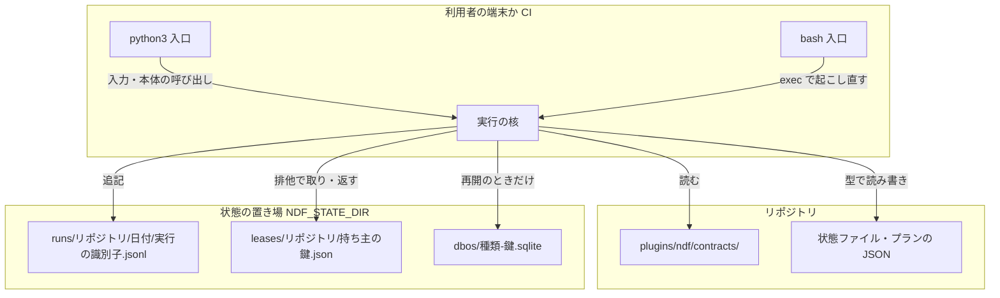
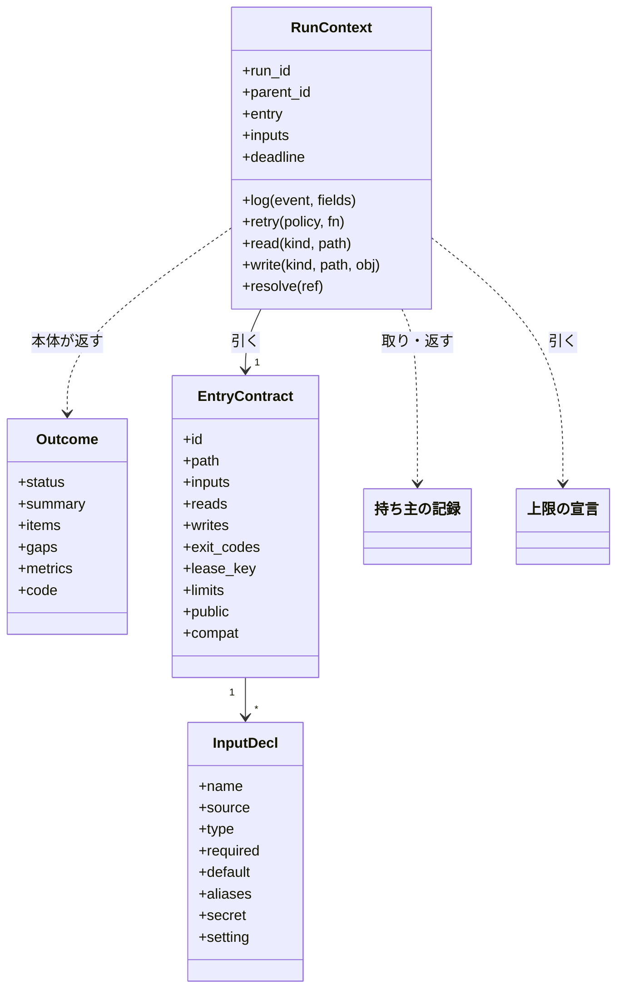
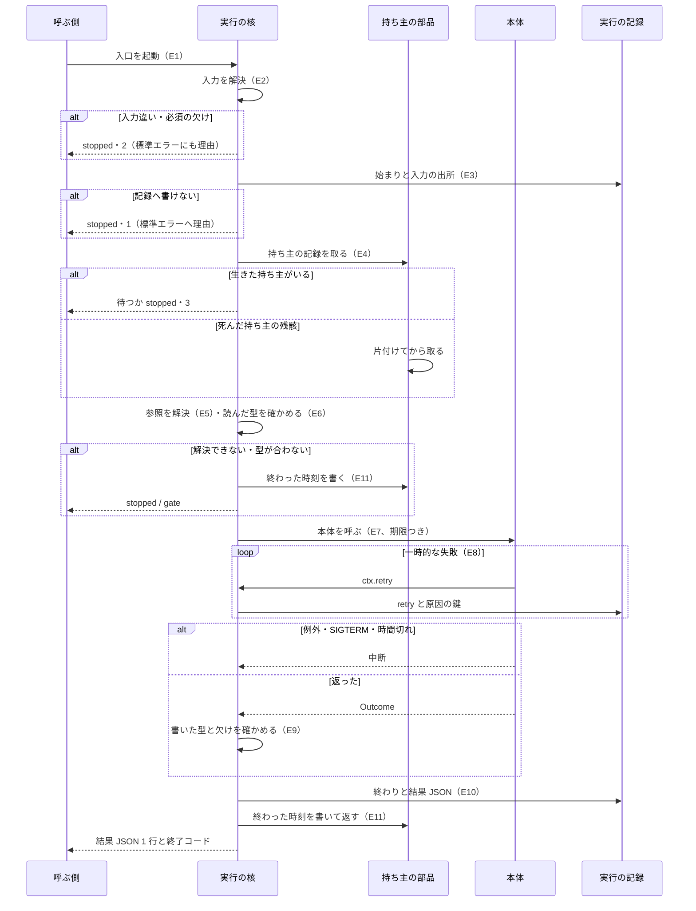
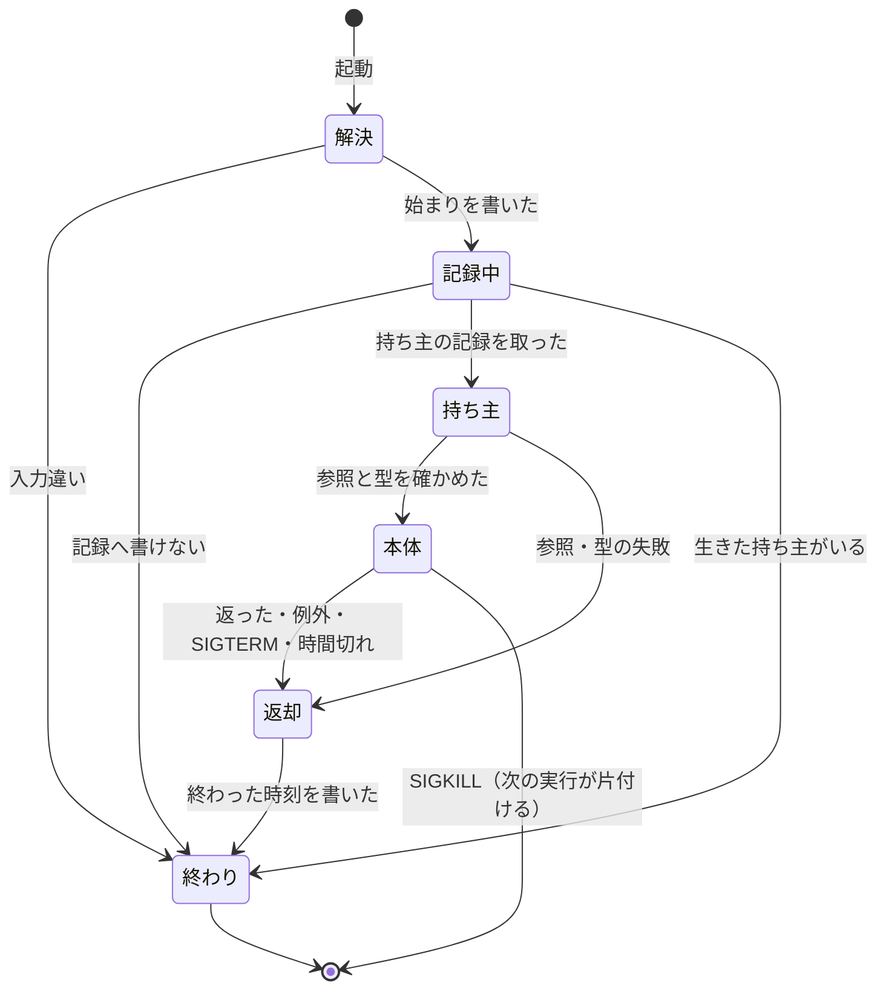

# NDF のスクリプト: すべての入口が 1 つの実行の核と契約の一覧を通り、異常系の不具合を型ごとに防げるようにする（#2335）

## 目的

- **何が壊れているか**: 入口とステップが、成功・失敗の判定・記録・後片付け・再試行と上限・入力の解決と、受け渡すデータの名前と形をそれぞれ自分で書く。共通部品（`step_result`・`proc`・`waits`・`durable`・`run_owner`）は呼ばなくても書けて、検査も落とさない
- **誰が困るか**: NDF でスプリントを回す利用者と conductor。m26-2 では本番へ出すまでに conductor が 9 回止めて直し、未完了の課題 194 件のうち 103 件が同じ 6 つの型（A〜F）に当たる
- **直すと何が成り立つか**: 入口は仕事の中身だけを書き、核が判定・記録・持ち主・上限・入力・型を引き受ける。核と契約の一覧を通らない入口を検査が落とすため、新しい入口でも同じ型の不具合が生まれない

## 適用範囲

- **働く範囲**: NDF の配布物（`plugins/ndf/scripts` と `plugins/ndf/skills/*/scripts`、テストと `experimental/` を除く）。配布先のリポジトリでも同じ核が動く。hook・`factory/`・ほかのプラグインは含まない
- **プロジェクトごとに違うもの**: リポジトリの根・設定（`.ndf/`）・上限の上書きは、核の入力の解決（引数 → 環境変数 → 設定 → 既定値）で受ける。核の中に ai-plugins の値を置かない
- **当たるモード**: `standard`。この文書は設計だけを持ち、実装は柱 9 本（#2336〜#2344）が、それぞれの設計 Pull Request で行う

## あるべき姿の根拠

| 根拠 | 種類 | 何を示すか |
| --- | --- | --- |
| 利用者の指摘（2026-11-01）「異常系処理とログ出力、異常時の回復処理が統一されていないから起こる不具合・課題が多い。1 件ずつ対処してもきりがない」「出力だけでなく入力もそろえるべき」 | 利用者の指示の原文 | 統一の範囲が異常系・記録・回復・データ・出力・入力の 6 つであること |
| 未完了 194 件の分類で A〜F が 103 件（不具合 125 件の 82%） | 実測（#2335 の調査） | 個別の修正では減らないこと |
| 核の候補の import の時間（10 回の中央値）: 何も読まない 12 ms・`step_result` 35 ms・`jsonio`+`clock`+`locks` を足して 86 ms・`schema`（pydantic）+`waits`（tenacity）を足して 164 ms・`durable`（DBOS）を足して 550 ms。`supervise.py --help` は 253 ms | 実測（2026-11-01、`/work/ai-plugins/.venv/bin/python`） | 核は DBOS を遅れて読めば 1 入口の増分を 150 ms 以内に収められること（決定 9） |

要求と受け入れ条件は #2335 の本文にある（写しは [issue-2335-requirements.md](issue-2335-requirements.md) ）。
この文書は「どう作るか」だけを扱う。柱の順序・受け入れ条件の受け持ち（受け入れ条件 D4）・移す順序と大きさ・既存の課題の扱いは [issue-2335-design-pillars.md](issue-2335-design-pillars.md) 、決定の記録は [issue-2335-design-decisions.md](issue-2335-design-decisions.md) にある。

要求の「lease」は、この文書では既存の語の **持ち主の記録**（#2229）と、それを取り合う排他を合わせたものを指す。「lease」という語は用語集へ足さない。

## ドメインモデル

### コンテキスト

| コンテキスト | 何の語が 1 つの意味に決まるか |
| --- | --- |
| NDF の開発ワークフロー（`ndf-workflow`） | 実行の核・契約の一覧・実行の識別子・実行の記録・上限の宣言・名前の対応表・例外リスト・機械用のブロック・結果 JSON |
| worktree（`ndf-worktree`） | 持ち主の記録・状態の持ち主（核が使う。語の意味は変えない） |

**核と契約の一覧は、すべてのコンテキストの共有カーネルである**（#1142 の「ライブラリ」と同じ位置）。
プランの実行・収束ループ・リリース・外部 CLI の起動などの各コンテキストは、契約の一覧に自分の入口とファイルの行を書き、
核を通して動く。共有部分を変えるのは柱の Pull Request だけで、その Pull Request が読み手と書き手を同じ差分で直す。

### 集約

| 集約 | 持ち主（書き換えてよいもの） | 根 | エンティティ | 値オブジェクト |
| --- | --- | --- | --- | --- |
| 契約の一覧 | 柱と各入口を変える Pull Request（実行時には誰も書かない。核は読むだけ） | `plugins/ndf/contracts/` | 入口の契約・ファイルの契約・設定の契約・環境変数の契約 | 入力の宣言・終了コードの集合・持ち主の鍵の宣言 |
| 実行 | 実行の核（`run_core`） | 実行の識別子 | 実行の記録の行 | 結果 JSON・入力の出所・原因の鍵 |
| 持ち主の記録 | 持ち主の部品（`lease`） | 持ち主の鍵 | — | pid と開始時刻・終わった時刻 |
| 型の定義 | データの型の部品（`lib/model/`） | 種類（kind）と版 | — | 移行関数 |
| 上限の宣言 | 上限の部品（`limits`） | 方針の名前 | — | 上限の秒・再試行の回数・同じ原因の上限 |
| 例外リスト | 構造チェック（読むだけ）。行を消すのは移した Pull Request | `scripts/script-structure-allow/` | 許可の行 | 検査の種類 |

**集約の間は識別子で参照する。** 実行は入口の契約を入口の id で、持ち主の記録を持ち主の鍵で、型を kind と版で指す。
1 回の実行が書き換える集約は「実行」と「持ち主の記録」の 2 つで、持ち主の記録は実行の前後でだけ書く（E4・E11）。

### 不変条件

| # | 集約 | 条件 | 破れたときの扱い |
| --- | --- | --- | --- |
| I1 | 実行 | 結果の `status` は `ok` / `gate` / `stopped` のどれかで、終了コードは `step_result.code_matches` を満たす。例外・SIGTERM・時間切れも核が `stopped` と理由に変える | 本体の返した結果を捨て、`stopped` を返す。原因は `summary` と `gaps` に書く（入出力の契約の「失敗の形」と同じ置き場） |
| I2 | 実行 | `ok` を返すのは、欠け（`gaps`）が空で、書いたデータと結果がすべて型に合うときだけ | `stopped`・終了コード 6（欠け）か 1（型違い） |
| I3 | 実行 | 実行の記録の行はすべて実行の識別子・`at`（UTC の ISO 8601）・`event` を持つ。始まりの行が最初、終わりの行が最後（SIGKILL を除く） | 記録へ書けなければ標準エラーへ理由を出し `stopped`（受け入れ条件 3a） |
| I4 | 持ち主の記録 | 1 つの持ち主の鍵を、生きた実行が 2 つ同時に持たない | 後から来た実行は宣言どおり待つか `stopped`（理由に持ち主の実行の識別子） |
| I5 | 持ち主の記録 | 正常・例外・SIGTERM・時間切れのどれで終わっても、持ち主の記録に終わった時刻が書かれる。SIGKILL の後は次の実行が死を判定して片付ける | 次の実行の E4 が片付けてから取る（受け入れ条件 4a） |
| I6 | 契約の一覧 | コードの入口と契約の一覧の入口の行は 1 対 1 に対応する。受け渡すファイルも同じ | 構造チェックが落とす |
| I7 | 契約の一覧 | 入口が読む引数・環境変数・設定のキー・標準入力は、すべてその入口の行に宣言されている | 実行時は `stopped`（理由に名前）、静的には構造チェックが落とす |
| I8 | 契約の一覧 | 1 つの値を持つ設定は 1 つのファイルの 1 つのキーだけ | 構造チェックが落とす |
| I9 | 実行 | 実行の記録と入力の出所に、秘密に当たる値が書かれない。秘密の入力は出所の名前だけを書く | 書く前に `secret_redact` を通す。秘密と宣言した入力は値を落とす。加えて、`secret: true` の入力の解決済みの値を実行の間保持し、記録・結果（`summary`・`gaps`・`items`）・例外の理由・診断の文字列を書く前に、その値と一致する部分を伏せ字へ置き換える。照合の対象は空でない文字列の値だけとする（`str`・`path` はその値、`list[str]` は空でない要素ごと。空文字列・`bool`・`int`・`seconds` は照合しない。空文字列で置き換えると全ての文字の間に伏せ字が入り、記録と結果を壊すため）（`secret_redact` は決まった形のトークンしか伏せないため、任意の形の認証情報はこの照合で落とす） |
| I10 | 型の定義 | 書くデータは今の版の型に合う。読むデータは前の版なら移行関数で今の版へ読み替え、知らない版・合わない形は読み替えない | `stopped`（理由に kind・版・合わない場所） |
| I11 | 例外リスト | ベースブランチにあった検査の種類について、許可の行が増えない | 構造チェックが落とす |
| I12 | 上限の宣言 | テストを除くコードの `timeout=` と、上限・再試行の定数に数字のリテラルが無い | 構造チェックが落とす |
| I13 | 実行 | 同じ原因の鍵の失敗の打ち直しは、宣言の回数で止まる | `stopped`（理由に原因と回数） |
| I14 | 実行 | プランの参照は持ち主の記録を取った後、ステップの直前に解決する。解決できなければステップを流さない。承認ゲートで見た値と食い違えば `gate` | `stopped` か `gate` |
| I15 | 実行 | 機械が次の手を決めるために読むのは、1 行の結果 JSON か機械用のブロックだけ | 構造チェックが落とす（P7 が検出の規則を決める） |
| I16 | 実行 | optional extras が無い環境でも、核は例外の跡を出さず `stopped` と足りないグループの名前を返す | 終了コード 69（`deps.EXIT_DEPS_MISSING`） |

### ドメインイベント

要求の E1〜E13 を引き継ぐ。

| # | イベント | 発生元 | 受け手 |
| --- | --- | --- | --- |
| E1 | 入口が起動された | 呼ぶ側（Skill の本文・プラン・conductor・利用者） | 実行の核 |
| E2 | 入力を解決し、値ごとの出所を決めた | 入力の部品（`inputs`） | 実行の核（E3 の記録の置き場・E4 の持ち主の鍵） |
| E3 | 実行の識別子を振り、記録へ始まりを書いた | 実行の核 | 実行の記録 |
| E4 | 持ち主の記録を取った | 持ち主の部品 | 実行の核・実行の記録 |
| E5 | プランの参照を解決して記録した | 参照の部品（`refs`） | 本体・実行の記録 |
| E6 | 読んだデータの型と版を確かめた | 型の部品 | 本体 |
| E7 | 本体を実行した | 本体 | 実行の核 |
| E8 | 失敗した呼び出しを再試行した | 上限の部品 | 実行の記録 |
| E9 | 書くデータの型と版を確かめた | 型の部品 | 実行の核 |
| E10 | 結果を決まった終了コードで返した | 実行の核 | 呼ぶ側・実行の記録 |
| E11 | 記録へ終わりを書き、持ち主の記録に終わった時刻を書いた | 実行の核 | 次の実行（E4） |
| E12 | 人へ見せる Markdown を結果 JSON から描いた | 描画の部品（`render`） | 人 |
| E13 | 中断した実行を耐久の記録から再開した | 再開の入口（`supervise.py resume`） | 実行の核（E3 で同じ実行の識別子を引き継ぐ） |

要求が未決とした E2 と E4 の順は **E2 → E3 → E4** に決めた（決定 7）。

### 用語

| 用語 | 意味 | 用語集への反映 |
| --- | --- | --- |
| 実行の文脈 | 実行の核が本体へ渡す 1 つの値。解決した入力・実行の識別子・期限・記録の書き口・再試行・型の読み書きを持つ（`RunContext`） | 追加（`ndf-workflow`） |
| 実行の記録 | 1 回の起動（子の実行を含む）の始まりから終わりまでを実行の識別子つきで書く JSON Lines のファイル | 追加（`ndf-workflow`） |
| 上限の宣言 | 上限の秒・再試行の回数・同じ原因の上限を方針の名前ごとに持つ 1 つのファイル（`plugins/ndf/contracts/limits.json`） | 追加（`ndf-workflow`） |
| 名前の対応表 | 同じ意味の値の正しい名前と、読むだけ受ける旧い名前の対応（`plugins/ndf/contracts/names.json`） | 追加（`ndf-workflow`） |
| 持ち主の鍵 | 持ち主の記録を取り合う単位。入口の契約が、解決した入力から作る形を宣言する（例 `cross-refactoring:pr=2301`） | 追加（`ndf-worktree`） |

## 機能一覧

| # | 機能 | 誰が使うか |
| --- | --- | --- |
| F1 | 入口を核の上で動かし、結果を 3 つの状態と決まった終了コードで返す | すべての入口（呼ぶ側は結果 JSON を読む） |
| F2 | 1 回の起動を実行の識別子 1 つで、1 つの記録から追う | conductor・利用者・振り返り |
| F3 | 持ち主の記録を取り、どの終わり方でも返す。残骸を片付ける | 収束ループ・リリース・キュー |
| F4 | 上限と再試行を宣言から当て、同じ原因の打ち直しを止める | すべての入口 |
| F5 | 入力を契約どおりに解決し、出所を記録する | すべての入口・呼ぶ側 |
| F6 | データを型と版で読み書きし、旧い版を移行関数で読む | 状態・記録・プラン・結果を読み書きする入口 |
| F7 | 機械が読む値を 1 行 JSON と機械用のブロックだけから読み、Markdown は結果から描く | conductor・supervisor・承認資料 |
| F8 | プランの参照をステップの直前に解決する | プランの実行 |
| F9 | 中断した実行を耐久の記録から 1 つの入口で再開する | conductor・利用者 |
| F10 | 契約の一覧・例外リスト・上限のリテラル・名前の対応表・核を通らない入口を検査で落とす | CI・柱の Pull Request |

## 構成要素

| 要素 | 責務 | 新設 / 変更 | 柱 |
| --- | --- | --- | --- |
| 契約の一覧（`plugins/ndf/contracts/`） | 入口・ファイル・設定・環境変数の契約、上限の宣言、名前の対応表を 1 項目 1 ファイルで持つ | 新設 | P0（上限は P4、名前は P6） |
| 契約の読み手（`lib/contracts.py`） | 契約の一覧を読み、型で確かめて引ける形にする。外の世界を書き換えない。壊れた行は例外を投げ、核が `stopped`・2 に変える | 新設 | P0 |
| 実行の核（`lib/run_core.py`） | `main(entry_id, body)` で E1〜E11 を順に行い、本体の結果か例外を結果 JSON と終了コードへ変える | 新設 | P1（スケルトン）→ 各柱が段を足す |
| シェルの入口（`lib/run-core.sh`） | シェルの入口を `run_core.py exec` の子として起こし直す（`rc_enter "$@"`） | 新設 | P1 |
| 実行の記録（`lib/run_log.py`） | 実行の記録の行を書く。秘密を伏せる。置き場と寿命を持つ | 新設 | P2 |
| 入力の部品（`lib/inputs.py`） | 引数 → 環境変数 → 設定 → 既定値の順で解決し、出所を返す。旧い引数名を名前の対応表から受ける | 新設（`legacy_names.py` の引数の書き換えを取り込む） | P8 |
| 型の部品（`lib/model/`） | 種類ごとの pydantic の型・版・移行関数。`read(kind, path)` / `write(kind, path, obj)` | 新設（`schema.py` の上） | P6 |
| 描画の部品（`lib/render.py`） | 結果 JSON とフェーズレポートの JSON から Markdown を描く。機械用のブロックを読み書きする | 新設 | P7 |
| 持ち主の部品（`lib/lease.py`） | 持ち主の鍵で持ち主の記録を排他で取り・返し・死んだ持ち主を片付ける | 新設（`run_owner.py`・`locks.py`・`run_state._process_alive` を束ねる） | P3 |
| 上限の部品（`lib/limits.py`） | 上限の宣言を読み、期限と再試行の方針と同じ原因の上限を返す | 変更（表を `limits.json` へ移す） | P4 |
| 参照の部品（`lib/refs.py`） | プランの参照（版・記録の PR・宣言・予算）を解決し、承認ゲートで見た値と照らす | 新設 | P5 |
| 再開の入口（`supervise.py resume`） | 耐久の記録から実行を再開する唯一の入口。`--from` を受ける | 変更（`run --from`・`queue --resume` を寄せる） | P3 |
| 構造チェック（`scripts/check-script-structure.py`） | 検査の種類を足す: `core-entry`・`contract`・`allow-grow`・`limit-literal`・`name-alias`・`argv`・`md-read` | 変更 | P0（`contract`・`allow-grow`・`core-entry`）・P4・P6・P7・P8 |
| 結果の形（`lib/step_result.py`） | 結果 JSON の形と終了コードの表。核の出口が使う。`run_id` を任意の鍵に足す | 変更 | P1 |



### 配置



状態の置き場は `${NDF_STATE_DIR:-~/.local/state/ndf}` で、`ask.jsonl` と耐久の記録と同じ場所である。worktree を消しても実行の記録と持ち主の記録は残る。

### 置き場所

```text
plugins/ndf/
├── contracts/                      # 新設（P0）。1 項目 1 ファイル
│   ├── entries/<入口の id>.json
│   ├── files/<ファイルの種類>.json
│   ├── settings/<設定のファイル>.<キー>.json
│   ├── env/<環境変数の名前>.json
│   ├── limits.json                 # P4
│   └── names.json                  # P6
└── scripts/lib/
    ├── contracts.py                # 新設（P0）
    ├── run_core.py / run-core.sh   # 新設（P1）
    ├── run_log.py                  # 新設（P2）
    ├── inputs.py                   # 新設（P8）
    ├── model/                      # 新設（P6）。種類ごとに 1 モジュール
    ├── render.py                   # 新設（P7）
    ├── lease.py                    # 新設（P3）
    ├── refs.py                     # 新設（P5）
    ├── limits.py                   # 変更（P4）
    └── step_result.py              # 変更（P1）
scripts/check-script-structure.py   # 変更（P0・P4・P6・P7・P8）
```

## 構造



- **本体の形**: `def body(ctx: RunContext) -> Outcome`。本体は `sys.exit`・`print` での結果の出力・`argparse`・自前の再試行を持たない
- **入口の形（Python）**: モジュールの末尾は `if __name__ == "__main__": run_core.main("<入口の id>", body)` の 1 文だけ。副命令を持つ入口は `run_core.main("<入口の id>", {"<副命令>": body, ...})` と渡し、副命令ごとに入口の契約の行を持つ（id は `<入口>.<副命令>`）
- **入口の形（シェル）**: 先頭で `. "$LIB/run-core.sh"; rc_enter "<入口の id>" "$@"`。`rc_enter` は `NDF_RUN_ENTRY` が自分の id でなければ `exec python3 run_core.py exec <入口の id> -- "$0" "$@"` で起こし直す。核は解決した入力を `NDF_IN_<名前>` の環境変数で渡し、`set -euo pipefail` を付けて本体を動かす。本体の結果は今と同じ `sr_emit` で出し、核が型と終了コードを確かめる
- **子の実行**: 核は `NDF_RUN_ID` を子プロセスへ渡す。子の核は自分の実行の識別子を振り、親の識別子を `parent_id` に持ち、**親と同じ実行の記録のファイルへ**書く（受け入れ条件 3 の「1 つの記録」）

## データ構造

### 契約の一覧の形（受け入れ条件 D3）

すべて JSON で、型は `lib/contracts.py` の pydantic の型が持つ。`version` は契約の形の版である。

**入口の行（`entries/<id>.json`）**

| 鍵 | 型 | 空を許すか | 意味 |
| --- | --- | --- | --- |
| `version` | int | 許さない | 契約の形の版（1 から） |
| `id` | str | 許さない | 入口の id。`<ファイルの名前>` か `<ファイルの名前>.<副命令>` |
| `path` | str | 許さない | リポジトリの根からのパス |
| `callers` | list[str] | 空のリストを許す | `skill:<名前>` / `plan:<型>` / `conductor` / `user` / `entry:<id>`。空は「呼ぶ側が見つからない」で、P0 の棚卸しで消すか確かめる |
| `public` | bool | 許さない | 利用者が直に呼ぶか。真なら旧い名前を受ける期間を持つ（決定 8） |
| `compat` | str | 許す | `none` のときだけ書く（旧い名前を受けない。承認ゲートで人が見る） |
| `inputs` | list[入力の宣言] | 空のリストを許す | 下の表 |
| `reads` / `writes` | list[str] | 空のリストを許す | 読む・書くファイルの種類（`files/` の id） |
| `result` | str | 許さない | 結果の種類（`files/` の id。既定の `step-result`） |
| `exit_codes` | list[int] | 許さない | 返しうる終了コード。`step_result` の表の値だけ |
| `lease` | str | 許す | 持ち主の鍵の形（例 `cross-refactoring:pr={pr}`）。空は「持ち主を取らない」 |
| `limits` | str | 許さない | 上限の宣言の方針の名前 |
| `resume` | bool | 許さない | 耐久の記録から再開できるか |

**入力の宣言**

| 鍵 | 型 | 空を許すか | 意味 |
| --- | --- | --- | --- |
| `name` | str | 許さない | 本体が `ctx.inputs` で引く名前。名前の対応表の正しい名前（`root`・`out`・`timeout`・`pr`・`issue`・`version`） |
| `source` | list[str] | 許さない | 受ける経路を解決の順に並べる（`arg` / `env:<名前>` / `setting:<id>` / `default`）。順は常に引数 → 環境変数 → 設定 → 既定値で、並びはその部分列 |
| `type` | str | 許さない | `str` / `int` / `seconds` / `path` / `bool` / `list[str]` / `stdin:<ファイルの種類>` |
| `required` | bool | 許さない | 解決できなければ `stopped` |
| `default` | any | 許す | 既定値。上限の値はここに書かず、`limits` の方針から引く |
| `aliases` | list[str] | 空のリストを許す | 読むだけ受ける旧い引数名（決定 8） |
| `secret` | bool | 許さない | 真なら記録へ値を書かず、出所の名前だけを書く |

**ファイルの行（`files/<種類>.json`）**: `id`・`path`（置き場の形。`{root}`・`{state}`・`{pr}` などを使う）・`model`（`lib/model/` の型の名前）・`version`（今の版）・`writer`（書く入口の id。1 つだけ）・`readers`（読む入口の id）・`lifetime`（`run` / `days:<N>` / `forever`）。

**設定の行（`settings/<ファイル>.<キー>.json`）**: `file`（`.ndf/` のファイルの名前）・`key`・`type`・`read_from`（`main`＝メインディレクトリ / `worktree`）・`replaces`（同じ値を前に持っていた設定の id。移行関数が読む）。**1 つの値は 1 つの行だけが持つ**（I8）。

**環境変数の行（`env/<名前>.json`）**: `name`・`type`・`secret`・`meaning`。どの入口が読むかは入口の行の `inputs` だけが持ち、ここへ写さない。

### 実行の記録の行

| 鍵 | 型 | 空を許すか | 意味 |
| --- | --- | --- | --- |
| `run_id` | str | 許さない | 実行の識別子（`<UTC の yyyymmddThhmmss>-<入口の id>-<6 桁の乱数>`） |
| `parent_id` | str | 許す | 親の実行の識別子。空は「起点の実行」 |
| `at` | str | 許さない | UTC の ISO 8601（`clock.iso(form="utc")`） |
| `event` | str | 許さない | `start` / `input` / `lease` / `ref` / `retry` / `decision` / `diag` / `end` |
| `entry` | str | 許さない | 入口の id |
| `fields` | object | 空のオブジェクトを許す | イベントごとの値。`input` は `{name, source, value}`（秘密は `value` を書かない）、`end` は結果 JSON 全体と終了コード |

**時系列は事象の記録で持つ。** 行は追記だけで、書き換えない。実行の状態は行から導く。

### 移行（受け入れ条件 D5・10b）

| 変えるもの | 旧い形の受け方 | 外す時点 |
| --- | --- | --- |
| 引数の名前 | 入力の宣言の `aliases` で受け、記録へ `diag`（旧い名前を使った）を書く | `public: true` の入口は、旧い名前を受けた版の次の正式版で外す。`public: false` は同じ Pull Request で呼ぶ側を直し、旧い名前を受けない |
| 状態ファイル・記録・プランの形 | 型の側の移行関数（`v<N>→v<N+1>`）を順にかけて読み、書くのは今の版だけ | 2 つ前の版の移行関数は、その版を書いた NDF の最後の正式版から 2 つ後の正式版で外す |
| `.ndf/` の設定の形 | 移行関数で読み、書き換えは結果 JSON の `next` で利用者へ案内する（受け入れ条件 14） | 利用者が直すまで外さない |
| 結果 JSON・終了コード | 鍵は足すだけで、消さない・意味を変えない | 外さない |

## 入出力の契約

**入口の約束の正本は契約の一覧である**（入口ごとの経路・入力・出力・失敗の形を 1 ファイルに持つ）。この節は核が全入口に課す共通の約束だけを書く。

| 項目 | 約束 |
| --- | --- |
| 入力 | 契約の入力の宣言だけを受ける。宣言に無い引数・環境変数（`NDF_` で始まるもの）は `stopped`・終了コード 2 |
| 出力 | 標準出力は結果 JSON の 1 行だけ（`step_result.emit`）。人へ見せる Markdown は `presentation_path` のファイルへ書く。診断は `ctx.log("diag", ...)` を通して記録と標準エラーの両方へ出す |
| 失敗の形 | `stopped` は理由（`summary` と `gaps`）を持つ。`stopped` の終了コードは今の表（1・2・3・4・6・69・75。`step_result.code_matches`）を変えない。核が足す理由: 例外（1）・SIGTERM（1、`gaps` に `interrupted`）・時間切れ（1、`gaps` に `timeout`）・型違い（1）・入力違い（2）・持ち主が生きている（3）・extras 無し（69） |
| 互換性 | 結果 JSON の鍵は足すだけ（`run_id` を任意の鍵に足す）。引数の名前は「移行」の表どおり |

## 処理の流れ



処理の流れの図に描かない要素: 契約の一覧と契約の読み手（E2 の中で読む）・シェルの入口（起こし直した後は Python の入口と同じ流れ）・描画の部品（E12、結果を返した後）・再開の入口（E13、核を呼ぶ側）・構造チェック（実行ではなく CI で動く）。入力の部品（E2）・参照の部品（E5）・型の部品（E6・E9）・上限の部品（E8）・結果の形（E10）は、図では核の段として書いた。

**E11 は `try` / `finally` と SIGTERM の受け手の両方から呼ぶ。** 期限は `signal.setitimer` で本体の外から切り、子プロセスには `ctx.deadline` の残りを `proc.run` の上限として渡す。SIGKILL の後は E11 が動かず、次の実行の E4 が持ち主の pid と開始時刻から死を判定する（前提 6）。

### 実行の状態



## 非機能の実現方式

| 大項目 | 要求の条件 | 実現方式 | 確かめ方 |
| --- | --- | --- | --- |
| 性能・拡張性 | 核を通すことによる 1 入口の起動の増分は、`python3 <入口> --help` を変更の前後で 10 回ずつ測った中央値の差で示し、上限の値を設計文書に置く | **上限は 150 ms。** 核は `durable`（DBOS、単独で約 390 ms）を再開と耐久の入口でだけ遅れて読む。`model/` の型は種類ごとのモジュールに分け、使う種類だけを読む | 柱 P1 の Pull Request で、移した入口の `--help` を前後で 10 回ずつ測り、差の中央値を本文に書く。150 ms を超えたら遅れて読む部品を足す |
| 運用・保守性 | 1 回の実行を実行の識別子で開始から終了まで追える。秘密の値を残さない。記録の置き場と寿命は設計で決める | 実行の記録は `${NDF_STATE_DIR}/runs/<リポジトリ>/<UTC の日付>/<起点の実行の識別子>.jsonl`。子の実行も同じファイルへ書く。寿命は 30 日（`durable.KEEP_DAYS` と同じ値を上限の宣言から引く）で、核の起動が日付のディレクトリ単位で消す。書く前に `secret_redact` を通す | 終わり方ごとのテストで、1 ファイルに `start` から `end` まで同じ `run_id` が並ぶことを見る。秘密を入れた環境変数で起動し、ファイルに値が無いことを見る |
| 移行性 | 柱の順。移す途中は例外リストの入口が旧い形のまま動く。旧い版の状態ファイルは移行関数で読む。柱ごとの Pull Request を revert すれば戻る | 核の各段は契約の一覧の行が無ければ何もしない（例: `lease` が空なら持ち主を取らない）。そのため柱は核の段と入口の移しを別の Pull Request に分けられ、どちらも 1 回の revert で戻る | 柱ごとに全体テストを前後で通す（受け入れ条件 16） |
| セキュリティ | 秘密は受け入れ条件 13。C1・C2 は変えない。`lib/auth.py`・`lib/git-credential.sh` を核へ移す変更は承認ゲートで人が見る | 入力の宣言の `secret` で値を落とす。秘密を扱う 2 つのファイルは例外リストに残したまま P8 の最後に移し、その Pull Request の本文に C1 の該当を書く | 秘密を入れた環境変数と引数で起動するテスト |
| システム環境 | 前提 5。Claude Code と Codex の両方の配布で同じ核が動く。シェルの入口は bash で動く | 核は `schema`（pydantic）・`waits`（tenacity）・`locks`（filelock）・`durable`（dbos）の既存の extras だけを使う。読めなければ `deps` の判定で `stopped`・69 を返す | extras を外した環境で入口を起動するテスト（受け入れ条件 15） |

## テスト設計

| 受け入れ条件・不変条件 | どの振る舞いで縛るか | どう壊したら落ちるべきか |
| --- | --- | --- |
| 0・I6 | 契約の一覧に無い入口・行のある入口の無いファイルを、構造チェックが名前を出して落とす | 入口を 1 本足して行を書かない／行を残して入口を消す |
| 1・1a・I11 | `__main__` の文が `run_core.main` でない入口、`rc_enter` を呼ばないシェルの入口を落とす。ベースブランチにあった種類の許可の行が増えたら落とす | 例外リストに 1 行足す／入口の末尾を `main()` に戻す |
| 2・I1 | 本体が返す・例外・SIGTERM・時間切れのそれぞれで、結果が 3 つの状態のどれかで終了コードが `code_matches` を満たす | 核の SIGTERM の受け手を外す／例外を握りつぶして `ok` を返す |
| 2a・I2 | 契約の一覧のすべての入口を、欠けを入れた本体と例外を投げる本体で回し、`ok` が出ない | `gaps` の確かめを外す |
| 2b | worker・外部 CLI の報告から完了を読む箇所が結果 JSON の `status` だけを見る | 自由文の「完了」で `ok` と読ませる |
| 3・I3 | 子の実行を含む 1 回の起動が、1 つのファイルに同じ起点の識別子で `start` から `end` まで並ぶ。止まった理由が切れない | 子の実行が別ファイルへ書く／理由を 300 文字で切る |
| 3a | 記録の置き場を書けない場所にして起動すると、標準エラーに理由が出て `stopped` | 書けない例外を握りつぶして続ける |
| 4・I5 | 正常・例外・SIGTERM・時間切れの後、持ち主の記録に終わった時刻があり、次の実行が止まらない。#2321 の再現の手順を通す | `finally` から E11 を外す |
| 4a | SIGKILL で終わった実行の持ち主の記録を、次の実行が片付けて取る | pid の生存だけを見て開始時刻を見ない（pid の再利用で生きていると読む） |
| I4 | 生きた持ち主がいる鍵を 2 つ目の実行が取れない | 排他の外で読んで書く |
| 5・I12 | `timeout=` と上限の定数に数字のリテラルがあると構造チェックが落とす。値は上限の宣言から引かれる | 入口に `timeout=600` を書く |
| 5a・I13 | 同じ原因の鍵の失敗が宣言の回数で止まり、理由に原因と回数が出る | 原因の鍵を見ずに回数だけで止める／上限まで回す |
| 6・I14 | 参照は持ち主の記録の後に解決され、解決できないとステップが流れない。承認ゲートで見た値と食い違えば `gate`。#2164・#2230 の再現の手順を通す | プランを作る時点に版を決める |
| 7 | 強制終了の後の `supervise.py resume --from` が指定のステップから始まる。#2325 の再現の手順を通す | `--from` を耐久の記録の位置で上書きする |
| 8・9 | （手動）柱ごとに子の課題の再現の手順を通し、閉じる・残すと理由を本文に書く。30 日後に分類する | — |
| 10・I10 | 型に合わないデータを書くと書かずに `stopped`。知らない版を読むと `stopped` | 確かめずに書く |
| 10a | 名前の対応表の旧い名前をコードの文字列のキーで読むと構造チェックが落とす | `result` の鍵を新しく読む |
| 10b | 前の版の NDF が書いた状態ファイル・記録・プランの実物を、今の版が読める | 移行関数を 1 つ外す |
| 11・I15 | 判定に使う値を Markdown の報告・本文の見出しと表から読む箇所を構造チェックが落とす | フェーズレポートの Markdown から `status` を読む |
| 12・12a・I7 | 宣言に無い引数・環境変数で `stopped`。`sys.argv` を手で読む入口を落とす。値ごとの出所が記録に残り、順は引数 → 環境変数 → 設定 → 既定値 | 環境変数を引数より先に読む |
| 12b・I8 | 同じ値を 2 つの設定の行が持つと落とす。宣言に無い設定のキーを読むと落とす | `production_branch` と `delivery` の両方を行にする |
| 13・I9 | 秘密と宣言した入力・トークンの形の値が記録に出ない。秘密と宣言した入力の値（決まった形を持たない文字列）を本体の例外の理由と `summary` へ入れても、記録と結果に値が出ない。秘密の入力が空文字列に解決されても、`summary` と記録が元の文字列のまま残る | `secret` を見ずに値を書く／例外の理由を伏せずに書く |
| 14 | 旧い形の `.ndf/` を読んでもファイルが変わらず、`next` に案内が出る | 移行の後に書き戻す |
| 15・I16 | extras を外した環境で、例外の跡を出さず `stopped`・69 と足りないグループ名 | 核の最上位で pydantic を import する |
| 16 | 柱ごとに全体テスト `uv run --frozen --project . --all-extras pytest . -q -n 4` が前後で通る | — |

## 設計の結果

| 課題 | 扱い | 取り込み先 | 触るファイル |
| --- | --- | --- | --- |
| #2336 | 実装する | — | `plugins/ndf/contracts/`、`scripts/check-ndf-contracts.py`、`scripts/contracts_lib/`、`scripts/lib/allowlist.py`、`scripts/lib/py_imports.py`、`scripts/contract-allow/`、`scripts/check-script-structure.py`、`scripts/tests/`、`plugins/ndf/scripts/lib/`、`plugins/ndf/scripts/supervise_lib/decl.py`、`plugins/ndf/scripts/project-decl.py`、`plugins/ndf/scripts/project_lib/`、`plugins/ndf/scripts/tests/`、`plugins/ndf/skills/development-workflow/schemas/project.schema.json`、`.github/workflows/script-structure.yml`、`.ndf/project.json`、`docs/glossary/glossary.json`、`docs/glossary.md` |

この課題（#2335）は表に載せない。柱がすべて閉じ、受け入れ条件 8・9 を確かめた時点で閉じるためである（前提 1）。P1〜P8 は、それぞれのマイルストーンで自分の設計の結果を持つ。

## 未確認のまま残ること

| 項目 | 内容 |
| --- | --- |
| 増分 150 ms の実物 | 上限は部品の import の実測から置いた。入口を移した後の `--help` の差は P1 で測る |
| `md-read` の検出の規則 | Markdown・本文の見出しから判定の値を読む箇所を静的に見分ける規則（`gh_sections`・`mdtable`・`report_fields` の呼び出し元のうち描画の部品の外にあるもの、が候補）は P7 が決める |
| `timeout=` の数の食い違い | 本文の 195 か所と打ち直した 17・78 か所の出所は P4 が P0 の数え方で確かめる（要求の未決のまま） |
| 公開の入口の範囲 | `public: true` を付ける入口は P0 が棚卸しで決める（要求の未決のまま） |
| 分類の再現 | 194 件の分類を同じ手順で作り直したとき 82% が再現するか（P0。食い違えば要求へ戻す） |
| DBOS とシグナル | 耐久の入口で `signal.setitimer` と DBOS の内部のスレッドが干渉しないか。P1 で耐久の入口を 1 本移したときに確かめる |
