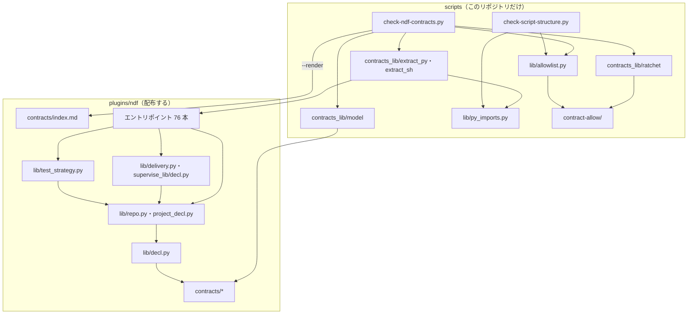
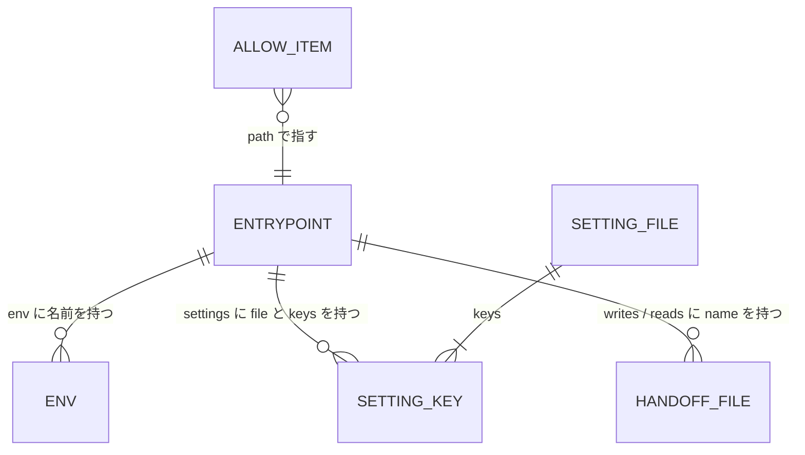
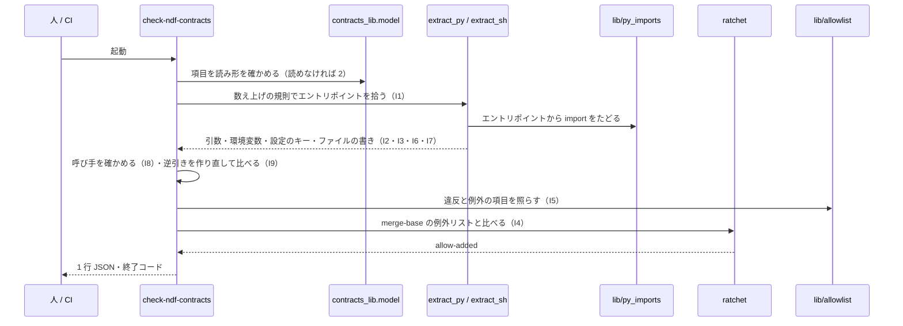
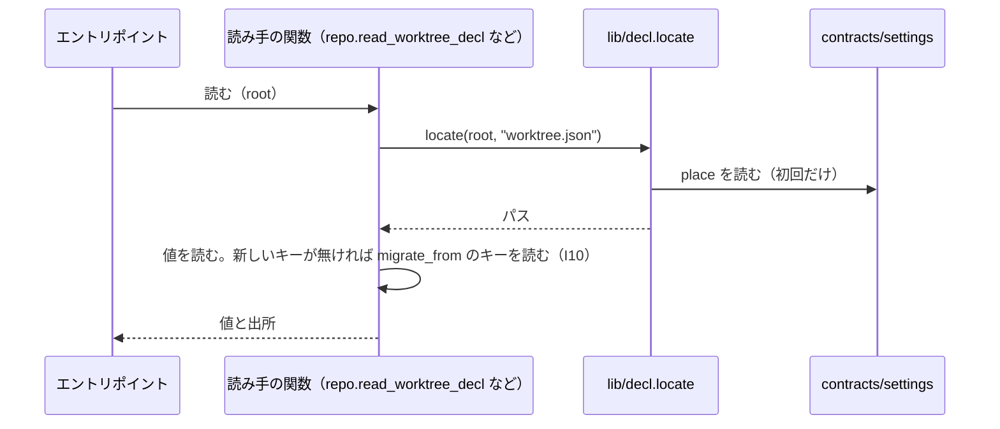
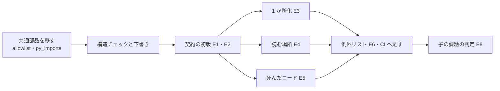

# NDF のエントリポイント: 入出力・設定・環境変数の契約を 1 か所で読み、宣言の外を構造チェックで止める（#2336）

## 目的

- **何が壊れているか**: エントリポイント 76 本が受け取るもの・返すもの・書く状態・終了コードは、Skill の本文・README・docstring に散っている。同じ値を 2 つの設定が持ち（本番のブランチ・テストのコマンド）、`.ndf/` をメインディレクトリから読むか worktree から読むかが読み手ごとに違う
- **誰が困るか**: エントリポイントを呼ぶ側（Skill の本文・プランの雛形・conductor）。違いを覚えて書くため、渡し忘れ・読み違いが起きる（#2317・#1709・#2097）
- **直すと何が成り立つか**: 契約を `plugins/ndf/contracts/` の 1 か所で読める。宣言の外の新しい入力・出力は CI が落とす。柱 P1〜P8（#2337〜#2344）がこの一覧を基準として使える

## 適用範囲

- **働く範囲**: 契約の一覧と読む場所の解決（`lib/decl.py`）は NDF と一緒に配布され、利用者のリポジトリでも働く。構造チェック（`scripts/check-ndf-contracts.py`）と例外リストは、このリポジトリの CI だけで働く
- **プロジェクトごとに違うもの**: 本番のブランチ・テストのコマンドは、今までどおり `.ndf/` の設定で受ける。置き場が変わるのは 1 か所へ寄せた値だけで、古い置き場は移行の読みで受ける
- **当たるモード**: `standard`

## あるべき姿の根拠

| 根拠 | 種類 | 何を示すか |
| --- | --- | --- |
| 「NDF は Skill の Script 化から発展してきたため、内部データ構造や入出力契約がほぼ整理されていない」「出力だけでなく入力もそろえるべき」 | 利用者の指示の原文（#2335 の「調べ方」） | 契約を 1 か所に宣言し、入力も対象にする |
| 前提 1 の規則が拾うエントリポイントは 76 本（`plugins/ndf/scripts` 直下: `.py` 37・`.sh` 15、Skill の `scripts` 直下: `.py` 12・`.sh` 12）。91 本は直下の `.py` と `.sh` をすべて数えた値（52 + 39） | 実測（2026-11-01。最上位に `if __name__ == "__main__":` を持つ `.py` と、1 行目が `#!` の `.sh` を数えた） | 91 本と 76 本の差 15 本はライブラリ（import と source で読まれるもの）。差の内訳は実装で契約の一覧の `metrics` に出す |
| `python3 scripts/check-script-structure.py` の所要 8.7 秒（452 ファイル・関数 4,490） | 実測（2026-11-01） | 非機能の条件の 18 秒の内訳を見積もる起点 |
| `lib/project_decl.py` はメインディレクトリ → `root` の順に、`lib/repo.read_worktree_decl` は `root` → メインディレクトリの順に読む | コードの実物（`plugins/ndf/scripts/lib/project_decl.py:17`・`lib/repo.py:45`） | 読む場所が読み手ごとに逆になっている（#2317・#1709 の原因） |
| サブモジュールでは `git rev-parse --git-common-dir` の親も `git worktree list` の先頭も `.git/modules/<名前>` を指し、共通ディレクトリの `core.worktree` だけがworktreeを指す | 実測（2026-11-01。一時ディレクトリにサブモジュールと worktree を作って確かめた） | メインディレクトリを決める正しい手段（#2054） |
| `uvx vulture plugins/ndf/scripts plugins/ndf/skills --exclude "*/tests/*,*/experimental/*" --min-confidence 60` は 2.1 秒で 121 行の候補を出す | 実測（2026-11-01。vulture 2.16） | 呼び手の無い関数の候補を、既存のライブラリで集められる |

要求と受け入れ条件は #2336 の本文にある（コピーは `issues/issue-2336-requirements.md`）。この文書は「どう作るか」だけを扱う。
決定の記録は [issue-2336-design-decisions.md](issue-2336-design-decisions.md) に分けた。

## ドメインモデル

### コンテキスト

| コンテキスト | 何の語が 1 つの意味に決まるか |
| --- | --- |
| スクリプトの契約（新しい） | エントリポイント・契約の一覧・受け渡しのファイル・設定の置き場・移行の読み・例外リスト |
| NDF の工程（既存の `ndf-workflow`） | 本番のブランチ・ベースブランチ・テストの戦略・suite |

関係: スクリプトの契約は NDF の工程に対して**公開された言語**（published language）を持つ。工程の側（Skill の本文・雛形・conductor）は契約の一覧の語と形で呼び、エントリポイントごとの言い換えを持たない。

### 集約

| 集約 | 持ち主（書き換えてよいもの） | 根 | エンティティ | 値オブジェクト |
| --- | --- | --- | --- | --- |
| エントリポイントの契約 | そのエントリポイントを変える変更 | 契約の項目（1 本 1 ファイル） | 副命令 | 引数・環境変数の読み・設定のキーの読み・標準入力の形・標準出力の形・書くファイル・終了コードとその意味・呼び手 |
| 受け渡しのファイル | そのファイルを書くエントリポイントを変える変更 | ファイルの項目 | — | 名前の型（glob）・種類・置き場・Skill の読み手 |
| 設定ファイル | 設定の形を変える変更 | 設定ファイルの項目（`.ndf/<名前>` 1 つに 1 ファイル） | キー | 置き場・範囲（チーム / 個人）・読み手の関数・移行の読み |
| 環境変数 | その変数を読み始める変更 | 環境変数の項目 | — | 誰が設定するか・意味 |
| 例外リスト | 項目を消す変更だけ（足す変更は名前の付け替えに限る） | 例外の項目（1 項目 1 ファイル） | — | パス・名前・種類・理由 |

### 不変条件

| # | 集約 | 条件 | 破れたときの扱い |
| --- | --- | --- | --- |
| I1 | エントリポイントの契約 | 数え上げの規則が拾うファイルと、契約の項目が 1 対 1 に対応する | 項目の無いファイルは `entry-undeclared`、ファイルの無い項目は `entry-stale` |
| I2 | エントリポイントの契約 | コードから拾った引数・環境変数の読み・設定のキーの読み・受け渡しのファイルの書きは、どれも契約にあるか例外の項目に当たる | 種類ごとの違反（`arg-undeclared` など）。`items` に下書きの項目を添える |
| I3 | エントリポイントの契約 | 契約にある引数・環境変数・設定のキー・書くファイルは、コードから拾える | `contract-stale`（例外の項目で許すのは、静的に拾えない種類だけ） |
| I4 | 例外リスト | ベースブランチの merge-base と比べて、項目が増えない。同じ差分で同じ `kind`・`name` の項目を消す付け替えは増加に数えない | `allow-added`（例外の項目で許せない） |
| I5 | 例外リスト | どの項目も今の違反に当たる | `unused-allow` |
| I6 | 設定ファイル | 置き場は 1 つで、読み手の関数は `lib/decl.locate` だけを通して開く | 読み手の関数の外で開けば `setting-open-outside-reader` |
| I7 | 設定ファイル | 1 つの値を持つキーは 1 つだけ。2 か所目は `duplicates` で宣言し、例外の項目に載る | `setting-duplicate` |
| I8 | エントリポイントの契約 | 呼び手（パス）が 1 つ以上あり、それぞれがエントリポイントの名前を含む。呼び手が無ければ `external` に理由がある | `no-caller`・`caller-stale` |
| I9 | 契約の一覧 | 読み手と書き手の逆引き（`contracts/index.md`）は、項目から作り直した結果と一致する | `index-stale` |
| I10 | 設定ファイル | 移行の読みは、新しい置き場に値が無いときだけ古い置き場の値を使う | 移行の読みのテストが落ちる |

### ドメインイベント

| # | イベント | 発生元 | 受け手 |
| --- | --- | --- | --- |
| E1 | エントリポイントと受け渡しのファイル・設定・環境変数を数え上げた | `check-ndf-contracts.py --draft`（実装者が走らせる） | 契約の一覧の初版 |
| E2 | 契約の一覧へ今の契約を書き写した | 実装者（下書きを補う） | 構造チェック |
| E3 | 同じ値を持つ設定を 1 か所へ寄せた | 実装者 | `lib/repo.py`・`lib/test_strategy.py` の読み手 |
| E4 | 読む場所の不一致を解消した | 実装者 | `lib/decl.locate` を通る読み手 |
| E5 | 呼び手の無いエントリポイント・関数を消した | 実装者 | 全体テスト・参照切れのチェック |
| E6 | 今の外れを例外リストへ載せた | 実装者 | 構造チェック |
| E7 | 構造チェックが契約の一覧の外か例外リストの増加を落とした | `check-ndf-contracts.py`（手元・CI） | 変更を出した人 |
| E8 | 子の課題の再現の手順を通し、閉じたか残したかを記録した | 実装者 | #2336 の本文の「子の課題の判定」 |

### 用語

| 用語 | 意味 | 用語集への反映 |
| --- | --- | --- |
| エントリポイント | 前提 1 の規則が拾う、直に起動されるスクリプト（hook の command が起動する 7 本を含む） | 既存 |
| 契約の一覧 | `plugins/ndf/contracts/` の下の項目の集まり。リポジトリで 1 つ | 既存 |
| 受け渡しのファイル | あるエントリポイントが書き、別のエントリポイントか Skill の手順が読むファイル | 既存 |
| 例外リスト | 構造チェックごとに置く、今の外れを 1 項目 1 ファイルで持つ置き場（`scripts/script-structure-allow/`・`scripts/contract-allow/`） | 意味の変更（置き場を 2 つにした） |
| 構造チェック | 既存の語 | 既存 |
| 移行の読み | 1 か所へ寄せた値を、新しい置き場に無いときだけ古い置き場から読むこと。契約の一覧の設定ファイルの項目に `migrate_from` として書く | 追加 |
| 設定の置き場 | `.ndf/` の設定ファイルを読む木。`worktree`（呼ばれた木）か `main`（メインディレクトリ） | 追加 |

## 機能一覧

| # | 機能 | 誰が使うか |
| --- | --- | --- |
| F1 | エントリポイント・受け渡しのファイル・設定・環境変数の契約を、項目のファイルで読む | Skill の本文・雛形を書く人、柱 P1〜P8 の実装者 |
| F2 | 読み手と書き手の逆引きを生成する（`--render`） | 同上 |
| F3 | コードと契約を突き合わせ、宣言の外・古い宣言・呼び手の無いものを落とす | CI・手元の構造チェック |
| F4 | 例外リストの増加をベースブランチと比べて落とす | CI |
| F5 | 新しいエントリポイントの下書きの項目を出す（`--draft <パス>`。落ちたときは `items` にも出す） | エントリポイントを足す人 |
| F6 | `.ndf/` の設定を、置き場の宣言どおりの木から 1 つの関数で開く | エントリポイント（実行時） |
| F7 | 本番のブランチ・テストのコマンドを 1 か所から読み、古い置き場は移行の読みで受ける | `supervise.py`・`release-steps.py`・`test-run.py` など |
| F8 | 呼び手の無いエントリポイントと関数を消す | 実装者（1 回） |

## 構成要素

| 要素 | 責務 |
| --- | --- |
| `plugins/ndf/contracts/entrypoints/*.json`（新） | エントリポイント 1 本の契約。ファイル名はパスの `/` を `__` にしたもの |
| `plugins/ndf/contracts/files/*.json`（新） | 受け渡しのファイル 1 種類の属性 |
| `plugins/ndf/contracts/settings/*.json`（新） | `.ndf/` の設定ファイル 1 つの置き場・範囲・キー・読み手の関数・移行の読み |
| `plugins/ndf/contracts/env/*.json`（新） | 環境変数 1 つの属性 |
| `plugins/ndf/contracts/index.md`（新・生成物） | 読み手と書き手の逆引き。`--render` だけが書く |
| `scripts/check-ndf-contracts.py`（新） | 構造チェックの入口。引数・結果 JSON・終了コード・ラチェット |
| `scripts/contracts_lib/model.py`（新） | 契約の項目を読み、形を確かめる（標準ライブラリだけ） |
| `scripts/contracts_lib/extract_py.py`・`extract_sh.py`（新） | コードから引数・環境変数・設定のキー・ファイルの書きを拾う |
| `scripts/contracts_lib/ratchet.py`（新） | merge-base の例外リストと比べて増加を数える |
| `scripts/lib/allowlist.py`（新。`check-script-structure.py` から移す） | 例外の項目の読み込み・ファイル名の規則・`unused-allow` の判定 |
| `scripts/lib/py_imports.py`（新。`check-script-structure.py` から移す） | エントリポイントから import をたどる |
| `scripts/contract-allow/`（新） | 契約の構造チェックの例外リスト |
| `scripts/check-script-structure.py`（変更） | 例外リストと import のたどり方を共通部品から使う。振る舞いは変えない |
| `plugins/ndf/scripts/lib/decl.py`（新） | `locate(root, name)`: 設定の置き場を契約の項目から読み、開くパスを返す。`main_dir` の決め方を含む |
| `plugins/ndf/scripts/lib/repo.py`・`lib/project_decl.py`（変更） | `.ndf/` を `decl.locate` で開く。`main_dir` は `decl` へ移す |
| `plugins/ndf/scripts/lib/delivery.py`・`supervise_lib/decl.py`（変更） | 本番のブランチを `repo.production_branch` だけで決める。`delivery` の行の `channel` を読む |
| `plugins/ndf/scripts/lib/test_strategy.py`・`supervise_lib/decl.py`（変更） | テストのコマンドを `project.json` の `test.suites` から読み、`supervise.json` の `test` は移行の読み |
| `plugins/ndf/scripts/project-decl.py`・`project_lib/`（変更） | `delivery` の行を書くとき、本番のブランチに当たる行は `"channel": "production"` で書く |
| `plugins/ndf/skills/development-workflow/schemas/project.schema.json`（変更） | `Delivery` に `channel` を足す |
| `.github/workflows/script-structure.yml`（変更） | ジョブ `ndf-contracts-check` を足す（`fetch-depth: 0`） |
| `.ndf/project.json`（変更） | suite `ndf-contracts` と必須チェックを足し、`delivery` の行を `channel` にする（C7。承認ゲート 2 で見る） |



図に含めない要素: 書く側（`project-decl.py`・`project_lib/`・`project.schema.json`）、CI の定義（`script-structure.yml`）、宣言（`.ndf/project.json`）。呼び出しの関係を持たないか、`contracts/` と `lib/` の読みに現れない。

## データ構造

契約の一覧はファイルの集まりで、データベースを持たない。項目どうしの関係は次のとおり。



### エントリポイントの項目（`contracts/entrypoints/<パスの / を __>.json`）

| キー | 型 | 必須 | 意味 |
| --- | --- | --- | --- |
| `version` | 整数 | ○ | 項目の形の版。初版は 1 |
| `path` | 文字列 | ○ | リポジトリの根からのパス |
| `summary` | 文字列 | ○ | 何をするか 1 文 |
| `callers` | 文字列の並び | `external` と択一 | 呼ぶファイルのパス（Skill の本文・雛形のモジュール・hook の定義・CI・ほかのスクリプト。テストを除く） |
| `external` | 文字列 | `callers` と択一 | 呼び手がこのリポジトリに無くても残す理由（利用者が手で打つ など） |
| `args` | オブジェクト | ○ | `{"options": [...], "positionals": [...], "subcommands": {"<名前>": {"options": [...], "positionals": [...]}}}`。静的に拾えないときは `{"unparsed": "<理由>"}` |
| `env` | 文字列の並び | ○ | 読む環境変数の名前（import でたどれるモジュールの読みを含む） |
| `settings` | オブジェクトの並び | ○ | `{"file": "project.json", "keys": ["test", "ci"]}`。最上位のキーだけ |
| `stdin` | 文字列 | ○ | `none` か、読む形（`json`・`text`・`hook-json`） |
| `stdout` | 文字列 | ○ | `step-result`（1 行 JSON）・`json`・`kv`（`eval` する KEY=VALUE）・`text`・`markdown`・`none` |
| `writes` / `reads` | 文字列の並び | ○ | 受け渡しのファイルの `name` |
| `exit` | オブジェクト | ○ | `{"0": "<意味>", "1": "...", "75": "..."}`。読み取れなければ `{"unknown": "<理由>"}`（例外の項目 `exit-unknown` が要る） |

### 受け渡しのファイルの項目（`contracts/files/<name>.json`）

| キー | 型 | 意味 |
| --- | --- | --- |
| `name` | 文字列 | 契約の中の名前（例 `cross-refactoring-state`） |
| `pattern` | 文字列 | ファイル名の型（glob。例 `cross-refactoring-*-state.json`） |
| `kind` | 文字列 | `state`・`record`・`result`・`report` |
| `place` | 文字列 | `worktree`・`main`・`tmp`（`NDF_WORKTREE_BASE` などの一時の置き場）・`state-dir`（XDG の状態の置き場）・`home`（`~/.claude` など） |
| `skill_readers` | 文字列の並び | 読む Skill の本文のパス（エントリポイントの読み手は逆引きで出す） |

### 設定ファイルの項目（`contracts/settings/<名前>.json`）

| キー | 型 | 意味 |
| --- | --- | --- |
| `file` | 文字列 | `.ndf/` の下の名前（例 `worktree.json`） |
| `place` | 文字列 | `worktree` か `main`（決定 9 の規則で決める） |
| `scope` | 文字列 | `team`（追跡する）か `personal`（`.ndf/.gitignore` に載る） |
| `readers` | 文字列の並び | 開いてよい関数（`plugins/ndf/scripts/lib/repo.py:read_worktree_decl` の形） |
| `keys` | オブジェクト | `{"<キー>": {"summary": "...", "migrate_from": "<ファイル>#<キー>", "duplicates": "<ファイル>#<キー>"}}`。`migrate_from`・`duplicates` は任意 |

### 環境変数の項目（`contracts/env/<名前>.json`）

| キー | 型 | 意味 |
| --- | --- | --- |
| `name` | 文字列 | 変数の名前 |
| `set_by` | 文字列 | `user`・`runtime`（Claude Code など）・`ci`・`ndf`（NDF のエントリポイントが子へ渡す） |
| `summary` | 文字列 | 意味と、無いときの扱い |

### 例外の項目（`scripts/contract-allow/<path>--<name>--<kind>.json`）

形は `scripts/script-structure-allow/` と同じ `{"path", "name", "kind", "reason"}`。ファイル名の規則も同じ関数（`scripts/lib/allowlist.py` の `allow_file_name`）が決める。`kind` は次の 12 種類。

| `kind` | `name` | 何を許すか |
| --- | --- | --- |
| `args-unparsed` | 空 | `sys.argv` を手で読む・引数を組み立てる。P8（#2341）で `argparse` へ移したら消す |
| `env-dynamic` | 関数名 | `os.environ` を走査する・名前を組み立てて読む |
| `file-dynamic` | 関数名 | 名前を組み立てて書く（型に当てられない） |
| `setting-open-outside-reader` | 設定ファイル名 | 読み手の関数の外で `.ndf/<名前>` を開く（シェルを含む） |
| `setting-duplicate` | `<ファイル>#<キー>` | 1 か所へ寄せずに残す 2 か所目 |
| `exit-unknown` | 空 | 終了コードの意味を読み取れない |
| `no-caller` | 空 | 呼び手が見つからないまま残す（理由は必須） |
| `entry-undeclared` | 空 | 契約の項目を書けないエントリポイント |
| `arg-undeclared`・`env-undeclared`・`setting-undeclared`・`file-undeclared` | 引数・変数・キー・ファイル名 | 初版で書けなかった個別の外れ |

`allow-added`・`unused-allow`・`contract-stale`・`index-stale`・`entry-stale`・`caller-stale` は例外の項目で許さない。

### CRUD（機能 × データ）

| 機能 | エントリポイントの項目 | ファイル・設定・環境変数の項目 | 例外の項目 | `index.md` | `.ndf/` の設定 |
| --- | --- | --- | --- | --- | --- |
| F1 読む | R | R | — | R | — |
| F2 逆引き | R | R | — | C/U | — |
| F3 突き合わせ | R | R | R | R | — |
| F4 増加の検出 | — | — | R（今と merge-base） | — | — |
| F5 下書き | R | R | — | — | — |
| F6 置き場 | — | R（`settings` の `place`） | — | — | R |
| F7 1 か所化 | — | U（`migrate_from`） | D（寄せた分） | U | R（移行の読み） |
| F8 削除 | D | U | D | U | — |

## 入出力の契約

### `scripts/check-ndf-contracts.py`

```text
python3 scripts/check-ndf-contracts.py [--root <リポジトリ>] [--allow <ディレクトリ>] [--base <ref>] [<ファイル>...]
python3 scripts/check-ndf-contracts.py --render [--root <リポジトリ>]
python3 scripts/check-ndf-contracts.py --draft <エントリポイントのパス> [--root <リポジトリ>]
```

| 引数 | 意味 |
| --- | --- |
| `--root` | 既定はスクリプトの 2 つ上 |
| `--allow` | 既定は `scripts/contract-allow/` |
| `--base` | 例外リストを比べる ref。既定は `GITHUB_BASE_REF` → `.ndf/worktree.json` の `base_branch` の順で `origin/<名前>` を作り、HEAD との merge-base を取る |
| `<ファイル>...` | `check-script-structure.py` と同じ絞り込み（違反の `path` が指定にあるものだけで合否を決める） |
| `--render` | `contracts/index.md` を書き直す。結果 JSON の `items` に変えたかを出す |
| `--draft` | 拾った事実から項目の下書き（JSON）を標準出力へ出す。ファイルは書かない |

結果は 1 行 JSON（`plugins/ndf/scripts/lib/README.md` の形）。

```json
{"tool": "check-ndf-contracts", "status": "error", "summary": "違反 1 件",
 "items": [{"kind": "env-undeclared", "path": "plugins/ndf/scripts/test-run.py", "name": "NDF_FOO",
            "result": "violation", "detail": "契約の env に無い。contracts/entrypoints/plugins__ndf__scripts__test-run.py.json の env へ足すか、contracts/env/NDF_FOO.json を作る",
            "via": "plugins/ndf/scripts/lib/ci_wait.py:42"}],
 "metrics": {"entrypoints": 76, "candidates": 91, "files": 0, "settings": 0, "env": 0,
             "allowed": 0, "violations": 1, "base": "origin/develop@<sha>", "ratchet": "checked"}}
```

| 終了コード | 意味 |
| --- | --- |
| 0 | 違反なし（`--render` は書き直した・変わらなかった、`--draft` は出せた） |
| 1 | 違反あり |
| 2 | 項目か例外の項目が読めない・形の誤り、`--draft` のパスがエントリポイントでない |
| 3 | 起点の ref を決められない（CI の中だけ。手元では `metrics.ratchet` を `skipped` にして続ける） |

`entry-undeclared` の `detail` には、`--draft` の出力（下書きの項目）をそのまま添える。足す人はそれを補ってファイルに置けば通る（非機能の運用・保守性）。

### `plugins/ndf/scripts/lib/decl.py`

| 関数 | 入力 | 出力 | 失敗の形 |
| --- | --- | --- | --- |
| `locate(root, name)` | 呼ばれた木の根、`.ndf/` の下の名前 | 開くパス（`Path`）か `None`（どちらの木にも無い） | 契約に無い名前は `KeyError`（構造チェックが先に落とすため、実行時に起きるのは配布物の不整合だけ） |
| `main_dir(root)` | 呼ばれた木の根 | メインディレクトリ（共通ディレクトリの `core.worktree` → `--git-common-dir` の親の順）か `None` | 例外を上げない |

`locate` の決め方: `place` が `worktree` なら `root/.ndf/<name>` → 無ければ `main_dir(root)/.ndf/<name>`。`main` なら `main_dir(root)/.ndf/<name>` → 無ければ `root/.ndf/<name>`。契約の項目は `Path(__file__).parents[2] / "contracts/settings"` から読み、プロセスの中で 1 回だけ読む。

### `.ndf/project.json` の `delivery` の行

| キー | 変更 |
| --- | --- |
| `channel`（新） | `"production"` か `"base"`。行が本番のブランチかベースブランチへのマージで動くことを、ブランチ名を写さずに指す |
| `branch` | `channel` が無い行だけで読む（ほかのブランチで動く行と、移行の読み）。`channel` と両方あれば `channel` が勝つ |

**`channel` は `lib/delivery.build` が行を読んだ時点で 1 回だけブランチ名へ解き、行の `branch` に入れて渡す。** 行の `branch` を読む既存の規則（`reaches_by_merge`・`_row_route`・`_row_text`。2026-11-01 に `row.get("branch")` を検索して当たったのはこの 3 か所だけ）は、新しい値のまま当てはまり、変えない。書く側は `project_lib/model.py` の `Delivery` と `project.schema.json` に `channel` を足す。

`supervise.json` の `test.command`・`test.all` は、`project.json` の `test.suites` が無いときだけ読む（移行の読み）。`test.no_reports` は別の値なので `supervise.json` に残す。

## 処理の流れ

### 構造チェック



### 設定を読む（実行時）



### 実装の順序

E1〜E8 の順に進む。依存は次のとおりで、Pull Request の分け方は `implementation-plan` が決める。



## 非機能の実現方式

| 大項目 | 条件 | 実現方式 | 確かめ方 |
| --- | --- | --- | --- |
| 性能・拡張性 | 契約の検査を足した後の構造チェックの所要が手元で 18 秒以内 | 新しい検査は 1 プロセスで、`git ls-files` を 1 回、各ファイルの構文木を 1 回だけ作る。import のたどりは結果をファイルごとに覚える。ラチェットは `git ls-tree` 1 回 | `check-script-structure.py` と `check-ndf-contracts.py` を続けて打った合計の秒を、変更の前後で実測して Pull Request に書く |
| 運用・保守性 | 新しいエントリポイントは項目 1 つで通る | `entry-undeclared` の `detail` に下書きの項目を添える。`--draft` で同じものを出せる | テスト設計の AC3 の行 |
| 移行性 | 既存の `.ndf/` は書き換えなしで動く | 移行の読み（`migrate_from`・`delivery` の `branch`・`supervise.json` の `test`） | テスト設計の AC6 の行 |

## 決定の記録

決定は [issue-2336-design-decisions.md](issue-2336-design-decisions.md) に置く。

## テスト設計

| 受け入れ条件・不変条件 | どの振る舞いで縛るか | どう壊したら落ちるべきか |
| --- | --- | --- |
| AC1・I1 | このリポジトリの木で構造チェックが 0 を返し、`metrics.entrypoints` が規則の本数と一致する | 項目を 1 つ消す・規則が拾わないファイルの項目を足すと 1 |
| AC2 | `contracts/` 以外に契約の項目の形（`"stdout":` と `"exit":` を持つ JSON）が無い | 文言の照合はしない。README・Skill の本文から契約の表を指す形にした差分は承認ゲート 2 で人が見る |
| AC3・I2 | 違反を 1 つ入れた木（契約に無いエントリポイント・引数・環境変数の読み・設定のキーの読み・ファイルの書き、それぞれ 1 つ）で 1 を返し、`items` にファイルとキーが出る | 抽出の 1 つを空を返すように壊すと、その種類の違反の木が 0 を返して落ちる |
| AC3・I3 | 契約にだけある引数を持つ木で `contract-stale` | 契約の側を見ないように壊すと落ちる |
| AC3・I5 | 違反に当たらない例外の項目を残した木で `unused-allow`、消した木で 0 | — |
| AC4・I4 | merge-base に無い例外の項目を足した木（項目が今の違反に当たっていても）で `allow-added`。同じ `kind`・`name` の項目を消して別のパスで足した木は通る | 比べる ref を HEAD にするよう壊すと落ちる |
| AC4 | CI の中で起点の ref を決められないとき 3、手元では `ratchet: skipped` で 0 | — |
| AC5・I7 | `production_branch` を読む経路が `repo.production_branch` だけになり、`delivery` の行が `channel` で本番を指す。`duplicates` を宣言して例外の項目が無い木で `setting-duplicate` | `delivery.build` に独自の後退を戻すと、`worktree.json` に `production_branch` が無い宣言で経路の判定と雛形の判定が食い違い落ちる（#2097 の再現） |
| AC6・I10 | 古い置き場だけを持つ `.ndf/`（`delivery` の行が `branch` だけ・`supervise.json` の `test` だけ）で、寄せた値を読むエントリポイントを起動し、寄せる前と同じ値を得る。両方あれば新しい置き場が勝つ | 移行の読みを外すと値が空になり落ちる |
| AC7・I6 | worktree の `.ndf/project.json` とメインディレクトリのそれが違う木で、`test-run.py` の待つチェック（#2317）と cross-refactoring の `init` の戦略（#1709）が worktree の値を使う。`main` の置き場の設定は逆に読む | `locate` の順を逆にすると落ちる |
| AC7・#2054 | サブモジュールの worktree で `main_dir` がサブモジュールのworktreeを返し、`project-decl.py check` が宣言を見つける | `core.worktree` を見ないと落ちる |
| AC7・I6 | 読み手の関数の外で `.ndf/<名前>` を開く木で `setting-open-outside-reader` | — |
| AC8・I8 | 呼び手の無い項目で `no-caller`、呼び手のファイルがエントリポイントの名前を含まない項目で `caller-stale` | 呼び手を確かめないと落ちる |
| AC8 | 消した後に全体テスト・`check-markdown-links.py`・`check-cross-skill-refs.py` が通る | 呼び手の残るものを消すと、どれかが落ちる |
| AC9 | 全体テストが変更の前と同じく通る。`check-script-structure.py` の結果（`items`・`metrics`）が共通部品へ移す前と同じ | — |
| AC10 | 子の課題ごとに再現の手順を通し、#2336 の本文の「子の課題の判定」に 1 行ずつ書く。閉じた課題に理由のコメントがある | （記録の確認。テストは書かない） |
| I9 | 項目を変えて `--render` を打たない木で `index-stale` | — |
| 非機能 | 2 つの構造チェックの合計が手元で 18 秒以内 | （実測。テストは書かない） |

## 子の課題の見込み

判定は E8 で再現の手順を通して決める。ここに書くのは、どの仕組みが効く見込みかだけである。

| 課題 | 効く見込みの仕組み | 見込み |
| --- | --- | --- |
| #2097 本番のブランチ | 1 か所化（決定 7） | 閉じる |
| #2011 テストのコマンド | 1 か所化（決定 8） | 閉じる |
| #1709 戦略の宣言の読む場所 | 読む場所（決定 9） | 閉じる |
| #2317 外したチェックを待つ | 読む場所（決定 9）。受け入れ条件のうち「現れないチェックを `stopped` で返す」「待つ間の出力」は柱 P4（#2343）の範囲 | 1 つ目の条件だけ解消。残りの理由を添えて残す |
| #2054 サブモジュールのメインディレクトリ | `decl.main_dir`（決定 9） | 閉じる |
| #1601 `metrics.aggregate` が呼ばれない | 死んだコード（決定 10） | 閉じる |
| #1787 終了コード 75・`merge-when-green` の引数が正本に無い | 契約の一覧の `exit`・`args` | 閉じる（README は契約を指す） |
| #2060 `release-steps.md` に打ち方が無い | 契約の一覧の `args` | 閉じる見込み。打ち方の手順（いつ打つか）は文書の課題として残るなら残す |
| #1512 `.ndf/` の作成・更新の定義・チームと個人の区別 | 設定ファイルの項目の `scope`・`readers` と逆引きの書き手 | 区別と定義は解消。`.gitignore` の配り方が残れば残す |
| #1968 指示書の既定が 2 か所で食い違う | 棚卸しの「同じ値を 2 か所」に当たるかを E2 で判定 | 当たれば 1 か所化、当たらなければ残す |
| #1774 失敗と数える集合が 2 か所 | コードの定数で、設定ではない。結果の契約（柱 P1・#2337） | 残す |
| #2010 計測値の書き戻し | 設定と計測値の分離はデータの契約（柱 P6・#2339） | 残す |
| #1694 CI のジョブがテストの宣言に無い | 契約の一覧の外（CI の宣言） | 残す |
| #1756 プラグインの置き場の決め打ち | 契約の一覧の外（リリースの汎用性） | 残す |
| #2235 require-groups の例外の 11 本 | 別の構造チェックの例外リスト | 残す |
| #715 版を解決する層 | 実行時点の解決（柱 P5・#2344） | 残す |
| #1142 スクリプト全体の設計 | 親の課題 | 残す（共通部品を移した分だけ進む） |

## 設計の結果

| 課題 | 扱い | 取り込み先 | 触るファイル |
| --- | --- | --- | --- |
| #2336 | 実装する | — | `plugins/ndf/contracts/`、`scripts/check-ndf-contracts.py`、`scripts/contracts_lib/`、`scripts/lib/allowlist.py`、`scripts/lib/py_imports.py`、`scripts/contract-allow/`、`scripts/check-script-structure.py`、`scripts/tests/`、`plugins/ndf/scripts/lib/`、`plugins/ndf/scripts/supervise_lib/decl.py`、`plugins/ndf/scripts/project-decl.py`、`plugins/ndf/scripts/project_lib/`、`plugins/ndf/scripts/tests/`、`plugins/ndf/skills/development-workflow/schemas/project.schema.json`、`.github/workflows/script-structure.yml`、`.ndf/project.json`、`docs/glossary/glossary.json`、`docs/glossary.md` |

死んだコードの削除（E5）と、エントリポイントの読み手を `locate` へ移す変更は、棚卸しの結果で触るファイルが増える。増えた分は `implementation-plan` が棚卸しの後に足す。

## 未確認のまま残ること

| 項目 | 内容 |
| --- | --- |
| 抽出の誤検出の数 | 設定のキー（読み手の関数の戻り値に限る）とファイルの書き（書く呼び出しの引数の文字列に限る）の規則で、誤って拾う・拾い漏らす数は初版を書くまで分からない。漏らしは I3 の `contract-stale` で一部が見える。数は Pull Request に書く |
| 例外の項目の初版の数 | `args-unparsed` は `sys.argv` を手で読む 16 ファイルが上限の見込み。ほかの種類は初版を書くまで分からない |
| シェルの抽出の精度 | 環境変数は「ファイルの中で代入されない大文字の変数」、引数は `case` の `--名前)` で拾う。`source` した先は追わない |
| 所要の秒 | 18 秒に収まるかは実装で測る。超えたら構文木の共有（2 つのチェックを 1 プロセスにする）を検討する |
| `.ndf/` の設定 15 種類の置き場の内訳 | `team` / `personal` の振り分けは、`.ndf/.gitignore` と各 Skill の文書を読んで初版で決める |
| hook から起動されるエントリポイント | `hooks/*.json` の command が起動する 7 本（`hook.py`・`relay.py`・`training-optout.py`・`usage-subagent.py`・`ensure-retention.sh`・`statusline-switch.sh`・`worktree-session.sh`）は契約を持つ。`hook.py` の `env` は import でたどれる処理の読みをすべて含むため長くなる見込み。処理ごとの約束（対象範囲の「含まない」）は持たない |
