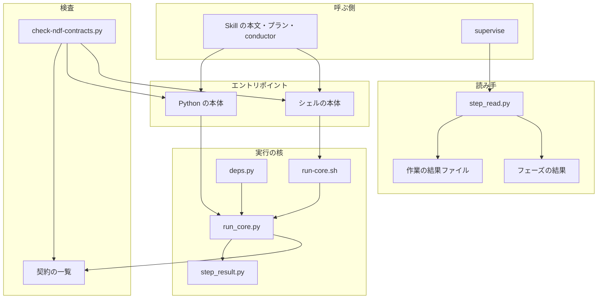
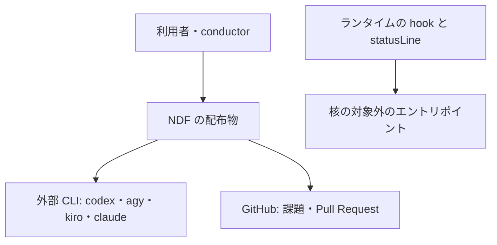
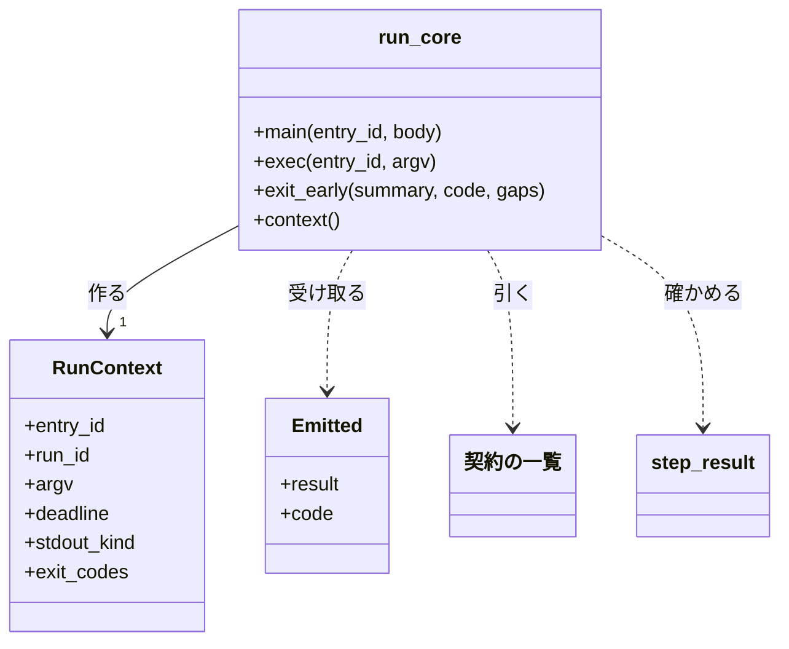
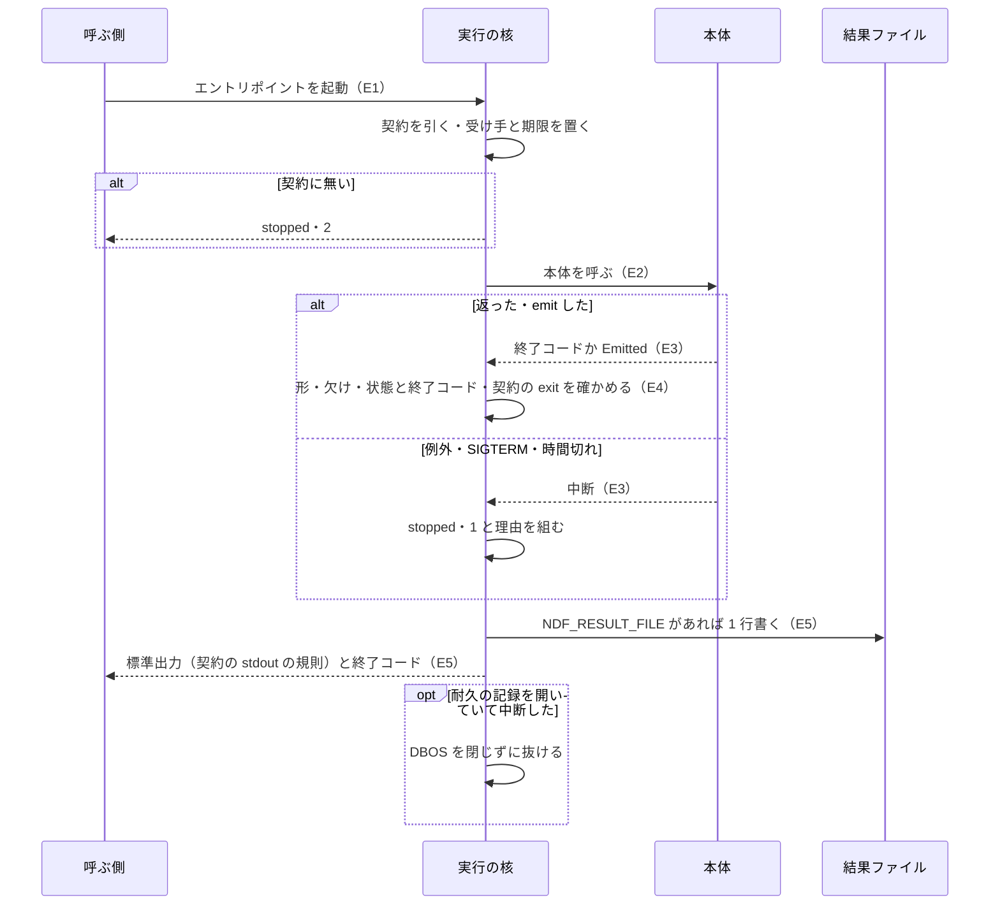
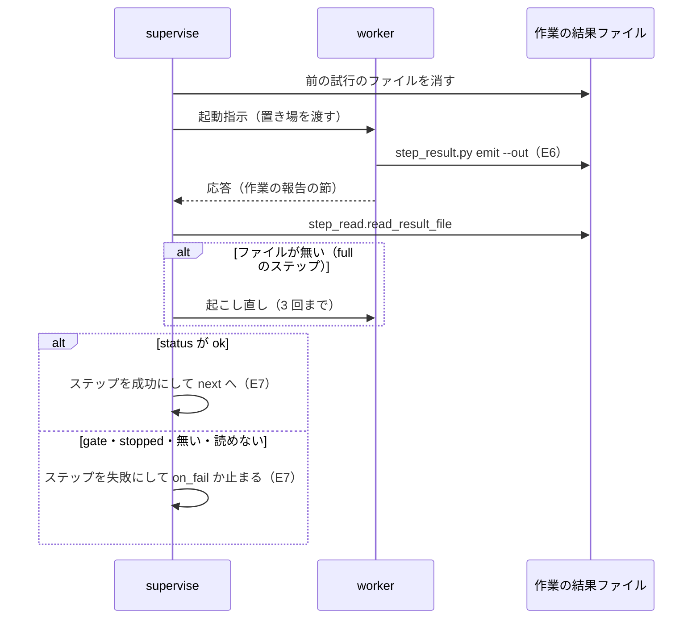

# NDF のエントリポイント: どの終わり方でも ok / gate / stopped と決まった終了コードで返り、欠けと失敗を ok と読まない（#2337）

## 目的

- **今どうなっているか**: エントリポイントは終わり方ごとの扱いをそれぞれ書く。例外・SIGTERM・時間切れでは結果 JSON が出ない。supervise は worker の完了を報告の文の「結果: 完了」の有無で、フェーズの成否を報告の文で、worker の止まりを進捗の文の語で決める。課題を閉じる処理は閉じられなかった課題を残したまま `ok`・終了コード 0 を返す
- **誰に効くか**: NDF でスプリントを回す利用者と conductor。要求の「子の課題」の表は、21 件のうち 16 件をこの柱の受け入れ条件で解消しうると見込む（残り 5 件は核の外の可能性）
- **変えると何が成り立つか**: エントリポイントは実行の核を通り、核が終わり方を結果と終了コードへ変える。成否は結果 JSON と結果ファイルの `status` だけから読む。核を通らないエントリポイントと、表と違う意味の終了コードを検査が落とすため、新しいエントリポイントでも同じ型の不具合が生まれない

## 適用範囲

- **働く範囲**: NDF の配布物のエントリポイント 64 項目と、supervise・外部 CLI の起動・課題を閉じる処理の読み手。64 項目は、契約の一覧の 77 項目から hook とランタイムが直接起動する 13 項目を除いたもの。配布先のリポジトリでも同じ核が動く。hook・`factory/`・ほかのプラグインは含まない
- **プロジェクトごとに違うもの**: 無い。核はプロジェクトの設定を読まない。時間切れの秒は呼ぶ側が環境変数 `NDF_RUN_TIMEOUT` で渡す（柱 P4 が上限の宣言へ移す）
- **当たるモード**: `standard`

## あるべき姿の根拠

| 根拠 | 種類 | 何を示すか |
| --- | --- | --- |
| 「異常系処理とログ出力、異常時の回復処理が統一されていないから起こる不具合・課題が多い。1 件ずつ対処してもきりがない」（利用者、2026-11-01） | 利用者の指示の原文 | 終わり方の扱いを 1 か所へ集め、型ごとに無くすこと |
| #2335 の設計（`issues/issue-2335-design.md`）の決定 1・2・11 と不変条件 I1・I2・I16 | 承認ゲート 1 を通った親の設計 | 核の形（`run_core.main` の 1 文・シェルは核の子として再実行する）と、P1 がすべてのエントリポイントを移すこと |
| DBOS 3.1.0 の耐久ワークフローを動かしたまま、主スレッドで `signal.setitimer` の時間切れと SIGTERM を受けた実測（2026-11-02、`/work/ai-plugins/.venv/bin/python`、Python 3.13.17）。どちらも 2.15〜2.28 秒で主スレッドの待ちが中断した。続けて DBOS を閉じると、動いていたステップのスレッドの例外の跡が標準エラーへ 2 件出た。閉じずに `durable.exit_leaving_pending` で抜けると 0 件だった | 実測 | 耐久のエントリポイントでも時間切れの仕組みは使え、中断した後は DBOS を閉じずに抜けること（決定 9） |
| 契約の一覧の `stdout` の内訳: `step-result` 31・`text` 34・`json` 5・`none` 5・`kv` 2（2026-11-02 に `plugins/ndf/contracts/entrypoints/*.json` を数えた） | 実測 | 46 項目の標準出力を変えずに結果を返す経路が要ること（決定 2） |

要求と受け入れ条件は #2337 の本文にある（コピーは [issue-2337-requirements.md](issue-2337-requirements.md) ）。この文書は「どう作るか」だけを扱う。決定の記録は [issue-2337-design-decisions.md](issue-2337-design-decisions.md) にある。

## ドメインモデル

### コンテキスト

| コンテキスト | 何の語が 1 つの意味に決まるか |
| --- | --- |
| NDF の開発ワークフロー（`ndf-workflow`） | 実行の核・本体・結果 JSON・欠け・核の対象外・作業の結果ファイル・フェーズの結果・作業の報告 |
| NDF の外部 CLI 委譲（`ndf-agent-cli`） | 結果ファイル・起動結果（語の意味は変えない） |

2 つの間は **公開された言語** でやり取りする。外部 CLI の起動（`external-ai.py run`）は、起動の終わり方を結果 JSON の形（`lib/step_result.py`）で返す。supervise はそれを共通の読み手（`lib/step_read.py`）だけで読む。外部 CLI の結果ファイルの中身（自由文）は、成否の判定に使わない。

### 集約

| 集約 | 持ち主（書き換えてよいもの） | 根 | エンティティ | 値オブジェクト |
| --- | --- | --- | --- | --- |
| 実行 | 実行の核（`lib/run_core.py`） | 実行の識別子（`run_id`） | — | 結果 JSON・終了コード・終わり方 |
| 契約の一覧 | 柱と各エントリポイントを変える Pull Request（核と検査は読むだけ） | `plugins/ndf/contracts/` | エントリポイントの契約 | 終了コードの表・核の対象外の印 |
| 作業の結果 | worker（書く）。supervise と supervisor は読むだけ | 作業の結果ファイル | — | 結果 JSON |
| フェーズの結果 | supervise のフェーズの実行（`supervise_lib/engine.py`） | フェーズの状態ディレクトリ | ステップの記録 | 結果 JSON |
| 閉じる判定 | 課題を閉じる処理（`sprint-close.py`） | 1 回の呼び出し | 課題ごとの項目 | 閉じた・閉じなかった理由 |

集約の間は識別子とファイルの置き場で参照する。実行は契約をエントリポイントの id（契約の `path`）で引く。フェーズの結果はステップごとの作業の結果をファイルの置き場で読む。

### 不変条件

| # | 集約 | 条件 | 破れたときの扱い |
| --- | --- | --- | --- |
| I1 | 実行 | 結果の `status` は `ok` / `gate` / `stopped` のどれかで、終了コードは `step_result.code_matches` を満たす。例外・SIGTERM・時間切れは `stopped`・1 で、`summary` に理由、`gaps` に `interrupted`（SIGTERM）か `timeout`（時間切れ）か `exception`（例外）を持つ | 核が本体の結果を捨て、`stopped` を返す |
| I2 | 実行 | `ok` を返すのは `gaps` が空のときだけ | `stopped`・6。本体の `gaps` はそのまま残す |
| I3 | 実行 | 本体の結果は結果 JSON の形で、`status` と終了コードが食い違わず、終了コードは契約の `exit` の鍵に含まれる | `stopped`・1。`summary` に違いの中身 |
| I4 | 契約の一覧 | 核の対象外の印を持たないエントリポイントは、Python なら `if __name__ == "__main__":` の中身が `run_core.main("<契約の path>", <本体>)` の 1 文、シェルなら先頭の実行文が `rc_enter "<契約の path>" "$@"` | 構造チェック（`core-entry`）が名前を出して落とす |
| I5 | 契約の一覧 | 核の対象外の印は、hook の定義か、ランタイムが直接起動する根拠を持つエントリポイントにだけ付く | 構造チェック（`core-exempt`）が落とす |
| I6 | 契約の一覧 | 構造チェックの例外リストの `core-entry`・`exit-meaning`・`result-read` の行は、ベースブランチより増えない | 構造チェック（`allow-added`）が落とす |
| I7 | 契約の一覧 | 契約の `exit` の各値は、`step_result` の終了コードの表のその番号の見出しで始まる。エントリポイントとその部品は `EXIT_` で始まる整数の定数を自分で持たない | 構造チェック（`exit-meaning`）が落とす |
| I8 | 実行 | optional extras が無い環境では、例外の跡を出さず `stopped`・69 と足りないグループの名前を返す | `deps` の止まりが核の早い出口を通る |
| I9 | 実行 | 核は、本体が結果を出さずに正常に終えたとき標準出力へ何も足さない。結果ファイルの環境変数（`NDF_RESULT_FILE`）を子プロセスへ継がない | 契約の標準出力の形を照らすテストが落とす |
| I10 | 作業の結果 | work のステップを成功と読むのは、作業の結果ファイルが結果 JSON の形で `status` が `ok` のときだけ。無い・読めない・形が違えば `stopped` | ステップを失敗にする（`on_fail` か止まる） |
| I11 | フェーズの結果 | `supervise.py run` の終了コードはフェーズの結果の `status` から決まる（`ok` 0・`gate` 10・`stopped` 1） | テストが落とす |
| I12 | 実行 | 外部 CLI の起動を `ok` と読むのは、監視が終わりを記録し、結果ファイルが空でなく読めるときだけ。進捗の文の語で止まりを決めない | `stopped` と理由 |
| I13 | 実行 | ほかのエントリポイントの結果 JSON を読んで次の手を決める箇所は共通の読み手を通し、`ok` でない結果を成功と読まない | 構造チェック（`result-read`）が落とす |
| I14 | 閉じる判定 | 閉じる対象のうち閉じなかった課題（`kept_open`・`closed_unverified`・`failed`）が 1 件でもあれば `ok` を返さない。参照しているだけの課題は状態に影響しない | `failed` があれば `stopped`・1、無ければ `gate`・10 |

### ドメインイベント

要求の E1〜E9 を引き継ぐ。

| # | イベント | 発生元 | 受け手 |
| --- | --- | --- | --- |
| E1 | エントリポイントが核を呼んだ | 呼ぶ側（Skill の本文・プラン・conductor・利用者） | 実行の核 |
| E2 | 核が本体を呼んだ | 実行の核 | 本体 |
| E3 | 本体が結果を返した、または例外・SIGTERM・時間切れで中断した | 本体・シグナル | 実行の核 |
| E4 | 核が結果の形・欠け・状態と終了コードの一致を確かめた | 実行の核 | 実行の核（E5） |
| E5 | 核が結果 JSON と終了コードを返した | 実行の核 | 呼ぶ側 |
| E6 | worker が作業の結果ファイルを書いて報告を終えた | worker | supervise・supervisor |
| E7 | supervise が作業の結果・外部 CLI の起動結果・フェーズの結果の状態から次の手を決めた | supervise | プランの次のステップ・conductor |
| E8 | 課題を閉じる処理が、閉じる対象の課題ごとに閉じる条件を判定した | 課題を閉じる処理 | プランの次のステップ（棚卸し）・conductor |
| E9 | 子の課題の再現の手順を通し、閉じる・残すを本文へ記録した | リリース後テスト | 子の課題の本文 |

### 用語

| 用語 | 意味 | 用語集への反映 |
| --- | --- | --- |
| 本体 | エントリポイントの仕事の中身を持つ関数。実行の核が呼び、結果 JSON か終了コードを返す | 追加（`ndf-workflow`） |
| 核の対象外 | 実行の核を通さないエントリポイントの印。hook の定義から起動されるか、ランタイムが直接起動して標準出力をそのまま使うもの。契約の一覧の `core` に理由と根拠を書く | 追加（`ndf-workflow`） |
| 作業の結果ファイル | worker が報告を終える前に書く、結果 JSON の形の 1 行のファイル。supervise と supervisor はこのファイルの `status` だけで作業の成否を決める | 追加（`ndf-workflow`） |
| フェーズの結果 | supervise の 1 つのプランの実行の終わり方を結果 JSON の形で書いたファイル（状態ディレクトリの `phase-result.json`） | 追加（`ndf-workflow`） |
| 作業の報告 | worker が応答の最後に書く「## 作業の報告」の節。人と conductor が読む。成否は作業の結果ファイルで決め、この節の文からは決めない | 意味の変更（`ndf-workflow`） |
| 起こし直し | supervise の full のステップで、作業の結果ファイルが無いまま応答が終わったとき、同じ会話（`--resume`）へ続けるよう送ること。3 回まで | 意味の変更（`ndf-workflow`） |

## 機能一覧

| # | 機能 | 誰が使うか |
| --- | --- | --- |
| F1 | エントリポイントを核の上で動かし、どの終わり方でも 3 つの状態と決まった終了コードで返す | すべての呼ぶ側 |
| F2 | 標準出力が結果 JSON でないエントリポイントの結果を、標準出力を変えずに結果ファイルへ返す（柱 P7 まで） | supervise・テスト・conductor |
| F3 | 核を通らないエントリポイント・表と違う意味の終了コード・共通の読み手を通らない結果の読みを検査で落とす | CI・柱の Pull Request |
| F4 | worker の作業の成否を作業の結果ファイルから決める | supervise・supervisor |
| F5 | プランの実行の成否をフェーズの結果から決め、`supervise.py run` の終了コードにする | conductor・キュー |
| F6 | 外部 CLI の完了を監視ログと結果ファイルから決め、進捗の文の語を読まない | supervise・cross-review・cross-refactoring |
| F7 | 課題を閉じる処理が、閉じなかった課題を理由つきで承認ゲートとして返す | スプリントのまとめのプラン・conductor |
| F8 | optional extras が無い環境で、依存の欠けを結果として返す | すべての呼ぶ側 |

## 構成要素

| 要素 | 責務 | 新設 / 変更 | 機能 |
| --- | --- | --- | --- |
| 実行の核（`plugins/ndf/scripts/lib/run_core.py`） | `main(entry_id, body)` で契約を引き、シグナルと時間切れの受け手を置いて本体を呼び、結果か中断を結果 JSON と終了コードへ変える。`exec` 副命令でシェルの本体を子として動かす。`exit_early` で核に入る前の止まりを結果にする。標準ライブラリだけで書く | 新設 | F1・F2・F8 |
| シェルの再実行（`plugins/ndf/scripts/lib/run-core.sh`） | `rc_enter "<id>" "$@"`。`NDF_RUN_ENTRY` が自分の id でなければ `exec python3 run_core.py exec <id> -- "$0" "$@"` で再実行する | 新設 | F1 |
| 結果の形（`lib/step_result.py`） | 核が動いている間の `emit` を、出力せずに核へ渡す。終了コードの表の見出し（`EXIT_LABELS`）を持つ。任意の鍵 `run_id` を足す。`emit` の CLI に `--out <パス>`（同じ 1 行をファイルへも書く）を足す | 変更 | F1・F3・F4 |
| 共通の読み手（`lib/step_read.py`） | `read_result_file(path)`（作業の結果ファイルと結果ファイルの読み）と `read_completed(completed)`（子プロセスの結果）を足す。無い・読めない・形が違うを `stopped` の理由として返す | 変更 | F4・F5・F6 |
| 依存の確かめ（`lib/deps.py`） | 止まるときは `run_core.exit_early` を通し、`stopped`・69 と足りないグループを返す | 変更 | F8 |
| 契約の一覧（`plugins/ndf/contracts/entrypoints/*.json`） | 13 項目に `core`（核の対象外の印）を足す。`exit` の値を表の見出しで始める。核へ移した項目の `env` に核が読む環境変数（`NDF_RUN_ENTRY`・`NDF_RUN_TIMEOUT`・`NDF_RESULT_FILE`）を足す | 変更 | F3 |
| 契約の型（`scripts/contracts_lib/model.py`） | `core` の鍵（`exempt`: `hook` / `runtime`、`evidence`: 文）を読み、型を確かめる | 変更 | F3 |
| 契約の検査（`scripts/check-ndf-contracts.py`） | 検査の種類 `core-entry`・`core-exempt`・`exit-meaning`・`result-read` を足す | 変更 | F3 |
| 増加の判定（`scripts/contracts_lib/ratchet.py`） | ベースブランチの検査が知らない種類の行を、増加として数えない | 変更 | F3 |
| 例外リスト（`scripts/contract-allow/`） | 核へ移していない項目の行を持ち、移した Pull Request が消す | 変更 | F3 |
| 起動指示（`supervise_lib/prompts.py`） | worker へ作業の結果ファイルの置き場と書き方を渡す。進捗の行に `state` を書かせる。報告の文を照らす正規表現を消す | 変更 | F4・F6 |
| work のステップ（`supervise_lib/worker_steps.py`） | 作業の結果ファイルを消してから起動し、読んで成否を決める。無ければ起こし直す | 変更 | F4 |
| 進捗の分類（`supervise_lib/state.py`） | worker の進捗の行を `state` の値と同じ文の繰り返しで分け、文の語を読まない | 変更 | F6 |
| フェーズの実行（`supervise_lib/engine.py`・`commands.py`・`steps.py`） | 終わり方をフェーズの結果へ書き、`supervise.py run` の終了コードにする。`steps.last_json` を共通の読み手へ寄せる | 変更 | F5 |
| エージェントの定義（`plugins/ndf/agents/worker.md`・`supervisor.md`・`supervisor-waits.md`） | worker は渡された置き場へ作業の結果ファイルを書く。supervisor は置き場を渡し、成否をそのファイルで決める | 変更 | F4 |
| 外部 CLI の起動（`skills/external-ai/scripts/external-ai.py`） | `ok` の条件を「監視が終わりを記録し、結果ファイルが空でなく読める」にそろえる | 変更 | F6 |
| 課題を閉じる処理（`plugins/ndf/scripts/sprint-close.py`） | 閉じなかった課題があれば `gate`・10（失敗があれば `stopped`・1）。呼び出しの誤りを 2 にする | 変更 | F7 |
| 64 のエントリポイント | 末尾を核の 1 文にする。独自の `EXIT_` 定数を表の定数へ置き換える（`handoff.py` の 4・5 ほか） | 変更 | F1・F3 |
| 文書（`skills/progress-tracking/SKILL.md`・`development-workflow/references/`・`plugins/ndf/scripts/lib/README.md`・用語集） | 終了コードが変わる箇所と、作業の結果ファイルの書き方を直す | 変更 | F4・F5・F7 |

### 構成要素の関係

構成要素の図に描かない要素:

| 要素 | 描かない理由 |
| --- | --- |
| 起動指示・work のステップ・進捗の分類・フェーズの実行 | supervise の中 |
| エージェントの定義 | supervise の外で supervisor が読む |
| 外部 CLI の起動・課題を閉じる処理 | Python の本体の 1 つ |
| 契約の型・増加の判定・例外リスト | 検査の部品 |
| 文書 | — |

### 文脈と配置

配置は #2335 の設計の「配置」と同じで、核は利用者の端末か CI の `python3` の中で、エントリポイントと同じプロセスで動く。シェルのエントリポイントだけは核のプロセスの子になる。作業の結果ファイルとフェーズの結果は、プランの状態ディレクトリ（`<プラン>-state/`）に置く。

### 核の対象外

| エントリポイント | 印 | 根拠 |
| --- | --- | --- |
| `scripts/hook.py`・`scripts/ensure-retention.sh`・`scripts/worktree-session.sh`・`scripts/usage-subagent.py` | `hook` | `plugins/ndf/hooks/claude.json`・`codex.json` が起動する |
| `scripts/hook-env.py`・`scripts/wait-notify.py` | `hook` | hook のエントリポイント（`worktree-session.sh`・`hook_lib/wait_notify.py`）が起動する |
| `scripts/token-guard.sh`・`scripts/worktree-guard.sh` | `hook` | Kiro CLI・agy の hook の定義が直に結ぶ古いエントリポイント（各ファイルの先頭の説明） |
| `skills/development-workflow/scripts/workflow-guard.sh` | `hook` | `development-workflow` の frontmatter が hook として登録する |
| `scripts/statusline.sh` | `runtime` | ランタイムの statusLine が直接起動し、標準出力を表示に使う |
| `scripts/statusline-switch.sh`・`scripts/training-optout.py` | `hook` | `hooks/claude.json`（`statusline-switch.sh ensure`）・`hooks/*.json`（`training-optout.py session-start`）が起動する |
| `scripts/relay.py` | `hook` | `hooks/claude.json` が起動する（`mark`・`notice` ほか）。ランタイムの起動を包むラッパーでもあり、子の端末の入出力をそのまま流す |

`hook` の印を付けられるのは、次のどちらかに当たるときだけである。

- hook の定義のファイル（`plugins/ndf/hooks/*.json`・Skill の frontmatter の `hooks`・`dev.kiro/`・`dev.agy/` の hook の定義）にパスが現れる
- `callers` に `hook` の印を持つエントリポイントがある

`runtime` の印は `evidence` に理由を書く。印の数がベースブランチより増えたら検査が落とす（I5）。

## 構造

- **本体の形**: `body(argv: list[str]) -> int | None`。既存の `main(argv=None)` をそのまま渡す。本体は今と同じく `step_result.emit` で結果を出してよい。核が動いている間の `emit` は標準出力へ書かずに `Emitted`（`SystemExit` の子クラス）を投げ、核が受け取って確かめてから出す。実行の文脈は `run_core.context()` で引く（決定 1）
- **エントリポイントの形**: Python は `if __name__ == "__main__": run_core.main("<契約の path>", main)` の 1 文。副命令は本体の中の `argparse` が今のまま分ける。シェルは先頭で `. "$(dirname "$0")/<lib への相対>/run-core.sh"; rc_enter "<契約の path>" "$@"`
- **核が受け取る値の読み替え**: `Emitted` は本体の結果 JSON と終了コード。`SystemExit`（`argparse` の `--help` と引数の誤りを含む）はその `code` を終了コードにし、`None` は 0 とする。戻り値は、契約の `stdout` が `step-result` でなければ `None` を 0、整数をその終了コードとする。`step-result` の本体が結果 JSON を出さずに返ったとき（戻り値が `None` か整数）と、戻り値が整数と `None` 以外のときは、I3 で `stopped`・1 にする
- **終了コードから状態を決める規則**: 結果 JSON が無い終わり方に当てる。0 は `ok`、10〜29 は `gate`、表の `stopped` の値（1・2・3・4・6・69・75）は `stopped` とする。それ以外は I3 で `stopped`・1 にする

## 入出力の契約

**エントリポイントごとの約束の正本は契約の一覧である。** この節は、核がすべてのエントリポイントに課す共通の約束だけを書く。

### 核の出力

| 契約の `stdout` | 本体が結果 JSON を出して終えた | 本体が結果 JSON を出さずに終えた | 例外・SIGTERM・時間切れ・形の違い |
| --- | --- | --- | --- |
| `step-result` | 確かめた結果を標準出力へ 1 行（`run_id` を足す）。違反なら置き換えた `stopped` の結果 | 標準出力へ何も足さない | 核の `stopped` の結果を標準出力へ 1 行 |
| それ以外（`text`・`json`・`kv`・`none`） | （出さない形） | 標準出力へ何も足さない | 標準出力へ何も足さず、理由を標準エラーへ 1 行 |

**どの場合も、`NDF_RESULT_FILE` が渡されていれば、核は最終の結果 JSON をそのファイルへ 1 行で書く。** 核は本体を呼ぶ前に `NDF_RESULT_FILE` と `NDF_RUN_TIMEOUT` を自分のプロセスの環境変数から外し、子プロセスへ継がない（I9）。

### 核が返す止まり

| 終わり方 | `status` | 終了コード | `gaps` の `kind` | `summary` |
| --- | --- | --- | --- | --- |
| 例外 | `stopped` | 1 | `exception` | 例外の型と文（秘密を伏せる `secret_redact` を通す）。例外の跡は標準エラーへ出す |
| SIGTERM | `stopped` | 1 | `interrupted` | `SIGTERM で中断した` |
| 時間切れ（`NDF_RUN_TIMEOUT` 秒） | `stopped` | 1 | `timeout` | `<秒> 秒の上限で中断した` |
| `ok` に `gaps` | `stopped` | 6 | 本体の `gaps` のまま | 本体の `summary` |
| 形の違い・状態と終了コードの食い違い・契約に無い終了コード・`step-result` の本体が結果 JSON を出さずに返った | `stopped` | 1 | `result-shape` | 違いの中身 |
| 契約に無いエントリポイント | `stopped` | 2 | `contract` | `契約の一覧に無い: <id>` |
| optional extras が無い | `stopped` | 69 | `deps`（`name` にグループ） | `deps` の止まりの文 |

**耐久の記録を開いたエントリポイントが中断したら、核は結果を出した後に DBOS を閉じず `durable.exit_leaving_pending` で抜ける**（決定 9）。耐久のワークフローは途中のまま残り、`--from` か同じコマンドの打ち直しで続く。核は `durable` を import せず、`sys.modules` に読まれているときだけ `launched()` を見る（起動の増分を増やさない）。

### シェルのエントリポイント

`run_core.py exec <id> -- <スクリプト> <引数>` は、スクリプトを `NDF_RUN_ENTRY=<id>` を付けた子として起動する。契約の `stdout` が `step-result` なら標準出力を受け取り、最後の行以外はそのまま流し、最後の行を本体の結果として確かめる。それ以外なら標準出力を受け取らずに流す。SIGTERM と時間切れは子のプロセスグループへ SIGTERM を送り、5 秒待って SIGKILL を送る。

### 作業の結果ファイル

| 項目 | 約束 |
| --- | --- |
| 置き場 | supervise は `<プランの状態ディレクトリ>/<ステップの id>-result.json` を起動指示の「作業の結果ファイル」の行で渡し、起動の前に消す。supervisor は `ndf:worker` へ同じ行で置き場を渡す |
| 書き方 | worker は報告を終える前に `python3 <lib>/step_result.py emit --tool worker --status <状態> --summary <要約> [--gap <種類> <名前> <理由>] [--next <理由>] --out <置き場>` を打つ。形が違えば CLI が終了コード 2 で拒み、worker は直して打ち直す |
| 状態 | 完了は `ok`、判断が要るは `gate`（`--next` に理由）、できなかったは `stopped`（`--gap` に理由）。人が読む「## 作業の報告」の節は今のまま残す |
| 読み方 | supervise は `step_read.read_result_file` で読み、`ok` のときだけステップを成功にする。無い・読めない・形が違えば `stopped`（I10）。外部 CLI を worker に使うステップも同じで、`external-ai.py run` の結果が `ok` で、かつ作業の結果ファイルが `ok` のときだけ成功 |

### 進捗の行

worker が進捗のファイルへ追記する行に `state`（`working` / `failing` / `stopped` / `gate`）を足す。supervise は `state` の値と、同じ文の 3 回の繰り返しだけで conductor へ知らせるかを決め、`text` の語を照らさない。`state` が無い行は `working` として読む（古い起動指示の worker の行で止まらない）。

### フェーズの結果と `supervise.py run`

フェーズの実行は、報告（`report.md`）と同じ時点で `phase-result.json` を書く。`status` は報告の結果が完了なら `ok`、承認ゲートなら `gate`（`next` に承認ゲートの理由）、止まったなら `stopped`（`gaps` に止まった理由）。`supervise.py run` の標準出力は今と同じ報告の文で、終了コードはフェーズの結果の `status` から決まる（`ok` 0・`gate` 10・`stopped` 1）。

### 課題を閉じる処理の結果

| 閉じる対象の課題の内訳 | `status` | 終了コード | `next` |
| --- | --- | --- | --- |
| すべて `closed` か `already_closed`（`--dry-run` では `would_close`） | `ok` | 0 | — |
| `failed` が 1 件以上 | `stopped` | 1 | 今と同じ（失敗した課題の `cmd` でやり直す） |
| `failed` が無く、`kept_open` か `closed_unverified` が 1 件以上 | `gate` | 10 | 閉じなかった課題と理由。条件を満たす工程を通してから打ち直すか、確かめて手で閉じる |
| `--record-pr unknown` | `gate` | 10 | 今と同じ（記録を確かめて手で閉じる） |

閉じなかった課題は、`gaps` に 1 件ずつ（`kind` は `issue`、`name` は `<リポジトリ>#<番号>`、`reason` は課題の項目の理由）載せる。参照しているだけの課題（`kept_open` のうちスプリントの PR が番号で参照しただけのもの）は `items` に残し、`gaps` と状態に入れない。呼び出しの誤りの終了コードは 3 から 2 にする（表の「呼び出しの誤り」）。プランの並び（振り返り → 課題を閉じる → 棚卸し）は変えない。承認ゲートの 10 はプランの規則どおり失敗にならず、棚卸しへ進んでフェーズの結果が承認ゲートになる。

### 終了コードが変わるエントリポイント

| エントリポイント | 場面 | 今 | 変更後 |
| --- | --- | --- | --- |
| `sprint-close.py` | 閉じなかった課題がある・記録の置き場が分からない | 0 | 10 |
| `sprint-close.py` | 呼び出しの誤り | 3 | 2 |
| `supervise.py run` | フェーズが承認ゲートで終わった | 0 | 10 |
| `supervise.py run` | フェーズが止まった | 3 | 1 |
| `handoff.py` | 一致する本体が 2 本以上 | 4 | 10（承認ゲート。利用者へ聞く） |
| `handoff.py` | 本体が上限の行数を超える | 5 | 1 |
| 64 のエントリポイントすべて | 例外・SIGTERM・時間切れ | Python の既定の 1・-15 など | 1 |

ほかに `exit-meaning` の検査が見つけた食い違いは、移す Pull Request ごとに本文へこの表の形で書き、承認ゲート 2 で人が見る。

## 処理の流れ

### エントリポイントの実行

この図に描かない要素:

| 要素 | 描かない理由 |
| --- | --- |
| シェルの再実行 | `rc_enter` が `exec` で再実行した後は同じ流れ |
| 依存の確かめ | 本体より前に止まるときは `exit_early` が E5 だけを行う |
| 結果の形 | 核の確かめの中 |
| 契約の一覧・契約の型・契約の検査・増加の判定・例外リスト | CI で動く |
| 64 のエントリポイント | 本体として描く |

### worker の作業の成否

この図に描かない要素:

| 要素 | 描かない理由 |
| --- | --- |
| 起動指示 | supervise が組む起動指示の文 |
| 共通の読み手 | supervise の読みの中 |
| 進捗の分類 | worker の進捗の行を読む。成否を決めない |
| フェーズの実行 | E7 の後に終わり方を書く（「フェーズの結果と `supervise.py run`」） |
| エージェントの定義 | supervisor が `ndf:worker` を起動するときの同じ流れ |
| 外部 CLI の起動 | worker を外部 CLI で動かすときの起動の中身 |
| 課題を閉じる処理 | プランの run のステップの 1 つ |
| 文書 | — |

## 非機能の実現方式

| 大項目 | 要求の条件 | 実現方式 | 確かめ方 |
| --- | --- | --- | --- |
| 性能・拡張性 | 移したエントリポイントの `--help` の中央値の差が 150 ms 以下 | 核は標準ライブラリと `step_result` だけを読む（#2335 の実測で `step_result` の import は 35 ms）。契約は自分の 1 ファイルだけを `json` で読む。`durable` は読まない | 移す Pull Request ごとに、移したエントリポイントの `--help` を前後で 10 回ずつ測り、中央値の差を本文に書く |
| 運用・保守性 | `stopped` の結果は、どの終わり方でも `summary` に理由を持つ | 「核が返す止まり」の表の `summary` と `gaps` を核が必ず埋める | 終わり方ごとのテストで `summary` が空でないことを見る |
| 移行性 | 部品ごとに移す。移していないものは例外リストに載ったまま動く。部品ごとの Pull Request を 1 回 revert すれば戻る | 核と検査を入れる Pull Request で、64 項目すべての `core-entry` の行を例外リストに置く。移す Pull Request は、エントリポイントの末尾・独自の終了コード・例外リストの行・呼ぶ側の文書を同じ差分で変える | 各 Pull Request で全体テストと構造チェックを前後で通す |
| システム環境 | Claude Code と Codex の両方で同じ核。シェルは bash。新しい依存を足さない | 核と `run-core.sh` は配布物の `plugins/ndf/scripts/lib/` に置く。核は標準ライブラリだけで書く | optional extras を外した環境でエントリポイントを起動するテスト（受け入れ条件 8） |

## 決定の記録

[issue-2337-design-decisions.md](issue-2337-design-decisions.md) に置く。

## テスト設計

| 受け入れ条件・不変条件 | どの振る舞いで縛るか | どう壊したら落ちるべきか |
| --- | --- | --- |
| 1・I1 | 本体が返す・例外を投げる・SIGTERM を受ける・時間切れになる、の 4 つで、結果の `status` が 3 つのどれかで終了コードが `code_matches` を満たす。Python とシェルの両方で見る | SIGTERM の受け手を外す／例外を握りつぶして 0 で返す／シェルの子へ SIGTERM を送らない |
| 2・I1 | 例外・SIGTERM・時間切れのとき `stopped`、`summary` が空でなく、`gaps` に `exception`・`interrupted`・`timeout` | `gaps` を付けずに返す／時間切れを SIGTERM と同じ `kind` にする |
| 3・I2 | 本体が `gaps` のある `ok` を出すと `stopped`・6 | 欠けの確かめを外す |
| 4・I3 | `step-result` の本体が結果 JSON を出さずに `None` を返す・形の違う結果を出す・整数と `None` 以外を返す・`status` と終了コードが食い違う・契約に無い終了コードを返すと `stopped`・1。`--help` は今と同じ 0 で終わる | 形の確かめを `emit` の 2 のまま通す／契約の `exit` を見ない／`SystemExit(0)` を結果の欠けと読む |
| 5 | 契約の一覧の核の対象外を除くすべてのエントリポイントの id で、欠けのある結果を出す本体と例外を投げる本体を核に渡して回し、`ok` が 1 度も出ない（シェルは同じ 2 つの振る舞いをするスクリプトを `exec` で回す） | 契約の `stdout` が `text` のときに `ok` を返す |
| 6・I4 | `__main__` の中身が `run_core.main` の 1 文でない Python、先頭で `rc_enter` を呼ばないシェル、契約の `path` と違う id を、構造チェックが名前を出して落とす | 1 本の末尾を `sys.exit(main())` に戻す／id の文字列を別のパスにする |
| 7・I6 | `core-entry` の例外リストに 1 行足した差分を落とす。ベースブランチの検査が知らない種類の行は数えない。課題を閉じる時点で `core-entry` の行が 0 | 増加の判定を種類で分けない |
| 8・I8 | extras を入れない環境で、extras を要るエントリポイントを起動すると、標準エラーに例外の跡が無く、`stopped`・69 で `gaps` にグループの名前（契約の `stdout` が `step-result` なら標準出力の結果 JSON、それ以外は結果ファイル） | `deps` の止まりを `exit_early` を通さず `sys.exit` に戻す／核の最上位で pydantic を import する |
| 9・I10 | 作業の結果ファイルが `ok` のときだけステップが成功する。報告の文に「結果: 完了」があってもファイルが無ければ失敗、文が無くてもファイルが `ok` なら成功。full のステップでファイルが無ければ起こし直す | 報告の文を照らす判定を残す／前の試行のファイルを消さずに読む |
| 10・I11 | フェーズが完了・承認ゲート・止まったで、`supervise.py run` の終了コードが 0・10・1 になり、`phase-result.json` の `status` と一致する | 報告の文で終了コードを決める |
| 11・I12 | 監視が終わりを記録しても結果ファイルが無い・空・読めなければ `ok` にならない。進捗の行の `text` に「止まった」を書いても `state` が `working` なら知らせない | `PROGRESS_STOP` の照合を残す／結果ファイルの有無を見ない |
| 12・I13 | 子のエントリポイントが `gate` か `stopped` を返すと読み手は成功と読まない。最後の行を JSON として読む箇所と `last_json` の定義が共通の読み手の外にあると構造チェック（`result-read`）が落とす | 読み手の外に `json.loads(out.splitlines()[-1])` を書く |
| 13・I7 | 契約の `exit` の値が表の見出しで始まらない項目、エントリポイントとその部品が持つ `EXIT_` の整数の定数を、構造チェック（`exit-meaning`）が落とす | `handoff.py` に `EXIT_FOUND_MANY = 4` を戻す |
| 14・I14 | 閉じる対象に `kept_open` か `closed_unverified` があれば `gate`・10、`failed` があれば `stopped`・1、参照だけの課題は状態を変えない。`gaps` に課題ごとの理由 | 参照だけの課題を数える／`kept_open` を `ok` で返す |
| 15 | 閉じる条件 2・3 を満たさない課題を閉じない（`test_sprint_close_final_stage.py`・`test_sprint_close_acceptance.py` の 38 件が通り、終了コードの期待だけを 14 に合わせる） | 条件 3 の判定を外す |
| 16 | （手動・リリース後テスト）子の課題 21 件ごとに再現の手順を通し、閉じた・残した（理由）を #2337 の本文に書く | — |
| 17 | 核が出す結果の鍵は、既存の鍵と任意の `run_id` だけ | 既存の鍵を消す |
| 18 | `step_result` の終了コードの値と `code_matches` が今と同じ | 表の値を変える |
| 19・I9 | 契約の `stdout` が `step-result` でないエントリポイントで、本体が正常に終えたとき標準出力が核を通す前と同じバイト列。子プロセスに `NDF_RESULT_FILE` が見えない | 核が `text` のエントリポイントの標準出力へ結果 JSON を足す／環境変数を継ぐ |
| 20 | 各 Pull Request のマージの前後で `uv run --frozen --project . --all-extras pytest . -q -n 4` が通る | — |
| I5 | `hook` の根拠の無い項目に `core.exempt: hook` を付けると落ちる。`runtime` の印をベースブランチより増やすと落ちる | 印の根拠を見ない |

## 設計の結果

| 課題 | 扱い | 取り込み先 | 触るファイル |
| --- | --- | --- | --- |
| #2337 | 実装する | — | `plugins/ndf/scripts/lib/`、`plugins/ndf/scripts/supervise_lib/`、`plugins/ndf/scripts/sprint-close.py`、`plugins/ndf/scripts/sprint_close_lib/`、`plugins/ndf/scripts/handoff.py`、`plugins/ndf/scripts/`、`plugins/ndf/skills/`、`plugins/ndf/agents/`、`plugins/ndf/contracts/`、`plugins/ndf/scripts/tests/`、`scripts/check-ndf-contracts.py`、`scripts/contracts_lib/`、`scripts/contract-allow/`、`scripts/tests/`、`docs/glossary/glossary.json`、`docs/glossary.md` |

子の課題 21 件は表に載せない。受け入れ条件 16 の再現の手順で閉じるか残すかを決めるためである。

## 未確認のまま残ること

| 項目 | 内容 |
| --- | --- |
| 移すスプリントの数 | 1 スプリントは核の Pull Request と、部品ごとに移す Pull Request 3 本までで作る。64 項目が何スプリントで移るかは実装計画が決める（要求の未決のまま） |
| 増分 150 ms の実物 | 核の import は部品の実測から見積もった。移した後の `--help` の差は移す Pull Request ごとに測る |
| 子プロセスの後片付け | Python の本体が `subprocess` で起こした子は、SIGTERM と時間切れのときに核が止めない（シェルの子は止める）。孫のプロセスが残るかは柱 P3（持ち主の記録と後片付け）が扱う |
| 監視ログの終了コード | 外部 CLI の監視ログ（`<stem>-monitor.json`）が CLI の終了コードを持つかは確かめていない。持たなければ、`ok` の条件は監視の状態と結果ファイルの 2 つで判定する |
| `exit-meaning` が見つける食い違いの数 | 契約の `exit` の値を表の見出しへ書き直したときに、意味の食い違う項目がいくつ出るかは数えていない。移す Pull Request が見つけ、「終了コードが変わるエントリポイント」の形で本文へ書く |
