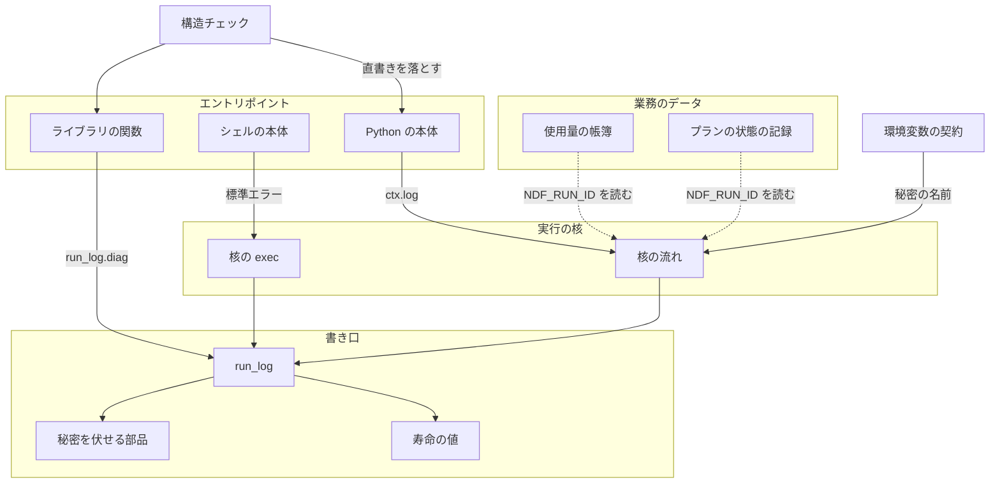
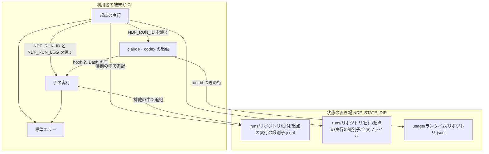
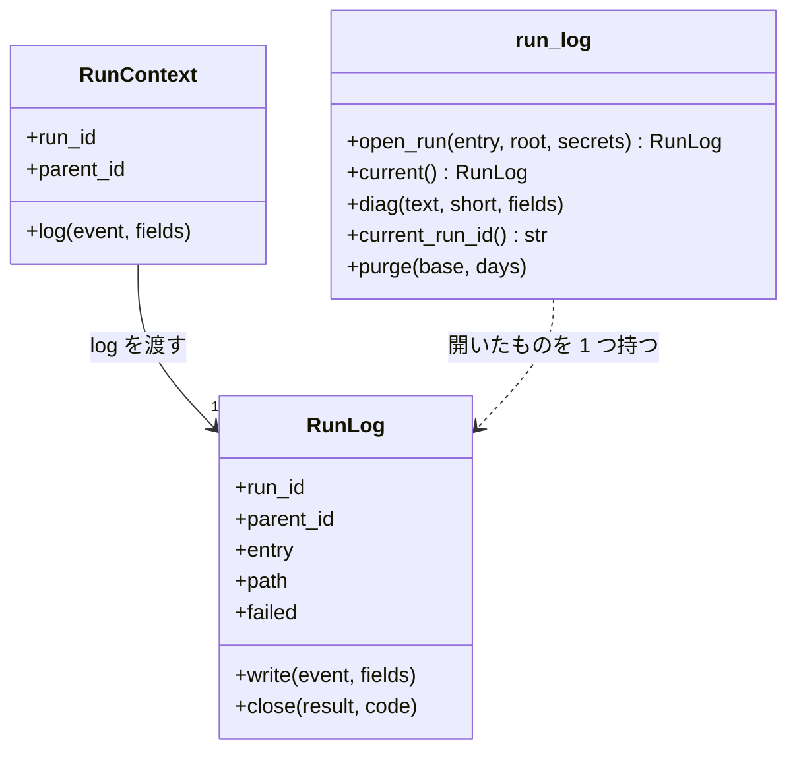
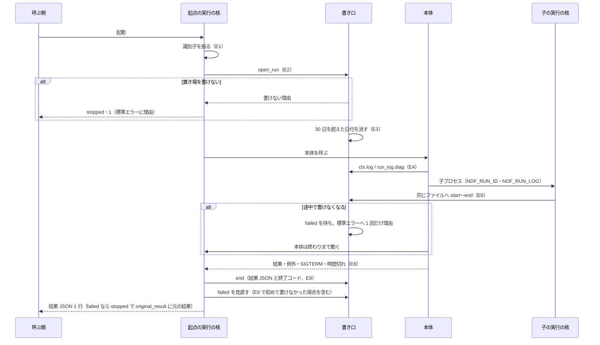
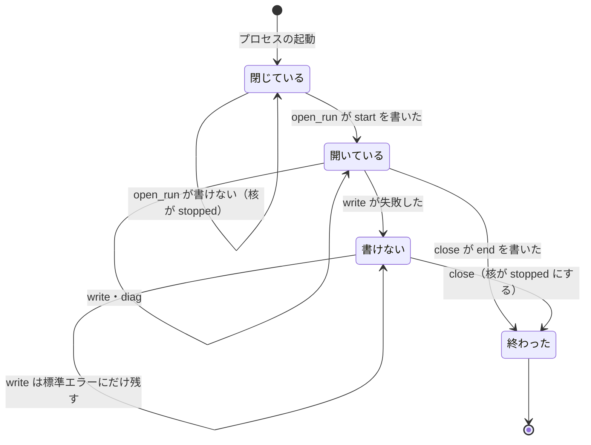

# NDF のスクリプト: 1 回の起動を実行の識別子 1 つで、1 つの記録から始まりから終わりまで追えるようにする（#2338）

## 目的

- **今どうなっているか**: スクリプトは標準エラーへ診断を直に書き（Python の直書きは 131 か所）、どこにも残らない。止まった理由は 10 か所で先頭 N 字に切られる。子プロセスで動いたエントリポイントの記録は親の記録とつながらない
- **誰に効くか**: NDF でスプリントを回す利用者と conductor、振り返りで止まった原因を探す人
- **変えると何が成り立つか**: 1 回の起動（子の実行を含む）の始まり・判断・診断・失敗・終わりと止まった理由の全文を、実行の識別子 1 つで 1 つのファイルから読める。記録とログの不統一が原因の課題（#2335 の型 B）を、1 件ずつ直さずにまとめて確かめられる

## 適用範囲

- **働く範囲**: NDF の配布物（`plugins/ndf/scripts` と `plugins/ndf/skills/*/scripts`）。テスト・`experimental/`・hook のエントリポイントを除く。配布先のリポジトリでも同じ書き口が動く
- **プロジェクトごとに違うもの**: 記録の置き場の根は環境変数 `NDF_STATE_DIR` で受ける（既定 `~/.local/state/ndf`）。リポジトリごとの値は置き場のパスの 1 階層（`<owner>__<repo>`）にだけ現れ、書き口の中に ai-plugins の値を置かない
- **当たるモード**: `standard`。柱 P1（#2337）の核のスケルトンを拡張する柱である。実装は核の拡張の Pull Request 1 本とエントリポイントを移す Pull Request 6 本（3 スプリント）に分かれる

## あるべき姿の根拠

| 根拠 | 種類 | 何を示すか |
| --- | --- | --- |
| 利用者の指摘（2026-11-01）「異常系処理とログ出力、異常時の回復処理が統一されていないから起こる不具合・課題が多い。1 件ずつ対処してもきりがない」 | 利用者の指示の原文 | 診断の経路を 1 つにし、型としてまとめて防ぐこと |
| 手元のプランの状態の記録 293 ファイル・1,778 行の長さ: 中央値 199 バイト・99 パーセンタイル 507 バイト・最大 570 バイト。使用量の帳簿の最長の行は 1,929 文字 | 実測（2026-11-04、`LC_ALL=C awk '{print length($0)}'`） | 1 行の上限 64 KiB は今の最長の行の 30 倍以上の余裕を持ち、通常の行は全文ファイルへ逃がさずに済むこと（決定 2） |
| `NDF_RUN_ID=20261104T000000-test-123456 claude -p ... --settings <UserPromptSubmit の hook>` を起動し、hook が書いたファイルに `run=20261104T000000-test-123456` が出た（Claude Code 2.1.318） | 実測（2026-11-04） | 核が起動した claude の hook は環境変数 `NDF_RUN_ID` を受け取れること（要求の未決 3。決定 4） |
| `plugins/ndf/scripts` で `grep -rn "isatty\|\[ -t [012] \]"` の結果は 6 件で、すべて標準入力か標準出力の判定。標準エラー（2 番）を端末か判定する箇所は 0 件 | 実測（2026-11-04） | スクリプト自身は標準エラーが端末かで振る舞いを変えないこと。シェルの本体が呼ぶ外部コマンドの振る舞いは示さない（決定 7・「未確認のまま残ること」） |

要求と受け入れ条件は #2338 の本文にある（コピーは [issue-2338-requirements.md](issue-2338-requirements.md) ）。この文書は「どう作るか」だけを扱う。
決定の記録は [issue-2338-design-decisions.md](issue-2338-design-decisions.md) にある。
実行の記録の行の形・置き場・寿命は、#2335 の設計（[issue-2335-design.md](issue-2335-design.md) ）が決めたものを前提にする。この文書は書き込みの方式と移し方を決める。

## ドメインモデル

### コンテキスト

| コンテキスト | 何の語が 1 つの意味に決まるか |
| --- | --- |
| NDF の開発ワークフロー（`ndf-workflow`） | 実行の記録・実行の識別子・起点の実行・子の実行・診断・全文ファイル・使用量の帳簿 |

実行の記録の書き口（`lib/run_log.py`）は #2335 が決めた共有カーネル（実行の核と契約の一覧）の一部である。各コンテキストのエントリポイントは書き口を直に呼ばず、実行の文脈の `ctx.log` と、ライブラリの関数から呼ぶ `run_log.diag` の 2 つだけを使う。

### 集約

| 集約 | 持ち主（書き換えてよいもの） | 根 | エンティティ | 値オブジェクト |
| --- | --- | --- | --- | --- |
| 実行 | 実行の核（`run_core`）。行を書くのは書き口（`run_log`）だけ | 実行の識別子 | 実行の記録の行 | 全文ファイルの参照・伏せ字にした文字列 |
| 使用量の帳簿 | 帳簿の書き手（`usage_ledger`。持ち主は変えない） | 帳簿のファイル | 帳簿の行 | 実行の識別子（任意の鍵） |
| プランの状態の記録 | `RunState`（`supervise_lib/state.py`。持ち主は変えない） | `progress.jsonl` | 状態の行 | 実行の識別子（任意の鍵） |
| 例外リスト | 構造チェック（読むだけ）。行を消すのはエントリポイントを移した Pull Request | `scripts/script-structure-allow/` | 許可の行（検査の種類 `stderr-direct`） | — |

**帳簿とプランの状態の記録は、実行の記録を識別子で参照するだけである。** 実行の記録の行を写さず、実行の記録も帳簿の行を写さない（要求の前提 3）。

### 不変条件

| # | 集約 | 条件 | 破れたときの扱い |
| --- | --- | --- | --- |
| I1 | 実行 | 実行の記録の行はすべて `run_id`・`at`（UTC の ISO 8601）・`event`・`entry`・`fields` を持つ。1 つの `run_id` について、`start` の行が最初、`end` の行が最後に来る（SIGKILL を除く） | 書き口が鍵の欠けた行を書かずに例外を投げる。核は `stopped` にする |
| I2 | 実行 | ファイルのすべての行が、それぞれ 1 つの JSON のオブジェクトとして読める。並行に書く子の実行の行が混ざらない | 1 行を排他（`fcntl.flock`）の中で、全バイトを書き切るまで `write` を続ける。書き切れなければ追記前の長さへ戻して I7 |
| I3 | 実行 | 子の実行の行は親と同じファイルに書かれ、`parent_id` が親の `run_id` と一致する | 受け継いだファイルが無いときは起点の実行として自分のファイルを作り、診断を残す（決定 5） |
| I4 | 実行 | 1 行は 64 KiB 以下。超える行は、長い文字列から順に全文ファイルへ移し、行にはパス・文字数・sha256 を残す。文字列を途中で切らない | 移した後も超えるときは、`fields` を全文ファイルへ移した参照だけの行にする |
| I5 | 実行 | 実行の記録と全文ファイルに、秘密の値が書かれない。伏せる対象はトークンの形の文字列と、秘密と宣言した環境変数の空でない値 | 書く前に伏せる（`secret_redact.redact`。短く縮めない） |
| I6 | 実行 | 診断は、渡された表示用の文がそのまま標準エラーへ出る。記録へ書けても書けなくても、端末に出る文は変わらない | 標準エラーへ先に書き、記録へ書くのは後にする |
| I7 | 実行 | 記録へ書けないとき、始まりなら本体を動かさず、途中なら本体を終わりまで動かして、結果を `stopped` にし、本体の元の結果 JSON を `original_result` の鍵に入れて標準出力へ出す。どちらも標準エラーへ理由を出す | 核が結果を置き換える（決定 3） |
| I8 | 例外リスト | 検査の種類 `stderr-direct` の許可の行が、ベースブランチより増えない | 構造チェックが落とす（#2335 の I11 と同じ検査） |
| I9 | 使用量の帳簿・プランの状態の記録 | 核を通る起動の中（環境変数 `NDF_RUN_ID` がある）で追記した行は `run_id` を持つ。持たない行も今と同じ形で読める | 鍵を足すだけで、版を上げない（決定 10） |
| I10 | 実行 | 起点の実行の起動で、30 日を超えた日付のディレクトリが記録の置き場から消える。消せなくても本体は動く | 診断を書いて続ける |

### ドメインイベント

要求の E1〜E9 を引き継ぐ。

| # | イベント | 発生元 | 受け手 |
| --- | --- | --- | --- |
| E1 | 実行の識別子を振った | 実行の核 | 書き口（`run_log.open_run`）・子プロセス（環境変数） |
| E2 | 記録の置き場を決め、始まりの行を書いた | 書き口 | 実行の記録 |
| E3 | 30 日を超えた日付のディレクトリを消した | 書き口（起点の実行だけ） | 記録の置き場 |
| E4 | 本体が判断・診断を書いた | 本体（`ctx.log`）・ライブラリ（`run_log.diag`） | 標準エラー・実行の記録 |
| E5 | シェルの本体が標準エラーへ書いた行を、診断として記録へ書いた | 実行の核（パイプの読み手） | 標準エラー・実行の記録 |
| E6 | 子の実行が親の識別子を持ち、同じファイルへ行を書いた | 子の実行の核 | 実行の記録 |
| E7 | 使用量の帳簿・プランの状態の記録の行へ実行の識別子を書いた | 帳簿の書き手・`RunState` | 帳簿・プランの状態の記録 |
| E8 | 本体が止まった理由を核が受けた | 実行の核 | 書き口（E9） |
| E9 | 終わりの行（結果 JSON の全体と終了コード）を書いた | 書き口 | 実行の記録・呼ぶ側 |

### 用語

| 用語 | 意味 | 用語集への反映 |
| --- | --- | --- |
| 全文ファイル | 実行の記録の 1 行の上限を超える文字列を、切らずに全文で置くファイル。実行の記録と同じ日付のディレクトリに置き、行にはパス・文字数・sha256 を残す | 追加（`ndf-workflow`） |

## 機能一覧

| # | 機能 | 誰が使うか |
| --- | --- | --- |
| F1 | 1 回の起動（子の実行を含む）の始まりから終わりまでを、1 つのファイルから実行の識別子で読む | conductor・利用者・振り返り |
| F2 | 診断を端末へ今と同じ文で出し、同じ文を記録にも残す | 利用者（端末）・振り返り（記録） |
| F3 | 止まった理由を切らずに結果 JSON と記録へ残し、人へ見せる表示だけを短くする | conductor・利用者 |
| F4 | 使用量の帳簿・プランの状態の記録の行から、その行を書いた実行の記録へたどる | 見積・使用量の集計・振り返り |
| F5 | 標準エラーへの直書きを構造チェックで落とし、例外リストを減る方向にだけ動かす | CI・エントリポイントを移す Pull Request |
| F6 | 30 日を超えた記録を消す | 利用者（状態の置き場の容量） |

## 構成要素

| 要素 | 責務 | 新設 / 変更 | Pull Request |
| --- | --- | --- | --- |
| 書き口（`lib/run_log.py`） | 置き場を決め、行を伏せて排他の中で書き切る。全文ファイルへ逃がす。診断を標準エラーと記録の両方へ出す。寿命の掃除。標準ライブラリだけを使う | 新設 | 核の拡張 |
| 実行の核（`lib/run_core.py`） | E1 で識別子を振って書き口を開き、`ctx.log` を書き口へつなぐ。E8 で理由を受け、E9 を `finally` と SIGTERM の受け手から呼ぶ。書けなかったら結果を `stopped` にする | 変更（P1 が作るスケルトンを拡張する） | 核の拡張 |
| 核の `exec`（`run_core.py exec`。シェルの本体を子として起動する） | シェルの本体の標準エラーをパイプで受け、1 行ずつ標準エラーへ出してから記録へ `diag` で書く | 変更（P1 が作る `exec` へ足す） | 核の拡張 |
| 秘密を伏せる部品（`lib/secret_redact.py`） | 伏せる処理（`redact`）と短く縮める処理（`shorten`）を分ける。`redact_output` は 2 つを順に呼ぶ形で残す | 変更 | 核の拡張 |
| 寿命の値（`lib/durable_keys.py`） | `KEEP_DAYS = 30` を持つ。`durable.py` と書き口がここから引く（`durable.py` は DBOS を読むため、書き口から import しない） | 変更（`durable.py` から移す） | 核の拡張 |
| 使用量の帳簿（`lib/usage_ledger.py`） | `UsageRecord` に任意の `run_id` を足し、既定値を環境変数 `NDF_RUN_ID` から取る | 変更 | 核の拡張 |
| プランの状態の記録（`supervise_lib/state.py`） | `progress_write` が書く行に、環境変数 `NDF_RUN_ID` があれば `run_id` を足す | 変更 | 核の拡張 |
| 環境変数の契約（`plugins/ndf/contracts/env/`） | `NDF_RUN_ID`・`NDF_RUN_LOG`・`NDF_STATE_DIR` の行を足す。秘密を持つ環境変数（`GH_TOKEN`・`GITHUB_TOKEN`・`AI_GATEWAY_API_KEY`・`SLACK_BOT_TOKEN`）の行へ `secret: true` を足す | 変更 | 核の拡張 |
| 契約の読み手（`scripts/contracts_lib/model.py`） | 環境変数の行の任意の鍵 `secret`（bool）を受けて確かめる | 変更 | 核の拡張 |
| テストの状態の置き場（ルートの `conftest.py`） | session の autouse の fixture で、テストの実行中だけ `NDF_STATE_DIR` を一時ディレクトリへ向ける。全体テストが実行した人の置き場へ記録を書かず、寿命の掃除も本物の置き場で動かさない（`NDF_CONTEXT_DIR`・`NDF_METRICS_DIR` と同じ形）。プラグインの外のテスト（`scripts/tests/` など）に効く | 変更 | 核の拡張 |
| テストの状態の置き場（`plugins/ndf/conftest.py`） | テストごとの autouse の fixture（`_isolated_usage_dirs`）で、`NDF_USAGE_DIR` などと並べて `NDF_STATE_DIR` をテストごとの一時ディレクトリへ向ける。ルートの `conftest.py` はプラグインのキャッシュへ配られないため、配布先でプラグインのテストを実行しても本物の `runs/` へ書かず、寿命の掃除も本物の置き場で動かさない | 変更 | 核の拡張 |
| 構造チェック（`scripts/check-script-structure.py`） | 検査の種類 `stderr-direct` を足す。例外リストの増加は既存の検査（#2335 の `allow-grow`）で落とす | 変更 | 核の拡張 |
| 例外リスト（`scripts/script-structure-allow/`） | 直書きを持つ 60 ファイルを `stderr-direct` の行として載せ、移した Pull Request が消す | 変更 | 核の拡張 → 移す 6 本 |
| 理由を切る 10 か所 | 下の「止まった理由を切る箇所の扱い」の表どおりに直す | 変更 | 核の拡張 |
| 直書きを持つ 60 ファイル | `print(..., file=sys.stderr)`・`sys.stderr.write` を `ctx.log("diag", ...)` か `run_log.diag(...)` へ置き換える | 変更 | 移す 6 本（下の「移す順序」） |

### 呼ぶ向き



### 配置



### 置き場所

```text
plugins/ndf/
├── contracts/env/
│   ├── NDF_RUN_ID.json             # 新設
│   ├── NDF_RUN_LOG.json            # 新設
│   ├── NDF_STATE_DIR.json          # 新設
│   └── GH_TOKEN.json ほか 3 つ      # 変更（secret: true）
└── scripts/
    ├── lib/
    │   ├── run_log.py              # 新設
    │   ├── run_core.py             # 変更（P1 が新設したものを拡張する）
    │   ├── secret_redact.py        # 変更
    │   ├── durable_keys.py         # 変更（KEEP_DAYS）
    │   ├── durable.py              # 変更（KEEP_DAYS を引く）
    │   └── usage_ledger.py         # 変更
    └── supervise_lib/state.py      # 変更
scripts/
├── check-script-structure.py       # 変更（stderr-direct）
├── contracts_lib/model.py          # 変更（secret）
└── script-structure-allow/         # 変更（60 行を足し、移すたびに消す）
```

## 構造



- **プロセスに開いた記録は 1 つだけ**: `open_run` は開いた `RunLog` をモジュールの変数に持ち、`current()` で返す。核の外のプロセス（hook・テスト・核へ移す前のエントリポイント）では `None` で、`diag` は標準エラーへ書くだけになる
- **`ctx.log(event, fields)`** は `current().write` を呼ぶ。`event` は #2335 の 8 種だけを受け、ほかは `ValueError`。8 種は `start` / `input` / `lease` / `ref` / `retry` / `decision` / `diag` / `end` である。`event` が `diag` のときだけは `current().write` を直に呼ばない。`run_log.diag(fields["text"], short=fields.get("display"), **残りの鍵)` へ渡す。標準エラーへ先に出してから記録へ書く経路を 1 つにするためである。Python の直書きを `ctx.log("diag", ...)` へ置き換えても、端末に出ていた警告や進捗が消えない（受け入れ条件 6・I6）
- **`run_log.diag(text, short=None, **fields)`**: 標準エラーへは `short` があれば `short`、無ければ `text` を 1 行で書く。記録へは `{"text": text, **fields}` を書き、`short` があれば `"display": short` も書く。ライブラリの関数は実行の文脈を受け取らないため、この関数を呼ぶ
- **`write` が書けなかったとき**: 例外を投げず、`failed` に理由を持ち、標準エラーへ理由を 1 回だけ出す。以後の `write` は記録へ書かない。核は E9 の前と E9 の完了後の 2 回 `failed` を見る。E9 の前に `failed` なら、結果を `stopped` にしてから `end` を書きにいく。E9 で初めて失敗することもある（`end` の行やその全文ファイルを書けなかった）。そのときは E9 の完了後の確認で、結果を `stopped`・終了コード 1 へ置き換え、本体の結果を `original_result` に入れる。核は 2 回目の確認を終えてから標準出力と終了コードを確定する（I7）

## データ構造

### 実行の記録の行

鍵の形は #2335 の設計の「実行の記録の行」のとおりで、変えない。この柱は `fields` の中身を決める。

| `event` | `fields` | 書く者 |
| --- | --- | --- |
| `start` | `{"argv": [...], "cwd": str, "pid": int, "root": str}`（`argv` は伏せた後の値） | 核（E2） |
| `decision` | 本体が渡す任意のオブジェクト。止まった理由を持つときは `reason` の鍵に全文 | 本体 |
| `diag` | `{"text": str, "display": str?, "source": "py" / "sh", ...}` | `run_log.diag`・核の `exec` |
| `end` | `{"result": <結果 JSON の全体>, "code": int, "how": "return" / "exception" / "sigterm" / "timeout", "error": str?}`（`error` は例外の型と理由の全文） | 核（E9） |

`input`・`lease`・`ref`・`retry` の中身はそれぞれの柱（P8・P3・P5・P4）が決める。この柱は書き口だけを用意する。

**全文ファイルの参照**: 行の中の文字列を置き換える値は次の形である。

```json
{"$text": "<記録のファイルからの相対パス>", "chars": <文字数>, "sha256": "<全文の sha256>"}
```

全文ファイルの名前は `<起点の実行の識別子>/<実行の識別子>-<行の通し番号>-<鍵のパス>.txt` で、記録と同じ日付のディレクトリに置く。寿命の掃除で日付のディレクトリごと消える。

### 使用量の帳簿とプランの状態の記録

| ファイル | 足す鍵 | 型 | 空を許すか | 版 |
| --- | --- | --- | --- | --- |
| 使用量の帳簿の行 | `run_id` | str | 許す（核の外で書いた行は鍵を持たない） | `SCHEMA = 2` のまま |
| プランの状態の記録の行 | `run_id` | str | 許す（同上） | 版を持たない（今と同じ） |

### 環境変数の契約の行

| 鍵 | 型 | 空を許すか | 意味 |
| --- | --- | --- | --- |
| `secret` | bool | 省略を許す（省略は偽） | 真なら、核はこの環境変数の空でない値を記録へ書く前に伏せる |

足す環境変数は次の 3 つである。

| 環境変数 | `set_by` | 意味 |
| --- | --- | --- |
| `NDF_RUN_ID` | `ndf` | 今の実行の識別子。子は親の識別子として読む |
| `NDF_RUN_LOG` | `ndf` | 起点の実行の記録のファイルの絶対パス |
| `NDF_STATE_DIR` | `user` | 状態の置き場の根 |

### 機能とデータ

| 機能 | 実行の記録 | 全文ファイル | 使用量の帳簿 | プランの状態の記録 | 例外リスト |
| --- | --- | --- | --- | --- | --- |
| F1 | 作る・読む | 作る・読む | — | — | — |
| F2 | 作る | — | — | — | — |
| F3 | 作る | 作る | — | — | — |
| F4 | 読む | — | 作る（`run_id`） | 作る（`run_id`） | — |
| F5 | — | — | — | — | 読む・消す |
| F6 | 消す | 消す | — | — | — |

## 入出力の契約

| 項目 | 約束 |
| --- | --- |
| 子へ渡す環境変数 | 核は E1 の後に `NDF_RUN_ID` を自分の識別子へ、`NDF_RUN_LOG` を起点の実行の記録のファイルの絶対パスへ書き換える。子の核は起動時の `NDF_RUN_ID` を `parent_id` に取り、`NDF_RUN_LOG` のファイルへ書く |
| 受け継いだファイルが無い | `NDF_RUN_LOG` のファイルが無いか、置き場の外を指すとき、子は起点の実行として自分のファイルを作り、`start` の `fields` に `"inherited_log_missing": <パス>` を書く |
| 標準エラー | 診断の表示用の文を 1 行ずつ出す。文は移す前と同じ（受け入れ条件 6）。記録へ書けなかった理由は 1 回だけ `run_log: 実行の記録へ書けない（<パス>: <理由>）` の形で出す |
| 標準出力・結果 JSON | 変えない。鍵 `run_id` を足すのは P1 の決めたとおり。`summary`・`gaps` は本体が渡した文字列を切らずに出す |
| 終了コード | 変えない。記録へ書けなかったときの `stopped` は終了コード 1、`gaps` に `run-log-unwritable` |
| 途中で書けなくなったときの結果 JSON | 核は本体の元の結果 JSON（本体が例外で終わったときは `null`）を、`stopped` の結果の鍵 `original_result` へ切らずに入れて標準出力へ出す。本体が済ませた外の操作の結果（作った Pull Request の番号など）を、呼ぶ側が記録を読まずに受け取れる。始まりの行を書けないときは本体を動かさないため、鍵を持たない |

### 止まった理由を切る箇所の扱い

**行き先で扱いを分ける。** 結果 JSON・例外の理由へ行く文字列は切らない。人へ見せる表示（端末・プランの状態の記録・周回の記録・報告の文）へ行く文字列は、切る前の全文を実行の記録へ書いてから、表示だけを短くする。

| 箇所（`plugins/ndf/scripts/` の下） | 今の行き先 | 扱い |
| --- | --- | --- |
| `project-mvv.py:184` | 結果の `summary`（形の誤りを先頭 10 件まで） | 切らずにすべて並べる |
| `supervise_lib/actuals.py:46` | プランの状態の記録の `reason` | 全文を `decision` で記録へ書き、状態の記録は 300 字のまま |
| `supervise_lib/engine.py:422` | プランの状態の記録の `summary` | 同上 |
| `supervise_lib/slow.py:202` | conductor 向けの注意の文 | 全文を `diag` で記録へ書き、注意の文は 200 字のまま |
| `merged_lib/merge.py:317` | 例外の理由（結果の `summary` になる） | 切らない |
| `lib/sprint_loop_gate.py:127` | 周回の記録の止まった理由 | 全文を `decision` で記録へ書き、周回の記録は 300 字のまま |
| `lib/sprint_loop_gate.py:128` | 結果の `summary` | 切らない |
| `lib/monitor_loop.py:120` | 端末の監視の行 | `run_log.diag(全文, short=先頭 200 字)` |
| `lib/monitor_loop.py:240` | 端末の監視の行 | 同上 |
| `release-steps.py:141` | ステップの結果の文（結果の `summary` になる） | 切らない |

## 処理の流れ



### 図に描かない要素

図に描かない要素は次のとおりである。

| 要素 | 図のどこで動くか |
| --- | --- |
| 核の `exec`（E5） | 本体の位置に入る。`exec` の子の標準エラーを 1 行ずつ `diag` へ渡す読み手のスレッド |
| 秘密を伏せる部品・寿命の値 | 書き口の中で使う |
| 使用量の帳簿・プランの状態の記録（E7） | 本体の中で書かれ、環境変数を読むだけ |
| 環境変数の契約・契約の読み手 | E1 の前に、核が秘密の名前を読む |
| 構造チェック・例外リスト | CI で動く |
| テストの状態の置き場（ルートと `plugins/ndf/` の `conftest.py`） | テストの実行中だけ、起動の前に `NDF_STATE_DIR` を一時ディレクトリへ向ける。図の流れは変わらず、置き場の根だけが変わる |
| 理由を切る 10 か所・直書きを持つ 60 ファイル | 本体の中身 |

### 1 行の書き方

次の順で書く。

1. 伏せる
2. JSON にする
3. 64 KiB を超えたら、長い文字列から全文ファイルへ移す
4. 記録のファイルを `O_APPEND` で開き、`fcntl.flock(LOCK_EX)` を取り、追記前のファイルの長さ（`os.fstat` の大きさ）を控える
5. 排他を持ったまま、1 行の全バイトを書き切るまで `os.write` を呼ぶ。`os.write` は容量不足などで例外を投げずに要求より少ないバイト数を返すことがあるため、戻り値を確かめ、残りのバイトを続けて書く
6. `os.write` が例外を投げたか 0 バイトを返したときは、書き切れなかったものとする。排他を持ったまま `os.ftruncate` で追記前の長さへ戻してから、I7 の失敗（`failed`）にする。途中まで書いた行を残すと、次に書く子の行が同じ行へつながり I2 が崩れるためである。長さを戻せなかったときも `failed` にし、理由に戻せなかったことを書く
7. 排他を返す

全文ファイルは記録の行より先に書く。行が全文ファイルを指した時点で、全文ファイルが在る。

### SIGTERM と時間切れ

CPython の Python で書いたシグナルの受け手は、どのスレッドがシグナルを受けても主スレッドで動く。`signal.pthread_sigmask` は呼んだスレッドにしか効かないため、受け手が主スレッドの排他の区間の中で動くことを防げない。核の `exec` の読み手のスレッドと、「移す順序」の G4 で移す監視・中継のスレッドがこの条件を満たす。`flock` は同じプロセスでも、開き直したファイル記述子どうしで排他になる。そのため受け手が排他の区間の中で `end` を書きにいくと、自分自身を待って止まる。そこで次の形にする。

1. 書き口はプロセスに 1 つの `threading.Lock` でスレッドどうしの書き込みを順に並べ、その中で `flock` を取る。主スレッドが排他の区間にいる間は、スレッドごとの印（`threading.local`）を立てる。印は `Lock` を取る前に立て、`Lock` を返した後に下ろす。`Lock` を取ってから印を立てるまでと、印を下ろしてから `Lock` を返すまでの隙間を作らないためである。隙間で受け手が動くと、印が無いと見て項目 2 の経路で同じ `Lock` を取りにいき、主スレッドが自分を待って止まる
2. 核の受け手（SIGTERM と時間切れのシグナル SIGALRM）は、主スレッドが排他の区間にいなければ、その場で E9 を呼んで `end` を書き、続けて終わらせ方の関数を呼ぶ
3. 主スレッドが排他の区間にいれば、受け手は `end` を書かずに、終わり方（`sigterm` / `timeout`）を保留の印として残して戻る。`write` は排他を返して印を下ろした後に保留の印を見て、印があれば E9 を呼び、続けて項目 2 と同じ終わらせ方の関数を呼ぶ。`write` は本体へ戻らない
   - **終わらせ方の関数**: 項目 2 と 3 が共有する 1 つの関数にする。結果を #2335 の失敗の形（`stopped`・終了コード 1・`gaps` に `interrupted` か `timeout`）にする。続けて、核だけが捕まえる例外を投げる。例外は `BaseException` から派生させ、本体の `except Exception` に捕まらない。核の `main` がこの例外を捕まえ、`end` の `result`・`code` と同じ結果 JSON を標準出力へ出し、同じ終了コードで終わる。`end` の `how` が `sigterm` / `timeout` のときに、標準出力と終了コードが本体の値にならない（1c）
   - E9 はプロセスで 1 回だけ `end` を書く。2 回目の呼び出しは何も書かずに戻る（保留の印を残した後に項目 2 の経路でも呼ばれる場合を含む）
4. ほかのスレッドが排他を持つ間に受け手が動いたときは、そのスレッドが排他を返すのを待ってから書く（待つ相手が別のスレッドのため止まらない）
5. `close` が `end` を書いた後の `write` は、記録へ書かずに捨てる。読み手のスレッドが後から書いても、`end` の行は最後に並ぶ

### 書き口の状態



## 移す順序

直書きを持つ対象のファイルは 60（125 か所）である。数は 2026-11-04 の develop（729dcbe40）で、要求の「調べ方」のコマンドからファイルごとに取った。
hook のエントリポイントの 6 か所は、次のとおり数から除いた。

- `hooks/*.json` が呼ぶ 5 つ: `context-policy.py`・`hook.py`・`relay.py`・`usage-subagent.py`・`training-optout.py`
- SessionStart が呼ぶ 1 つ: `hook-env.py`

順は #2335 の部品の順で、1 スプリントに 3 本までとする（要求の前提 8）。

| スプリント | Pull Request | 対象（`plugins/ndf/scripts/` の下。`skills/` は `plugins/ndf/skills/` の下） | ファイル | か所 |
| --- | --- | --- | --- | --- |
| 1 | 核の拡張 | 書き口・核・帳簿・状態の記録・契約・構造チェック・例外リスト（60 行）・理由を切る 10 か所 | — | — |
| 1 | G1 supervise のプラン・判定・キュー | `supervise_lib/` の 10 ファイル・`phase-steps.py`・`sprint-close.py`・`lib/loop_drive.py`・`lib/post_queue.py` | 14 | 29 |
| 1 | G2 cross-refactoring と review | `skills/cross-refactoring/scripts/` の 3 ファイル・`refactor-scope.py`・`lib/result_posts.py`・`lib/review_criteria.py`・`lib/parallel_lane.py` | 7 | 16 |
| 2 | G3 課題を閉じる処理・リリース | `release-steps.py`・`release_lib/declared_steps.py`・`merged_lib/checks.py`・`lib/body_findings.py`・`lib/gh_parts.py`・`skills/fix/scripts/fix-steps.py`・`skills/backlog-refinement/scripts/upkeep_gh.py` | 7 | 8 |
| 2 | G4 外部 CLI の監視と中継 | `lib/monitor.py`・`lib/monitor_loop.py`・`lib/monitor_outcome.py`・`lib/proc.py`・`lib/limits.py`・`lib/runtime_policy.py`・`lib/container_reach.py`・`skills/external-ai/scripts/external-ai.py`・`relay_lib/` の 6 ファイル | 14 | 36 |
| 2 | G5 使用量の帳簿 | `lib/usage_capture.py`・`lib/usage_ledger.py`・`lib/transcript_agents.py`・`lib/run_metrics.py`・`lib/whole_runs.py`・`skills/skill-stats/scripts/skill-stats.py`・`parallel-measure.py` | 7 | 18 |
| 3 | G6 残り | `check-trigger.py`・`glossary.py`・`instructions-check.py`・`instructions_lib/report.py`・`lib/deps.py`・`lib/durable.py`・`lib/legacy_names.py`・`lib/step_result.py`・`lib/tool_paths.py`・`lib/worktree_deps.py`・`project-mvv.py` | 11 | 18 |

数え直すと、G1〜G6 のファイルは 14+7+7+14+7+11=60、か所は 29+16+8+36+18+18=125 で、対象の数と一致する。受け入れ条件 4（子の課題 8 件の判定）は G6 をマージした後に行う。

## 非機能の実現方式

| 大項目 | 要求の条件 | 実現方式 | 確かめ方 |
| --- | --- | --- | --- |
| 運用・保守性 | 1 回の起動を実行の識別子 1 つで、1 ファイルから追う。寿命 30 日 | 起点の実行ごとに 1 ファイル。子は `NDF_RUN_LOG` で同じファイルへ書く。寿命は `durable_keys.KEEP_DAYS` を引き、起点の実行の起動で `runs/*/<日付>` のうち日付が 30 日より前のディレクトリを消す（ディレクトリの名前の日付で判定し、更新時刻を見ない） | 終わり方ごとのテスト・子の実行のテスト・寿命のテスト（テスト設計） |
| 移行性 | 部品の順・例外リストで並走・Pull Request ごとの revert で戻る・識別子の無い行も読める | 書き口は核の外では標準エラーへ書くだけになるため、移したエントリポイントと移す前のエントリポイントが並んで動く。核の拡張の Pull Request を revert すると、移したエントリポイントの `run_log.diag` も標準エラーだけへ書く | 柱の Pull Request ごとに全体テストと構造チェックを通す |
| セキュリティ | 受け入れ条件 5。C1・C2 は変えない | 書く前に `secret_redact.redact`（トークンの形）と、秘密と宣言した環境変数の空でない値の置き換えを通す。全文ファイルにも同じ処理を通す。秘密の値そのものは記録にも契約にも書かない（契約には `secret: true` だけ） | 秘密を入れた環境変数で起動するテスト |
| システム環境 | Claude Code と Codex の両方で同じ核。シェルは bash | 書き口は標準ライブラリ（`json`・`os`・`fcntl`・`hashlib`）だけを使い、extras の無い環境でも動く | extras を外した環境で診断が出るテスト |

## 決定の記録

決定の記録は [issue-2338-design-decisions.md](issue-2338-design-decisions.md) にある。

## テスト設計

| 受け入れ条件・不変条件 | どの振る舞いで縛るか | どう壊したら落ちるべきか |
| --- | --- | --- |
| 1・I1 | 核を通るエントリポイントを正常・例外・SIGTERM・時間切れで終わらせると、1 ファイルに同じ `run_id` で `start` から `end` までが並び、すべての行が 5 つの鍵を持つ | SIGTERM の受け手から E9 を外す／`at` を地方時で書く |
| 1・I1 | 読み手のスレッドが書き続ける間に、主スレッドが排他の区間にいる時点で SIGTERM と SIGALRM を送っても、エントリポイントが時間内に終わり、`end` の行が最後に並ぶ | 受け手が排他の区間の中で `end` を書きにいく／`end` の後の `write` を記録へ書く |
| 1・1c・I1 | 主スレッドが排他の区間に入る直前と出た直後に SIGTERM を送っても止まらずに終わる。保留の経路で終わったときも、本体は `write` の後の処理へ進まず、標準出力の結果 JSON（`stopped`・`gaps` に `interrupted`）と終了コード 1 が `end` の `result`・`code` に一致する | 印を `Lock` を取った後に立てる／保留の経路で E9 の後に `write` から本体へ戻る |
| 1a・I3 | エントリポイントが別のエントリポイントを子プロセスで起こすと、子の行が親のファイルに入り、`parent_id` が親の `run_id` | 子へ `NDF_RUN_LOG` を渡さない／子が自分の識別子を `parent_id` に書く |
| 1b・I2 | 子の実行を並行に複数起こし、64 KiB 近い行を書かせても、全行が JSON として読める | 排他を外して 2 回の `write` に分ける |
| 1b・I2・I7 | `os.write` が要求より少ないバイト数を返す・途中で例外を投げるように差し替えると、短く返す場合は残りを書き切って行が 1 つの JSON になり、例外の場合はファイルの長さが追記前に戻って `failed` になる。どちらの後も、次に書く行は独立した行として読める | 戻り値を確かめずに 1 回で返す／書き切れなかった行を残したまま排他を返す |
| 1c | 本体の `decision` と止まった理由が行に残り、`end` の `fields` が標準出力の結果 JSON と終了コードに一致する | `end` に `summary` だけを書く |
| 1d・I9 | 核の中で追記した帳簿の行とプランの状態の記録の行が `run_id` を持ち、核の外で書いた行は鍵を持たずに今の読み手で読める | `run_id` を必須にする／読み手が未知の鍵で落ちる |
| 1e・I10 | 31 日前の日付のディレクトリが消え、29 日前は残る。消せない（権限）ときは `diag` が残り本体の結果が変わらない | 更新時刻で判定する／消せない例外で止まる |
| 1f・I7 | 置き場を書けない場所にすると、標準エラーに理由が出て `stopped`・1。途中で書けなくすると本体は終わりまで動き、結果が `stopped` で `gaps` に `run-log-unwritable`、`original_result` に本体の元の結果 JSON がそのまま入る | 書けない例外を握りつぶして `ok` を返す／`stopped` に置き換えるときに本体の結果を捨てる |
| 1f・I7 | 本体が `ok` で終わり、E9 の `end` の行（またはその全文ファイル）で初めて書けなくすると、標準出力は `original_result` に本体の結果を持つ `stopped`、終了コードは 1 になる | `failed` を E9 の前にだけ見て、本体の `ok` と 0 を返す |
| 2・I8 | 対象のファイルに `print(..., file=sys.stderr)` か `sys.stderr.write` を書くと構造チェックが落とす。例外リストに 1 行足すと落とす。書き口の中は落とさない | 検査を `file=sys.stderr` の文字列一致にして `file=sys.stdout if c else sys.stderr` を通す |
| 2a | `run_log.diag` の文と `ctx.log("diag", ...)` の文が、どちらも標準エラーと記録の `diag` の両方に出る。シェルの本体の `>&2` の行も `diag`（`source: sh`）で残る | シェルの標準エラーを記録へ書かずに捨てる／`ctx.log` の `diag` を `current().write` へ直に渡して標準エラーへ出さない |
| 2b | 移した Pull Request で例外リストの行が消え、残った行が `unused-allow` で落ちる | 移した後も行を残す |
| 3・I4 | 本体の渡した 10,000 字の `summary` が、結果 JSON と `end` の行に同じ文字列で残る。10 か所の行き先ごとの扱いが表のとおり | 理由を 300 字で切る |
| 3a・I4 | 64 KiB を超える理由は全文ファイルへ移り、行のパス・文字数・sha256 が全文と一致する。全文ファイルが行より先に在る | 全文ファイルを書かずに参照だけ残す／長い文字列を切る |
| 4 | （手動）G6 の後に子の課題 8 件の再現の手順を 1 回ずつ通し、本文の「子の課題の判定」へ書く | — |
| 5・I5 | `secret: true` の環境変数に値を入れ、本体がその値を診断・例外の理由・`summary` へ入れても、記録と全文ファイルに値が無い。トークンの形の文字列も無い。空文字列の値で他の文字列が壊れない | 伏せる処理を全文ファイルに通さない／空の値で置き換える |
| 6・I6 | 移す前と後で、同じ入力に対する標準エラーの文が一致する。直書きを `ctx.log("diag", ...)` へ置き換えたエントリポイントと `run_log.diag` へ置き換えたエントリポイントの両方で確かめる。記録の置き場を書けないときも同じ文が出る | 記録へ書いた後でしか標準エラーへ書かない |
| 1e | 全体テストの後に、テストの外の `NDF_STATE_DIR`（未設定なら `~/.local/state/ndf`）の `runs/` の中身が増えも減りもしない | ルートの `conftest.py` から `NDF_STATE_DIR` の fixture を外す |
| 1e | `plugins/ndf/` だけを根にして（ルートの `conftest.py` が読まれない、プラグインのキャッシュと同じ条件で）核を通すテストを実行した後も、テストの外の `NDF_STATE_DIR` の `runs/` の中身が増えも減りもしない | `plugins/ndf/conftest.py` から `NDF_STATE_DIR` の行を外す |
| 7 | 柱の Pull Request ごとに `uv run --frozen --project . --all-extras pytest . -q -n 4` が前後で通る | — |

## 設計の結果

| 課題 | 扱い | 取り込み先 | 触るファイル |
| --- | --- | --- | --- |
| #2338 | 実装する | — | `conftest.py`、`plugins/ndf/conftest.py`、`plugins/ndf/scripts/lib/run_log.py`、`plugins/ndf/scripts/lib/run_core.py`、`plugins/ndf/scripts/lib/secret_redact.py`、`plugins/ndf/scripts/lib/durable_keys.py`、`plugins/ndf/scripts/lib/durable.py`、`plugins/ndf/scripts/lib/usage_ledger.py`、`plugins/ndf/scripts/supervise_lib/state.py`、`plugins/ndf/contracts/env/`、`scripts/contracts_lib/model.py`、`scripts/check-script-structure.py`、`scripts/script-structure-allow/`、`scripts/tests/`、`plugins/ndf/scripts/tests/`、`plugins/ndf/scripts/project-mvv.py`、`plugins/ndf/scripts/supervise_lib/`、`plugins/ndf/scripts/merged_lib/merge.py`、`plugins/ndf/scripts/lib/sprint_loop_gate.py`、`plugins/ndf/scripts/lib/monitor_loop.py`、`plugins/ndf/scripts/release-steps.py`、`plugins/ndf/scripts/phase-steps.py`、`plugins/ndf/scripts/sprint-close.py`、`plugins/ndf/scripts/lib/loop_drive.py`、`plugins/ndf/scripts/lib/post_queue.py`、`plugins/ndf/scripts/refactor-scope.py`、`plugins/ndf/scripts/lib/result_posts.py`、`plugins/ndf/scripts/lib/review_criteria.py`、`plugins/ndf/scripts/lib/parallel_lane.py`、`plugins/ndf/skills/cross-refactoring/scripts/`、`docs/glossary/glossary.json`、`docs/glossary.md` |

触るファイルはスプリント 1（核の拡張・G1・G2）の分である。G3〜G6 は同じ柱の次のスプリントの設計の結果へ載せる。

## 未確認のまま残ること

| 項目 | 内容 |
| --- | --- |
| P1 の核の形 | `run_core.py` は 2026-11-04 の時点で無い（#2337 は OPEN）。この設計は #2335 の設計の `RunContext`・`main`・`exec`・SIGTERM の受け手の形を前提にした。P1 の実装で形が変わったときは、核の拡張の Pull Request で呼ぶ位置だけを合わせる |
| Codex の hook と Bash の子 | `NDF_RUN_ID` が hook へ届くことは Claude Code の hook で確かめた。Codex の hook と、エージェントの Bash ツールが起こす子プロセスへ届くかは未確認。届かないときも、子は起点の実行として自分のファイルを作るだけで、記録は失われない |
| 直書きの別の形 | 検査は `print` の `file` の式に `sys.stderr` を含むものと `sys.stderr.write` を落とす。変数へ入れてから書く形（`err = sys.stderr`）と、`sys.stderr` を参照するほかの 11 か所（`flush`・`argparse` の `print_usage`・`subprocess` の出力先・DBOS のハンドラ）は対象にしない |
| シェルの標準エラーをパイプにした影響 | シェルの本体が呼ぶ外部コマンド（git・gh・uv・claude など）は、標準エラーが端末かで進捗表示・色・対話の出力を変えることがある。行単位で転送するため、改行の無い進捗の表示も遅れる。`plugins/ndf/scripts` と `plugins/ndf/skills` のシェルの本体に `read -p` は 0 件（2026-11-04、`grep -nE 'read +-[a-z]*p'`）。受け入れ条件 6 を満たすかは、核の拡張の Pull Request で、代表的なシェルのエントリポイントを標準エラーが端末のときとパイプのときで動かし、出力を比べて確かめる |
| 正規表現に当たらない切る箇所 | 要求の「調べ方」の正規表現に当たらない書き方（`textwrap.shorten`・変数名の違い）で切る箇所は数えていない |
| 問い合わせの記録 | hook が書く `ask.jsonl` の行へ実行の識別子を足すかは、hook の変更として #2335 の対象範囲の外に置いた（決定 4） |
