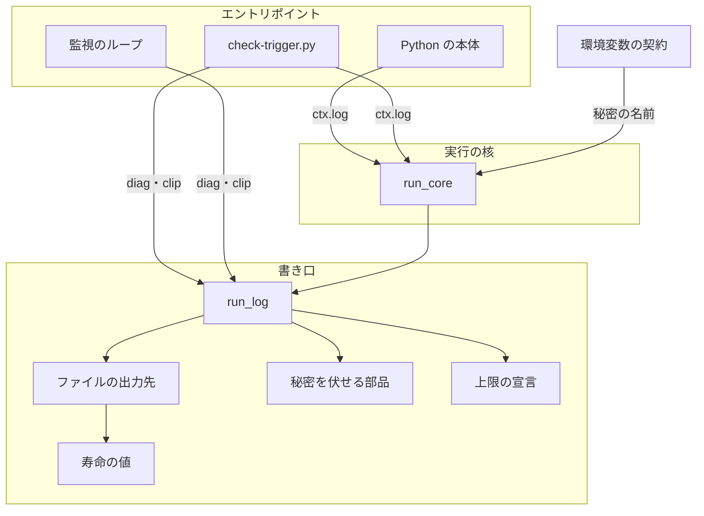
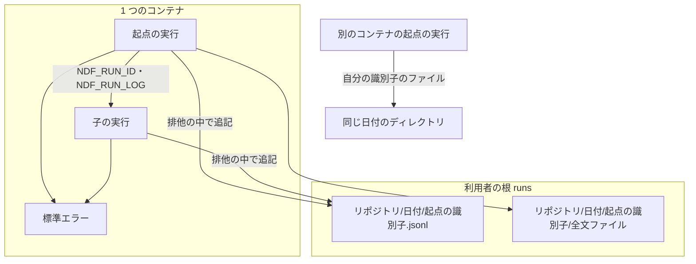
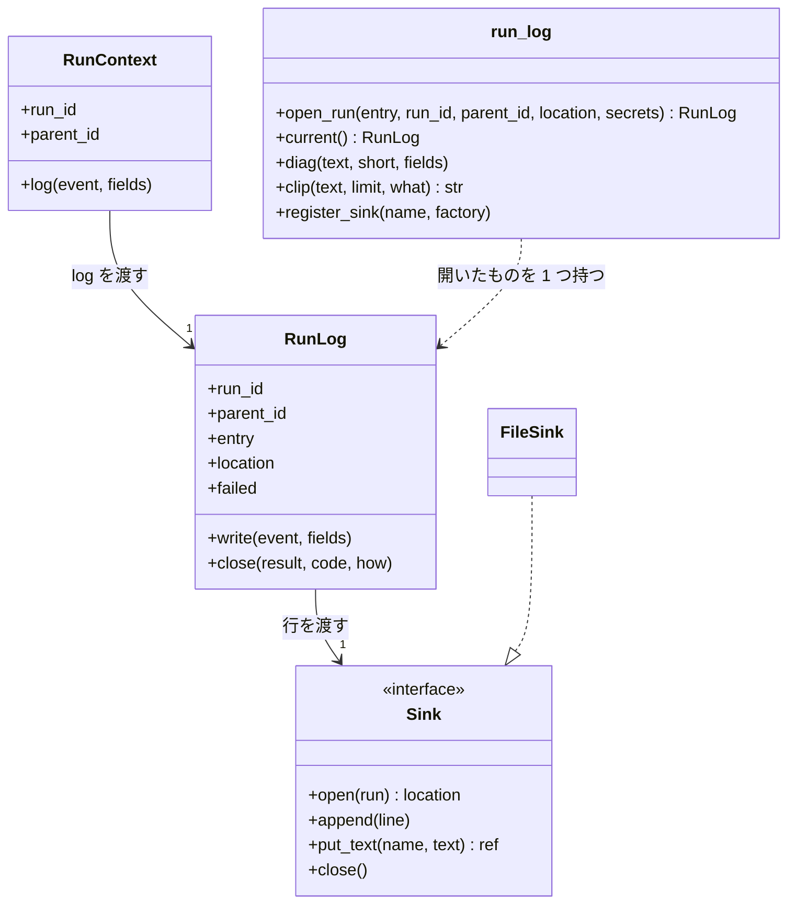
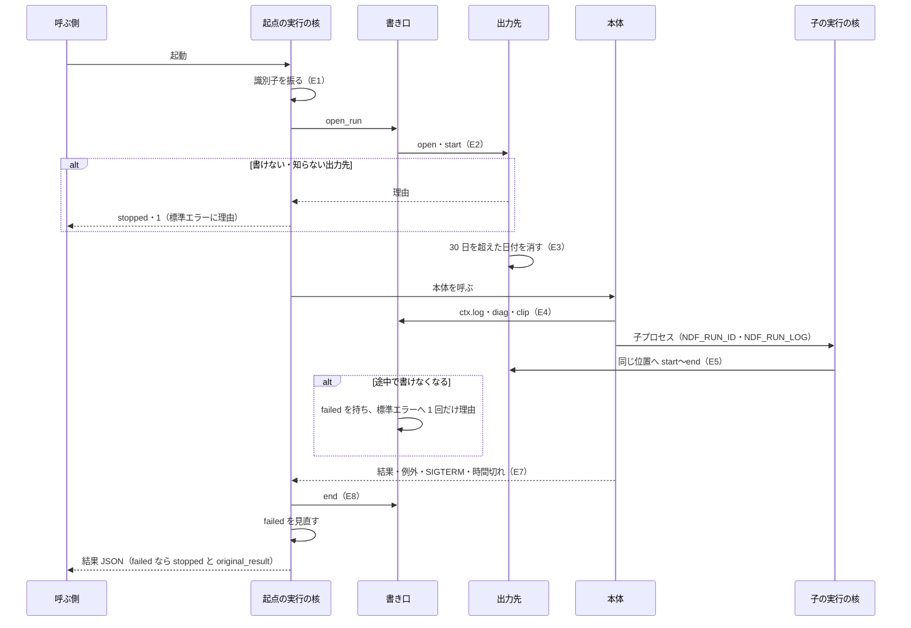
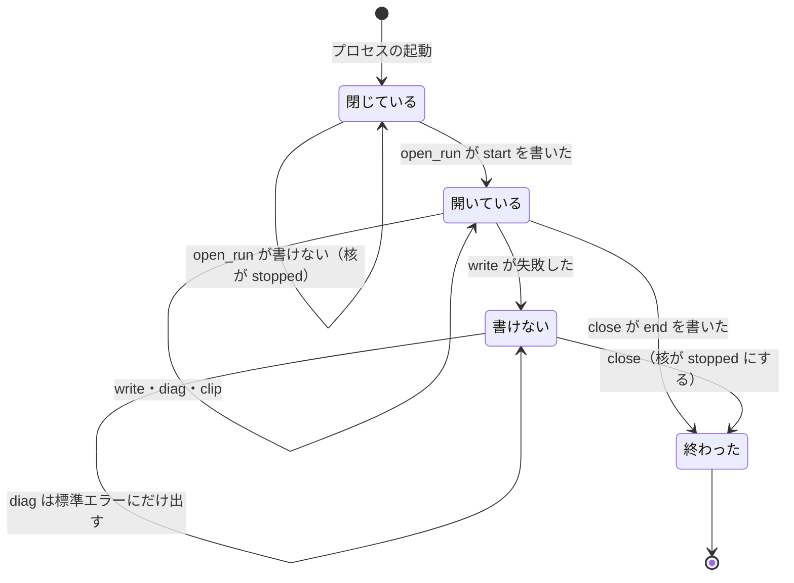

# NDF のスクリプト: 1 回の起動を実行の識別子 1 つで 1 つの記録から追い、記録の出力先を設定 1 つで差し替える（#2338）

## 目的

- **今どうなっているか**: スクリプトの診断は標準エラーにしか出ず、どこにも残らない。監視のループは先に別の警告を出すと拒否の件数の警告を落とす（#2059）。検査の記録は落ちた工程を読めないと「不明」とだけ書き、理由を残さない（#2300）
- **誰に効くか**: NDF でスプリントを回す利用者と conductor、振り返りで止まった原因を探す人、Factory でログを CloudWatch Logs へ送る実装（#2608）
- **変えると何が成り立つか**: 実行の核を通る 1 回の起動（子の実行を含む）の始まり・判断・診断・終わりと止まった理由の全文を、実行の識別子 1 つで 1 つの記録から読める。記録の出力先は環境変数 1 つで差し替えられ、手元の既定はファイルである。上の 2 件の不具合が、この仕組みの上で直る

## 適用範囲

- **働く範囲**: NDF の配布物の実行の核（`plugins/ndf/scripts/lib/run_core.py`）を通るエントリポイントすべてと、移す 2 ファイル（`lib/monitor_loop.py`・`check-trigger.py`）。配布先のリポジトリでも同じ書き口が動く
- **プロジェクトごとに違うもの**: 無い。記録の置き場の根は利用者の根（`lib/state_home.py` の `user_home`）から取り、リポジトリごとの値は置き場のパスの 1 階層（`<所有者>__<リポジトリ>`）にだけ現れる。出力先は動く場所（手元か Factory か）で変わるため、リポジトリの設定ではなく環境変数で受ける（決定 4）
- **当たるモード**: `standard`。柱 P1（#2337）の核を拡張する柱である。実装は 1 スプリント・Pull Request 2 本（「Pull Request の分け方」）に収める。**実装は #2337 の核が develop に入った後に始める**（2026-11-09 の時点で PR 2786 がマージ済み）

## あるべき姿の根拠

| 根拠 | 種類 | 何を示すか |
| --- | --- | --- |
| 利用者の指摘（2026-11-01）「異常系処理とログ出力、異常時の回復処理が統一されていないから起こる不具合・課題が多い。1 件ずつ対処してもきりがない」 | 利用者の指示の原文 | 診断の経路を 1 つにし、起きた不具合をその仕組みの上で直すこと |
| 利用者の指示（2026-11-06）「手元はファイル、FactoryならCloudWatch Logsなど、ログの出力方法は統一した上で切り替えられるようにする必要があります」 | 利用者の指示の原文 | 書き口を 1 つにし、出力先だけを差し替える形にすること（決定 4） |
| 手元のプランの状態の記録 293 ファイル・1,778 行の長さ: 中央値 199 バイト・99 パーセンタイル 507 バイト・最大 570 バイト。使用量の帳簿の最長の行は 1,929 文字 | 実測（2026-11-04、`LC_ALL=C awk '{print length($0)}'`） | 1 行の上限 64 KiB は今の最長の行の 30 倍以上の余裕を持ち、通常の行は全文ファイルへ逃がさずに済むこと（決定 2） |
| CloudWatch Logs の 1 イベントの上限は 1,024 KB、1 回の送信の上限は 1 MB（PRD1） | 外部の一次情報 | 64 KiB の行は、差し替えた出力先でも 1 イベントとして送れること（決定 2） |
| 利用者の根 `~/.claude/ndf/state` は、ホストの docker のボリュームの ext4 上にあり、同じホストの複数のコンテナが共有する（`findmnt -T ~/.claude/ndf/state`、2026-11-09） | 実測 | 複数のコンテナが同じ日付のディレクトリへ書くことが実際に起きること（決定 6） |

要求と受け入れ条件は #2338 の本文にある（コピーは [issue-2338-requirements.md](issue-2338-requirements.md) ）。この文書は「どう作るか」だけを扱う。
決定の記録は [issue-2338-design-decisions.md](issue-2338-design-decisions.md) にある。
実行の記録の行の鍵は、#2335 の設計（[issue-2335-design.md](issue-2335-design.md) の「実行の記録の行」）のとおりにする。

## ドメインモデル

### コンテキスト

| コンテキスト | 何の語が 1 つの意味に決まるか |
| --- | --- |
| NDF の開発ワークフロー（`ndf-workflow`） | 実行の記録・実行の識別子・起点の実行・子の実行・診断・出力先・全文ファイル・検査の記録 |

実行の記録の書き口（`lib/run_log.py`）は、#2335 が決めた共有カーネル（実行の核と契約の一覧）の一部である。エントリポイントは書き口の
中身を直に触らず、実行の文脈の `ctx.log` と、ライブラリの関数から呼ぶ `run_log.diag`・`run_log.clip` の 3 つだけを使う。

### 集約

| 集約 | 持ち主（書き換えてよいもの） | 根 | エンティティ | 値オブジェクト |
| --- | --- | --- | --- | --- |
| 実行 | 実行の核（`run_core`）。行を書くのは書き口（`run_log`）だけ | 実行の識別子 | 実行の記録の行 | 全文ファイルの参照・伏せ字にした文字列・出力先の位置 |
| 検査の記録 | `check-trigger.py`（持ち主は変えない） | 検査の記録のファイル | 検査の行 | 実行の識別子（任意の鍵）・落ちた工程を読めなかった理由 |

**検査の記録は、実行の記録を識別子で参照するだけである。** 実行の記録の行を写さない。使用量の帳簿・プランの状態の記録・問い合わせの記録は
今の形のまま残し、識別子を足さない（要求の前提 3）。

### 不変条件

| # | 集約 | 条件 | 破れたときの扱い |
| --- | --- | --- | --- |
| I1 | 実行 | 実行の記録の行はすべて `run_id`・`at`（UTC の ISO 8601）・`event`・`entry`・`fields` を持つ。1 つの `run_id` について、`start` の行が最初、`end` の行が最後に来る（SIGKILL を除く） | 書き口が鍵の欠けた行を書かずに例外を投げる。核は `stopped` にする |
| I2 | 実行 | ファイルのすべての行が、それぞれ 1 つの JSON のオブジェクトとして読める。並行に書く子の実行の行が混ざらない | 1 行を排他（`fcntl.flock`）の中で、全バイトを書き切るまで `os.write` を続ける。書き切れなければ追記前の長さへ戻して I7 |
| I3 | 実行 | 子の実行の行は親と同じ出力先の位置へ書かれ、`parent_id` が親の `run_id` と一致する | 受け継いだ位置が無いときは起点の実行として自分の位置を作り、`start` に印を残す（決定 5） |
| I4 | 実行 | 1 行は 64 KiB 以下。超える行は、長い文字列から順に全文ファイルへ移し、行には参照（パス・文字数・sha256）を残す。文字列を途中で切らない | 移した後も超えるときは、`fields` 全体を全文ファイルへ移した参照だけの行にする |
| I5 | 実行 | どの出力先へも、秘密の値が届かない。伏せる対象は、トークンの形の文字列と、秘密と宣言した環境変数の空でない値 | 出力先へ渡す前に、書き口が伏せる（`secret_redact.redact`。短く縮めない） |
| I6 | 実行 | 診断は、渡された表示用の文がそのまま標準エラーへ出る。記録へ書けても書けなくても、端末に出る文は変わらない | 標準エラーへ先に書き、記録へ書くのは後にする |
| I7 | 実行 | 記録へ書けないとき、始まりなら本体を動かさず、途中なら本体を終わりまで動かす。どちらも結果を `stopped`・終了コード 1 にし、標準エラーへ理由を出す。途中のときは本体の元の結果 JSON を鍵 `original_result` に入れる | 核が結果を置き換える（決定 3） |
| I8 | 実行 | 出力先は環境変数 `NDF_RUN_LOG_SINK` の 1 つで決まる。未設定か空ならファイル。登録の無い名前なら書けないものとして I7 | 書き口の `open_run` が理由つきで失敗を返す |
| I9 | 検査の記録 | 核を通る起動で追記した検査の行は `run_id` を持つ。持たない行も今と同じ形で読める | 鍵を足すだけで、行の形の版を上げない |
| I10 | 実行 | ファイルの出力先で、起点の実行の起動のたびに、30 日を超えた日付のディレクトリが置き場から消える。消せなくても本体は動く | 診断を書いて続ける |

### ドメインイベント

要求の E1〜E8 を引き継ぐ。

| # | イベント | 発生元 | 受け手 |
| --- | --- | --- | --- |
| E1 | 実行の識別子を振った | 実行の核 | 書き口（`run_log.open_run`）・子プロセス（環境変数） |
| E2 | 出力先を設定から決め、始まりの行を書いた | 書き口 | 出力先 |
| E3 | 30 日を超えた日付のディレクトリを消した | ファイルの出力先（起点の実行だけ） | 記録の置き場 |
| E4 | 本体が判断・診断を書いた | 本体（`ctx.log`）・ライブラリ（`run_log.diag`・`run_log.clip`） | 標準エラー・出力先 |
| E5 | 子の実行が親の識別子を持ち、同じ記録へ行を書いた | 子の実行の核 | 出力先 |
| E6 | 検査の記録の行へ実行の識別子を書いた | `check-trigger.py record` | 検査の記録 |
| E7 | 本体が止まった理由を核が受けた | 実行の核 | 書き口（E8） |
| E8 | 終わりの行（結果 JSON の全体と終了コード）を書いた | 書き口 | 出力先・呼ぶ側 |

### 用語

| 用語 | 意味 | 用語集への反映 |
| --- | --- | --- |
| 全文ファイル | 実行の記録の 1 行の上限を超える文字列を、切らずに全文で置くファイル。行には参照（パス・文字数・sha256）を残す | 追加済み（`ndf-workflow`） |
| 出力先 | 実行の記録の行を書く先。既定はファイル。環境変数 `NDF_RUN_LOG_SINK` 1 つで別の出力先へ差し替える | 追加済み（`ndf-workflow`） |

## 外部の調査

| 種類 | 調べるか | 理由 |
| --- | --- | --- |
| 標準・仕様 | 調べる | 構造化ログの行の形・親子の実行のつなぎ方・追記と排他の OS の保証に、標準と仕様がある |
| 主要な製品 | 調べる | 差し替える出力先の代表（CloudWatch Logs）の 1 イベントの上限が、1 行の上限を決める |
| ライブラリとサービス | 調べる | 構造化ログ・出力先の差し替え・排他を、既存のライブラリで得られるかを決める |

### 標準・仕様

| # | 標準・仕様 | 何を定めているか | 設計への反映 | 出典 |
| --- | --- | --- | --- | --- |
| STD1 | JSON Lines | UTF-8・BOM なし・1 行に 1 つの JSON の値・空行は不可・区切りは `\n` | 記録のファイルの形。空行を書かない | https://jsonlines.org/ （2026-11-09） |
| STD2 | OpenTelemetry Logs Data Model（Stable） | 行は Timestamp・TraceId・SpanId・SeverityText・Body・Attributes などを持つ。TraceId は 1 つの処理に属する行をまとめ、SpanId は処理の中の区間を指す | `run_id`（起点からの区間）と `parent_id` の親子で同じ役割を持たせる。行の鍵は #2335 の形のままにし、OpenTelemetry の形へは変えない（決定 1） | https://opentelemetry.io/docs/specs/otel/logs/data-model/ （2026-11-09） |
| STD3 | OpenTelemetry の環境変数による文脈の伝搬（Release Candidate） | ネットワークを使わない子プロセスへ、親が環境変数へ文脈を入れて渡す。子は起動時に取り出す。秘密を載せない | 親が `NDF_RUN_ID`・`NDF_RUN_LOG` を子へ渡す形（決定 5） | https://opentelemetry.io/docs/specs/otel/context/env-carriers/ （2026-11-09） |
| STD4 | Linux の `flock(2)` | 鍵は開いたファイルの記述に付く。別々に `open` したものは独立に排他になる。NFS では `fcntl` のバイト範囲の鍵として模される | 1 行を書く区間を `flock` で囲む。同じプロセスでも開き直した記述どうしで排他になる点を、シグナルの扱いに反映する（決定 1・決定 7） | https://man7.org/linux/man-pages/man2/flock.2.html （2026-11-09） |
| STD5 | Linux の `write(2)` | 成功した `write` が要求より少ないバイト数を返すことがある（容量不足など）。`O_APPEND` の位置の調整と書き込みは 1 つの原子的な手順 | 戻り値を確かめて残りを書き切る。書き切れないときは長さを戻す（決定 1） | https://man7.org/linux/man-pages/man2/write.2.html （2026-11-09） |

### 主要な製品

| # | 製品 | どう解いているか | 設計への反映 | 出典 |
| --- | --- | --- | --- | --- |
| PRD1 | Amazon CloudWatch Logs | 1 イベントの上限 1,024 KB、`PutLogEvents` の 1 回の上限 1 MB（どちらも変えられない） | 1 行の上限 64 KiB は、差し替えた出力先でも 1 イベントで送れる（決定 2）。送る出力先の実装は #2608 | https://docs.aws.amazon.com/AmazonCloudWatch/latest/logs/cloudwatch_limits_cwl.html （2026-11-09） |

### ライブラリとサービス

| # | 候補 | 版 | ライセンス | 最後のリリースの日付 | 終了のアナウンス | 要件を満たすか | 出典 |
| --- | --- | --- | --- | --- | --- | --- | --- |
| LIB1 | Python 標準の `logging`（Handler で出力先を差し替える） | Python 3 の標準ライブラリ | PSF | 標準ライブラリに従う | 無し | 一部。出力先の差し替えはできるが、プロセスの全体で共有するため `argparse` や依存先の出力まで混ざる。排他・全文ファイル・秘密を伏せる処理は自前で足す | `python3 -c "import logging.handlers"`（2026-11-09） |
| LIB2 | structlog | 26.1.0 | MIT OR Apache-2.0 | 2026-06-06 | 無し | 一部。行の形と処理の連鎖は得られるが、extras の無い環境（`deps.py` の診断も書き口を通る）で動かない | https://pypi.org/pypi/structlog/json （2026-11-09） |
| LIB3 | python-json-logger | 4.2.0 | BSD-2-Clause | 2026-08-15 | 無し | 一部。LIB1 の行を JSON にするだけで、LIB1 と同じ不足が残る。extras が要る | https://pypi.org/pypi/python-json-logger/json （2026-11-09） |
| LIB4 | watchtower（LIB1 から CloudWatch Logs へ送る Handler） | 3.4.0 | Apache-2.0 | 2025-02-25 | 無し | この課題では使わない。CloudWatch Logs の出力先の実装（#2608）の候補 | https://pypi.org/pypi/watchtower/json （2026-11-09） |
| LIB5 | opentelemetry-sdk（ログの出力先の差し替え） | 1.45.2 | Apache-2.0 | 2026-10-29 | 無し | 満たさない。送り先（Collector）の運用が前提で、手元の既定のファイルへ 1 行ずつ排他で書く形を持たない。extras が要る | https://pypi.org/pypi/opentelemetry-sdk/json （2026-11-09） |
| LIB6 | filelock（extras の `locks` にある） | 4.2.9 | MIT | 2026-11-04 | 無し | 満たさない。extras の無い環境で動かない。標準の `fcntl.flock` で足りる | https://pypi.org/pypi/filelock/json （2026-11-09） |

### 確かめられなかったこと

| 対象 | 試した手段 | 結果と理由 |
| --- | --- | --- |
| CloudWatch Logs が上限を超えたイベントを切るか拒むか | PRD1 の URL | 取得できたが、その頁に記述が無い。#2608 の設計で確かめる |

調べた量: 候補 12 件・取得の試み 11 回。

## 機能一覧

| # | 機能 | 誰が使うか |
| --- | --- | --- |
| F1 | 1 回の起動（子の実行を含む）の始まりから終わりまでを、1 つの記録から実行の識別子で読む | conductor・利用者・振り返り |
| F2 | 診断を端末へ今と同じ文で出し、同じ文を記録にも残す | 利用者（端末）・振り返り（記録） |
| F3 | 止まった理由を切らずに結果 JSON と記録へ残し、2 ファイルでは人へ見せる表示だけを短くする | conductor・利用者 |
| F4 | 記録の出力先を環境変数 1 つで差し替える | Factory のランナー（#2608）・テスト |
| F5 | 30 日を超えた記録を消す | 利用者（状態の置き場の容量） |
| F6 | 監視のループの早期の警告を、種類ごとに 1 回ずつ出す（#2059） | cross-review・cross-refactoring の利用者 |
| F7 | 検査の記録の行から、その行を書いた実行の記録へたどり、落ちた工程を読めなかった理由を読む（#2300） | 振り返り・`check-trigger.py stats` を読む人 |

## 構成要素

| 要素 | 責務 | 新設 / 変更 | Pull Request |
| --- | --- | --- | --- |
| 書き口（`lib/run_log.py`） | 出力先を決めて開く。行を伏せ、64 KiB を超える文字列を全文ファイルへ移し、出力先へ渡す。診断を標準エラーと記録の両方へ出す。表示を切る前に全文を記録へ書く（`clip`）。標準ライブラリだけを使う | 新設 | 1 |
| ファイルの出力先（`lib/run_log.py` の中） | 置き場を決め、排他の中で 1 行を書き切る。全文ファイルを書く。起点の実行の起動で寿命の掃除をする | 新設 | 1 |
| 実行の核（`lib/run_core.py`） | E1 で親の識別子と出力先の位置を受け、書き口を開き、子へ渡す環境変数を書き換える。`ctx.log` を書き口へつなぐ。E7 で理由を受け、E8 で `end` を書く。書けなかったら結果を `stopped` にする。例外の理由を切らない | 変更 | 1 |
| 秘密を伏せる部品（`lib/secret_redact.py`） | 伏せる処理（`redact`）と短く縮める処理を分ける。`redact_output` は 2 つを順に呼ぶ形で残す | 変更 | 1 |
| 上限の宣言（`contracts/limits.json`・`lib/limits.py`） | `run-log.line` の方針に `bytes: 65536` を置く。`limits.py` が持てる値に `bytes`（整数・下限 1）を足す | 変更 | 1 |
| 寿命の値（`lib/durable_keys.py`・`lib/durable.py`） | `KEEP_DAYS = 30` を `durable_keys.py` へ移し、`durable.py` と書き口がここから引く | 変更 | 1 |
| 環境変数の契約（`contracts/env/`） | `NDF_RUN_ID`・`NDF_RUN_LOG`・`NDF_RUN_LOG_SINK` の行を足す。`GH_TOKEN`・`GITHUB_TOKEN`・`AI_GATEWAY_API_KEY`・`SLACK_BOT_TOKEN` の行へ `secret: true` を足す | 変更 | 1 |
| 契約の読み手（`scripts/contracts_lib/model.py`） | 環境変数の行の任意の鍵 `secret`（bool）を受けて確かめる | 変更 | 1 |
| ファイルの契約（`contracts/files/`） | 実行の記録と全文ファイルの行を足す（書き手は `run_log.py`） | 変更 | 1 |
| `check-trigger.py` の契約の項目（`contracts/entrypoints/`） | 読む環境変数の一覧へ、核と書き口が読む `NDF_RUN_ID`・`NDF_RUN_LOG`・`NDF_RUN_LOG_SINK`・`NDF_RUNS_DIR` を足す（契約の検査が求める分） | 変更 | 2 |
| テストの置き場（ルートの `conftest.py`・`plugins/ndf/conftest.py`） | テストごとに `NDF_RUNS_DIR` を一時ディレクトリへ向け、`NDF_RUN_ID`・`NDF_RUN_LOG`・`NDF_RUN_LOG_SINK` を外す | 変更 | 1 |
| 実行の核の説明（`lib/README.md` の「実行の核」） | 実行の記録・出力先・子の実行の約束を足す | 変更 | 1 |
| 早期の検知（`lib/monitor_scan.py`） | 警告を種類（`stderr`・`denials`）ごとの組で返す関数を足す。`_early_error` は今の戻り値の形のまま残す | 変更 | 2 |
| 監視のループ（`lib/monitor_loop.py`） | 早期の警告を種類ごとに 1 回ずつ出す。標準エラーへの 3 か所を `run_log.diag` へ、切る 3 か所を `run_log.clip` へ置き換える | 変更 | 2 |
| 検査のトリガー（`check-trigger.py`） | 核を通るエントリポイントにする。標準エラーへの 1 か所を `run_log.diag` へ、切る 3 か所を `run_log.clip` へ置き換える。検査の行へ `run_id` と、落ちた工程を読めなかった理由 `failed_reason` を足す | 変更 | 2 |
| 検査の記録の行の説明（`skills/development-workflow/references/pace.md`） | 検査の行の鍵の表へ `run_id`・`failed_reason` を足す | 変更 | 2 |

### 呼ぶ向き



### 配置



### 置き場所

```text
plugins/ndf/
├── contracts/
│   ├── env/
│   │   ├── NDF_RUN_ID.json          # 新設
│   │   ├── NDF_RUN_LOG.json         # 新設
│   │   ├── NDF_RUN_LOG_SINK.json    # 新設
│   │   ├── NDF_RUNS_DIR.json        # 新設
│   │   └── GH_TOKEN.json ほか 3 つ   # 変更（secret: true）
│   ├── entrypoints/                 # 変更（check-trigger.py の読む環境変数）
│   ├── files/                       # 変更（実行の記録・全文ファイル）
│   └── limits.json                  # 変更（run-log.line）
├── conftest.py                      # 変更
└── scripts/
    ├── check-trigger.py             # 変更
    └── lib/
        ├── run_log.py               # 新設
        ├── run_core.py              # 変更
        ├── secret_redact.py         # 変更
        ├── limits.py                # 変更（bytes）
        ├── durable_keys.py          # 変更（KEEP_DAYS）
        ├── durable.py               # 変更（KEEP_DAYS を引く）
        ├── monitor_scan.py          # 変更
        ├── monitor_loop.py          # 変更
        └── README.md                # 変更
conftest.py                          # 変更
scripts/contracts_lib/model.py       # 変更（secret）
```

## 構造



- **プロセスに開いた記録は 1 つだけ**: `open_run` は開いた `RunLog` をモジュールの変数に持ち、`current()` で返す。核の外のプロセス（hook・テスト・ライブラリとして読み込んだとき）では `None` で、`diag` は標準エラーへ書くだけ、`clip` は切るだけになる（決定 8）
- **出力先は `Sink` の 4 つの操作だけを持つ**: `open` は置き場を用意して位置（子へ渡す文字列）を返す。`append` は改行を含まない 1 行を書き切る。`put_text` は全文を置いて参照の文字列を返す。どれも書けなければ `OSError` を投げる。伏せる処理と 64 KiB の判定は `RunLog` が先に済ませ、出力先は受け取った文字列を書くだけにする（I5・I8）
- **`register_sink(name, factory)`**: 名前と出力先の作り方を登録する。既定で登録するのは `file` だけである。テストは偽物を登録し、#2608 は CloudWatch Logs の出力先を登録する
- **`ctx.log(event, fields)`** は `current().write` を呼ぶ。`event` は #2335 の 8 種（`start` / `input` / `lease` / `ref` / `retry` / `decision` / `diag` / `end`）だけを受け、ほかは `ValueError`。`event` が `diag` のときは `run_log.diag(fields["text"], short=fields.get("display"), **残りの鍵)` へ渡し、標準エラーへ先に出す経路を 1 つにする（I6）
- **`run_log.diag(text, short=None, **fields)`**: 標準エラーへは `short` があれば `short`、無ければ `text` を 1 行で書く。記録へは `{"text": text, **fields}` を書き、`short` があれば `"display": short` も書く
- **`run_log.clip(text, limit, what)`**: `text` が `limit` 字以下ならそのまま返す。超えるときは、開いた記録があれば `diag` の行 `{"text": 全文, "display": 切った文, "what": what, "stderr": false}` を書いてから、先頭 `limit` 字を返す。標準エラーへは書かない（呼ぶ側が切った文を出す）
- **`write` が書けなかったとき**: 例外を投げず、`failed` に理由を持ち、標準エラーへ理由を 1 回だけ出す。以後の `write` は出力先へ渡さない。核は E8 の前と後の 2 回 `failed` を見る（「処理の流れ」）

## データ構造

### 実行の記録の行

鍵は #2335 の設計の「実行の記録の行」のとおりで、変えない。`run_id` の値は P1 の核が振る値（`uuid4` の 16 進の先頭 12 字）を使う。この柱は `fields` の中身を決める。

| `event` | `fields` | 書く者 |
| --- | --- | --- |
| `start` | `{"argv": [...], "cwd": str, "pid": int, "sink": str, "inherited_log_missing": str?}`（`argv` は伏せた後の値） | 核（E2） |
| `decision` | 本体が渡す任意のオブジェクト。止まった理由を持つときは `reason` の鍵に全文 | 本体 |
| `diag` | `{"text": str, "display": str?, "what": str?, "stderr": bool?, ...}`（`stderr` は `clip` が書いた行だけ `false`） | `run_log.diag`・`run_log.clip` |
| `end` | `{"result": <標準出力へ出す結果 JSON の全体>, "code": int, "how": "return" / "exception" / "sigterm" / "timeout", "error": str?, "traceback": str?}`（`error` は例外の型と理由の全文） | 核（E8） |

`input`・`lease`・`ref`・`retry` の中身はそれぞれの柱（P8・P3・P5・P4）が決める。この柱は書き口だけを用意する。

**全文ファイルの参照**: 行の中の文字列を置き換える値は次の形である。

```json
{"$text": "<出力先が返した参照>", "chars": 12345, "sha256": "<全文の sha256>"}
```

ファイルの出力先では、参照は記録のファイルからの相対パス `<起点の実行の識別子>/<実行の識別子>-<行の通し番号>-<鍵のパス>.txt` で、
記録と同じ日付のディレクトリに置く。寿命の掃除で日付のディレクトリごと消える。

### 置き場

| 項目 | 値 |
| --- | --- |
| 根 | `NDF_RUNS_DIR` があればその値。無ければ `state_home.user_home()` の下の `runs`（`NDF_STATE_HOME` を指定すればその下） |
| 記録のファイル | `<根>/<所有者>__<リポジトリ>/<UTC の yyyy-mm-dd>/<起点の実行の識別子>.jsonl`。git のリポジトリの外で動いたときは `_` を 1 階層目にする |
| 寿命 | 30 日（`durable_keys.KEEP_DAYS`）。日付のディレクトリの名前で判定する |

### 検査の記録の行

| 足す鍵 | 型 | 空を許すか | 意味 |
| --- | --- | --- | --- |
| `run_id` | str | 許す（核の外で書いた行と既存の行は鍵を持たない） | 行を書いた `check-trigger.py` の実行の識別子 |
| `failed_reason` | str | 許す（`result: failed` で `failed_at` が「不明」の行だけが持つ） | 落ちた工程を読めなかった理由。読んだ状態のパスと、見つからなかったもの |

`failed_reason` の値は次の 3 つの形のどれかである。

| 状態 | 値 |
| --- | --- |
| 状態のファイルを読めない | `<パス>/state.json を読めない（<OSError か JSON の誤り>）` |
| 記録が空 | `<パス>/state.json の log が空` |
| 落ちたステップが無い | `<パス>/state.json に終了コードが 0 でないステップが無い（欠けを残して進んだステップ: <id>…・承認ゲートで止まったステップ: <id>…）` |

### 環境変数

| 環境変数 | `set_by` | `secret` | 意味 |
| --- | --- | --- | --- |
| `NDF_RUN_ID` | `ndf` | — | 今の実行の識別子。子は親の識別子として読む |
| `NDF_RUN_LOG` | `ndf` | — | 起点の実行の出力先の位置（ファイルの出力先では記録のファイルの絶対パス） |
| `NDF_RUN_LOG_SINK` | `runtime` | — | 出力先の名前。未設定か空なら `file` |
| `NDF_RUNS_DIR` | `user` | — | ファイルの出力先の置き場の根の上書き（テストと明示の指定） |
| `GH_TOKEN`・`GITHUB_TOKEN`・`AI_GATEWAY_API_KEY`・`SLACK_BOT_TOKEN` | 変えない | `true` | 空でない値を、記録へ書く前に伏せる |

環境変数の契約の行の鍵 `secret` は bool で、省略は偽である。

### 機能とデータ

| 機能 | 実行の記録 | 全文ファイル | 検査の記録 |
| --- | --- | --- | --- |
| F1 | 作る・読む | 作る・読む | — |
| F2 | 作る | — | — |
| F3 | 作る | 作る | — |
| F4 | 作る | 作る | — |
| F5 | 消す | 消す | — |
| F6 | 作る | — | — |
| F7 | 読む | — | 作る（`run_id`・`failed_reason`） |

## 入出力の契約

| 項目 | 約束 |
| --- | --- |
| 子へ渡す環境変数 | 核は E1 の後に `NDF_RUN_ID` を自分の識別子へ、`NDF_RUN_LOG` を起点の実行の出力先の位置へ書き換える。子の核は起動時の `NDF_RUN_ID` を `parent_id` に取り、`NDF_RUN_LOG` の位置へ書く |
| 受け継いだ位置が無い | ファイルの出力先で `NDF_RUN_LOG` のファイルが無いか置き場の根の外を指すとき、子は起点の実行として自分のファイルを作り、`start` の `fields` に `inherited_log_missing` を書く |
| 標準エラー | 診断の表示用の文を 1 行ずつ出す。2 ファイルの文は移す前と同じ（受け入れ条件 6）。記録へ書けなかった理由は 1 回だけ `[ndf run-log] 実行の記録へ書けない（<位置>: <理由>）` の形で出す |
| 標準出力・結果 JSON | 鍵は変えない。`summary`・`gaps` と例外の理由は、核が切らずに出す（今の核は例外の理由を 3 行・500 字へ縮めている） |
| 記録へ書けなかったとき | 結果は `stopped`・終了コード 1、`gaps` に `{"kind": "run-log-unwritable", "name": <出力先の名前>, "reason": <理由>}` |
| 途中で書けなくなったときの結果 JSON | 本体の元の結果 JSON（本体が例外で終わったときは `null`）を、`stopped` の結果の鍵 `original_result` へ切らずに入れる。始まりで書けないときは本体を動かさないため、鍵を持たない |
| `check-trigger.py` の標準出力 | `scope` は今と同じく範囲のディレクトリを空白で区切った 1 行を出し、結果 JSON を足さない（本体は `SystemExit` で終わる）。ほかの副命令は今と同じ結果 JSON に核が `run_id` を足す |

### 止まった理由を切る箇所の扱い

**全文を記録へ書いてから、今の表示を今の長さで返す**（`run_log.clip`。受け入れ条件 3b）。表示は変えない（受け入れ条件 6）。

| 箇所（`plugins/ndf/scripts/` の下。2026-11-09 の develop） | 今の行き先 | `what` |
| --- | --- | --- |
| `lib/monitor_loop.py:120` | 監視の結果の文（致命の早期の誤り） | `monitor.early-fatal` |
| `lib/monitor_loop.py:142` | 監視の結果の文（CLI の時間切れ） | `monitor.cli-timeout` |
| `lib/monitor_loop.py:240` | 端末の警告の行 | `monitor.early-warn` |
| `check-trigger.py:114` | 結果の `summary`（git の失敗の出力） | `check-trigger.git` |
| `check-trigger.py:124` | 結果の `summary`（gh の失敗の出力） | `check-trigger.gh` |
| `check-trigger.py:662` | 結果の `summary`（PR の変更したファイルを読めない） | `check-trigger.gh` |

## 処理の流れ



### 図に描かない要素

| 要素 | 図のどこで動くか |
| --- | --- |
| 秘密を伏せる部品・上限の宣言 | 書き口が出力先へ渡す前に使う |
| 寿命の値 | ファイルの出力先の E3 で使う |
| 環境変数の契約・契約の読み手 | E1 の前に、核が秘密の名前を読む |
| ファイルの契約・`check-trigger.py` の契約の項目・実行の核の説明 | 契約の検査と読み手のための記述で、実行の流れに入らない |
| テストの置き場 | テストの実行中だけ、起動の前に置き場の根を一時ディレクトリへ向け、受け継いだ環境変数を外す |
| 早期の検知・監視のループ・検査のトリガー・検査の記録の行の説明 | 本体の中身（「2 ファイルの直し方」） |

### 1 行の書き方

`RunLog.write` は次の順で書く。

1. 伏せる（I5）
2. JSON にする（`ensure_ascii=False`、改行を含まない 1 行）
3. 64 KiB を超えたら、長い文字列から順に `Sink.put_text` で全文ファイルへ移し、参照へ置き換える。全文ファイルは行より先に書く
4. `Sink.append` へ渡す

ファイルの出力先の `append` は次の順で書き切る。

1. 記録のファイルを `O_APPEND` で開き、`fcntl.flock(LOCK_EX)` を取り、追記前の長さ（`os.fstat`）を控える
2. 排他を持ったまま、行の全バイトを書き切るまで `os.write` を呼ぶ。戻り値を確かめ、残りを続けて書く（STD5）
3. `os.write` が例外を投げたか 0 を返したときは、`os.ftruncate` で追記前の長さへ戻してから `OSError` を投げる。途中まで書いた行が残ると、次に書く子の行が同じ行へつながるためである
4. 排他を返す

### SIGTERM と時間切れ

P1 の核は、SIGTERM と時間切れ（SIGALRM）の受け手が主スレッドで `_Interrupt` を投げる。受け手が `append` の排他の区間の中で動くと、
行が途中で切れたまま例外が抜け、核が `end` を書こうとして自分の排他を待つ（STD4。開き直した記述どうしで排他になる）。そこで次の形にする。

1. 書き口はプロセスに 1 つの `threading.Lock` でスレッドどうしの書き込みを順に並べ、その中で出力先へ渡す。主スレッドが区間にいる間は印を立てる。印は `Lock` を取る前に立て、`Lock` を返した後に下ろす（隙間で受け手が動いても、印を見て保留へ回る）
2. 核の受け手は、印が立っていなければ今と同じく `_Interrupt` を投げる
3. 印が立っていれば、受け手は終わり方（`interrupted` / `timeout`）を保留の印として残して戻る。`write` は印を下ろした後に保留の印を見て、あれば `_Interrupt` を投げる。本体へは戻らず、核の `except _Interrupt` が受ける
4. 核は `run_body` から戻った後に `end` を書く。`end` はプロセスで 1 回だけ書き、`close` の後の `write` は出力先へ渡さずに捨てる

### 核の終わり方

1. `run_body` が (結果, 終了コード, 出すか, 中断したか) を返す。例外の理由は `secret_redact.redact` だけを通し、切らない
2. `main` は `deliver` が足す鍵（`run_id`・`lease`）を足した最終の結果 JSON を先に組み、`close(result, code, how)` で `end` を書く
3. `failed` を見る。E8 の前から `failed` だった場合も、E8 で初めて書けなかった場合も、結果を `stopped`・1 に置き換え、元の結果 JSON を `original_result` に入れる
4. `deliver` と `_leave` で出す。`exit_early` と `exec_main` も 2〜4 を通す

### 書き口の状態



## 2 ファイルの直し方

### 監視のループ（#2059）

今は早期の警告を 1 つの印（`warned_early_error`）で 1 回だけ出す。先に標準エラーの記録の警告を出すと、後から現れた拒否の件数の警告が出ない。

1. `monitor_scan._early_findings(paths, agent, disabled)` を足し、(致命, 警告の組の並び) を返す。組は (種類, 文) で、種類は `stderr`（標準エラーの記録の警告）と `denials`（拒否の件数）の 2 つである。`_early_error` はこの関数から今と同じ戻り値（文を ` / ` でつないだもの）を作る
2. 監視のループは、出した種類の集合を持つ。周回ごとに、まだ出していない種類の文だけを ` / ` でつなぎ、`run_log.diag(全文, short=<今の形の行>)` で 1 行出して集合へ足す。同じ周回で 2 つが初めて現れたときは今と同じ 1 行になる
3. 標準エラーへの残り 2 か所（進み具合の行・終わりの行）は、文を変えずに `run_log.diag` へ置き換える

### 検査のトリガー（#2300）

1. `__main__` を `run_core.main("scripts/check-trigger.py", main)` にする。`main` は `emit` で結果を出す。`scope` は `SystemExit(cmd_scope(...))` で終わる
2. `cmd_scope` の標準エラーへの 1 か所を `run_log.diag` へ置き換える
3. `append_event` は、開いた記録があれば行へ `run_id` を足す
4. `findings_of` は、落ちたステップが無いときに `failed_reason`（「データ構造」の 3 つの形）を返す。`record_target` と `cmd_record` は、`failed_at` が「不明」の行へ `failed_reason` を足し、同じ理由を `decision` の行 `{"reason": ..., "state": <パス>}` で記録へ書く。結果の `summary` は今の文に理由を足す
5. `failed_at` の値の決め方は変えない。数え方を変えると、`stats` の既存の集計と食い違うためである

## Pull Request の分け方

| Pull Request | 中身 | 受け入れ条件 |
| --- | --- | --- |
| 1 核の拡張 | 書き口・ファイルの出力先・核・秘密を伏せる部品・上限の宣言・寿命の値・契約・テストの置き場・実行の核の説明 | 1・1a〜1c・1e〜1h・3・3a・5・7 |
| 2 2 ファイルの移し替え | 早期の検知・監視のループ・検査のトリガー・検査の記録の行の説明。マージの前に #2059 と #2300 の再現の手順を通し、「子の課題の判定」へ書く | 2・2a・2c〜2e・3b・4・4a・6・7 |

1 から 2 の順にマージする。2 は 1 の書き口を使う。

## 非機能の実現方式

| 大項目 | 要求の条件 | 実現方式 | 確かめ方 |
| --- | --- | --- | --- |
| 運用・保守性 | 実行の識別子 1 つで 1 つの記録から追う。寿命 30 日。出力先を設定 1 つで切り替える | 起点の実行ごとに 1 ファイル。子は `NDF_RUN_LOG` で同じ位置へ書く。起点の実行の起動で `<根>/*/<日付>` のうち日付が 30 日より前のディレクトリを消す（名前の日付で判定し、更新時刻を見ない。消すときに無くなっていても誤りにしない）。出力先は `NDF_RUN_LOG_SINK` で選ぶ | 終わり方ごとのテスト・子の実行のテスト・寿命のテスト・偽物の出力先のテスト |
| 移行性 | 2 ファイルだけを移す。Pull Request ごとの revert で戻る。識別子の無い検査の行も読める | 書き口は核の外では標準エラーへ書くだけになり、移す前の書き方のスクリプトと並んで動く。検査の行は鍵を足すだけ | 全体テスト・識別子の無い行を読むテスト |
| セキュリティ | 受け入れ条件 5。C1・C2 は変えない | 出力先へ渡す前に、トークンの形の置き換えと、秘密と宣言した環境変数の空でない値の置き換えを通す。全文ファイルにも同じ処理を通す。契約には `secret: true` だけを書き、値を書かない | 秘密を入れた環境変数で起動するテスト |
| システム環境 | Claude Code と Codex の両方で同じ核。コンテナの再起動で記録が消えない | 書き口は標準ライブラリ（`json`・`os`・`fcntl`・`hashlib`・`threading`）だけを使う。置き場は利用者の根 | extras を外した環境で記録が書けるテスト |

## 決定の記録

決定の記録は [issue-2338-design-decisions.md](issue-2338-design-decisions.md) にある。

## テスト設計

| 受け入れ条件・不変条件 | どの振る舞いで縛るか | どう壊したら落ちるべきか |
| --- | --- | --- |
| 1・I1 | 核を通るエントリポイントを正常・例外・SIGTERM・時間切れで終わらせると、1 ファイルに同じ `run_id` で `start` から `end` までが並び、すべての行が 5 つの鍵を持つ | 中断の経路で `end` を書かない／`at` を地方時で書く |
| 1・I1 | 主スレッドが排他の区間にいる時点で SIGTERM と SIGALRM を送っても、時間内に終わり、`end` の行が最後に 1 つだけ並ぶ | 受け手が区間の中で `_Interrupt` を投げる／印を `Lock` を取った後に立てる |
| 1a・I3 | エントリポイントが別のエントリポイントを子プロセスで起こすと、子の行が親のファイルに入り、`parent_id` が親の `run_id`。親のファイルを消してから子を起こすと、子は自分のファイルを作り `inherited_log_missing` を書く | 子へ `NDF_RUN_LOG` を渡さない／子が自分の識別子を `parent_id` に書く |
| 1b・I2 | 子の実行を並行に複数起こし、64 KiB 近い行を書かせても、全行が JSON として読める | 排他を外して 2 回の `os.write` に分ける |
| 1b・I2 | `os.write` が少ないバイト数を返す・例外を投げるように差し替えると、前者は行を書き切り、後者はファイルの長さが追記前に戻って `failed` になる。どちらの後も次の行は独立に読める | 戻り値を確かめない／書きかけの行を残して排他を返す |
| 1c | 本体の `decision` と止まった理由が行に残り、`end` の `fields` が標準出力の結果 JSON と終了コードに一致する | `end` に `summary` だけを書く／`run_id` を足す前の結果を書く |
| 1e・I10 | 31 日前の日付のディレクトリが消え、29 日前は残る。消せない（権限）ときは `diag` が残り、本体の結果が変わらない。子の実行の起動では消さない | 更新時刻で判定する／消せない例外で止まる |
| 1f・I7 | 置き場を書けない場所にすると、標準エラーに理由が出て `stopped`・1 で本体が動かない。途中で書けなくすると本体は終わりまで動き、`stopped`・1・`gaps` に `run-log-unwritable`、`original_result` に元の結果 JSON | 書けない例外を握りつぶして `ok` を返す／元の結果を捨てる |
| 1f・I7 | 本体が `ok` で終わり、`end` の行で初めて書けなくすると、標準出力は `original_result` を持つ `stopped`、終了コードは 1 | `failed` を E8 の前にだけ見る |
| 1g・I8 | 偽物の出力先を登録して `NDF_RUN_LOG_SINK` に名前を入れると、同じ 5 つの鍵の行が偽物へ届き、ファイルは作られない。偽物へ届く行も伏せてある。登録の無い名前では `stopped`・1 | 書き口が出力先の名前を見ずにファイルへ書く／偽物の出力先へ伏せる前の行を渡す |
| 1h | `NDF_RUNS_DIR` が無いとき、記録は `NDF_STATE_HOME` の下の `runs/` に書かれる | 置き場の根をコンテナの根から取る |
| 1h | 全体テストの後に、テストの外の置き場の `runs/` の中身が増えも減りもしない。`plugins/ndf/` だけを根にしてテストを実行しても同じ | `conftest.py` から `NDF_RUNS_DIR` の行を外す／受け継いだ `NDF_RUN_LOG` を外さない |
| 2 | 2 ファイルに `print(..., file=sys.stderr)` と `sys.stderr.write` が無い（`grep -nE 'file=sys\.stderr\|sys\.stderr\.write'` が 0 件） | 直書きを 1 か所残す |
| 2a・I6 | `run_log.diag` と `ctx.log("diag", ...)` の文が、標準エラーと記録の `diag` の両方に出る。記録へ書けないときも標準エラーの文は同じ | 記録へ書いた後でしか標準エラーへ書かない |
| 2c | 標準エラーの記録の警告を出した後の周回で拒否の件数が見つかると、拒否の件数の警告が 1 回出て、記録にも `diag` で残る。以後の周回では 2 つとも繰り返さない | 出した印を 1 つに戻す |
| 2d・I9 | 核を通して `record` した検査の行が、標準出力の結果 JSON と同じ `run_id` を持つ。`run_id` の無い既存の行を混ぜても `stats` の値が変わらない | 鍵を必須にする／読み手が未知の鍵で落ちる |
| 2e | `record --target-pr --failed` に、`state.json` の無い状態・`log` が空の状態・欠けを残したステップだけの状態を渡すと、行の `failed_reason` と記録の `decision` に、パスと見つからなかったものが残る。行の `run_id` で記録の行が引ける | 理由を結果の文にだけ書く |
| 3・I4 | 本体が渡した 10,000 字の `summary` と、例外の 10 行の理由が、結果 JSON と `end` の行に同じ文字列で残る | 核が例外の理由を `redact_output` で縮める |
| 3a・I4 | 64 KiB を超える理由は全文ファイルへ移り、参照の文字数と sha256 が全文と一致する。全文ファイルが行より先に在る | 全文ファイルを書かずに参照だけ残す／長い文字列を切る |
| 3b | 6 か所それぞれで、長い入力の全文が記録の `diag`（`stderr: false`）に残り、表示は今の長さのまま | `clip` が記録へ書かずに切る |
| 4・4a | （手動）PR 2 のマージの前に #2059 と #2300 の再現の手順を 1 回ずつ通し、本文の「子の課題の判定」へ書く。残りの 6 件は今の理由のまま残す | — |
| 5・I5 | `secret: true` の環境変数に値を入れ、本体がその値を診断・例外の理由・`summary` へ入れても、記録と全文ファイルと偽物の出力先に値が無い。空の値で他の文字列が壊れない | 全文ファイルに伏せる処理を通さない／空の値で置き換える |
| 6 | 2 ファイルの診断が、同じ入力に対して移す前と同じ文で標準エラーへ出る（拒否の件数の警告が増える場合を除く） | 表示を全文にする |
| 7 | 各 Pull Request で `uv run --frozen --project . --all-extras pytest . -q -n 4` が前後で通る | — |

## 設計の結果

| 課題 | 扱い | 取り込み先 | 触るファイル |
| --- | --- | --- | --- |
| #2338 | 実装する | — | `conftest.py`、`plugins/ndf/conftest.py`、`plugins/ndf/scripts/lib/run_log.py`、`plugins/ndf/scripts/lib/run_core.py`、`plugins/ndf/scripts/lib/secret_redact.py`、`plugins/ndf/scripts/lib/limits.py`、`plugins/ndf/scripts/lib/durable_keys.py`、`plugins/ndf/scripts/lib/durable.py`、`plugins/ndf/scripts/lib/monitor_scan.py`、`plugins/ndf/scripts/lib/monitor_loop.py`、`plugins/ndf/scripts/lib/README.md`、`plugins/ndf/scripts/check-trigger.py`、`plugins/ndf/contracts/env/`、`plugins/ndf/contracts/files/`、`plugins/ndf/contracts/entrypoints/`、`plugins/ndf/contracts/limits.json`、`plugins/ndf/skills/development-workflow/references/pace.md`、`scripts/contracts_lib/model.py`、`scripts/tests/`、`plugins/ndf/scripts/tests/`、`plugins/ndf/skills/cross-review/tests/` |

## 未確認のまま残ること

| 項目 | 内容 |
| --- | --- |
| Codex の hook と Bash の子 | `NDF_RUN_ID` が Claude Code の hook へ届くことは 2026-11-04 に確かめた（Claude Code 2.1.318）。Codex と、エージェントの Bash ツールが起こす子プロセスへ届くかは未確認。届かないときも、子は起点の実行として自分のファイルを作るだけで、記録は失われない |
| NFS 上の利用者の根 | 排他は同じカーネルの上の `flock` を前提にする。利用者の根を NFS に置いた環境では、`flock` が `fcntl` の鍵として模される（STD4）。同じファイルへ書くのは同じコンテナの親子だけ（決定 6）のため影響は小さいと見るが、NFS で動かしてはいない |
| 正規表現に当たらない切る箇所 | 要求の「調べ方」の正規表現に当たらない書き方（`textwrap.shorten` など）で 2 ファイルが切る箇所は数えていない |
| 監視のループを動かす CLI | 監視のループを動かす CLI（`lib/monitor.py`。cross-review の `scripts/monitor.py` が読み込む）は、2026-11-09 の develop で核を通っていない（`git show origin/develop:plugins/ndf/scripts/lib/monitor.py \| grep -n run_core` が 0 件）。その起動では `run_log.diag` は標準エラーへ書くだけで、拒否の件数の警告（受け入れ条件 2c）は実行の記録に残らない。2c の記録はテストで核の中の監視のループとして確かめる。監視の CLI を核へ移すかは、移す 2 ファイルの外のため承認ゲートで人が決める |
