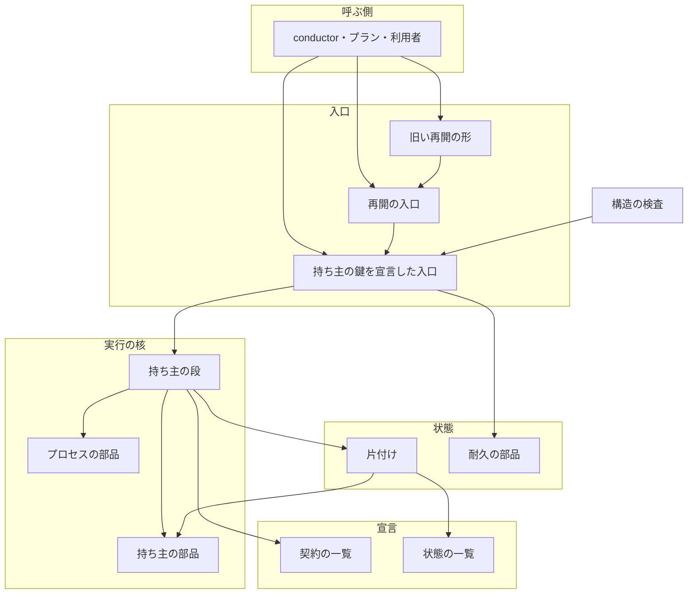
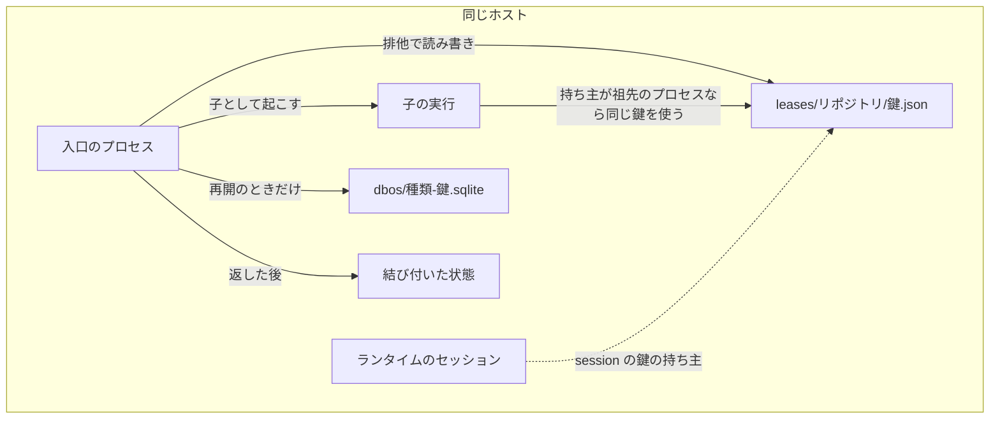
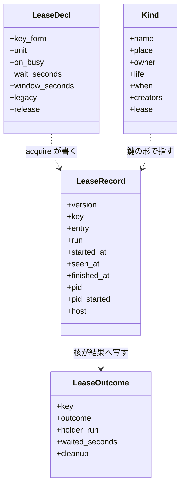
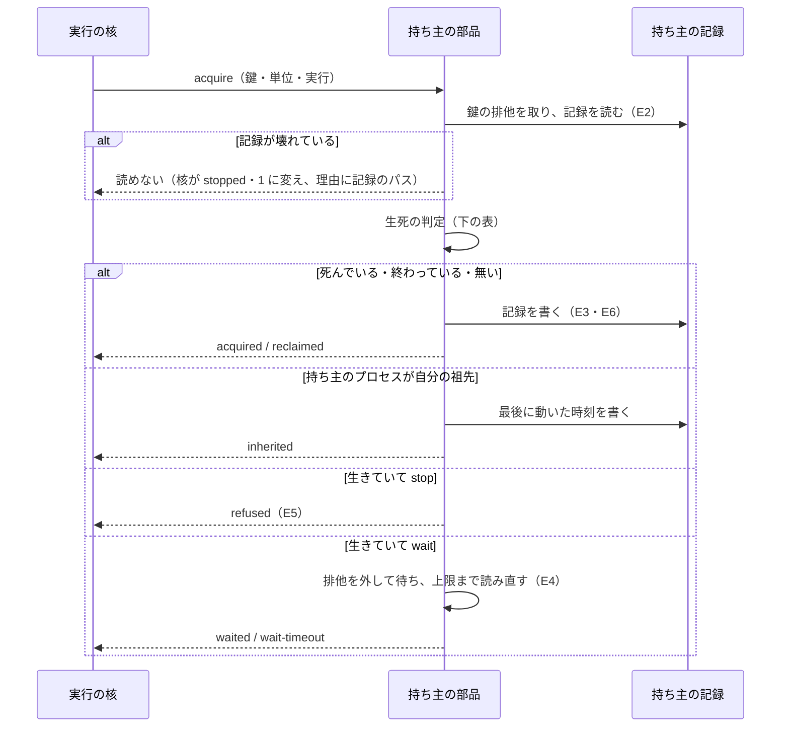
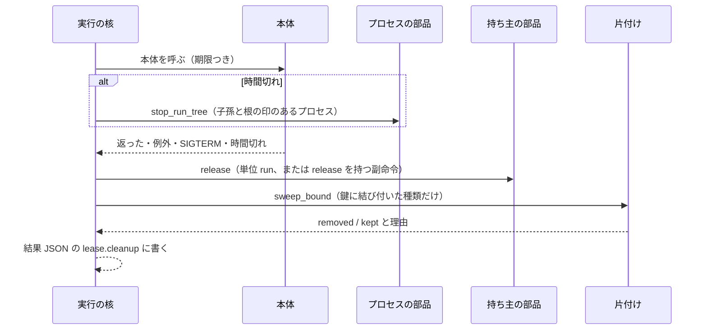
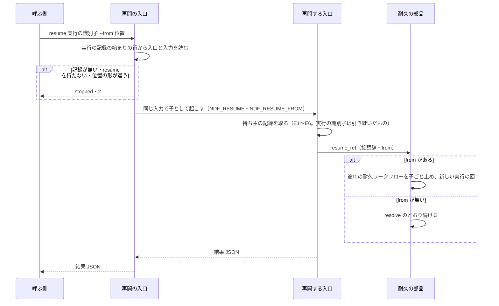
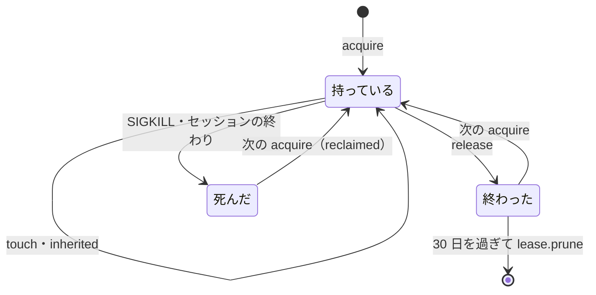

# 実行の持ち主と後片付け: どの終わり方の後も次の実行が止まらず、並行する実行が互いを知り、再開の手段が 1 つになる（#2342）

## 目的

- **今どうなっているか**: 着手前のテストの打ち切りで終わった実行が持ち主の記録に終わった時刻を残さず、次の実行を 24 時間断る（#2321・#2285）。2 つの conductor が同じ開発ループとキューを互いに知らずに流す（#2316）。強制終了の後の `queue --resume --from` が前の途中の位置に負ける（#2325）
- **誰に効くか**: NDF でスプリントを回す conductor と利用者。打ち切り・強制終了・並行のたびに、持ち主の記録を手で書き換えるか耐久の記録を手で取り消している
- **変えると何が成り立つか**: 実行の核が持ち主の記録を取り・返し・死んだ持ち主を片付け、後から来た実行は待つか止まるかを結果で知る。再開は `supervise.py resume` の 1 つの入口から耐久の記録をもとに行い、`--from` が常に勝つ

## 適用範囲

- **働く範囲**: NDF の配布物（`plugins/ndf/scripts` と `plugins/ndf/skills/*/scripts`）。配布先のリポジトリでも同じ部品が動く。hook（`plugins/ndf/hooks/` と hook から呼ぶ `*-guard.sh`）・`factory/` は含まない
- **プロジェクトごとに違うもの**: 持ち主の鍵の値（PR・プラン・done のパス・ループの名前）は入口の入力から作り、置き場はリポジトリの slug で分ける。待つ上限と寿命の窓は契約の一覧の値で、プロジェクトの `.ndf/` を読まない（見直しの `depths.owner.ttl` も読まない。決定 15）
- **当たるモード**: `standard`

## あるべき姿の根拠

| 根拠 | 種類 | 何を示すか |
| --- | --- | --- |
| 利用者の指摘（2026-11-01）「異常系処理とログ出力、異常時の回復処理が統一されていないから起こる不具合・課題が多い。1 件ずつ対処してもきりがない」 | 利用者の指示の原文（#2335 の本文から引用） | 持ち主の扱いと再開を、入口ごとではなく核の 1 か所で持つこと |
| #2321・#2285 の記録: プロセスが残っていないのに `rf2318.owner.json` の `finished_at` が `null` のまま、次の init が 4 秒で断られた | 実測（課題の本文） | 終わった時刻を書く経路が入口ごとにあり、打ち切りの経路が漏れていること |
| `refactor_lib/process.py` の `run_with_timeout` は打ち切りでプロセスグループごと止める（`start_new_session=True` と `_kill_process_group`）。#2285 で残った偽の claude を起こすテスト（`plugins/ndf/scripts/tests/test_relay.py:430`）は自分で `start_new_session=True` を付ける | コードの読み取り（2026-11-04、`grep -rn start_new_session`） | プロセスグループを止めるだけでは、自分でプロセスグループを抜けた子孫が残ること |
| `durable.launch` は実行の鍵の排他を `lock_timeout=None`（空くまで待つ）で取る（`lib/durable.py:173`、`supervise_lib/flow.py:125` は値を渡さない） | コードの読み取り | 2 つ目のキューが何も告げずに待ち、前の側が終わると続きとして流すこと（#2316 のキューの重なり） |
| #2325 の回避は `cancel_workflow(<id>, cancel_children=True)` で途中の耐久ワークフローを取り消してから打ち直すことで、これで `--from` のとおり流れた | 実測（課題の本文） | `--from` があるときは前の途中を子ごと止めて新しい実行の回で流せば足りること |
| 契約の一覧の入口の行のキー（`scripts/contracts_lib/model.py:_check_entry` の必須 11 個と任意の `callers`・`external`）に持ち主の鍵も再開も無い | コードの読み取り | 持ち主と再開の宣言を契約の一覧へ足す必要があること |

要求と受け入れ条件は #2342 の本文にある（コピーは [issue-2342-requirements.md](issue-2342-requirements.md) ）。この文書は「どう作るか」だけを扱う。
上位の設計は #2335 の [issue-2335-design.md](issue-2335-design.md) と [issue-2335-design-decisions.md](issue-2335-design-decisions.md) である。
この文書はその決定 7・14・15 を正として、柱 P3 の範囲を詳しくする。
決定の記録は [issue-2342-design-decisions.md](issue-2342-design-decisions.md) にある。
データ構造と入出力の契約は [issue-2342-design-contracts.md](issue-2342-design-contracts.md) にある。

**前提にする柱は未完了である。** 実行の核（`run_core`。柱 P1 #2337）・実行の記録（`run_log`。柱 P2 #2338）・入力の部品（`inputs`。柱 P8 #2341）は
2026-11-04 の時点でマージされていない。この文書はそれらの #2335 での形（`RunContext`・`NDF_RUN_ID`・実行の記録の行）を前提に書く。
3 本の設計がそれと違う形で決まったときは、実装の開始時に読み直す（要求の未決の最後の行）。

## ドメインモデル

### コンテキスト

| コンテキスト | 何の語が 1 つの意味に決まるか |
| --- | --- |
| NDF の worktree（`ndf-worktree`） | 持ち主の記録・持ち主の鍵・持ち主の契約・持ち主の単位・使用中のときの扱い・寿命の窓・状態の一覧・結び付いた状態・片付け |
| NDF の開発ワークフロー（`ndf-workflow`） | 実行の核・実行の識別子・根の実行・耐久の記録・再開の入口 |

2 つは #2335 と同じく**共有カーネル**の関係にある。持ち主の部品（`lib/lease.py`）と状態の一覧（`lib/run_state_kinds.py`）を、
実行の核と片付けの両方が使う。共有部分を変えるのはこの柱の Pull Request だけで、読み手と書き手を同じ差分で直す。

### 集約

| 集約 | 持ち主（書き換えてよいもの） | 根 | エンティティ | 値オブジェクト |
| --- | --- | --- | --- | --- |
| 持ち主の記録 | 持ち主の部品（`lib/lease.py`）だけ。30 日を過ぎた記録の削除も持ち主の部品の `lease.prune` が行い、片付けはそれを呼ぶだけにする | 持ち主の鍵 | — | 持ち主のプロセス（pid・開始時刻・ホスト名）・時刻（開始・最後に動いた・終わった） |
| 持ち主の契約 | この柱と入口を変える Pull Request（実行時は読むだけ） | 入口の契約の行の `lease` | — | 鍵の形・持ち主の単位・使用中のときの扱い・待つ上限・寿命の窓・旧い置き場の形 |
| 状態の一覧 | 状態の種類を足す Pull Request（実行時は読むだけ） | `KINDS` | 種類 | 置き場・持ち主・寿命・片付ける時点・結び付く鍵の形 |
| 耐久の記録 | 耐久の部品（`lib/durable.py`） | 起動の種類と鍵 | 耐久ワークフロー | 実行の回・形式の版 |

**集約の間は識別子で参照する。** 持ち主の記録は実行を実行の識別子で、状態の一覧の種類は持ち主の記録を鍵の形で指す。
持ち主の記録は結び付いた状態のパスを持たない（受け入れ条件 12・決定 6）。1 回の取る・返すが書き換える集約は持ち主の記録 1 つで、
片付けは返した後に、状態の一覧に従ってディスクの状態を外す（持ち主の記録を書き換えない。記録の削除は `lease.prune` を呼ぶ）。

### 不変条件

| # | 集約 | 条件 | 破れたときの扱い |
| --- | --- | --- | --- |
| I1 | 持ち主の記録 | 1 つの持ち主の鍵を、生きた持ち主が 2 つ同時に持たない（#2335 の I4） | 後から来た実行は宣言どおり待つか `stopped`・終了コード 3（理由に持ち主の実行の識別子） |
| I2 | 持ち主の記録 | 記録を読んでから書くまでを、鍵ごとの排他の中で行う | 排他を取れなければ記録を書かない |
| I3 | 持ち主の記録 | 持ち主の単位が実行の鍵は、正常・例外・SIGTERM・時間切れのどの終わり方でも、終わった時刻が書かれる（#2335 の I5） | SIGKILL・電源断の後は、次の実行が I4 で死を判定して片付けてから取る |
| I4 | 持ち主の記録 | 持ち主が生きているのは、記録の pid が同じホストで動いていて、そのプロセスの開始時刻が記録と 1 秒未満で一致するときだけ。別のホストの記録は最後に動いた時刻から寿命の窓の中を生きているとみなす。見直しの持ち主も例外にせず、同じホストでは窓を使わない（決定 15） | pid が一致し開始時刻が違えば、pid の再利用として死んだ持ち主に扱う |
| I5 | 持ち主の記録 | 記録が持つのは版・鍵・入口・実行の識別子・3 つの時刻・pid・開始時刻・ホスト名だけ | 書く前に形を型で確かめ、余分な鍵があれば書かずに `stopped`・1 |
| I6 | 持ち主の記録 | 記録の持ち主のプロセス（pid と開始時刻）が自分の祖先のプロセスである実行は、持ち主の鍵を取り直さずに使う（`inherited`）。実行の識別子の一致では判定しない。再開の入口が起こした実行は前の実行の識別子を引き継ぐが（E9）、前の持ち主の子孫ではないため、I4 の生死の判定を通る | 祖先が持っていない鍵は I1 のとおり取り合い、取った実行がその鍵の持ち主になって自分の終わりで返す |
| I7 | 状態の一覧 | 一時の置き場へ NDF のスクリプトが作る種類は、すべて一覧の行に持ち主と寿命を持つか、残す理由を持つ | 一覧に無い作り手をテストが落とす |
| I8 | 状態の一覧 | 結び付いた状態を外すのは、結び付く鍵の記録がすべて終わっている（返したか、I4 で死んでいる）ときだけである。返した世代の持ち主を生存扱いしない | 片付けは結び付く鍵すべての排他を鍵の名前の順に取り、その中で記録を読み直す。別の鍵の持ち主が生きているか、返した後に次の実行が同じ鍵を取っていれば、外さずに `kept`（理由に持ち主の実行の識別子） |
| I9 | 耐久の記録 | 再開の位置を決めるのは耐久の記録と `--from` だけで、`--from` があれば耐久の記録の位置より常に優先する | 構造の検査（`resume-source`）が、ほかの置き場から位置を読む箇所を落とす |
| I10 | 耐久の記録 | `--from` のある再開は、前の途中の耐久ワークフローを子ごと止めてから新しい実行の回で始める | 止められなければ流さずに `stopped`・1 |

### ドメインイベント

要求の E1〜E9 を引き継ぐ。右端の列は #2335 のイベントの番号である。

| # | イベント | 発生元 | 受け手 | #2335 |
| --- | --- | --- | --- | --- |
| E1 | 入力を解決し、持ち主の鍵を作った | 実行の核（入力の部品の後） | 持ち主の部品 | E2 |
| E2 | 持ち主の記録を読んだ | 持ち主の部品 | 持ち主の部品（E3〜E6） | E4 |
| E3 | 死んだ持ち主の記録を片付けた | 持ち主の部品 | 実行の記録（`lease` の行）・結果 JSON | E4 |
| E4 | 生きた持ち主を待った | 持ち主の部品 | 実行の記録・結果 JSON | E4 |
| E5 | 生きた持ち主がいるため断った | 持ち主の部品 | 実行の核（`stopped`・3）・呼ぶ側 | E4 |
| E6 | 持ち主の記録を取った | 持ち主の部品 | 実行の核（本体を呼ぶ）・実行の記録 | E4 |
| E7 | ステップの中身を実行した | 本体 | 実行の核（時間切れなら子孫を止める） | E7 |
| E8 | 持ち主の記録に終わった時刻を書き、結び付いた状態を片付けた | 実行の核・片付け（`run_state`） | 次の実行（E2）・結果 JSON | E11 |
| E9 | 中断した実行を耐久の記録から再開した | 再開の入口 | 実行の核（同じ実行の識別子を引き継ぐ） | E13 |

### 用語

| 用語 | 意味 | 用語集への反映 |
| --- | --- | --- |
| 持ち主の単位 | 持ち主の記録を誰が持つか。`run` は入口の 1 回の実行で、実行の終わりで返す。`session` はランタイムのセッション（Claude Code・Codex のプロセス）で、返す入口が呼ばれるかセッションが終わるまで持つ。どちらも、返せるのは記録の持ち主のプロセスが自分（`session` では自分のランタイムのセッション）と同じ実行だけである | 追加（`ndf-worktree`） |
| 持ち主の契約 | 入口の契約の行が持つ `lease` の宣言。副命令ごとに鍵の形・持ち主の単位・使用中のときの扱い・待つ上限・寿命の窓・旧い置き場の形を決める。見直しの持ち主が実行時に取る記録（既存の語「持ち主の宣言」）とは別の物である | 追加（`ndf-worktree`） |
| 寿命の窓 | 別のホストの記録と旧い置き場の記録について、最後に動いた時刻からこの長さを過ぎた持ち主を死んでいるとみなす長さ。同じホストの生死は pid と開始時刻で決め、窓を使わない（I4）。値は持ち主の契約の `window_seconds` に置く | 意味の変更（`ndf-worktree`。すべての記録に使う長さから、別のホストと旧い置き場の記録にだけ使う長さへ） |
| 使用中のときの扱い | 生きた持ち主がいる鍵に来た実行が、待つ（`wait`。上限の秒まで）か止まる（`stop`）か。入口の契約が鍵ごとに宣言する | 追加（`ndf-worktree`） |
| 結び付いた状態 | 状態の一覧で持ち主の鍵の形を持つ種類の状態。その鍵の持ち主の記録を返した後に片付けの対象になる | 追加（`ndf-worktree`） |
| 根の実行 | 子の実行をたどった先頭の、呼ぶ側が直接起動した実行。子孫は根の実行の識別子を `NDF_RUN_ROOT` で受け継ぐ | 追加（`ndf-workflow`） |
| 再開の入口 | 中断した実行を耐久の記録から続ける唯一の入口 `supervise.py resume <実行の識別子> [--from <位置>]` | 追加（`ndf-workflow`） |
| 持ち主の記録 | 持ち主の鍵ごとに 1 つ、状態の置き場の `leases/<リポジトリ>/` に置く記録。実行の識別子・入口・開始・最後に動いた時刻・終わった時刻・持ち主のプロセス（pid・開始時刻・ホスト名）を持つ | 意味の変更（`ndf-worktree`。残る状態ごとの記録から、鍵ごとの記録へ） |

## 機能一覧

| # | 機能 | 誰が使うか |
| --- | --- | --- |
| F1 | 持ち主の鍵で持ち主の記録を排他の中で取り、どの終わり方でも返す | 実行の核（持ち主の鍵を宣言した入口すべて） |
| F2 | 死んだ持ち主（pid の再利用を含む）と旧い置き場の記録を判定し、片付けてから取る | 持ち主の部品 |
| F3 | 生きた持ち主がいるとき、宣言どおり待つか止まり、結果 JSON に扱いと持ち主の実行の識別子と待った秒数を出す | 呼ぶ側（conductor・プラン・利用者） |
| F4 | 開発ループをセッションで持ち、2 つ目の conductor の `loop` の副命令を止める | conductor |
| F5 | 時間切れで、本体の子孫（自分でプロセスグループを抜けたものを含む）を止める | 実行の核・テストの打ち切り |
| F6 | 返した後に、結び付いた状態を片付け、残したものと理由を返す | 実行の核・片付け |
| F7 | 中断した実行を 1 つの入口から耐久の記録をもとに再開し、`--from` を優先する | conductor・利用者 |
| F8 | 旧い再開の形を再開の入口へ寄せ、新しい形を案内する | 旧い形で呼ぶ利用者・プラン |
| F9 | 再開の位置を耐久の記録以外から決める箇所と、状態の一覧に無い一時の置き場を検査で落とす | CI |

## 構成要素

| 要素 | 責務 | 新設 / 変更 |
| --- | --- | --- |
| 持ち主の部品（`lib/lease.py`） | `acquire` / `touch` / `release` / `read` / `last_run` / `prune`（30 日を過ぎた記録の削除）。鍵ごとの排他（`locks.exclusive`）の中で記録を読み書きし、生死を判定し、旧い置き場を読む。外部コマンドを起こさない | 新設（`run_owner.py` の読み書きと `run_state._process_alive` を移す） |
| 持ち主の記録の旧い読み手（`lib/run_owner.py`） | 消す。呼び出し元（`merged-steps.py`・cross-review と cross-refactoring の init と drive・backlog-refinement の `upkeep_*`）は持ち主の部品を呼ぶ | 削除 |
| プロセスの部品（`lib/procs.py`） | `runtime_session()`（祖先のランタイムのプロセスの pid と開始時刻）と `stop_run_tree(pid, root)`（子孫と根の印を持つプロセスを止める）を足す | 変更（`hook_lib/worktree.session_owner` の探し方を移す） |
| 実行の核の持ち主の段（`lib/run_core.py`） | E1 の後に `lease.acquire`、終わり（`finally`・SIGTERM の受け手・時間切れ）に `lease.release` と片付け。結果 JSON に `lease` を足し、実行の記録へ `lease` の行を書く。時間切れで `procs.stop_run_tree` を呼ぶ | 変更（柱 P1 のスケルトンに段を足す） |
| 契約の読み手（`scripts/contracts_lib/model.py`） | 入口の行の任意のキー `lease` と `resume` の形を確かめる | 変更 |
| 契約の一覧（`plugins/ndf/contracts/entrypoints/`・`env/`） | 前提 3 の入口の行に `lease` を、再開できる入口に `resume` を書く。環境変数 `NDF_RUN_ROOT`・`NDF_RESUME`・`NDF_RESUME_FROM` の行を足す | 変更 |
| 状態の一覧（`lib/run_state_kinds.py`） | 列 `lease`（結び付く鍵の形）を足す。配布の承認資料・持ち主の記録・#2243 の 5 種類の行を足す | 変更 |
| 片付け（`lib/run_state.py`） | レビュー worktree の持ち主を持ち主の部品から読む。`sweep_bound(key)` で 1 つの鍵に結び付いた状態だけを片付ける。そのとき、状態に結び付くほかの鍵の記録も読み、I8 のとおりすべて終わっているときだけ外す。持ち主の記録の削除は `lease.prune` を呼ぶ（記録を自分で書き換えない） | 変更 |
| 再開の入口（`supervise.py resume`） | 実行の記録の始まりの行から入口と入力を組み直し、`NDF_RESUME` と `NDF_RESUME_FROM` を付けて入口を子として起こす | 新設（副命令） |
| 耐久の部品（`lib/durable.py`） | `resume_ref(prefix, resume)`: `--from` があれば途中を子ごと止めて新しい実行の回、無ければ `resolve` のとおり。`launch` の `lock_timeout` の既定を 0 にする | 変更 |
| 再開する入口の本体（`supervise_lib/flow.py`・`queue.py`・`queue_resume.py`・cross-review と cross-refactoring の `drive.py`） | 再開の位置を `ctx.resume` と耐久の記録だけから決める。キューの止まったプランの位置を前の実行の回の出力から読み、`progress.jsonl` を読まない | 変更 |
| 旧い再開の形（`supervise.py run --from`・`queue --resume`・cross-review の `drive.py --reopen`） | 持ち主の記録の `last_run` で前の実行を引き、再開の入口と同じ処理へ渡し、標準エラーに新しい形を出す | 変更（別名） |
| 開発ループ（`lib/sprint_loop.py`） | `loop` の副命令は持ち主の単位 `session` の鍵 `supervise.loop:name={name}` を取る。`stop`・`finish` が返す | 変更 |
| 打ち切りの実装（`refactor_lib/process.py`・`lib/test_triage.py`・`lib/worktree_deps.py`） | 打ち切りを `procs.stop_run_tree` へ寄せる | 変更 |
| 配布のプランの後片付け（`supervise_lib/release_templates.py`） | 後片付けのステップが、そのプランの配布の承認資料を `run_state` の種類 `approval-doc` として外す | 変更 |
| 構造の検査（`scripts/check-script-structure.py`） | 検査の種類 `resume-source` を足す | 変更 |



処理の流れの図に描かない要素は次のとおりである。

| 要素 | 描かない理由 |
| --- | --- |
| 契約の一覧と状態の一覧 | 核と片付けが読む宣言 |
| 契約の読み手 | 核が契約の一覧を読むときに通る |
| 持ち主の記録の旧い読み手 | 削除 |
| 旧い再開の形 | 再開の入口へ渡す前段 |
| 開発ループと打ち切りの実装と配布のプランの後片付け | 持ち主の鍵を宣言した入口とその本体の一部 |
| 構造の検査 | CI で動く |

### 配置



置き場は `${NDF_STATE_DIR:-~/.local/state/ndf}/leases/<owner>--<repo>/<鍵をファイル名にしたもの>.json` である。
排他の錠は、同じ名前に `.lock` を付けたファイルである。
`<owner>--<repo>` は origin の URL から作り、同じリポジトリの別の clone と worktree の実行どうしが取り合う（#2335 の決定 15）。
鍵のうち `/` と `:` と `=` は `%2F`・`%3A`・`%3D` に置き換えてファイル名にする。

### 置き場所

```text
plugins/ndf/
├── contracts/
│   ├── entrypoints/*.json            # 変更: lease・resume を足す
│   └── env/NDF_RUN_ROOT.json ほか 2 本 # 新設
└── scripts/
    ├── lib/
    │   ├── lease.py                  # 新設
    │   ├── run_owner.py              # 削除
    │   ├── procs.py                  # 変更
    │   ├── run_core.py               # 変更（柱 P1 が新設した段に足す）
    │   ├── run_state.py              # 変更
    │   ├── run_state_kinds.py        # 変更
    │   └── durable.py                # 変更
    ├── supervise.py                  # 変更: resume を足す
    └── supervise_lib/                # 変更: flow・queue・queue_resume・release_templates
scripts/
├── contracts_lib/model.py            # 変更
└── check-script-structure.py         # 変更: resume-source
```

## 構造



- **部品の形**: 次の 5 つの関数を持つ。待ちの上限に達したら `LeaseBusy` を投げ、核が `stopped`・3 に変える

  ```python
  lease.acquire(decl, inputs, run) -> LeaseOutcome
  lease.release(key, holder) -> None
  lease.touch(key, holder) -> None
  lease.last_run(key) -> str | None
  lease.prune(days) -> list[str]
  ```

  `holder` は持ち主のプロセス（pid と開始時刻）で、単位 `run` では自分の入口のプロセス、単位 `session` では自分のランタイムのセッションである。
  `release` と `touch` は、記録の `pid` と `pid_started` が `holder` と一致するときだけ書き、一致しなければ何も書かない。
  実行の識別子（`run`）は受け取らず、照合にも使わない。再開した実行と `inherited` で使う子の実行が、識別子の一致で記録を返さないためである

- **核の形**: 本体は持ち主の記録を触らない。長く動く本体は `ctx.touch()` で最後に動いた時刻を書く（drive の `mark_owner(..., "touch")` を置き換える）

## データ構造

[issue-2342-design-contracts.md の「データ構造」](issue-2342-design-contracts.md#データ構造) に次のものがある。

- 持ち主の記録の形
- 入口の契約に足すキー
- 前提 3 の入口の宣言
- 状態の一覧に足す列と行
- 移行

## 入出力の契約

[issue-2342-design-contracts.md の「入出力の契約」](issue-2342-design-contracts.md#入出力の契約) に次のものがある。

- 結果 JSON に足す鍵
- 再開の入口
- 旧い再開の形
- 環境変数

## 処理の流れ

### 持ち主の記録を取る（E1〜E6）



| 記録の状態 | 判定 | 結果 |
| --- | --- | --- |
| 新しい記録も旧い置き場の記録も無い | いない | `acquired` |
| `finished_at` がある | 終わっている | `acquired` |
| 記録の pid と開始時刻が、自分の祖先のプロセス（単位 `session` では自分のランタイムのセッションを含む）と一致する | 同じ実行の子・同じ conductor | `inherited`（書き換えるのは `seen_at` だけ） |
| 同じホストで、pid が無い・pid が別のプロセスで開始時刻が違う | 死んでいる（I4） | `reclaimed` |
| 同じホストで、pid と開始時刻が一致する | 生きている | `on_busy` のとおり |
| 別のホストで、最後に動いた時刻が寿命の窓（`window_seconds`）の外 | 死んでいる | `reclaimed` |
| 別のホストで、最後に動いた時刻が寿命の窓の中 | 生きている | `on_busy` のとおり |
| 新しい記録が無いか終わっていて、旧い置き場の記録が旧い規則で生きている | 前の版の実行が生きている | `on_busy` のとおり（記録は書かない） |

**記録の `run` の一致では `inherited` にしない。** 再開の入口が起こした実行は前の実行の識別子を引き継ぐため（E9・`NDF_RESUME`）、`run` の一致で通すと、前の実行が生きているときに持ち主が 2 つになる（I1）。祖先のプロセスかどうかは、生きた記録があるときだけ `psutil` で自分の親をたどって確かめる。

**待つ間は排他を外す。** 排他を持ったまま待つと、持ち主の `touch` と `release` が止まる。読み直すたびに排他を取り直し、取れた時点の状態で上の表を引き直す。
待つ間の読み直しの間隔は持ち主の部品の定数（`lease.POLL_SECONDS`）に置き、待つ上限と同じく柱 P4 が上限の宣言へ移す。

### 返す・片付ける（E7・E8）



- **返すのは `finally` と SIGTERM の受け手の両方から 1 回だけ**（2 回目は何もしない）。`release` は、記録の持ち主のプロセス（pid と開始時刻）が自分の持ち主のプロセスと同じときだけ `finished_at` を書く。
  持ち主のプロセスは、単位 `run` では自分の入口のプロセス、単位 `session` では自分のランタイムのセッションである。
  `inherited` で使った実行は返さない（祖先の持ち主が返す）。祖先が持っていない鍵を子の実行が取ったときは、その子が持ち主で、子の終わりで返す（I6）
- **単位 `session` の記録は、`release: true` の副命令でだけ返す。** ほかの副命令の終わりでは `seen_at` だけを書く。`loop start` と `loop finish` は別の実行だが、持ち主のプロセスが同じランタイムのセッションなので `loop finish` が返せる。セッションが終われば、次の取る側が I4 で死を判定する
- **片付けは返した世代だけを外す。** `sweep_bound` は結び付く鍵すべての排他の中で記録を読み直し、どれかの鍵を次の実行が取っていれば外さない（I8）
- **排他は 1 つの順序でだけ取る。** 複数の鍵の排他を持つときは、必ず鍵の名前の順に取る。1 つの鍵の排他を持ったまま、別の鍵の排他を取りに行かない。
  `release` は自分の鍵の排他を外してから戻り、核はその後に `sweep_bound` を呼ぶ
- **死んだ持ち主を `reclaimed` で取るときは、次の順に進む。** 自分の鍵だけの排他の中で死んだ持ち主を見つけたら、記録を書かずに排他を外す。
  結び付く鍵すべて（自分の鍵を含む）の排他を名前の順に取り直し、その中で上の表を引き直す。まだ死んでいれば結び付いた状態を片付け、自分の記録を書いてから、排他をすべて外す。
  引き直した結果が `reclaimed` でなければ、その結果に従う。このとき `sweep_bound` は呼び出し側が持つ排他の並びを受け取り、排他を取り直さない（`sweep_bound(key, held=<持っている鍵の並び>)`）
- **打ち切りで止めるのは 2 種類のプロセスである。** どちらも SIGTERM、猶予の後に SIGKILL（`procs.stop_tree` と同じ順）

  | 止めるプロセス | 補足 |
  | --- | --- |
  | 本体のプロセスの子孫 | `psutil` の `children(recursive=True)` を止める直前に読む |
  | 同じユーザーのプロセスのうち、環境変数 `NDF_RUN_ROOT` が自分の根の実行と同じもの | プロセスグループを抜けて親を失った子孫を拾う |

- **テストの打ち切り（本体の中の打ち切り）も同じ部品を使う。** `run_with_timeout` などはプロセスグループを止めた後に `stop_run_tree` を呼ぶ

### 再開する（E9）



- **入力は実行の記録の `input` の行から組み直す。** 秘密の入力は値が記録に無いため、出所（環境変数の名前）から今の値を読み直す（#2335 の I9）
- **キューの続きの位置は耐久の記録から読む。** 前の実行の回が終わっていて止まったプランがあるとき、各プランの耐久ワークフローの出力が持つ止まったステップから
  新しい実行の回を始める。`queue_resume.resume_targets` が読む done と各プランの `progress.jsonl` は位置の決め方に使わない（I9・決定 9）
- `--from` の無い再開で、前の実行の回が成功で終わっていれば、`resolve` の `done` のとおり前の結果を返す（今の振る舞い）

### 持ち主の記録の状態



## 非機能の実現方式

| 大項目 | 要求の条件 | 実現方式 | 確かめ方 |
| --- | --- | --- | --- |
| 性能・拡張性 | 持ち主の段の増分が #2335 の上限 150 ms の内側 | 取る・返すは `filelock` と JSON の 1 ファイルの読み書きで、外部コマンドを起こさない。`psutil` は生死の判定と打ち切りのときだけ遅れて読む。片付けは結び付いた種類だけを見る（`sweep_bound`） | 柱の Pull Request で、持ち主の鍵を宣言した入口（`refactor.py init --help` ではなく、PR を渡して鍵を取る起動）を前後で 10 回ずつ測り、差の中央値を本文に書く |
| 可用性 | 待つ上限で返る | `wait-timeout` で `stopped`・3。前提 3 の入口はどれも `stop` で待たない | 2 つのプロセスで同じ鍵を取り合うテスト（待つ宣言のテスト用の契約で上限を 1 秒にする） |
| 運用・保守性 | 取った・待った・断った・片付けた・返したを実行の記録の `lease` の行に書く | 核が `ctx.log("lease", {key, outcome, holder_run, waited_seconds})` を取る・返す・片付けの 3 か所で書く | 終わり方ごとのテストで行が並ぶことを見る |
| 移行性 | 旧い置き場を読む。旧い再開の形を受ける。revert で戻る | 移行の表のとおり。持ち主の段の Pull Request と入口を移す Pull Request を分け、段は契約の行に `lease` が無ければ何もしない | 旧い置き場の記録だけがある状態で入口を起動するテスト。それぞれの Pull Request の revert の後に全体テストが通る |
| セキュリティ | 記録に秘密が無い | 記録の型が I5 の鍵だけを許す。鍵の形に `secret: true` の入力を使う宣言を契約の検査が落とす | 秘密を入れた環境変数で起動し、`leases/` の下に値が無いことを見る |
| システム環境 | extras が無ければ 69 | 持ち主の部品は `deps.require("locks")` を先に呼ぶ。`psutil`（`procs`）が無い環境は、同じホストの生死を判定できないため `stopped`・69 と足りないグループ名を返す | extras を外した環境で鍵を宣言した入口を起動するテスト |

## 決定の記録

決定の記録は [issue-2342-design-decisions.md](issue-2342-design-decisions.md) にある。

## テスト設計

| 受け入れ条件・不変条件 | どの振る舞いで縛るか | どう壊したら落ちるべきか |
| --- | --- | --- |
| 1・I3 | 正常・例外・SIGTERM・時間切れで終えた後、記録に `finished_at` があり、同じ鍵の次の実行が `acquired` で始まる。#2321 の再現の手順（着手前のテストを上限で打ち切った後に `--from` で流し直す）を通す | `finally` から `release` を外す／SIGTERM の受け手で返さない |
| 1a | 時間切れの後、本体の子孫と、`start_new_session` でプロセスグループを抜けた孫が残らない。#2285 の再現の手順を通す | プロセスグループだけを止める／根の印の走査を外す |
| 2・I4 | SIGKILL の後の次の実行が `reclaimed` で取る。pid が一致し開始時刻が違う記録を `reclaimed` と読む。同じホストで最後に動いた時刻が寿命の窓を過ぎた見直しの持ち主の記録を、pid と開始時刻が一致する間は `refused` と読む（決定 15） | pid の生存だけを見る／同じホストの記録に寿命の窓を使う |
| 2・I8 | 死んだ持ち主を `reclaimed` で取る経路と、返した後の片付けを、結び付く鍵が 2 つある種類（`review-worktree`）で並行に走らせても、どちらも止まらずに終わる | 自分の鍵の排他を持ったまま、結び付く鍵の排他を取りに行く |
| 3・I8 | 返した後、結び付いた状態が外れるか、`kept` の理由が「持ち主が生きている」以外である | 片付けを返す前に呼ぶ |
| 3a・I7 | 一時の置き場へ作る作り手が状態の一覧のどの行にも無いとテストが落ちる | 作り手を 1 つ一覧から外す |
| 4 | 旧い置き場の記録だけがあるとき、終わっていれば `acquired`、生きていれば `refused` | 旧い置き場を読まない |
| 5 | 2 つのプロセスで同じ鍵を起動し、後の側が `stop` の宣言で `refused`・3、`wait` の宣言で `waited` か `wait-timeout` になり、結果に扱い・持ち主の実行の識別子・待った秒が出る | 結果に `lease` を書かない／待つ上限を見ない |
| 5a・I1・I2 | 多数のプロセスが同時に同じ鍵を取り、生きた持ち主が常に 1 つ | 排他の外で読んで書く |
| 6 | 2 つのセッションから同じ開発ループの `loop start` を打つと、後の側が `resumed` を返さず `refused`・3。同じ done の `queue --resume` も同じ。#2316 の再現の手順を通す | ループの鍵の単位を `run` にする／`queue` に鍵を宣言しない |
| 7・I10 | 強制終了で途中のまま残った後の `resume <id> --from <ステップ>` が指定のステップから新しい実行の回で流れ、前の途中の耐久ワークフローが子ごと止まる。#2325 の再現の手順を通す | `--from` を耐久の記録の位置で上書きする |
| 8 | `--from` の無い再開が、済んだステップを流し直さずに続ける | 再開で毎回新しい実行の回を作る |
| 9・I9 | 旧い 3 つの形が再開の入口と同じ結果を返し、標準エラーに新しい形が出る。`NDF_RESUME*` を核の外で読む箇所・`progress.jsonl` から開始の位置を決める箇所を `resume-source` が落とす | `queue_resume` に `progress.jsonl` の読み取りを戻す |
| 10 | （手動）子の課題 18 件の再現の手順を本番へ出した版で通し、課題の本文の表を埋める | — |
| 11 | `lease` の無い入口の振る舞いが変わらず、全体テストが前後で通る | 鍵の無い入口でも記録を書く |
| 12・I5 | 秘密を入れた環境変数で起動しても記録に値が無い。余分な鍵を持つ記録を書こうとすると `stopped`・1 | 記録に引数の並びを書く |
| I6 | 祖先が持つ鍵を子の実行が `inherited` で使い、子の終わりで記録が返らない。祖先が持たない鍵を子が取ったときは子の終わりで返る。前の実行が生きているうちに再開の入口で同じ実行を再開すると `refused`・3 になる | 子の終わりで `release` する／`run` の一致で `inherited` にする |

## 子の課題の扱い

受け入れ条件 10 で、柱の仕組みを本番へ出した後に再現の手順を 1 回ずつ通す。この表は設計の時点の判定で、結論は再現の結果で決める。

| 課題 | 判定 | 理由 |
| --- | --- | --- |
| #2321・#2285 | 解消の見込み | 打ち切りも核の `finally` を通って返し、子孫は `stop_run_tree` が止める |
| #2313 | 柱の後にリファクタリングを 1 回通して閉じる | #2285 が解消すれば PR 2312 のリファクタリングが流れる |
| #2325・#1592・#1635 | 解消の見込み | `resume --from` が途中を子ごと止めて新しい実行の回で流す。頭からは最初のステップ、cross-review は `--from round` |
| #2316 | 解消の見込み | 開発ループを単位 `session` で、キューを done ごとに持つ |
| #2243 | 解消の見込み | 5 種類が状態の一覧に持ち主と寿命か残す理由を持つ |
| #2009 | 解消の見込み | 配布の承認資料を状態の一覧の種類にし、配布のプランの後片付けが外す（決定 11） |
| #1886 | 残す見込み | 消えた作業ディレクトリをキューが読み直すのは入力の解決（柱 P8 #2341 の根の解決）の問題で、持ち主の記録では変わらない（決定 12） |
| #2198 | 残す見込み | ステップの冪等性の問題で、再開の手段では変わらない |
| #1967 | 残す見込み | テストの間の状態の共有で、持ち主の記録の外 |
| #1640 | 残す見込み | 受け渡しの契約の問題で、状態の寿命の外 |
| #2273 | 残す見込み | プランの分岐の問題 |
| #1811・#2037・#2165 | 残す見込み | キューの重なりの判定の粒度（対象範囲の「含まない」） |
| #2229 | 閉じている | 置き場を移しても #2229 の受け入れ条件が保たれることを全体テストで確かめる |

## 設計の結果

| 課題 | 扱い | 取り込み先 | 触るファイル |
| --- | --- | --- | --- |
| #2342 | 実装する | — | `plugins/ndf/scripts/lib/`、`plugins/ndf/scripts/supervise.py`、`plugins/ndf/scripts/supervise_lib/`、`plugins/ndf/scripts/merged-steps.py`、`plugins/ndf/scripts/hook_lib/worktree.py`、`plugins/ndf/scripts/tests/`、`plugins/ndf/skills/cross-review/scripts/`、`plugins/ndf/skills/cross-refactoring/scripts/`、`plugins/ndf/skills/backlog-refinement/scripts/`、`plugins/ndf/contracts/`、`scripts/contracts_lib/model.py`、`scripts/check-script-structure.py`、`scripts/tests/`、`docs/glossary/glossary.json`、`docs/glossary.md` |

子の課題は表に載せない。表の行はスプリントの Pull Request の `Closes` になるが、子の課題は本番へ出した版で再現の手順を通してから閉じるためである（受け入れ条件 10）。

## 未確認のまま残ること

| 項目 | 内容 |
| --- | --- |
| 前提の柱の形 | 実行の核・実行の記録・入力の部品の形は #2335 の設計から置いた。3 本の設計が違う形で決まれば、持ち主の段の呼び出しの位置と再開の入口の入力の組み直しを読み直す |
| 根の印の届く範囲 | 子孫が環境変数を消して起動した場合（`env -i` など）、根の印の走査では拾えない。#2285 の偽の claude が `NDF_RUN_ROOT` を受け継ぐかは、実装の最初に `ps e` で確かめる |
| 中継の切り替えとセッションの持ち主 | 中継の再起動で新しいセッションが前のセッションの終わりより先に `loop` を打つと、前のセッションが生きている間は `refused` になる。切り替えの順を再現の手順で確かめる |
| 旧い版との並走 | 旧い版の NDF は新しい置き場を読まないため、旧い版と新しい版が同じ鍵を同時に取ると排他が効かない。並走は次の正式版までで、利用者が両方を同時に動かす運用は確認していない |
| 増分の実測 | 持ち主の段の増分は柱の Pull Request で測る。150 ms に収まらなければ、片付けを返した後の別スレッドへ移す |
