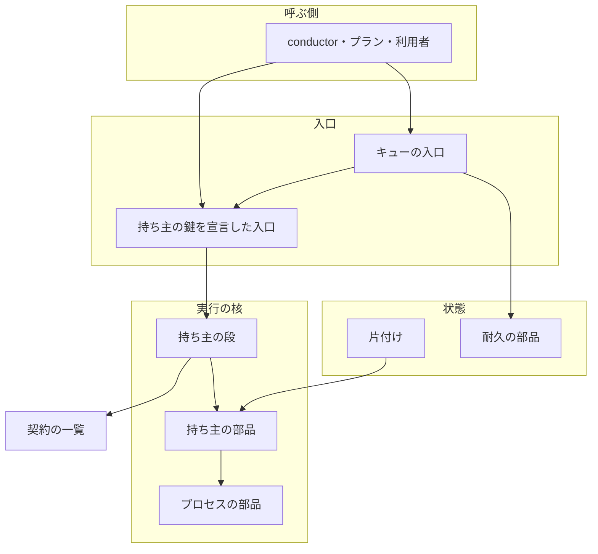
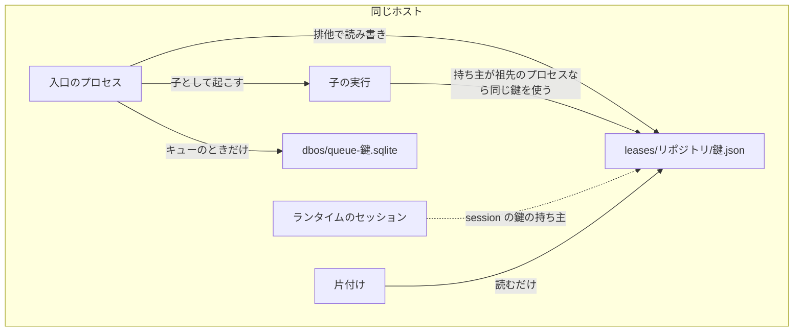
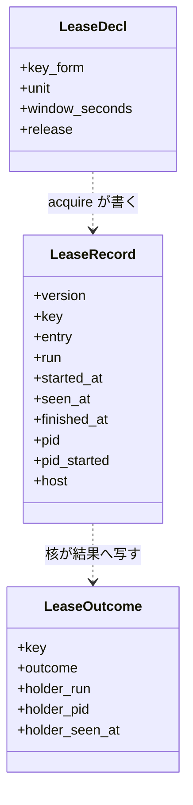
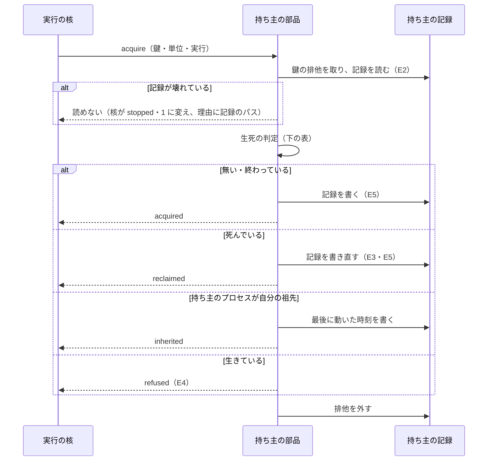
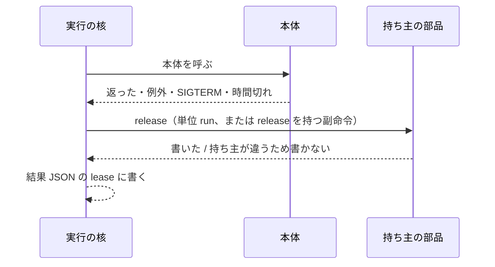
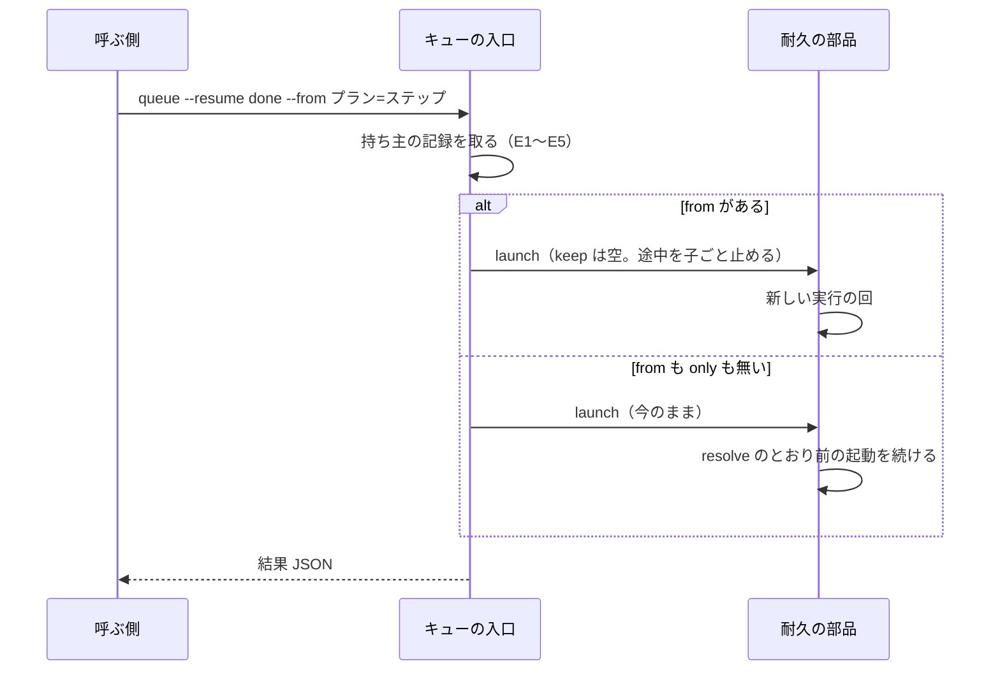
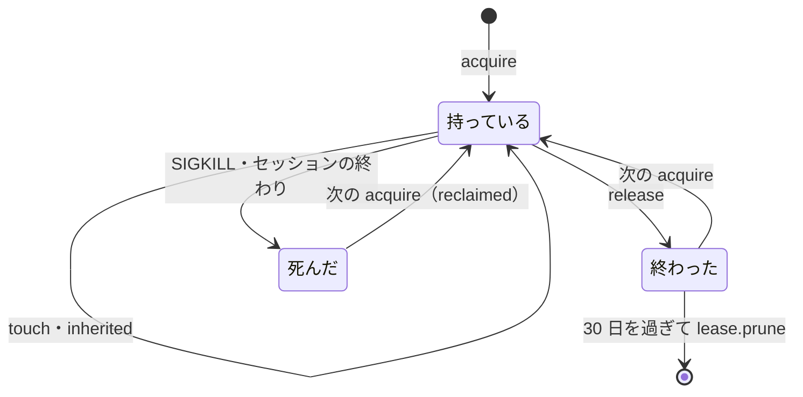

# 実行の持ち主: どの終わり方の後も次の実行が止まらず、並行する conductor が互いを知り、キューの再開で `--from` が勝つ（#2342）

## 目的

- **今どうなっているか**: 着手前のテストの打ち切りで終わった実行が持ち主の記録に終わった時刻を残さず、次の実行を 24 時間断る（#2321）。2 つの conductor が同じ開発ループとキューを互いに知らずに流す（#2316）。強制終了の後の `queue --resume --from` が前の途中の位置に負ける（#2325）
- **誰に効くか**: NDF でスプリントを回す conductor と利用者。打ち切り・強制終了・並行のたびに、持ち主の記録を手で書き換えるか耐久の記録を手で取り消している
- **変えると何が成り立つか**: 実行の核が持ち主の記録を取り・返し・死んだ持ち主を引き取る。後から来た実行は止まり、持ち主を結果で知る。キューの再開は `--from` があれば前の途中を止めて指定のステップから流す

## 適用範囲

- **働く範囲**: NDF の配布物（`plugins/ndf/scripts` と `plugins/ndf/skills/*/scripts`）。配布先のリポジトリでも同じ部品が動く。hook（`plugins/ndf/hooks/` と hook から呼ぶ `*-guard.sh`）・`factory/` は含まない
- **プロジェクトごとに違うもの**: 持ち主の鍵の値（PR・done のパス・ループの名前）は入口の入力から作り、置き場はリポジトリの slug で分ける。寿命の窓は契約の一覧の値で、プロジェクトの `.ndf/` を読まない
- **当たるモード**: `standard`
- **この柱で直す子の課題**: #2321・#2316・#2325 の 3 件だけである（承認ゲート 1 の答え。MVV 版 5 の Value 2・Value 3）。ほかの子の課題は「子の課題の扱い」に残す理由を書く

## あるべき姿の根拠

| 根拠 | 種類 | 何を示すか |
| --- | --- | --- |
| 利用者の指摘（2026-11-01）「異常系処理とログ出力、異常時の回復処理が統一されていないから起こる不具合・課題が多い。1 件ずつ対処してもきりがない」 | 利用者の指示の原文（#2335 の本文から引用） | 持ち主の扱いを、入口ごとではなく核の 1 か所で持つこと |
| #2321 の記録: プロセスが残っていないのに `rf2318.owner.json` の `finished_at` が `null` のまま、次の init が 4 秒で断られた | 実測（課題の本文） | 終わった時刻を書く経路が入口ごとにあり、打ち切りの経路が漏れていること |
| #2321 の断りの案内は `--run` を渡す・`finish` の後に開始すると示すが、プランから呼ぶ `drive.py` は `pr` しか受けず、`refactor.py` に `finish` は無い | 実測（課題の本文） | 案内が打てない手段を示していること |
| #2316 の記録: 後から来たセッションの `loop start` が `resumed` を返し、同じ done の `queue --resume` を 2 つのプロセスが流した | 実測（課題の本文） | 開発ループとキューに、後から来た conductor を止める仕組みが無いこと |
| `supervise_lib/flow.py` の `launch_queue` は、途中の耐久ワークフローを止める（`keep=()`）のが `fresh`（プランの並びが変わった）のときだけである。`launch_run` は開始のステップを接頭辞に含め（`plan_prefix(engine, start)`）、接頭辞の違う途中を止める（`keep=prefix`） | コードの読み取り（2026-11-04、`supervise_lib/flow.py:104-127`） | `--from` が負けるのはキューの再開だけで、`run --from` はすでに勝つこと |
| 契約の一覧の入口の行のキー（`scripts/contracts_lib/model.py:_check_entry` の必須 11 個と任意の `callers`・`external`）に持ち主の鍵が無い | コードの読み取り | 持ち主の宣言を契約の一覧へ足す必要があること |

要求と受け入れ条件は #2342 の本文にある（コピーは [issue-2342-requirements.md](issue-2342-requirements.md) ）。この文書は「どう作るか」だけを扱う。
上位の設計は #2335 の [issue-2335-design.md](issue-2335-design.md) と [issue-2335-design-decisions.md](issue-2335-design-decisions.md) である。
この文書はその決定 14・15 の持ち主の部品と置き場を正として、柱 P3 のうち 3 件に要る部分だけを詳しくする。決定 15 の再開の入口は作らない（決定 7）。
決定の記録は [issue-2342-design-decisions.md](issue-2342-design-decisions.md) にある。
データ構造と入出力の契約は [issue-2342-design-contracts.md](issue-2342-design-contracts.md) にある。

**実装は、柱 P1（#2337 結果の契約。すべての入口を実行の核 `run_core.main` へ移す）のマージの後に始める。** 持ち主の段を足す先が実行の核だからである。
#2337 は 2026-11-04 の時点でマージされていない。この文書は #2335 での実行の核の形（`RunContext` が解決済みの入力を持つ・SIGTERM の受け手・結果の JSON）を前提に書く。
#2337 の設計がそれと違う形で決まったときは、実装の開始時に読み直す（要求の未決の 2 行目）。柱 P2（#2338）・P8（#2341）のマージは待たない。

## ドメインモデル

### コンテキスト

| コンテキスト | 何の語が 1 つの意味に決まるか |
| --- | --- |
| NDF の worktree（`ndf-worktree`） | 持ち主の記録・持ち主の鍵・持ち主の契約・持ち主の単位・寿命の窓・状態の一覧・片付け |
| NDF の開発ワークフロー（`ndf-workflow`） | 実行の核・実行の識別子・耐久の記録 |

2 つは #2335 と同じく**共有カーネル**の関係にある。持ち主の部品（`lib/lease.py`）を、実行の核と片付けの両方が使う。
共有部分を変えるのはこの柱の Pull Request だけで、読み手と書き手を同じ差分で直す。

### 集約

| 集約 | 持ち主（書き換えてよいもの） | 根 | エンティティ | 値オブジェクト |
| --- | --- | --- | --- | --- |
| 持ち主の記録 | 持ち主の部品（`lib/lease.py`）だけ。30 日を過ぎた記録の削除も持ち主の部品の `lease.prune` が行い、片付けはそれを呼ぶだけにする | 持ち主の鍵 | — | 持ち主のプロセス（pid・開始時刻・ホスト名）・時刻（開始・最後に動いた・終わった） |
| 持ち主の契約 | この柱と入口を変える Pull Request（実行時は読むだけ） | 入口の契約の行の `lease` | — | 鍵の形・持ち主の単位・寿命の窓・返す副命令か |
| 耐久の記録 | 耐久の部品（`lib/durable.py`） | 起動の種類と鍵 | 耐久ワークフロー | 実行の回 |

**集約の間は識別子で参照する。** 持ち主の記録は実行を実行の識別子で指す。1 回の取る・返すが書き換える集約は持ち主の記録 1 つである。
片付けは持ち主の記録を読むだけで書き換えない（記録の削除は `lease.prune` を呼ぶ）。

### 不変条件

| # | 集約 | 条件 | 破れたときの扱い |
| --- | --- | --- | --- |
| I1 | 持ち主の記録 | 1 つの持ち主の鍵を、生きた持ち主が 2 つ同時に持たない（#2335 の I4） | 後から来た実行は `stopped`・終了コード 3（理由に持ち主の実行の識別子） |
| I2 | 持ち主の記録 | 記録を読んでから書くまでを、鍵ごとの排他の中で行う | 排他を取れなければ記録を書かない |
| I3 | 持ち主の記録 | 持ち主の単位が `run` の鍵は、正常・例外・SIGTERM・時間切れのどの終わり方でも、終わった時刻が書かれる（#2335 の I5） | SIGKILL・電源断の後は、次の実行が I4 で死を判定して引き取る |
| I4 | 持ち主の記録 | 持ち主が生きているのは、記録の pid が同じホストで動いていて、そのプロセスの開始時刻が記録と 1 秒未満で一致するときだけ。別のホストの記録は最後に動いた時刻から寿命の窓の中を生きているとみなす | pid が一致し開始時刻が違えば、pid の再利用として死んだ持ち主に扱う |
| I5 | 持ち主の記録 | 記録が持つのは版・鍵・入口・実行の識別子・3 つの時刻・pid・開始時刻・ホスト名だけ | 書く前に形を型で確かめ、余分な鍵があれば書かずに `stopped`・1 |
| I6 | 持ち主の記録 | 記録の持ち主のプロセス（pid と開始時刻）が自分の祖先のプロセスである実行は、持ち主の鍵を取り直さずに使う（`inherited`）。実行の識別子の一致では判定しない | 祖先が持っていない鍵は I1 のとおり取り合い、取った実行がその鍵の持ち主になって自分の終わりで返す |
| I7 | 耐久の記録 | キューの再開で `--from` があれば、前の途中の耐久ワークフローを子ごと止めてから新しい実行の回で始める | 止められなければ流さずに `stopped`・1 |

### ドメインイベント

要求の E1〜E8 を引き継ぐ。右端の列は #2335 のイベントの番号である。

| # | イベント | 発生元 | 受け手 | #2335 |
| --- | --- | --- | --- | --- |
| E1 | 入力を解決し、持ち主の鍵を作った | 実行の核 | 持ち主の部品 | E2 |
| E2 | 持ち主の記録を読んだ | 持ち主の部品 | 持ち主の部品（E3〜E5） | E4 |
| E3 | 死んだ持ち主の記録を引き取った | 持ち主の部品 | 結果 JSON | E4 |
| E4 | 生きた持ち主がいるため断った | 持ち主の部品 | 実行の核（`stopped`・3）・呼ぶ側 | E4 |
| E5 | 持ち主の記録を取った | 持ち主の部品 | 実行の核（本体を呼ぶ） | E4 |
| E6 | ステップの中身を実行した | 本体 | 実行の核 | E7 |
| E7 | 持ち主の記録に終わった時刻を書いた | 実行の核 | 次の実行（E2）・片付け | E11 |
| E8 | キューを `--from` つきで再開した | キューの入口（`supervise.py queue`） | 耐久の部品 | E13 |

### 用語

| 用語 | 意味 | 用語集への反映 |
| --- | --- | --- |
| 持ち主の単位 | 持ち主の記録を誰が持つか。`run` は入口の 1 回の実行で、実行の終わりで返す。`session` はランタイムのセッション（Claude Code・Codex のプロセス）で、返す副命令が呼ばれるかセッションが終わるまで持つ。どちらも、返せるのは記録の持ち主のプロセスが自分（`session` では自分のランタイムのセッション）と同じ実行だけである | 追加（`ndf-worktree`） |
| 持ち主の契約 | 入口の契約の行が持つ `lease` の宣言。副命令ごとに鍵の形・持ち主の単位・寿命の窓・返す副命令かを決める。見直しの持ち主が実行時に取る記録（既存の語「持ち主の宣言」）とは別の物である | 追加（`ndf-worktree`） |
| 寿命の窓 | 持ち主の記録が終わっていなくても、最後に動いた時刻からこの長さを過ぎた持ち主を死んでいるとみなす長さ。持ち主の部品の記録では別のホストの記録にだけ使い、同じホストは pid と開始時刻で決める（I4） | 意味の変更（`ndf-worktree`。持ち主の部品の記録では別のホストにだけ使う） |
| 持ち主の記録 | 持ち主の鍵ごとに 1 つ、状態の置き場の `leases/<リポジトリ>/` に置く記録。実行の識別子・入口・開始・最後に動いた時刻・終わった時刻・持ち主のプロセス（pid・開始時刻・ホスト名）を持つ | 意味の変更（`ndf-worktree`。残る状態ごとの記録から、鍵ごとの記録へ） |

## 機能一覧

| # | 機能 | 誰が使うか |
| --- | --- | --- |
| F1 | 持ち主の鍵で持ち主の記録を排他の中で取り、どの終わり方でも返す | 実行の核（持ち主の鍵を宣言した入口すべて） |
| F2 | 死んだ持ち主（pid の再利用を含む）を判定し、引き取ってから取る | 持ち主の部品 |
| F3 | 生きた持ち主がいるとき止まり、結果 JSON に持ち主の実行の識別子・pid・最後に動いた時刻と、打てる手段だけの案内を出す | 呼ぶ側（conductor・プラン・利用者） |
| F4 | 開発ループをセッションで、キューを done ごとに持ち、2 つ目の conductor を止める | conductor |
| F5 | キューの再開で `--from` があれば、前の途中を子ごと止めて新しい実行の回で流す | conductor・利用者 |
| F6 | レビュー worktree の片付けが、持ち主の部品の記録で生死を判定し、古い記録を消す | 片付け |

## 構成要素

| 要素 | 責務 | 新設 / 変更 |
| --- | --- | --- |
| 持ち主の部品（`lib/lease.py`） | `acquire` / `touch` / `release` / `read` / `prune`（30 日を過ぎた記録の削除）。鍵ごとの排他（`locks.exclusive`）の中で記録を読み書きし、生死を判定する。外部コマンドを起こさない | 新設（`run_owner.py` のうちレビュー worktree の記録の読み書きと、`run_state._process_alive` の判定を移す） |
| 持ち主の記録の旧い読み手（`lib/run_owner.py`） | レビュー worktree の持ち主の関数（`adopt_owner`・`mark_owner`・`run_args`・`claim_owner`・`touch_owner`・`finish_owner`）を消す。backlog-refinement の見直しの持ち主が使う関数（`read_owner`・`write_owner`・`alive` など）は残す（決定 8） | 変更 |
| プロセスの部品（`lib/procs.py`） | `runtime_session()`（祖先のランタイムのプロセスの pid と開始時刻）と `ancestors()`（自分の祖先の pid と開始時刻の並び）を足す | 変更（`hook_lib/worktree.session_owner` の探し方を移す） |
| 実行の核の持ち主の段（`lib/run_core.py`） | E1 の後に `lease.acquire`、終わり（`finally`・SIGTERM の受け手）に `lease.release`。結果 JSON に `lease` を足す | 変更（柱 P1 #2337 の実行の核に段を足す） |
| 契約の読み手（`scripts/contracts_lib/model.py`） | 入口の行の任意のキー `lease` の形を確かめる | 変更 |
| 契約の一覧（`plugins/ndf/contracts/entrypoints/`） | 持ち主の鍵を宣言する 4 つの入口の行に `lease` を書く | 変更 |
| 状態の一覧（`lib/run_state_kinds.py`） | 種類 `lease-record`（`leases/` の記録と錠）の行を足す。`review-worktree` の行の記録の置き場を `leases/` に直す | 変更 |
| 片付け（`lib/run_state.py`・`merged-steps.py`） | レビュー worktree（`pr<n>`・`rf<n>`）の持ち主を、鍵 `cross-review:pr=<n>`・`cross-refactoring:pr=<n>` の `lease.read` で判定する。種類 `lease-record` は `lease.prune` を呼ぶ | 変更 |
| cross-refactoring と cross-review の入口（`drive.py`・`refactor.py init`・`state.py init`） | 自前の持ち主の扱い（`adopt_owner`・`mark_owner`・`--run` の受け渡し）を消し、長く動く間は `ctx.touch()` で最後に動いた時刻を書く | 変更 |
| 開発ループ（`lib/sprint_loop.py`） | `loop` の副命令は持ち主の単位 `session` の鍵 `supervise.loop:name={name}` を宣言する。`stop`・`finish` が返す | 変更 |
| キューの耐久の記録の開き方（`supervise_lib/flow.py` の `launch_queue`・`supervise_lib/queue.py`） | `--from` があれば `fresh` と同じく途中の耐久ワークフローを子ごと止めてから開く | 変更 |



キューの入口は持ち主の鍵を宣言した入口の 1 つで、耐久の記録の開き方だけを別に描く。
処理の流れの図に描かない要素は次の 4 つである。

| 描かない要素 | 理由 |
| --- | --- |
| 契約の読み手 | 核が契約の一覧を読むときに通る |
| 状態の一覧 | 片付けが読む宣言である |
| 持ち主の記録の旧い読み手 | 見直しの持ち主だけが使う |
| 入口ごとの変更 | 持ち主の鍵を宣言した入口の一部である |

### 配置



置き場は `${NDF_STATE_DIR:-~/.local/state/ndf}/leases/<owner>--<repo>/<鍵をファイル名にしたもの>.json` である。
排他の錠は、同じ名前に `.lock` を付けたファイルである。
`<owner>--<repo>` は origin の URL から作り、同じリポジトリの別の clone と worktree の実行どうしが取り合う（#2335 の決定 15）。
鍵のうち `/` と `:` と `=` は `%2F`・`%3A`・`%3D` に置き換えてファイル名にする。

### 置き場所

```text
plugins/ndf/
├── contracts/
│   └── entrypoints/*.json            # 変更: lease を足す
└── scripts/
    ├── lib/
    │   ├── lease.py                  # 新設
    │   ├── run_owner.py              # 変更: レビュー worktree の持ち主の関数を消す
    │   ├── procs.py                  # 変更
    │   ├── run_core.py               # 変更（柱 P1 が新設した核に足す）
    │   ├── run_state.py              # 変更
    │   ├── run_state_kinds.py        # 変更
    │   └── sprint_loop.py            # 変更
    ├── merged-steps.py               # 変更
    └── supervise_lib/                # 変更: flow・queue
scripts/
└── contracts_lib/model.py            # 変更
```

## 構造



- **部品の形**: 次の 5 つの関数を持つ。生きた持ち主がいれば `LeaseBusy` を投げ、核が `stopped`・3 に変える

  ```python
  lease.acquire(decl, inputs, run) -> LeaseOutcome
  lease.release(key, holder) -> None
  lease.touch(key, holder) -> None
  lease.read(key) -> LeaseRecord | None
  lease.prune(days) -> list[str]
  ```

  `holder` は持ち主のプロセス（pid と開始時刻）で、単位 `run` では自分の入口のプロセス、単位 `session` では自分のランタイムのセッションである。
  `release` と `touch` は、記録の `pid` と `pid_started` が `holder` と一致するときだけ書き、一致しなければ何も書かない。
  実行の識別子（`run`）は照合に使わない

- **核の形**: 本体は持ち主の記録を触らない。長く動く本体は `ctx.touch()` で最後に動いた時刻を書く（drive の `mark_owner(..., "touch")` を置き換える）

## データ構造

[issue-2342-design-contracts.md の「データ構造」](issue-2342-design-contracts.md#データ構造) に次のものがある。

- 持ち主の記録の形
- 入口の契約に足すキー
- 持ち主の鍵を宣言する入口
- 状態の一覧に足す行
- 移行

## 入出力の契約

[issue-2342-design-contracts.md の「入出力の契約」](issue-2342-design-contracts.md#入出力の契約) に次のものがある。

- 結果 JSON に足す鍵
- 断るときの案内
- キューの `--from` つきの再開

## 処理の流れ

### 持ち主の記録を取る（E1〜E5）



| 記録の状態 | 判定 | 結果 |
| --- | --- | --- |
| 記録が無い | いない | `acquired` |
| `finished_at` がある | 終わっている | `acquired` |
| 記録の pid と開始時刻が、自分の祖先のプロセス（単位 `session` では自分のランタイムのセッションを含む）と一致する | 同じ実行の子・同じ conductor | `inherited`（書き換えるのは `seen_at` だけ） |
| 同じホストで、pid が無い・pid が別のプロセスで開始時刻が違う | 死んでいる（I4） | `reclaimed` |
| 同じホストで、pid と開始時刻が一致する | 生きている | `refused` |
| 別のホストで、最後に動いた時刻が寿命の窓（`window_seconds`）の外 | 死んでいる | `reclaimed` |
| 別のホストで、最後に動いた時刻が寿命の窓の中 | 生きている | `refused` |

**記録の `run` の一致では `inherited` にしない。** 祖先のプロセスかどうかは、生きた記録があるときだけ `psutil` で自分の親をたどって確かめる（決定 4）。

**引き取りは記録を書き直すだけにする。** 死んだ持ち主が残したレビュー worktree は、入口が今と同じく作り直すか使い直す。引き取りの中で片付けを呼ばない（決定 6）。

### 返す（E6・E7）



- **返すのは `finally` と SIGTERM の受け手の両方から 1 回だけ**（2 回目は何もしない）。時間切れは、本体の中の打ち切りが例外か終了コードで戻る経路で、`finally` を通る。#2321 の着手前のテストの打ち切りは、`refactor.py init` が終了コード 4 で戻る経路である
- `release` は、記録の持ち主のプロセス（pid と開始時刻）が自分の持ち主のプロセスと同じときだけ `finished_at` を書く。
  `inherited` で使った実行は返さない（祖先の持ち主が返す）。祖先が持っていない鍵を子の実行が取ったときは、その子が持ち主で、子の終わりで返す（I6）
- **単位 `session` の記録は、`release: true` の副命令でだけ返す。** ほかの副命令の終わりでは `seen_at` だけを書く。`loop start` と `loop finish` は別の実行だが、持ち主のプロセスが同じランタイムのセッションなので `loop finish` が返せる。セッションが終われば、次の取る側が I4 で死を判定する

### 片付ける（F6）

片付け（`run_state` の `review-worktree`・`merged-steps.py`）は、今 `<base>/<slug>/{pr,rf}<n>.owner.json` を読んで判定している。
この判定を、鍵 `cross-review:pr=<n>`・`cross-refactoring:pr=<n>` の `lease.read` と I4 の判定に置き換える。
判定の結果の扱い（生きていれば `kept`、終わっていれば今の条件で外す）は変えない。種類 `lease-record` は、片付けが `lease.prune(30)` を呼んで外す。

### キューを `--from` つきで再開する（E8）



- `launch_queue` の `fresh` を「プランの並びが変わった、または `--from` がある」に広げる（決定 5）。`--only` の扱いは変えない
- `supervise.py run --from` は変えない。開始のステップを耐久ワークフローの接頭辞に含めており、すでに `--from` が勝つ（あるべき姿の根拠の 5 行目）

### 持ち主の記録の状態



## 非機能の実現方式

| 大項目 | 要求の条件 | 実現方式 | 確かめ方 |
| --- | --- | --- | --- |
| 性能・拡張性 | 持ち主の段の増分が #2335 の上限 150 ms の内側 | 取る・返すは `filelock` と JSON の 1 ファイルの読み書きで、外部コマンドを起こさない。`psutil` は生きた記録があるときだけ遅れて読む | 柱の Pull Request で、持ち主の鍵を宣言した入口（`refactor.py init --help` ではなく、PR を渡して鍵を取る起動）を前後で 10 回ずつ測り、差の中央値を本文に書く |
| 可用性 | 生きた持ち主がいれば待たずに返る | `refused` で `stopped`・3 | 2 つのプロセスで同じ鍵を取り合うテスト |
| 運用・保守性 | 取った・引き取った・断った・返したを結果に出す | 結果 JSON の `lease`（入出力の契約） | 終わり方ごとのテストで `lease.outcome` を見る |
| 移行性 | 置き場を移す。revert で戻る | 移行の表のとおり。持ち主の段の Pull Request と入口を移す Pull Request を分け、段は契約の行に `lease` が無ければ何もしない | それぞれの Pull Request の revert の後に全体テストが通る |
| セキュリティ | 記録に秘密が無い | 記録の型が I5 の鍵だけを許す。鍵の形に `secret: true` の入力を使う宣言を契約の検査が落とす | 秘密を入れた環境変数で起動し、`leases/` の下に値が無いことを見る |
| システム環境 | extras が無ければ 69 | 持ち主の部品は `deps.require("locks")` を先に呼ぶ。`psutil`（`procs`）が無い環境は、同じホストの生死を判定できないため `stopped`・69 と足りないグループ名を返す | extras を外した環境で鍵を宣言した入口を起動するテスト |

## 決定の記録

決定の記録は [issue-2342-design-decisions.md](issue-2342-design-decisions.md) にある。

## テスト設計

| 受け入れ条件・不変条件 | どの振る舞いで縛るか | どう壊したら落ちるべきか |
| --- | --- | --- |
| 1・I3 | 正常・例外・SIGTERM・時間切れで終えた後、記録に `finished_at` があり、同じ鍵の次の実行が `acquired` で始まる。#2321 の再現の手順（着手前のテストを上限で打ち切った後に `--from` で流し直す）を通す | `finally` から `release` を外す／SIGTERM の受け手で返さない |
| 2・I4 | SIGKILL の後の次の実行が `reclaimed` で取る。pid が一致し開始時刻が違う記録を `reclaimed` と読む | pid の生存だけを見る |
| 3 | 断りの結果に持ち主の実行の識別子・pid・最後に動いた時刻があり、`next` に `--run`・`finish`・`kill` が無い | 案内に今の文を戻す |
| 4 | 2 つのプロセスで同じ鍵を起動し、後の側が `refused`・3 になる | 結果に `lease` を書かない |
| 5・I1・I2 | 多数のプロセスが同時に同じ鍵を取り、生きた持ち主が常に 1 つ | 排他の外で読んで書く |
| 6 | 2 つのセッションから同じ開発ループの `loop start` を打つと、後の側が `resumed` を返さず `refused`・3。同じ done の `queue --resume` も同じ。#2316 の再現の手順を通す | ループの鍵の単位を `run` にする／`queue` に鍵を宣言しない |
| 7・I7 | 途中のまま残った後の `queue --resume <done> --from <プラン>=<ステップ>` が指定のステップから新しい実行の回で流れ、前の途中の耐久ワークフローが子ごと止まる。`--from` も `--only` も無ければ前の起動を続ける。#2325 の再現の手順を通す | `fresh` を並びの変化だけに戻す |
| 8 | 終わった記録のレビュー worktree が今の条件で外れ、生きた記録のものは `kept`。30 日を過ぎた記録が消える | 片付けが旧い置き場を読む |
| 9 | （手動）子の課題 3 件の再現の手順を本番へ出した版で通し、課題の本文の表を埋める | — |
| 10 | `lease` の無い入口の振る舞いが変わらず、全体テストが前後で通る | 鍵の無い入口でも記録を書く |
| 11・I5 | 秘密を入れた環境変数で起動しても記録に値が無い。余分な鍵を持つ記録を書こうとすると `stopped`・1 | 記録に引数の並びを書く |
| I6 | 祖先が持つ鍵を子の実行が `inherited` で使い、子の終わりで記録が返らない。祖先が持たない鍵を子が取ったときは子の終わりで返る | 子の終わりで `release` する／`run` の一致で `inherited` にする |

## 子の課題の扱い

受け入れ条件 9 で、柱の仕組みを本番へ出した後に 3 件の再現の手順を 1 回ずつ通す。この表は設計の時点の判定で、結論は再現の結果で決める。

| 課題 | 判定 | 理由 |
| --- | --- | --- |
| #2321 | 解消の見込み | 打ち切りも核の `finally` を通って返し、断りの案内は打てる手段だけを示す |
| #2316 | 一部の解消の見込み。課題は残す | 開発ループを単位 `session` で、キューを done ごとに持つ。本文の残りの対象（Issue・触るファイル・版数・マシンをまたぐロック）は範囲外 |
| #2325 | 解消の見込み | `--from` があれば途中を子ごと止めて新しい実行の回で流す |
| #2285 | 残す | 子のプロセスの停止を範囲から外した |
| #2313 | 残す | 3 件の外。#2321 の解消で流せる見込みだが、確かめる作業を範囲に入れない |
| #1592・#1635 | 残す | 再開の入口の新設と旧い再開の形の別名を範囲から外した（決定 7） |
| #2009 | 残す | 承認資料の後片付けを範囲から外した |
| #2243 | 残す | 一時の置き場の一覧の整理を範囲から外した |
| #1886 | 残す | リポジトリの根の解決（柱 P8 #2341）の問題で、持ち主の記録では変わらない |
| #2198 | 残す | ステップの冪等性の問題で、再開の手段では変わらない |
| #1967 | 残す | テストの間の状態の共有で、持ち主の記録の外 |
| #1640 | 残す | 受け渡しの契約の問題で、状態の寿命の外 |
| #2273 | 残す | プランの分岐の問題 |
| #1811・#2037・#2165 | 残す | キューの重なりの判定の粒度（対象範囲の「含まない」） |
| #2229 | 閉じている | 置き場を移しても #2229 の受け入れ条件が保たれることを全体テストで確かめる |

## 設計の結果

| 課題 | 扱い | 取り込み先 | 触るファイル |
| --- | --- | --- | --- |
| #2342 | 実装する（#2337 のマージ後に始める） | — | `plugins/ndf/scripts/lib/`、`plugins/ndf/scripts/supervise_lib/`、`plugins/ndf/scripts/merged-steps.py`、`plugins/ndf/scripts/hook_lib/worktree.py`、`plugins/ndf/scripts/tests/`、`plugins/ndf/skills/cross-review/scripts/`、`plugins/ndf/skills/cross-refactoring/scripts/`、`plugins/ndf/contracts/`、`scripts/contracts_lib/model.py`、`scripts/tests/`、`docs/glossary/glossary.json`、`docs/glossary.md` |

子の課題は表に載せない。表の行はスプリントの Pull Request の `Closes` になるが、子の課題は本番へ出した版で再現の手順を通してから閉じるためである（受け入れ条件 9）。

## 未確認のまま残ること

| 項目 | 内容 |
| --- | --- |
| 前提の柱の形 | 実行の核の形は #2335 の設計から置いた。#2337 が違う形で決まれば、持ち主の段の呼び出しの位置と、鍵を埋める入力の受け取り方を読み直す |
| 中継の切り替えとセッションの持ち主 | 中継の再起動で新しいセッションが前のセッションの終わりより先に `loop` を打つと、前のセッションが生きている間は `refused` になる。切り替えの順を再現の手順で確かめる |
| 旧い版との並走 | 新しい版は旧い置き場の記録を読まない（決定 3）。旧い版と新しい版が同じ鍵を同時に取ると排他が効かない。利用者が両方を同時に動かす運用は確認していない |
| 旧い置き場の残り | 旧い置き場の `*.owner.json` は、今の片付けがレビュー worktree を外すときに一緒に消す（`run_state.py:157`・`run_state.py:167`）。worktree が残る間は記録も残るが、新しい版は読まない |
| 増分の実測 | 持ち主の段の増分は柱の Pull Request で測る。150 ms に収まらなければ、`psutil` の読み込みを生きた記録があるときに限る範囲を見直す |
