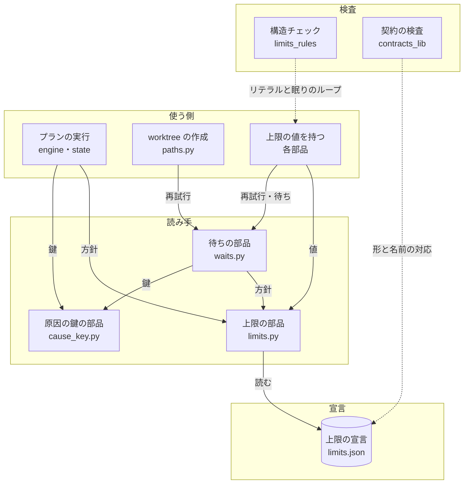
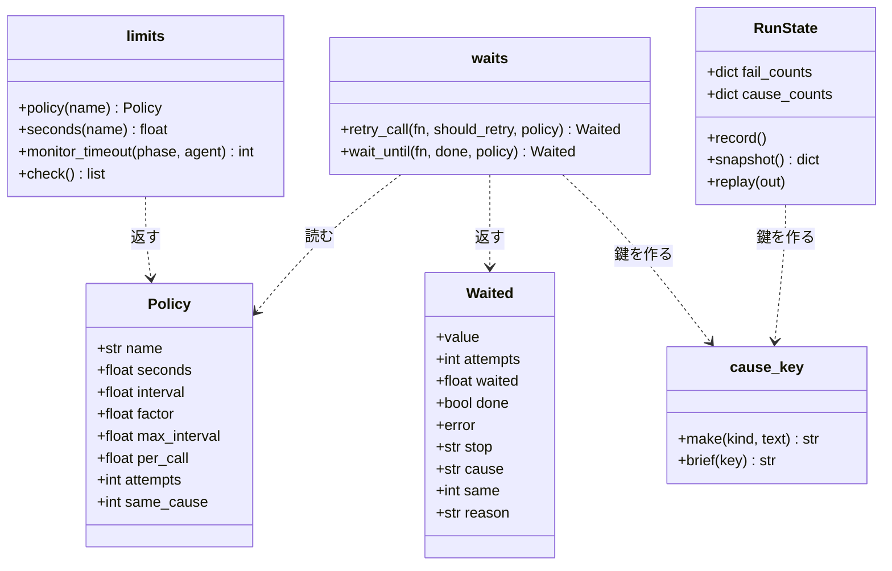
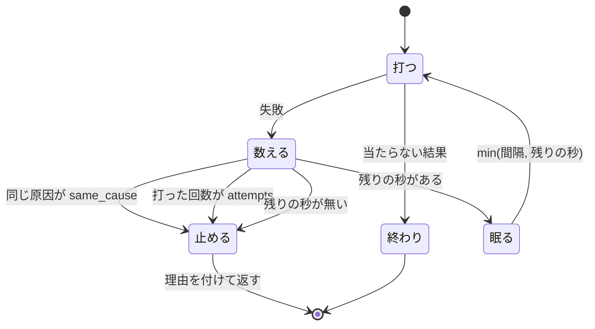
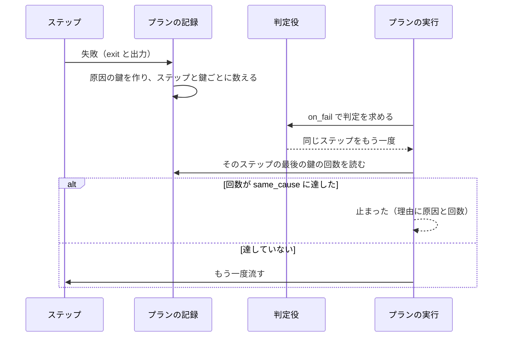

# NDF のスクリプト: 上限と再試行を 1 つの宣言から引き、同じ原因の打ち直しを決まった回数で止める（#2343）

## 目的

- **今どうなっているか**: 上限の秒・再試行の回数・待ちの間隔が、テストと実験版を除く 69 ファイルの 110 か所に数字で書かれている。待ちの部品は上限の最大 2 分前に止まり（#2224）、プランの判定役（judge）は同じ CI の失敗に 7 回打ち直しを返した（#1983）
- **誰に効くか**: NDF でスプリントを回す利用者と conductor。上限で止まった実行を追い直す手間と、通るはずの検査が「判断が要る」で止まる手当てが減る
- **変えると何が成り立つか**: 上限の値は上限の宣言 1 か所にあり、数字を書き戻すと構造チェックが落とす。同じ原因の失敗は宣言の回数で止まり、待ちは上限の時刻に最後の照会を打ってから止まる。止まった理由（方針の名前・原因・回数・待った秒）が結果に出る

## 適用範囲

- **働く範囲**: NDF の配布物（`plugins/ndf/` の Python のコード。テストと `plugins/ndf/scripts/experimental/` を除く）。hook も含む。配布先のリポジトリでも同じ宣言が使われる
- **プロジェクトごとに違うもの**: 上限の値の上書きは、今ある環境変数と引数（`MONITOR_TIMEOUT` など）のまま受ける。新しい上書きの経路は #2341（入力の契約）が作る。宣言が持つのは既定値だけである
- **当たるモード**: `standard`

## あるべき姿の根拠

| 根拠 | 種類 | 何を示すか |
| --- | --- | --- |
| 利用者の指摘（2026-11-01）「異常系処理とログ出力、異常時の回復処理が統一されていないから起こる不具合・課題が多い。1 件ずつ対処してもきりがない」 | 利用者の指示の原文 | 回復の手段（再試行と待ち）を 1 つの部品と 1 つの宣言にそろえること |
| 構文木で数えた上限の数字のリテラル 110 か所（定数 68・呼び出しのキーワード引数 19・関数の既定値 18・`.get("timeout", <数字>)` 5）。うち上限でないもの 6 か所（終了コード 3・割合 2・見直しの周期 1） | 実測（2026-11-04、下の「数え方」） | 移す対象が 104 か所で、正規表現の `timeout=[0-9]`（20 か所。0 と docstring の中を含む）は呼び出しのキーワード引数しか見ず、定数・既定値・`.get` の 91 か所を見落とすこと |
| 眠り（`sleep`）を含むループが `lib/waits.py` の外に 25 か所ある。うち再試行（失敗した同じ呼び出しの打ち直し）は `supervise_lib/paths.py` の 1 か所で、残り 24 か所は条件が揃うまでの待ち | 実測（2026-11-04、構文木） | 再試行のループを `lib/waits.py` へ寄せる変更が 1 か所で済み、待ちのループは例外リストの行で数を固定できること |
| #2224 の記録: 上限 1154 秒のうち 112 秒を残して「結論を得られない」で止まり、同じコミットのチェックはすべて成功していた | 実測（PR #2209 の検査のフェーズの記録） | 待ちは上限の時刻に照会を打つ必要があること |
| #1983 の記録: `release` のステップが同じ run の同じ失敗で 7 回流され、ステップの上限（366 秒）で止まった | 実測（スプリント m1953 の本番の配布の記録） | 同じ原因の打ち直しを回数で止める仕組みが、呼び出しの再試行だけでなくステップの打ち直しにも要ること |
| 上限の宣言の読み込みの費用: 120 の方針を持つ 18.9 KB の JSON を `json.load` で読む起動と読まない起動の中央値（10 回）は、どちらも 21.5 ms で、差は 1 ms 未満。`supervise.py --help` の中央値は 262 ms | 実測（2026-11-04、`/work/ai-plugins/.venv/bin/python -I`） | 宣言の読み込みが #2335 の起動の増分の上限 150 ms の内訳で 1 ms 未満に収まること |

数え方（構文木で数えた）:

| 項目 | 中身 |
| --- | --- |
| 対象のファイル | `git ls-files 'plugins/ndf/*.py'` から、テストと実験版を除いたもの |
| (1) 定数 | 名前が大文字で `TIMEOUT`・`RETRY`・`RETRIES`・`WAIT`・`INTERVAL`・`BUDGET`・`DEADLINE`・`POLL`・`STALL`・`MARGIN`・`GRACE`・`ATTEMPTS` のどれかを含む定数への、0 でない数字の代入 |
| (2) キーワード引数 | 呼び出しのキーワード引数 |
| (3) 既定値 | 関数の引数の既定値 |
| (4) `.get` | `.get("<キー>", <数字>)` の 2 つ目の引数 |
| (2)〜(4) のキー | 「構造チェックの新しい種類」の表にある 12 個 |

要求と受け入れ条件は #2343 の本文にある（コピーは [issue-2343-requirements.md](issue-2343-requirements.md) ）。
この文書は「どう作るか」だけを扱う。決定の記録は [issue-2343-design-decisions.md](issue-2343-design-decisions.md) にある。

## ドメインモデル

### コンテキスト

| コンテキスト | 何の語が 1 つの意味に決まるか |
| --- | --- |
| NDF の開発ワークフロー（`ndf-workflow`） | 上限の宣言・方針の名前・原因の鍵・再試行・ステップの打ち直し・眠りのループ |

1 つのコンテキストに収まる。上限の宣言は #2335 の設計が決めた共有カーネル（契約の一覧）の一部で、プランの実行・収束ループ・リリースなどの各部品は方針の名前で値を引く。

### 集約

| 集約 | 持ち主（書き換えてよいもの） | 根 | エンティティ | 値オブジェクト |
| --- | --- | --- | --- | --- |
| 上限の宣言 | 宣言を変える Pull Request（実行時には誰も書かない。上限の部品 `lib/limits.py` は読むだけ） | `plugins/ndf/contracts/limits.json` | 方針（方針の名前で引く行） | 上限の秒・間隔・倍率・間隔の上限・1 回の呼び出しの待ち・打つ回数・同じ原因の上限 |
| 1 回の再試行 | 待ちの部品（`lib/waits.py`）。1 回の `retry_call` / `wait_until` の呼び出しの間だけ生きる | 呼び出し | — | 原因の鍵・原因ごとの回数・待った秒・止まった理由（`Waited`） |
| プランの実行 | プランの実行の部品（`supervise_lib/engine.py` と記録の `supervise_lib/state.py`） | 状態の置き場 | ステップの結果 | 原因の鍵・ステップと原因ごとの回数 |

**集約の間は名前で参照する。** 部品は方針を方針の名前で引き、値をコピーして持たない。1 回の再試行とプランの実行は、
上限の宣言を読むだけで書き換えない。

### 不変条件

| # | 集約 | 条件 | 破れたときの扱い |
| --- | --- | --- | --- |
| I1 | 上限の宣言 | 方針の名前は一意で、各方針は `summary` と値を 1 つ以上持つ。秒・間隔は 0 以上の数、倍率は 1 以上の数、打つ回数と同じ原因の上限は 1 以上の整数で、知らないキーを持たない | 読み手が `LimitsError`（理由に宣言のパスと方針の名前）。CI では契約の検査（`check-ndf-contracts.py`）が落とす |
| I2 | 上限の宣言 | 宣言が無い・壊れている・引いた方針の名前が無い・引いた値が方針に無いとき、部品は組み込みの値へ戻らない | `LimitsError`。エントリポイントは終了コード 1 と理由で止まる |
| I3 | 上限の宣言 | テストと実験版を除く `plugins/ndf/` の Python のコードに、上限の数字のリテラルが無い（#2335 の I12） | 構造チェックの `limit-literal` が落とす |
| I4 | 上限の宣言 | コードが引く方針の名前はすべて宣言にあり、宣言の方針はすべてどこかのコードが引く（`lib/limits.py` が接頭辞で数え上げる `monitor.` の方針は引かれたものとする） | 契約の検査が落とす |
| I5 | 上限の宣言 | 監視の工程と担当のすべての組で、無進捗の許容 < 監視の上限 < CLI の上限 | `limits.py check` が組を出して終了コード 1 |
| I6 | 1 回の再試行 | 眠りを含むループは `lib/waits.py` と、例外リストに理由つきで載った待ちのループだけにある | 構造チェックの `sleep-loop` が落とす。例外リストの行を足すには、その行を差分に載せてレビューを通す |
| I7 | 1 回の再試行 | `tenacity` を import するのは `lib/waits.py` だけ | 構造チェックの `wrapped` が落とす |
| I8 | 1 回の再試行 | 同じ原因の鍵の失敗の回数が方針の `same_cause` に達したら、待ちの合計の上限が残っていても打ち直さない。原因の鍵が違う失敗は別に数える（#2335 の I13） | 打ち直さずに `Waited`（`stop` が `same-cause`）を返す |
| I9 | 1 回の再試行 | 眠りの合計は方針の `seconds` を超えない。次の眠りが上限を超えるときは残りの秒だけ眠り、上限の時刻に最後の 1 回を打ってから止まる | 打ち切った `Waited`（`stop` が `deadline`）を返す |
| I10 | 1 回の再試行 | 止まった `Waited` は理由の文を持ち、そこに方針の名前と、上限なら待った秒・照会の回数・上限の秒が、同じ原因なら原因の要旨と回数が入る | — （作る関数が 1 つで、空の理由を作る経路が無い） |
| I11 | プランの実行 | 判定役が失敗したステップの打ち直しを返したとき、そのステップの同じ原因の鍵の失敗が方針 `supervise.step-rerun` の `same_cause` に達していれば、ステップを流さずに止まる | 結果「止まった」、理由に原因の要旨と回数 |
| I12 | プランの実行 | ステップと原因ごとの回数は、落ちた後の続き（耐久の記録からの再開）でも数え直さずに引き継ぐ | 耐久ステップの出力のコピー（`snapshot`）が持ち、`replay` が戻す |

### ドメインイベント

番号は要求のドメインイベントを引き継ぐ。

| # | イベント | 発生元 | 受け手 |
| --- | --- | --- | --- |
| P4-E1 | 上限の宣言を読んだ | 上限の部品（`limits.policy`） | 待ちの部品・各部品（値を使う） |
| P4-E2 | 呼び出しが失敗した | 待ちの部品が呼んだ関数 | 待ちの部品 |
| P4-E3 | 失敗から原因の鍵を作った | 原因の鍵の部品（`lib/cause_key.py`） | 待ちの部品・プランの実行 |
| P4-E4 | 同じ原因の失敗を数えた | 待ちの部品 / プランの記録（`RunState.record`） | 待ちの部品 / プランの実行 |
| P4-E5 | 間隔を置いて打ち直した | 待ちの部品 | 呼び出し元（`on_wait` のアナウンス） |
| P4-E6 | 打ち直しを止めた | 待ちの部品 | 呼び出し元 |
| P4-E7 | 止めた理由を結果に書いた | 呼び出し元（`Waited.reason` を結果の `summary` へ） | 呼ぶ側・プランの進捗の記録 |
| P4-E8 | 判定役がステップの打ち直しを返した | 判定役（`JudgeStep`） | プランの実行（`Engine._next_after_judge`） |
| P4-E9 | ステップの打ち直しを同じ原因の上限で止めた | プランの実行 | プランの結果・進捗の記録（`kind: same-cause` の行） |
| P4-E10 | 待ちが上限の時刻に最後の照会を打った | 待ちの部品（`wait_until`） | 呼び出し元 |

### 用語

| 用語 | 意味 | 用語集への反映 |
| --- | --- | --- |
| 眠りのループ | 本体（入れ子の関数を除く）で `sleep` を呼ぶ `for` / `while` のループ。再試行と待ちの両方が当たり、`lib/waits.py` の外では構造チェックが落とす | 追加（`ndf-workflow`） |
| 最後の照会 | 待ちの次の眠りが上限を超えるとき、残りの秒だけ眠った後に上限の時刻に打つ 1 回の照会 | 追加（`ndf-workflow`） |

要求で足した語（上限の宣言・方針の名前・原因の鍵・再試行・ステップの打ち直し）は意味を変えずに使う。

## 機能一覧

| # | 機能 | 誰が使うか |
| --- | --- | --- |
| F1 | 上限の値を方針の名前で宣言から引く。宣言が読めなければ組み込みの値へ戻らずに止まる | NDF のすべての部品（hook を含む） |
| F2 | 上限の数字のリテラル・`lib/waits.py` の外の眠りのループ・`tenacity` の import を構造チェックで落とす | CI・Pull Request の作者 |
| F3 | 方針の名前と宣言の食い違いを契約の検査で落とし、方針ごとに引く関数を契約の一覧に描く | CI・上限を変えたい人 |
| F4 | 呼び出しの再試行を、同じ原因の回数・打つ回数・待ちの合計のどれかで止め、止めた理由を返す | 再試行を使う部品（worktree の作成・投稿キュー・設計の結果の読み取りなど） |
| F5 | 判定役が返したステップの打ち直しを、同じ原因の回数で止める | プランの実行（conductor・利用者） |
| F6 | 待ちが上限の時刻に最後の照会を打ってから止まり、待った秒・照会の回数・上限の秒を返す | CI の待ち・チェックの待ち（`wait_until` の呼び出し元） |
| F7 | 子の課題 9 件の再現の手順を通し、閉じるか理由つきで残すかを記録する | 利用者・backlog |

## 構成要素

| 要素 | 責務 | 新設 / 変更 |
| --- | --- | --- |
| 上限の宣言（`plugins/ndf/contracts/limits.json`） | 方針の名前ごとに上限の値を持つ。今の `limits.py` の表と、各部品の上限の既定値を移す | 新設 |
| 上限の部品（`lib/limits.py`） | 宣言を標準ライブラリの `json` だけで 1 プロセスに 1 回読み、I1 を確かめ、`policy(名前)` と `seconds(名前)` を返す。監視の工程と担当の引き方（`monitor_timeout` など）と `check` は宣言を読む形へ変える。CLI の引数と出力は変えない | 変更 |
| 原因の鍵の部品（`lib/cause_key.py`） | 種類（例外の型か `exit=<終了コード>`）と理由の文から原因の鍵を作り、要旨（60 字まで）を返す。外の世界を触らない純粋な処理 | 新設 |
| 待ちの部品（`lib/waits.py`） | `retry_call` / `wait_until` が方針を引数に取り、同じ原因の上限・打つ回数・最後の照会・止まった理由を受け持つ。数字の既定値を持たない | 変更 |
| プランの実行（`supervise_lib/engine.py`・`supervise_lib/state.py`） | ステップの失敗ごとに原因の鍵を作って数え、判定役の打ち直しを `supervise.step-rerun` の回数で止める | 変更 |
| worktree の作成（`supervise_lib/paths.py`） | 自前の打ち直しのループを `waits.retry_call` の呼び出しへ置き換える | 変更 |
| 構造チェック（`scripts/check-script-structure.py` と、新設の `scripts/structure_checks/limits_rules.py`） | 検査の種類 `limit-literal` と `sleep-loop` を足し、`wrapped` の表に `tenacity` を足す。規則の本体は新設のモジュールに置き、今 895 行のチェックの本体を伸ばさない | 変更・新設 |
| 契約の検査（`scripts/check-ndf-contracts.py`・`scripts/contracts_lib/`） | 宣言の形（I1）と方針の名前の対応（I4）を確かめ、契約の一覧（`plugins/ndf/contracts/index.md`）に「上限の宣言」の表を描く | 変更 |
| 上限の値を持つ各部品（69 ファイル） | 数字のリテラルを `limits.seconds("<方針の名前>")` などの呼び出しへ置き換える | 変更 |
| 例外リスト（`scripts/script-structure-allow/`） | 待ちのループ 24 か所と、上限でない数字 3 か所（割合 2・見直しの周期 1）の行を持つ | 変更 |

### 要素の間の関係



### パッケージ構成

```text
plugins/ndf/
├── contracts/
│   ├── limits.json                 # 新設: 上限の宣言
│   └── index.md                    # 変更: 「上限の宣言」の表を描く（生成物）
└── scripts/
    ├── lib/
    │   ├── limits.py               # 変更: 宣言の読み手
    │   ├── cause_key.py            # 新設: 原因の鍵
    │   └── waits.py                # 変更: 方針・同じ原因・最後の照会
    └── supervise_lib/
        ├── engine.py               # 変更: ステップの打ち直しの上限
        ├── state.py                # 変更: ステップと原因ごとの回数
        └── paths.py                # 変更: 再試行を waits へ
scripts/
├── check-script-structure.py       # 変更: 種類の追加
├── structure_checks/
│   └── limits_rules.py             # 新設: limit-literal・sleep-loop の規則
├── check-ndf-contracts.py          # 変更
├── contracts_lib/                  # 変更: 宣言の検査と描画
└── script-structure-allow/         # 変更: 待ちのループ・上限でない数字の行
```

## 構造



### 値の扱い

- `Policy` は値オブジェクト（`NamedTuple`）で、方針に無い値は `None`。計算で上限を縮める呼び出し元（設計の結果の読み取りの残りの予算など）は `policy._replace(seconds=<計算した値>)` で渡す。リテラルを渡す経路は I3 が落とす
- `Waited` の今の 5 つの値（`value`・`attempts`・`waited`・`done`・`error`）は、位置も意味も変えない。後ろに次の 4 つの値を既定値つきで足す。今の呼び出し元は書き換えずに動く
  - `stop`: 止まり方（`done` / `deadline` / `same-cause` / `attempts`）
  - `cause`: 最後の失敗の原因の鍵
  - `same`: その鍵の回数
  - `reason`: I10 の理由の文
- `RunState.cause_counts` は `{ステップの id: {原因の鍵: 回数}}` で、`fail_counts` と同じく `snapshot` と `replay` が運ぶ。`state.json` には書かない（`durable-boundary` の検査が `state.json` の鍵を `log`・`llm`・`project_mvv` に限るため）

## データ構造

上限の宣言は 1 つの JSON のファイルで、実行時には読むだけである。

```json
{
  "version": 1,
  "policies": {
    "monitor.phase.review": {"summary": "レビューの工程の監視の上限", "seconds": 1200},
    "monitor.stall.claude": {"summary": "claude の無進捗の許容。--output-format json は完了まで出さない", "seconds": 900},
    "monitor.cli-margin": {"summary": "CLI の上限 = 監視の上限 + この秒数", "seconds": 120},
    "supervise.design-stage-read": {"summary": "設計の結果の gh / git の一時的な失敗の打ち直し", "seconds": 120, "per_call": 30, "interval": 15, "same_cause": 3},
    "supervise.worktree-lock": {"summary": ".git/config の lock で落ちた worktree の作成の打ち直し", "seconds": 5, "attempts": 6, "interval": 1, "same_cause": 6},
    "supervise.step-rerun": {"summary": "判定役が返すステップの打ち直しの同じ原因の上限", "same_cause": 2}
  }
}
```

| キー | 型 | 空の扱い | 意味 |
| --- | --- | --- | --- |
| `version` | int | 許さない | 宣言の形の版。今は 1 |
| `policies` | object | 許さない | 方針の名前 → 方針 |
| 方針の名前 | str | — | `<領域>.<用途>`。領域は Skill の名前（`skills/<名>/`）、`*_lib` の名前から `_lib` を除いたもの、`lib/` の部品はその部品の名前（例 `post-queue`）、エントリポイントのスクリプトはその名前。用途は小文字のケバブケース |
| `summary` | str | 許さない | 何の上限か。理由の文と契約の一覧に出る |
| `seconds` | number | 省略可 | 上限の秒。待ちと再試行では眠りの合計の上限、呼び出しでは `timeout` |
| `interval` | number | 省略可 | 待ちの最初の間隔（秒）。再試行では毎回の間隔 |
| `factor` | number | 省略可 | 待ちの間隔の倍率（値が変わらない間に掛ける） |
| `max_interval` | number | 省略可 | 待ちの間隔の上限（秒） |
| `per_call` | number | 省略可 | 1 回の呼び出しの打ち直しの待ちの上限（秒）。1 回の実行の合計は `seconds` |
| `attempts` | int | 省略可 | 打つ回数の上限（最初の 1 回を含む） |
| `same_cause` | int | 省略可 | 同じ原因の鍵の失敗の上限の回数 |

**値は今の既定値のまま移す**（要求の「移行性」）。表の値は、移す前のコードの値と一致することをテストで見る。
監視の工程と担当の表は、`monitor.phase.<工程>`・`monitor.stall.<担当>`・`monitor.stall-default`・`monitor.cli-margin` の名前で持つ。
`limits.py` は `monitor.phase.` と `monitor.stall.` の接頭辞で工程と担当を数え上げる（表に無い担当の値は接頭辞の外に置き、担当として数えない）。

## 入出力の契約

### 上限の部品（`lib/limits.py`）

| 呼び出し | 入力 | 出力 | 失敗の形 |
| --- | --- | --- | --- |
| `policy(name)` | 方針の名前 | `Policy` | 宣言が無い・壊れている・名前が無い → `LimitsError`（`str()` が「上限の宣言 <パス> に方針 <名前> が無い」などの 1 文） |
| `seconds(name)` / `value(name, key)` | 方針の名前（とキー） | 数 | 上に加え、方針にその値が無い → `LimitsError` |
| `monitor_timeout(phase, agent, explicit=None)` ほか今の関数 | 今と同じ | 今と同じ値 | 表に無い工程 → 今と同じ `KeyError`。宣言の誤り → `LimitsError` |
| `phases()` / `stalls()` / `cli_margin()` | — | 工程 → 秒、担当 → 秒、秒 | 宣言の誤り → `LimitsError` |
| CLI `cli-timeout` / `monitor-timeout` / `check` | 今と同じ | 今と同じ | 今の失敗に加え、宣言の誤りは理由を標準エラーへ 1 行出して終了コード 1 |

`PHASE_TIMEOUT`・`AGENT_STALL`・`DEFAULT_STALL`・`CLI_MARGIN` の定数は消す。読む側は `lib/monitor.py` と `skills/external-ai/scripts/external-ai.py` である。
どちらも同じ Pull Request で `phases()`・`stalls()`・`cli_margin()` を呼ぶ。`DEFAULT_PHASE`（工程の名前）は数字でないため残す。

**`LimitsError` はエントリポイントで終了コード 1 になる。** 実行の核（#2337）が入る前は、各エントリポイントの今の例外の扱いのままにする
（捕まえないエントリポイントは Python の既定で終了コード 1）。`LimitsError` を捕まえて組み込みの値へ戻す処理は書かない。核が入った後は、核が `stopped` と理由に変える。

### 待ちの部品（`lib/waits.py`）

| 呼び出し | 方針から読む値 | 止まる条件 |
| --- | --- | --- |
| `retry_call(fn, should_retry, *, policy, retry_on=(), reason=None, sleep, on_wait)` | `seconds`（必須）・`interval`（必須）・`attempts`・`same_cause` | 当たらない結果（`done`）、同じ原因の回数が `same_cause`（`same-cause`）、打った回数が `attempts`（`attempts`）、眠りの合計が `seconds`（`deadline`） |
| `wait_until(fn, done, *, policy, sleep, same, on_wait)` | `seconds`（必須）・`interval`（必須）・`factor`・`max_interval` | `done(値)`（`done`）、最後の照会の後（`deadline`） |

- `reason(値)` は失敗の理由の文を返す関数で、省くと結果の値の `str()` を使う。例外は型の名前と `str(例外)` から鍵を作る
- **`interval` が 0 の方針は打ち直さない**（今の `interval <= 0` の振る舞いを宣言の値で表す）
- 方針に必須の値が無いときは `LimitsError`

理由の文の形（I10）:

```text
上限で止めた（方針 test-triage.check-wait）: 待った 1154 秒・照会 15 回・上限 1154 秒
同じ原因（exit=1: PR #<数> の CI が失敗: runtime-smoke (agy)（run <数>））で 2 回失敗した（方針 supervise.step-rerun）
```

### 原因の鍵（`lib/cause_key.py`）

`make(kind, text)` は理由の文に次の置き換えをこの順で当て、空白を 1 つにまとめて先頭 200 字を残し、`"<種類>: <伏せた文>"` を返す。伏せた文が空なら `None`（P4-E3 の失敗。呼ぶ側は「原因を見分けられない」として、鍵を持たない失敗どうしを同じ原因として数える）。

| 順 | 伏せる部分 | 置き換え |
| --- | --- | --- |
| 1 | ISO 8601 の日時（日付と時刻、秒・小数・時差は任意） | `<時刻>` |
| 2 | URL（`http://` / `https://` から空白まで） | `<URL>` |
| 3 | パス（`/`・`./`・`../`・`~/` で始まる語と、`/` を 1 つ以上含む語） | `<パス>` |
| 4 | 英字を 1 つ以上含む 7〜64 字の 16 進の語（コミットの SHA など） | `<sha>` |
| 5 | 数字の並び（小数を含む） | `<数>` |

`brief(key)` は鍵の先頭 60 字を返し、理由の文と進捗の記録に使う。

### 構造チェックの新しい種類

| 種類 | 落とすもの | 落とさないもの | 例外リストの `name` |
| --- | --- | --- | --- |
| `limit-literal` | (1) 名前の規則（「数え方」の 12 語のどれかを含む大文字の名前。`EXIT_` で始まる名前と `_CODE` で終わる名前を除く）に当たる定数への 0 でない数字の代入、(2) 呼び出しのキーワード引数 `timeout`・`max_wait`・`interval`・`max_interval`・`wait`・`deadline`・`retries`・`attempts`・`grace`・`per_call`・`poll`・`stall_timeout` への 0 でない数字、(3) 同じ名前の引数の既定値の 0 でない数字、(4) `.get("<同じキー>", <0 でない数字>)` | 0（待たない・打ち直さないの意味）、`lib/limits.py` の中、テストと実験版 | 定数の名前・引数の名前 |
| `sleep-loop` | `lib/waits.py` の外で、本体（入れ子の関数・クラス・`lambda` を除く）が名前の末尾を `sleep` とする関数を呼ぶ `for` / `while` のループ | テストと実験版 | ループを持つ関数の名前（最上位はモジュールの名前） |

`wrapped` は持ち主の表に `tenacity`（持ち主 `lib/waits.py`）を足すだけで、規則は変えない。

## 処理の流れ

### 呼び出しの再試行（`retry_call`）



構造チェック・契約の検査・例外リストは CI で動く構成要素で、実行時の処理の流れの図には含めない。

「数える」は、失敗から原因の鍵を作り（P4-E3）、鍵ごとの回数に 1 を足す（P4-E4）。`wait_until` も同じ形で、
「失敗」を「条件が揃わない値」に、「数える」を「残りの秒を見る」だけに読み替える（同じ原因と打つ回数では止めない）。
眠りを残りの秒に縮めるため、最後の照会は上限の時刻に打たれる（P4-E10）。

### ステップの打ち直し



原因の鍵の理由の文は、ステップの出力の最後の結果 JSON の `summary`（`_result_summary` と同じ読み方）で、無ければ出力の最後の空でない行である。
種類は `exit=<終了コード>` とする。判定役が失敗していないステップ・別のステップを返したときは数えない。
止めたときは進捗の記録へ `{"kind": "same-cause", "step", "cause", "count", "policy"}` の 1 行を書く。

## 非機能の実現方式

| 大項目 | 条件 | 実現方式 | 確かめ方 |
| --- | --- | --- | --- |
| 性能・拡張性 | 宣言の読み込みでエントリポイントの起動が遅くならない | 読み手は標準ライブラリの `json` だけを使い、1 プロセスに 1 回読む。pydantic で確かめない（hook の経路でも読むため） | 実装の Pull Request で `python3 <エントリポイント> --help` を変更の前後で 10 回ずつ測り、中央値の差を本文に書く。設計の時点の実測は「あるべき姿の根拠」の 1 ms 未満 |
| 運用・保守性 | 上限で止まった理由が結果と実行の記録の両方に残る | 理由の文を `Waited.reason` 1 か所で作り、呼び出し元が結果の `summary` へ書く。プランの実行は進捗の記録（`progress.jsonl`）に `same-cause` の行を書く。実行の記録（#2338）が入った後は、核の記録の書き口へも同じ値を書く | 単体テストで理由の文の中身（方針の名前・回数・秒）を見る |
| 移行性 | 移す値は今の既定値と同じ | 移す Pull Request ごとに、移す前の値の表をテストに持ち、宣言から引いた値と比べる | 値の比較のテスト |

## 決定の記録

決定は [issue-2343-design-decisions.md](issue-2343-design-decisions.md) にある。

## テスト設計

| 受け入れ条件・不変条件 | どの振る舞いで縛るか | どう壊したら落ちるべきか |
| --- | --- | --- |
| 受け入れ条件 1・I1 | 宣言を差し替えると、同じ方針を引く部品（`retry_call` の打つ回数・`monitor_timeout` の値）が変わる。形の誤り（負の秒・知らないキー・整数でない回数）を `LimitsError` で拒む | 読み手が値をモジュールの中にコピーして持つ。形を確かめずに受け取る |
| 受け入れ条件 2・I3 | `timeout=600` を足したファイル・`FOO_TIMEOUT = 5` を足したファイル・`def f(timeout=5)` を足したファイルで `limit-literal` が終了コード 1。`timeout=0` と `EXIT_WAIT = 75` は通る | 名前の規則・キーワードの表・既定値の検査のどれかを外す |
| 受け入れ条件 3・I6 | `lib/waits.py` の外に `while True: ...; time.sleep(1)` を足すと `sleep-loop` が落ちる。入れ子の関数の中の `sleep` だけなら落とさない | ループの本体だけでなく入れ子の関数まで見る、または `lib/waits.py` を外し忘れる |
| 受け入れ条件 3・I7 | `lib/waits.py` の外で `import tenacity` すると `wrapped` が落ちる | 持ち主の表に足し忘れる |
| 受け入れ条件 4・I8 | 同じ理由の失敗を続けると `same_cause` 回で止まり、待ちの合計まで眠らない。数字だけが違う理由（run の番号・秒）は同じ原因として数える。理由の文が違えば別に数える | 伏せる規則を外す。連続した回数だけを数える。鍵を見ずに回数で止める |
| 受け入れ条件 5・I10・I11 | 同じ CI の失敗を返す `release` のステップと、毎回同じステップを返す判定役のプランが、2 回目の失敗の後の打ち直しで「止まった」になり、理由に原因の要旨と回数が出る。別の失敗に変わったら流し続ける | 判定役の後で数を見ない。原因の鍵ではなくステップの失敗の回数だけで止める |
| 受け入れ条件 6・I9 | 条件が揃わない値を返し続ける `wait_until` の最後の照会が上限の時刻に打たれ、眠りの合計が上限と一致する。上限で止まった理由に待った秒・照会の回数・上限の秒が出る。#2224 の再現の手順（上限 1154 秒・間隔 120 秒まで伸びる待ち）で最後の照会が打たれる | 次の眠りが上限を超えた時点で打たずに止める（今の `_stop_by_idle`） |
| 受け入れ条件 7・I2 | 宣言が無い・壊れた JSON・名前が無い・値が無いの 4 通りで、`limits.py` の CLI が終了コード 1 と、パスと名前を含む理由を出す | 例外を捕まえて組み込みの値を返す |
| 受け入れ条件 8 | 子の課題 9 件の本文に、閉じた・残したと理由の行がある（下の「子の課題の扱い」） | — （記録の作業で、テストで縛らない） |
| 受け入れ条件 9・I5 | 既存の全体テストが通る。`limits.py check` が宣言の値で今と同じ組を判定し、無進捗の許容を監視の上限より長くした宣言で組を出して終了コード 1 | `check` が宣言でなく別の表を見る |
| I4 | コードに宣言に無い方針の名前を書く・宣言にどこからも引かれない方針を足すと、契約の検査が落ちる | 名前の対応を片方向だけ見る |
| I12 | 同じ原因で 1 回落ちた後に落ちて再開した実行が、再開の後の 1 回の失敗で止まる | 回数を `snapshot` に入れ忘れる |
| 移行性 | 移す前の値の表と、宣言から引いた値が一致する | 値を移すときに数字を誤る |

## 子の課題の扱い

受け入れ条件 8 の記録は、実装がすべてマージされた後に 1 件ずつ再現の手順を通して決める。設計の時点の見込みは次のとおりで、判定の基準ではない。

| 課題 | この柱の仕組みとの関係 | 見込み |
| --- | --- | --- |
| #1983 | ステップの打ち直しの同じ原因の上限（F5）が直接当たる | 再現の手順で止まれば閉じる。本文の受け入れ条件 2（判定役が前の判断を読む）は、判定役の後でプランの実行が止める形で置き換えたことを閉じる理由に書く |
| #2224 | 最後の照会（F6）が直接当たる | 再現の手順で上限まで照会すれば閉じる |
| #2202・#2203 | 2026-11-03 に閉じた（not planned） | 再現の手順を通さず、閉じた状態を記録する |
| #1286・#1734・#1735・#2093・#2158 | 待ちの止め方と上限の置き場に関わるが、原因が宣言の値か部品の振る舞いかは再現するまで分からない | 再現の手順を通し、残ったものは理由（どの仕組みで解消しないか）を本文に書いて残す |

## 設計の結果

| 課題 | 扱い | 取り込み先 | 触るファイル |
| --- | --- | --- | --- |
| #2343 | 実装する | — | `plugins/ndf/contracts/limits.json`、`plugins/ndf/contracts/index.md`、`plugins/ndf/scripts/lib/limits.py`、`plugins/ndf/scripts/lib/cause_key.py`、`plugins/ndf/scripts/lib/waits.py`、`plugins/ndf/scripts/supervise_lib/`、`plugins/ndf/scripts/lib/`、`plugins/ndf/scripts/relay_lib/`、`plugins/ndf/scripts/hook_lib/`、`plugins/ndf/scripts/release_lib/`、`plugins/ndf/scripts/merged_lib/`、`plugins/ndf/scripts/project_lib/`、`plugins/ndf/scripts/instructions_lib/`、`plugins/ndf/scripts/release-steps.py`、`plugins/ndf/scripts/release-verification-steps.py`、`plugins/ndf/scripts/sprint-close.py`、`plugins/ndf/scripts/sprint-state.py`、`plugins/ndf/scripts/wait-notify.py`、`plugins/ndf/skills/`、`plugins/ndf/scripts/tests/`、`scripts/check-script-structure.py`、`scripts/structure_checks/`、`scripts/check-ndf-contracts.py`、`scripts/contracts_lib/`、`scripts/script-structure-allow/`、`scripts/tests/` |

## 未確認のまま残ること

| 項目 | 内容 |
| --- | --- |
| 前提の柱が入っていない | 要求の前提 1 の #2337（結果の契約と核のスケルトン）と #2342（持ち主・後片付け・並行）は 2026-11-04 の時点で開いている。この設計は核に依存しない形で作る（決定 11）。核が入ったときに `LimitsError` を `stopped`・終了コード 1 に変えるかは、#2337 の設計が契約の誤りに終了コード 2 を当てる場合に食い違う。#2337 の実装の時点で照らす |
| 境界の置き場を触る | 移す対象に `plugins/ndf/skills/google-workspace/`（3 か所）と `plugins/ndf/scripts/lib/auth.py`（1 か所）がある。どちらも `.ndf/pace.json` の境界の置き場で、値の置き場を変えるだけでも、その Pull Request は MVV の判定で承認ゲート 2 を通らず人が見る |
| 眠りのループの検査の取りこぼし | `sleep-loop` はループの本体で直に `sleep` を呼ぶものだけを見る。眠りを別の関数に包んで呼ぶ打ち直し（例: `supervise_lib/claude.py` の利用上限の待ちを呼ぶループ）は落とさない。今あるものは利用上限の回復の時刻までの待ちで、要求の前提 6 で再試行に当たらない |
| シェルのスクリプトの数字 | `statusline.sh`・`progress-record.sh`・`workflow-common.sh`・`lock-common.sh`・`worktree-registry.sh`・`pr-body-decisions.sh` の上限の数字（2026-11-04 に 6 か所。要求の前提 8 の 4 か所より多い）は検査の外に残す（決定 10） |
| 例外リストの行の増加 | 行の増加をベースブランチと比べて落とす検査（`allow-grow`。#2335 の設計で P0 の受け持ち）は、2026-11-04 の時点でリポジトリに無い（`grep -rln "allow-grow\|allow_grow"` を `.py`・`.yml`・`.sh` に打って 0 件）。それまでは、`sleep-loop` と `limit-literal` の行を足す差分をレビューが見る |
| 実行の記録への書き込み | 非機能の「実行の記録の両方に残る」は、実行の記録（#2338）が入るまで、プランの進捗の記録と結果の `summary` だけで満たす |
