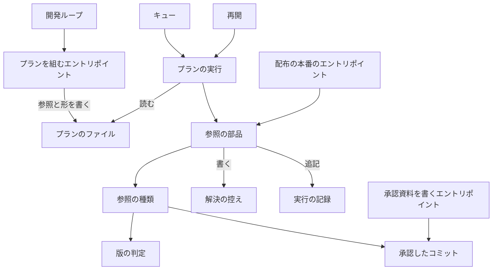
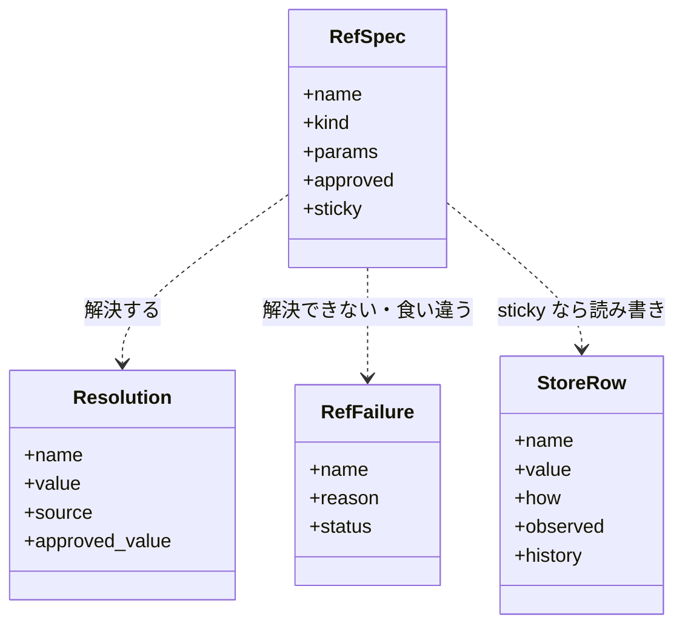
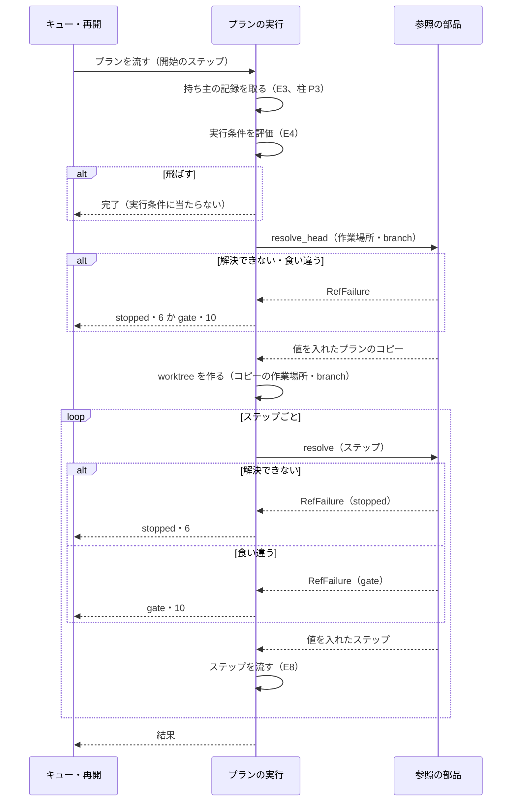
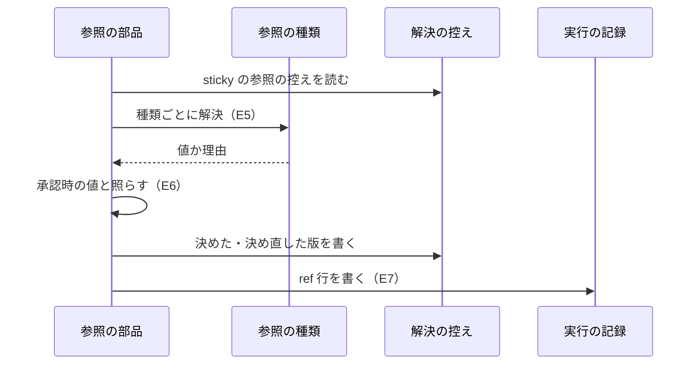
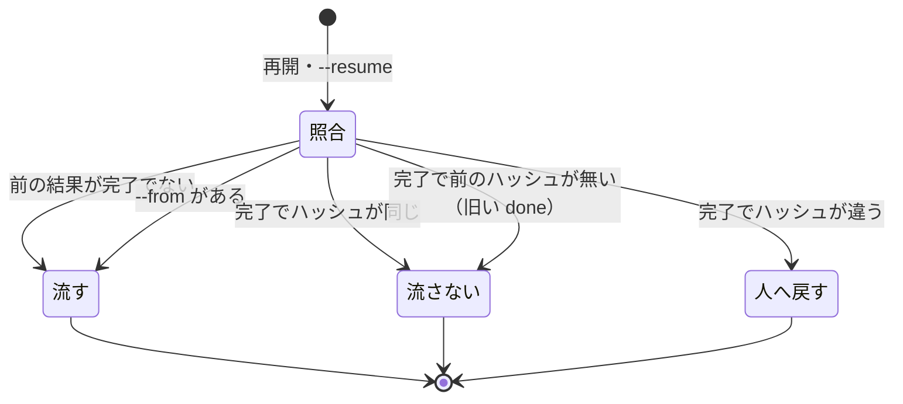

# プランの参照: プランを作り直さずに版・記録の PR を流す直前の値で使い、承認時の値と食い違えば止まる（#2344）

## 目的

- **今どうなっているか**: プランは版と記録の PR を、組んだ時点の値か差し込みで持つ。差し込みはキューが流す前に埋めるが、埋めた値でプランのファイルを上書きし、差し込みの種類ごとに別の関数が解決する。`--from` で始めると実行条件を見ずに流れ（#2349）、開発ループのスプリントは明示の版しか持てない（#2354）
- **誰に効くか**: NDF でスプリントを回す conductor と利用者。並行するスプリントの配布の後にプランを作り直す手当て（#2164 の再発 2 回）と、完了したプランの流し直し（#2349 の 24 分・$0.89）が無くなる
- **変えると何が成り立つか**: プランは値の取り先（参照）を持ち、参照の部品がステップの直前に 1 つの規則で解決・記録・照合する。解決できない・承認時の値と食い違うときは、推定の値で進まずに `stopped` か `gate` で返る

## 適用範囲

- **働く範囲**: NDF の配布物のうち次の 3 つ。配布先のリポジトリでも同じに働く。`factory/` のプランは含まない
  - プランを組むエントリポイント（`supervise.py new sprint` / `new close`、`sprint-state.py loop sprint`）
  - プランを流す処理（キュー・プランの実行・再開のエントリポイント）
  - 配布の本番のエントリポイント
- **プロジェクトごとに違うもの**: 参照の値は各リポジトリの origin の版とタグ・GitHub の Pull Request・プランの状態ディレクトリから読む。版の規則に要る値（プラグインの名前・チャネル）は参照の宣言の `params` が持ち、ai-plugins の値を部品に置かない
- **参照にしないもの**: `.ndf/` の設定から読んだ値と予算の秒は、今と同じく組んだ時点の値でプランに書く。組んだ時点の設定と流す時点の設定も照らさない（決定 4）
- **当たるモード**: `standard`。#2335 の柱 P5 で、柱 P6（#2339 データの契約）・P8（#2341 入力の契約）・P3（#2342 持ち主の記録）のマージの後に実装する

## あるべき姿の根拠

| 根拠 | 種類 | 何を示すか |
| --- | --- | --- |
| 利用者の指示（2026-11-01）「異常系処理とログ出力、異常時の回復処理が統一されていないから起こる不具合・課題が多い。1 件ずつ対処してもきりがない」「出力だけでなく入力もそろえるべき」 | 利用者の指示の原文 | 値の解決を種類ごとの手当てでなく 1 つの仕組みに寄せること |
| 差し込みを解決する関数が `supervise_lib/queue_fill.py` に 5 つ（`_fill_prs`・`_fill_states`・`_fill_work`・`_fill_record`・`fill_release_version`）と `supervise_lib/queue.py` に 1 つ（`fill_queue_prs`）ある。埋めた値は `fill_queue_pr`・`fill_queue_prs`・`_Fill.ensure_filled` の 3 か所でプランのファイルへ上書きされる（`write_text_atomic(Path(plan), …)` と `write_text_atomic(self.path, …)`） | 実測（2026-11-04 の develop のコード） | 解決の規則が 6 か所に分かれ、プランが変わったのが人の編集か解決かを区別できないこと |
| `supervise_lib/engine.py:219` の `if self.plan.get("実行の条件") and not start:` | 実測（同上） | 開始のステップを渡すと実行条件が評価されないこと（#2349 の 1 つ目の原因） |
| `lib/sprint_loop_cli.py:97` の `s.add_argument("--dev", required=True)` と `lib/sprint_loop.py:294` の `"--version", dev` | 実測（同上） | 開発ループが版を参照にできないこと（#2354 の原因） |

要求と受け入れ条件は #2344 の本文にある。コピーは [issue-2344-requirements.md](issue-2344-requirements.md) にある。
この文書は「どう作るか」だけを扱う。決定の記録は [issue-2344-design-decisions.md](issue-2344-design-decisions.md) にある。
上位の設計は [issue-2335-design.md](issue-2335-design.md) である。実行の核・参照の部品（`lib/refs.py`）・不変条件 I14・ドメインイベント E5 はそれに従う。

## ドメインモデル

### コンテキスト

| コンテキスト | 何の語が 1 つの意味に決まるか |
| --- | --- |
| NDF の開発ワークフロー（`ndf-workflow`） | プランの参照・解決の記録・解決の控え・承認時の値・プランのハッシュ・版の記録 |
| リリース（`ndf-release`） | 承認したコミット・承認資料（語の意味は変えない。承認資料に「承認した版」の行を足す） |

**リリースが供給者、開発ワークフローが顧客の関係（顧客 / 供給者）。** 参照の部品は承認資料の形（承認したコミットと承認した版の行）と
`lib/approved_commit.py` の比較を、リリースが決めたとおりに読む。参照の部品は承認資料を書かない。

### 集約

| 集約 | 持ち主（書き換えてよいもの） | 根 | エンティティ | 値オブジェクト |
| --- | --- | --- | --- | --- |
| プラン | プランを組むエントリポイントと人（実行の間は誰も書かない） | プランのファイル | ステップ | 参照の宣言・実行条件 |
| 解決の控え | 参照の部品（`lib/refs.py`） | プランの状態ディレクトリ | 控えの行（参照の名前ごと） | 解決した値・出所・決め直しの履歴 |
| 実行 | 実行の核（#2335） | 実行の識別子 | 実行の記録の行 | 解決の記録の行・プランのハッシュ |

**集約の間は識別子で参照する。** 解決の控えはプランを状態ディレクトリのパスで、実行の記録の `ref` 行は控えを参照の名前で指す。
1 回の解決が書き換える集約は「解決の控え」だけで、実行の記録へは追記だけを行う。プランは解決で書き換えない。

### 不変条件

| # | 集約 | 条件 | 破れたときの扱い |
| --- | --- | --- | --- |
| I1 | プラン | プランのファイルは参照の解決で書き換わらない。解決した値はメモリ上のステップにだけ入る | 書き込みの経路が無い（解決の部品はプランのパスを書き口として受け取らない） |
| I2 | 実行 | 参照からステップに入る値は、解決した参照・控えの値・明示の版・旧い形の差し込みのどれかの出所を持ち、1 値 1 行で解決の記録に残る。参照を通らない値（設定・予算・引数で明示した上限とブランチ）はプランの値そのもので、解決の記録に行を持たない | 記録へ書けなければ `stopped`（#2335 の I3） |
| I3 | 実行 | 参照の解決は、持ち主の記録を取った後・実行条件の評価の後に行う。プランの上位の欄（`作業場所`・`branch`）の参照は、worktree を作る前に 1 回だけ解決する。ステップの参照は、ステップを流す直前に解決する。開始のステップ（`--from`）によらず実行条件を先に評価する。版の決め直しの事前判定も実行条件の評価の後に行い、飛ばすプランでは版を照会しない | 順序はプランの実行の 1 つの関数が持つ（下の処理の流れ） |
| I4 | 実行 | 解決できない参照を使うステップは流れない。推定の値・空・`0`・`unknown` で埋めない | `stopped`・終了コード 6、`gaps` に `ref:<名前>` と理由 |
| I5 | 実行 | 承認時の値を持つ参照は、解決した値と承認時の値が食い違えば流れない。承認したコミットの後に許したもの（この版の配布の Pull Request）だけが入ったときは食い違いとみなさない | `gate`・終了コード 10（`EXIT_GATE`）、`items` に承認時の値と実行時の値 |
| I6 | 解決の控え | 版の参照は控えがあれば控えの版を使う。決め直すのは #2164 の規則に当たるときだけで、前の版と理由を控えの `history` と解決の記録に残す | 規則に当たらない決め直しの経路が無い（決め直しは `release_version` の判定だけが起こす） |
| I7 | 実行 | 完了したプランを `--from` なしに流し直さない。完了した実行の記録のプランのハッシュと今のハッシュが違えば流さない | `gate`・終了コード 10（`EXIT_GATE`）、`next` に `--from` で流し直すコマンド |

### ドメインイベント

要求の E1〜E9 を引き継ぐ。右端は #2335 の番号である。

| # | イベント | 発生元 | 受け手 | #2335 |
| --- | --- | --- | --- | --- |
| E1 | プランを参照つきで組んだ | プランを組むエントリポイント | プランのファイル | — |
| E2 | 承認時の値（承認したコミット・承認した版）を承認資料に記録した | 承認ゲート 1・2 の承認（`approved_commit.record_approval`） | 参照の部品（E6） | — |
| E3 | 持ち主の記録を取った | 実行の核（柱 P3） | プランの実行 | E4 |
| E4 | 実行条件を評価した | プランの実行 | プランの実行（飛ばすなら E5〜E8 を行わずに完了） | E5 |
| E5 | 参照を解決した | 参照の部品 | プランの実行・解決の控え | E5 |
| E6 | 解決した値を承認時の値と照らした | 参照の部品 | プランの実行（食い違えば `gate`） | E5 |
| E7 | 解決の記録を書いた | 参照の部品（`ctx.log("ref", …)`） | 実行の記録 | E5 |
| E8 | ステップを流した | プランの実行 | 実行の核 | E7 |
| E9 | 同じプランを流し直し・再開した | 再開のエントリポイント（柱 P3）・キュー | プランの実行（ハッシュの照合） | E13 |

### 用語

| 用語 | 意味 | 用語集への反映 |
| --- | --- | --- |
| プランの参照 | 要求の用語のとおり | 追加済み（要求） |
| 解決の記録 | 要求の用語のとおり。実行の記録の `ref` 行である | 追加済み（要求） |
| 承認時の値 | 要求の用語のとおり | 追加済み（要求） |
| 解決の控え | 流し直しでも同じ値を使う参照（版）の解決した値と決め直しの履歴を、プランの状態ディレクトリに残すファイル（`refs.json`） | 追加（`ndf-workflow`） |
| プランのハッシュ | プランの型で読んだ中身を、キーを並べ替えた JSON にして取った sha256。完了したプランが変わったかを測る | 追加（`ndf-workflow`） |
| 版の記録 | 解決の控えのうち、版の参照の行 | 意味の変更（`ndf-workflow`） |
| 版の差し込み | 前の版の NDF が組んだプランの `{release_version}`・`{release_base}`。移行関数が版の参照へ読み替える | 意味の変更（`ndf-workflow`） |

## 機能一覧

| # | 機能 | 誰が使うか |
| --- | --- | --- |
| F1 | プランを組むエントリポイントが、版・記録の PR・前のプランの結果を参照で書く | `new sprint` / `new close`・開発ループ |
| F2 | ステップの直前に参照を解決し、解決の記録を書いてメモリ上のステップへ値を入れる | プランの実行 |
| F3 | 版の参照の解決を控えに残し、流し直しで同じ版を使い、#2164 の規則のときだけ決め直す | 配布のプラン |
| F4 | 承認時の値と照らし、食い違えば `gate` で返す | 本番の配布（プランからも手動の起動からも） |
| F5 | 実行条件を開始のステップによらず先に評価する | プランの実行・再開 |
| F6 | 完了したプランの流し直しをプランのハッシュで判定する | 再開のエントリポイント・キュー |
| F7 | 旧い形のプラン（差し込み・値を書き込んだもの）を移行関数で読み、値をそのまま流す | 前の版の NDF が組んだプラン |

## 構成要素

| 要素 | 責務 | 新設 / 変更 |
| --- | --- | --- |
| 参照の部品（`lib/refs.py`） | 参照の宣言の型・種類の表・`resolve(ctx, plan, step)`。種類ごとの解決を遅れて読み、解決の記録と解決の控えを書く。外へ書くのは控えと記録だけ | 新設 |
| 参照の種類（`lib/ref_kinds/`） | 種類ごとに 1 モジュール（`version`・`record_pr`・`plan_result`・`tip`）。値か失敗の理由を返し、終了コードと出力を持たない | 新設（`queue_fill.py` の 5 つの関数と `queue.fill_queue_prs` を移す） |
| 版の判定（`lib/release_version.py`） | 次に空いている版・既出の判定・自分の配布のマージの有無（変えない） | 変えない |
| 承認したコミット（`lib/approved_commit.py`） | 「承認した版」の行の読み書きを足す。`release_lib/approval.py` の `check_approved`・`release_pr_allowed` を移し、`tip` の種類と配布の本番のエントリポイントが同じ関数を呼ぶ | 変更 |
| 承認資料を書くエントリポイント（`release-steps.py approval-facts`） | 承認資料に「承認した版」の行を書く | 変更 |
| プランの型（柱 P6 の `lib/model/` のプラン） | `refs`（参照の宣言）の欄を持つ。旧い差し込みを参照へ読み替える移行関数を持つ | 変更（柱 P6 の型に欄を足す） |
| 解決の控えの型（`lib/model/` の `refs-store`） | 控えの形と、`version.json` を控えへ読み替える移行関数 | 新設 |
| プランの実行（`supervise_lib/engine.py`） | ステップの直前に実行条件 → 参照の解決の順に呼ぶ。開始のステップで実行条件を飛ばさない | 変更 |
| キュー（`supervise_lib/queue.py`） | 差し込みを埋めない。done の項目にプランのハッシュを書き、参照で止まったプランに `unfilled: true` を付ける | 変更（`fill_stage` の埋める処理と `_release_skipped_by_condition`・`fill_queue_prs` を消す） |
| 差し込みの解決（`supervise_lib/queue_fill.py`） | — | 削除（`FINISHED`・`named`・`results_named` は `ref_kinds/plan_result.py` へ移す） |
| 再開（`supervise_lib/queue_resume.py`・柱 P3 の `supervise.py resume`） | 完了したプランをプランのハッシュで照らし、違えば `gate` で返す | 変更 |
| プランを組むエントリポイント（`supervise_lib/release_templates.py`・`delivery_templates.py`・`sprint_routes.py`・`sprint.py`・`sprint_waves.py`・`design_merge.py`、`lib/parallel_release.py`。差し込みを書く 7 ファイル） | 差し込みの代わりに参照を書く。明示した版は版の参照の `explicit` に書く。設定・予算・引数で明示した上限とブランチは今と同じく値で書く | 変更 |
| 開発ループ（`lib/sprint_loop_cli.py`・`lib/sprint_loop.py`） | `--dev` を任意にし、省いたら `new sprint` に `--version` を、`sprint-state.py init` に `--dev` / `--prod` を渡さない | 変更 |
| エントリポイントの契約（`plugins/ndf/contracts/entrypoints/`） | 配布の本番のエントリポイントの行に `refs`（`tip` の参照）を足す | 変更 |

### 要素の関係



図に描かない要素は次のとおりである。

| 要素 | 図に描かない理由 |
| --- | --- |
| プランの型と解決の控えの型 | 参照の部品とプランの実行が読み書きに使う |
| エントリポイントの契約 | 核が配布の本番のエントリポイントの `refs` を読む |
| 差し込みの解決 | 消す |

### 置き場所

```text
plugins/ndf/
├── contracts/
│   └── entrypoints/*.json          # 変更: 配布の本番のエントリポイントに refs
└── scripts/
    ├── lib/
    │   ├── refs.py                 # 新設
    │   ├── ref_kinds/              # 新設: version・record_pr・plan_result・tip
    │   ├── model/                  # 変更（柱 P6）: プランの refs、refs-store
    │   ├── approved_commit.py      # 変更
    │   ├── sprint_loop.py / sprint_loop_cli.py  # 変更
    │   ├── parallel_release.py     # 変更: 差し込みの代わりに参照
    │   └── release_version.py      # 変えない
    ├── release_lib/approval.py     # 変更: check_approved を approved_commit へ移す
    └── supervise_lib/
        ├── engine.py / queue.py / queue_resume.py  # 変更
        ├── queue_fill.py           # 削除
        └── release_templates.py など supervise_lib のプランを組む 6 ファイル  # 変更
```

## 構造



- **`resolve_head(ctx, plan) -> (plan, list[Resolution]) | RefFailure`**: プランの上位の欄（`作業場所`・`branch`）が使う参照を解決する。値を入れたプランのコピーをメモリ上で返す。実行条件の評価の後、worktree を作る前（`ensure_worktree` の前）に 1 回だけ呼ぶ。worktree の準備とその後のステップは、このコピーを使う。控えの無い版の最初の決定はこの解決で行い、決め直しはこの解決では起こさない（決め直しは耐久ワークフローを始める前に判定する。下の「耐久ワークフローの世代」）
- **`resolve(ctx, plan, step) -> (step, list[Resolution]) | RefFailure`**: ステップが使う参照だけを解決する。値を入れたステップのコピーを返す。`plan` は `resolve_head` が返したコピーである。`RefFailure.status` は `stopped` か `gate`
- **`plan_digest(plan) -> str`**: プランのハッシュ。プランの型で読んだ値を `json.dumps(sort_keys=True, ensure_ascii=False, separators=(",", ":"))` にして sha256 を取る
- **種類のモジュールの形**: `resolve(ctx, spec, plan) -> Resolution | RefFailure`。GitHub と origin を読む種類は、その種類を使うステップでだけ読み込まれる

## データ構造

### 参照の宣言（プランの `refs`）

プランの型の欄 `refs` は、参照の名前 → 宣言の対応である。ステップからは次の形で指す。

| 指す場所 | 書き方 |
| --- | --- |
| ステップの文字列の中 | `{ref:<名前>}`（版の起点は `{ref:<名前>.base}`） |
| プランの上位の欄（`作業場所`・`branch`） | `{ref:<名前>}`。版を省いた配布のプランは `branch` に `release/v{ref:version}` を、`作業場所` に版を含むパスを持つ |

| 種類 | `params` | 解決した値 | `sticky` | 解決できないとき |
| --- | --- | --- | --- | --- |
| `version` | `plugin`・`channel`（`dev` / `prod`）・`level`・`series`（本番が版を読む開発版のプランの名前）・`explicit`（明示の版。任意） | `{version, base}` | 真 | origin の版かタグを読めない・明示の版が既出・系列の版の記録が無い（#2164 の `unreadable` / `taken` / `no_series`） |
| `record_pr` | `issues`（課題の番号の並び） | リリース記録を置いた PR の番号 | 偽 | 記録の PR が見つからない（`record_find` の理由） |
| `plan_result` | `plan`（名前）か `plans: "earlier"`（キューの前のステージ）・`field`（`pr` / `state` / `prs` / `approved`）・`optional` | PR の番号・状態ディレクトリのパス・PR の並び・承認したコミット | 偽 | 名前の一致するプランの完了した結果が無い（`optional` の `state` だけ空を返す） |
| `tip` | `branch`・`approved_from`（承認したコミットを返す参照の名前）・`allowed_pr`（許すものの参照の名前） | ブランチの先端の SHA | 偽 | 先端を読めない |

`approved`（任意）は承認時の値を持つ参照に付け、`gate-2` を書く。`version` では承認資料の「承認した版」と、`tip` では承認したコミットと
`compare_approved` で照らす。承認資料に「承認した版」の行が無い旧い資料では、#2164 の `series_changed`（承認ゲート 2 の通過の後に系列の版の記録が変わった）で照らす。

**設定の値・予算の秒・引数で明示した上限とブランチは参照にしない。** プランを組むエントリポイントが今と同じく値で書く（決定 4）。

**`--version` で明示した版は、版の参照の `params.explicit` に値のまま入れる。** 参照の部品は明示の版を置き換えず、版の参照の解決で既出の判定（#2164 の `taken`。既出なら `stopped`・終了コード 6）と、`approved` を付けた参照では承認した版との照合を必ず通す。解決の記録の出所は `plan:explicit`、控えの `how` は `explicit` になる（決定 5）。

### 解決の控え（`<状態ディレクトリ>/refs.json`）

| キー | 型 | 空を許すか | 意味 |
| --- | --- | --- | --- |
| `kind` / `version` | str / int | 許さない | `refs-store` / 1（柱 P6 の型の版） |
| `rows.<名前>.value` | object | 許さない | 解決した値（版なら `{version, base}`） |
| `rows.<名前>.how` | str | 許さない | `decided`（次に空いている版）/ `explicit` / `series` |
| `rows.<名前>.observed` | object | 許さない | 決めたときに読んだ origin の版とタグ（`Observed.as_dict()`） |
| `rows.<名前>.at` | str | 許さない | 決めた時刻（UTC の ISO 8601） |
| `rows.<名前>.history` | list | 空のリストを許す | 決め直しごとに `{from, to, reason, existing, observed, left, at}` を追記する。消さない |

**時系列は追記で持つ。** 決め直しは `value` を上書きするが、前の値は `history` に残る。`version.json` は移行関数で `rows.version` へ読み替え、
書くのは `refs.json` だけにする。`version-plan.json`（差し込み前のプランのコピー）は、プランを書き換えないため作らない。

### 実行の記録の `ref` 行

#2335 の実行の記録の行（`event: "ref"`）の `fields` は次の形である。1 つの参照の解決ごとに 1 行。

| キー | 型 | 空を許すか | 意味 |
| --- | --- | --- | --- |
| `step` | str | 許さない | ステップの id。上位の欄の解決は `head` |
| `name` / `kind` | str | 許さない | 参照の名前と種類。プランの値は `kind: "literal"` |
| `source` | str | 許さない | `ref`（解決した）/ `store`（控えの値）/ `plan:explicit` / `plan:legacy` |
| `value` | any | 許す | 解決した値 |
| `outcome` | str | 許さない | `resolved` / `redecided` / `unresolved` / `mismatch` / `match` |
| `approved` | object | 許す | 承認時の値（照らしたときだけ） |
| `reason` | str | 許す | 解決できない・食い違う・決め直した理由 |

実行の記録の `start` 行の `fields` に `plan` と `plan_digest` を足す。キューの done の項目にも `plan_digest` を足す（キーは足すだけ）。

### CRUD

| 機能 | プランのファイル | 解決の控え | 実行の記録 | 承認資料 | done |
| --- | --- | --- | --- | --- | --- |
| F1 組む | C | — | — | — | — |
| F2 解決 | R | R | C（`ref`） | — | — |
| F3 版 | R | C・U | C | — | — |
| F4 承認時の値 | R | R | C | R | — |
| F5 実行条件 | R | — | C | — | — |
| F6 流し直し | R | — | R（`start`） | — | R・C |
| F7 旧い形 | R | R（`version.json`） | C | — | — |

書く相手が 2 つ以上ある機能は F3（控えと記録）である。記録は追記だけのため、控えを書いてから記録を書く順にする。
落ちたら次の解決が控えを読み、同じ版の `ref` 行を書き直す。

## 入出力の契約

| 項目 | 約束 |
| --- | --- |
| `sprint-state.py loop sprint` | `--dev` を任意にする。渡せば今と同じく `new sprint --version <開発版>` を組む。省けば `--version` を渡さず、周回の `versions` は配布の答え（`settle_release`）で埋まる |
| 解決できないときの結果 | ステップを流さず、プランの結果は「止まった」、結果 JSON は `status: "stopped"`・終了コード 6、`gaps` に `ref:<名前>`、`summary` に参照の名前と理由 |
| 承認時の値と食い違うときの結果 | `status: "gate"`・終了コード 10（`EXIT_GATE`）、`items` に `{kind: "ref-mismatch", name, approved, actual, reason}` |
| 完了したプランが変わったときの結果 | 再開とキューの `--resume` は `status: "gate"`・終了コード 10（`EXIT_GATE`）、`items` に `{kind: "plan-changed", plan, digest_done, digest_now}`、`next` に `supervise.py resume <実行の識別子> --from <プラン>=<ステップ>` |
| キューの done | 参照で止まったプランの項目は `result: "止まった"`・`unfilled: true`・`reason`。旧い版の `result: "流さなかった"`・`unfilled: true` の項目も読む |
| 承認資料 | 「2. 承認の判断に使うもの」の表に `| 承認した版 | <版> |` の行を足す。承認の記録（`record_approval`）は今と同じ |
| 旧い形のプラン | `{release_version}`・`{release_base}`・`{queue_record}`・`{queue_pr:<名>}`・`{queue_state(?):<名>}`・`{queue_prs:<名>}`・`{queue_approved:<名>}`・`QUEUE_PRS` は、プランの型の移行関数が参照へ読み替える。受けるのは次の正式版まで |

## 処理の流れ

### プランを流す順



### 参照を解決する中身

`resolve` の中（E5〜E7）は次のとおりである。



図に描かない要素は次のとおりである。

| 要素 | 図に描かない理由 |
| --- | --- |
| 版の判定と承認したコミット | 参照の種類の中で呼ぶ |
| プランの型と解決の控えの型 | 読み書きの型 |
| プランを組むエントリポイント・開発ループ | 流す前の E1 で働く |
| 承認資料を書くエントリポイント | E2 で働く |
| エントリポイントの契約と配布の本番のエントリポイント | 下の「流れの決まり」の 2 つ目の項目 |
| 差し込みの解決 | 消す |

### 流れの決まり

- **実行条件を評価する関数は 1 つにする。** 呼ぶのは E4 と、版の決め直しの事前判定（下の「耐久ワークフローの世代」の 2）だけである。今の `engine.py` の `and not start` を外す。`queue._release_skipped_by_condition`（版を照会する前に条件を打つ手当て）を消す。実行条件が版の参照より先に評価されるため、配布不要のプランは版を照会しない
- **配布の本番のエントリポイントは、エントリポイントの契約の `refs` で同じ参照の部品を通る。** プランから呼ばれても手動で呼ばれても、核の E5 で `tip` の参照を解決して承認したコミットと照らす。`check_approved` を呼ぶ箇所はこの 1 つになる。関数は `release_lib/approval.py` から `lib/approved_commit.py` へ移す
- **前のプランの結果は、キューが渡す結果でなく状態ディレクトリから読む。** 今の `results_named` が承認ゲートの後に単独で流すときに使う経路を、唯一の経路にする。その経路は、同じディレクトリのプランの `report.md` と `work/` を読む。`plans: "earlier"` はキューが done の隣に書く一覧（`<done>.plans.json` の `stages`）から前のステージのプランを引く
- **版の参照の解決は #2164 の判定を順に呼ぶ。** 控えが無ければ `release_version.observe` → `decide_dev` か `taken` で決めて控えを書く。控えがあれば `taken` → `own_released` で確かめ、当たれば `decide_dev` で決め直す（明示の版は止める）。本番は明示の版か系列の開発版の控えの `base` を使う
- **版の決め直しを確かめるのは、1 回の起動で耐久ワークフローの接頭辞を決める前の判定だけである。** 判定の中身は下の「耐久ワークフローの世代」の 2 にある。その後の解決とステップは、その起動で決めた版をそのまま使う。1 回の起動の中で旧版と新版が混ざらない

### 版を決め直したときの退避

**決め直したら、旧版の成果物を退避して新版の先頭から流す。** 次の順で行い、プランのファイルは書き換えない。

1. 状態ディレクトリのファイルのうち、ステップの記録・結果・`work/` を `superseded/v<旧版>/` へ移す。移さないのは、解決の控え（`refs.json`）・退避先（`superseded/`）・状態の実体のコピー（`plan.json`）である
2. 解決の控えの `rows.version` を新版で上書きする。`history` には `{from, to, reason, existing, observed, left, at}` を追記する。`left` は旧版の `作業場所`・`branch`・退避先である。旧版の worktree とブランチは消さずに残す（消すのは戻せない操作のため）
3. `ref` 行を `outcome: "redecided"` で書く
4. 上位の欄を新版で解決し直し、新しい作業場所と `branch` で worktree を作り、最初のステップから流す。旧版の済んだステップの記録は 1 で退避したため、再利用されない

1 の後で落ちても、済んだステップの記録が無いため、次の起動は最初のステップから流れる。控えを書く前に落ちれば控えの判定で同じ決め直しへ戻り、書いた後に落ちれば新版で流れる。

### 耐久ワークフローの世代

**決め直しは、耐久ワークフローの回復より先に判定し、決め直した世代は新しい耐久ワークフローとして先頭から始める。** 耐久ステップの記録（`prepare`・`run_step` の出力）は状態ディレクトリの外の耐久の記録にあり、上の「版を決め直したときの退避」の 1 では消えない。プランのファイルを書き換えないため、プランの中身から作る耐久ワークフローの接頭辞（`flow.prefix_of`）も変わらない。そのため次のとおり決める。

1. 世代は、解決の控えの `rows.version.history` の件数である（控えが無ければ 0）。`flow.prefix_of` は、プランの鍵・中身の鍵・開始のステップに世代を加えた `plan-<パス鍵>-<中身鍵>-<世代>-<開始>` を返す。`run` の `flow.plan_prefix` とキューの `admit_step` は、どちらも状態ディレクトリの控えから世代を読む。読んだ世代は `prefix_of` へ渡す。決め直すと世代が 1 つ増え、接頭辞が変わるため、旧版の耐久ステップの記録は引かれない
2. 控えに版の行があるプランは、接頭辞を決める前に、決め直しの事前判定を次の順で行う。`run` は耐久の記録を開く（`durable.launch`）前、キューは耐久の記録を開く（`launch_queue`）前に、キューのすべてのプランへ行う。前の起動の判定は根拠にせず、その起動の実行条件で確かめる
   1. 実行条件を評価する（E4 と同じ関数）。飛ばすなら、版を照会せず、判定も退避もしない
   2. 「流れの決まり」の版の参照の判定（`taken` → `own_released`）を流す。当たれば「版を決め直したときの退避」の 1〜3 を行ってから接頭辞を決める

   飛ばすプランは、控えの版のまま耐久ワークフローへ渡し、耐久ワークフローの中の E4 が同じ結果（完了）を返す。控えが無いプランの最初の版は、これまでどおり `resolve_head` の中で決め、世代は 0 のままである
3. 世代が変わったら、前の世代の接頭辞の途中の耐久ワークフローを、新しい世代を始める前に止める。`run` は `durable.launch` の `keep` へ新しい接頭辞を渡し、回復の前に止める。キューは接頭辞を耐久ステップ `admit_step` の中で決める。キューの再開（`launch_queue` の `keep=None`）では、その出力が再生されて旧世代の接頭辞が使われる。そのため、2 の事前判定で 1 つでも決め直したプランがあれば、`launch_queue` を `fresh` で開く。途中の耐久ワークフローは子ごと止まり、`admit_step` が世代の増えた接頭辞を計算し直す。完了したプランは、完了の記録が接頭辞で引けるため流し直されない。決め直しが無ければ、これまでどおり続きから再開する
4. 耐久ワークフローの中の `resolve_head` は、決め直しを起こさない。控えの版をそのまま使う（控えが無いときの最初の決定を除く）。決め直しの経路は 2 の判定の 1 つだけになる

2 の判定の後・退避の 1〜3 の途中で落ちたときの次の起動は 2 通りになる。控えを書く前なら、2 の判定が同じ結果を返す。控えを書いた後なら、世代の増えた控えから新しい接頭辞で始まる。どちらでも旧版の耐久ステップの記録は再利用されない。

開始のステップ（`--from`）を渡した起動で決め直しが要るときは流さない。旧版の済んだステップを前提にできないためである。結果は `stopped`・終了コード 6 で、`gaps` に `ref:version`、`next` に `--from` を外したコマンドを出す。

### 流し直しの判定（E9）



`--from` は柱 P3 の決まりどおり常に勝つ（#2342 の I9）。流し直す手段は `--from` の 1 つで、「人へ戻す」の結果はそのコマンドを `next` に出す。

## 非機能の実現方式

| 大項目 | 要求の条件 | 実現方式 | 確かめ方 |
| --- | --- | --- | --- |
| 性能・拡張性 | 参照を持たないエントリポイントの起動に足す時間は #2335 の上限 150 ms の内側。GitHub と origin はその参照を持つステップだけが読む | 核はエントリポイントの契約に `refs` が無ければ参照の部品を読み込まない。種類のモジュールは使う種類だけを読み込む | 参照を持たないエントリポイントの `--help` を前後で 10 回ずつ測り、差の中央値を実装の Pull Request に書く。GitHub を呼ぶ関数を差し替え、参照を持たないプランで呼ばれないことをテストで見る |
| 可用性 | 解決できない・食い違うときは待ち続けずに返る | 種類のモジュールは待ちを持たず、外部の呼び出しは上限の部品（柱 P4）の 1 回の上限で打ち切る | 解決できない・食い違うテストが `stopped` / `gate` で返る |
| 運用・保守性 | 解決した・解決できなかった・照合した・食い違ったを実行の識別子つきで書く | `ref` 行の `outcome` に 5 つの値 | 種類ごとのテストで `ref` 行の `outcome` を見る |
| 移行性 | 旧い形のプランは値のまま流す。`version.json` は解決の記録として読む。2 つの Pull Request をそれぞれ revert すれば戻る | 移行関数（プランと控え）。Pull Request は、参照の仕組み（参照の部品・種類・プランの実行・キュー）と、エントリポイントの移し（プランを組むエントリポイント・開発ループ）の 2 つに分ける | 前の版が組んだプランと `version.json` の実物で流すテスト |
| セキュリティ | 参照が解決する値は秘密を含まない。C1・C2 を変えない | 種類は `version`・`record_pr`・`plan_result`・`tip` の 4 つで、版・PR の番号・状態ディレクトリのパス・コミットの SHA だけを返す。設定と秘密を読む種類を持たない | 種類の表（データ構造の節）を設計レビューで見る |
| システム環境 | 版の比較は `versions`（extras）。無い環境では `stopped`・69 | `version` の種類だけが `versions` を読み込み、読めなければ `deps` の判定で返す | extras を外した環境で版の参照を持つプランを流すテスト |

## 決定の記録

決定の記録は [issue-2344-design-decisions.md](issue-2344-design-decisions.md) にある。

## テスト設計

| 受け入れ条件・不変条件 | どの振る舞いで縛るか | どう壊したら落ちるべきか |
| --- | --- | --- |
| 1 | 版を明示しない `new sprint`・`new close`・`loop sprint` が組むプランのファイルに、版数と記録の PR の番号が無く `refs` がある。設定の値と予算の秒は今と同じ値で入る | 組む時点に版を書く／記録の PR の番号を書く／旧い差し込み（`{release_version}`・`{queue_record}`）を書く |
| 2・I1・I2 | 流す前と後でプランのファイルの sha256 が同じ。ステップに入った値ごとに `ref` 行がある | 解決した値をプランへ書き戻す／`ref` 行を書かずに流す |
| 3・I4 | 記録の PR が無い・origin を読めない・前のプランの完了した結果が無い、のそれぞれでステップが流れず、`stopped` と `gaps` の `ref:<名前>` と理由が出る | 見つからない PR を `0` で埋める／読めない版を前の版で埋める |
| 4・I5 | 承認したコミットの後に許していないコミットがある・承認した版と解決した版が違う、で本番のステップが流れず `gate` と両方の値。許した配布の PR だけのときは流れる | 照合を飛ばして流す／許した PR まで食い違いとする |
| 5・I6 | 同じプランを流し直すと控えの版を使う。#2164 の決め直しに当たるときだけ版が変わり、`history` と `ref` 行に前の版と理由が残る。決め直すと旧版のステップの記録が `superseded/v<旧版>/` へ移り、新版の作業場所で、世代の増えた新しい耐久ワークフローとして最初のステップから流れる。決め直した後に落ちて打ち直しても、旧版の耐久ステップの記録を引かない。キューを `--resume` で再開して決め直しが起きても、`admit_step` が世代の増えた接頭辞で流す | 流し直しのたびに次に空いている版を決める／決め直しで `history` を上書きする／旧版の済んだステップの記録を新版で再利用する／耐久ワークフローの接頭辞に世代を入れない／キューの再開で `admit_step` の旧い出力を再生する |
| 6・I3 | #2349 の再現の手順: 実行条件で飛ぶプランを `--from <プラン>=<ステップ>` で始めても飛ばされ、結果に飛ばした旨。実行条件は参照より先に評価され、飛ぶプランは版を照会しない。控えに版の行があるプランも、実行条件で飛ぶ起動では、決め直しの事前判定で版を照会せず、状態ディレクトリを退避しない。版を省いた配布のプランは、worktree を版の入った `branch` と作業場所で作る | `and not start` を戻す／参照を実行条件より先に解決する／事前判定を実行条件より先に流す／上位の欄を解決せずに worktree を作る |
| 7・I7 | #2349 の再現の手順: 完了したプランを含む done を `--resume` しても流れない。完了の後にプランを書き足すと `gate` と `--from` のコマンド。キーの並びだけを変えたプランは同じハッシュ | ハッシュを見ずに流し直す／ファイルのバイト列でハッシュを取る |
| 8 | #2354 の再現の手順: `loop sprint` を `--dev` なしで起動でき、組んだスプリントのプランが版の参照を持つ。`--dev` を渡せば版の参照の `explicit` に入り、既出の版なら `stopped`・6 | `--dev` を省いたときに既定の版を入れる／明示の版をリテラルで書いて既出の判定を飛ばす |
| 9 | #2164 の受け入れ条件 1〜10 と #2230 の受け入れ条件の既存のテストが通る。`supervise_lib/queue_fill.py` が無く、`queue.py` に `fill_` で始まる関数が無い | 差し込みの関数をキューに残して二重に解決する |
| 10・F7 | 前の版が組んだプラン（差し込みのもの・値を書き込んだもの）と `version.json` を持つ状態ディレクトリで流れ、`ref` 行の `source` が `plan:legacy` / `store` | 移行関数を外す／旧い差し込みを文字のまま流す |
| 11 | （手動）子の課題 4 件の再現の手順を本番へ出した版で通し、課題の本文の表に結果を書く | — |
| 12 | 参照を持たないエントリポイントとプランの振る舞いと結果が前と同じ。全体テスト `uv run --frozen --project . --all-extras pytest . -q -n 4` が前後で通る | 参照を持たないプランでも参照の部品が GitHub を読む |

## 設計の結果

| 課題 | 扱い | 取り込み先 | 触るファイル |
| --- | --- | --- | --- |
| #2344 | 実装する | — | `plugins/ndf/scripts/lib/refs.py`、`plugins/ndf/scripts/lib/ref_kinds/`、`plugins/ndf/scripts/lib/model/`、`plugins/ndf/scripts/lib/approved_commit.py`、`plugins/ndf/scripts/lib/sprint_loop.py`、`plugins/ndf/scripts/lib/sprint_loop_cli.py`、`plugins/ndf/scripts/release_lib/approval.py`、`plugins/ndf/scripts/release-steps.py`、`plugins/ndf/scripts/supervise_lib/`、`plugins/ndf/scripts/tests/`、`plugins/ndf/scripts/lib/parallel_release.py`、`plugins/ndf/contracts/entrypoints/`、`docs/glossary/glossary.json`、`docs/glossary.md` |

子の課題 4 件（#2230・#2164・#2349・#2354）は表に載せない。表の行はスプリントの Pull Request で閉じる。
子の課題は、本番へ出した版で再現の手順を通してから、閉じるか残すかを決める（受け入れ条件 11）。
#2349 の 3 つ目の事象は、差分の無い実装のプランで `pr` が終了コード 1 になることである。
これは柱 P1（#2337）の結果の契約の問題で、この柱では直さない（要求の「含まない」）。

## 未確認のまま残ること

| 項目 | 内容 |
| --- | --- |
| 柱 P3・P6・P8 の設計 | 2026-11-04 の時点で P6（#2339）と P8（#2341）の設計文書は無く、P3（#2342）は設計 Pull Request 2480 が開いた状態である。この設計はそれらの語（`ctx.resolve`・`ctx.log`・プランの型・入力の宣言・`supervise.py resume`）にだけ依る。形が変わったら実装の開始時に読み直す（要求の未決 5） |
| プランのキーの名前 | #2335 の決定 4 でプランの日本語のキーは英語へそろう。この文書の `実行の条件`・`版` などは今の名前で書いた。英語の名前は柱 P6 が決める |
| 承認した版の行の書き手 | 承認資料を書く `approval-facts` が、配布の本番のプランの版の参照をどの時点で読むか（承認ゲート 2 の提示の前に版が決まっていること）は、提示のプランの流れで確かめる |
| 差し込みを書くエントリポイントの網羅 | 構成要素の 7 ファイルは、`plugins/ndf/scripts/supervise_lib/` と `lib/` を差し込みの書き方（`{release_version}`・`{release_base}`・`{queue_record}`・`{queue_pr`・`{queue_state`・`{queue_approved`・`QUEUE_PRS`）で検索して当たったもののうち、プランを組むものである（2026-11-05 の develop）。`plugins/ndf/scripts/` 直下のエントリポイントがプランを組んで差し込みを書いていないかは、実装の開始時に同じ検索で確かめる |
| 並行するスプリントの版の取り合い | 2 つのスプリントが同時に次に空いている版を決めたときは、#2164 の `own_released` の確かめで後から決め直す。版の参照を持ち主の記録で排他にするかは測っていない（#2354 の起票者の推定 2 点目） |
