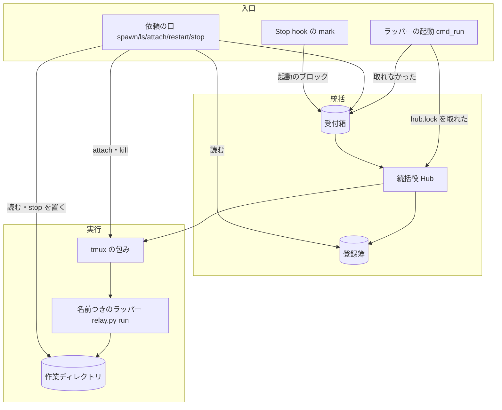
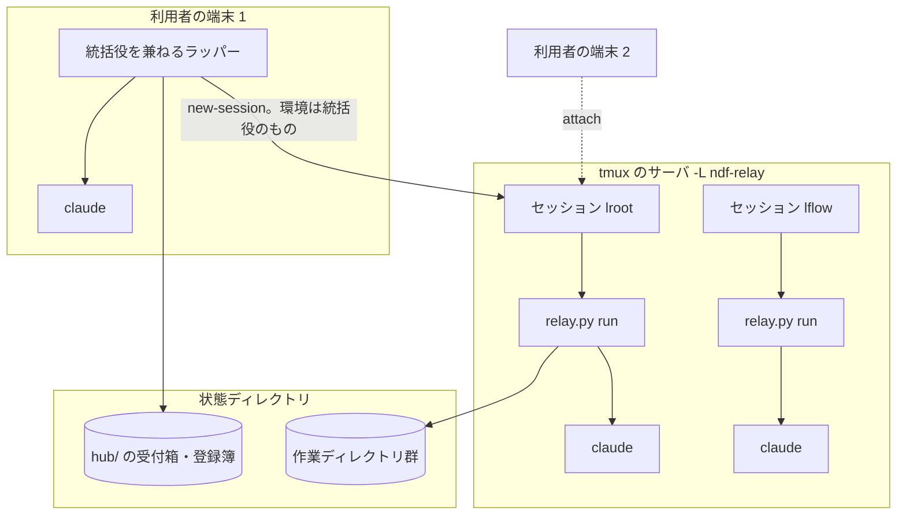
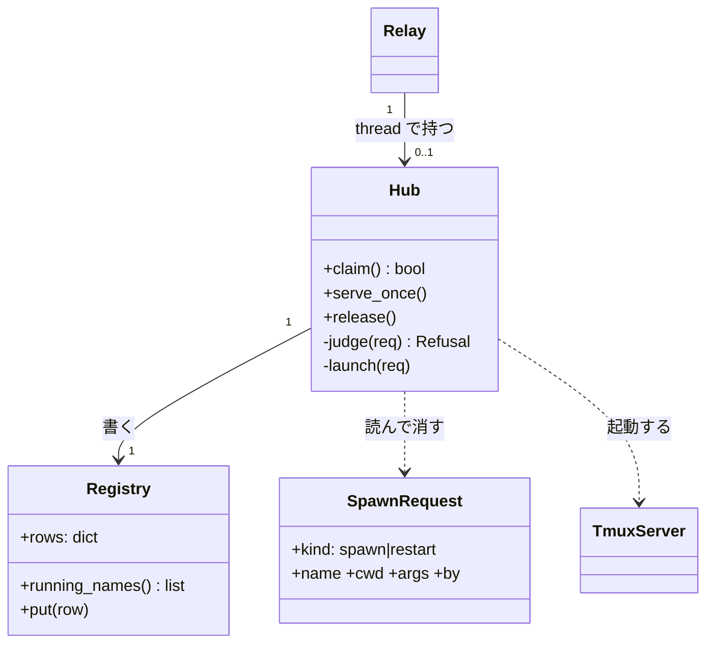
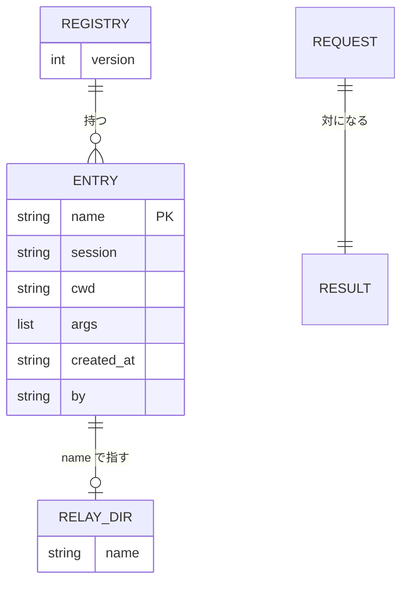
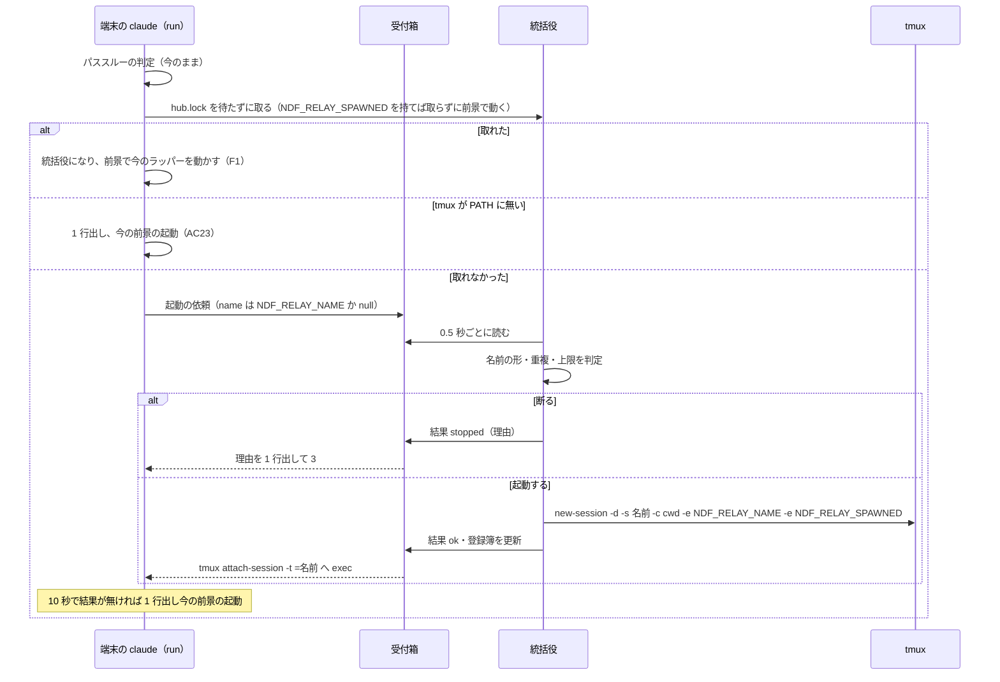
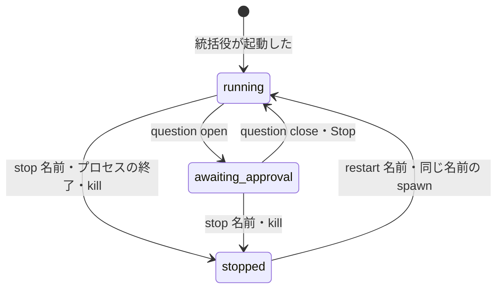

# relay.py: 同じコンテナの複数のラッパーを 1 つの統括役から起動し、1 つの表で見て 1 本ずつ止める（#2346）

## 目的

- **何が壊れているか**: 開発ループを並列に回すたびに、利用者が端末を開いて `claude` を打ち、`ndf-next` のコマンドを貼る。どれが動き・止まり・承認待ちかを見る手段が無く、`relay.py stop` は全部を止める。端末を閉じるとそのラッパーが終わる
- **誰が困るか**: 同じコンテナで 2 本以上のループを回す利用者と、別のループを始めると決めても自分では起動できない conductor
- **直すと何が成り立つか**: 2 本目の `claude` が tmux の中の名前つきのラッパーへ結び付き、`relay.py ls` が全ラッパーの状態と承認待ちを 1 つの表で出し、`relay.py stop <名前>` が 1 本だけを止める。conductor は応答の `ndf-spawn` のブロックで別のループを起動できる

## 適用範囲

- **働く範囲**: 配布先のどのリポジトリでも働く（ラッパーはリポジトリに依らず、コンテナの利用者ごとに動く）。Claude Code だけ
- **プロジェクトごとに違うもの**: 無し。同時に動かす数の上限はコンテナごとの値で、環境変数 `NDF_RELAY_MAX_NAMED` で受ける（決定 5）
- **当たるモード**: `standard`

## あるべき姿の根拠

| 根拠 | 種類 | 何を示すか |
| --- | --- | --- |
| 「1本目のrelay.pyが2本目のclaudeを立ち上げ、screen(tmux)には2本目のclaudeに結び付ける」（#2346 の依頼の原文、2026-11-01） | 利用者の指示の原文 | 2 本目の起動を 1 本目が担い、端末の切り替えを tmux に任せる形 |
| 案 B を採る決定（#2346 の本文、2026-11-01。起票者の記録） | 利用者の指示 | tmux を親にし、各 window で今の `relay.py run` を動かす |
| tmux 3.6 で `new-session -d -s <名前>` の重複が終了コード 1 と `duplicate session`、`-s a.b` が `a_b` へ置き換わる、`-e NAME=値` が window の中へ届く、端末でない標準入力の `attach` が `open terminal failed: not a terminal` で 1（2026-11-02 に使い捨てのソケットで実行） | 実測 | 名前の規則（決定 13）と、環境の渡し方（決定 2）の前提 |
| Factory の実行ジョブの状態 `running` / `gate` / `stopped` とスプリントの実行の状態 `awaiting_approval`（`docs/specifications/ndf-factory-runs-state-and-data.md`） | 一次情報（確定仕様） | 一覧の状態の語を揃える先（決定 8） |

要求と受け入れ条件は #2346 の本文にある（コピーは `issues/issue-2346-requirements.md`）。この文書は「どう作るか」だけを扱う。
決定の記録は `issues/issue-2346-design-decisions.md` に分けた。

## ドメインモデル

### コンテキスト

| コンテキスト | 何の語が 1 つの意味に決まるか |
| --- | --- |
| NDF の工程（`ndf-workflow`） | 統括役・名前つきのラッパー・端末の結び付け・登録簿・起動の依頼・起動のブロック |
| NDF のラッパー（`ndf-relay`） | 作業ディレクトリ・シグナルファイル・区間・質問シグナルファイル（今の語のまま） |
| Factory（`ndf-factory`） | 実行ジョブ・進捗の事象（参照するだけ。変えない） |

統括役はラッパーの作業ディレクトリに対して**顧客 / 供給者**の関係に立つ。統括役は作業ディレクトリのファイル（`relay.lock`・`question`・`log.jsonl`）を読むだけで、書くのはシグナルファイル（`stop`）だけである。Factory とは**公開された言語**の関係で、`factory/contracts/schemas/` の語と形を写して使い、コードは参照しない（AC27）。

### 集約

| 集約 | 持ち主（書き換えてよいもの） | 根 | エンティティ | 値オブジェクト |
| --- | --- | --- | --- | --- |
| 統括役の役目 | 統括役（`hub.lock` を持つ前景のラッパー） | 統括役の記録（`hub.json`） | — | pid・作業ディレクトリ・取った時刻 |
| 登録簿 | 統括役 | 登録簿（`registry.json`） | 登録（名前ごと） | 名前・cwd（起動したリポジトリ。作業ディレクトリとは別）・最初の引数・tmux のセッション名 |
| 起動の依頼 | 書くのは頼む側、消すのは統括役 | 依頼（`requests/<id>.json`） | — | 種類・名前・作業ディレクトリ・引数・頼んだ側 |
| 作業ディレクトリ（今のまま） | そのラッパー | 作業ディレクトリ | 区間 | 名前（`name`。新しく足す） |

登録簿は作業ディレクトリのパスを持たず、名前（作業ディレクトリの `name`）で参照する（集約は ID で参照する。ID は名前）。作業ディレクトリはラッパーが起動してから作るため、統括役は起動の時点でパスを知らず、ラッパーが登録簿へ書き戻すと I4 が破れるためである。登録簿の行と作業ディレクトリの `name` は、統括役の起動の後でラッパーが自分の `name` を書くことで結果整合で揃う。同じ名前の作業ディレクトリが複数ある（restart の後に新旧が残る）ときは、一覧・停止・再起動のどれも同じ規則で 1 つに決める: `relay.lock` が取られている（動いている）ものを採り、動いているものが無ければ `log.jsonl` の最後の start の行が最も新しいものを採る（I2 により動いているものは高々 1 つ）。

### 不変条件

| # | 集約 | 条件 | 破れたときの扱い |
| --- | --- | --- | --- |
| I1 | 統括役の役目 | 同じコンテナで統括役は高々 1 つ（`hub.lock` の排他を持つプロセスだけ） | 取れなかった側は依頼する側になる（AC22） |
| I2 | 登録簿 | 動いている名前つきのラッパーの名前は重ならない | 起動せず `name-taken` で断る（AC6） |
| I3 | 登録簿 | 動いているラッパーの数（名前つき・統括役のラッパー・名前の無い今のラッパーのすべて）は上限以下。数えるのは「`relay.lock` が取られている作業ディレクトリ」と「登録簿の行のうち tmux のセッションが在るのに、同じ名前の作業ディレクトリがまだ `relay.lock` を取っていないもの（起動した直後でロックの前）」の和で、重複は名前で除く | 起動せず `limit` で断り、上限と動いている名前を返す（AC16） |
| I4 | 登録簿 | 登録簿を書くのは統括役だけである | 頼む側は受付箱へ依頼を置くだけにする（コードの構造で守る） |
| I5 | 作業ディレクトリ | 統括役は名前つきのラッパーの区間の切り替え・`ndf-next`・アカウントの選び方に触れない | 今の `Relay` の状態機械を変えない（AC3・AC8） |
| I6 | 統括役の役目 | 統括役が終わっても、名前つきのラッパーは止まらない | tmux のサーバが window の親なので、統括役の終了が届かない（AC21） |
| I7 | 登録簿 | 名前は `^[a-z0-9][a-z0-9_-]{0,31}$` に合う | 起動せず `bad-name` で断る（tmux が `.` を `_` へ置き換え、`:` を区切りに使うため） |
| I8 | 起動の依頼 | 依頼と結果のファイルは所有者だけが読み書きできる（ディレクトリ 0700・ファイル 0600） | 権限の違う受付箱を統括役は読まずに記録へ 1 行残す |
| I9 | 作業ディレクトリ | 名前の無い `relay.py stop` の振る舞いは今と同じ | 変えない（AC12） |
| I10 | 登録簿 | 一覧と記録に最初の入力を出さない | 一覧の項目に入力の欄を持たない |

### ドメインイベント

| # | イベント | 発生元 | 受け手 |
| --- | --- | --- | --- |
| E1 | 1 本目の `claude` でラッパーが起動し、統括役を兼ねた | `run`（`hub.lock` を取った） | 統括役の記録 |
| E2 | 2 本目の `claude` が統括役へ起動を頼んだ | `run`（`hub.lock` を取れなかった） | 統括役 |
| E3 | conductor が名前つきのラッパーの起動を頼んだ | Stop hook の `mark`・`relay.py spawn` | 統括役 |
| E4 | 統括役が同時に動かす数の上限を判定した | 統括役 | 頼んだ側（結果のファイル） |
| E5 | 統括役が tmux で名前つきのラッパーを起動した | 統括役 | 登録簿・頼んだ側 |
| E6 | 端末が名前つきのラッパーへ結び付いた | `run`・`relay.py attach` | tmux |
| E7 | 端末が閉じられた | 利用者 | tmux（クライアントが外れるだけ） |
| E8 | 名前つきのラッパーがカットポイントで区間を切り替えた | 名前つきのラッパー | 今の記録（変えない） |
| E9 | 名前つきのラッパーが承認待ちに入った | `question open` hook | 一覧・待ち通知 |
| E10 | 利用者が 1 本を止めた・やり直した | `relay.py stop <名前>`・`restart <名前>` | 対象の作業ディレクトリ・tmux・統括役 |
| E11 | 名前つきのラッパーが落ちた | ラッパーのプロセス | 一覧（`relay.lock` が放される） |
| E12 | 統括役が落ちた | 統括役のプロセス | 次に打った `claude`（`hub.lock` を取る） |

### 用語

| 用語 | 意味 | 用語集への反映 |
| --- | --- | --- |
| 登録簿 | 統括役だけが書く、名前つきのラッパーの名前と cwd（起動したリポジトリ）・最初の引数・tmux のセッションの表（`registry.json`。作業ディレクトリのパスは持たない） | 追加（`ndf-workflow`） |
| 起動の依頼 | 頼む側が統括役の受付箱へ置く 1 件のファイル。起動・やり直しの種類と名前・作業ディレクトリ・引数を持つ | 追加（`ndf-workflow`） |
| 起動のブロック | conductor の応答に置く、情報文字列が `ndf-spawn <名前>` の囲み。中身が最初の入力になる | 追加（`ndf-workflow`） |

## 機能一覧

| # | 機能 | 誰が使うか |
| --- | --- | --- |
| F1 | 1 本目の `claude` が今どおり前景で動き、統括役を兼ねる | 利用者 |
| F2 | 2 本目以降の `claude` が統括役に起動を頼み、tmux のラッパーへ結び付く | 利用者 |
| F3 | `relay.py spawn --name <名前> -- <最初の入力>` で端末の無いラッパーを起動する | 利用者・conductor |
| F4 | 応答の起動のブロックで名前つきのラッパーを起動する | conductor |
| F5 | `relay.py ls [--json]` で全ラッパーの状態・承認待ち・区間・費用・時刻・アカウントを見る | 利用者・conductor |
| F6 | `relay.py stop <名前>`・`restart <名前>`・`attach <名前>` で 1 本を扱う | 利用者 |
| F7 | 同時に動かす数の上限で起動を断る | 統括役 |
| F8 | 承認待ち通知にラッパーの名前と結び付けの案内を付ける | 利用者 |
| F9 | 統括役が落ちたら次の `claude` が引き継ぎ、tmux が無ければ今の起動に戻る | 利用者 |

## 構成要素

| 要素 | 責務 |
| --- | --- |
| 統括役（`relay_lib/hub.py` の `Hub`。新設） | `hub.lock` の取得と保持、受付箱の依頼の処理（名前・上限の判定、tmux の起動、登録簿の更新、結果の書き込み）、統括役の記録（`hub-log.jsonl`） |
| 依頼の口（`relay_lib/hub_client.py`。新設） | 依頼を受付箱へ置いて結果を待つ。副命令 `spawn`・`ls`・`attach`・`restart` と、名前つきの `stop` の本体。一覧の組み立て（読むだけ） |
| tmux の包み（`relay_lib/tmux.py`。新設） | tmux を呼ぶ唯一のモジュール。専用のソケット `-L ndf-relay` で `new-session`・`has-session`・`list-sessions`・`kill-session` を呼び、`attach-session` へ exec する |
| ラッパーの起動（`relay_lib/run.py` の `cmd_run`。変更） | パススルーの判定の後で、統括役になる・依頼する・今の起動に戻るを選ぶ。統括役になったら `Hub` の thread を始める。名前を作業ディレクトリの `name` へ書く |
| Stop hook（`relay_lib/mark.py` の `cmd_mark`。変更） | 応答の起動のブロックを拾って受付箱へ依頼を置く（待たない）。`cmd_stop` に名前の引数を足す |
| 入れ替え（`relay_lib/handover.py`。変更） | 入れ替えた後の版で統括役の役目を取り直す |
| 子の環境（`relay_lib/claude.py` の `child_env`。変更） | 名前つきのラッパーの子へ `NDF_RELAY_NAME` を渡す |
| 待ち通知（`lib/wait_notice.py` の `build_locator`。変更） | `NDF_RELAY_NAME` があれば `ラッパー: <名前>（relay.py attach <名前>）` の 1 行を足す |
| 副命令の表（`relay_lib/__init__.py`。変更） | `spawn`・`ls`・`attach`・`restart` を足し、`stop` へ引数を渡す |
| 残る状態の種類（`lib/run_state_kinds.py`。変更） | 受付箱の依頼と結果を種類 `relay-hub-request` として載せる |
| 契約の一覧（`plugins/ndf/contracts/`。変更） | 新しい環境変数・受け渡しのファイル・`relay.py` の出力と終了コードを載せる |



図に含めない要素: 副命令の表・子の環境・待ち通知・入れ替え・残る状態の種類・契約の一覧（呼び出しの関係を変えず、値や行を足すだけのため）。入れ替えと待ち通知の振る舞いは「処理の流れ」と決定 7 にある。

**配置。** すべて同じコンテナの同じ OS の利用者の中で動く。tmux のサーバは統括役が最初の起動で立て、統括役とは別のプロセスとして残る（I6）。



### 置き場所

```text
plugins/ndf/scripts/
├── relay_lib/
│   ├── hub.py           # 新設
│   ├── hub_client.py    # 新設
│   ├── tmux.py          # 新設
│   ├── __init__.py  run.py  mark.py  handover.py  claude.py  common.py   # 変更
├── lib/wait_notice.py  lib/run_state_kinds.py                           # 変更
└── tests/test_relay_hub*.py                                             # 新設
plugins/ndf/contracts/{entrypoints,env,files}/                          # 変更・新設
plugins/ndf/skills/development-workflow/references/relay.md             # 変更（使い方の節）
```

## 構造



`Relay` は統括役になったときだけ `Hub` を thread で持つ（`UsageWatch` と同じ持ち方）。`Hub` は端末へ書かない（端末は raw のため）。

## データ構造

置き場は `${XDG_STATE_HOME:-~/.local/state}/ndf/relay/hub/`（0700）。名前に `relay.lock`・`log.jsonl` を使わないため、今の `cmd_stop`・`StartLimit.count_today` の走査はこのディレクトリを作業ディレクトリと読まない。



| ファイル | 列 | 型 | 空を許すか | 意味 |
| --- | --- | --- | --- | --- |
| `hub.json` | `pid`・`dir`・`claimed_at` | int・str・str | 許さない | 今の統括役。`hub.lock` を取った直後に書く |
| `registry.json` | `version` | int | 許さない | 1 |
| 〃 `entries.<名前>` | `session`・`cwd`・`args`・`created_at`・`by` | str・str・list・str・str | `by` だけ許す | `by` は頼んだ側（`terminal` / `spawn` / `block:<作業ディレクトリ>`）。空は統括役自身 |
| `requests/<id>.json` | `kind`・`name`・`cwd`・`args`・`by`・`at` | str・str か null・str・list・str・str | `name` だけ許す | `name` の null は「自動で付ける」（端末の 2 本目） |
| `results/<id>.json` | step_result の形 | — | — | 結果。頼む側が読んで消す |
| `hub-log.jsonl` | `at`・`event`・`name`・`reason` | str | `name`・`reason` は許す | 統括役の起動・断り・引き継ぎ・起動・停止を 1 行ずつ足す（非機能の運用・保守性） |
| 作業ディレクトリの `name` | 名前 | 1 行の文字列 | 無いのは「名前の無い今のラッパー」 | ラッパーが起動の最初に書く。登録簿の行から作業ディレクトリを引く鍵で、同じ名前が複数あるときの選び方は「集約」の節の規則による |

**時系列。** 登録簿は名前ごとの今の行を上書きする（同じ名前の起動し直しで前の行を失う）。履歴は `hub-log.jsonl` の事象の記録が持つ（事象の記録）。

CRUD:

| 機能 | 登録簿 | 依頼・結果 | 作業ディレクトリ | 統括役の記録 |
| --- | --- | --- | --- | --- |
| F1 | C | — | C（`name`） | C |
| F2・F3・F4 | U（統括役） | C（頼む側）・D（統括役） | C（ラッパー） | U |
| F5 | R | — | R | R |
| F6 | U（restart） | C | U（`stop`） | U |

移行: 既存の作業ディレクトリに `name` は無い。一覧は `name` の無い動いているラッパーを `-` の名前で出し、数の上限には数える。

## 入出力の契約

| 副命令 | 入力 | 成功 | 失敗の形 |
| --- | --- | --- | --- |
| `run [claude の引数]`（変更） | 引数・`NDF_RELAY_NAME`（任意） | 今と同じ。2 本目以降は tmux へ attach した端末の終了コード | 上限・重複は理由を 1 行出して 3。統括役が 10 秒（`NDF_RELAY_HUB_WAIT`）答えなければ 1 行出して今の前景の起動へ |
| `spawn --name <名前> [--json] -- <最初の入力>` | 名前・入力 | `{"tool":"relay-spawn","status":"ok",...}`・0 | 重複・上限・名前の形・統括役が居ない: `stopped`・3（統括役が居ない・答えないは 1） |
| `ls [--json]` | — | `--json` は `{"tool":"relay-ls","status":"ok","items":[...]}`・0。無ければ表 | 状態ディレクトリが読めない: 2 |
| `attach <名前>` | 名前 | `tmux attach-session` へ exec | 無い名前: 理由・3。端末でない: 理由・2 |
| `stop [<名前>] [--json]` | 名前（任意） | 名前なし: 今と同じ（pid を並べ 0、無ければ 1）。名前あり: `relay-stop` の結果・0 | 無い名前: `stopped`・3 |
| `restart <名前> [--json]` | 名前 | `relay-restart` の結果・0 | 無い名前: 3。起動の失敗は spawn と同じ |

`ls` の `items` の 1 件（`step_result` の `items`）:

| キー | 型 | 意味 |
| --- | --- | --- |
| `name` | str | 名前。名前の無い今のラッパーは `-` |
| `state` | `running` / `awaiting_approval` / `stopped` | `relay.lock` が持たれている → `running`、さらに `question` が在る → `awaiting_approval`、どちらでもない → `stopped`（決定 8） |
| `awaiting_approval` | bool | 承認待ちの有無 |
| `sections` | int か null | `log.jsonl` の最後の start の区間の番号 |
| `cost_usd` | number か null | 費用。記録が無いときは null（0 と書かない。要求の前提 5） |
| `at` | str（ISO 8601 UTC・`Z`） | 最後に動いた時刻。tmux の `window_activity`、tmux の外は `log.jsonl` の最後の行 |
| `account` | str か null | 最後の start の行の `account`。null は起動した環境のまま |
| `ndf_version` | str か null | 最後の start の行の `plugin_version` |
| `attached` | bool か null | 端末が結び付いているか。tmux の外は null |
| `hub` | bool | 統括役を兼ねるラッパーか |

`metrics` は `running`・`awaiting_approval`・`stopped`・`limit` の数を持つ。最初の入力は持たない（I10）。

**起動のブロック**（決定 6）: 囲みの情報文字列が `ndf-spawn <名前>`、中身が最初の入力。1 つの応答に複数置ける。置いた区間は止まらない。

**環境変数**（契約の一覧の `env` に足す）: `NDF_RELAY_NAME`（名前。端末から打つときの指定と、名前つきのラッパーとその子の claude が持つ名前）・`NDF_RELAY_SPAWNED`（統括役が tmux で起動した印。持つ `run` は統括役を取りに行かず、依頼もせずに前景で動く。決定 1）・`NDF_RELAY_MAX_NAMED`（上限。既定 3）・`NDF_RELAY_HUB_WAIT`（頼む側の待ち。既定 10 秒）・`NDF_RELAY_TMUX`（tmux の実行ファイル。既定は PATH の `tmux`。テストの差し替え用）。

### Factory の契約との対応（AC26）

| relay の項目 | Factory の項目（`factory/contracts/schemas/`） | 扱い |
| --- | --- | --- |
| `ls` の `state` の `running` | 実行ジョブの状態 `running` | 同じ名前 |
| `ls` の `state` の `awaiting_approval` | スプリントの実行の状態 `awaiting_approval`・事象 `gate.reached` | 同じ名前（要求の AC9 の `waiting_approval` と食い違う。未確認 1） |
| `ls` の `state` の `stopped`・`stop` の結果 | 事象 `job.finished` の `payload.result` の `stopped` | 同じ名前 |
| `ls` の `at` | 事象の `at`（ISO 8601、UTC、`Z`） | 同じ名前と形 |
| `ls` の `cost_usd` | 事象 `usage.recorded` の `payload.cost_usd` | 同じ名前 |
| `ls` の `ndf_version` | 指示の `NDF_VERSION`・事象 `job.started` の `payload.ndf_version` | 同じ名前 |
| 結果の `summary` | 事象 `job.finished` の `payload.summary` | 同じ名前 |
| `name` | 指示の `JOB_ID` | 対応しない（実行ジョブは承認ゲートで終わり、名前つきのラッパーは続く）。形は `JOB_ID` の部分集合 |
| `spawn` の最初の入力 | 指示の `START`・`ISSUES` | 対応しない（#2189 が指示から入力を組む） |
| `sections`・`account`・`attached`・`hub` | — | relay だけの項目 |

## 処理の流れ



- **統括役の起動時の片付け。** `hub.lock` を取った直後に `hub.json` を書き、受付箱に残った依頼を古い順に処理し（統括役の居ない間の起動のブロック）、10 分を過ぎた結果のファイルを消す
- **名前の自動。** 端末の 2 本目に名前が無ければ、統括役が `t2`・`t3`… のうち動いていない最小の番号を付ける（決定 13）。統括役のラッパー自身の名前は `NDF_RELAY_NAME`、無ければ `t1`
- **起動のブロック。** `cmd_mark` は `ndf-next` と同じ包み（`lib/md.py`）で囲みを拾い、ブロックごとに依頼を置いて待たない。結果は統括役の記録と `ls` で見る
- **名前つきの stop。** `stop` のシグナルファイルを置き、`tmux kill-session -t =名前` を呼び、`relay.lock` が放されるまで 5 秒待つ。放されなければ `relay.pid` の木を `lib/procs.py` の `stop_tree` で止める
- **restart。** 名前つきの stop の後、`kind: restart` の依頼を置く。統括役は最後の start の行の `cwd` と、最後の区間の入力（区間 1 なら登録簿の `args`、2 以降は最後の start の行の `command`）で起動する（決定 10）
- **入れ替え（#1587）。** `os.execve` で `hub.lock` が放される。入れ替えた後の版は `from_handover` で `claim()` を呼び直し、取れなければ統括役を兼ねずに続ける

名前つきのラッパーの状態:



## 非機能の実現方式

| 大項目 | 要求の条件 | 実現方式 | 確かめ方 |
| --- | --- | --- | --- |
| 可用性 | 名前つきのラッパー 1 本・統括役の異常終了が、ほかのラッパーを止めない | window の親は tmux のサーバで、統括役は依頼を処理するだけ。統括役の死は `hub.lock` の解放だけを残す | 使い捨ての tmux サーバで 1 本・統括役を kill し、ほかの `relay.lock` が持たれたままか見る |
| 運用・保守性 | 統括役の起動・断り・引き継ぎ、ラッパーの起動・停止を時刻・名前・理由つきで 1 行ずつ残す | `hub-log.jsonl` へ `lib/locks.py` の `append_locked` で足す | 各操作の後の行を読む |
| 移行性 | 1 本だけの利用者は設定を変えずに今と同じ。tmux の無い環境も同じ | 1 本目は `hub.lock` を取って今の前景の起動を通る。シェルの設定（`relay.py run "$@"` を呼ぶ関数）は変えない | 既存の relay のテスト一式と AC1・AC23 のテスト |
| セキュリティ | 依頼は同じ OS の利用者だけが送れる。最初の入力・一覧に秘密を出さない | 受付箱は 0700・ファイルは 0600（I8）。環境変数は依頼に載せず、統括役の環境を tmux へ継ぐ（決定 2）。一覧に入力の欄が無い（I10） | 権限の違う依頼を置いて処理されないこと、`ls --json` に入力が無いことを見る |
| システム環境 | tmux 3.x・Linux のコンテナ・Claude Code だけ | tmux は専用のソケット `-L ndf-relay` だけを使い、利用者の tmux サーバに触れない | テストはソケット名を使い捨てにする |

## 決定の記録

決定の記録は `issues/issue-2346-design-decisions.md` に分けた。

## テスト設計

| 受け入れ条件・不変条件 | どの振る舞いで縛るか | どう壊したら落ちるべきか |
| --- | --- | --- |
| AC1・I1 | 統括役の居ない状態で `run` が前景で今のラッパーを起動し、tmux を呼ばない | `hub.lock` を取った後に tmux へ回すと落ちる |
| AC2・AC3 | 統括役が居るとき `run` が依頼を置き、統括役が tmux のセッションを作り、`run` が attach へ exec する。window の中は今の `Relay` | 依頼を置かずに自分で前景に起動すると落ちる |
| AC4 | `spawn --name x -- 入力` が 0 と `ok` を返し、window の claude の引数に入力が届く | 入力を落とすと落ちる |
| AC5 | 起動のブロックを持つ応答の Stop で依頼が置かれ、`next.json` は書かれない | ブロックを `ndf-next` と同じに扱うと落ちる |
| AC6・I2 | 動いている名前で `spawn` すると 3 と `name-taken` | 重複の判定を外すと落ちる |
| AC7 | attach した端末（擬似端末）を閉じても `relay.lock` が持たれ、`ls` が `running` | ラッパーを端末の子にすると落ちる |
| AC8 | 端末の無いラッパーで `ndf-next` の後に区間 2 の start の行が書かれる | 名前つきのラッパーで `ndf-next` を拾わないと落ちる |
| AC9・I10 | `ls --json` が 1 行の step_result で、`items` に上の表のキーがあり、入力が無い | キーを欠く・入力を載せると落ちる |
| AC10 | `question` の在る間 `awaiting_approval`、消えると `running` | 状態を `question` から導かないと落ちる |
| AC11 | 3 本のうち `stop b` で b だけが `stopped` | 名前を無視して全部に置くと落ちる |
| AC12・I9 | 名前なしの `stop` が今と同じ出力と終了コード | 名前なしで tmux を止めると落ちる |
| AC13 | 無い名前の `stop`・`restart`・`attach` が 3 と理由を返し、何も変えない | 無い名前で依頼を置くと落ちる |
| AC14 | `restart b` の後、b は同じ cwd で新しい作業ディレクトリ、ほかの `relay.lock` の pid は変わらない | ほかを止めると落ちる |
| AC15・AC16・I3 | `NDF_RELAY_MAX_NAMED` が無いと 3。上限の数だけ動いていると端末・`spawn`・ブロックのどれも 3 と `limit` と名前の一覧。1 つのブロック（1 回の応答）に上限を超える数の `ndf-spawn` を置くと、上限を超えた分は先に起動したものが `relay.lock` を取る前でも `limit` で断られる | 統括役のラッパー・名前の無い動いているラッパーを数えない・起動した直後でロックを取る前のラッパー（登録簿の行と tmux のセッションだけが在るもの）を数えない・入口ごとに判定を分けると落ちる |
| AC17 | 名前つきのラッパーの起動が `count_today` に数えられる | 作業ディレクトリを状態ディレクトリの外に作ると落ちる |
| AC18 | `ls` の各行に `account` がある | 最後の start の行を読まないと落ちる |
| AC19 | `NDF_RELAY_NAME` のある待ち通知の本文に名前と `relay.py attach <名前>` が 1 行入る | 環境変数を読み捨てると落ちる |
| AC20 | 名前つきのラッパーを 1 本 kill すると `stopped`、ほかと統括役は `running` | 統括役が子の終了で止まると落ちる |
| AC21・I6 | 統括役を kill しても名前つきは `running`。次の `run` が統括役になり `ls` に既存が出る | window を統括役の子にすると落ちる |
| AC22 | 2 つの `run` を同時に始めて統括役が 1 つ | 判定をロックの外で行うと落ちる |
| AC23 | tmux が PATH に無いと 1 行出して今の前景の起動 | tmux の不在で起動に失敗すると落ちる |
| AC24 | 新しいモジュールが `fcntl`・`psutil` を直接 import しない | 構造チェック（I14）が落とす |
| AC25 | 契約のテスト（`check-ndf-contracts.py`）が通る | 新しい環境変数を宣言しないと落ちる |
| AC26 | — | 文書の表で確かめる（テストを書かない） |
| AC27 | `check-service-boundary.py` が 0 | `factory/` を参照すると落ちる |
| I4 | 頼む側の関数が `registry.json` を開かない | 頼む側が登録簿を書くと落ちる |
| I5 | 名前つきのラッパーの `Relay` の切り替えの既存テストがそのまま通る | 区間の切り替えへ統括役の分岐を足すと落ちる |
| I7 | `a.b`・`A`・33 文字の名前を `bad-name` で断る | 規則を外すと tmux が名前を置き換えて落ちる |
| I8 | 0644 の依頼を統括役が処理しない | 権限を見ないと落ちる |

## 設計の結果

| 課題 | 扱い | 取り込み先 | 触るファイル |
| --- | --- | --- | --- |
| #2346 | 実装する | — | `plugins/ndf/scripts/relay_lib/`、`plugins/ndf/scripts/lib/wait_notice.py`、`plugins/ndf/scripts/lib/run_state_kinds.py`、`plugins/ndf/scripts/tests/`、`plugins/ndf/contracts/`、`plugins/ndf/skills/development-workflow/references/relay.md` |

## 未確認のまま残ること

| 項目 | 内容 |
| --- | --- |
| 1. 状態の語 | 要求の AC9 は `waiting_approval`、AC26 は Factory と同じ名前を求め、Factory は `awaiting_approval`。この設計は `awaiting_approval` を採る（決定 8）。ゲート 1 で AC9 の文言を直すかを利用者が決める |
| 2. 同時に流すプランの合計の上限 | 要求の未決 1（S8）。この設計に含めない。含めないなら別の課題に起こす（ゲート 1 で利用者が決める） |
| 3. tmux の中から打つ 2 本目 | 端末が既に tmux の中（`TMUX` が在る）のとき、`TMUX` を外して入れ子で attach する。入れ子の画面の崩れはリリース後テストで見る |
| 4. tmux のサーバの環境 | サーバを立てた統括役の環境を後のセッションも継ぐ。統括役が替わった後の起動は、前の統括役の環境で動く。困る例が出たら `-e` で継ぐ変数を足す |
| 5. 費用 | ラッパーは費用を記録しないため `cost_usd` は当面いつも null。記録を足すのは別の課題 |
| 6. 止まった行の寿命 | 登録簿の止まった行は、同じ名前で起動し直すまで残る。増えて困るかは使ってから決める |
