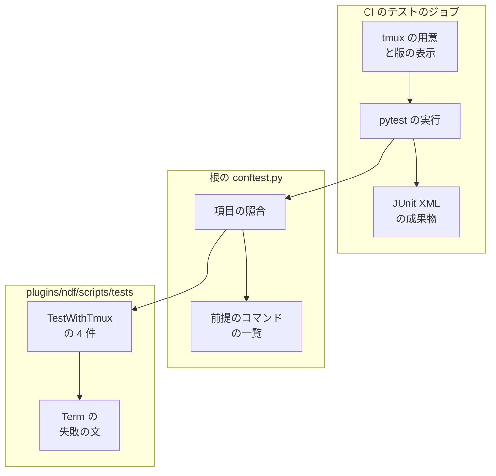
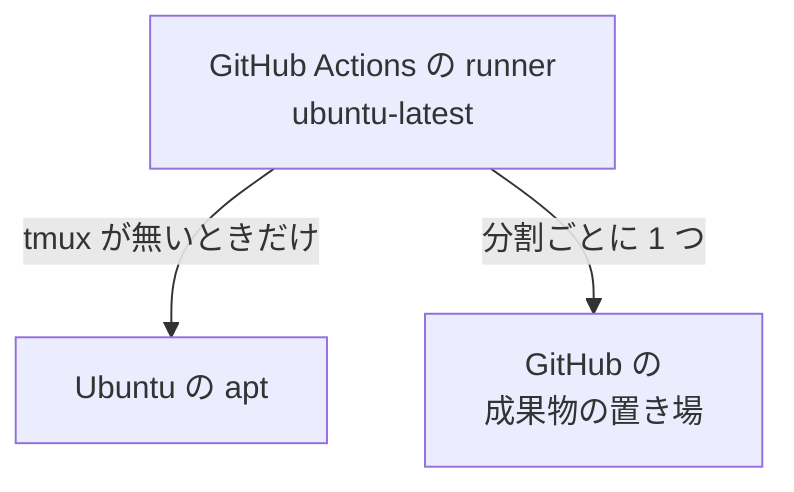
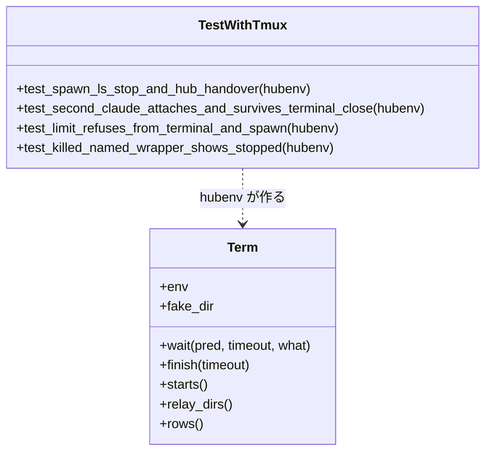
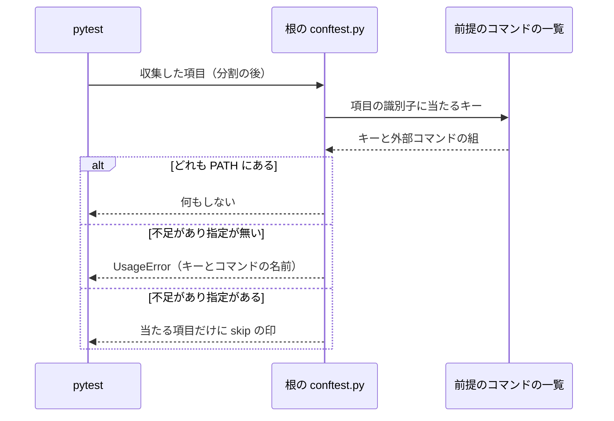

# relay の統括役の結合テスト: tmux を使う 4 件が手元と CI で毎回走り、落ちたときに原因を読める（#2346）

## 目的

- **今どうなっているか**: 名前つきのラッパーを tmux で動かす結合テスト 4 件は、テストの側の読み飛ばし（`skipif`）で、tmux の無い実行環境では黙って飛ばされ、通過と同じ終了コード 0 になる。待ちが切れて落ちたときの出力は統括役の画面と記録だけで、名前つきのラッパーの区間ごとの起動とシグナルファイルが見えない
- **誰に効くか**: relay の統括役を直す開発者と、CI の結果で受け入れ条件 3・8 を確かめるレビュアー
- **変えると何が成り立つか**: tmux が無い実行環境では、テストの実行が tmux を名指しして失敗する。CI では 4 件が毎回走り、結果を名前で読める。待ちが切れたときは、どの区間が起動し、どのシグナルファイルが置かれていたかを失敗の出力から読める

## 適用範囲

- **働く範囲**: このリポジトリのテストの実行と CI だけ。配布物（`relay.py`・`relay_lib/`）の振る舞いは変えない
- **プロジェクトごとに違うもの**: 無し（このリポジトリの開発の検査だけに効く）
- **当たるモード**: `standard`

## あるべき姿の根拠

| 根拠 | 種類 | 何を示すか |
| --- | --- | --- |
| CI の実行 41945018391（develop、2026-11-05）の分割 0 のジョブが「5375 passed」で skipped が 0 件。`test_relay_hub.py` はファイルのパスの CRC32 を 2 で割った余りが 0 で、分割 0 に入る | 実測 | CI の runner（`ubuntu-latest`）では tmux が PATH にあり、4 件は今も走っている。runner のイメージの定義（`actions/runner-images` の `toolset-2404.json` の apt の一覧）には tmux が無いため、イメージの土台に含まれているだけで、入っている保証は無い |
| 開発コンテナで `pytest plugins/ndf/scripts/tests/test_relay_hub.py --collect-only -q` を `plugins/ndf/scripts` から打つと、項目の識別子が `plugins/ndf/scripts/tests/test_relay_hub.py::test_spawn_ls_stop_and_hub_handover` と出る（48 件） | 実測 | 項目の識別子は、起点のディレクトリに関わらずリポジトリの根からの相対パスで始まる。前提のコマンドの一覧のキーを、パスの後ろへ `::` で延ばせる |
| 根の `conftest.py` の注記「読み飛ばしを既定にすると、テストの 9 割以上が消えても終了コード 0 で終わる」 | 既存の決定 | 不足を失敗にする仕組みは既にあり、tmux はその一覧に載っていないだけである |

要求と受け入れ条件は #2346 の本文にある（コピーは [issues/issue-2346-requirements.md](issue-2346-requirements.md) ）。この文書は受け入れ条件 28〜32 の「どう作るか」だけを扱う。受け入れ条件 1〜27 は ndf v10.27.14 で配布し、確定仕様 [docs/specifications/ndf-relay-multi-session-supervisor.md](../docs/specifications/ndf-relay-multi-session-supervisor.md) が持つ。

## ドメインモデル

### コンテキスト

| コンテキスト | 何の語が 1 つの意味に決まるか |
| --- | --- |
| このリポジトリの開発の検査（`repo-dev-checks`） | テストの実行に要る外部コマンド・読み飛ばしの指定・CI のテストのジョブ |

relay のラッパー（`ndf-relay`）と統括役（`ndf-workflow`）の語は、テストが名前を引くだけで、意味を変えない。

### 集約

| 集約 | 持ち主（書き換えてよいもの） | 根 | エンティティ | 値オブジェクト |
| --- | --- | --- | --- | --- |
| 前提のコマンドの一覧 | 根の `conftest.py` | 一覧（`REQUIRED_COMMANDS`） | キー（テストの置き場所） | 外部コマンドの名前の組 |
| tmux を使う結合テストの組 | `plugins/ndf/scripts/tests/test_relay_hub.py` | テストのクラス `TestWithTmux` | 4 件のテスト | — |
| 擬似端末のテストの失敗の文 | `plugins/ndf/scripts/tests/test_relay.py` の `Term` | 失敗の文 | 作業ディレクトリごとの段落 | 区間の起動の引数・ファイルの名前の一覧 |
| CI のテストのジョブ | `.github/workflows/pytest.yml` | 分割のジョブ（2 本） | 手順 | JUnit XML の成果物 |

### 不変条件

| # | 集約 | 条件 | 破れたときの扱い |
| --- | --- | --- | --- |
| I1 | 前提のコマンドの一覧 | tmux を使う 4 件は一覧のキーに当たる。tmux が PATH に無く読み飛ばしの指定も無ければ、収集が失敗し、出力が tmux を名指しする | 実行の全体が 0 以外で終わる（E14） |
| I2 | 前提のコマンドの一覧 | 読み飛ばしの指定があるとき、skipped になるのはキーに当たる項目だけである。`test_relay_hub.py` の残りの 44 件は走る | 指定ありでも、キーの外の項目は今どおり実行する |
| I3 | 前提のコマンドの一覧 | キーが項目に当たるのは、識別子がキーと一致するか、キーの直後が `/` か `::` のときだけである（`TestWithTmux` は `TestWithTmuxOld` に当たらない） | 境界の外の項目には前提を課さない |
| I4 | tmux を使う結合テストの組 | 4 件はテストの側に読み飛ばしの判定を持たない。tmux の有無は I1 の一覧だけが決める | — |
| I5 | 擬似端末のテストの失敗の文 | 待ちが切れた・終わらないときの失敗の文に、状態の置き場の作業ディレクトリごとに、ディレクトリの名前・ラッパーの名前・そのディレクトリで起動した区間の引数・ディレクトリにあるファイルの名前の一覧が載る | — |
| I6 | CI のテストのジョブ | テストを始める前に tmux が PATH にあり、版を 1 行出す。テストの後は、成否に関わらず分割ごとの JUnit XML を成果物に残す | tmux を用意できなければ、テストの手順で I1 により落ちる（E15） |
| I7 | （全体） | `relay.py` と `relay_lib/` に差分が無い | 実装の PR の完了判定で落とす |

### ドメインイベント

| # | イベント | 発生元 | 受け手 |
| --- | --- | --- | --- |
| E13 | テストの実行が、tmux を使う結合テストを集めた | pytest の収集 | 根の `conftest.py` の照合 |
| E14 | tmux が PATH に無く、テストの実行が失敗として tmux を名指しした | 根の `conftest.py` の照合 | テストを打った人・CI のジョブの結果 |
| E15 | CI のテストのジョブが tmux を使える状態でテストを始めた | `pytest.yml` の tmux の手順 | テストの手順 |
| E16 | 結合テストの待ちが切れ、ラッパーの記録を失敗の出力に出した | `Term` の待ち | テストの失敗の出力（手元の端末・CI のログと JUnit XML） |

### 用語

| 用語 | 意味 | 用語集への反映 |
| --- | --- | --- |
| 前提のコマンドの一覧 | 根の `conftest.py` が持つ、テストの置き場所（パス、またはパスに `::` でつないだファイルの中のクラス）ごとに要る外部コマンドの表。収集した項目に当たるコマンドが PATH に無ければ、読み飛ばしの指定が無い限り収集を失敗させる | 追加（`repo-dev-checks`） |

## 機能一覧

| # | 機能 | 誰が使うか |
| --- | --- | --- |
| F1 | tmux が無い実行環境で、tmux を使う結合テストが tmux を名指しして失敗する（指定があれば 4 件だけを飛ばす） | テストを打つ開発者・CI |
| F2 | CI のテストのジョブが tmux を用意し、4 件の結果を名前で読める成果物を残す | レビュアー・リリースの担当 |
| F3 | 擬似端末の結合テストの待ちが切れたとき、作業ディレクトリごとの区間の起動とファイルを失敗の出力へ出す | 結合テストの失敗を調べる開発者 |

## 構成要素

| 要素 | 責務 |
| --- | --- |
| 根の `conftest.py` の照合（`_bundle_of` を項目で引く形へ変える） | 項目の識別子（根からの相対パス、続けてファイルの中の位置を `::` でつないだもの）を一覧のキーと照らす。境界は I3 |
| 前提のコマンドの一覧に足すキー | `plugins/ndf/scripts/tests/test_relay_hub.py::TestWithTmux` に `("tmux",)` |
| `test_relay_hub.py` の `TestWithTmux` | tmux を使う 4 件をまとめるクラス。`needs_tmux` の `skipif` を消す |
| `test_relay.py` の `Term` の失敗の文 | 状態の置き場を読み、I5 の段落を組む関数を足し、`wait` と `finish` の失敗の文へ載せる |
| `scripts/tests/test_root_conftest.py` | I1〜I3 を、PATH から tmux を外した子プロセスの pytest で確かめる |
| `.github/workflows/pytest.yml` の分割のジョブ | tmux が無ければ apt で入れ、版を出す手順。pytest に JUnit XML の出力を足し、成果物として残す手順 |



図に含めない要素: `scripts/tests/test_root_conftest.py`（照合を子プロセスの pytest で確かめるテストで、実行の流れには現れない）。

### システムの文脈と配置



テストは手元の開発コンテナと CI の runner の 2 か所で動く。どちらでも、統括役のテストは使い捨ての tmux サーバ（`TMUX_TMPDIR` を一時ディレクトリに向けたもの）だけを使い、利用者の tmux サーバに触れない（今のフィクスチャ `hubenv` のまま）。

### パッケージ・モジュール構成

```text
.
├── conftest.py                              # 照合を項目の識別子で行う・一覧にキーを足す
├── .github/workflows/pytest.yml             # tmux の用意・JUnit XML の成果物
├── scripts/tests/test_root_conftest.py      # I1〜I3 のテスト
└── plugins/ndf/scripts/tests/
    ├── test_relay.py                        # Term の失敗の文（I5）
    └── test_relay_hub.py                    # TestWithTmux（I4）
```

## 構造



`Term` に足すのは、状態の置き場から失敗の文の段落を組む処理だけである。`wait` と `finish` の引数と戻り値は変えない。`TestWithTmux` の 4 件はクラスへ移すだけで、本体を変えない。

## 処理の流れ

収集の時点の照合（F1）:



待ちが切れたとき（F3）: `Term.wait` が上限に達すると、今の画面と記録に続けて、状態の置き場（`$HOME/.local/state/ndf/relay/`）の下のディレクトリを名前の順に読み、次の段落を 1 つずつ組んで `AssertionError` に載せる。統括役の置き場（`hub/`）も同じ形で載せる。

| 段落に載せるもの | 出所 |
| --- | --- |
| ディレクトリの名前とラッパーの名前 | ディレクトリの名前・`name` ファイル（無ければ空） |
| そのディレクトリで起動した区間の引数 | 偽の claude が書く `starts.jsonl` のうち、`relay_dir` がそのディレクトリの行の `argv` を起動の順に |
| ディレクトリにあるファイルの名前 | ディレクトリの直下のファイルの名前を名前の順に（`next.json`・`stop`・`relay.pid` などの有無がここで読める） |

ファイルの名前は決め打ちの一覧で調べず、ある分をすべて出す。シグナルファイルの種類が増えても、失敗の文の側を直さずに済む。

CI のテストのジョブ（F2）: 分割の 2 本それぞれで、checkout → Python・Node・uv の用意 → tmux の用意（`command -v tmux` が見つからなければ `sudo apt-get install -y tmux`）と `tmux -V` → pytest（`--junitxml` を足す）→ 成果物の保存（`if: always()`）の順に進む。

## 非機能の実現方式

要求の非機能の条件のうち、この変更が関わるのは 2 項目である。可用性・運用・保守性・移行性・セキュリティの各項目は配布済みの統括役の振る舞いに掛かり、この変更は振る舞いを変えない（I7）。

| 大項目 | 実現方式 |
| --- | --- |
| システム環境 | CI は `ubuntu-latest`。tmux はイメージの土台にあるものを使い、無いときだけ apt で入れる。版は `tmux -V` でログに残し、開発コンテナ（3.6）との違いを失敗の調査で読めるようにする |
| 性能・拡張性 | tmux がある今の runner で足すのは `command -v tmux` と `tmux -V` の 2 つで、1 秒未満。JUnit XML の書き出しと成果物の保存は数秒。apt で入れる経路を通るときは `apt-get update` を含めて 60 秒以内（未確認。下の「未確認のまま残ること」） |

## 決定の記録

### 決定 1: 4 件だけに tmux を課すため、テストのクラスにまとめ、一覧のキーをパスに `::` でつないだ形まで広げる

前提のコマンドの一覧は、今はパスの前方一致だけで項目を引く。ファイル全体をキーにすると、tmux を使わない 44 件も tmux の無い実行環境で失敗し、読み飛ばしの指定では一緒に飛ばされる。4 件をクラス `TestWithTmux` にまとめ、キーを `plugins/ndf/scripts/tests/test_relay_hub.py::TestWithTmux` にすれば、一覧の 1 行で 4 件だけを指せる。キーに 4 件のテストの名前を並べる形も取れるが、テストの名前を変えたときに一覧の行が当たらなくなる。クラスなら、クラスへ足したテストにも同じ前提が掛かる。

4 件を別のファイルへ移す形は採らない。受け入れ条件 28 は `test_relay_hub.py` を打って tmux を名指しすることを求めており、移すとこのファイルは tmux を要らなくなる。テストに印（marker）を付けて照合で読む形も採らない。前提を書く場所が一覧と印の 2 か所になり、前提 11（同じ役割の判定を別に作らない）に合わない。

根拠: Value 7（MVV 版 5）

### 決定 2: tmux の有無を 1 か所で決めるため、テストの側の `skipif`（`needs_tmux`）を消す

一覧に載せた後も `skipif` を残すと、読み飛ばしの指定が無いときは収集の時点で先に失敗するため働かず、指定があるときは一覧と同じ結果を別の理由の文で出す。判定が 2 か所にあると、片方だけを直したときに食い違いが見えない。消して、I4 のとおり一覧だけが決める形にする。

根拠: Value 7（MVV 版 5）

### 決定 3: runner のイメージが変わってもジョブが止まらないよう、tmux は無いときだけ apt で入れる

今の runner には tmux があり（あるべき姿の根拠の 1 行目）、入れる手順が無くても 4 件は走る。ただし runner のイメージの定義に tmux は載っておらず、土台の変更で消えると、一覧に載せた後はすべての Pull Request のテストのジョブが落ちる。`command -v tmux` で確かめ、無いときだけ入れる。ある間は時間を足さない。毎回 `apt-get install` を打つ形は、ある間も `apt-get update` の時間を毎回払うため採らない。手順を足さずに一覧の失敗に任せる形は、イメージが変わった日から修正が入るまで、無関係な変更のマージが止まるため採らない。

根拠: Value 1 / Value 3（MVV 版 5）

### 決定 4: 4 件の結果を名前で読むため、分割ごとの JUnit XML を成果物に残す

今のジョブは `-q` で走り、ログには件数しか出ない。JUnit XML には項目ごとの名前と結果（通過・失敗・skipped）が残り、`gh run download` で取り出して 4 件を名前で確かめられる。ログに全項目を出す `-rA`・`-v` は、分割の 2 本で合わせて 11,000 件を超える行がログに並び、ほかの失敗を探しにくくするため採らない。4 件だけを別の手順で打ち直す形は、同じテストを 2 回走らせ、本体の実行で走ったかの証拠にならないため採らない。

根拠: Value 4（MVV 版 5）

### 決定 5: どの擬似端末のテストでも原因を読めるよう、失敗の文は `Term` の共通の処理に足す

2026-11-04 の失敗は、統括役の画面と記録だけでは、名前つきのラッパーが区間 2 を起動しようとしたかどうかが読めなかった。区間の起動の引数とファイルの一覧は、統括役のテストに限らず `Term` を使うすべての擬似端末のテストで、待ちが切れたときに役立つ。`test_relay_hub.py` の側に包む処理を作る形は、同じ役割の処理が 2 か所に分かれるため採らない。

根拠: Value 7（MVV 版 5）

## テスト設計

| 受け入れ条件・不変条件 | どの振る舞いで縛るか | どう壊したら落ちるべきか |
| --- | --- | --- |
| 受け入れ条件 28・I1 | PATH から tmux を外して `test_relay_hub.py` を子プロセスの pytest で打つと、0 以外で終わり、出力にキーと `tmux` が出る | 一覧からキーを消す、または照合がパスだけを見る形に戻すと、終了コードが 0 になって落ちる |
| 受け入れ条件 28・I2 | 同じ実行に読み飛ばしの指定を付けると、終了コード 0 で、skipped がちょうど 4 件（4 件の名前） | キーをファイル全体にすると skipped が 48 件になって落ちる |
| I3 | 一覧と同じ照合に、キーの直後が `/`・`::`・それ以外の識別子を渡し、前の 2 つだけが当たる | 前方一致を文字列の前方一致だけにすると、`TestWithTmuxOld` が当たって落ちる |
| I4 | `test_relay_hub.py` の 4 件に `skipif` の印が無いことを、収集した項目の印で確かめる | `needs_tmux` を戻すと落ちる |
| 受け入れ条件 29・I6 | 実装の PR の CI で、分割 0 の成果物の JUnit XML に 4 件の名前があり、どれも failure・skipped を持たない。ジョブのログに `tmux -V` の行がある | 実装の PR の検証で確かめる（自動のテストは書かない。ワークフローの文面を照合するテストになるため） |
| 受け入れ条件 30 | 開発コンテナで `test_spawn_ls_stop_and_hub_handover` を 10 回続けて打ち、10 回とも通る。全体の実行（`-n 4`）でも通る | 実装の PR の検証で確かめ、結果を PR に残す |
| 受け入れ条件 31・I5 | 作業ディレクトリ 2 つ（`next.json` を持つものと `stop` を持つもの）と、それぞれを指す `starts.jsonl` の行を置いた状態で、`Term` の待ちを切らせると、失敗の文に両方のディレクトリの区間の引数とファイルの名前が出る | 段落を組む処理を失敗の文から外すと落ちる。ファイルの名前を決め打ちの一覧で調べる形にすると、一覧に無い名前のファイルが出ずに落ちる |
| 受け入れ条件 32・I7 | 実装の PR で `git diff --stat origin/develop -- plugins/ndf/scripts/relay.py plugins/ndf/scripts/relay_lib/` が空 | 完了判定で確かめる |

## 設計の結果

| 課題 | 扱い | 取り込み先 | 触るファイル |
| --- | --- | --- | --- |
| #2346 | 実装する | — | `conftest.py`、`scripts/tests/test_root_conftest.py`、`plugins/ndf/scripts/tests/test_relay.py`、`plugins/ndf/scripts/tests/test_relay_hub.py`、`.github/workflows/pytest.yml` |

## 未確認のまま残ること

| 項目 | 内容 |
| --- | --- |
| 受け入れ条件 32 の一覧の外のファイル | 受け入れ条件 32 は変更を `plugins/ndf/scripts/tests/`・根の `conftest.py`・`.github/workflows/` に限るが、根の `conftest.py` のテストの置き場は `scripts/tests/test_root_conftest.py` で、この設計はそこにも足す。受け入れ条件 32 の目的（relay の振る舞いを変えない）は I7 で確かめる。この 1 ファイルを一覧へ加えてよいかは承認ゲート 1 で利用者が決める |
| apt で入れる経路の時間 | 今の runner には tmux があるため、apt の経路は CI で一度も通らない。60 秒以内に収まるかは未確認で、通ったときのジョブの時間で確かめる |
| 2026-11-04 の失敗の原因 | 前提 10 のとおり追わない。受け入れ条件 30 の実行で再び落ちたら、I5 の失敗の文を材料に別の課題を起こす |
| `.github/workflows/` の変更と自動の承認 | `.ndf/pace.json` の `boundary_paths` に `.github/workflows/**` があり、この変更はその対象に当たる。承認ゲートの扱いは `development-workflow` の判定に従う |
