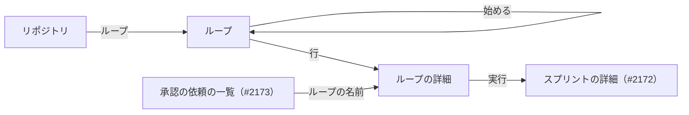

# #2347 の設計: 入出力の契約・画面・テスト設計

設計文書の本体は [issue-2347-design.md](issue-2347-design.md) 、決定の記録は
[issue-2347-design-decisions.md](issue-2347-design-decisions.md) にある。不変条件（I44〜I55）と構成要素の名前は本体のものを使う。

## 入出力の契約

**機械可読な正は `factory/contracts/` に置く。** 実装の最初のタスクで、下の表のとおりにスキーマと OpenAPI を書き、
`npm run lint:contracts` と生成した型を通してから API とランナーを書く。どの欄も足すだけで、既存の書き手と読み手はそのまま通る。

### 実行ジョブの指示（`run-job-instruction.schema.json`）

| 入力 | 型・必須 | 意味 |
| --- | --- | --- |
| `START` | `new` / `resume` / `loop`・必須（`loop` を足す） | `loop` は開発ループの周回を新しく始める |
| `ISSUES` | 番号の並び・`new` で必須 | 変えない。`loop` では持たない |
| `APPROVAL_REQUEST_ID` | 文字列・任意（`resume` で必須を外す） | 無い `resume` は答えを書かずに続ける（決定 7） |
| `LOOP_NAME` | `^[0-9A-Za-z][0-9A-Za-z_-]{0,63}$`・`loop` で必須 | NDF のループ名。ループの実行の `resume` にも載せる |
| `LOOP_MILESTONES` | 文字列・`loop` で必須 | マイルストーンの題を `,` で結ぶ |
| `LOOP_BUDGET` | `^(laps=\d+(\.\d+)?)?(,?usd=\d+(\.\d+)?)?(,?hours=\d+(\.\d+)?)?$`・任意 | 宣言した予算だけを並べる。無ければ NDF の既定 |
| `EXCLUDE_ISSUES` | 番号の並び・任意 | 同じリポジトリの課題の持ち分。無ければ外さない |
| `LOOP_ANSWERS` | `<番号>=(approved\|rejected)(#<PR の番号>)?` を `,` で結ぶ・任意 | 人の判断待ちへの答え |

- `START=loop` は `LOOP_NAME`・`LOOP_MILESTONES` を要り、`ISSUES` を許さない。`LOOP_*`・`EXCLUDE_ISSUES` は `loop` と、ループの実行の `resume` のほかでは許さない
- RunTask の `overrides` の 8,192 字に収めるため、マイルストーンは 10 件・各 100 字まで（ループの開始の入力で断る）

### 進捗の事象（`progress-event.schema.json`）

`schema_version` は 1 のまま（足すだけで互換を壊さない）。

| 種類 | 出所 | `payload` | 受け手 |
| --- | --- | --- | --- |
| `section.started`（新設） | ランナー | `section`（1 から）・`command`（2,000 字で切る） | 画面の詳細 |
| `loop.lap_closed`（新設） | ランナー（`loop.json` の締めた周回） | `loop`・`lap`・`issues`（番号の並び）・`result`（`完了` / `失敗` / `人へ戻した`）・`version`（開発版と本番の版、無ければ `null`）・`cost_usd`・`seconds`・`pending`（`{number, reason, lap}` の並び） | 実行の制御（停止の後に読む）・画面の詳細 |
| `loop.stopped`（新設） | ランナー（`loop.json` の `stop`） | `loop`・`condition`（前提 4 の 10 個）・`detail`（`stop` の残りの値の JSON。4,000 字まで）・`pending` | 実行の制御・画面 |
| `job.started`（変更） | ランナー | `start` に `loop` を足す | — |
| `job.finished`（変更） | ランナー | `reason`（`section_limit` / `usage_limit`、任意）・`resets_at`（ISO 8601、`usage_limit` のときだけ。読めなければ `null`）を足す | 実行の制御 |
| `gate.reached`（変更） | ランナー | `loop`（`{name, lap}`、ループの実行だけ）を足す | #2173 の一覧 |

**冪等の鍵は今の形（`<job_id>:<seq>`）のままである。** `loop.*` はジョブの終わりに `job.finished` より前に送り、実行の制御は
停止の後に同じジョブの事象として読む。

### NDF の受け渡しの形（`plugins/ndf/contracts/forms/ndf-next-block.json`）

| 鍵 | 中身 |
| --- | --- |
| `name` | `ndf-next-block` |
| `summary` | 応答の文の最後に置く、次の区間で起動するコマンド |
| `rule` | CommonMark の 3 つのバッククォートの囲みで、情報文字列を前後の空白を除いて `ndf-next` と比べる。ほかの囲みの中の囲みは拾わない。中身は前後の改行を除く。囲みが 2 つ以上なら起動しない。`- 結果:` の行の値が `判断が要る` なら起動しない |
| `writers` / `readers` | `sprint-state.py`（`ndf_next`）・conductor の Skill の本文 / `relay.py`（`relay_lib/mark.py`） |
| `cases` | `{text, blocks, launch}` の並び。囲みが 1 つ・無し・2 つ・別の囲みの中・`~~~` の囲み・情報文字列の前後の空白・`判断が要る`・`完了` を含む |

`scripts/contracts_lib/model.py` は `forms/*.json` を読み、上の鍵の型を確かめる（知らない鍵は今の項目と同じく断る）。
Factory のランナーは実行時にこのファイルを読まず、テストだけが `../plugins/ndf/contracts/forms/ndf-next-block.json` を読む。

### 手元のランナーの申告（`local-runner-declaration.schema.json`、新設）

| 鍵 | 型・必須 | 意味 |
| --- | --- | --- |
| `runner_id` | 32 字の英数字・必須 | 登録のたびに #2189 が発行する |
| `max_jobs` | 1〜16 の整数・任意（無ければ 1） | 同時のジョブの数 |
| `capacity_hint` | 1 以上の整数・任意 | 目安（決定 13）。表示だけに使う |

#2189 の登録と心拍の本文はこの形を含む。`claimLocalRunJob(accountId, {runnerId, maxJobs})` は、そのランナーの手元のランナーの枠が
`maxJobs` 未満のときだけ、ジョブを `running` にする書き込みと枠を 1 増やす書き込みを 1 回のトランザクションで行う（I50）。
引数の 2 つ目が無い呼び出しは今のまま（`max_jobs` 1、ランナーの識別子なし）として扱う。

### 画面向けの経路（`openapi/loops.yaml`、新設。`runs.yaml` は変更）

どの経路も Cognito の access token を要り、`resolveFromRequest` でアカウントを解決する。ループの経路はループの `accountId` が
一致しなければ 403、無ければ 404 `loop_not_found`。エラーの本文は今の形 `{"error": {"code", "message", "details"?}}`。

| 経路 | 誰が | 入力 | 成功 | 失敗 |
| --- | --- | --- | --- | --- |
| `POST /accounts/{a}/repositories/{r}/loops` | 席を持つ人 | `{name, milestones, budget?: {laps?, usd?, hours?}}` | 201 `{loop_id, state}`（`running` か `between_laps`） | 400 `invalid_request`（名前・題の形、1〜10 件、予算が正の数でない）・403・404 `repository_not_found`・409 `milestone_in_use`（`details.milestones`・`details.loop_name`）・409 `loop_name_in_use`（同じ登録の終わりの状態でないループ） |
| `GET /accounts/{a}/repositories/{r}/loops` | 席を持つ人 | — | 200 `{loops: [{loop_id, name, milestones, state, wait_reason, laps_closed, cost_usd, budget, budget_remaining, last_run_at, stop_condition, stop_detail}]}`（新しい順 50 件） | 400・403 |
| `GET /accounts/{a}/loops/{id}` | 席を持つ人 | — | 200 `{loop, laps: [{lap, issues, result, version, cost_usd, seconds}], runs: [{sprint_run_id, lap, state, failure_reason, finish_reason, resume_at, cost_usd, sections}], pending: [{number, reason, lap, answer}]}` | 403・404 |
| `PATCH /accounts/{a}/loops/{id}` | 席を持つ人 | `{budget}` | 200 ループの 1 行 | 400・403・404・409 `already_finished` |
| `POST /accounts/{a}/loops/{id}/cancel` | 席を持つ人 | — | 200 `{state}`（`cancelled` か、実行の停止を待つ `running`） | 403・404・409 `already_finished` |
| `POST /accounts/{a}/loops/{id}/next-lap` | 席を持つ人 | — | 202 `{state}` | 403・404・409 `not_awaiting_user_start` |
| `POST /accounts/{a}/loops/{id}/answers` | 席を持つ人 | `{issue, decision: approved \| rejected, pr?}` | 200 `{pending}` | 400・403・404・409 `not_pending`（`pending` に無い番号） |
| `PATCH /accounts/{a}/repositories/{r}`（`runs.yaml`） | 持ち主 | `{max_concurrent_runs: 1〜100 の整数か null}` | 200 登録の 1 行 | 400・403・404 |
| `POST /accounts/{a}/sprint-runs`（`runs.yaml`） | 席を持つ人 | 変えない | 変えない | 既存に 409 `issue_in_use`（`details.numbers`）・409 `issue_in_loop`（`details.numbers`・`details.loop_name`）・409 `parallel_unsupported_version`、`limits_exceeded` の `reasons` に `concurrent_repo_runs` を足す |

**開始の確かめの順**（既存の 8 段のうち）: 3 の課題の確かめでマイルストーンの題を引き、`issue_in_loop` を 3 の直後に断る。
`issue_in_use` と `parallel_unsupported_version` は 8 のトランザクションの条件で落ち、読み直して理由を返す。

**ループの開始**は、登録の確かめ・名前の重なり・マイルストーンの持ち分と、ループの行を 1 回のトランザクションで書き、続けて
`startNextLap` を呼ぶ。最初の周回が枠で待つときも 201（`between_laps`）を返す。

### 環境変数（`factory/.env.example` に名前だけを足す）

| 名前 | 使う側 | 意味 |
| --- | --- | --- |
| `NDF_PARALLEL_MIN_VERSION` | 制御 | 並行を許す NDF の版の下限（決定 12）。無ければ並行を許さない |
| `LOCAL_LOOP_AUTOSTART` | 制御 | `true` のとき `local` のループも自動で次の周回を起こす。既定 `false` |
| `USAGE_LIMIT_RETRY_SECONDS` | 制御 | リセット時刻を読めないときの待ち。既定 900 |
| `RUNNER_SECTION_LIMIT` | ランナー | 区間の上限。既定 20 |

## 画面

| 画面 | 経路 | 何をする場所か |
| --- | --- | --- |
| ループ（新設） | `/accounts/:accountId/repositories/:repositoryId/loops` | リポジトリのループの一覧・始める欄 |
| ループの詳細（新設） | `/accounts/:accountId/loops/:loopId` | 周回・実行と区間・人の判断待ちと答え・予算の変更・止める・次の周回を始める |
| リポジトリ（変更） | 既存 | 行に「ループ」への移りと、持ち主に同時の実行の数の宣言の欄 |
| 承認の依頼の一覧（#2173） | #2173 が決める | ループの実行の依頼の行に、ループの名前と周回の番号の列 |

| 画面 | 項目 | 型 | 必須 | 上限 | 満たさないときの表示 |
| --- | --- | --- | --- | --- | --- |
| ループ | 名前 | 文字列 | 必須 | 64 字・英数字と `-` `_` | 「英数字と - _ で 64 字までにしてください」 |
| ループ | マイルストーン | 開いているマイルストーンの複数選択 | 必須 | 10 件 | 「マイルストーンを 1 つ以上選んでください」 |
| ループ・詳細 | 予算（周回の数・費用（USD）・時間） | 正の数 | 任意 | — | 「0 より大きい数を入れてください」 |
| 詳細 | 答え | 承認・差し戻し、設計 PR の番号（承認のとき任意） | 必須 | — | — |
| リポジトリ | 同時の実行の数 | 整数か空 | 任意 | 1〜100 | 「1 から 100 の整数を入れてください」 |

| 状態 | 出すもの |
| --- | --- |
| 読み込み中・403・5xx | 既存の画面と同じ |
| ループが 0 件 | 「まだループがありません」と始める欄 |
| `between_laps` | 待ちの理由: `slots`「同時に動かせる実行の空きを待っています」・`legacy_version`「並行できない版の実行が終わるのを待っています」・`user_start`「次の周回を始める」のボタン |
| `stopped` | 止まった理由（条件の名前と `detail` の要点）。`budget_*` は「新しいループで続けられます」 |
| 実行が `awaiting_reset` | 「利用上限のため <時刻（利用者の時間帯）> に再開します」 |
| 409 `milestone_in_use` | 「<題> はループ <名前> が選んでいます」 |
| 人の判断待ちが 0 件 | 節を出さない |

権限: 一覧・詳細・操作は席を持つ人、同時の実行の数の欄は持ち主だけに出す（API も 403）。

## テスト設計

| 受け入れ条件・不変条件 | どの振る舞いで縛るか | どう壊したら落ちるべきか |
| --- | --- | --- |
| 受け入れ条件 1 | ループを始め・止め・予算を変える経路と、周回のジョブの指示が `START=loop`・`LOOP_NAME` を持つこと。`factory/api/src/` に選定の規則（順位・マイルストーンの候補の選び方）が無いこと | 指示から `LOOP_NAME` を落とす・予算の変更を次の指示へ写さない |
| 受け入れ条件 2・I53 | 決定 4 の表の各行の組で、ループの状態と止まった理由が表のとおりになる。10 個の条件のどれも `loop.stopped` として受かる | `gate2_returned` を `stopped` へ写す・`failed` で `between_laps` にする |
| 受け入れ条件 3・I46 | 枠が満ちたアカウントでループが `between_laps`（`slots`）で待ち、枠の行の数が実行の数と等しい。別の実行が終わると待っていたループの周回が起きる | ループの待ちで枠を増やす・`wakeWaitingLoops` を呼ばない |
| 受け入れ条件 4・I45 | 重なるマイルストーンの 2 本目が 409 `milestone_in_use`（題と相手の名前）、重ならない 2 本目は 201。同時の 2 つの開始で片方だけが通る | 持ち分を条件にせず読むだけにする |
| 受け入れ条件 5・I47 | 動いている実行の課題を指す手動の開始が 409 `issue_in_use`、ループのマイルストーンの課題が 409 `issue_in_loop`。ループの周回の指示の `EXCLUDE_ISSUES` に持ち分の課題が並ぶ。NDF の `loop select` が `NDF_LOOP_EXCLUDE` の課題をその周回の除外にする | 持ち分を書かない・`EXCLUDE_ISSUES` を空で渡す・`loop select` が環境変数を読まない |
| 受け入れ条件 6・I48 | 下限より古い版の実行があるリポジトリで 2 本目が 409 `parallel_unsupported_version`。下限が設定に無いと 2 本目が断られ、下限以上の版どうしは並ぶ | `legacyCount` を条件にしない・下限をコードに置く |
| 受け入れ条件 7 | `step` が `base-sync` の `attention` の行が `reason: base_conflict` の事象になり、ほかの行の理由は変わらない | すべての `attention` を `base_conflict` にする |
| 受け入れ条件 8・I49 | プランの値 3 で宣言 1 のリポジトリで 2 本目が `concurrent_repo_runs` で断られる。宣言が無ければプランの値で断られる | 宣言を読まない・大きい方を使う |
| 受け入れ条件 9・I50 | `max_jobs` 1 のランナーへ 2 本目を渡さず、1 本目が終わると渡す。申告が無ければ 1 | 枠を条件にせず数えるだけにする・終わりで枠を減らさない |
| 受け入れ条件 10 | 8 コア・30 GiB で目安 6、2 コア・4 GiB で 1。目安を超える申告で標準エラーに警告の 1 行が出て、申告は変わらない | 申告を目安へ切り詰める |
| 受け入れ条件 11・12 | 一覧の列と、詳細の周回・人の判断待ち。答えると次のジョブの `LOOP_ANSWERS` に載り、ランナーが `loop answer` を打つ。答えの済んだ番号は打たない | 答えを指示へ写さない・同じ答えを 2 回打つ |
| 受け入れ条件 13 | ループの実行の `gate.reached` が `loop`（名前と周回）を持つ。#2173 の一覧が 2 つのループの依頼を並べる | `loop` を落とす |
| 受け入れ条件 14・I52 | `local` の周回の後にループが `user_start` で待ち、`next-lap` で起きる。`LOCAL_LOOP_AUTOSTART=true` なら待たない。`managed`・`byok` は待たない | 見回りが `user_start` を起こす |
| 受け入れ条件 15・I55 | 偽の `claude` が `ndf-next` を 1 つ返すと次の区間が起き、`判断が要る`・ブロック無し・2 つでは起きない。区間ごとに `section.started` が届く | 2 つ目のブロックを使う・`判断が要る` を見ない |
| 受け入れ条件 16・I51 | 21 回目を起動せず `job.finished`（`stopped`・`section_limit`）で終わる。打ち切りの時間は区間の合計に掛かる | 区間ごとに打ち切りの時間を数え直す |
| 受け入れ条件 17・I55 | 契約の一覧の例の組を NDF の pytest（`next_blocks` と `_mark_action`）と Factory の vitest（`next-block.ts`）が読み、同じ答えを返す。`check-service-boundary.py` が通る | 片方の読み方だけを変える・`plugins/` から `factory/` を読む |
| 受け入れ条件 18・I54 | `local` の偽の `claude` が上限の文を返すと `job.finished`（`stopped`・`usage_limit`・リセット時刻）で終わり、実行が `awaiting_reset`、時刻の後の見回りで `APPROVAL_REQUEST_ID` の無い `resume` が積まれる。時刻が読めなければ 900 秒後 | `local` 以外でも `usage_limit` を出す・時刻の前に再開する |
| 受け入れ条件 19 | `managed`・`byok` で同じ上限の文が来ても今の `failed` の扱いになる。既存のテストが通る | 形態を見ずに `awaiting_reset` にする |
| 受け入れ条件 20 | 契約の検査が新しい欄と種類を通し、生成した型に現れる。`loop` に `ISSUES` を持つ指示が断られる | スキーマを足さずに型だけを書く |
| 受け入れ条件 21 | 手動の開始・一覧・取り消し・再開の既存のテストが変えずに通る | 既存の 409 の順を変える |
| I44 | 周回の開始のトランザクションの後で止めても、2 つの呼び手が同時に `startNextLap` を呼んでも、実行が 1 本だけ | `lapRuns` を条件から外す |
