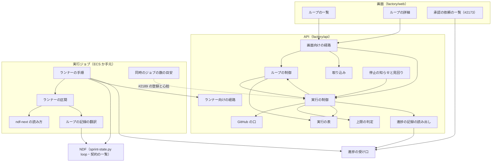
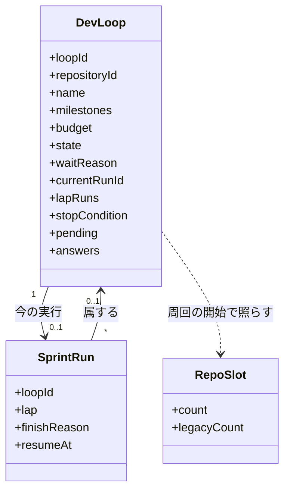
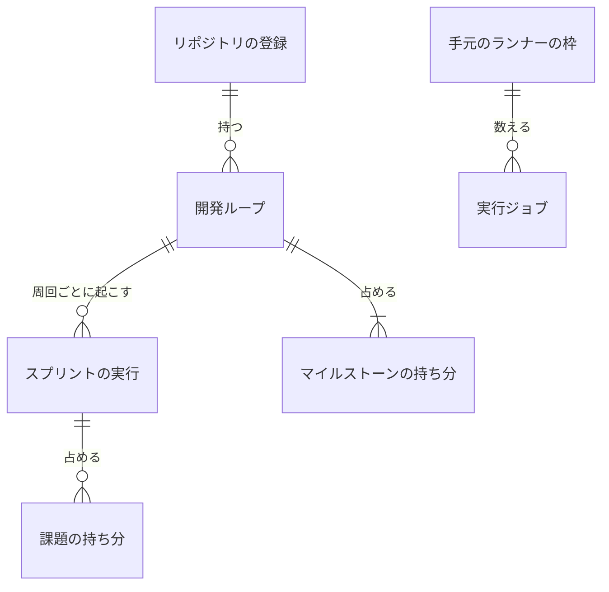
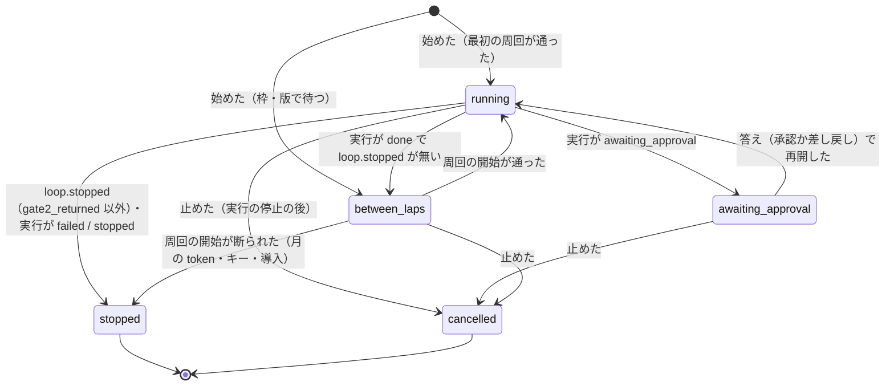
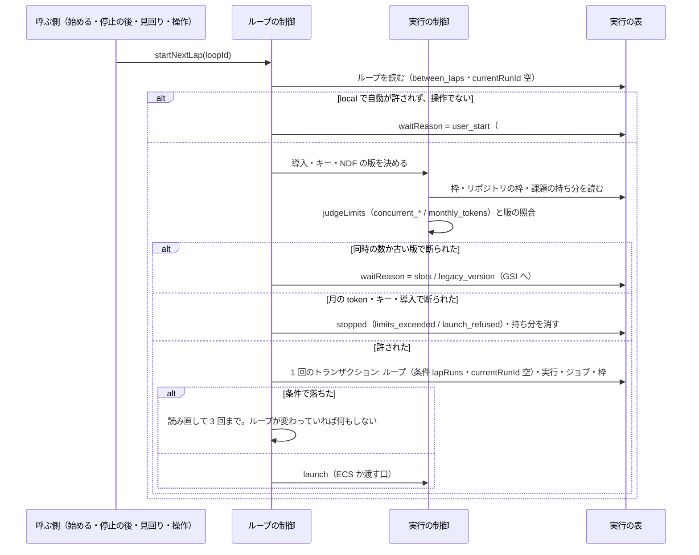
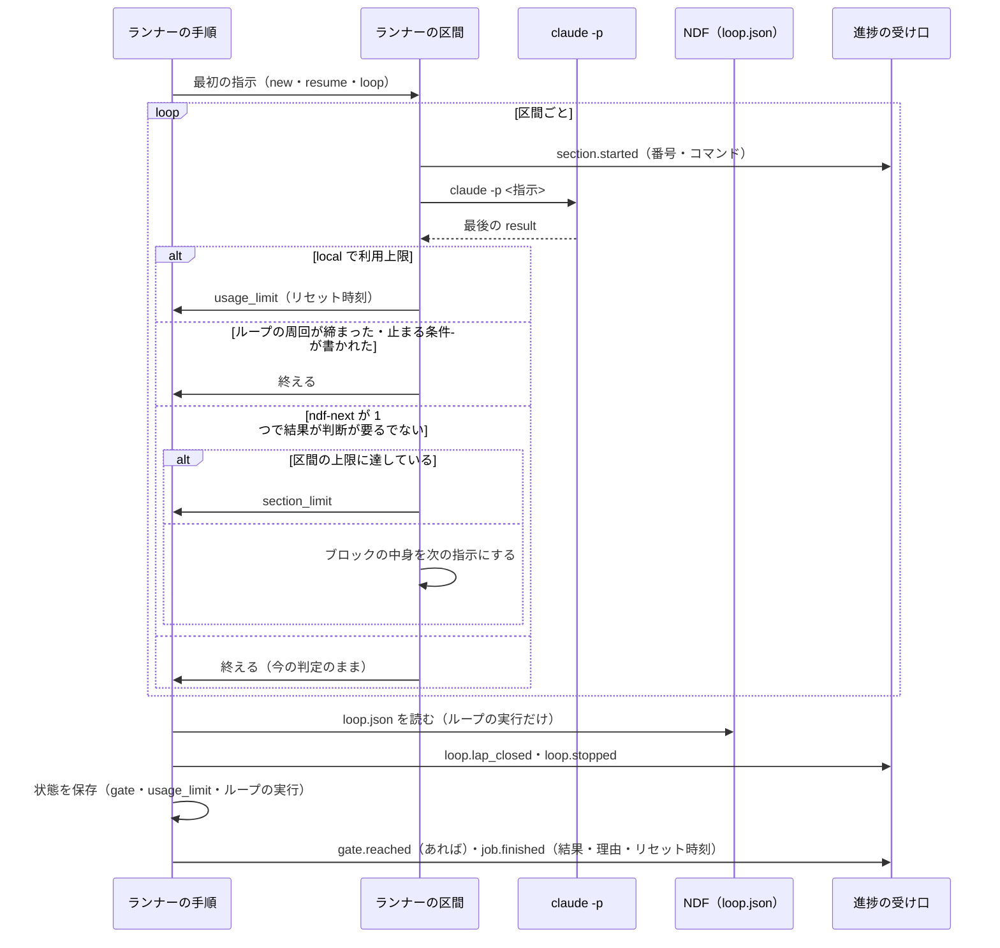

# NDF Factory: 方針の違う開発ループを同じリポジトリで並べ、Web から始め・止め・見て、ジョブの中で区切りを越えて続ける（#2347）

## 目的

- **何が壊れているか**: Factory はスプリントの実行を課題の番号で 1 本ずつ始められるだけで、開発ループの入口・同じリポジトリで並行する実行どうしの取り合い（課題・版）の扱い・手元のランナーの同時のジョブの数・1 つのジョブの中で conductor を起動し直す仕組みが無い
- **誰が困るか**: 2026-11-01 にこのリポジトリで行った「方針の違う開発ループを 3 本並べる」運用を、Factory の利用者が Web から同じ形で行えない。8 時間のジョブの途中で conductor の context window が埋まると、ジョブがそこで終わる
- **直すと何が成り立つか**: 利用者はリポジトリごとにループを始め・止め・予算を変え、一覧と詳細で周回と止まった理由を見る。課題・版・同時の数・手元の機械の上限を機械が守り、ランナーは `ndf-next` で区間をつないで手元の relay.py と同じく続ける

## 適用範囲

- **働く範囲**: このリポジトリの `factory/`（API・ランナー・画面・契約）と、NDF の配布物のうち `ndf-next` のブロックの読み方の宣言と、ループの選定から外す課題を受け取る環境変数（`plugins/ndf/contracts/`・`sprint-state.py loop select`）。NDF の側の変更は配布先のリポジトリでも働く
- **プロジェクトごとに違うもの**: 取り込むリポジトリの選定の規則・予算の既定・止まる条件の閾値は、ランナーの中の NDF がそのリポジトリの `.ndf/pace.json` から読む。Factory が持つのは利用者が画面で入れた値（マイルストーン・予算・同時の数の宣言）と、サービスの設定（並行を許す NDF の版の下限・区間の上限・`local` の自動の周回の可否）だけである
- **当たるモード**: `standard`

## あるべき姿の根拠

| 根拠 | 種類 | 何を示すか |
| --- | --- | --- |
| 「決まっていないこと、は全て定義する必要があります」「factory の場合 relay.py に相当するオーケストレーターが低コストで常に動いているのではないでしょうか」（利用者、2026-11-01） | 利用者の指示の原文 | 未決を残さないこと。常駐の費用を増やさずに relay.py の役割を置くこと（決定 1） |
| 手元の relay の記録 14 本（`~/.local/state/ndf/relay/*/log.jsonl`、2026-10-25〜11-02）の区間の数: 1 が 8 本、4 が 2 本、2・3・6・9 が各 1 本。最大 9 | 実測（2026-11-02） | 区間の上限の既定 20 は最大の 2 倍を超え、通常のジョブを打ち切らないこと（前提 9 の置き換え） |
| 8 コア・30 GB で全体テストの同時実行 6 本が上限（2026-09-25） | 実測（記録） | 同時のジョブの数の目安を 1 本あたり 4/3 コア・5 GB で出すこと |
| `plugins/ndf/scripts/supervise_lib/claude.py` の `LIMIT_RETRY = 900`（リセット時刻を読めないときの待ち） | 既存の形 | 未決 3 の既定の待ちを NDF と同じ 900 秒にすること（決定 9） |
| Factory の全体の契約の I11「承認を求める種類はゲート 1 とゲート 2 の 2 つだけ」と決定 15「サービスの側で承認を足したり省いたりしない」 | 既存の形 | 未決 1・2 を承認の依頼の種類へ足さないこと（決定 6） |

要求と受け入れ条件は #2347 の本文にある（写しは [issue-2347-requirements.md](issue-2347-requirements.md) ）。この文書は「どう作るか」だけを扱う。
入出力の契約・画面・テスト設計は [issue-2347-design-contracts.md](issue-2347-design-contracts.md) 、決定の記録は
[issue-2347-design-decisions.md](issue-2347-design-decisions.md) にある。

**要求の未決への答え**: 未決 1・2 は決定 6、未決 3 は決定 9、未決 4 は決定 2、未決 5・6 は「未確認のまま残ること」にある。

## ドメインモデル

### コンテキスト

| コンテキスト | 何の語が 1 つの意味に決まるか |
| --- | --- |
| Neural Development Factory（`ndf-factory`） | 開発ループ（集約）・スプリントの実行・実行の枠・マイルストーンの持ち分・課題の持ち分・手元のランナーの枠・区間・区間の上限・同時のジョブの数 |
| NDF の開発ワークフロー（`ndf-workflow`） | 開発ループ（`loop.json`）・周回・ループの予算・止まる条件・人の判断待ち・`ndf-next`・リセット時刻 |

**`ndf-workflow` が上流、`ndf-factory` が下流の腐敗防止層である**（全体の契約のまま）。Factory の開発ループは NDF の
ループの記録を読まず、ランナーが翻訳した進捗の事象（`loop.lap_closed`・`loop.stopped`）だけを読む。翻訳はランナーの
`factory/runner/src/loop-file.ts` と `translate.ts` だけが持つ。`ndf-next` のブロックの読み方は、NDF の契約の一覧が
**公開された言語**として宣言し、ランナーは形を写す（決定 8）。

### 集約

| 集約 | 持ち主（書き換えてよいもの） | 根 | エンティティ | 値オブジェクト |
| --- | --- | --- | --- | --- |
| 開発ループ（新設） | ループの制御（`factory/api/src/runs/loops.ts`、`LoopControl`） | ループ | — | 名前・選定の対象のマイルストーン・予算・状態・待ちの理由・止まった理由・人の判断待ちの写し・答え・締めた周回の和 |
| スプリントの実行（変更） | 実行の制御（`factory/api/src/runs/control.ts`） | スプリントの実行 | 実行ジョブ | 既存に、属するループ・周回の番号・終わりの理由・再開の時刻を足す |
| 実行の枠（変更） | 実行の制御 | アカウントの枠 | — | 既存に、リポジトリの枠の古い版の数・マイルストーンの持ち分・課題の持ち分・手元のランナーの枠を足す |
| リポジトリの登録（変更） | 取り込み（`factory/api/src/repositories/`） | 登録 | — | 既存に、同時の実行の数の宣言を足す |

- **ほかの集約は識別子で参照する。** ループは登録を `repositoryId`、今の実行を `currentRunId` で指す。実行はループを `loopId` で指す
- **1 つの処理が書き換える集約は 1 つで、例外を「スプリントの実行・実行の枠」から「開発ループ・スプリントの実行・実行の枠」の 3 つへ広げる**（決定 2）。周回の開始・実行の終わりへの移り・ループの取り消しを 1 つのトランザクションで書く
- **持ち分と手元のランナーの枠は実行の枠の行である。** 取り合いの条件を、実行と同じトランザクションの条件つきの書き込みで守るためである

### 不変条件

I8・I9・I32〜I43 は既存のまま変えない。続けて番号を振る。

| # | 集約 | 条件 | 破れたときの扱い |
| --- | --- | --- | --- |
| I44 | 開発ループ | 1 つのループで終わりの状態でないスプリントの実行は 1 つまで（`currentRunId`） | 周回の開始は `currentRunId` が空で `lapRuns` が読んだ値のときだけ書く。条件で落ちれば何もしない（2 本目を起こさない） |
| I45 | 実行の枠 | 同じリポジトリの終わりの状態でない 2 つのループの選定の対象のマイルストーンは重ならない | 持ち分の行を `attribute_not_exists` で書き、落ちれば 409 `milestone_in_use`（重なった題と相手のループの名前） |
| I46 | 実行の枠 | 枠の数は終わりの状態でない実行の数に等しい（I34）。`between_laps` のループは枠の行を持たない | ループは枠の行を書かない。枠は実行の作成と終わりへの移りでだけ増減する |
| I47 | 実行の枠 | 同じリポジトリで、1 つの課題を持つ終わりの状態でない実行は 1 つまで | 手動の開始が、課題の持ち分の行の `attribute_not_exists` の書き込みと、課題のマイルストーンの持ち分の行の `attribute_not_exists` の照合（題ごとに重複を除いて 1 件）を同じトランザクションで行い、前者で落ちれば 409 `issue_in_use`、後者で落ちれば 409 `issue_in_loop`。ループの周回へは、強い整合で読んだ持ち分の課題を `EXCLUDE_ISSUES` で渡す（決定 11） |
| I48 | 実行の枠 | 並行を許す版の下限より古い NDF の版の実行がリポジトリにあれば、その実行は唯一である | リポジトリの枠の `legacyCount` と `count` を条件にし、落ちれば 409 `parallel_unsupported_version`（ループは待つ）。移行の済みの行が無い間は、すべての版を古い版として扱う（決定 12） |
| I49 | 実行の枠 | リポジトリの終わりの状態でない実行の数は、プランの同時の数と登録の宣言の小さい方以下 | `judgeLimits` が `concurrent_repo_runs` を理由に断る（ループは待つ） |
| I50 | 実行の枠 | 1 つの手元のランナーが `running` で持つ `local` のジョブの数は、そのランナーが申告した `max_jobs` 以下 | 受け取りが手元のランナーの枠を条件に書き、落ちれば `null`（渡さない） |
| I51 | スプリントの実行 | 1 つの実行ジョブが起動する区間は区間の上限以下 | ランナーが次の区間を起動せず `job.finished`（`stopped`・`section_limit`）で終える |
| I52 | 開発ループ | `local` のループの次の周回は、利用者の「次の周回を始める」の操作か、設定 `LOCAL_LOOP_AUTOSTART=true` のときだけ起こる | 自動の起動は `waitReason` が `user_start` のループを飛ばす |
| I53 | 開発ループ | ループの状態は、属する実行の終わり方と `loop.stopped` の条件から、決定 4 の表のとおりにだけ決まる | 表に無い組は `stopped`（`run_failed`）にする |
| I54 | スプリントの実行 | `usage_limit` で終わるジョブと `awaiting_reset` の実行は、形態 `local` にだけある | ランナーは `local` 以外で利用上限を検出しない。制御は `local` 以外の `usage_limit` を `failed` として扱う |
| I55 | — （ランナー） | ランナーと NDF の relay.py は、同じ応答の文から同じ `ndf-next` のブロックと同じ「起動するか」を読む | 契約の一覧の例の組を両方のテストが読み、どちらかが違えば落ちる |

### ドメインイベント

要求の番号を引き継ぐ。

| # | イベント | 発生元 | 受け手 |
| --- | --- | --- | --- |
| E1 | 開発ループを始めた | 実行の制御（画面の操作） | E2（実行の制御） |
| E2 | 周回の実行を起こした（`START=loop`） | 実行の制御（`startNextLap`） | ランナー・実行の枠 |
| E3 | 周回の課題を選んだ | ランナーの中の NDF（`loop select`） | ランナー（`phase.changed` の課題で画面へ） |
| E4 | ジョブの中で次の区間を起動した（`section.started`） | ランナー | 進捗の受け口 → 画面の詳細 |
| E5 | 承認ゲート 2 で止まった | ランナー（`gate.reached`・`loop.stopped`（`gate2_returned`）） | #2173・実行の制御（ループを `awaiting_approval`） |
| E6 | 人の判断待ちの課題ができた | ランナー（`loop.lap_closed`・`loop.stopped` の `pending`） | 実行の制御（ループの写し）→ 画面の詳細・#2173 の知らせ |
| E7 | ループが止まった（`loop.stopped`） | ランナー | 実行の制御（停止の後の処理で読む） |
| E8 | 周回の実行が終わった | 実行の制御（停止の後の処理） | 実行の制御（`startNextLap`・待っているループを起こす） |
| E9 | 取り込みで衝突を解けなかった（`attention`・`base_conflict`） | ランナー（NDF の `progress.jsonl` の行の翻訳のまま） | 画面・#2173 |
| E10 | 次の周回を始める操作を待つ（`local`） | 実行の制御（E8 の後） | 画面（一覧の待ちの理由）・#2173 の知らせ |
| E11 | 利用上限でジョブを終えた（`usage_limit`） | ランナー | 実行の制御（実行を `awaiting_reset`） |
| E12 | リセット時刻の後に再開を起こした | 実行の制御（見回り） | ランナー（`START=resume`） |
| E13 | 利用者がループを止めた（`cancelled`） | 実行の制御（画面の操作） | 実行の制御（`cancelSprintRun` と同じ形で今の実行を止める） |
| E14 | 手元のランナーが同時のジョブの数を申告した | 手元のランナー（#2189 の登録と心拍） | 実行の制御（`claimLocalRunJob` の条件） |

### 用語

| 用語 | 意味 | 用語集への反映 |
| --- | --- | --- |
| マイルストーンの持ち分 | 終わりの状態でない開発ループが、リポジトリのマイルストーン 1 つを選定の対象として占めていることを表す実行の枠の行 | 追加（`ndf-factory`） |
| 課題の持ち分 | 終わりの状態でない手動のスプリントの実行が、リポジトリの課題 1 つを持っていることを表す実行の枠の行 | 追加（`ndf-factory`） |
| 手元のランナーの枠 | 1 つの手元のランナーが `running` で持つ `local` の実行ジョブの数を数えた実行の枠の行 | 追加（`ndf-factory`） |
| 区間 | 1 つの実行ジョブの中でランナーが起動する `claude -p` の 1 回分 | 変えない（要求で追加済み） |
| 区間の上限 | 1 つの実行ジョブで起動してよい区間の数の上限（既定 20） | 変えない（要求で追加済み） |
| 同時のジョブの数 | 手元のランナーが同時に動かす実行ジョブの数の上限（`max_jobs`） | 変えない（要求で追加済み） |

## 機能一覧

| # | 機能 | 誰が使うか |
| --- | --- | --- |
| F1 | リポジトリごとに開発ループを始める（名前・マイルストーン・予算） | 席を持つ人 |
| F2 | ループを止める・予算を変える | 席を持つ人 |
| F3 | ループの周回を、枠が空き次第、自動で続けて起こす（`managed`・`byok`） | 実行の制御 |
| F4 | `local` のループで次の周回を始める | 席を持つ人 |
| F5 | ループの一覧と詳細を見る（周回・止まった理由・人の判断待ち） | 席を持つ人 |
| F6 | 人の判断待ちの課題に答える | 席を持つ人 |
| F7 | 同じリポジトリで並行する実行の取り合い（課題・版・同時の数）を断るか待たせる | 実行の制御 |
| F8 | リポジトリの同時の実行の数を宣言する | 持ち主 |
| F9 | 1 つのジョブの中で `ndf-next` の区間をつなぐ | ランナー |
| F10 | `local` で利用上限に当たったジョブをリセット時刻の後に続ける | ランナー・実行の制御 |
| F11 | 手元のランナーの同時のジョブの数を申告し、目安を超えれば警告する | 手元のランナー（#2189） |

## 構成要素

| 要素 | 場所 | 責務 |
| --- | --- | --- |
| ループの制御（新設） | `factory/api/src/runs/loops.ts`（`LoopControl`） | 始める・止める・予算・答え・次の周回の操作、`startNextLap`（周回の開始の判定とトランザクション）、`wakeWaitingLoops`（待っているループを古い順に起こす）、停止の後の処理から呼ばれるループの状態の写し（決定 4） |
| 実行の制御（変更） | `factory/api/src/runs/control.ts`（`RunControl`） | 開始に課題の持ち分・マイルストーンの照合・版の照合・リポジトリの同時の数を足す。停止の後の処理で `loop.*` と `job.finished` の理由を読み、ループの写しと `awaiting_reset` を同じトランザクションへ入れる。見回りに再開の時刻と待っているループを足す。`claimLocalRunJob` に手元のランナーの枠を足す |
| 実行の表（変更） | `factory/api/src/runs/table.ts`・`dynamo-table.ts`・`memory-table.ts` | ループの行・持ち分の行・手元のランナーの枠の行と、3 集約をまたぐ条件つきの書き込みを操作の単位で持つ |
| 移行の埋め戻し（新設） | `factory/api/src/runs/backfill.ts` | 既存の終わりの状態でない実行を古い版として `legacyCount` と課題の持ち分へ写し、移行の済みの行を書く（「データ構造」の「移行」・決定 12） |
| 上限の判定（変更） | `factory/api/src/accounts/limits.ts`（`judgeLimits`） | 理由 `concurrent_repo_runs` を足す。入力にリポジトリの枠の数と宣言を足す |
| 取り込み（変更） | `factory/api/src/repositories/service.ts` | 登録の `maxConcurrentRuns` の宣言を書く |
| GitHub の口（変更） | `factory/api/src/github/port.ts`・`app.ts` | 課題の確かめの応答にマイルストーンの題を足す |
| 進捗の記録の読み出し（変更） | `factory/api/src/progress/read.ts`（`ProgressReader`） | ジョブの `loop.lap_closed`・`loop.stopped` を読む。ループの周回の行（詳細の画面）を読む |
| 画面向けの経路（変更） | `factory/api/src/routes/factory.ts` | ループの 7 経路と登録の宣言の経路、開始の新しい 409 |
| ランナー向けの経路（変更） | `factory/api/src/runs/runner-api.ts` | 状態の置き場の鍵を、ループの実行では `loops/<loopId>/ndf-state.tar.gz` にする |
| ランナーの区間（新設） | `factory/runner/src/sections.ts` | 区間をつなぐ繰り返し・区間の上限・周回の締めの検出・利用上限の検出（決定 5・7） |
| `ndf-next` の読み方（新設） | `factory/runner/src/next-block.ts` | 応答の文からブロックと「起動するか」を読む（I55） |
| ループの記録の翻訳（新設） | `factory/runner/src/loop-file.ts` | `.ndf/loop/<名>/loop.json` を読み、`loop.lap_closed`・`loop.stopped` と、答えの書き込みの要否を作る |
| 同時のジョブの数の目安（新設） | `factory/runner/src/capacity.ts` | CPU の数とメモリから目安を出し、申告と比べる（#2189 の手元のランナーが呼ぶ） |
| ランナーの手順（変更） | `factory/runner/src/main.ts`・`runtime.ts`・`state.ts`・`translate.ts` | `START=loop` の手順、答えの書き込み、`NDF_LOOP_EXCLUDE` の受け渡し、状態に `.ndf/handoff/loop-*` を足す。`attention` の行の `step` が `base-sync` なら `reason` を `base_conflict` へ写す（決定 10） |
| 契約（変更・新設） | `factory/contracts/schemas/*.json`・`openapi/runs.yaml`・`openapi/loops.yaml`（新設）・`schemas/local-runner-declaration.schema.json`（新設） | 入出力の契約の文書の形 |
| 画面（新設・変更） | `factory/web/src/pages/LoopsPage.tsx`・`LoopDetailPage.tsx`・`RepositoriesPage.tsx` | ループの一覧と始める・詳細と操作・宣言の欄 |
| NDF の受け渡しの形（新設） | `plugins/ndf/contracts/forms/ndf-next-block.json`・`scripts/contracts_lib/model.py` | `ndf-next` のブロックの読み方と例の組を宣言し、構造チェックが形を確かめる（決定 8） |
| NDF のループの除外（変更） | `plugins/ndf/scripts/lib/sprint_loop_select.py`・`plugins/ndf/contracts/env/NDF_LOOP_EXCLUDE.json` | `loop select` が環境変数の課題をその周回の除外へ足す（決定 3） |



図に含めない要素: 契約（どの要素も生成した型を読む）と NDF の受け渡しの形（ランナーのテストだけが読む）。

**配置は変えない。** ループの制御は既存の API の handler と、停止の知らせと見回りの Lambda の中で動く。常駐のプロセスは足さない
（決定 1）。手元のランナーは利用者の環境で、`max_jobs` の数までジョブを別の作業場所で並べて動かす。

### パッケージの構成

```text
factory/
├── api/src/runs/loops.ts            # 新設
├── api/src/runs/backfill.ts         # 新設（移行の埋め戻し。一度だけ流す）
├── api/src/runs/{control,table,dynamo-table,memory-table,model,runner-api}.ts
├── api/src/accounts/limits.ts
├── api/src/github/{port,app}.ts
├── api/src/progress/read.ts
├── api/src/routes/factory.ts
├── runner/src/{sections,next-block,loop-file,capacity}.ts   # 新設
├── runner/src/{main,runtime,state,translate}.ts
├── contracts/openapi/{runs,loops}.yaml                      # loops.yaml は新設
├── contracts/schemas/{run-job-instruction,progress-event,local-runner-declaration}.schema.json
└── web/src/pages/{LoopsPage,LoopDetailPage,RepositoriesPage}.tsx
plugins/ndf/
├── contracts/forms/ndf-next-block.json   # 新設
├── contracts/env/NDF_LOOP_EXCLUDE.json   # 新設
└── scripts/lib/sprint_loop_select.py
scripts/contracts_lib/model.py            # forms を読む
```

## 構造



`SprintRun` の `loopId` が空の実行は今の手動の実行で、振る舞いは変わらない（受け入れ条件 21）。

## データ構造

実行の表（`RUNS_TABLE_NAME`）に行を足す。**時系列の扱いは既存と同じ「今の値の上書き」である。** 周回ごとの課題・結果・版・費用は
進捗の記録の `loop.lap_closed` が追記で持ち、ループの行の和はそこから作り直せる。



| 行 | `pk` | `sk` | `gsi1pk` / `gsi1sk` |
| --- | --- | --- | --- |
| 開発ループ | `ACCOUNT#<accountId>` | `LOOP#<loopId>` | `WAITING_LOOPS` / `<updatedAt>#<loopId>`（`between_laps` で `waitReason` が `user_start` でない間だけ） |
| マイルストーンの持ち分 | `ACCOUNT#<accountId>` | `MILESTONE#<repositoryId>#<題の sha256 の先頭 32 字>` | — |
| 課題の持ち分 | `ACCOUNT#<accountId>` | `ISSUE#<repositoryId>#<番号>` | — |
| 手元のランナーの枠 | `ACCOUNT#<accountId>` | `RUNNER#<runnerId>` | — |
| 移行の済み（表に 1 つ） | `MIGRATION` | `MIGRATED#2347` | — |

| 行 | 列 | 型 | 空 | 意味 |
| --- | --- | --- | --- | --- |
| ループ | `loopId` | 文字列 | 不可 | 32 字（実行と同じ作り方） |
| ループ | `repositoryId`・`name` | 数・文字列 | 不可 | 属する登録と、NDF のループ名（`^[0-9A-Za-z][0-9A-Za-z_-]{0,63}$`） |
| ループ | `milestones` | 文字列の並び | 不可 | 1〜10 件。題に `,` を含まない（NDF の `--milestones` の区切り） |
| ループ | `budget` | `{laps, usd, hours}` | 各値は可 | 空は「宣言しない（NDF の `.ndf/pace.json` の既定）」 |
| ループ | `state` | 文字列 | 不可 | `running` / `between_laps` / `awaiting_approval` / `stopped` / `cancelled`。後ろの 2 つが終わりの状態 |
| ループ | `waitReason` | 文字列 | 可 | `between_laps` の理由: `slots`（枠）・`legacy_version`・`user_start`（`local`）。空は「起こす途中」 |
| ループ | `currentRunId` | 文字列 | 可 | 終わりの状態でない実行（I44）。空は「動く実行が無い」 |
| ループ | `lapRuns` | 数 | 不可 | 起こした実行の数。周回の開始の条件（I44）と、実行の `lap` |
| ループ | `lapsClosed`・`closedCostUsd`・`closedSeconds` | 数 | 不可 | `loop.lap_closed` の和（一覧の周回の数・費用・予算の残り） |
| ループ | `stopCondition`・`stopDetail` | 文字列・JSON | 可 | 止まった理由。NDF の条件か、Factory の `run_failed`・`run_stopped`・`limits_exceeded`・`launch_refused` |
| ループ | `pending` | `{number, reason, lap}` の並び | 不可 | 最後に届いた人の判断待ちの写し |
| ループ | `answers` | `{number, decision, pr}` の並び | 不可 | 画面の答え。次のジョブの `LOOP_ANSWERS` に載り、`pending` から消えた番号は外す |
| ループ | `cancelRequested`・`createdBy`・`createdAt`・`updatedAt`・`lastRunAt` | — | `lastRunAt` だけ可 | 取り消しの要求と時刻（`lastRunAt` は最後の実行の `updatedAt`） |
| 持ち分 | `loopId`・`title` / `sprintRunId` | 文字列 | 不可 | 占めるループと題 / 占める実行 |
| ランナーの枠 | `count` | 数 | 不可 | `running` の `local` のジョブの数（I50） |
| 実行 | `loopId`・`lap` | 文字列・数 | 可 | 空は手動の実行 |
| 実行 | `legacy` | 真偽 | 可 | 古い版として `legacyCount` に数えた実行。作成と移行の埋め戻しで書き、終わりへの移りで真のときだけ `legacyCount` を減らす。空は「この課題より前に作られ、まだ埋め戻していない」 |
| 実行 | `finishReason` | 文字列 | 可 | `job.finished` の `reason`（`section_limit` / `usage_limit`） |
| 実行 | `resumeAt` | 文字列 | 可 | `awaiting_reset` の間だけ。リセット時刻（読めなければ 900 秒後） |
| ジョブ | `runnerId` | 文字列 | 可 | `local` で受け取ったランナー。手元のランナーの枠を減らす先 |
| リポジトリの枠 | `legacyCount` | 数 | 不可 | 並行を許す版の下限より古い版の、終わりの状態でない実行の数（I48）。無いのは 0 |
| 登録 | `maxConcurrentRuns` | 数 | 可 | 空は「宣言しない（プランの値）」 |

**実行の状態に `awaiting_reset` を足す**（終わりの状態でない。枠を数え、承認待ちと同じく今のジョブは空）。

| 機能 | ループ | 実行 | ジョブ | 枠・持ち分・ランナーの枠 | 登録 | 進捗の記録 |
| --- | --- | --- | --- | --- | --- | --- |
| F1 始める | C | C | C | C・U | R | — |
| F2 止める | U | U | — | U・D | — | R |
| F2 予算 | U | — | — | — | — | — |
| F3・F4 次の周回 | U | C | C | U・C | R | — |
| F5 一覧と詳細 | R | R | — | — | — | R |
| F6 答える | U | — | — | — | — | — |
| F7 手動の開始 | R | C | C | C・U | R | — |
| F8 宣言 | — | — | — | — | U | — |
| 停止の後の処理 | U | U | U | U・D | — | R・C |
| 見回り（再開・待ち） | U | U | C | U・C | R | — |
| 受け取り（`local`） | — | U | U | U | — | — |

**移行**: 既存の行の形は変えず、列と行を足すだけにする。`maxConcurrentRuns`・`loopId` などの無い行は空として読む（非機能の移行性）。
**並行の開始の材料（課題の持ち分・`legacyCount`）は、既存の終わりの状態でない実行から埋め戻してから使う**（決定 12）。手順は次の順で、
どの時点で止まっても I47・I48 を破らない。

1. この課題の版を出す。表に移行の済みの行が無い間、開始はすべての版を古い版として扱い、リポジトリの枠の `count` が 0 のときだけ書く。
   この版より前の実行も `count` に数えられているため、動いている実行があるリポジトリでは 2 本目が断られる（ループは `legacy_version` で待つ）
2. 埋め戻しのコマンド（`factory/api/src/runs/backfill.ts`。一度だけ流し、何度流しても同じ結果になる）が、すべてのアカウントの `legacy` の空の
   終わりの状態でない実行を 1 本ずつ扱う。まず実行の課題の持ち分の行を強い整合（`ConsistentRead`）で読み、他の実行が持つ課題を除く
   （どちらの実行も `legacy` で数えられ、終わるまで新しい開始は通らない）。次に 1 回のトランザクションで、実行の `legacy` を真に
   （条件は `attribute_not_exists(legacy)` と、実行が終わりの状態でないこと）・リポジトリの枠の `legacyCount` を 1 増やし・残った課題の持ち分を
   `attribute_not_exists` で書く。トランザクションは原子的で 1 行だけを飛ばせないため、落ちたら（`TransactionCanceledException`）その実行を
   読み直してやり直す（終わりの状態か `legacy` が空でなければ何もしない）。読んでから書く間に、そのリポジトリで新しい開始が課題の持ち分を
   書くことは無い。1 の間の開始は `count` が 0 のときだけ書き、埋め戻す実行がそのリポジトリの `count` に数えられているためである
3. `legacy` の空の終わりの状態でない実行が表に 0 件になったら、同じコマンドが移行の済みの行（表に 1 つ）を書く。開始はこの行がある間だけ
   `NDF_PARALLEL_MIN_VERSION` を読む。開始と周回の開始は、この行をトランザクションの前に強い整合（`ConsistentRead`）で 1 回読むだけにし、
   行の照合（`attribute_exists`）をトランザクションへ入れない（全アカウントで共有の 1 項目のため、入れると同時の開始どうしが
   `TransactionConflict` で取り消し合う。行は一度書けば消さないので、読んで「ある」なら以後もあり、「無い」なら 1 の扱いになる。決定 12）。行はアカウントごとに置かないため、
   埋め戻しの後に作られたアカウントも同じ行で並行の開始を許される（その実行はすべて 4 で `legacy` を書いており、埋め戻すものが無い）
4. この版で作られた実行は、作成のトランザクションで `legacy` と持ち分を書く。移行の済みの行が無い間（1 の間）は、版によらず `legacy` を真にして
   `legacyCount` を 1 増やす（下限と比べない。偽を書くと、1 の間に始めた古い版の実行が移行の後に数えられず I48 を破る）。行がある間は、
   下限より古い版なら真にして `legacyCount` を 1 増やし、新しい版なら偽にする。埋め戻しは `legacy` の空の実行だけを扱うため、同時に動いても重ならない

無い値を 0 と読むのは、この順の 1 の間の `legacyCount` だけである（移行の済みの行が無ければ `legacyCount` を条件にしないため、0 と読んでも通さない）。

## 処理の流れ

### ループの状態



利用上限の `awaiting_reset` の間、ループは `running` のままである（周回は進行中）。

### 周回の開始（`startNextLap`）



- **`EXCLUDE_ISSUES` は、トランザクションの直前に強い整合（`ConsistentRead`）で読んだ同じリポジトリの課題の持ち分の番号である。** 読みと手動の開始の間は、マイルストーンの持ち分の行で直列になる（決定 11）。ループの作成がマイルストーンの持ち分を書いた後に通る手動の開始は、その行の照合で落ちる。作成より前に通った手動の開始の持ち分は、作成より後に行うこの読みに必ず現れる
- **起こすのは 4 か所だけ**: 始めた直後・停止の後の処理（そのループ）・停止の後の処理で枠が減ったとき（同じアカウントの待っているループを `wakeWaitingLoops` が古い順に 1 本ずつ）・5 分ごとの見回り（`WAITING_LOOPS` をすべて）。`local` の `user_start` は操作だけが起こす（I52）

### 停止の後の処理（`finalize`）へ足すもの

既存の順（`job.finished` を読む → 実行と枠を移す → 最後にジョブを終わりへ）を変えない。実行と枠を移すトランザクションへ次を足す。

| 足すもの | いつ |
| --- | --- |
| 実行を `awaiting_reset`（`resumeAt`）にする | `job.finished` が `stopped`・`usage_limit` で、形態が `local`（I54。ほかの形態では `failed`） |
| 実行の `finishReason` | `job.finished` に `reason` がある |
| 課題の持ち分を消す（`sprintRunId` がその実行の行だけ）・`legacyCount` を減らす（実行の `legacy` が真のときだけ）。実行を移す書き込みに、読んだ時の `legacy` の値を条件として入れる（真なら `legacy = true`、偽なら `legacy = false`、空なら `attribute_not_exists(legacy)`）。落ちたら実行と持ち分を読み直してやり直す（読んだ後に埋め戻しが `legacy` を真にし `legacyCount` と持ち分を書いたとき、減算と削除を漏らして数と持ち分が永久に残らないため） | 実行が終わりの状態へ移る |
| 手元のランナーの枠を減らす | ジョブを終わりへ移す最後の書き込み（`runnerId` がある） |
| ループの写し（決定 4 の表）・`lapsClosed` などの和・`pending`・持ち分の削除 | 実行が `loopId` を持つ。`loop.lap_closed` と `loop.stopped` をジョブの冪等の鍵の範囲で読む |

トランザクションが通った後に、ループが `between_laps` なら `startNextLap`、枠が減ったなら `wakeWaitingLoops` を呼ぶ。
どちらも落ちてよく、次の見回りが同じ結果で起こし直す（非機能の可用性）。

### ランナーの区間（`START` の 3 つに共通）



- **区間の数には最初の起動を数える。** 区間の上限 20 は 20 回目の `claude -p` の後に次を起動しないことを指す
- **周回の締めの判定は区間ごとに行う。** ジョブの始めの `loop.json` の締めた周回の数より増えたか、`stop` がジョブの始めより後に書かれていれば、`ndf-next` があっても次の区間を起動しない。ループの次の周回は実行の制御が新しい実行で起こす（周回 1 回がスプリントの実行 1 本）
- **使用量（`usage.recorded`）は区間ごとに今のとおり送る。** 打ち切りの時間はジョブの全体に掛かり、区間で延びない

### `START=loop` のランナーの手順

既存の手順 1〜4 と 8 は変えず、5〜7 を次にする。`START=resume` でも `LOOP_NAME` があれば 5・6 の鍵と書き込みは同じである。

| 手順 | 中身 |
| --- | --- |
| 5. 状態の復元 | `POST /run-jobs/state`（`get`）。鍵はループの `loops/<loopId>/ndf-state.tar.gz`。404 は最初の周回として空から始める。戻すのは `.ndf/tmp`・`.ndf/loop`・`.ndf/handoff/loop-<LOOP_NAME>.md`（I42 の許すパスを 1 つ足す。追跡するファイルは今のとおり断る） |
| 6. 答えの書き込み | `LOOP_ANSWERS` の各組のうち、`loop.json` の人の判断待ちに答えの無い番号だけ `sprint-state.py loop answer <名> <番号> --approved \| --rejected [--pr <番号>]` を打つ |
| 7. conductor | `/ndf:development-workflow --loop <LOOP_NAME> --milestones <LOOP_MILESTONES> [--budget-laps …]`。子の環境に `NDF_LOOP_EXCLUDE=<EXCLUDE_ISSUES>` を置く |

## 非機能の実現方式

| 大項目 | 要求の条件 | 実現方式 | 確かめ方 |
| --- | --- | --- | --- |
| 可用性 | ループの次の周回は、実行の制御のどの処理が途中で止まっても、見回りか知らせの再送で同じ結果へやり直せる（1 つの周回の実行を 2 本起こさない） | 周回の開始は `lapRuns` と `currentRunId` を条件にした 1 回のトランザクション（I44）。ループの写しは実行の終わりと同じトランザクション。起こし直しは見回りの `WAITING_LOOPS` | 開始のトランザクションの後で止めた・2 つの呼び手が同時に `startNextLap` を呼んだテストで、実行が 1 本だけになる |
| 性能・拡張性 | 常駐のプロセスを足さない。手元のランナーの同時のジョブの数は `max_jobs` を上限とする | ループの制御は API と既存の Lambda の中だけで動く。受け取りは手元のランナーの枠を条件に書く（I50） | 新しい常駐の定義が無い（インフラの差分が無い）。`max_jobs` 1 のランナーへ 2 本目を渡さないテスト |
| 運用・保守性 | ループの状態と止まった理由、区間の並び、`usage_limit` の回復の時刻が画面から読める | 一覧の列と詳細の区間・`resumeAt` の表示（入出力の契約の文書の「画面」） | 画面のテスト |
| 移行性 | 既存の実行・指示・事象は互換のまま足す。既存の登録に `max_jobs` が無ければ 1 | 足す欄はすべて省略でき、無い値を 0・空・1 で読む。`START` の enum と `job.finished` の欄は足すだけ。並行の開始は、既存の実行を埋め戻して移行の済みの行を書いた後だけ許す（「データ構造」の「移行」） | 既存の Factory のテストと契約の検査が変えずに通る |
| セキュリティ | サービスは `local` のアカウントと認証を知らない。ループの操作は、そのリポジトリの登録を持つアカウントだけ | 利用上限の事象はリセット時刻だけを持ち、アカウントの名前を載せない。ループの経路は `resolveFromRequest` の後に、ループの `accountId` と登録を照らす（他人は 403、無ければ 404） | 他のアカウントのループを操作して 403。事象の形にアカウントの欄が無い |

## 決定の記録

[issue-2347-design-decisions.md](issue-2347-design-decisions.md) にある。

## 設計の結果

| 課題 | 扱い | 取り込み先 | 触るファイル |
| --- | --- | --- | --- |
| #2347 | 実装する | — | `factory/api/src/runs/`、`factory/api/src/accounts/limits.ts`、`factory/api/src/github/`、`factory/api/src/progress/read.ts`、`factory/api/src/repositories/service.ts`、`factory/api/src/routes/factory.ts`、`factory/runner/src/`、`factory/contracts/`、`factory/web/src/pages/`、`plugins/ndf/contracts/`、`plugins/ndf/scripts/lib/sprint_loop_select.py`、`scripts/contracts_lib/model.py`、`docs/glossary/glossary.json`、`docs/glossary.md` |

## 未確認のまま残ること

| 項目 | 内容 |
| --- | --- |
| 並行を許す版の下限（未決 5） | #2164 のリリースで決まる。設定 `NDF_PARALLEL_MIN_VERSION` が無い間は、どの版も古い版として扱い、同じリポジトリの実行を 1 本に絞る（安全な側） |
| Anthropic への確認（未決 6） | 結果が #2189 に記録されるまで、`LOCAL_LOOP_AUTOSTART` は既定 `false` のまま。設定を変えるのは利用者の判断 |
| `local` の利用上限の後の自動の再開 | 定義 7 のとおり、リセット時刻の後にサービスが `resume` のジョブを積む。手元のランナーが受け取って動かすため、定義 5 の「サービスがジョブを自動で起こさない」の例外になる。承認ゲート 1 で利用者がこの扱いを見る |
| `claude -p` の利用上限の出力の形 | 上限に当たった `claude -p` の stream-json を手元で再現できていない。検出は NDF と同じ文言の規則（`usage limit reached\|<UNIX 時刻>`・`resets <時刻> (<時間帯>)`）と、`result` の `is_error` で読む。実物の形は実装で偽の `claude` と、上限に当たった実行の記録で確かめる |
| #2189・#2173 の順 | 手元のランナーの登録と心拍（#2189）と承認の依頼の一覧（#2173）はまだ無い。この課題は `claimLocalRunJob` の条件・申告の形・目安の関数と、`gate.reached` の `loop` の欄を持ち、#2189・#2173 の経路と一覧がそれを使う。先にこの課題が入ったときは、#2189・#2173 の設計がこの形を入力に取る |
| 取り込みの衝突（受け入れ条件 7） | NDF の base-sync は衝突で止まると `attention` の行を書くが、`reason` に `base_conflict` の語は無い（2026-11-02 に `grep -rn base_conflict plugins/ndf/scripts` が 0 件）。翻訳が行の `step` から写す（決定 10）。行が `step` を持つ形は実装で、base-sync を衝突で止めた `progress.jsonl` で確かめる |
