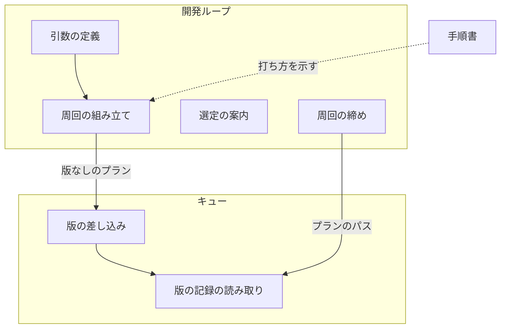
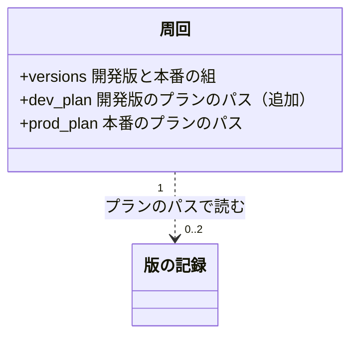
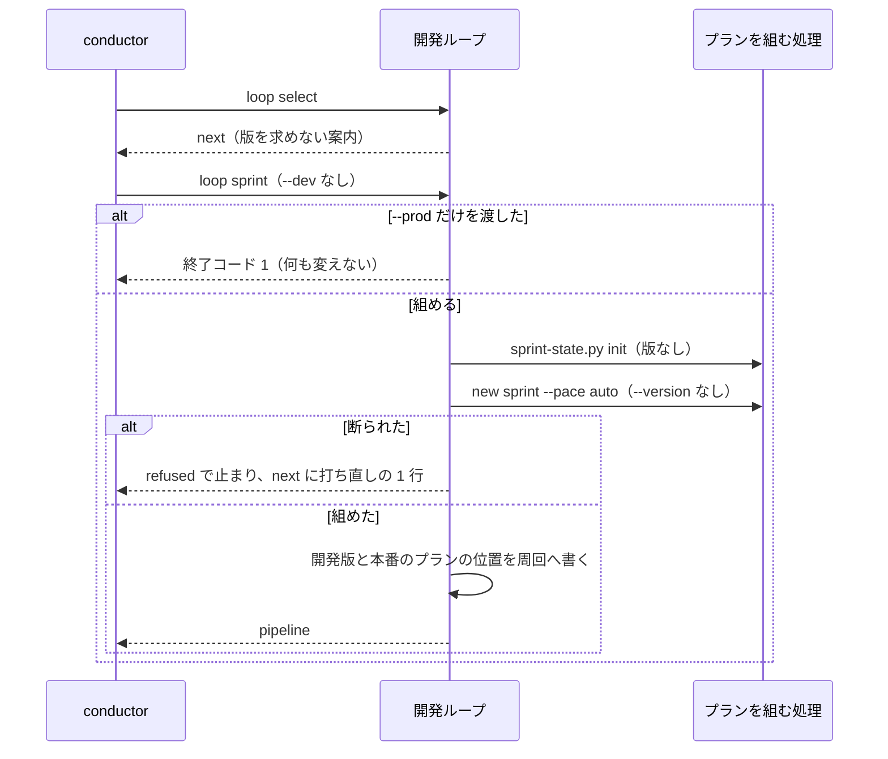
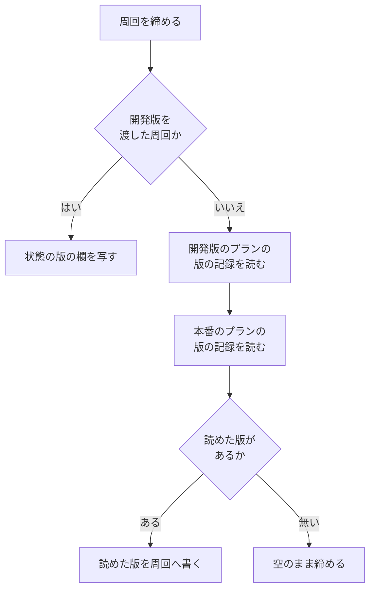

# 開発ループ: 周回ごとに版を決めずにスプリントを組み、並行する配布があっても次に空いている開発版で出す（#2354）

## 目的

- **今どうなっているか**: 開発ループは開発版の版を必須で受け、明示の版のプランしか組めない。並行するスプリントが先にその版を出すと、周回は配布の前に止まり、人か conductor が版を決めて組み直す
- **誰に効くか**: 開発ループを回す conductor と、止まった周回を受け取る利用者
- **変えると何が成り立つか**: `--dev` を省いて組むと、キューが流す直前に次に空いている開発版を決めるため、開発版のぶつかりでは周回が止まらない。周回の記録には実際に使った版が残る

## 適用範囲

- **働く範囲**: NDF の配布物のうち開発ループ（`sprint-state.py loop`）。配布先のリポジトリでも同じに働く
- **プロジェクトごとに違うもの**: 配布の形は `.ndf/supervise.json` の宣言で受け、版を出さない形では版の記録が作られず、周回の版は空のままになる。明示したいときは引数 `--dev` で受ける
- **当たるモード**: 開発ループが組むすべてのスプリント

## あるべき姿の根拠

| 根拠 | 種類 | 何を示すか |
| --- | --- | --- |
| 「範囲を、起きた不具合に根拠のあるものに絞る: 版数・リリース記録の PR の直前の解決（#2164）・実行条件を先に評価（#2349）・流し直しの判定（#2349）・開発ループの版（#2354）」（#2344 の承認ゲート 1、2026-11-05） | 利用者の指示の原文 | 開発ループの版を流す時点の解決へ載せること |
| `sprint-state.py init` と `supervise.py new sprint --pace auto` を `--version` なしで打つと 0 で返り、開発版と本番のプランの「版」の欄は差し込みを持つ（2026-11-06、一時の git リポジトリで実行。`package-plugin` の宣言あり） | 実測 | 開発ループが `--version` を渡さなければ、#2164 の経路に載ること |
| 同じ手順を配布の宣言なしで打つと 0 で返り、ステージは 設計・承認ゲート 1・設計の結果・スプリントブランチ・実装・検査・リリースの 7 つで、「版」の欄と差し込みを持つプランは 0 本（2026-11-06、一時の git リポジトリで実行） | 実測 | 版を出さない形でも、同じ打ち方で組めること |

要求と受け入れ条件は #2354 の本文にある（コピーは [issue-2354-requirements.md](issue-2354-requirements.md) ）。この文書は「どう作るか」だけを扱う。

## ドメインモデル

### コンテキスト

| コンテキスト | 何の語が 1 つの意味に決まるか |
| --- | --- |
| 開発ワークフロー（`ndf-workflow`） | 開発ループ・周回・ループの記録・版の差し込み・版の記録・版の決め直し・明示の版 |

このコンテキストの中で完結するため、コンテキストマップの関係は宣言しない。

### 集約

| 集約 | 持ち主（書き換えてよいもの） | 根 | エンティティ | 値オブジェクト |
| --- | --- | --- | --- | --- |
| ループの記録 | 開発ループ（`lib/sprint_loop*.py`） | ループ | 周回 | 周回の版（開発版と本番の組） |
| 版の記録 | キューの版の差し込み（`supervise_lib/queue_fill.py`） | プランごとの記録 | — | 決めた版と決め直しの履歴 |

開発ループは版の記録を読むだけで書かない。プランのパスだけを持って参照する。

### 不変条件

| # | 集約 | 条件 | 破れたときの扱い |
| --- | --- | --- | --- |
| I1 | ループの記録 | 開発版を渡さない周回は、組んだプラン・`sprint.json`・周回の組み立てのコマンドに版数を持たない | テストで落とす |
| I2 | ループの記録 | 開発版を渡す周回は、組み立て・周回の版・既出の扱いが今と同じである | テストで落とす |
| I3 | ループの記録 | 本番の版は開発版と一緒にだけ受ける | 終了コード 1 で断り、状態ファイル・プラン・ループの記録のどれも変えない |
| I4 | ループの記録 | 開発版を渡さない周回の版は、周回を締めるときに版の記録から写す。本番の版を開発版から導かない | テストで落とす |
| I5 | ループの記録 | 版の記録が無い・読めないことは周回の締めを止めない | 版の欄を空のまま締める |
| I6 | ループの記録 | レーンの配布の依頼の答えで受け取った本番の版は、締め直しで失わない | テストで落とす |
| I7 | 版の記録 | 開発ループは版の記録を書かない | テストで落とす |

### ドメインイベント

| # | イベント | 発生元 | 受け手 |
| --- | --- | --- | --- |
| E1 | conductor が `--dev` なしで `loop sprint` を打った | conductor | 開発ループ |
| E2 | 開発ループが版を持たないスプリントのプランを組んだ | 開発ループ | キュー |
| E3 | 別のスプリントが同じ系列の版を先に出した | 並行するスプリントの配布 | キュー（E4・E5 の判定で読む） |
| E4 | キューが開発版のプランの直前に版を決め、版の記録を書いた | キュー | 配布のステップ・開発ループ（E8 で読む） |
| E5 | キューが版を決め直した | キュー | 配布のステップ・開発ループ（E8 で読む） |
| E6 | 開発版を出した | 配布のステップ | キュー（本番のステージ） |
| E7 | 本番の版を開発版の記録から決めた、またはレーンの配布の依頼の答えで本番の版を受け取った | キュー、またはオーガナイザー | 開発ループ（E8 で読む） |
| E8 | 周回を締め、出した版を周回の記録へ書いた | 開発ループ | `laps.md` の描画・周回の境の判定 |

### 用語

| 用語 | 意味 | 用語集への反映 |
| --- | --- | --- |
| 開発ループ | スプリントを 1 つ終えるたびに次のスプリントを選んで続けて始める進め方 | 変更なし |
| 周回 | 開発ループの 1 回分 | 変更なし |
| ループの記録 | 周回ごとの選定・判定・版・費用を持つ記録 | 変更なし |
| 版の差し込み | プランの版を書く箇所に置き、キューが流す直前に埋める語 | 変更なし |
| 版の記録 | キューが決めた版を持つプランごとの記録 | 変更なし |
| 版の決め直し | 流し直しで記録の開発版がもう出ていたときに、次に空いている版へ取り直すこと | 変更なし |
| 明示の版 | 呼ぶ側が渡した版 | 変更なし |

## 外部の調査

省く: 開発ループの引数の任意化と周回の記録への転記で、形はプロジェクトの中の取り決め（#2164 の版の規則と周回の記録の形）だけで決まり、版を決める規則も変えないため、外部の判断が要らない。

## 機能一覧

| # | 機能 | 誰が使うか |
| --- | --- | --- |
| F1 | 開発版を決めずにスプリントを組む | conductor |
| F2 | 必要なときに開発版を明示して組む | conductor |
| F3 | `--level` で上げ幅を渡して組む | conductor |
| F4 | 周回の記録で、周回ごとに使った版を読む | 利用者・conductor |
| F5 | 選定の後と組めなかった後に、版を求めない打ち方の案内を受け取る | conductor |

## 構成要素

| 要素 | 責務 | 扱い |
| --- | --- | --- |
| 引数の定義（`lib/sprint_loop_cli.py`） | `--dev` を任意で受ける | 変更 |
| 周回の組み立て（`lib/sprint_loop.py`） | 開発版の有無で周回の版と組み立てのコマンドを決める。`--prod` だけの呼び方を断る。組めなかった後の案内を出す。開発版のプランの位置を周回へ持つ | 変更 |
| 選定の案内（`lib/sprint_loop_select.py`） | 選定の後の案内から版の指定を外す | 変更 |
| 周回の締め（`lib/sprint_loop_gate.py`） | 開発版を渡さなかった周回の版を、版の記録から写す | 変更 |
| 版の記録の読み取り（`supervise_lib/queue_fill.py`） | プランのパスから版の記録の版を返す | 追加 |
| 手順書（`skills/development-workflow/references/loop.md`） | 手順 2・3 と実例の打ち方から、版を決める手順を外す | 変更 |

開発版のプランの差し込み・版の決定・版の決め直し（`fill_release_version`・`release_version.py`）は変えない。



### 文脈

外部の系は origin の git と GitHub で、開発ループからの出入りは変わらない。origin を読むのは今と同じくキューである。


### 置き場所

```text
plugins/ndf/
├── scripts/
│   ├── lib/
│   │   ├── sprint_loop.py          # 変更
│   │   ├── sprint_loop_cli.py      # 変更
│   │   ├── sprint_loop_gate.py     # 変更
│   │   └── sprint_loop_select.py   # 変更
│   ├── supervise_lib/
│   │   └── queue_fill.py           # 変更
│   └── tests/
│       ├── test_sprint_loop.py     # 変更
│       └── test_release_version.py # 変更
└── skills/development-workflow/references/
    └── loop.md                     # 変更
```

## 構造

触る型は周回の行（`loop.json` の辞書）だけである。鍵を 1 つ足し、周回の版の鍵は変えない。



## 入出力の契約

### `sprint-state.py loop sprint`

| 項目 | 内容 |
| --- | --- |
| 名前 | `sprint-state.py loop sprint <名> --mode <モード> [--dev <開発版>] [--prod <本番の版>] [-- <new sprint に足す引数>]` |
| 入力 | `--mode` は必須。`--dev`・`--prod` は任意で、空文字の `--dev` は省いたものとして扱う。`--` より後は `new sprint` へそのまま渡す（`--level` を含む） |
| 出力（`--dev` なし） | 今と同じ `metrics`。周回の版は開発版・本番とも空文字で、`sprint_command` に `--version` が無い。`sprint-state.py init` へ `--dev`・`--prod` を渡さない |
| 出力（`--dev` あり） | 今と同じ |
| 失敗の形 | `--prod` だけを渡すと終了コード 1。`summary` に「`--prod` は `--dev` と一緒に渡す」旨が出て、`metrics.status` は `refused`。周回の記録を開く前に断るため、何も変えない。ほかの失敗は今と同じ（`refused` で止まる） |
| 互換性 | 今の呼び方はそのまま通る。`--dev` なしの `--prod` は今も打てないため、断っても既存の呼び方を壊さない |

### 案内の文

| 場面 | 示す 1 行 |
| --- | --- |
| `loop select` の `next` | `モードを決め、対象外は loop exclude で外し、python3 <sprint-state.py> loop sprint <名> --mode <モード> を打つ` |
| 組めなかった後の `next` | `python3 <sprint-state.py> loop sprint <名> --mode <モード>（モードを決め直す）` |

### `queue_fill.recorded_version`

| 項目 | 内容 |
| --- | --- |
| 名前 | `recorded_version(plan: str) -> str \| None` |
| 入力 | プランのパス |
| 出力 | プランの状態ディレクトリの版の記録の `version`。無い・読めない・文字列でなければ `None` |
| 失敗の形 | 例外を投げない。版の記録を書かない |
| 互換性 | 新しい関数で、既存の呼び出しを変えない |

### 周回の記録の版

| 周回の形 | 締めた後の `versions` |
| --- | --- |
| 開発版を渡した | 今と同じ（スプリント状態の版の欄、無ければ周回の版） |
| 渡さなかった・版の記録あり | 開発版は開発版のプランの版の記録。本番は本番のプランの版の記録、無ければ周回の持つ本番の版 |
| 渡さなかった・版の記録なし | 値は空のまま。`laps.md` の版の列は空の印 `—` になる |

### 版の欄が空になることの読み手

周回の版とスプリント状態の版の欄を読む箇所を次のとおり確かめた。いずれも空の値で働くため、変える対象に載せない。

| 読む箇所 | 空のときの振る舞い |
| --- | --- |
| `sprint-state.py` の `default_label` | 版を外したラベル（`開発版 #<課題>`）になる |
| `sprint-state.py` の現在地の版の行 | 行を出さない |
| `sprint-state.py` の `next_block` のテンプレート | `{dev}` は空で埋まる。開発ループのテンプレート（`resume_command`）は `{dev}`・`{prod}` を持たない |
| `sprint_loop_gate2.py` の `settle_release`・`finish_held` | 本番の版の有無を見て書く |
| `sprint_loop_record.py` の `lap_rows`・`render_lap_overview` | 空の版を外し、すべて空なら `—` を出す |

## 処理の流れ

### 組む

手順書は実行の流れに現れないため、図に含めない。



### 流す

変更は無い。開発版のプランの直前にキューが版を決めて版の記録を書き（E4）、流し直しで記録の版がもう出ていれば決め直す（E5）。origin を読めなければ流さず `unreadable` で止まる。

### 締める

周回を締める箇所（`close_lap`）の版の転記を、次の判定へ置き換える。「周回を締める」は完了・失敗・人へ戻した・配布待ち・質問待ちのすべてと、保留の周回の締め直しを指す。



## 非機能の実現方式

| 大項目 | 要求の条件 | 実現方式 | 確かめ方 |
| --- | --- | --- | --- |
| 運用・保守性 | 周回の記録の版の出所は、スプリント状態の版の欄と版の記録の 2 つに限る。周回の記録だけを読めば、周回ごとの出した版が分かる状態を保つ | 締めるときに 2 つから写し、周回の記録に値として固定する。レーンの答えの版（E7）は今の経路のまま残す | 締めた後の `loop.json` と `laps.md` を読むテスト |
| 移行性 | 進行中の周回の記録と、`--dev` を渡して組んだプランはそのまま流れる。記録の形（`versions` の鍵）を変えない | 開発版を渡した周回は新しい鍵を読まない。`dev_plan` の無い周回は開発版を持つため、この経路を通らない | `dev_plan` を持たない進行中の周回の記録を締めるテスト |

## 決定の記録

### 決定 1: 周回の記録の読み手が版の記録を読まずに済むよう、周回の版は締めるときにだけ書く

ループの記録は、費用・秒・承認ゲートの判定・版を周回を締めるときに写して固定する形で、版もこの形に合わせる。描画と周回の境の判定は周回の記録だけを読み、ファイルの読み取りを増やさない。

`laps.md` を描くたびに版の記録を読む形は採らない。描画が別の置き場を読むことになり、進行中の周回の版が、書き直すたびに読むファイルの状態で変わるためである。

根拠: Value 5（MVV 版 6）

### 決定 2: 出していない本番の版を周回の記録に載せないよう、本番の版は本番のプランの版の記録から読み、開発版から導かない

開発版を渡さない周回では、本番へ進まなかった周回に本番の版を載せないため、本番のプランが書いた版の記録だけを読む。レーンでは本番のプランが配布の依頼で版の記録を持たないため、配布の依頼の答えで受け取った周回の本番の版を保つ。

開発版の接尾辞を外した版を本番の版として書く形は採らない。周回が本番へ進まなくても版が載り、確かめていない版を記録するためである。開発版を渡した周回の導き方は今のまま残す（受け入れ条件 6）。

根拠: Value 1（MVV 版 6）

### 決定 3: 版の記録の置き場を 1 か所で扱うよう、読み取りを持ち主のキューの版の差し込みの層へ置き、周回は開発版のプランの位置だけを持つ

ファイル名と状態ディレクトリの決め方は版の差し込みが持つため、読み取りも同じ層に置く。#2344 が版の記録を解決の控えへ移すときは、この 1 つの関数を持ち替えれば開発ループの側は変わらない。開発版のプランの位置は、本番のプランの位置と同じく組むときに周回へ書く。

開発ループの中で `version.json` のパスを組み立てる形は採らない。置き場の知識が 2 か所へ分かれるためである。締めるときに `sprint.json` を読み直してプランを探す形も採らない。本番のプランの位置を周回が持つ今の形と分かれ、読むファイルが増えるためである。

根拠: Value 7（MVV 版 6）

### 決定 4: どのプロジェクトでも同じ打ち方で通るよう、配布のテンプレートを持たない形に分岐を足さない

配布の宣言が無いプロジェクトでも `--version` なしで組め、「版」の欄を持つプランが 0 本になることを実行で確かめた。開発版のステージが無ければプランの位置は空で、版の記録も読まれず、周回の版は空のまま締まる。受け入れ条件 10 と同じ経路に入るため、配布の形を見る分岐は要らない。

根拠: Value 6（MVV 版 6）

## テスト設計

| 受け入れ条件・不変条件 | どの振る舞いで縛るか | どう壊したら落ちるべきか |
| --- | --- | --- |
| 1・I1 | `--dev` なしの `loop sprint` が 0 で返り、開発版のプランの `明示` が空で、プランと `sprint.json` に版数の形が無い | `--dev` の既定に版を入れると落ちる |
| 2・I1 | 周回の組み立てのコマンドに `--version` が無い | 空の値で `--version` を渡すと落ちる |
| 3 | 組んだ後に origin へ版とタグを足して差し込みを流すと、作り直さずに次に空いている版で埋まり、版の記録の `how` が `decided` | `--version` を渡す経路へ戻すと落ちる |
| 4 | 記録の後に別のスプリントがその版を出すと、決め直して `history` に 1 件入る | 開発ループが組むプランを `explicit` にすると落ちる |
| 5・6・I2 | `--dev` ありのコマンド・`明示`・周回の版・既出のときの `taken` が今と同じ | `--dev` の有無の判定を逆にすると落ちる。`--prod` なしで本番の版を導かなくすると落ちる |
| 7・I3 | `--prod` だけで終了コード 1 と理由が返り、状態ファイルが無く、`new sprint` が呼ばれず、ループの記録が同じ | 断る判定を外すと落ちる。判定を `sprint-state.py init` の後へ動かすと落ちる |
| 8 | `-- --level minor` で組んだ開発版のプランの `上げ幅` が `minor` | `--` より後を渡さなくすると落ちる |
| 9・I4 | 締めた後の周回の開発版が版の記録の版で、`laps.md` の版の列に出る。決め直した周回は後の版が載る。本番へ進まなかった周回の本番の版は空 | 締める処理で版の記録を読まなくすると落ちる。開発版から本番の版を導くと落ちる |
| 10・I5 | 版の記録が無い・壊れているとき、周回は今の結果のまま締まり、版の欄が空で `laps.md` が `—` | 読み取りの例外を通すと落ちる |
| 11 | 2 つの `next` の行に `--dev` が無く、モードを埋めて打つと組める | 案内に `--dev` を戻すと落ちる |
| 12 | `--help` の使い方の行が `[--dev DEV]` | `required=True` へ戻すと落ちる |
| 13 | 手順書の手順 2・3 のコマンドを、書く前に実行して通ることを確かめる | テストにしない（`.md` の文言を照合するテストを書かない）。コードレビューで見る |
| 14 | `test_sprint_loop.py` が通り、`--dev` を渡す既存のテストの期待値が変わらない（`next` の文面の行を除く） | 既定の振る舞いを変えると既存のテストが落ちる |
| I6 | レーンの周回で、答えの本番の版が締め直しの後も残る | 締める処理が本番の版を空で上書きすると落ちる |
| I7 | 周回を締めても版の記録のファイルが変わらない | 読み取りが書き込みを持つと落ちる |
| 移行性 | `dev_plan` を持たない進行中の周回が今の値で締まる | 新しい鍵を必須で読むと落ちる |

## 設計の結果

| 課題 | 扱い | 取り込み先 | 触るファイル |
| --- | --- | --- | --- |
| #2354 | 実装する | — | `plugins/ndf/scripts/lib/sprint_loop.py`、`plugins/ndf/scripts/lib/sprint_loop_cli.py`、`plugins/ndf/scripts/lib/sprint_loop_gate.py`、`plugins/ndf/scripts/lib/sprint_loop_select.py`、`plugins/ndf/scripts/supervise_lib/queue_fill.py`、`plugins/ndf/scripts/tests/test_sprint_loop.py`、`plugins/ndf/scripts/tests/test_release_version.py`、`plugins/ndf/skills/development-workflow/references/loop.md` |

## 未確認のまま残ること

| 項目 | 内容 |
| --- | --- |
| #2344 との順序 | #2344 の設計は同じ `--dev` の任意化を含み、周回の版は配布の答えで埋まると書く（`issues/issue-2344-design.md` の入出力の契約の表）。レーンでない周回は配布の依頼を送らず答えが届かないため、版の記録を読むこの設計とは経路が違う。#2344 を後から実装するときは、開発ループの変更を既存の実装として扱い、`recorded_version` を解決の控えの読み取りへ持ち替える。#2354 の前提 1 の「開発ループの側は変更が要らない」は、この関数を除いた範囲で成り立つ |
| 版の出所の 3 つ目 | 要求の非機能の条件は出所を 2 つに限るが、同じ要求の E7 はレーンの配布の依頼の答えを本番の版の受け取りとして挙げる。この設計は答えの経路を今のまま残す（I6）。条件の文言を直すかは承認ゲート 1 で人が見る |
| 版の記録と出した版の差 | 版の記録は配布の前に書かれるため、配布に失敗した周回では出していない版が周回の記録に載る。受け入れ条件 9 の「版の記録を書いていれば」に従う。開発版を渡した周回でも同じく出す予定の版が載る |
| まとめの配布の版 | まとめのプランも流す時点に版を決めるが、周回の記録へ写すのはスプリントの開発版のプランの版だけである。開発版を渡した周回と同じ範囲に保つ |
| 用語集の語義 | 用語集の「版の差し込み」「版の記録」「版の決め直し」は #2344 の後の形で書かれ、解決の控えの語を含む。この課題の用語は要求の表のとおり今の実装を指す。用語集は変えない |
| 手動確認 | 開発ループの 1 周を `--dev` なしで回す確認は、開発版を入れた環境でのリリース後テストで行う。並行するスプリントとのぶつかりの頻度は測らない（要求の前提 5） |
