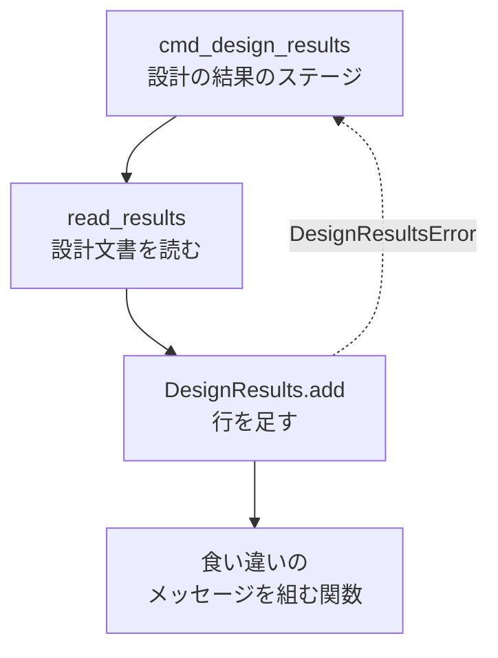
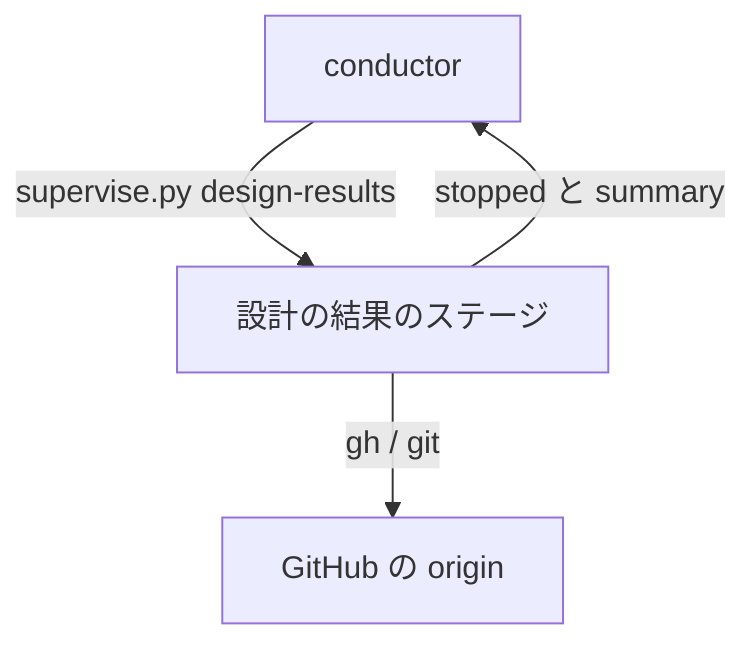
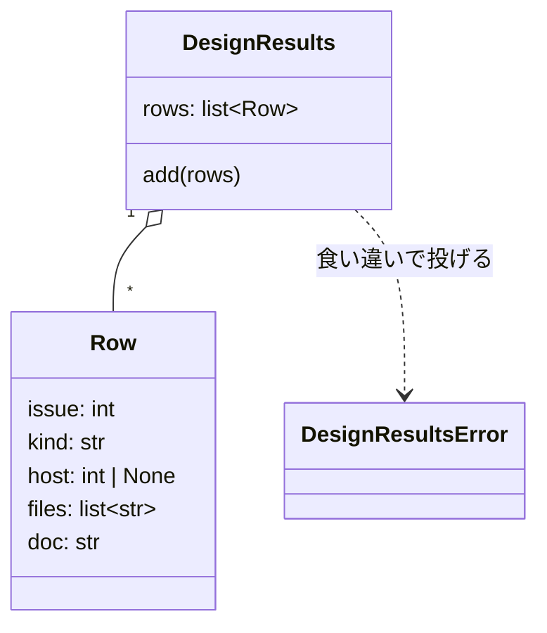
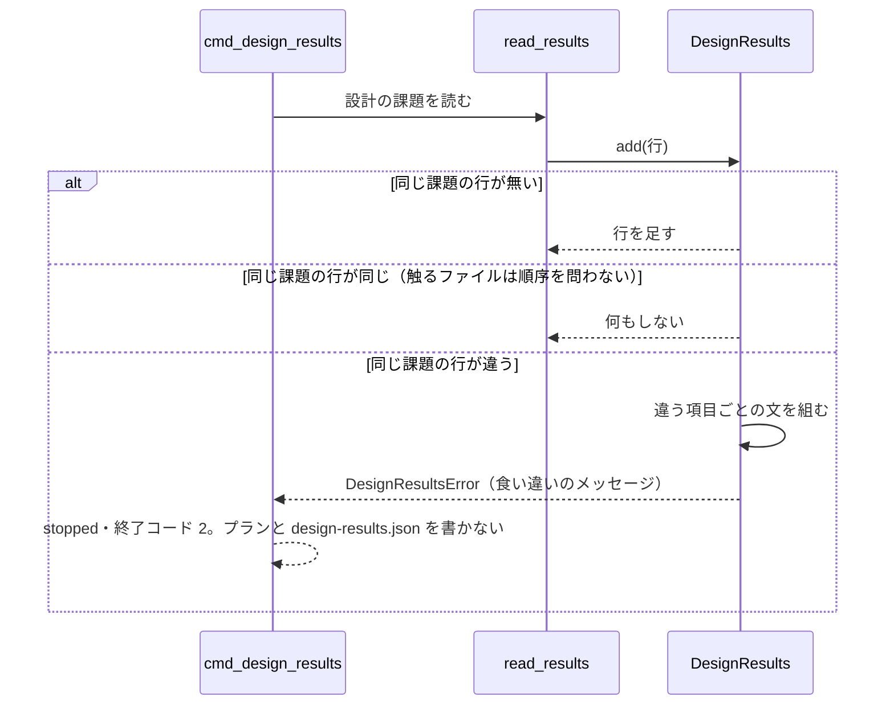

# 設計の結果の食い違い: 止まった理由のメッセージだけで、そろえる設計文書と項目が分かる（#2361）

## 目的

- **今どうなっているか**: 同じ課題に 2 本の設計文書が違う設計の結果を書いていると、`supervise.py design-results` は `#2336 に違う扱いが書かれている（実装する と 実装する）` で止まる。比べるのは扱い・取り込み先・触るファイルの 3 つなのに、メッセージには扱いしか出ない。実例では違っていたのは触るファイル（5 個と 18 個）で、原因を探すのにコードを読んだ
- **誰に効くか**: 開発ループで止まった工程を人へ戻す conductor と、戻されて設計文書を直す人
- **変えると何が成り立つか**: メッセージに違う項目・両方の値・2 本の設計文書のパスが載り、どの設計文書のどの項目をそろえればよいかがメッセージだけで分かる。止まるかどうかの判定と結果の形は変わらない

## 適用範囲

- **働く範囲**: NDF のスプリントの「設計の結果」のステージ（`supervise.py design-results`）。配布先のリポジトリでも同じスクリプトが動くため、そこでも働く
- **プロジェクトごとに違うもの**: 無し（メッセージの文だけを変え、設定も引数も足さない）
- **当たるモード**: `standard`

## あるべき姿の根拠

| 根拠 | 種類 | 何を示すか |
| --- | --- | --- |
| #2361 の本文「依頼（原文）」のメッセージ `設計の結果を書けない: #2336 に違う扱いが書かれている（実装する と 実装する）。人へ戻す` と、実際の違いが触るファイル（5 個と 18 個）だったという記録 | 実測（開発ループ lroot の周回 2 で出たメッセージ） | 扱いだけを出すメッセージでは、違いが扱い以外のとき何も読めない |
| `plugins/ndf/scripts/lib/design_results.py:64` の比較 `(old.kind, old.host, sorted(old.files)) != (r.kind, r.host, sorted(r.files))` と、`:65` のメッセージ `f"#{r.issue} に違う扱いが書かれている（{old.kind} と {r.kind}）"` | 一次情報（コード） | 比べる項目は 3 つ、メッセージに出すのは 1 つ |

要求と受け入れ条件は #2361 の本文にある（コピーは `issues/issue-2361-requirements.md`）。この文書は「どう作るか」だけを扱う。

## ドメインモデル

### コンテキスト

| コンテキスト | 何の語が 1 つの意味に決まるか |
| --- | --- |
| NDF の開発の工程（`ndf-workflow`） | 設計の結果・扱い・取り込み先・触るファイル・食い違い |

1 つのコンテキストに収まる。

### 集約

| 集約 | 持ち主（書き換えてよいもの） | 根 | エンティティ | 値オブジェクト |
| --- | --- | --- | --- | --- |
| 設計の結果 | 設計の結果の値オブジェクトのモジュール（`plugins/ndf/scripts/lib/design_results.py` の `DesignResults.add`） | 設計の結果（`DesignResults`） | 行（`Row`。課題の番号で識別する） | 扱い・取り込み先・触るファイル・設計文書のパス |

設計の結果のステージ（`supervise_lib/design_stage.py`）は集約を読むだけで、行を足すのは `DesignResults.add` だけである。この変更は集約の境界を変えない。

### 不変条件

| # | 集約 | 条件 | 破れたときの扱い |
| --- | --- | --- | --- |
| I1 | 設計の結果 | 1 つの課題の行は 1 つだけである。同じ課題の行の扱い・取り込み先・触るファイルのどれかが違えば、行を足さずに `DesignResultsError` で止まる | 今の振る舞い。この変更でも保つ |
| I2 | 設計の結果 | 触るファイルは順序を問わずに比べる。並びだけが違う 2 行は食い違いにしない | 今の振る舞い。この変更でも保つ |
| I3 | 設計の結果 | 食い違いのメッセージは、違う項目をすべて、扱い・取り込み先・触るファイルの順で載せ、同じ値の項目は載せない | テストが落ちる |
| I4 | 設計の結果 | 食い違いのメッセージの値は、先に読んだ設計文書の値、後に読んだ設計文書の値の順で並び、2 本のパスも同じ順で載る | テストが落ちる |
| I5 | 設計の結果 | 食い違いで止まったとき、実装のプランと `design-results.json` を書かない | 今の振る舞い。この変更でも保つ |

### ドメインイベント

| # | イベント | 発生元 | 受け手 |
| --- | --- | --- | --- |
| E1 | 設計の課題ごとに、マージ済みの設計 PR の設計文書から設計の結果の行を読んだ | 設計の結果のステージ（`read_results`） | 設計の結果（`DesignResults.add`） |
| E2 | すでに合わせた行の中に、同じ課題の行が見つかった | 設計の結果（`DesignResults.add`） | 同じ集約の中の比較 |
| E3 | 2 つの行の項目を比べ、違う項目を見つけた | 設計の結果（`DesignResults.add`） | 食い違いのメッセージを組む関数 |
| E4 | 違う項目・両方の値・両方の設計文書のパスを載せたメッセージで止まった | 設計の結果（`DesignResultsError`） | 設計の結果のステージ（`cmd_design_results`）。結果を `stopped`・終了コード 2 で返し、conductor が人へ戻す |

### 用語

| 用語 | 意味 | 用語集への反映 |
| --- | --- | --- |
| 食い違い | 同じ課題について、2 本の設計文書が違う設計の結果（扱い・取り込み先・触るファイルのどれか）を書いていること。設計の結果のステージは食い違いを見つけると止まり、人へ戻す | 追加（`ndf-workflow`） |

扱い・取り込み先・触るファイル・設計の結果は、要求の工程で用語集へ足した意味のまま使う。

## 機能一覧

| # | 機能 | 誰が使うか |
| --- | --- | --- |
| F1 | 食い違いで止まったとき、違う項目・両方の値・2 本の設計文書のパスをメッセージで示す | conductor（結果の `summary` を人へ渡す）と、設計文書を直す人 |

## 構成要素

| 要素 | 責務 | 変更 |
| --- | --- | --- |
| `DesignResults.add`（`plugins/ndf/scripts/lib/design_results.py`） | 行を足し、同じ課題の行が違えば `DesignResultsError` を投げる | 投げるときのメッセージを、下の食い違いのメッセージを組む関数で作る。比べる条件は変えない |
| 食い違いのメッセージを組む関数（同じファイルに新設。モジュールの外へ公開しない） | 先の行と後の行を受け、違う項目ごとの文を「入出力の契約」の形で組んで返す。比べるのは扱い・取り込み先・触るファイルの 3 つ | 新設 |
| `cmd_design_results`（`plugins/ndf/scripts/supervise_lib/design_stage.py`） | `DesignResultsError` を受け、`設計の結果を書けない: <メッセージ>。人へ戻す` の `stopped`・終了コード 2 で返す | 変えない |
| テスト（`plugins/ndf/scripts/tests/test_design_results_rewrite.py`） | 受け入れ条件 1〜7 と不変条件 I1〜I5 を縛る | 足す |



### システム構成

動く場所と外部の系は変わらない。設計の結果のステージは conductor が打つ `supervise.py design-results` の中で動き、設計文書を origin の基点のブランチから `git` で、設計 PR を `gh` で読む。



### パッケージ構成

```
plugins/ndf/scripts/
├── lib/
│   └── design_results.py          # 変える（DesignResults.add と、食い違いのメッセージを組む関数）
├── supervise_lib/
│   └── design_stage.py            # 変えない
└── tests/
    └── test_design_results_rewrite.py  # テストを足す
```

## 構造

型は変えない。`Row` の項目（`issue`・`kind`・`host`・`files`・`doc`）も `DesignResultsError` の型もそのままで、`DesignResults.add` が投げるメッセージの中身だけが変わる。



## 入出力の契約

**結果の JSON の形・状態・終了コードは変えない。** 変わるのは、食い違いで止まったときの `summary` の文だけである。`summary` は今と同じく `設計の結果を書けない: ` で始まり `。人へ戻す` で終わる（前後は `cmd_design_results` が付け、変えない）。

### 食い違いのメッセージ（`DesignResultsError` の文）

1 行で組む。

```text
#<課題> の設計の結果が 2 本の設計文書で違う（先: <先のパス> / 後: <後のパス> ）。<項目の文>。<項目の文>…
```

| 部分 | 中身 |
| --- | --- |
| `<課題>` | 食い違った課題の番号 |
| `先` / `後` | `DesignResults.add` で、すでに合わせてあった行が先、新しく足そうとした行が後 |
| `<先のパス>` / `<後のパス>` | 行の設計文書のパス（`Row.doc`）。空なら `パスの記録なし` |
| `<項目の文>` | 違う項目ごとに 1 つ。扱い → 取り込み先 → 触るファイルの順。同じ値の項目は出さない |

項目の文は、値を `先 / 後` の順で並べる。

| 項目 | 形 | 値の書き方 |
| --- | --- | --- |
| 扱い | `扱い: <先> / <後>` | `実装する` / `取り込む` / `閉じる` |
| 取り込み先 | `取り込み先: <先> / <後>` | `#<番号>`。取り込み先を持たない行は `—`（設計文書の表と同じ記号） |
| 触るファイル | `触るファイル: <先の個数> 個 / <後の個数> 個（先にだけある: <ファイル>, … / 後にだけある: <ファイル>, … ）` | 個数は行の触るファイルの数。括弧の中は、片方にしか無いファイルを、その設計文書に書かれた順で `, ` 区切りに並べる。片方にしか無いファイルが無い側は、その部分（`先にだけある: …` か `後にだけある: …`）を出さない |

パスとファイルの直後には半角スペースか半角の記号を置き、全角の文字を密着させない。メッセージを開いた画面でパスをそのまま開けるようにするためである。

### 例

扱いが同じ `実装する` で、触るファイルが違う（受け入れ条件 3）:

```text
設計の結果を書けない: #2336 の設計の結果が 2 本の設計文書で違う（先: issues/issue-2335-design.md / 後: issues/issue-2336-design.md ）。触るファイル: 2 個 / 4 個（後にだけある: pkg/c.py, pkg/d.py ）。人へ戻す
```

扱いが同じ `取り込む` で、取り込み先が違う（受け入れ条件 2）:

```text
設計の結果を書けない: #13 の設計の結果が 2 本の設計文書で違う（先: issues/issue-11-design.md / 後: issues/issue-12-design.md ）。取り込み先: #11 / #12。人へ戻す
```

扱いが `実装する` と `取り込む` で違う（受け入れ条件 1・5。3 つの項目がすべて違う）:

```text
設計の結果を書けない: #12 の設計の結果が 2 本の設計文書で違う（先: issues/issue-11-design.md / 後: パスの記録なし ）。扱い: 実装する / 取り込む。取り込み先: — / #11。触るファイル: 1 個 / 0 個（先にだけある: pkg/a.py ）。人へ戻す
```

## 処理の流れ



## 非機能の実現方式

| 大項目 | 条件 | 実現方式 |
| --- | --- | --- |
| 運用・保守性 | 止まった理由がメッセージだけで分かり、原因を探すためにコードを読まなくてよい | 違う項目・両方の値・2 本のパスを、値とパスが同じ `先 / 後` の順で対応する 1 行のメッセージにする（「入出力の契約」）。触るファイルは差だけを出し、読み手が一覧を突き合わせなくてよいようにする |

## 決定の記録

### 決定 1: 結果の要約を他の止まり方とそろえるため、食い違いのメッセージを 1 行で組む

設計の結果のステージが止まる他の場合（打ち直しても読めない・取り込み先に流れるプランが無い）の `summary` は、どれも 1 行の文である。食い違いだけを複数行にすると、同じステージの要約の中で形が分かれる。項目は `。` で区切り、値は `先 / 後` の順で並べることで、1 行でも項目と値の対応が読める。

項目ごとに改行する形は採らない。どの読み手が改行をそのまま見せるかを確かめておらず、1 行の他の要約と形が分かれるためである。

根拠: Value 2・Value 6（MVV 版 4）

### 決定 2: 重なりの数だけの違いも読めるよう、触るファイルの差は重なりを数えて取る

触るファイルの比較は、並べ替えた一覧どうしで行う（`sorted(files)`）。同じファイルが片方に 2 回書かれていても違いになる。差を集合で取ると、この場合に「先にだけある」も「後にだけある」も空になり、メッセージから違いが読めない。差は重なりを数えて取り（片方で多く書かれた分を、その側にだけあるとして出す）、比較と同じ基準で違いを示す。個数も行の一覧の長さ（重なりを含む）で数える。

集合の差は採らない。比較の基準と表示の基準が分かれ、違うと判定したのに差が空のメッセージが出るためである。

根拠: Value 6（MVV 版 4）

### 決定 3: 読み手がパスと取り違えないよう、パスを持たない行は `パスの記録なし` と出す

行の設計文書のパスが空になるのは、テストなどで行を直接組んだときだけである（設計の結果のステージは読んだ文書のパスを必ず渡す）。空文字のまま出すと `先:  / 後: …` となり、どちらがどの値か読めない。`パスの記録なし` はパスの形を持たないため、ファイルの名前と取り違えない。

`—` は採らない。取り込み先を持たないことを表す記号として同じメッセージの中で使い、1 つの記号が 2 つの意味になるためである。

根拠: Value 8（MVV 版 4）

### 決定 4: 直す対象をメッセージだけで洗い出せるよう、片方にしか無いファイルは数を切らずにすべて出す

食い違いを直す人は、片方にしか無いファイルを 1 つずつ見て、どちらの設計文書に合わせるかを決める。一部だけを出して「ほか N 個」と省くと、残りを知るために設計文書を開いて突き合わせることになり、メッセージだけで分かるという目的に届かない。実例は 5 個と 18 個で、片方にしか無いファイルは多くても 23 個に収まる。

出す数に上限を設ける形は採らない。上限を超えた分は結局設計文書を読むことになるためである。

根拠: Value 2（MVV 版 4）

## テスト設計

| 受け入れ条件・不変条件 | どの振る舞いで縛るか | どう壊したら落ちるべきか |
| --- | --- | --- |
| 受け入れ条件 1 | 扱いが `実装する` と `取り込む` の 2 本を `DesignResults.add` で合わせると、メッセージに `#<課題>`・`扱い: 実装する / 取り込む` が載る | 扱いの文を出さないように壊す・値の順を入れ替えると落ちる |
| 受け入れ条件 2 | 扱いが同じ `取り込む` で取り込み先が違う 2 本では、`取り込み先: #11 / #12` が載り、`扱い:` は載らない | 同じ値の項目も出すように壊すと落ちる |
| 受け入れ条件 3 | 扱いが同じ `実装する` で触るファイルが違う 2 本では、`触るファイル: <先の個数> 個 / <後の個数> 個` と、各設計文書にしか無いファイルが載り、`扱い:` は載らない | 一覧の全体を出す・差の側を取り違えるように壊すと落ちる |
| 受け入れ条件 4 | 1〜3 のメッセージに `先: <先のパス> / 後: <後のパス>` が載る。パスが空の行では `パスの記録なし` が載る | 先と後のパスを入れ替える・空のパスをそのまま出すように壊すと落ちる |
| 受け入れ条件 5・I3 | 3 つの項目がすべて違う 2 本では、3 つの項目の文が扱い → 取り込み先 → 触るファイルの順で載る | 最初に見つけた 1 項目だけを出す・順を変えるように壊すと落ちる |
| 受け入れ条件 6・I2 | 触るファイルの順序だけが違う 2 本と、すべてが同じ 2 本は止まらず、行は 1 つのまま | 並べ替えずに比べるように壊すと落ちる |
| 受け入れ条件 7・I5 | 食い違いを返す読み出しを渡して `cmd_design_results` を通すと、`stopped`・終了コード 2・`summary` が `設計の結果を書けない: ` で始まり `。人へ戻す` で終わり、実装のプランと `design-results.json` が書き換わらない | 食い違いでもプランを書くように壊すと落ちる |
| I1 | 同じ課題の行が違うとき、`DesignResults.add` は行を足さずに `DesignResultsError` を投げる | 後の行で上書きするように壊すと落ちる |
| I4 | 先と後で値もパスも違う 2 本では、メッセージの値とパスがどちらも `先 / 後` の順で並ぶ | 値だけ・パスだけの順を入れ替えるように壊すと落ちる |
| 決定 2 | 同じファイルを片方で 2 回書いた 2 本では、そのファイルが多く書いた側の「にだけある」に載る | 集合の差で取るように壊すと落ちる |

## 設計の結果

| 課題 | 扱い | 取り込み先 | 触るファイル |
| --- | --- | --- | --- |
| #2361 | 実装する | — | `plugins/ndf/scripts/lib/design_results.py`、`plugins/ndf/scripts/tests/test_design_results_rewrite.py` |

## 未確認のまま残ること

| 項目 | 内容 |
| --- | --- |
| 実例の差の中身 | 本文の実例（`issues/issue-2335-design.md` は 5 個、`issues/issue-2336-design.md` は 18 個）のファイルの一覧は、PR https://github.com/devbasex/ai-plugins/pull/2360 でそろえた後のため、そろえる前の差を再現していない。メッセージの形はテストの入力で確かめる |
| 要約を見せる画面の折り返し | 片方にしか無いファイルが多いとき、1 行の `summary` を conductor の報告や進捗記録がどう折り返すかは確かめていない。決定 4 のとおり数を切らない |
