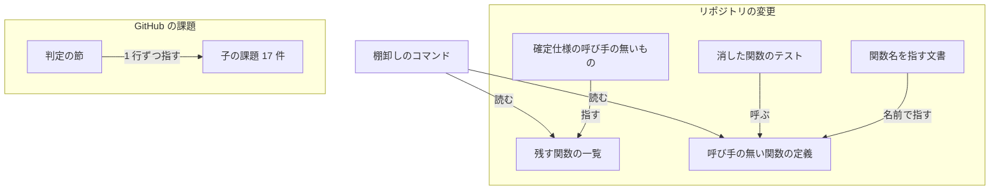
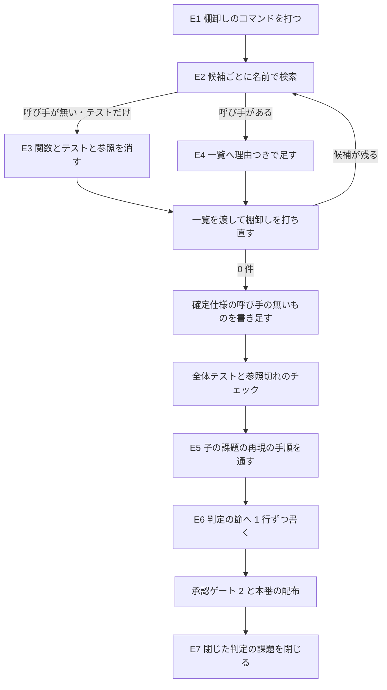

# NDF のスクリプト: 呼び手の無い関数を片付け、子の課題 17 件の解消を確かめて閉じる（#2369）

## 目的

- **今どうなっているか**: NDF のスクリプトには、テストの外から呼ばれない関数とメソッドが 70 件の候補として残っている（2026-11-04 の棚卸しのコマンドの結果）。柱 P0（#2336）の子の課題 17 件は、解消したかを 1 件ずつ確かめないまま開いている
- **誰に効くか**: 柱 P1〜P8（マイルストーン 29・30）で実行の核へ移す作業の担当と、課題の一覧から次に着手する課題を選ぶ利用者
- **変えると何が成り立つか**: 移す対象が実際に呼ばれる関数だけになり、残した関数には残す理由が 1 行ずつ付く。子の課題は、解消を確かめたものが閉じ、残したものに理由と根拠が付く

## 適用範囲

- **働く範囲**: このリポジトリの `plugins/ndf/scripts` と `plugins/ndf/skills/*/scripts` の下の `.py`（テストと実験版を除く）と、子の課題 17 件。配布先のリポジトリの振る舞いは変わらない
- **プロジェクトごとに違うもの**: 無し（このリポジトリの中の片付けで、設定も引数も足さない）
- **当たるモード**: `standard`

## あるべき姿の根拠

| 根拠 | 種類 | 何を示すか |
| --- | --- | --- |
| `uvx vulture plugins/ndf/scripts plugins/ndf/skills/*/scripts --exclude '*/tests/*,*/experimental/*' --min-confidence 60`（vulture 2.16、2026-11-04、develop 729dcbe40）で `unused function` 51 件・`unused method` 19 件 | 実測 | 呼び手の無い関数の候補は 70 件ある。どれを消すかは候補ごとに呼び手を確かめて決める |
| 同じ候補の名前でリポジトリを検索した結果（下の「候補の分類」）: 23 件は `getattr`・`globals()`・名前の辞書で呼ばれ、4 件は枠組み（pydantic・urllib）が呼ぶ | 実測 | vulture は名前で呼ぶ形を見られない。消す前に呼ばれ方を確かめる手順と、残す理由の置き場が要る |
| 確定仕様 `docs/specifications/ndf-entrypoint-contracts.md` の「呼び手の無いもの」（310〜315 行目）: 関数の棚卸しは `uvx vulture` で 1 回だけ行い、CI の常設の検査にしない | 既存の決定 | 残す関数の一覧は CI が読まない。次に棚卸しをする人が同じコマンドで同じ結果を得られれば足りる |
| #1601 の本文「直し方」: `metrics.aggregate` と、それだけが使う補助の関数と、そのテストを消す | 既存の課題 | 子の課題のうち少なくとも 1 件は、この片付けそのもので解消する |

要求と受け入れ条件は #2369 の本文にある（コピーは `issues/issue-2369-requirements.md`）。この文書は「どう作るか」だけを扱う。

この文書での呼び方は次のとおりにする。

| 呼び方 | 意味 |
| --- | --- |
| 棚卸しのコマンド | 要求の前提 2 の `uvx vulture <対象> --exclude '*/tests/*,*/experimental/*' --min-confidence 60`。残す関数の一覧を渡すときは対象の後ろにそのパスを足す |
| 候補 | 棚卸しのコマンドが `unused function` か `unused method` として出した 1 行 |
| 呼び手 | その関数を呼ぶ、テストの外のファイル（要求の用語と同じ） |
| 残す関数の一覧 | 呼び手が vulture に見えない関数を、理由つきで並べた vulture の許可リスト（要求の用語と同じ） |
| 子の課題 | 要求の受け入れ条件 6 に並ぶ 17 件 |
| 判定の節 | #2369 の本文の「子の課題の判定」の節 |
| 構造チェック | 要求の用語と同じく `scripts/check-ndf-contracts.py` を指す。`scripts/check-script-structure.py` はこの文書では名前で書く |

## ドメインモデル

### コンテキスト

| コンテキスト | 何の語が 1 つの意味に決まるか |
| --- | --- |
| NDF の開発ワークフロー（`ndf-workflow`） | エントリポイント・契約の一覧・構造チェック・呼び手・残す関数の一覧 |
| NDF の課題の棚卸し（`ndf-issue-upkeep`） | 子の課題・判定・再現の手順 |

開発ワークフローが供給者、課題の棚卸しが顧客の関係（顧客 / 供給者）である。課題の棚卸しは、開発ワークフローの片付けを終えた worktree で再現の手順を通し、その結果だけを受け取る。契約の一覧の形と構造チェックの規則は変えない（要求の対象範囲の「含まない」）。

### 集約

| 集約 | 持ち主（書き換えてよいもの） | 根 | エンティティ | 値オブジェクト |
| --- | --- | --- | --- | --- |
| 残す関数の一覧 | 棚卸しを行うその時点の担当（1 回の棚卸しを 1 つの変更として書き換える）。この課題の初版は E3・E4 の実装の担当が作る | 一覧のファイル（`scripts/ndf-vulture-keep.txt`） | 行（残す 1 つの名前） | 名前・定義のあるファイル・理由の種類・理由の本文 |
| 子の課題の判定 | この課題の実装だけ（#2369 の本文の判定の節だけを書き換える）。リリース後テストは判定の節を書き換えない | 判定の節 | 行（子の課題 1 件） | 再現の手順の結果・判定（閉じた / 残した）・理由の種類・根拠 |
| 契約の一覧 | #2336 の構造チェックの運用。この変更は、消したエントリポイントの項目の削除だけ書き換える | `plugins/ndf/contracts/` | エントリポイントの項目 | `callers`・`external` |

この変更が書き換えるのは、上の 2 つの集約と、呼び手の無い関数の定義だけである。契約の一覧は、呼び手の無いエントリポイントが見つかったときだけその項目を消す（2026-11-04 の構造チェックでは 0 件）。

### 不変条件

| # | 集約 | 条件 | 破れたときの扱い |
| --- | --- | --- | --- |
| I1 | 残す関数の一覧 | 棚卸しのコマンドへ一覧を渡すと、`unused function` と `unused method` が 0 件である（受け入れ条件 2） | 完了判定で止まる。出た候補を消すか、理由つきで一覧へ足す |
| I2 | 残す関数の一覧 | 名前の行はどれも、`#` の後ろに理由の種類（下の「理由の種類」の 6 つのどれか）と理由の本文を持つ（受け入れ条件 3） | 完了判定で止まる。理由を書くか、行を消してその関数を消す |
| I3 | 残す関数の一覧 | 名前の行はどれも、定義のあるファイルのパスを持ち、そのファイルにその名前の `def` がある | 完了判定で止まる。古い行を消す。古い行を残すと、同じ名前の呼び手の無い関数を棚卸しから隠す |
| I4 | 契約の一覧 | 構造チェックが終了コード 0 で `violations: 0` を返す（受け入れ条件 1） | CI のジョブ `ndf-contracts-check` が落ちる |
| I5 | 子の課題の判定 | 判定の節の行は 17 行で、子の課題 1 件に 1 行である（受け入れ条件 6） | 完了判定で止まる |
| I6 | 子の課題の判定 | 判定が「残した」の行は、理由の種類が「再現した」「判断待ち」「手順を起こせない」のどれかで、根拠（打ったコマンドと結果、または待っている判断）を持つ。その課題は本番の配布の後に開いている。#1709 のように既に閉じている課題は、E7 で開き直す（受け入れ条件 8） | 理由と根拠は完了判定で止まる。開いているかはリリース後テストで止まる。開き直す操作が失敗した課題は、判定の節を書き換えず、E7 の担当が失敗の内容を #2369 のコメントへ記録し、開き直す操作を 1 回だけやり直す。やり直しも失敗したら、受け入れ条件 8 をリリース後テストの記録で不合格にし、人へ戻す |
| I7 | 子の課題の判定 | 判定が「閉じた」の行の課題は、本番の配布の後に GitHub 上で閉じていて、判定の理由と通した手順の結果を書いたコメントを持つ（受け入れ条件 7） | リリース後テストで止まる。閉じる操作が失敗した課題は、判定の節を書き換えず、E7 の担当が失敗の内容を #2369 のコメントへ記録し、閉じる操作を 1 回だけやり直す。やり直しも失敗したら、受け入れ条件 7 をリリース後テストの記録で不合格にし、人へ戻す |
| I8 | 契約の一覧 | 契約の一覧の項目の差分は、消したエントリポイントの項目の削除だけである（受け入れ条件 5） | 完了判定で止まる。`git diff origin/develop -- plugins/ndf/contracts/entrypoints/` に削除以外の差分があれば、その差分を戻す |

### ドメインイベント

| # | イベント | 発生元 | 受け手 |
| --- | --- | --- | --- |
| E1 | 関数の棚卸しを行った | 実装の担当（棚卸しのコマンド） | E2 の手順 |
| E2 | 候補ごとに呼び手を確かめた | 実装の担当（候補の名前の検索） | E3・E4 |
| E3 | 呼び手の無い関数を消し、参照を直した | 実装の担当 | 全体テスト・参照切れのチェック・構造チェック |
| E4 | 残す関数を残す関数の一覧へ理由つきで載せた | 実装の担当 | 棚卸しのコマンド（I1） |
| E5 | 子の課題の再現の手順を通した | 実装の担当（E3・E4 の後の worktree） | E6 |
| E6 | 子の課題を閉じたか残したかを記録した | 実装の担当（判定の節） | 承認ゲート 2 の承認資料 |
| E7 | 判定が「閉じた」の子の課題を閉じ、「残した」の閉じている課題を開き直した | リリース後テストの担当（本番の配布の後） | リリース後テスト（I6・I7 の確認）。閉じる操作・開き直す操作の失敗は #2369 のコメントへ記録する |

E1〜E6 は要求のドメインイベントを引き継ぐ。E7 は、閉じる時期を本番の配布の後に置く決定 3 で足したイベントである。要求の E6 の「失敗したとき」の列（判定の行を「残した」にして理由に失敗を書く）は、この設計では使わない。閉じる操作の失敗の扱いは E7 へ移り、I6・I7 が持つ（置き換える理由は決定 3）。判定の節は実装だけが書き、E7 は判定の節を書き換えない。

### 用語

| 用語 | 意味 | 用語集への反映 |
| --- | --- | --- |
| 呼び手 | その関数かエントリポイントを呼ぶ、テストの外のファイル | 無し（要求の工程で追加済み） |
| 残す関数の一覧 | 呼び手が vulture に見えない関数を、理由つきで残す一覧。置き場は `scripts/ndf-vulture-keep.txt` | 意味の変更（置き場を書き足す） |

## 機能一覧

| # | 機能 | 誰が使うか |
| --- | --- | --- |
| F1 | 棚卸しのコマンドに残す関数の一覧を渡すと、呼び手の無い関数が 0 件になる | 次に棚卸しをする開発者 |
| F2 | 残した関数ごとに、残す理由と定義のあるファイルを一覧の 1 行で読める | 柱 P1〜P8 の担当・次に棚卸しをする開発者 |
| F3 | 子の課題 17 件の再現の結果・判定・理由を、#2369 の本文の 1 か所で読める | 承認ゲート 2 で承認する人・課題の棚卸しをする利用者 |
| F4 | 解消を確かめた子の課題が閉じ、閉じた理由をその課題のコメントで読める | 課題の一覧を読む利用者 |

## 構成要素

| 要素 | 責務 |
| --- | --- |
| 残す関数の一覧（`scripts/ndf-vulture-keep.txt`、新規） | 呼び手が vulture に見えない関数の名前を 1 行に 1 つ持ち、行ごとに理由の種類・理由・定義のあるファイルを持つ |
| 呼び手の無い関数の定義（`plugins/ndf/scripts/**`・`plugins/ndf/skills/*/scripts/**` の該当の `.py`） | 消す。消した関数だけを使う定数と補助の関数、再エクスポートの `import`（例: `plugins/ndf/scripts/lib/monitor.py` の 137・161 行目）も一緒に消す |
| 消した関数だけを確かめるテスト（`plugins/ndf/scripts/tests/`・`plugins/ndf/skills/*/tests/` の該当の関数・ファイル） | 消す。ほかの関数も確かめるテストは、消した関数を確かめる部分だけを消す |
| 消した関数を名前で指す文書（`docs/specifications/*.md`・`plugins/ndf/scripts/lib/README.md`・Skill の本文・モジュールの docstring） | 消した名前の記述を消すか、残る関数の名前へ直す。`issues/old/`・`CHANGELOG.md`・`docs/archive/` は書いた時点の記録なので直さない |
| 確定仕様の「呼び手の無いもの」（`docs/specifications/ndf-entrypoint-contracts.md`） | 棚卸しのコマンド・残す関数の一覧の置き場・理由の種類・I3 の確かめ方を書き足す（非機能の条件「運用・保守性」） |
| 判定の節（#2369 の本文） | 子の課題 1 件に 1 行で、再現の手順の結果・判定・理由を持つ。`gh issue edit --body` で書き、`spec-copy.py write` で仕様のコピーを作り直す |
| 子の課題 17 件（GitHub の課題） | 判定が「閉じた」の課題は、本番の配布の後に閉じた理由のコメントを付けて閉じる。#1709（既に閉じている）はコメントだけを足し、再現したら開き直す |

構成要素図（参照と書き込みの関係。CI と承認ゲートは図に含めない）:



## データ構造

### 残す関数の一覧の形

vulture の許可リストの形（`--make-whitelist` が出す形）で書く。vulture は渡されたファイルを拡張子に関わらず Python として読むため、`.txt` で置く。`.py` にすると、lint（`scripts/check-lint.sh`）が名前の行を未定義の名前（F821）として落とす。lint は git が追跡するすべての `.py` を ruff で検査する（2026-11-04、`uvx ruff check` で 2 行とも F821 を確かめた）。

```text
# 残す関数の一覧（vulture の許可リスト）。棚卸しのコマンドの対象の後ろに渡す。
# 行の形: <名前の式>  # <理由の種類>: <理由の本文>（<定義のあるファイル>）
# 理由の種類: 名前で呼ばれる / 枠組みが呼ぶ / 範囲の外から呼ばれる / テストの基盤が呼ぶ / 利用者が手で打つ / 呼び手を確かめられない
_.redirect_request  # 枠組みが呼ぶ: urllib の HTTPRedirectHandler が 3xx の応答で呼ぶ（plugins/ndf/scripts/lib/claude_usage.py）
cmd_present  # 名前で呼ばれる: main が globals()["cmd_" + 副命令] で引く（plugins/ndf/scripts/parallel.py）
```

| 項目 | 決まり |
| --- | --- |
| 名前の式 | 関数は名前だけ、メソッドは `_.<名前>`（`--make-whitelist` の形） |
| 理由の種類 | 上の 6 つのどれか |
| 定義のあるファイル | リポジトリの根からのパス。行番号は書かない（関数を足し引きするたびに古くなる） |
| 同じ名前が 2 つのファイルにある | ファイルごとに 1 行ずつ書く（例: `parallel_plan.py` の `_name` は同じファイルに 2 件あるので 1 行） |
| 先頭の `#` の行 | 一覧の説明。名前の行として数えない |

この形の行は、`.txt` と `.py` のどちらで渡しても効く。vulture 2.16 で `redirect_request` が候補から消えることを確かめた（2026-11-04、`uvx vulture plugins/ndf/scripts/lib/claude_usage.py <一覧> --min-confidence 60`）。

### 判定の節の形

#2369 の本文の既存の見出しと列をそのまま使う。

| 列 | 書くこと |
| --- | --- |
| 課題 | `#<番号>` と題の要約 |
| 再現の手順の結果 | 打ったコマンドと、その結果の要点（終了コード・出力の該当の行・件数） |
| 判定 | `閉じた` / `残した` |
| 理由 | 閉じた: 解消を確かめた根拠（どの仕組みで、どの出力から）。残した: 理由の種類（再現した / 判断待ち / 手順を起こせない）と根拠 |

1 行に収まらない出力は、行には要点だけを書き、全文は閉じた理由のコメント（閉じた課題）か、#2369 のコメント（残した課題）に置いてその URL を行に添える。

## 処理の流れ



### E2 の手順（候補 1 件ごと）

1. テストを除いてリポジトリ全体を名前で検索する（`git grep -nw <名前> -- . ':!*/tests/*' ':!tests/*'`）。定義のあるファイルの中の出現も見る
2. 当たりを読み、呼び出しの形か（`getattr` の文字列・名前の辞書の値・`globals()` の組み立て・`import` してからの呼び出し・枠組みの上書き）を決める。docstring・コメント・`issues/old/`・`CHANGELOG.md` の語の出現は呼び手に数えない
3. 呼び出しの形が見つかったら、理由の種類を決めて一覧へ足す（E4）
4. 見つからなければ消す（E3）。テストだけが呼ぶ関数も消す（要求の前提 3）
5. 名前を組み立てて呼ぶ形（`"cmd_" + …` のような前置きの連結）は名前の全体では当たらない。定義のあるファイルの `getattr` と `globals()` を先に見る

### 候補の分類（試行）

2026-11-04 の 70 件の候補を、名前の検索（テストを除くリポジトリ全体の `git grep -lw <名前>` と、定義のあるファイルの中の名前の出現）で分けた結果である。件数は参考値で、実装で同じ手順を打ち直して決める。

| 理由の種類（残すとき） | 呼ばれ方 | 件数 | 例 |
| --- | --- | --- | --- |
| 名前で呼ばれる | `getattr`・`globals()`・名前の辞書で関数を引く | 23 | `plugins/ndf/scripts/hook_lib/write_target.py` の `_stmt_*` 8 件と `andor`（`STMT_HANDLERS` を `getattr` で引く）、`plugins/ndf/scripts/parallel.py` の `cmd_*` 9 件（`globals()["cmd_" + …]`）、`plugins/ndf/skills/cross-review/scripts/drive.py` の 5 件（`act(d, "review_round")` などの `getattr`） |
| 枠組みが呼ぶ | ライブラリが上書きのメソッドや検証の関数を呼ぶ | 4 | `plugins/ndf/scripts/lib/claude_usage.py` の `redirect_request`（urllib の `HTTPRedirectHandler`）、`plugins/ndf/scripts/lib/parallel_plan.py` の `_name` 2 件と `_handoff`（pydantic の `field_validator`） |
| 範囲の外から呼ばれる | 棚卸しの対象の外（リポジトリ直下の `scripts/`）が `import` して呼ぶ | 1 | `plugins/ndf/scripts/lib/yamlio.py` の `front_matter_text`（`scripts/check-skill-frontmatter.py` の 287・329 行目） |
| テストの基盤が呼ぶ | `conftest.py` が全テストの後始末で呼ぶ | 1 | `plugins/ndf/scripts/lib/usage_ledger.py` の `marked_rows`（`plugins/ndf/conftest.py` の 51 行目） |
| （消す） | 呼び手が無いか、テストだけが呼ぶ | 41 | `plugins/ndf/scripts/lib/metrics.py` の `aggregate`・`format_report`（#1601）、`plugins/ndf/scripts/lib/md.py` の `fences`・`prose_lines` |

`md.fences` は `scripts/check-markdown-links.py` に語として出る。出現は docstring の英文（9・134 行目）で、`md.fences` の呼び出しは無い。名前の検索の当たりは、呼び出しの形かを読んで決める。

残す理由の種類は、上の 4 つに「利用者が手で打つ」（試行では 0 件）と「呼び手を確かめられない」（要求の E2 の失敗の扱い）を足した 6 つにする。

### E3 の手順（消す関数 1 件ごと）

1. 関数の定義を消す。消した関数だけが使っていた定数・補助の関数・`import` が新しく棚卸しに出たら、同じ手順で扱う
2. 再エクスポートの `import` と `__all__` の名前を消す
3. その関数だけを確かめるテストの関数を消す。ファイルの全部がその関数のテストなら、ファイルを消す
4. 文書の名前の参照を直す（構成要素の表の「消した関数を名前で指す文書」）
5. 例外リスト（`scripts/script-structure-allow/`・`scripts/contract-allow/`）がその名前を持っていれば項目を消す。2026-11-04 の候補 70 件の名前では、次の検索の当たりは 0 件だった: `grep -rlw <名前> scripts/script-structure-allow scripts/contract-allow plugins/ndf/contracts`

### E5 の手順（子の課題 1 件ごと）

1. 課題の本文を読み、再現の手順を取り出す。本文に手順が無ければ、本文の「何を見つけたか」の現象を起こすコマンドを組む（要求の前提 5）
2. E3・E4 を終えた実装の worktree で 1 回打つ
3. 現象が起きなければ「閉じた」、起きれば「残した（再現した）」。コマンドを組めなければ「残した（手順を起こせない）」と、組めない理由を書く
4. #1512・#1968 は、手順の結果だけを書いて「残した（判断待ち）」にし、待っている判断を理由に書く（要求の前提 6）
5. #1709 は既に閉じている。手順を通して現象が起きなければ判定を「閉じた」にし、E7 でコメントだけを足す。起きれば「残した（再現した）」にし、E7 で開き直す（要求の前提 7）

子の課題の 2026-11-04 の状態（`gh issue view <番号> --json state,title,body`）:

| 課題 | 状態 | 本文に再現の語 | 題の要点 |
| --- | --- | --- | --- |
| #715 | 開 | あり | 実行する版を解決する層を 1 つにする |
| #1142 | 開 | 無し | スクリプト全体をモデル・クラスの設計からやり直す |
| #1512 | 開（`needs-decision`） | 無し | `.ndf/` の定義ファイルに作成・更新の定義が無い |
| #1601 | 開 | 無し | `metrics.aggregate` が本番から呼ばれない |
| #1694 | 開 | 無し | `runtime-plugin-validate.yml` の 9 ジョブがテストの宣言に無い |
| #1709 | 閉 | 無し | cross-refactoring が戦略の宣言をメインディレクトリから読む |
| #1756 | 開 | 無し | release がプラグインの置き場を名前で決め打つ |
| #1774 | 開 | 無し | CI の失敗の集合が 2 つのモジュールで別々にある |
| #1787 | 開 | 無し | 基盤待ち（終了コード 75）と merge-when-green の引数が正本に無い |
| #1968 | 開 | 無し | 宣言の無いリポジトリで指示書の既定が食い違う |
| #2010 | 開 | 無し | `.ndf/project.json` の計測値が実行のたびに書き戻される |
| #2011 | 開 | 無し | テストのコマンドを 2 か所が持つ |
| #2054 | 開 | あり | サブモジュールのリポジトリでメインディレクトリを取り違える |
| #2060 | 開 | 無し | release-steps.md に範囲の PR と承認の材料の打ち方が無い |
| #2097 | 開 | あり | release のテンプレートが本番のブランチを既定ブランチへ後退させない |
| #2235 | 開 | 無し | require-groups の例外リストに残した 11 本 |
| #2317 | 開 | 無し | 全体テストの CI 待ちが外したチェックを待ち続ける |

#1601 は、本文の「直し方」が E3 で消す関数（`metrics.aggregate`・`format_report`）と一致する。E3 の後の worktree では関数が無いため、本文の確かめ方（`import metrics` の検索が 0 件であること）は成り立たなくなる。そのため手順は「`metrics.aggregate` の定義とテストが無いこと」を確かめる形で組む。

## 非機能の実現方式

| 大項目 | 条件 | 実現方式 |
| --- | --- | --- |
| 運用・保守性 | 残す関数の一覧と棚卸しのコマンドを、確定仕様の「呼び手の無いもの」から辿れる。次に棚卸しをする人が、同じコマンドで同じ結果を得られる | 確定仕様の「呼び手の無いもの」に、一覧を渡した棚卸しのコマンドの全文・一覧の置き場（`scripts/ndf-vulture-keep.txt`）・理由の種類の 6 つ・I3 の確かめ方（行のパスのファイルに名前の `def` があるか）を書く。vulture の版で結果が変わりうるため、確かめた版（2.16）も書く |

## 決定の記録

### 決定 1: 配布物に開発用のツールを混ぜないため、残す関数の一覧をリポジトリ直下の `scripts/ndf-vulture-keep.txt` に置く

残す関数の一覧は、このリポジトリで棚卸しをする開発者だけが使い、CI も配布先のリポジトリも読まない（確定仕様の「呼び手の無いもの」）。`plugins/ndf/contracts/` は配布物に含まれ、エントリポイント・受け渡しのファイル・設定・環境変数の項目だけを持つ形として構造チェックが読む。関数の項目を足すと、契約の一覧の形と配布物の両方が変わる。リポジトリ直下の `scripts/` には、構造チェックと `check-script-structure.py` の例外リストが既にある（`scripts/contract-allow/`・`scripts/script-structure-allow/`）。開発用のツールの置き場として揃う。

`plugins/ndf/contracts/` の下に置く形は、上の理由で採らない。拡張子は `.txt` にする。`.py` は lint（`scripts/check-lint.sh`）が名前の行を未定義の名前（F821）として落とすため採らない。

根拠: Value 6 / Value 8（MVV 版 5）

### 決定 2: 一覧の古い行が呼び手の無い関数を隠さないよう、行ごとに定義のあるファイルを書き、そのファイルに名前の `def` があることを確かめる

vulture の許可リストは名前だけで照らすため、行は同じ名前のすべての関数を候補から外す。`_name` のように短い名前の行が残ると、別のファイルに増えた同じ名前の呼び手の無い関数が棚卸しに出なくなる。行にファイルを書けば、完了判定で 1 行ずつ `def` の有無を確かめられ、関数を消したときに行も消す手掛かりになる。

確かめ方はスクリプトにせず、完了判定と確定仕様に 1 行のコマンドとして書く。棚卸しは 1 回だけ行う決まり（確定仕様）で、常設の検査を足すと決まりと食い違う。行番号は関数の足し引きで古くなるため書かない。

根拠: Value 3 / Value 5（MVV 版 5）

### 決定 3: 承認する人が判定を見てから課題が閉じるよう、判定は実装で書き、閉じる操作は本番の配布の後のリリース後テストで行う

要求の境界は、子の課題を閉じることを「確認してから行う（承認ゲート 2 で判定の節を見る）」に置いている。実装で閉じると、承認する人が判定を見る前に課題が閉じる。#1601 は、この変更で関数を消して初めて解消するため、本番へ届く前に閉じると、正式版にまだ残っている不具合が課題の一覧から消える。

判定の節の「判定」の列は、実装の時点で決めた結論（閉じた / 残した）を書く。承認ゲート 2 から閉じる操作までの間は、「閉じた」の行の課題が開いている。受け入れ条件 7 はリリース後テストで確かめる。

この決定で、要求の E6 の「失敗したとき」の列（閉じる操作が失敗した課題は、判定の行を「残した」にして理由に失敗を書く）を置き換える。閉じる操作は本番の配布の後に行うため、その時点の判定の節は承認ゲート 2 で承認された内容である。リリース後テストが判定の節を書き換えると、承認されていない判定が本文に残り、判定の節の持ち主も実装とリリース後テストの 2 者になる。閉じる操作・開き直す操作の失敗は #2369 のコメントへ記録し、やり直しは 1 回までとする（I6・I7）。要求の写し（`issues/issue-2369-requirements.md`）は課題の本文から作り直すものなので、この設計では直さない。

実装の Pull Request のマージの前に閉じる形は、上の 2 つの理由で採らない。

根拠: Value 1 / Value 2（MVV 版 5）

### 決定 4: 呼ばれ方の判断を候補ごとに 1 回で済ませるため、残す理由を 6 つの種類に固定する

理由を自由な文にすると、受け入れ条件 3（理由の無い行が 0 件）を機械で確かめられず、似た理由が別の言い方で並ぶ。試行で見つかった呼ばれ方は 4 つある（名前で呼ばれる・枠組みが呼ぶ・範囲の外から呼ばれる・テストの基盤が呼ぶ）。これに、要求が挙げる「利用者が手で打つ」と、要求の E2 の失敗の扱いの「呼び手を確かめられない」を足して 6 つにする。種類の後ろに、呼び出しの場所を示す本文を添える。

当たらない呼ばれ方が見つかったら、種類を足して確定仕様の一覧を直す。

根拠: Value 8（MVV 版 5）

### 決定 5: 名前を組み立てて呼ぶ関数を消さないよう、名前で呼ぶ関数の群は群ごとに残す

`parallel.py` の `cmd_*` と `write_target.py` の `_stmt_*` は、副命令と構文の種類の名前から関数名を組み立てて引く。群のうち 1 つでも呼ばれない関数を消すと、その副命令を打ったときに初めて失敗する。群の 1 件ごとに、組み立ての元（副命令の一覧・`STMT_HANDLERS` の値）にその名前があるかを確かめ、元にある関数は残し、元に無い関数だけを消す。

群をまとめて許可リストのワイルドカードで外す形は採らない。元から外れた関数も一緒に隠れるためである。

根拠: Value 7（MVV 版 5）

## テスト設計

この変更は新しい振る舞いを足さない。受け入れ条件は、既存のテストとチェックの終了コードと、1 回のコマンドの結果で縛る。消した関数だけを確かめるテストは一緒に消す（要求の前提 3）。

| 受け入れ条件・不変条件 | どの振る舞いで縛るか | どう壊したら落ちるべきか |
| --- | --- | --- |
| 受け入れ条件 1・I4 | `python3 scripts/check-ndf-contracts.py` が終了コード 0 で `violations: 0` を返す | 消した文書の記述がエントリポイントの呼び手の記述を含んでいて、項目の `callers` のファイルがその名前を含まなくなると `caller-stale` で落ちる |
| 受け入れ条件 2・I1 | 一覧を渡した棚卸しのコマンドの出力に `unused function`・`unused method` が 0 行 | 一覧から 1 行消すと、その名前が候補として出る |
| 受け入れ条件 3・I2 | 一覧の `#` で始まらない行のうち、`# <6 つの種類のどれか>: ` を持たない行が 0 件 | 行から理由を消すと 1 件になる |
| I3 | 一覧の名前の行ごとに、括弧のパスのファイルに `def <名前>` がある | 消した関数の行を一覧に残すと、`def` の無い行として出る |
| 受け入れ条件 4 | 全体テスト（`uv run --frozen --project . --all-extras pytest . -q -n 4`）・`python3 scripts/check-markdown-links.py`・`python3 scripts/check-cross-skill-refs.py` が終了コード 0 | 名前で呼ばれる関数を消すと、その副命令のテストが落ちる。消した関数を指す文書のリンクの見出しを消すと、参照切れのチェックが落ちる |
| 受け入れ条件 5・I8 | `git diff --stat origin/develop -- plugins/ndf/contracts/entrypoints/` が空か、消したエントリポイントの項目の削除だけ。全体テストが develop の CI のジョブ `Python tests` と同じく通る | エントリポイントの引数・出力を変えると、構造チェックか、そのエントリポイントのテストが落ちる |
| 受け入れ条件 6・I5 | 判定の節の表の行が 17 行で、課題の列の番号の集合が子の課題 17 件と一致する | 1 件を書き忘れると 16 行になる |
| 受け入れ条件 7・I7 | 「閉じた」の行の課題ごとに `gh issue view <番号> --json state,comments` が `CLOSED` で、判定の理由を書いたコメントを持つ（リリース後テスト） | 閉じ忘れると `OPEN` が出る |
| 受け入れ条件 8・I6 | 理由の列が「再現した」「判断待ち」「手順を起こせない」のどれかで始まる（完了判定）。「残した」の行の課題が本番の配布の後に `OPEN` である（リリース後テスト） | 理由の種類を書き忘れると、どれでも始まらない行として出る |

## 設計の結果

| 課題 | 扱い | 取り込み先 | 触るファイル |
| --- | --- | --- | --- |
| #2369 | 実装する | — | `scripts/ndf-vulture-keep.txt`、`plugins/ndf/scripts/`、`plugins/ndf/skills/`、`docs/specifications/ndf-entrypoint-contracts.md`、`docs/specifications/` |

## 未確認のまま残ること

| 項目 | 内容 |
| --- | --- |
| 候補の分類の件数 | 「候補の分類（試行）」の件数は名前の検索の当たりから分けた試行の値で、41 件の消す候補の中に、呼び出しの形を読み落とした関数が残っている可能性がある。実装の E2 で 1 件ずつ読み直して決める。消した後の全体テストが落ちれば、その関数を一覧へ戻す |
| 消す候補の中の公開の API | `plugins/ndf/scripts/lib/schema.py` の `lenient_choice` のように、モジュールの docstring が書き方の例として示す関数がある。テストの外の呼び手が無ければ要求の前提 3 に従って消し、docstring の例も消す。後続の柱で要るときは git の履歴から戻す |
| `durable.step` の関数 | `plugins/ndf/scripts/lib/parallel_run.py` の `step_render` は `@durable.step(name="parallel.render")` で登録される。登録の名前で呼ばれる経路があるか（再開のときに名前で引くか）は未確認。E2 で `durable.py` の引き方を読んで決める |
| 子の課題の再現の手順 | 17 件のうち本文に再現の語を持つのは 3 件（#715・#2054・#2097）。残りの 14 件は本文の現象から手順を組む。組めない課題が何件になるかは実装で決まる |
| 判定から閉じるまでの間 | 決定 3 により、承認ゲート 2 から本番の配布の後のリリース後テストまで、「閉じた」の行の課題が開いたままになる。この間に課題の棚卸しが走ると、閉じる予定の課題が着手の候補に並ぶ |
