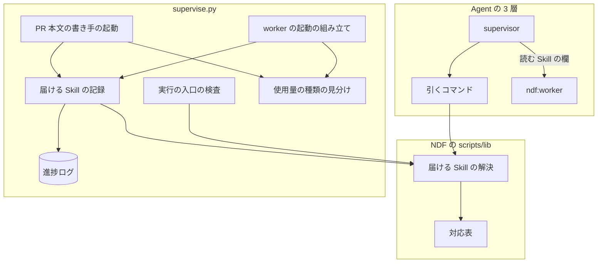
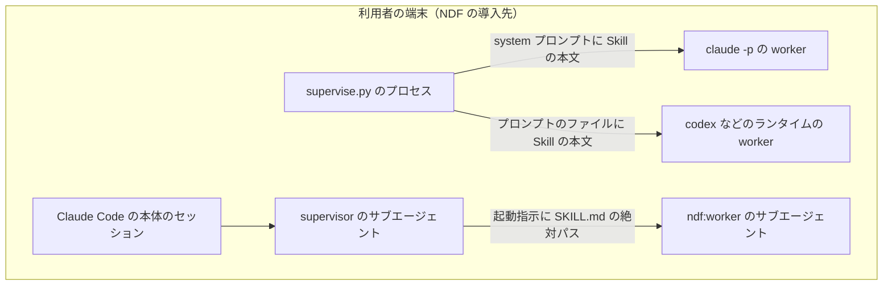
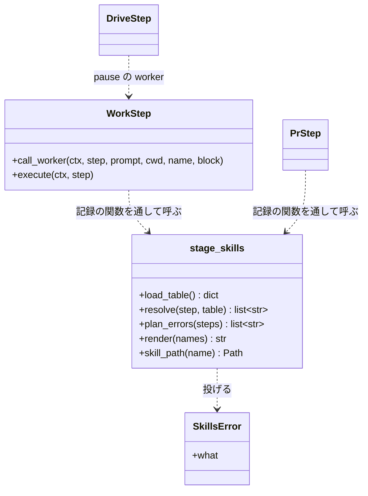
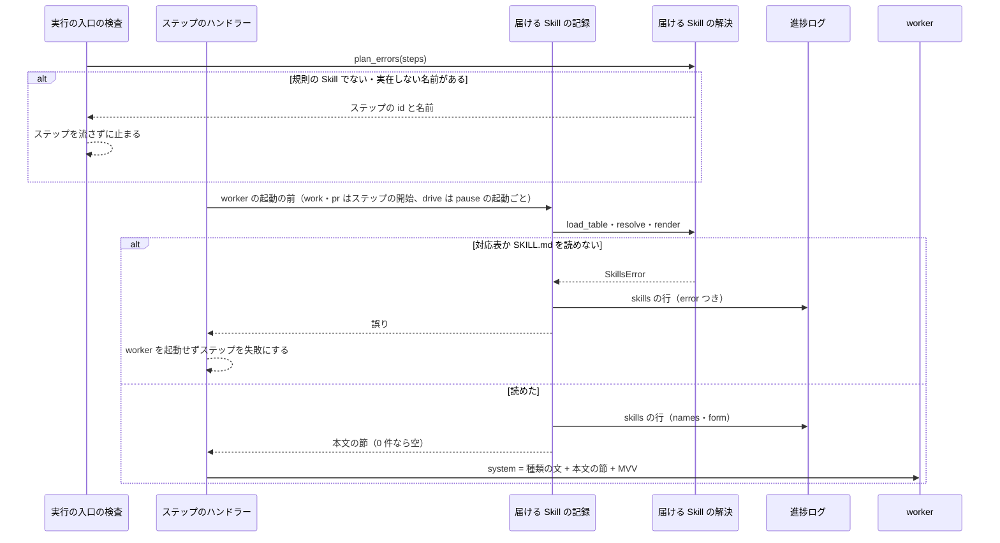

# worker: ステップの工程に要る Skill だけを、worker の種類に合った形で受け取る（#2376）

## 目的

- **今どうなっているか**: プランの worker と Agent の `ndf:worker` は、ステップに要る Skill を受け取る仕組みを持たない。#2372 では `document-style` だけを 3 つの system プロンプトと worker の定義へ書き足した。そのため文書を書かないステップにも常に載り、別の Skill を届けたいときは同じ書き足しがまた要る
- **誰に効くか**: NDF でスプリントを回す利用者（worker が書く文書とコードの質）と、NDF の保守者（Skill を届ける経路が 1 か所になる）
- **変えると何が成り立つか**: worker が動くとき、そのステップの工程に要る Skill だけが届く。新しい Skill をある工程へ届ける変更は、対応表の 1 行の追加で済む
- **`document-style` が届く工程は今より狭めない**: 今は #2372 の書き足し（PR #2377）で、他者が読む文書を書く worker に工程を問わず届いている。対応表には、要求の初期値の 4 工程（設計・ドキュメント再構成・Pull Request・振り返り）に `document-style` を置く。あわせて、他者が読む文書を書く 6 工程（要求と受け入れ条件・計画・ドキュメントレビュー・完了判定・確定仕様化・棚卸し）にも置く（決定 9）。工程を問わず届いていた今の経路が消えるため、雛形で `stage` を持たずに文書を直す work（`supervise_lib/templates.py` の `fix-doc`。`doc-lint` で当たった文書の行を直す）には、入力の `doc-lint` と同じ `stage: 完了判定` を付ける。テストの失敗を直す `fix` の work はコードを直すステップで、`stage` を持たないまま空の一覧にする（受け入れ条件 2）

## 適用範囲

- **働く範囲**: NDF を導入したすべてのリポジトリ。対応表は NDF のプラグインに同梱し、`supervise.py` が流すプランと、supervisor が起動する `ndf:worker` の両方に効く
- **プロジェクトごとに違うもの**: 無い。届けるのは NDF に同梱した Skill だけで（要求の前提 4）、ステップごとの差はプランの `skills`・`skills_add` 欄で受ける
- **当たるモード**: 全モード。対応表のキーは工程で、モードを問わない

## あるべき姿の根拠

| 根拠 | 種類 | 何を示すか |
| --- | --- | --- |
| 課題の本文「実測: `skills:` と `disallowedTools: Skill` の併用」（2026-11-02、Claude Code v2.1.316） | 実測 | `skills:` はサブエージェントとして起動したときだけ効き、効いた結果は「Skill の本文を最初から文脈に持つ」ことである。同じ効果は本文を system プロンプトへ入れれば 1 段のまま得られる |
| 下の「非機能の実現方式」の測定（2026-11-02、Claude Code v2.1.316、`claude_cmd` の最小構成） | 実測 | 本文を system プロンプトに入れた起動は 1 ターンで答え、増分はキャッシュへ書き込む起動で +$0.075 だった（同じ本文の起動がキャッシュの寿命の中で続いたときだけ +$0.001）。パスを渡して読ませた起動は 2 ターンで、毎回 $0.08〜0.14 だった |
| [Claude Code のサブエージェントの文書](https://code.claude.com/docs/en/sub-agents) の `skills` 欄 | 外部の一次情報 | 挙げた Skill の本文全体を、起動の時点で文脈へ読み込む。部分だけを読み込む仕組みは無い |

要求と受け入れ条件は #2376 の本文にある（コピーは [issue-2376-requirements.md](issue-2376-requirements.md)）。この文書は「どう作るか」だけを扱う。
受け入れ条件・要求の前提・Value の番号の中身は、末尾の「この文書が番号で指す項目」にある。

## ドメインモデル

### コンテキスト

| コンテキスト | 何の語が 1 つの意味に決まるか |
| --- | --- |
| NDF の開発ワークフロー（`ndf-workflow`） | 工程・ステップ・worker・Skill の対応表・Skill の渡し方・読む Skill |

1 つのコンテキストに収まる。工程の名前は、同じコンテキストの工程表の行名をそのまま使う。工程表は `development-workflow` の「モードごとに起動する Skill」と `workflow-common.sh` の `WF_STAGE_MATRIX` である。`WF_STAGE_MATRIX` は、工程の名前ごとにモード別の要否（必須・条件付き・対象外）を持つシェルの定数で、19 行の行名は `SKILL.md` の表の行名と同じである。同じファイルの関数 `wf_stages` は、その行名を 1 行に 1 つずつ返す。テスト設計で「工程表（`wf_stages`）」と書くのは、この関数の出力を工程の名前の正とすることである。

### 集約

| 集約 | 持ち主（書き換えてよいもの） | 根 | エンティティ | 値オブジェクト |
| --- | --- | --- | --- | --- |
| Skill の対応表 | 対応表のファイル（NDF の保守者が Pull Request で変える）。実行中のどの構成要素も書き換えない | 対応表 | — | 工程の名前・Skill の名前 |
| プランのステップ | プランの書き手（雛形・conductor）。`supervise.py` は読むだけ | ステップ | — | `skills`（置き換え）・`skills_add`（追加） |
| 進捗ログ | 実行の状態（`RunState.progress_write`）。追記だけで書き換えない | 進捗ログ | 行 | 届けた Skill の行（ステップ・工程・名前の一覧・渡し方・誤り） |

**ステップに届ける Skill は、どの集約にも属さない値として、ステップの開始のたびに計算する。** 対応表とステップを ID ではなく工程の名前で結び、計算の結果は進捗ログの行として残す。

### 不変条件

| # | 集約 | 条件 | 破れたときの扱い |
| --- | --- | --- | --- |
| I1 | Skill の対応表 | 工程と Skill の組は対応表のファイルにだけある。Skill を worker へ届ける経路（`supervise_lib` の全ファイル〔system プロンプトとプランの雛形を含む〕・`lib/stage_skills.py`・`stage-skills.py`・`worker.md`・`agent-layers.md`）は、`rule_skills` に載るどの Skill の名前も持たない | テストで落ちる（`rule_skills` の名前ごとに経路のファイルを探す） |
| I2 | Skill の対応表 | 対応表のキーはすべて工程表の工程の名前で、値の Skill はすべて対応表の `rule_skills`（規則の Skill の一覧）に載り、`plugins/ndf/skills/<名前>/SKILL.md` が実在する。`rule_skills` に工程 Skill（`development-workflow` の「モードごとに起動する Skill」の表に載る Skill）は載らない | テストで落ちる。実行の時点で読めなければ I6 |
| I3 | プランのステップ | `skills`・`skills_add` 欄に書いた Skill は、すべて対応表の `rule_skills` に載り、`plugins/ndf/skills/<名前>/SKILL.md` が実在する。工程 Skill（`development-workflow` など）は実在しても載らないため通らない | ステップを 1 つも流す前の検査で落ち、ステップの `id` と名前と理由（規則の Skill でない・実在しない）を示して止まる |
| I4 | プランのステップ | 届ける Skill は「`skills` があればその一覧、無ければ対応表のその工程の一覧（工程が無い・対応表に無ければ空）」に `skills_add` を足し、重ねずに並べたものである | テストで落ちる |
| I5 | プランのステップ | worker の起動に渡すもの（system プロンプト・プロンプト・引数）が含む Skill の本文は I4 の結果だけである。judge の起動は Skill を含まない | テストで落ちる |
| I6 | 進捗ログ | 対応表を読めない、または届ける Skill の `SKILL.md` を読めないときは worker を起動しない。読めなかった名前かファイルを進捗ログの行に残し、ステップを失敗にする。解決する時点は I7 の単位と同じで、drive のステップは pause の worker を起動する前ごとに解決する。pause が無く worker を起動しない drive は解決せず、対応表が読めなくても失敗にしない | テストで落ちる |
| I7 | 進捗ログ | 届けた Skill の行は worker の起動 1 回に 1 行で、起動の前に書く。0 件のときも空の一覧で書く。work・pr のステップは worker を 1 回起動するため 1 行である。drive のステップは pause の worker の起動ごとに 1 行（N 回起動すれば N 行。行の `step` は drive のステップの `id`）で、pause が無ければ行は無い | テストで落ちる |
| I8 | — | `ndf:worker` の定義は Skill の名前を持たず、`Skill` と `Agent` のツールを外したままである | テストで落ちる |

I1 の範囲の外で Skill の名前を持つファイルは、Skill を届ける経路ではないため対象にしない。2026-11-02 に次のコマンドが返したのは、テストを除いて 4 つである。

```bash
grep -rlE "document-style|logging-guidelines" plugins/ndf/scripts --include=*.py --include=*.json
```

| ファイル | 何のコードか |
| --- | --- |
| `supervise_lib/prompts.py` | この変更で消す |
| `doc-lint.py` | 文書の検査 |
| `lib/mdtable.py` | Markdown の表の整形 |
| `project_lib/measure_repo.py` | 計測 |

残る 3 つは、どれも規則の出典としてコメントか語の一覧に名前を持つ。

I8 の集約の欄が「—」なのは、worker の定義がこの変更の集約の外（配布物の定義）にあるためである。

### ドメインイベント

| # | イベント | 発生元 | 受け手 |
| --- | --- | --- | --- |
| E1 | プランを作った（ステップに `stage` と、要れば `skills`・`skills_add` を書いた） | 雛形の生成・conductor | 実行の入口（E2） |
| E2 | プランを検査した（`skills`・`skills_add` の名前を照合した） | 実行の入口（`Engine.setup`） | 届ける Skill の解決（E3）。落ちたら conductor |
| E3 | ステップに届ける Skill を決めた | 届ける Skill の解決 | worker の起動の組み立て（E4）・進捗ログ（E5） |
| E4 | worker を起動した（本文を system プロンプトへ入れた） | worker の起動の組み立て | worker（E7） |
| E5 | 届けた Skill を記録した（E4 の前） | 届ける Skill の解決 | 進捗ログを読む conductor・振り返り |
| E6 | supervisor が `ndf:worker` へ起動指示を書いた（引くコマンドで「読む Skill」を決めた） | supervisor | `ndf:worker`（E7） |
| E7 | worker が届いた Skill の規則で作業し、報告を返した | worker | supervisor・`supervise.py` |

### 用語

| 用語 | 意味 | 用語集への反映 |
| --- | --- | --- |
| Skill の対応表 | 工程（ステップの `stage`）から、そのステップの worker へ届ける Skill の一覧を引く表。NDF の `scripts/lib/stage-skills.json` の 1 か所に置く | 意味の変更（置き場を足す） |
| Skill の渡し方 | Skill を worker へ届ける形。プランの worker には本文を system プロンプトへ入れ（`本文`）、`ndf:worker` には `SKILL.md` の絶対パスを起動指示の「読む Skill」に書く（`パス`） | 意味の変更（2 つの形に決めた） |
| 読む Skill | supervisor が `ndf:worker` の起動指示に書く項目。その作業で読む Skill の名前と `SKILL.md` の絶対パスを並べる。worker はここに挙がった `SKILL.md` だけを読む | 追加 |
| 規則の Skill | 手順を持たず、書き方・記録の仕方のような規則だけを持つ Skill（`document-style`・`logging-guidelines` など）。Skill の対応表に置けるのはこれだけで、工程 Skill は置かない（決定 6） | 追加 |

## 機能一覧

| # | 機能 | 誰が使うか |
| --- | --- | --- |
| F1 | 工程を渡すと、届ける Skill の名前と `SKILL.md` のパスが返る | supervisor（`ndf:worker` の起動指示を書くとき）・保守者 |
| F2 | プランのステップで、届ける Skill を置き換える・足す | プランの書き手（雛形・conductor） |
| F3 | 書いた Skill の名前が無いプランを、ステップを流す前に止める | conductor |
| F4 | プランの worker（通常・full・PR 本文の書き手）が、そのステップの Skill の本文を持って起動する | `supervise.py` |
| F5 | `ndf:worker` が、起動指示の「読む Skill」に挙がった `SKILL.md` だけを読んで作業する | supervisor |
| F6 | どのステップに何の Skill が届いたかを進捗ログから読む | conductor・振り返り |

## 構成要素

| 要素 | 責務 | 置き場 |
| --- | --- | --- |
| 対応表 | 規則の Skill の一覧（`rule_skills`）と、工程の名前 → Skill の名前の一覧。初期値は `rule_skills` が `document-style`・`logging-guidelines`、要求と受け入れ条件・設計・ドキュメント再構成・計画・ドキュメントレビュー・完了判定・Pull Request・確定仕様化・振り返り・棚卸し → `document-style`（決定 9）、実装 → `logging-guidelines` | `plugins/ndf/scripts/lib/stage-skills.json`（新設） |
| 届ける Skill の解決 | 対応表を読み、値に `rule_skills` に無い名前があれば読めない対応表として例外にする（決定 6）。ステップから届ける Skill を決める（I4）。プランの欄を照合する（I3）。本文の節を組む。どれも副作用を持たず、読めないときは例外で知らせる | `plugins/ndf/scripts/lib/stage_skills.py`（新設） |
| 引くコマンド | 工程を受け、名前と絶対パスを統一 JSON レポートで返す（F1） | `plugins/ndf/scripts/stage-skills.py`（新設） |
| 実行の入口の検査 | ステップを流す前に `skills`・`skills_add` を照合する（E2） | `supervise_lib/engine.py` の `setup` |
| 届ける Skill の記録 | worker の起動の前に解決を呼び（work・pr はステップの開始、drive は pause の worker の起動ごと。I7）、進捗ログへ 1 行書き、本文の節か誤りを返す（E3・E5）。進捗ログへ書くため純粋な処理ではない | `supervise_lib/steps.py`（関数を 1 つ足す） |
| worker の起動の組み立て | work・drive のステップで本文の節を system プロンプトへ入れる（通常・full・ランタイム指定の worker、drive の pause の worker。drive の pause の worker は、drive のステップが回す cross-review・cross-refactoring の駆動〔`drive.py`〕が判断待ちで止まったとき、`DriveStep._delegate_pause` が `WorkStep.call_worker` で起動する worker で、止まりの指示ファイルを読んで結果ファイルを書く） | `supervise_lib/worker_steps.py` |
| PR 本文の書き手の起動 | pr のステップで本文の節を `PR_SYSTEM` の後へ入れる | `supervise_lib/pr.py` の `_llm_body` |
| 使用量の種類の見分け | system プロンプトの先頭で `pr`・`judge`・`slow` を見分ける（後ろに本文の節が付いても `pr` のまま） | `supervise_lib/claude.py` の `claude_kind` |
| #2372 の応急の書き足しの撤去 | `DOCUMENT_STYLE`・`_style_rules`・`DOCUMENT_RULE` と、`FULL_SYSTEM`・`PR_SYSTEM` の `document-style` の行を消す | `supervise_lib/prompts.py` |
| プランの形の説明 | `skills`・`skills_add` 欄を説明に足す | `supervise_lib/plan.py` の先頭の説明 |
| worker の定義 | 「起動指示の『読む Skill』に挙がった `SKILL.md` だけを読む」へ一般化し、`document-style` の例外の段落を消す | `plugins/ndf/agents/worker.md` |
| supervisor → worker の規約 | 起動指示の項目に「読む Skill」を足して 6 項目にし、引くコマンドでの決め方（工程の名前の出どころは決定 10）を書く。worker の規則 6（Skill を起動せず `SKILL.md` を読まない）の `document-style` の例外の文を一般化する | `plugins/ndf/skills/development-workflow/references/agent-layers.md` |
| プランの雛形 | `stage` を持たずに文書を直す `fix-doc` の work に `stage: 完了判定` を付ける（目的の「今より狭めない」） | `supervise_lib/templates.py` |
| 確定仕様 | 「worker は `SKILL.md` を読まない」の 3 か所を、工程 Skill に限る形へ直す（決定 6） | `docs/specifications/ndf-worker-agent-and-skill-excerpts.md` |
| テスト | 対応表・解決・検査・記録・起動の組み立ての単体テストと、`rule_skills` と工程 Skill が重ならないことの構造チェック（決定 6）。#2372 のテストを置き換える | `plugins/ndf/scripts/tests/test_stage_skills.py`（新設）、`test_supervise_document_style.py`（削除） |

**ステップに欄を足すことと、進捗ログに行の種類を足すことは、既存の規則に当てはまる。** パートへの展開（`expand_parts`）はステップの欄を写すため `skills` もそのまま写る。進捗ログを読む部品（`slow_step.py`・`estimate_records.py`・`RunState` の数え上げ）は `kind` で行を絞り、知らない種類を読み飛ばす。当てはまらなかったのは `claude_kind` だけで、`PR_SYSTEM` との一致で種類を決めているため、後ろへ本文の節を付けると `work` に数えられる。表の「使用量の種類の見分け」の行がそれを直す。

### 実行時の関係



`#2372 の応急の書き足しの撤去`・`プランの形の説明`・`worker の定義`・`supervisor → worker の規約`・`確定仕様`・`テスト` は消す・書き換える対象である。実行時の関係を持たないため、図に含めない。

### 配置



境界をまたいで流れるのは Skill の本文（プランの worker）と `SKILL.md` の絶対パス（`ndf:worker`）だけである。どちらも NDF に同梱した文書で、秘密を含まない。

### 置き場所

```text
plugins/ndf/
├── agents/worker.md                      # 変える
├── scripts/
│   ├── stage-skills.py                   # 新設（引くコマンド）
│   ├── lib/
│   │   ├── stage-skills.json             # 新設（対応表）
│   │   └── stage_skills.py               # 新設（解決）
│   ├── supervise_lib/
│   │   ├── claude.py                     # 変える（claude_kind）
│   │   ├── engine.py                     # 変える（setup の検査）
│   │   ├── plan.py                       # 変える（説明）
│   │   ├── pr.py                         # 変える（_llm_body）
│   │   ├── prompts.py                    # 変える（#2372 の撤去）
│   │   ├── steps.py                      # 変える（記録の関数）
│   │   ├── templates.py                  # 変える（fix-doc の stage）
│   │   └── worker_steps.py               # 変える（起動の組み立て）
│   └── tests/
│       ├── test_stage_skills.py          # 新設
│       └── test_supervise_document_style.py  # 削除
└── skills/development-workflow/references/agent-layers.md  # 変える
docs/specifications/ndf-worker-agent-and-skill-excerpts.md  # 変える
```

## 構造



`DriveStep` と `PrStep`（`pr.py` の pr のステップのハンドラー）は既存の型で、名前だけを置く。

## 入出力の契約

### 対応表のファイル

```json
{
  "version": 1,
  "rule_skills": ["document-style", "logging-guidelines"],
  "stages": {
    "要求と受け入れ条件": ["document-style"],
    "設計": ["document-style"],
    "ドキュメント再構成": ["document-style"],
    "ドキュメントレビュー": ["document-style"],
    "計画": ["document-style"],
    "実装": ["logging-guidelines"],
    "完了判定": ["document-style"],
    "Pull Request": ["document-style"],
    "確定仕様化": ["document-style"],
    "振り返り": ["document-style"],
    "棚卸し": ["document-style"]
  }
}
```

### プランのステップの欄

| 欄 | 型 | 必須か | 意味 |
| --- | --- | --- | --- |
| `skills` | 文字列の配列 | 任意 | 対応表の値を置き換える。空の配列なら何も届けない |
| `skills_add` | 文字列の配列 | 任意 | 対応表の値（`skills` があればその値）へ足す。重なる名前は 1 つにする |

名前は `plugins/ndf/skills/` の下のディレクトリ名である（`ndf:` を付けない）。どちらの欄も、対応表の `rule_skills` に載る名前だけを受ける（I3）。`skills: ["development-workflow"]` のように工程 Skill を書いたプランは、実在しても検査で落ちる。落ちたときは、ステップを 1 つも流さずに `止まった` で終わる。理由には、該当するすべてのステップと名前を次の形で並べる。

| 落ちた名前 | 理由の形 |
| --- | --- |
| 工程 Skill | `<ステップの id>: development-workflow は規則の Skill でない（工程 Skill の手順は起動指示の「手順」へ抜粋で渡す）` |
| 実在しない名前 | `<ステップの id>: <名前> の SKILL.md が無い` |

どちらの欄も無いプランは今と同じに読み、対応表の値で動く（互換あり）。

### 引くコマンド

| 項目 | 内容 |
| --- | --- |
| 名前 | `python3 "$SCRIPTS/stage-skills.py" lookup <工程>` |
| 入力 | 工程の名前（必須。工程表の行名） |
| 出力（成功） | 統一 JSON レポート（`lib/step_result.py` の形）。`{"tool": "stage-skills", "status": "ok", "summary": "<工程>: N 件", "items": [{"name": "document-style", "path": "/abs/.../SKILL.md"}], "metrics": {"count": N}}`。対応表に無い工程は `items` が空で `status` は `ok` |
| 失敗の形 | 終了コード 1: 対応表を読めない・`SKILL.md` が無い（`status` は `stopped`、`items` に読めなかった名前かファイル）。終了コード 2: 引数の誤り |
| 互換性 | 新設のため、既存の呼び出し側は無い |

### 進捗ログの行

```json
{"kind": "skills", "at": "2026-11-02T10:00:00+09:00", "step": "design", "stage": "設計", "names": ["document-style"], "form": "本文"}
{"kind": "skills", "at": "2026-11-02T10:05:00+09:00", "step": "test-fix", "stage": null, "names": [], "form": "本文"}
{"kind": "skills", "at": "2026-11-02T10:09:00+09:00", "step": "impl", "stage": "実装", "names": [], "form": "本文", "error": "SKILL.md が無い: /abs/.../logging-guidelines/SKILL.md"}
```

| 項目 | 型 | 空を許すか | 意味 |
| --- | --- | --- | --- |
| `step` | 文字列 | 許さない | ステップの `id` |
| `stage` | 文字列 | 許す | 空（`null`）は「ステップに `stage` が無い」 |
| `names` | 文字列の配列 | 空の配列を許す | 届けた Skill。空の配列は「届けるものが無い」。`error` があるときは空 |
| `form` | 文字列 | 許さない | 渡し方。プランの worker は `本文` |
| `error` | 文字列 | 項目ごと省く | 読めなかった名前かファイル。項目があるときステップは失敗している |

既存の行は変えず、`kind: skills` の行を足すだけである。行は書き換えず追記する（事象の記録）ため、同じステップを打ち直せば行が増え、打ち直しごとに何が届いたかを追える。

### 本文の節（system プロンプトの後ろへ入れる形）

```text
## このステップで従う Skill

### document-style
置き場: /abs/plugins/ndf/skills/document-style/SKILL.md（本文の相対パスはこのファイルから読む）

<SKILL.md の frontmatter を除いた本文>
```

Skill が 0 件のときは節ごと入れない。system プロンプトは「worker の種類の文 → 本文の節 → MVV の節」の順に並べる。

## 処理の流れ



**記録は起動の前に書く。** 起動が落ちても、何を渡そうとしたかが残る。drive のステップは pause の worker を 0〜N 回起動するため、解決と記録はステップの開始ではなく pause の起動ごとに行う（I6・I7）。pause が無ければ解決も記録もしない。

`ndf:worker` の経路は `supervise.py` を通らない。supervisor は作業を 1 つ渡すとき、その作業が属する工程の名前で `stage-skills.py lookup <工程>` を打つ（名前の出どころは決定 10）。出力の `items` の名前と `path` を、起動指示の「読む Skill」に並べる。終了コードが 0 以外なら欄を空にせず、supervisor が `結果: 判断が要る` で返す（E6）。

## 非機能の実現方式

| 大項目 | 要求の条件 | 実現方式 | 確かめ方 |
| --- | --- | --- | --- |
| 性能・拡張性 | Skill を届けるステップと届けないステップのそれぞれで、worker の起動 1 回あたりの費用（USD）と秒を変更前後で同じステップについて実測し、設計文書と実装の PR に載せる | 本文を system プロンプトへ入れ、起動を 1 段のままにする。届けないステップは `DOCUMENT_RULE` が消える分だけ今より短くなる。増分の上限は決定 7 | 下の表（設計の時点の測定）。実装の PR では、実在の `claude` で設計の工程の work ステップと Skill の無い工程の work ステップを 1 回ずつ流して測り、同じ表の形で載せる |
| 運用・保守性 | 新しい Skill をある工程の worker へ届けるのに要る変更は、対応表の 1 行の追加だけになる | 工程と Skill の組を対応表のファイルにだけ置く（I1）。届ける処理・worker の定義・規約は Skill の名前を持たない | テストが `rule_skills` の名前ごとに I1 の範囲のファイルを探し、どれにも当たらないことを見る。手で見るときは `grep -rnE "document-style\|logging-guidelines" plugins/ndf/scripts/supervise_lib plugins/ndf/scripts/lib/stage_skills.py plugins/ndf/scripts/stage-skills.py plugins/ndf/agents/worker.md plugins/ndf/skills/development-workflow/references/agent-layers.md` が何も返さない（I1 と同じ範囲） |
| 移行性 | `skills` 欄の無い既存のプラン・キューに入ったプランは、移行の手順なしでそのまま動く | 欄が無ければ対応表の値で動かす（I4）。対応表に無い工程は空 | 欄の無いプランで検査が通り、工程どおりに届くことを単体テストで見る |
| システム環境 | Claude Code v2.1.316 以降で動く。通常の worker の起動（`--setting-sources ""`・`--disable-slash-commands`）でプラグインが読み込まれない条件の下でも届く | 本文は `supervise.py` 自身と同じプラグインの `skills/` から読み、プラグインの読み込みに頼らない | 最小構成の起動で、規則 1 の見出しを Tool を使わずに答えられる（下の測定の `本文` の行） |

設計の時点の測定の条件:

| 項目 | 値 |
| --- | --- |
| 日付と版 | 2026-11-02、Claude Code v2.1.316 |
| 起動 | `claude_cmd` の最小構成 |
| system プロンプト | 今の `WORK_SYSTEM` から `DOCUMENT_RULE` を除いた文 |
| 問い | `document-style` の規則 1 の見出しを答える |
| モデル | 既定のモデル |

設計の時点の測定の結果:

| 条件 | 1 回目の費用 | 2 回目の費用 | 秒 | ターン | 答え |
| --- | --- | --- | --- | --- | --- |
| 届けない | $0.0115〜0.0185 | $0.0051 | 3.1〜4.1 | 1 | 不明 |
| 本文を system プロンプトへ入れる（採る形） | $0.0868（キャッシュの書き込み 10,371） | $0.0059〜0.0065 | 3.1〜3.7 | 1 | 正しい |
| `SKILL.md` のパスを渡して読ませる | $0.0838〜0.1405 | $0.0838 | 4.6〜5.0 | 2 | 正しい |

`--agents` で組んだサブエージェントを本体から起動する形は、決定 4 で構造の理由から退けたため測っていない。

## 決定の記録

決定 1〜10 の結論・理由・採らなかった案は [issue-2376-design-decisions.md](issue-2376-design-decisions.md) にある。この文書の「決定 N」はそのファイルの見出しを指す。

## テスト設計

| 受け入れ条件・不変条件 | どの振る舞いで縛るか | どう壊したら落ちるべきか |
| --- | --- | --- |
| 受け入れ条件 1・I1 | 対応表の `rule_skills` のどの名前も、I1 の範囲（`supervise_lib` の全ファイル・`lib/stage_skills.py`・`stage-skills.py`・`worker.md`・`agent-layers.md`）に無く、対応表のファイルにだけある | `prompts.py` か雛形に Skill の名前を書き戻す |
| I2・決定 6 | 対応表のキーがすべて工程表（`wf_stages` の出力）の行名で、値の Skill がすべて `rule_skills` に載って `SKILL.md` が実在し、`rule_skills` に `development-workflow` の「モードごとに起動する Skill」の表の Skill が無い。値に `rule_skills` に無い名前がある対応表は、`load_table` が読めない対応表として扱う | 対応表へ工程表に無い工程か、実在しない Skill か、工程 Skill を書く。`rule_skills` に無い名前を値に書いても読める |
| 受け入れ条件 2 | `stage` の無いステップと、対応表に無い工程のステップの解決が空の一覧になり、本文の節が入らない | 対応表に無い工程へ既定の Skill を返す |
| 受け入れ条件 3・I4 | `skills` を書いたステップは指定した Skill だけになり、空の配列なら空になる | `skills` に対応表の値を足して返す |
| 受け入れ条件 4・I4 | `skills_add` は対応表の値に重ならずに足される。両方を書いたステップは `skills` に足される | 重なる名前を 2 回返す、または `skills_add` で置き換える |
| 受け入れ条件 5・I3 | 実在しない名前を書いたプランと、`skills`・`skills_add` に工程 Skill（`development-workflow`）を書いたプランは、ステップを 1 つも流さずに止まり、理由にステップの `id` と名前と理由（規則の Skill でない・実在しない）が出る | 照合をステップの開始まで遅らせる、または実在だけを見て工程 Skill を通す |
| 受け入れ条件 6 | 欄の無い既存のプランが検査を通り、工程どおりに届く | 欄が無いプランを検査で落とす |
| 受け入れ条件 7・I5 | 通常の worker（ランタイム指定と drive の pause を含む）の system プロンプトに、解決した Skill の本文だけが入り、対応表のほかの行の Skill の名前が入らない | 対応表のすべての Skill を入れる |
| 受け入れ条件 8・I5 | full の worker の `--append-system-prompt` に解決した Skill の本文だけが入る。再開の起動も同じ文になる | full の起動だけ節を入れない、または再開で節が落ちる |
| 受け入れ条件 9 | pr のステップで LLM に渡す system プロンプトが `PR_SYSTEM` で始まり、`Pull Request` の工程に対応表が当てた Skill の本文を含み、使用量の種類は `pr` のままである | `claude_kind` を一致の判定のまま残す |
| 受け入れ条件 10 | `lookup 設計` が `document-style` の名前と実在するパスを返し、`lookup 存在しない工程` が空の `items` と終了コード 0 を返す。対応表を読めないと終了コード 1 | 対応表に無い工程で終了コード 1 を返す |
| 受け入れ条件 11・I8 | `worker.md` の frontmatter が `disallowedTools` に `Skill` と `Agent` を持ち、本文が Skill の名前を持たない | 定義へ `skills:` か特定の Skill の名前を書く |
| 受け入れ条件 12 | `prompts.py` に `DOCUMENT_STYLE`・`DOCUMENT_RULE`・`_style_rules` が無く、設計の工程の work ステップには `document-style` の本文が届く | 撤去だけをして対応表の行を入れない |
| 受け入れ条件 13・決定 9 | 設計・ドキュメント再構成・Pull Request・振り返りの 4 工程と、要求と受け入れ条件・計画・ドキュメントレビュー・完了判定・確定仕様化・棚卸しの 6 工程のステップに `document-style` が届く | 10 のどれかの行を対応表から落とす |
| 受け入れ条件 13・決定 9 | 雛形が作る `fix-doc` の work ステップが `stage: 完了判定` を持ち、`document-style` が届く | `fix-doc` の `stage` を消す |
| 受け入れ条件 14・I7 | work・pr のステップは `kind: skills` の行が 1 行、起動の前に書かれ、0 件のときは空の一覧である。drive のステップは pause の worker を 2 回起動すると行が 2 行、pause が無いと行が 0 行である | 0 件のときに行を省く、起動の後に書く、または drive の行をステップの開始で 1 行だけ書く |
| I6（drive） | pause の無い drive のステップは、対応表のファイルを壊しても失敗しない。pause がある drive は、壊した対応表で pause の worker を起動せずに失敗する | drive のステップの開始で解決して失敗にする |
| 受け入れ条件 15・I6 | 対応表のファイルを壊すか `SKILL.md` を消すと、worker を起動せずにステップが失敗し、行の `error` に名前かファイルが出る | 読めない Skill を飛ばして起動する |
| JUDGE の除外（I5） | judge のステップの system プロンプトは対応表の行がある工程でも `JUDGE_SYSTEM` のままである | judge にも節を入れる |

テストは `claude` を起動しない（起動の引数と system プロンプトを組み立てる関数と、偽の `ctx.claude` で見る）。実在の `claude` での確かめは要求の「検証手段」の手動確認が持つ。

## 設計の結果

| 課題 | 扱い | 取り込み先 | 触るファイル |
| --- | --- | --- | --- |
| #2376 | 実装する | — | `plugins/ndf/scripts/stage-skills.py`、`plugins/ndf/scripts/lib/stage-skills.json`、`plugins/ndf/scripts/lib/stage_skills.py`、`plugins/ndf/scripts/supervise_lib/claude.py`、`plugins/ndf/scripts/supervise_lib/engine.py`、`plugins/ndf/scripts/supervise_lib/plan.py`、`plugins/ndf/scripts/supervise_lib/pr.py`、`plugins/ndf/scripts/supervise_lib/prompts.py`、`plugins/ndf/scripts/supervise_lib/steps.py`、`plugins/ndf/scripts/supervise_lib/templates.py`、`plugins/ndf/scripts/supervise_lib/worker_steps.py`、`plugins/ndf/scripts/tests/test_stage_skills.py`、`plugins/ndf/scripts/tests/test_supervise_document_style.py`、`plugins/ndf/agents/worker.md`、`plugins/ndf/skills/development-workflow/references/agent-layers.md`、`docs/specifications/ndf-worker-agent-and-skill-excerpts.md` |

## 未確認のまま残ること

| 項目 | 内容 |
| --- | --- |
| 10 工程のほかに `document-style` が要る工程 | 決定 9 で、他者が読む文書を書く工程として 10 工程に置いた。ほかの工程（実装・コードレビューなど）の worker が他者の読む文書を書くかは、工程ごとには数えていない。見つかったら対応表に 1 行足す（受け入れ条件は変わらない） |
| 実装の PR の測定 | 上の測定は問い 1 つの起動である。実在のステップで上限（決定 7）に収まるかは、実装の PR の手動確認で測る |
| full の worker での重なり | full の worker はプラグインを読み込むため、本文を持ったうえで同じ Skill を Skill のツールで読み直すことがありうる。費用への影響は実装の PR の測定で見る |
| `ndf:worker` の手動確認 | supervisor は LLM のため、「読む Skill」の欄を引くコマンドで決めるかはリリース後テストで見る（要求の「検証手段」） |

## この文書が番号で指す項目

受け入れ条件と要求の前提は要求のコピーの番号、Value はプロジェクトの MVV（`.ndf/mvv.md`、版 4）の番号である。

| 番号 | 中身の要約 |
| --- | --- |
| 受け入れ条件 1 | 対応表はリポジトリの 1 か所にだけあり、プランの worker の起動と引くコマンドの両方がそこを読む |
| 受け入れ条件 2 | 対応表に無い工程のステップと、`stage` の無いステップには Skill が届かない |
| 受け入れ条件 3 | 置き換えの指定をしたステップには指定した Skill だけが届く。0 件なら何も届かない |
| 受け入れ条件 4 | 追加の指定をしたステップには、対応表の Skill と追加した Skill が重ならずに届く |
| 受け入れ条件 5 | 実在しない Skill 名を書いたプランは、worker を起動する前の検査で落ち、名前とステップの `id` を示す |
| 受け入れ条件 6 | `skills` 欄の無い既存のプランは、書き換えずに今と同じく動く |
| 受け入れ条件 7 | 通常の worker の起動に、そのステップの Skill の規則だけが届く |
| 受け入れ条件 8 | full の worker の起動に、そのステップの Skill だけが届く |
| 受け入れ条件 9 | PR 本文の書き手に、Pull Request の工程に当てた Skill の規則が Tool なしで読める形で届く |
| 受け入れ条件 10 | 工程から Skill の名前と `SKILL.md` の絶対パスを返すコマンドがあり、supervisor はそれで「読む Skill」を決める |
| 受け入れ条件 11 | `ndf:worker` の定義は Skill の名前を持たず、`Skill` と `Agent` のツールは使えないまま |
| 受け入れ条件 12 | `prompts.py` の #2372 の書き足しが消え、同じ規則が対応表から届く |
| 受け入れ条件 13 | `worker.md` と `agent-layers.md` の `document-style` の例外の文が消え、設計など 4 工程には今と同じく届く |
| 受け入れ条件 14 | 届けた Skill と渡し方が `progress.jsonl` の 1 行に残り、記録だけで答えられる |
| 受け入れ条件 15 | 対応表か `SKILL.md` を読めないときは worker を起動せずステップを失敗にし、読めなかったものを記録する |
| 要求の前提 2 | 対応表の初期値は、設計・ドキュメント再構成・Pull Request・振り返り → `document-style`、実装 → `logging-guidelines`。行の増減は受け入れ条件を変えない |
| 要求の前提 4 | 届ける Skill は NDF に同梱した Skill（`plugins/ndf/skills/<名前>/SKILL.md` が実在するもの）に限る |
| Value 1 | まず届ける（たぶん動くものを早く出し、守りは開発版・検査で持つ） |
| Value 3 | 測って決める（効果は費用・秒・件数の実測で示す） |
| Value 4 | 決まった手順はスクリプトに、判断と中身は AI に |
| Value 5 | どのプロジェクトでも使える形を保つ |
| Value 6 | 根本原因の場所で直す（同じ役割の定数・関数を分けない） |
| Value 7 | 判断の理由を残す（正本は 1 か所に置き、写さずに指す） |
| Value 8 | 語は 1 語 1 意味 |
| Value 10 | 費用 > 速さ > 品質の順で決める（上限は実測で決めて見直す） |
