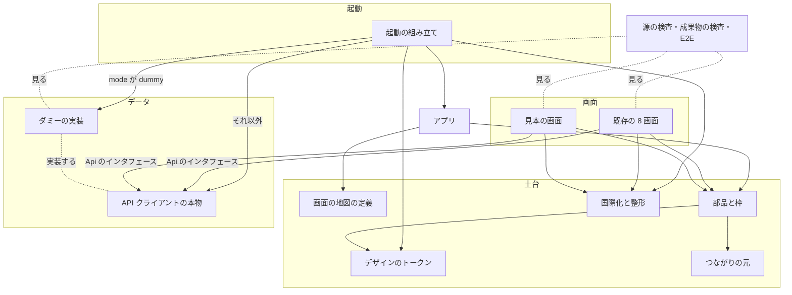
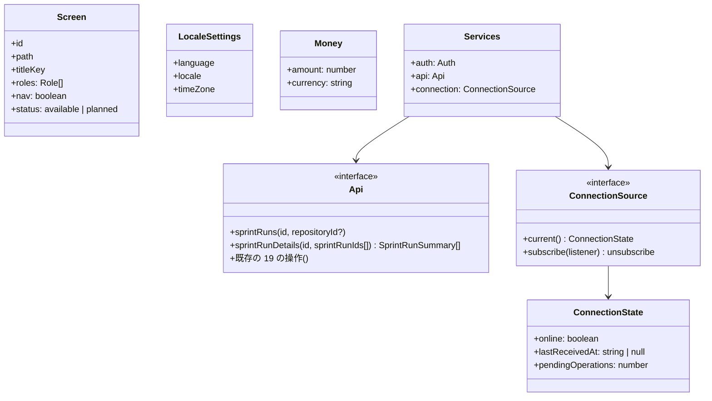
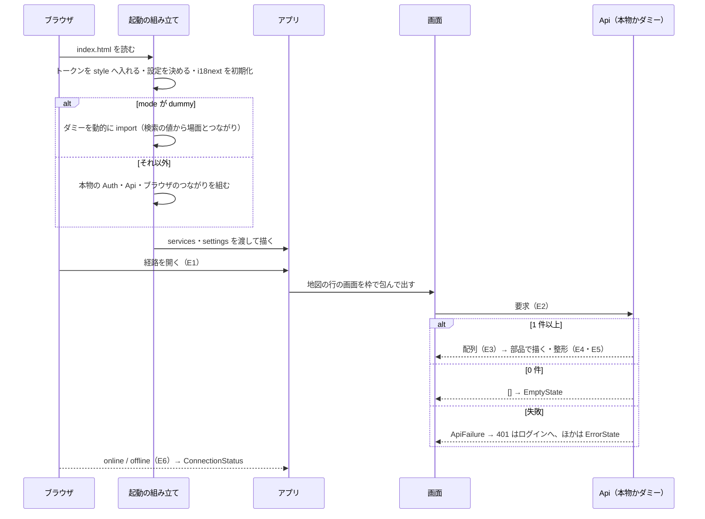

# NDF Factory: 画面の地図と部品の上に、どの端末・言語でも同じ形で画面を足せる（#2382）

## 目的

- **何が壊れているか**: `factory/web/src/pages/` の 8 画面は、文言を日本語でコードに直に書き、PC の幅だけを前提にしている。部品・画面の地図・つながりの状態の見せ方・ダミーの API クライアントが無い
- **誰が困るか**: 画面を足す後続の課題（#2172 スプリントの一覧と詳細・#2173 承認と通知・#2347 ループの見え方）の担い手と、スマートフォンやタブレットで操作する利用者
- **直すと何が成り立つか**: 後続の課題は、画面の地図に 1 行、翻訳のファイルにキーを足し、部品を組むだけで画面を足せる。足した画面は 360 px〜1280 px のどの幅でも横にはみ出さず、言語を足すときに画面のコードを書き換えない。API の中身が無くてもダミーで画面を作り切れる

## 適用範囲

- **働く範囲**: `factory/web/`（画面）・`docs/specifications/` の確定仕様 2 本（画面の地図・部品の一覧）・CI のジョブ `factory-check`。`plugins/`・API・契約（`factory/contracts/`）は変えない
- **プロジェクトごとに違うもの**: 無し（Factory の画面だけの土台）。ダミーと本物の切り替えは Vite の mode（`dummy`）、言語・地域・時刻帯はブラウザの設定から受ける
- **当たるモード**: `standard`

## あるべき姿の根拠

| 根拠 | 種類 | 何を示すか |
| --- | --- | --- |
| スプリント MVV の Value 2「画面の地図・部品・端末・オフラインの見せ方・国際化を UX の土台として先に固め、その上に機能の画面をダミーデータで作り切ってから、API の中身をつなぐ」 | 利用者の指示の原文（承認済みのスプリント MVV） | 土台を機能の画面より先に作り、ダミーで画面を作り切る |
| スプリント MVV の Value 5「画面の文言は国際化の仕組み（言語ごとの翻訳のファイル）で持ち、言語を足すときに画面のコードを書き換えない。日時は UTC で保存して利用者の時刻帯で表示し、金額は通貨とともに扱う」 | 利用者の指示の原文 | 翻訳のファイル・時刻帯・通貨の扱い |
| `npm view typescript-eslint peerDependencies`（2026-11-02 に打った）→ `typescript: '>=4.8.4 <6.1.0'`。`factory/` の TypeScript は `^7.0.2` | 実測 | ESLint の TypeScript の構文解析は今の TypeScript と組めない（決定 3） |
| `npm view react-i18next peerDependencies` → `typescript: '^5 \|\| ^6 \|\| ^7'`、`npm view oxc-parser engines` → `node: '^20.19.0 \|\| >=22.12.0'`（`factory/.node-version` は 24） | 実測 | 選んだ依存が今の TypeScript と Node で使える |
| #2172 の要求の「モックの中身」（モック https://claude.ai/artifact/MYL6CPBTsm6JFTNgtiwY2J の版 1793412669-5df4 を 2026-10-31 に写したもの） | 利用者の指示（写し） | 一覧・詳細・バックログの配置と項目。モックの原文はこの工程で読めなかった（未確認 1） |
| `docs/specifications/ndf-factory-*.md` の 7 本の「画面」「画面向けの経路」「受け持つ課題」の節 | 一次情報（確定仕様） | 画面の地図に載せる機能と、まだ画面の無い機能の持ち主 |

要求と受け入れ条件は #2382 の本文にある（コピーは `issues/issue-2382-requirements.md`）。この文書は「どう作るか」だけを扱う。決定の記録は `issues/issue-2382-design-decisions.md` に分けた。

## ドメインモデル

### コンテキスト

| コンテキスト | 何の語が 1 つの意味に決まるか |
| --- | --- |
| Factory（`ndf-factory`）の画面 | 画面・経路・役割・部品・翻訳のキー・つながりの状態・言語と地域の設定 |

API と契約のコンテキストとの関係は **順応者** である。画面は API の応答の形（`factory/contracts/openapi/`）をそのまま受け、自分の語へ翻訳する層を置かない。#2384 が契約を配列へ揃えたときは、API クライアントの本物の実装だけが追随する。

### 集約

永続データを持たない。画面のコードの中で、書き換えてよい持ち主が 1 つに決まる値の集まりを集約として扱う。

| 集約 | 持ち主（書き換えてよいもの） | 根 | エンティティ | 値オブジェクト |
| --- | --- | --- | --- | --- |
| 画面の地図 | 画面の地図の定義（`src/screens.ts`） | 画面の地図 | 画面（`id` で識別） | 経路・役割の集合・ナビゲーションに出すか |
| 翻訳のファイル | 国際化（`src/i18n/`） | 言語ごとの翻訳のファイル | — | 文言のキー・文言 |
| デザインのトークン | 部品（`src/ui/tokens.json`） | トークンの集合 | — | 色・文字・余白・角の丸み |
| API クライアント | 起動の組み立て（`src/main.tsx`）が 1 つを選ぶ | `Api` | — | — |

画面のコードの中で使う値オブジェクト: 言語と地域の設定（`language`・`locale`・`timeZone`）、金額（`amount`・`currency`）、つながりの状態（`online`・`lastReceivedAt`・`pendingOperations`）。

### 不変条件

| # | 集約 | 条件 | 破れたときの扱い |
| --- | --- | --- | --- |
| I1 | 画面の地図 | アプリの経路の定義は、画面の地図の「状態が `あり`」の行の経路と一致する。経路の定義は地図から作り、別に書かない | 地図と確定仕様の表の経路が食い違うとテストが落ちる |
| I2 | 画面の地図 | 地図に無い経路を開くと `/account` へ移る | テストが落ちる |
| I3 | 画面の地図 | ナビゲーションに出す行き先へ、360 px の幅で 2 手以内で届く | E2E が落ちる |
| I4 | 翻訳のファイル | `factory/web/src` の画面・部品・文脈のコード（テスト・ダミー・翻訳のファイルを除く）に表示の文言が無い | 検査のコマンドが 1 で終わり、`npm run check` が落ちる |
| I5 | 翻訳のファイル | 画面のコードが使う翻訳のキーは、日本語の翻訳のファイルにある | 型検査が落ちる |
| I6 | 翻訳のファイル | ブラウザの言語に翻訳のファイルが無いとき、文言は日本語で出る | テストが落ちる |
| I7 | 翻訳のファイル | 言語を足すのは翻訳のファイルの追加だけで、画面のコードを変えない | 2 つ目の言語を差し込むテストが落ちる |
| I8 | 言語と地域の設定 | 日時は UTC の ISO 8601 で受け、設定の時刻帯で整形する | テストが落ちる |
| I9 | 金額 | 金額は通貨と組でだけ整形の関数へ渡せる | 型検査が落ちる |
| I10 | デザインのトークン | 部品の色・文字・余白はトークンの名前で引く。トークンの JSON は Design Tokens Format Module の形（`$value`・`$type`）で、CSS の変数へ写せる | 写しの関数のテストが落ちる |
| I11 | 部品 | 部品のディレクトリの部品は、部品の一覧の文書に 1 つずつ載る | テストが落ちる |
| I12 | 部品 | ログインの後の画面は 360・768・1280 px のどの幅でも横にはみ出さない | E2E が落ちる |
| I13 | API クライアント | 画面は `Api` のインタフェースだけを通してデータを読む。ダミーの実装を import するのは起動の組み立てだけ | 検査のコマンドが 1 で終わる |
| I14 | API クライアント | 本番のビルドの成果物にダミーの実装とダミーデータが入らない | ビルドの後の検査が 1 で終わる |
| I15 | API クライアント | 0 件は空の状態、失敗は失敗の表示を出し、画面は白くならない | 部品のテストが落ちる |
| I16 | つながりの状態 | つながりの状態の部品は オンライン・オフライン（最後に受け取った時刻）・つながってから確定する操作がある の 3 つを見分けて出す | 部品のテストが落ちる |

### ドメインイベント

| # | イベント | 発生元 | 受け手 |
| --- | --- | --- | --- |
| E1 | 利用者が経路を開いた | ルーター（地図から作った経路の定義） | 画面・ナビゲーション（今の行き先の印） |
| E2 | 画面が API クライアントへ要求を出した | 画面 | `Api` の実装（本物かダミー） |
| E3 | API クライアントが要素の配列を返した | `Api` の実装 | 画面（0 件なら空の状態の部品、失敗なら失敗の表示の部品） |
| E4 | 画面が翻訳のファイルから文言を引いた | 画面・部品 | 国際化（i18next） |
| E5 | 日時・数・金額を言語と時刻帯で整形した | 整形の関数 | 画面・部品 |
| E6 | つながりの状態が変わった | つながりの元（ブラウザの `online` / `offline`、またはダミー） | つながりの状態の部品・承認の操作の部品 |
| E7 | 端末の幅が変わった | ブラウザ | CSS（メディアクエリ）。JavaScript は受けない |

### 用語

| 用語 | 意味 | 用語集への反映 |
| --- | --- | --- |
| 画面の地図 | Factory の全画面の経路・役割ごとの主な動線・確定仕様の機能との対応を 1 つにまとめた表 | 追加（要求で反映済み） |
| デザインのトークン | 色・文字・余白の値に名前を付け、画面の部品がその名前で参照する値の集合 | 追加（要求で反映済み） |
| ダミーの API クライアント | 画面が呼ぶ API クライアントのインタフェースを満たし、決まったデータを返す実装。本物の API クライアントと差し替えられる | 追加（要求で反映済み） |
| 翻訳のファイル | 言語ごとに、画面の文言のキーと文言を持つファイル | 追加（要求で反映済み） |
| 見本の画面 | 土台の部品だけで組み、ダミーデータで動かす画面の 1 組（スプリントの一覧と詳細）。後続の課題が中身を置き換える出発点 | 追加 |
| つながりの状態 | 画面が今サーバーへつながっているか・最後に受け取った時刻・つながってから確定する操作の数の組 | 追加 |
| 言語と地域の設定 | 画面の文言の言語・日時と数の書式の地域・表示の時刻帯の組。今はブラウザの設定から決める | 追加 |

## 機能一覧

| # | 機能 | 誰が使うか |
| --- | --- | --- |
| F1 | 画面の地図を読み、機能がどの画面に載るかを知る | 画面を足す課題の担い手 |
| F2 | ナビゲーションから主な行き先へ移る（どの幅でも） | 個人・Team の管理者・席 |
| F3 | 部品の一覧と使い分けを読み、部品で画面を組む | 画面を足す課題の担い手 |
| F4 | 画面の文言を利用者の言語で読む（今は日本語だけ） | 個人・Team の管理者・席 |
| F5 | 日時・数・金額を自分の地域と時刻帯の書式で読む | 個人・Team の管理者・席 |
| F6 | つながりの状態（オンライン・オフライン・確定待ちの操作）を読む | 個人・Team の管理者・席 |
| F7 | スプリントの一覧から詳細へ移る（見本の画面） | 個人・Team の管理者・席 |
| F8 | API の中身が無くても、ダミーで画面を起動して確かめる | 画面を足す課題の担い手・E2E |
| F9 | 直に書いた文言・ダミーの import・本番へのダミーの混入を検査で落とす | 画面を足す課題の担い手・CI |

## 構成要素

| 要素 | 責務 |
| --- | --- |
| 画面の地図の定義（`src/screens.ts`、新設） | 画面ごとの `id`・経路・題のキー・役割・ナビゲーションに出すか・状態（`あり` / `予定`）。経路の定義とナビゲーションはここから作る |
| アプリ（`src/App.tsx`） | 地図の `あり` の行から `<Route>` を作る。ログインの後の画面を枠で包む（`/login`・`/callback`・地図に無い経路の転送は包まない）。地図に無い経路は `/account` へ |
| 枠（`src/ui/AppShell.tsx`、新設） | 見出しの帯・ナビゲーション・つながりの状態を置く。幅 1024 px 以上は横に並べた案内、未満はメニューのボタンで開く案内 |
| 部品（`src/ui/`、新設） | 下の「部品の一覧」の 17 個。トークンだけで見た目を決め、文言は呼ぶ側から受けるか翻訳のキーで引く |
| デザインのトークン（`src/ui/tokens.json`・`src/ui/tokens.ts`、新設） | Design Tokens Format Module の JSON と、それを CSS の変数の文へ写す純粋な関数。起動時に 1 度だけ `<style>` へ入れる |
| 国際化（`src/i18n/`、新設） | 翻訳のファイル `ja.json`・i18next の初期化・キーの型・言語と地域の設定の決定・設定の文脈 |
| 整形（`src/i18n/format.ts`、新設） | 日時・数・金額を言語と地域の設定で整形する純粋な関数（`Intl` を使う） |
| つながりの元（`src/connection.ts`、新設） | `ConnectionSource`（今の状態と変化の通知）。ブラウザの実装は `navigator.onLine` と `online` / `offline` の事象を読む |
| API クライアント（`src/api.ts`） | `Api` に `sprintRunDetails` を足す（配列で受け渡す）。本物の実装は既存の一覧の経路から組む |
| ダミーの実装（`src/dummy/`、新設） | `Api`・`Auth`・`ConnectionSource` のダミーと、ダミーデータ。場面（`normal` / `empty` / `error`）とつながりの状態を URL の検索の値から決める |
| 起動の組み立て（`src/main.tsx`） | mode が `dummy` ならダミー、それ以外は本物を組む（切り替えはここ 1 か所）。トークンと国際化を整えてから描く |
| 既存の 8 画面（`src/pages/*.tsx`・`src/context.tsx`） | 文言を翻訳のキーへ、要素を部品へ置き換える。経路・API の呼び方・入力の検査は変えない |
| 見本の画面（`src/pages/SprintsPage.tsx`・`SprintDetailPage.tsx`、新設） | スプリントの一覧と詳細を部品だけで組む |
| 源の検査（`web/scripts/check-source.ts`、新設） | 直に書いた文言（I4）とダミーの import（I13）を落とす |
| 成果物の検査（`web/scripts/check-bundle.ts`、新設） | `dist/` にダミーの印が無いことを確かめる（I14） |
| E2E（`web/e2e/`・`web/playwright.config.ts`、新設） | ダミーで起動した画面を Chromium の 3 つの幅で開き、はみ出しとナビゲーションの手数を測る |
| CI（`.github/workflows/factory-check.yml`） | `npm run check` の後に Chromium を入れて E2E を打つ |
| 確定仕様（`docs/specifications/ndf-factory-screen-map.md`・`ndf-factory-ui-components.md`、新設） | 画面の地図と部品の一覧・使い分け（決定 9） |



**配置は変わらない。** 画面は今と同じ静的な資産として配られる。境界をまたぐのは今と同じ「画面 → API」だけで、ダミーで起動したときは境界をまたがない。

置き場（変える範囲）:

```text
factory/web/
├── package.json                 # 依存 5 つ（i18next・react-i18next・oxc-parser・@playwright/test・@types/node）・script
├── tsconfig.json                # include に scripts・e2e を足し、types に node
├── vite.config.ts               # test.include を src に絞る
├── playwright.config.ts         # 新設
├── scripts/{check-source.ts, check-bundle.ts}   # 新設
├── e2e/{widths.spec.ts, navigation.spec.ts}     # 新設
└── src/
    ├── App.tsx, main.tsx, api.ts, context.tsx
    ├── screens.ts（新設）, connection.ts（新設）
    ├── i18n/{index.ts, ja.json, settings.ts, format.ts}（新設）
    ├── ui/{tokens.json, tokens.ts, ui.css, *.tsx}（新設）
    ├── dummy/{index.ts, api.ts, data.ts}（新設）
    └── pages/{既存の 8 画面, parts.tsx, SprintsPage.tsx（新設）, SprintDetailPage.tsx（新設）}
docs/specifications/{ndf-factory-screen-map.md, ndf-factory-ui-components.md}   # 新設
.github/workflows/factory-check.yml
```

## 構造



- `Services` に `connection` を足す。既存のテストは `services` に `connection` を渡していないため、`App` は無いときにブラウザの実装を使う（既存のテストを書き換えない）
- `App` は `settings?: LocaleSettings` と `resources?`（テストで 2 つ目の言語を差し込む口）を受ける。無いときはブラウザから決めた設定と日本語の翻訳のファイルを使う
- `Role` は `personal`（個人のアカウントの持ち主）・`team_owner`（Team の管理者）・`team_seat`（席を持つ人）の 3 つ

### 部品の一覧

| 部品 | 何に使うか |
| --- | --- |
| `AppShell` | ログインの後の画面の枠（見出しの帯・ナビゲーション・つながりの状態）。ログインの後の経路（`/account`・`/teams/new`・`/accounts/:accountId` 以下）だけを包む 1 つの layout route（`<Outlet>`）として置き、画面を切り替えても作り直さない。`/login`・`/callback` と `*` の転送は layout route の外に置き、枠で包まない（包むと `/callback` で枠が token の無いまま `api.me()` を呼び、401 で `/login` へ移って `completeLogin` の後の `/account` への移動に負ける）。役割と個人のアカウントの ID の取り方は「画面の地図」の節の下にある |
| `NavMenu` | 地図の `nav` の行き先。今のアカウントの経路を埋める。DOM は `<nav aria-label>` の中にリンク（`a`）だけを並べ、`ul` / `li` を使わない（既存のチームの画面のテストの `getAllByRole("listitem")` の 2 件を変えないため。決定 13）。リンクは幅によらず常に DOM に描き、1024 px 未満では CSS のメディアクエリで隠してメニューのボタン（`aria-expanded`）で開く。幅を JavaScript（`matchMedia`）で読まない（jsdom に無く、テストの描画が幅で変わらないため） |
| `PageHeader` | 画面の題（`h1`）と画面の操作 |
| `DataList` | 一覧。768 px 以上は列の表、未満は 1 行を 1 枚のカードに積む。行は詳細へのリンク |
| `DetailList` | 名前と値の組（`dl`）。狭い幅では縦に積む |
| `StatusBadge` | 状態の札。色の調子（中立・情報・成功・注意・危険）と文言を受ける |
| `ApprovalActions` | 承認する・差し戻すの 2 つのボタン。オフラインでは押せず、「つながってから確定します」を添える |
| `SearchField` | 絞り込みの入力。ラベルを必ず持つ |
| `EmptyState` | 0 件のとき |
| `LoadingState` | 読み込み中 |
| `ErrorState` | 読み込みの失敗。文言とやり直しのボタン |
| `ConnectionStatus` | つながりの状態の 3 つの見せ方（I16） |
| `Button` | ボタン。主・副・危険の 3 種 |
| `TextField` | 1 行の入力とラベルと誤りの文 |
| `SelectField` | 選択とラベル |
| `Alert` | 操作の結果の文（`role="alert"`） |
| `Section` | 見出し（`h2`）つきのまとまり |

## 入出力の契約

### API クライアント（画面の中の約束）

| 名前 | 入力 | 出力 | 失敗の形 | 互換性 |
| --- | --- | --- | --- | --- |
| `sprintRunDetails(accountId, sprintRunIds)`（新設） | アカウントの ID、実行の ID の配列（1 件のときも要素 1 個の配列） | `SprintRunSummary[]`。見つからない ID の要素は返さない | `ApiFailure`（既存の 401・403・5xx） | 足すだけ。本物の実装は `GET /accounts/{a}/sprint-runs` の 50 件から ID で選ぶ。#2172 が詳細の経路を足したら本物の実装だけを差し替える |
| 既存の 20 の操作 | 変えない | 変えない | 変えない | `api.ts` の 401 の `message` を ASCII の機械の値へ変える（画面に出していない） |

API の経路と契約（`factory/contracts/`）は変えない。

### 画面

| 画面 | 経路 | 何をする場所か |
| --- | --- | --- |
| スプリントの一覧（見本） | `/accounts/:accountId/sprints` | 実行を新しい順に並べ、課題の番号で絞り、行を押して詳細へ移る |
| スプリントの詳細（見本） | `/accounts/:accountId/sprints/:sprintRunId` | 課題・リポジトリ・状態・失敗の理由・始めた日時を読む |

経路は #2172 の設計（`issues/issue-2172-design.md` の「画面」）と同じで、#2172 は中身だけを置き換える。

| 状態 | 一覧 | 詳細 |
| --- | --- | --- |
| 読み込み中 | `LoadingState` | 同じ |
| 空 | `EmptyState`「スプリントの実行はまだありません」 | 見つからなければ `EmptyState`「このスプリントの実行は見つかりません」 |
| 失敗（5xx など） | `ErrorState` と「もう一度読む」 | 同じ |
| 401 | token を消してログインへ（既存の扱い） | 同じ |
| 403 | 「このアカウントを見る権限がありません」（既存） | 同じ |
| オフライン | 枠の `ConnectionStatus` が出す。画面は最後の表示を残す | 同じ |

入力は一覧の絞り込みだけで、上限も必須も無いため入力規則の表は作らない。権限で隠す要素は無い（席を持つ人は誰でも一覧を読める）。

### 画面の地図（確定仕様 `ndf-factory-screen-map.md` へ書く中身）

| 画面 | 経路 | 役割 | 状態 | 載る機能（確定仕様の節） |
| --- | --- | --- | --- | --- |
| ログイン | `/login` | ログイン前 | あり | Google・GitHub でログイン（accounts-and-plans「ログインの流れ」） |
| ログインの戻り | `/callback` | ログイン前 | あり | code を token に換える |
| 自分のアカウント | `/account` | 個人・管理者・席 | あり | 利用者の ID・個人のプランと実行の形態・使える量・チームの一覧・ログアウト |
| チームを作る | `/teams/new` | 個人 | あり | Team を作る |
| チームのアカウント | `/accounts/:accountId` | 管理者・席 | あり | 席の追加・種類の変更・削除（管理者）・実行の形態（管理者）・使える量 |
| リポジトリ | `/accounts/:accountId/repositories` | 個人・管理者・席 | あり | 導入の案内・登録と外す（個人・管理者）・実行の状態（runs-and-runner「画面」） |
| キーの持ち込み | `/accounts/:accountId/model-credential` | 個人・管理者 | あり | キーの保存と消去・外部 ID |
| スプリントを始める | `/accounts/:accountId/repositories/:repositoryId/sprints/new` | 個人・管理者・席 | あり | 課題の候補・選び直し・開始 |
| スプリントの一覧 | `/accounts/:accountId/sprints` | 個人・管理者・席 | あり（見本。#2172 が置き換える） | フェーズと状態（#2172）・取り消し（#2186） |
| スプリントの詳細 | `/accounts/:accountId/sprints/:sprintRunId` | 個人・管理者・席 | あり（見本。#2172 が置き換える） | 工程・PR・CI・承認ゲート（#2172）・起票の下書き（issue-requests、#2172） |
| バックログ | `/accounts/:accountId/repositories/:repositoryId/backlog` | 個人・管理者・席 | 予定（#2172） | 順位の表と棚卸しの記録 |
| 承認 | 未定（#2173） | 個人・管理者・席 | 予定 | 承認の依頼・Web からの承認・通知 |
| 請求と使用量 | 未定（#2174） | 個人・管理者 | 予定 | プランの料金・使用量の台帳・決済 |
| 手元のランナー | 未定（#2189） | 個人・管理者 | 予定 | ランナーの登録・心拍 |
| ループ | 未定（#2347） | 個人・管理者・席 | 予定 | 開発ループと並行する実行の見え方 |

ナビゲーションに出す行き先（`nav`）は、自分のアカウント・スプリントの一覧・リポジトリ・キーの持ち込み（個人と管理者だけ）の 4 つ。`:accountId` は今開いている経路のアカウント、無ければ個人のアカウントで埋める。

役割と個人のアカウントの ID は、枠（`AppShell`）が `api.me()` を 1 度だけ呼んで得て、枠の中の文脈に持つ。

- 呼ぶ時: 枠が最初に描かれた時の 1 回だけ。枠は layout route なので画面を切り替えても呼び直さない。token が変わった時（ログインし直した時）だけ呼び直す。画面の切り替えで API の呼び出しは増えない
- 経路の `:accountId` が枠の持つ `Me.accounts` に無い時（チームを作った直後に `NewTeamPage` が `/accounts/:accountId` へ移った時など）: 枠はその `:accountId` につき 1 度だけ `api.me()` を呼び直し、文脈の `Me` を置き換える。こうして作成者が管理者になったチームでも、再読み込みせずに「キーの持ち込み」が出る。呼び直しても無ければ同じ `:accountId` では呼び直さず、役割の要る行き先を出さない。`NewTeamPage` の API の呼び方は変えない
- 既存の画面の API の呼び方は変えない（`AccountPage` は今のまま自分で `api.me()` を呼ぶ）。枠の文脈を画面へ渡して呼び出しを減らすのは、この課題の範囲の外である
- 役割の決め方: `Me.accounts` のうち今の `:accountId` の行が `kind: "personal"` なら個人、`role: "owner"` なら管理者、ほかは席。キーの持ち込みは個人と管理者のときだけ出す
- 返るまでと失敗（403・5xx・オフライン）のとき: 枠は誤りの文を出さず、役割の要る行き先（キーの持ち込み）を出さない。`:accountId` が経路に無ければ、アカウントの要る行き先（スプリントの一覧・リポジトリ）も出さず、自分のアカウントだけを出す。誤りは画面の側が今のとおり出す（既存のテストの「このアカウントを見る権限がありません」を 2 つにしない）
- 401 のとき: 既存の扱いと同じ（`api.ts` が token を消し、ログインの画面へ移る）。枠と画面の両方が 401 を受けても、移る先は同じ `/login` である

| 役割 | 主な動線 |
| --- | --- |
| 個人 | ログイン → 自分のアカウント → リポジトリ → スプリントを始める → スプリントの一覧 → スプリントの詳細 |
| Team の管理者 | ログイン → 自分のアカウント → チームのアカウント（席の管理・実行の形態）→ キーの持ち込み・リポジトリ |
| 席 | ログイン → 自分のアカウント → チームのアカウント → リポジトリ → スプリントを始める → スプリントの一覧 |

### コマンド（`factory/web/package.json` の script）

| script | 中身 | 終了コード |
| --- | --- | --- |
| `dev:dummy` | `vite --mode dummy`（ダミーで起動） | — |
| `check:source` | `node scripts/check-source.ts` | 0 無し、1 見つけた（`<ファイル>:<行>:<列> <規則> <文>` を 1 行ずつ）、2 構文解析できない |
| `check:bundle` | `node scripts/check-bundle.ts`（`dist/` を読む） | 0 無し、1 ダミーの印を見つけた、2 `dist/` が無い |
| `check` | `typecheck` → `test` → `check:source` → `vite build` → `check:bundle`。`build`（`tsc --noEmit && vite build`）を呼ばず `vite build` を直に呼び、型検査を 1 回に保つ。`build` は単独で使うために今のまま残す | どれかが 0 以外ならその値 |
| `e2e` | `playwright test`（`webServer` は `vite --mode dummy`） | Playwright の終了コード |

源の検査の規則（対象は `src/**/*.{ts,tsx}`。`*.test.*`・`src/dummy/`・`src/i18n/*.json` を除く。コメントは見ない）:

| 規則 | 落とすもの |
| --- | --- |
| `jsx-text` | 文字（Unicode の `L`）を含む JSX の文 |
| `jsx-attr` | 文字を含む文字列を `aria-label`・`title`・`placeholder`・`alt`・`label` に直に渡す |
| `jsx-expr` | JSX の子に置いた文字列・テンプレートで文字を含むもの |
| `non-ascii` | ASCII の外の文字（日本語など）を含む文字列・テンプレート（JSX の外も） |
| `dummy-import` | `src/main.tsx` 以外から `src/dummy/` を import する |

## 処理の流れ



この図は実行時に動く要素だけを描く。地図の定義・枠と部品・トークン・国際化と整形・つながりの元は、起動の組み立てとアプリの中の手として描き、源の検査・成果物の検査・E2E・CI・確定仕様は図に含めない。

本番のビルドでは `import.meta.env.MODE` が `"production"` に置き換わり、ダミーの分岐とその動的な import がビルドから落ちる。落ちたことは `check:bundle` が確かめる（決定 5）。

## 非機能の実現方式

| 大項目 | 要求の条件 | 実現方式 | 確かめ方 |
| --- | --- | --- | --- |
| セキュリティ | ダミーの実装・ダミーデータは本番のビルドに入らない。翻訳のファイルとダミーデータに秘密・実在の個人情報を書かない | ダミーは mode の分岐の中の動的な import だけで読む。ダミーデータに印の文字列 `ndf-factory-dummy-data` を置く。利用者の ID は `00000000-…` の形、名前は架空のもの | `check:bundle` が `dist/` で印を探す。`check:source` の `dummy-import` |
| システム環境 | E2E は Chromium の 3 つの幅で確かめる。iOS の Safari と Android の Chrome での描かれ方は、リリース後テストで人が見る | Playwright の 3 つの project（360×740・768×1024・1280×800）。CI で `playwright install --with-deps chromium` | `npm run e2e -w web` が CI の `factory-check` で 0 |
| 運用・保守性 | 画面を足す課題は、地図の行と翻訳のキーを足すだけで、部品・整形・API クライアントの仕組みに手を入れずに済む | 経路とナビゲーションを地図から作る。部品は文言をキーか引数で受ける。`Api` のダミーは操作ごとの関数を足すだけ | 見本の画面 2 つを、部品・整形・`main.tsx` を変えずに足せたこと（実装の差分で見る） |

## 決定の記録

`issues/issue-2382-design-decisions.md` に分けた。

## テスト設計

| 受け入れ条件・不変条件 | どの振る舞いで縛るか | どう壊したら落ちるべきか |
| --- | --- | --- |
| 1 / I1 | 確定仕様の画面の地図の表の `あり` の行の経路の集合が、`screens.ts` の `available` の経路の集合と一致する（Vitest） | 地図か `screens.ts` の片方だけに行を足す・消す |
| 2・3 | 確定仕様の地図に「載る機能」の列と役割ごとの動線の表がある。中身は承認ゲート 2 で人が読む（文言を照らすテストは書かない） | — |
| 4 / I2 | 地図に無い経路を開くと `/account` に移る（既存の `App.test.tsx`） | `*` の経路を消す |
| 5 / I3 | 360 px で `/account` から、メニュー → 行き先の 2 回の押下で `nav` の 4 つの行き先へそれぞれ届く（E2E） | メニューを 2 段にする・行き先を `nav` から外す |
| 6 / I11 | `src/ui/` の部品のファイル名の集合が、部品の一覧の文書の表の 1 列目の集合と一致する（Vitest） | 部品を足して文書に載せない |
| 7 | ダミーで一覧を開くと 3 件が出て、1 行を押すとその詳細の経路へ移る（部品のテスト） | 行のリンクの経路を誤る |
| 8 / I15 | 場面 `empty` で `EmptyState`、`error` で `ErrorState` が出る（部品のテスト） | 0 件で表を空のまま出す・失敗で例外を投げる |
| 9 / I12 | ログインの後の 6 画面と見本の 2 画面で、3 つの幅とも `scrollWidth` ≤ ウィンドウの幅（E2E） | 固定の幅 900 px の要素を部品に入れる |
| 10 / I4 | 規則ごとに、文言を直に書いた小さな源を渡すと 1、キーで引いた源で 0（Vitest で検査の関数を呼ぶ） | 規則を 1 つ外す・コメントの中を拾う |
| 11 / I4 | `npm run check:source -w web` が今の源で 0 | 既存の画面に日本語の文字列を 1 つ戻す |
| 12 / I5 | 無いキーを使うコードで型検査が落ちる（`@ts-expect-error` を置いたテスト） | 翻訳のキーの型を `string` にする |
| 13 / I7 | テストで英語の翻訳のファイルを `resources` に差し込むと、見本の一覧の題がその文言で出る | 画面の中で日本語へ固定する |
| 14 / I8 | `2026-11-02T00:00:00Z` が `ja-JP`・`Asia/Tokyo` で 9 時、`en-US`・`America/New_York` で前日の 19 時（2026-11-01 に夏時間が終わった後の EST）に整形される | 時刻帯を渡さずに整形する |
| 15 / I9 | `JPY` で小数が無く `USD` で 2 桁、`formatMoney(100)` は `@ts-expect-error` | 金額を数だけで受ける |
| 16 / I16 | 3 つの状態を渡すと 3 つの文言が出分ける。ダミーのつながりを `offline` にすると見本の画面の枠に出る | オフラインで時刻を出さない |
| 17 / I13 | 画面のファイルに `../dummy/` の import を足すと `check:source` が 1 | 規則を外す |
| 18 / I14 | 本番のビルドの後 `check:bundle` が 0。分岐を `if (true)` にすると 1 | 印を探さない |
| 19 | `npm run check`（`factory/`）が 0。`App.test.tsx`・`auth.test.ts` を書き換えずに通る | 既存の画面の文言をキーへ移すときに日本語の文を変える |
| I6 | ブラウザの言語が `fr-FR` のとき日本語で出る | 翻訳の無い言語で空の文言を出す |
| I10 | トークンの JSON を CSS の変数の文へ写すと、`$value` が `--color-…` の値になる。参照（`{color.base}`）は解く | 入れ子の名前を潰す・参照を解かない |

## 設計の結果

| 課題 | 扱い | 取り込み先 | 触るファイル |
| --- | --- | --- | --- |
| #2382 | 実装する | — | `factory/web/`、`factory/package-lock.json`、`factory/README.md`、`docs/specifications/ndf-factory-screen-map.md`、`docs/specifications/ndf-factory-ui-components.md`、`.github/workflows/factory-check.yml` |

## 未確認のまま残ること

| 項目 | 内容 |
| --- | --- |
| 1. モックの原文 | https://claude.ai/artifact/MYL6CPBTsm6JFTNgtiwY2J はこの工程で読めなかった（文書の Tool の呼び出しが権限の無いまま拒まれた）。#2172 の要求に写した 3 画面の配置と項目だけを読み、残る 4 画面は確定仕様から起こした。部品の見た目がモックと合うかは承認ゲート 1 で人が見る |
| 2. ダミーの分岐がビルドから落ちるか | Vite 8（rolldown）が `"production" === "dummy"` の分岐と、その中の動的な import の塊を落とすかは、実装で 1 度ビルドして確かめる。落ちなければ決定 5 の代わりの案（エイリアスで空の module へ置き換える）へ移る。`check:bundle` が見張る |
| 3. oxc-parser の AST の形 | JSX の文と属性の節の名前（ESTree 互換）は実装の最初に 1 つの `.tsx` を解析して確かめる |
| 4. API が返す文言 | 409・422・400 の `message` は API が日本語で返し、画面はそのまま出す。言語を足すときは API の側の課題になる（#2384 の配列化と同時に見る） |
| 5. 最後に受け取った時刻の本物 | ブラウザの実装は `lastReceivedAt` を `null` で返し、オフラインでは時刻を添えずに出す。時刻を持つのは #2383 |
| 6. 見本の詳細の本物 | 本物の実装は一覧の 50 件から選ぶため、それより古い実行は「見つかりません」になる。#2172 の詳細の経路で解ける |
| 7. 既存の画面の見た目 | 部品へ置き換えると 8 画面の見た目と配置が変わる。承認ゲート 2 で人が見る |
