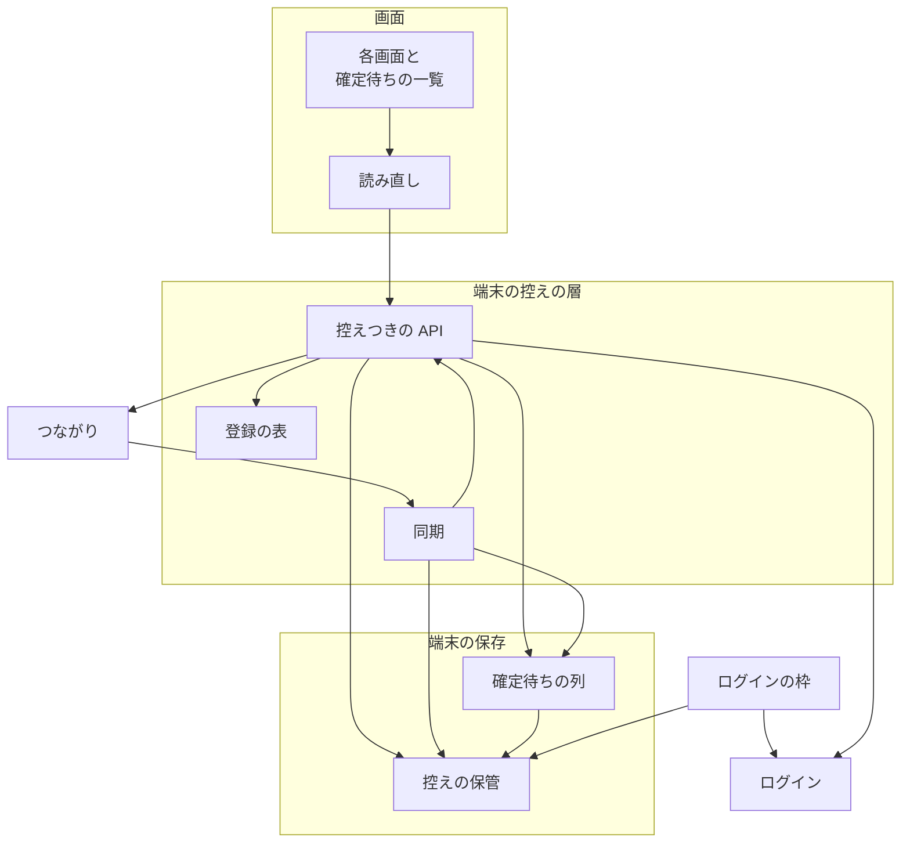
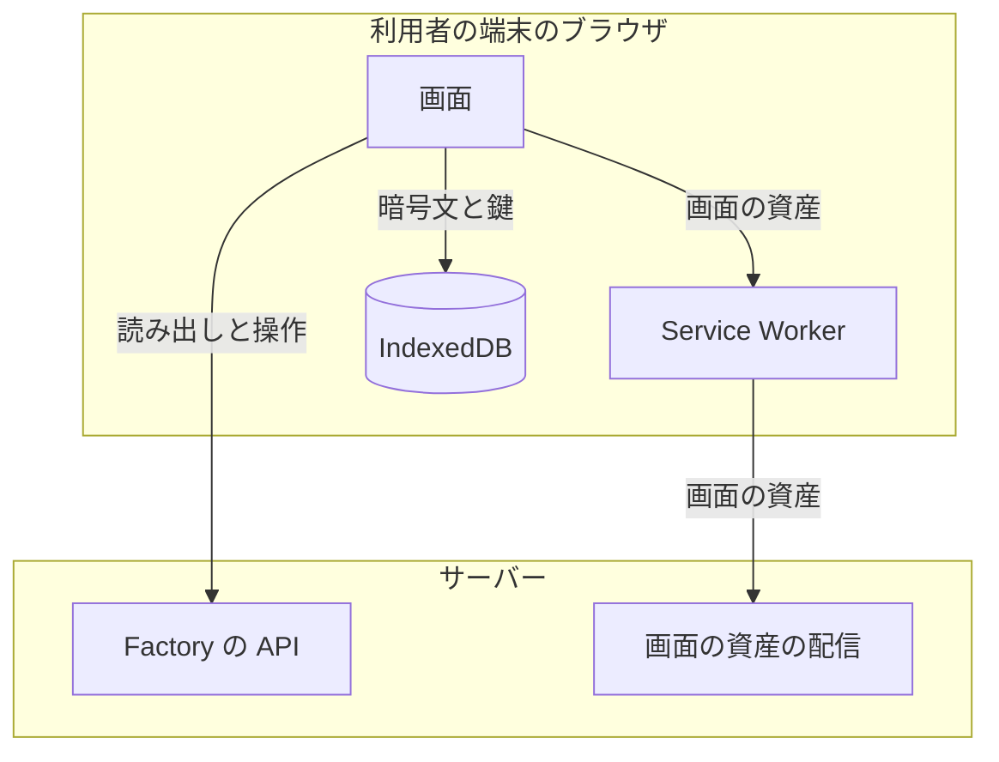
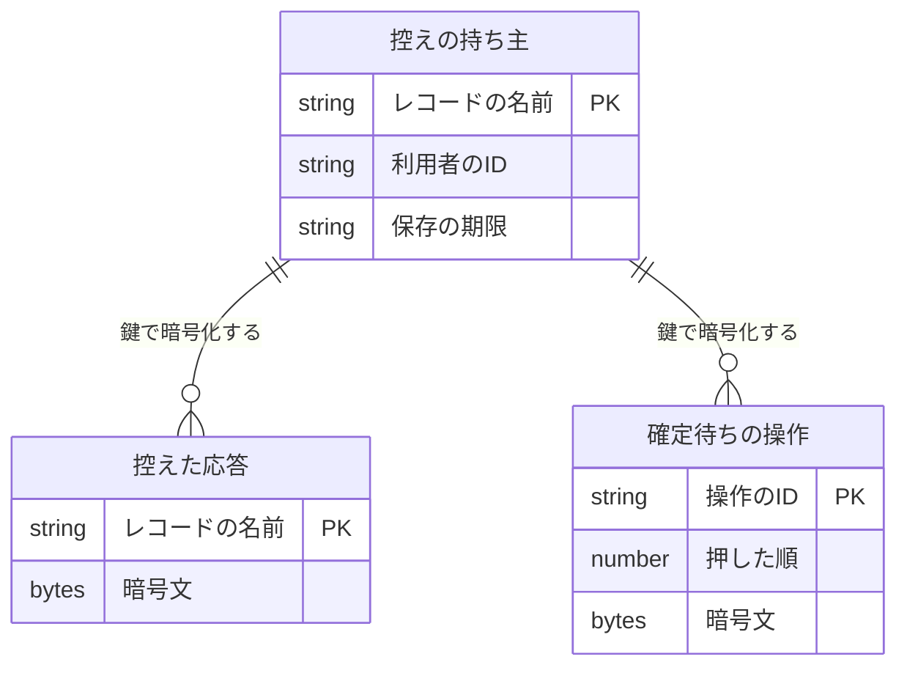
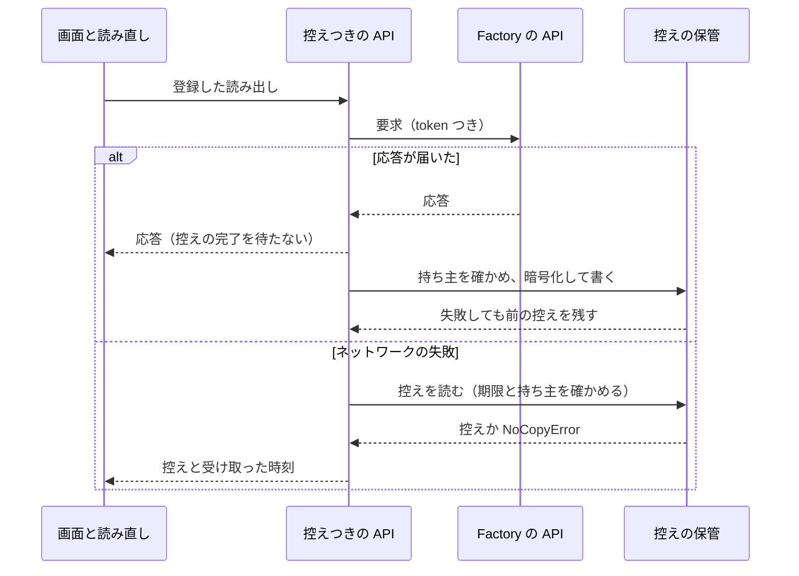
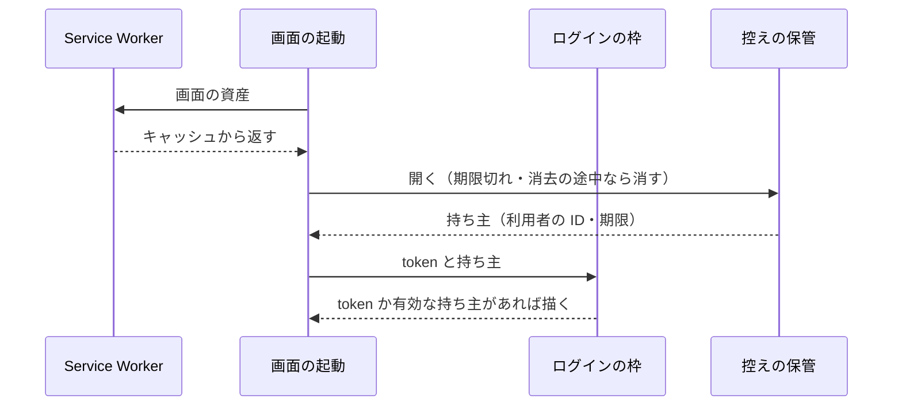
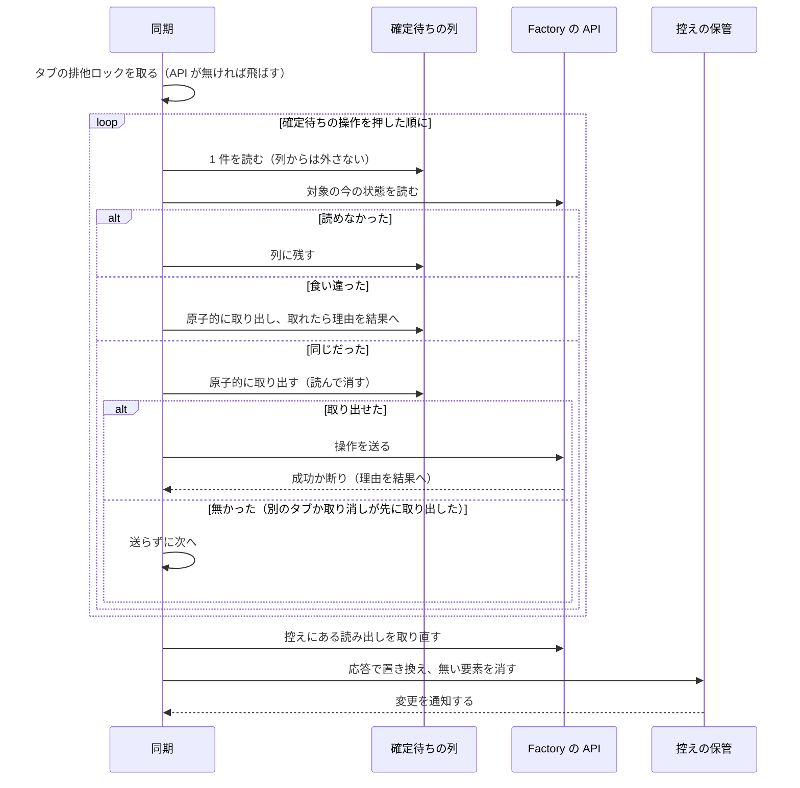
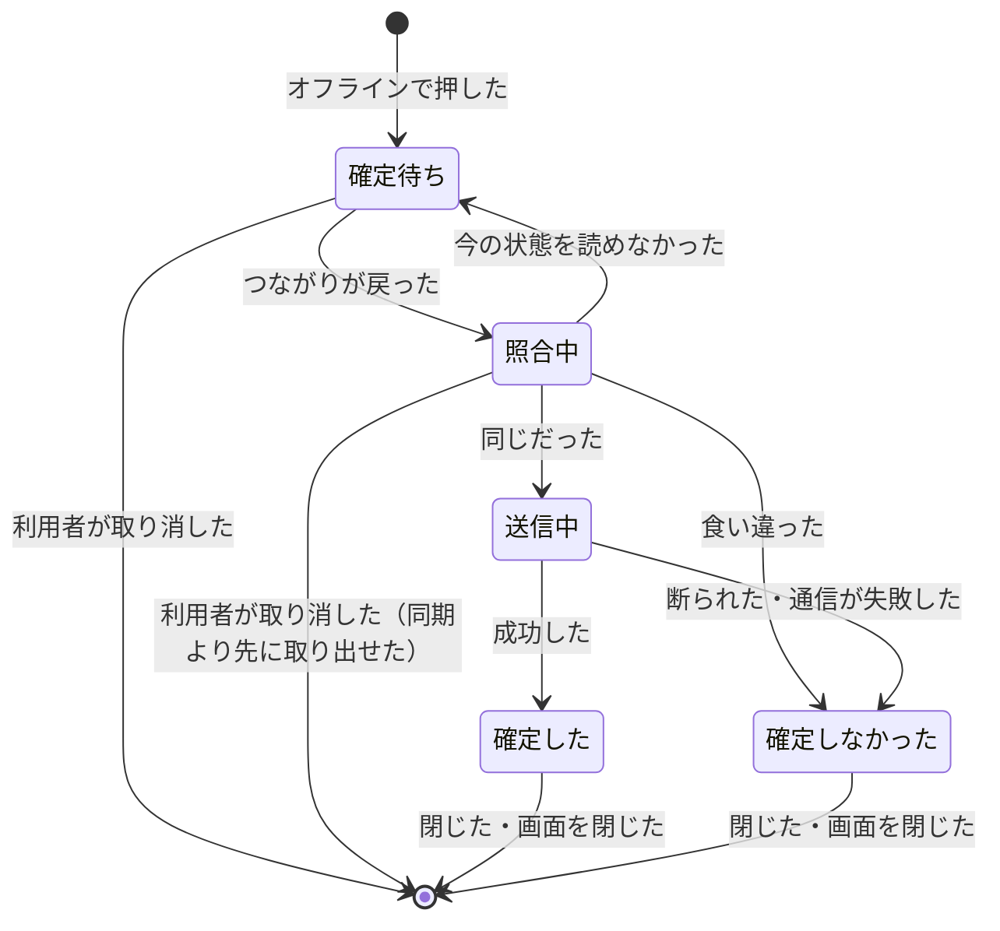

# Factory の画面: オフラインでも最後に受け取った内容を読め、取り消せない操作はつながってから照らして確定する（#2383）

## 目的

- **今どうなっているか**: Factory の画面は、API が応答を返さないと一覧も詳細も表示しない。取り消せない操作（ループの判断待ちへの答え・ループの開始・止める）のボタンはオフラインでは押せず、つながりの状態の表示は「最後に受け取った時刻」と「確定待ちの数」を実際の値で持たない
- **誰に効くか**: 移動中にスマートフォンやタブレットで承認の通知を受け、電波の弱い場所で開く Factory の利用者
- **変えると何が成り立つか**: 最後に受け取ったスプリントの一覧・詳細・承認を待つ依頼の一覧・ループの一覧と詳細を、暗号化して端末に残した端末の控えから読める。オフラインの間に押した取り消せない操作は、つながってからサーバーの今の状態と照らし、同じときだけ確定する。端末の控えはログアウト・401・期限・別の利用者のログインで消える

## 適用範囲

- **働く範囲**: Factory の画面（`factory/web`）だけ。API（`factory/api`）と契約（`factory/contracts`）、NDF のプラグイン（`plugins/`）は変えない
- **プロジェクトごとに違うもの**: 無し（Factory の画面はこのリポジトリにだけある。端末の控えに入れる読み出しは画面のコードの登録の表が持つ）
- **当たるモード**: `standard`

## あるべき姿の根拠

| 根拠 | 種類 | 何を示すか |
| --- | --- | --- |
| スプリント MVV の Value 3「つながらないときも、最後に受け取ったスプリントの一覧・詳細・承認資料を読め…端末に残すデータは暗号化して保存する…取り消せない操作は、オフラインでは確定させず、つながってからサーバーの今の状態と照らして確定する」 | 利用者の指示の原文 | 読めるもの・暗号化・確定の規則 |
| STD1（Web Crypto API）は、`[[extractable]]` が偽の鍵の書き出しで `InvalidAccessError` を投げると定め、鍵を IndexedDB へ保存する使い方を想定している | 外部の一次情報 | 書き出せない鍵を端末に残せること（受け入れ条件 10） |
| Node 24.22.1 で、書き出せない AES-GCM の鍵を `structuredClone` で複製でき、複製の `exportKey` が `InvalidAccessError` になった | 実測（`node -e` で 2026-11-05 に実行） | 単体テストの側でも、鍵の複製と書き出しの拒否を確かめられること |
| `factory/web/src/auth.ts` は token を `sessionStorage` に置く。新しいタブは token を持たない | 実測（コードの読み取り） | 通知から開いた新しいタブで読むには、token に依らずに端末の控えを読める必要があること（起票者の推定 S9） |
| `grep -rn cancelSprintRun factory/web/src` の結果は `src/api.ts` の 2 行と `src/dummy/api.ts` の 1 行だけで、画面（`src/pages/`）からの呼び出しは 0 件 | 実測（2026-11-05 に実行） | スプリントの実行を止める操作は、今の画面にボタンが無いこと（未確認のまま残ること 4） |

要求と受け入れ条件は #2383 の本文にある（コピーは [issue-2383-requirements.md](issue-2383-requirements.md) ）。この文書は「どう作るか」だけを扱う。決定の記録は [issue-2383-design-decisions.md](issue-2383-design-decisions.md) に分けた。

## ドメインモデル

### コンテキスト

| コンテキスト | 何の語が 1 つの意味に決まるか |
| --- | --- |
| Neural Development Factory（`ndf-factory`） | 端末の控え・確定待ちの操作・スプリントの実行・ループ・承認を待つ依頼 |

変更は 1 つのコンテキストに収まる。サーバーのスプリントの実行とループは読み出しの応答として受け取るだけで、端末の側でモデルを持ち直さない。

### 集約

| 集約 | 持ち主（書き換えてよいもの） | 根 | エンティティ | 値オブジェクト |
| --- | --- | --- | --- | --- |
| 端末の控え | 控えの保管（`src/offline/vault.ts`） | 控えの持ち主の記録（利用者の ID・保存の期限・鍵） | 控えた応答（1 つの読み出しの 1 つの応答。要素ごとに読む読み出しでは要素 1 個） | 受け取った時刻・保存の期限・読み出しの指し方（読み出しの名前・アカウント・引数） |
| 確定待ちの操作 | 確定待ちの列（`src/offline/pending.ts`） | 確定待ちの操作 | — | 操作の種類・送る中身・押したときに見ていた状態・照合の結果 |

- 控えの保管と確定待ちの列は、同じ IndexedDB のデータベースに別のオブジェクトストアとして置く。暗号の鍵は控えの持ち主の記録だけが持ち、確定待ちの列は控えの保管の暗号化と復号の操作を呼ぶ
- 確定待ちの操作は、操作の対象（ループ・スプリントの実行）を ID で指す。対象の今の状態は照合のときにサーバーから読み、端末の控えを照合の根拠にしない

### 不変条件

| # | 集約 | 条件 | 破れたときの扱い |
| --- | --- | --- | --- |
| I1 | 端末の控え | 端末に書くバイト列に、応答の平文と token の値が現れない。控えた応答は AES-GCM で暗号化し、レコードの名前は HMAC で作る | 暗号化に失敗したら書かない（応答は画面へそのまま返す） |
| I2 | 端末の控え | 暗号と名前の鍵は書き出せない（`extractable: false`） | 鍵を作れなければ控えを使わない |
| I3 | 端末の控え | 控えの持ち主は 1 人である。持ち主と別の利用者の token で読み書きする前に、控えと確定待ちの操作をすべて消す | 消せなければ控えを返さない |
| I4 | 端末の控え | 保存の期限（控えを作ったログインの token の `exp`）を過ぎた控えは返さず、消す | 消せなければ控えを返さない |
| I5 | 端末の控え | 控えの中身を端末で書き換えない。置き換えるのはサーバーの応答だけである | — （書き換える操作を持たない） |
| I6 | 端末の控え | 登録の表に無い読み出しの応答は控えに入らない | — （登録に無い読み出しは控えの保管を呼ばない） |
| I7 | 端末の控え | オンラインのときは先にネットワークを読み、控えへの書き込みの完了を待たずに応答を返す | 書き込みの失敗は捨て、前の控えを残す |
| I8 | 確定待ちの操作 | 照合で「押したときと同じ」と判定されるまで API へ送らない | 照合の読み出しが失敗したら確定待ちのまま残す |
| I9 | 確定待ちの操作 | 1 つの確定待ちの操作を送るのは、全タブを通じて多くとも 1 回である。送る権利は、列からの原子的な取り出し（1 つの読み書きのトランザクションでレコードを読んで消す）に成功した 1 つの処理だけが得る。Web Locks API の有無によらない | 取り出したレコードが無かった処理は送らない。送る要求が失敗したら理由を示して列へ戻さない |

### ドメインイベント

| # | イベント | 発生元 | 受け手 |
| --- | --- | --- | --- |
| E1 | 読み出しの応答を受け取り、端末の控えへ暗号化して残した | 控えつきの API | 控えの保管・つながり（最後に受け取った時刻） |
| E2 | つながりが切れた | つながり（ブラウザの `offline` の事象、または API への要求のネットワークの失敗） | 控えつきの API・画面の表示 |
| E3 | 端末の控えから画面を表示した | 控えつきの API | 読み直し（受け取った時刻を画面へ渡す） |
| E4 | 取り消せない操作を確定待ちとして残した | 控えつきの API | 確定待ちの列・つながり（確定待ちの数） |
| E5 | 確定待ちの操作を取り消した | 確定待ちの一覧（利用者の操作） | 確定待ちの列・つながり |
| E6 | つながりが戻った | つながり（`online` の事象、またはネットワークの失敗の後の最初の成功） | 同期 |
| E7 | 端末の控えを取り直した | 同期 | 控えの保管・読み直し（控えから出した画面を読み直す） |
| E8 | 確定待ちの操作を今の状態と照らした | 同期 | 確定待ちの列 |
| E9 | 確定待ちの操作を確定した、または食い違いの理由を示して確定しなかった | 同期 | 確定待ちの一覧（結果の表示）・つながり |
| E10 | 端末の控えと確定待ちの操作を消した | 控えの保管（ログアウト・API の 401・期限・別の利用者） | ログインの枠（token の無いタブはログインへ移る）・読み直し |

### 用語

| 用語 | 意味 | 用語集への反映 |
| --- | --- | --- |
| 端末の控え | 画面が最後に受け取った読み出しの応答を、暗号化して端末に残したもの。受け取った時刻と保存の期限を持つ | 追加（要求の変更で反映済み） |
| 確定待ちの操作 | オフラインの間に押した取り消せない操作で、つながったときに今の状態と照らしてから確定するもの | 追加（要求の変更で反映済み） |

画面の資産（HTML・JavaScript・CSS）を端末に置く仕組みは、業界の語のまま「Service Worker のキャッシュ」と書き、端末の控えと呼ばない。

## 外部の調査

| 種類 | 調べるか | 理由 |
| --- | --- | --- |
| 標準・仕様 | 調べる | 端末の保存・暗号・鍵の保存・オフラインの画面の資産に、W3C と WHATWG の仕様がある |
| 主要な製品 | 調べない | 見せ方は UX の土台（#2382）が決めており、取り消せない操作の扱いは利用者の指示の原文（スプリント Value 3）が決めている。製品の解き方で変わる判断が残っていない |
| ライブラリとサービス | 調べる | IndexedDB のラッパー・Service Worker の生成・送り直しの列に既存のライブラリがある |

### 標準・仕様

| # | 標準・仕様 | 何を定めているか | 設計への反映 | 出典 |
| --- | --- | --- | --- | --- |
| STD1 | Web Cryptography API（W3C） | AES-GCM の暗号化と復号、HMAC。鍵の `[[extractable]]` が偽なら `exportKey` は `InvalidAccessError` を投げる。CryptoKey は直列化でき、IndexedDB への保存を想定する | 暗号は AES-GCM 256、レコードの名前は HMAC-SHA-256。鍵は書き出せない形で作り、IndexedDB に置く（決定 2） | https://www.w3.org/TR/WebCryptoAPI/ （2026-11-05） |
| STD2 | Indexed Database API（W3C） | レコードの値に直列化できる任意の値（Blob・ArrayBuffer を含む）を保存する | 控えと確定待ちの操作を IndexedDB に置き、鍵（CryptoKey）も同じデータベースに置く（決定 1） | https://www.w3.org/TR/IndexedDB/ （2026-11-05） |
| STD3 | Service Workers（W3C） | fetch の事象と、要求と応答のストア。オフラインで動く画面を作るための仕組み。境界はオリジンである | 画面の資産を Service Worker のキャッシュに置き、API の応答は置かない（決定 7・前提 8） | https://www.w3.org/TR/service-workers/ （2026-11-05） |
| STD4 | Storage Standard（WHATWG） | ローカルのストレージのバケットは既定で `best-effort` で、ブラウザが消すことがある | 控えは消えうる前提で作り、消えたときは「まだ受け取っていません」を出す（受け入れ条件 4） | https://storage.spec.whatwg.org/ （2026-11-05） |

### ライブラリとサービス

| # | 候補 | 版 | ライセンス | 最後のリリースの日付 | 終了のアナウンス | 要件を満たすか | 出典 |
| --- | --- | --- | --- | --- | --- | --- | --- |
| LIB1 | vite-plugin-pwa（依存に workbox-build・workbox-window 7.4.1） | 2.0.0 | MIT | 2026-10-03 | 無し | 満たす。peerDependencies に `vite ^8.0.0` を含む。`generateSW` でビルドの成果物を事前にキャッシュする Service Worker を作る。開発のサーバーではエントリポイントだけをキャッシュする | `npm view vite-plugin-pwa version license peerDependencies dependencies time` / https://vite-pwa-org.netlify.app/guide/development.md （2026-11-05） |
| LIB2 | workbox-background-sync | 7.4.1（workbox の版） | MIT | 2026-05-04（workbox-precaching の版の日付） | 無し | 満たさない。失敗した要求を列に積み、Service Worker の起動時に送り直す。送る前にサーバーの今の状態と照らす段を持たず、画面を閉じている間にも送る（前提 6 に反する） | https://developer.chrome.com/docs/workbox/modules/workbox-background-sync （2026-11-05） |
| LIB3 | idb | 8.0.4 | ISC | 2026-10-06 | 無し | 満たす。IndexedDB の要求を Promise にする薄いラッパー | `npm view idb version license time`（2026-11-05） |
| LIB4 | dexie | 4.4.7 | Apache-2.0 | 2026-10-19 | 無し | 満たすが、問い合わせとスキーマの版の管理を持つ。この変更が使うのは 3 つのストアの読み書きと消去だけである | `npm view dexie version license time`（2026-11-05） |
| LIB5 | idb-keyval | 6.3.0 | Apache-2.0 | 2026-07-08 | 無し | 一部を満たす。1 つのストアの鍵と値だけを持ち、3 つのストアを 1 つのトランザクションで消せない | `npm view idb-keyval version license time`（2026-11-05） |
| LIB6 | fake-indexeddb（テストだけ） | 6.2.7 | Apache-2.0 | 2026-10-30（登録簿の更新の日付） | 無し | 満たす。jsdom に無い IndexedDB を単体テストで使う | `npm view fake-indexeddb version license time`（2026-11-05） |

### 確かめられなかったこと

| 対象 | 試した手段 | 結果と理由 |
| --- | --- | --- |
| Web Locks API の仕様と、iOS の Safari での対応 | 試していない | 上限（取得の試み 30 回）。決定 6 のタブの排他ロックはこの API に依る。無いブラウザでも、二重の送信は確定待ちの列の原子的な取り出し（I9）で防ぐ |
| Playwright の `setOffline` で `navigator.onLine` と `offline` の事象が変わるか | https://playwright.dev/docs/api/class-browsercontext （2026-11-05 に取得） | 文書は「通常のネットワークの経路を通る要求（ページの遷移・fetch・XMLHttpRequest・WebSocket）にだけ効く」と書き、`navigator.onLine` には触れていない。実測していない（未確認のまま残ること 2） |
| localforage 1.10.0（最後のリリース 2021-08-18）・@tanstack/query-persist-client-core 5.106.1 | `npm view`（2026-11-05） | 版とライセンスは取得したが、候補の上限（6 件）に当たったため比べていない |

調べた量: 候補 10 件・取得の試み 32 回。上限の 30 回を 2 回超えた（`npm view` を 1 つの候補につき 2 回打った分）。超えた後の取得はしていない。

## 機能一覧

| # | 機能 | 誰が使うか |
| --- | --- | --- |
| F1 | オフラインで、最後に受け取ったスプリントの一覧・詳細・承認を待つ依頼の一覧を読む | Factory の利用者 |
| F2 | オフラインで、最後に受け取ったループの一覧と詳細を読む | Factory の利用者 |
| F3 | 端末の控えから出した画面で、受け取った時刻と、つながりの状態の「最後に受け取った時刻」を見る | Factory の利用者 |
| F4 | オフラインで取り消せない操作を押し、確定待ちとして残す。確定待ちの一覧で取り消す | Factory の利用者 |
| F5 | つながりが戻ったとき、確定待ちの操作が照合の後に確定する、または食い違いの理由が出る | Factory の利用者 |
| F6 | つながりが戻ったとき、端末の控えがサーバーの応答にそろう | Factory の利用者 |
| F7 | ログアウト・401・期限・別の利用者のログインで、端末の控えと確定待ちの操作が消える | Factory の利用者（端末を手にした他人から守られる） |
| F8 | 通信を切った状態で画面を開き直しても、画面の資産が読み込まれる | Factory の利用者 |
| F9 | 読み出しの操作を 1 行の登録で端末の控えへ足す | Factory の開発者（#2173 の実装） |

## 構成要素

| 要素 | 責務 | 置き場 |
| --- | --- | --- |
| 控えの保管 | IndexedDB の開閉。暗号化と復号、レコードの名前の HMAC。持ち主・期限の判定と消去。変更の通知 | `src/offline/vault.ts`（新規） |
| 確定待ちの列 | 確定待ちの操作の追加・一覧・取り消し・取り出し。暗号化は控えの保管を呼ぶ | `src/offline/pending.ts`（新規） |
| 登録の表 | 控えに入れる読み出しの登録（読み出しの名前と、一覧か要素ごとか）と、取り消せない操作の登録（押したときに見ていた状態の取り方・照合・送り方） | `src/offline/registry.ts`（新規） |
| 控えつきの API | 画面の API（`Api`）を包む。登録した読み出しをネットワークから先に読んで控えに書き、ネットワークで失敗したら控えを返す。オフラインで押した取り消せない操作を確定待ちにする | `src/offline/copied-api.ts`（新規） |
| 同期 | つながりが戻ったときに、確定待ちの操作の照合と確定、続けて控えの取り直しを行う。Web Locks API があれば 1 つのタブだけが行う。無くても、送るのは列から取り出せた処理だけである（I9） | `src/offline/sync.ts`（新規） |
| つながり | オンラインの判定（ブラウザの事象と要求のネットワークの失敗）・最後に受け取った時刻・確定待ちの数を実際の値で持つ | `src/connection.ts`（変更） |
| 読み直し | 読み出しが控えから出たときの受け取った時刻を画面へ返す。控えが変わったら、控えから出した画面を読み直す | `src/poll.ts`（変更） |
| ログイン | token の利用者の ID と有効期限の時刻を読む（`session()`）。401 で控えを消す | `src/auth.ts`・`src/api.ts`（変更） |
| ログインの枠 | token が無くても、オフラインで控えの持ち主が有効なら画面を描く | `src/context.tsx`（変更） |
| 画面の部品 | 控えから出した画面の注記（受け取った時刻）・確定待ちの一覧（取り消しと結果） | `src/ui/CopyNotice.tsx`・`src/ui/PendingOperations.tsx`（新規）、`src/ui/AppShell.tsx`・`src/ui/ApprovalActions.tsx`（変更） |
| 画面 | ループの一覧と詳細を読み直しの部品へ移す。取り消せない操作のボタンをオフラインでも押せるようにする。ログアウトで控えを消す | `src/pages/LoopsPage.tsx`・`LoopDetailPage.tsx`・`SprintsPage.tsx`・`SprintDetailPage.tsx`・`ApprovalsPage.tsx`・`AccountPage.tsx`・`CallbackPage.tsx`（変更） |
| 画面の資産のキャッシュ | ビルドの成果物を事前にキャッシュする Service Worker を生成し、画面から登録する | `vite.config.ts`・`src/main.tsx`（変更） |
| ダミー | ダミーの API がオフラインでネットワークの失敗と同じ誤りを投げる。本物の控えとつながりを使う。token の無いタブを作れる | `src/dummy/index.ts`・`src/dummy/api.ts`（変更） |
| E2E | ダミーのビルドを配り、通信を切って開き直す | `e2e/offline.spec.ts`（新規）、`playwright.config.ts`（変更） |

### 要素どうしの呼び出し



図に含めない要素: 画面の資産のキャッシュ（下の配置の図）・ダミー・E2E（確かめるための要素で、上の要素を呼ぶだけである）。

### 配置



境界をまたぐもの: 画面と API の間は今と同じ token つきの要求である。IndexedDB へ書くのは暗号文・書き出せない鍵・利用者の ID・時刻だけで、token の値は書かない。Service Worker は画面の資産だけを扱い、API の要求を扱わない。

## データ構造

**IndexedDB のデータベース 1 つに、3 つのオブジェクトストアを置く。** データベースの名前は `ndf-factory-copies`、版は 1 である。



### 控えの持ち主（ストア `owner`。レコードは常に 0 件か 1 件）

| 項目 | 型 | 空を許すか | 意味 |
| --- | --- | --- | --- |
| レコードの名前 | 文字列 | 許さない | 常に `owner` |
| 利用者の ID | 文字列 | 許さない | token の `sub`。API の `Me.user_id` と同じ値。秘密ではない（前提 4） |
| 保存の期限 | 文字列（UTC の ISO 8601） | 許さない | 控えを作ったログインの token の `exp`。同じ利用者がログインし直したら新しい `exp` に置き換える |
| 最後に受け取った時刻 | 文字列（UTC の ISO 8601） | 許す | 空は「まだ 1 度も受け取っていない」 |
| 暗号の鍵 | CryptoKey（AES-GCM 256・書き出せない） | 許さない | 控えた応答と確定待ちの操作の暗号化 |
| 名前の鍵 | CryptoKey（HMAC-SHA-256・書き出せない） | 許さない | 控えた応答のレコードの名前を作る |

### 控えた応答（ストア `copies`）

**時系列は持たない。** 控えた応答は同じレコードの名前へ最後の応答を上書きする（理由は決定 14）。

| 項目 | 型 | 空を許すか | 意味 |
| --- | --- | --- | --- |
| レコードの名前 | 文字列（16 進） | 許さない | 読み出しの指し方（読み出しの名前・アカウントの ID・引数、要素ごとの読み出しでは要素の ID）を名前の鍵で HMAC にしたもの。平文の ID を名前に出さない |
| 初期化ベクトル | ArrayBuffer（12 バイト） | 許さない | 書くたびに乱数で作る |
| 暗号文 | ArrayBuffer | 許さない | 次の JSON を暗号化したもの: 読み出しの指し方・応答の値・受け取った時刻 |

### 確定待ちの操作（ストア `pending`）

| 項目 | 型 | 空を許すか | 意味 |
| --- | --- | --- | --- |
| 操作の ID | 文字列（UUID） | 許さない | 押したときに乱数で作る。応答の中身を含まない |
| 押した順 | 数 | 許さない | 照合と確定の順序。押した時刻のミリ秒 |
| 初期化ベクトル・暗号文 | ArrayBuffer | 許さない | 次の JSON を暗号化したもの: 操作の種類・アカウントの ID・送る中身・押したときに見ていた状態・押した時刻 |

### 機能ごとの読み書き

| 機能 | 控えの持ち主 | 控えた応答 | 確定待ちの操作 |
| --- | --- | --- | --- |
| F1・F2 オフラインで読む | R | R | — |
| F3 受け取った時刻を見る | R | R | — |
| F4 確定待ちにする・取り消す | R | R | C・D |
| F5 照合と確定 | R | R | R・D |
| F6 取り直す | U（最後に受け取った時刻） | R・U・D | — |
| F7 消す | D | D | D |
| （オンラインの読み出し） | C・U | C・U | — |

### 移行

新しいデータベースで、既存のデータは無い。版を上げるときは、古い版のデータベースを消して作り直す（控えはサーバーから取り直せる）。

## 入出力の契約

**API と契約は変えない。** 変えるのは画面の内側の約束（登録の表の形と、画面の状態）である。

### 登録の表

前提 2 の「1 行の登録」は次の形にする。#2173 は自分の読み出しと操作をこの表へ 1 行ずつ足す。

```ts
// 控えに入れる読み出し。list は引数ごとに 1 つ、byIds は要素ごとに 1 つ控える
export const COPIED_READS = {
  sprintRuns: list(),
  approvalRequests: list(),
  loops: list(),
  sprintRunDetails: byIds((d: SprintRunDetail) => d.sprint_run_id),
  loopDetails: byIds((d: LoopDetail) => d.loop.loop_id),
} satisfies CopiedReads;

// 取り消せない操作。seen は押したときに見ていた状態を控えから取り、check は今の状態と照らす
export const DEFERRED_WRITES = {
  answerLoop: deferred({ seen: seenLoopPending, check: loopPendingStillOpen }),
  startLoop: deferred({ seen: noSeen, check: loopNameFree }),
  cancelLoop: deferred({ seen: seenLoopState, check: loopNotFinished }),
  cancelSprintRun: deferred({ seen: seenRunState, check: runNotFinished }),
} satisfies DeferredWrites;
```

| 操作 | 照合で読むもの | 同じと判定する条件 | 食い違いの理由 |
| --- | --- | --- | --- |
| ループの判断待ちへの答え | ループの詳細（`loopDetails([loopId])`） | ループが終わっておらず、同じ課題の判断待ちが同じ周回で答えを持たない | すでに答えられている / 周回が変わった / ループが終わった / ループが無い |
| ループの開始 | ループの一覧（`loops(repositoryId)`） | 同じ名前のループが動いていない（`stopped`・`cancelled` 以外の状態に無い） | 同じ名前のループが動いている |
| ループを止める | ループの詳細 | ループの状態が `stopped`・`cancelled` でない | すでに止まっている / ループが無い |
| スプリントの実行を止める | スプリントの詳細（`sprintRunDetails([id])`） | 実行の状態が終わりの状態（`done`・`stopped`・`failed`・`cancelled`）でない | すでに終わっている |

- 照合の読み出しが 401 以外の理由で失敗したら（ネットワーク・5xx）、確定待ちのまま残す（受け入れ条件 14）。401 は E10 で消す
- 送った要求が失敗したら（409・422 など）、サーバーの文を理由として出し、列へ戻さない（I9）

### 控えつきの API の振る舞い

| 場面 | 登録した読み出し | 取り消せない操作 | 登録の無い操作 |
| --- | --- | --- | --- |
| オンライン | ネットワークを読む。成功したら控えへ書き（完了を待たない）、応答を返す | 今と同じくその場で送る | 今と同じ |
| オンラインでネットワークが失敗した | つながりをオフラインにし、控えを返す。ブラウザがオンラインと言う間は、次の読み出しでもネットワークを先に試す（決定 10） | 失敗をそのまま返す（結果が分からないため確定待ちにしない。決定 11） | 失敗をそのまま返す |
| オフライン（ブラウザの `navigator.onLine` が偽、または前の要求がネットワークで失敗した） | ブラウザが偽と言う間はネットワークを読まずに控えを返す。控えが無い・要素が 1 つでも欠ける・期限切れなら「まだ受け取っていません」の誤り（`NoCopyError`） | 押したときに見ていた状態を控えから取り、確定待ちの列へ足し、「つながってから確定します」の誤り（`DeferredError`）を返す | 今と同じ（画面がボタンを押せないようにしている） |
| サーバーの 401 | 控えと確定待ちの操作を消す | 同じ | 同じ |

### 画面

| 画面 | 何をする場所か | 変わること |
| --- | --- | --- |
| スプリントの一覧・詳細・承認を待つ依頼の一覧 | 実行と依頼を読む | 控えから出したとき、見出しの下に受け取った時刻の注記を出す |
| ループの一覧・詳細 | ループを読み、開始・止める・判断待ちに答える | 読み出しを読み直しの部品へ移し（間隔の読み直しはしない）、控えの注記を出す。開始・止める・答えのボタンをオフラインでも押せる |
| 枠（すべてのログインの後の画面） | 見出しの帯とつながりの状態 | つながりの状態が実際の値を出す。確定待ちが 1 件以上か、照合の結果があるとき、確定待ちの一覧を出す |
| アカウント | ログアウト | ログアウトで控えと確定待ちの操作を消してから、今のログアウトへ送る |

| 状態 | 控えを使う画面に出すもの |
| --- | --- |
| 読み込み中 | 今と同じ |
| ネットワークから表示 | 今と同じ（注記を出さない） |
| 控えから表示 | 中身と「端末の控えを表示しています（受け取った時刻: 利用者の時刻帯の日時）」 |
| 控えが無い | 「まだ受け取っていません」。空の一覧として「0 件」を出さない |
| 読み直しの失敗（控えも無い） | 今と同じ誤りの文と再試行 |

| 確定待ちの一覧の行 | 出すもの | 操作 |
| --- | --- | --- |
| 確定待ち | 操作の説明（例: 「ループ lfactory の #123 を承認する」）・押した時刻 | 取り消す |
| 確定した | 操作の説明と「確定しました」 | 閉じる |
| 確定しなかった | 操作の説明と食い違いの理由 | 閉じる |
| 取り消せなかった（同期が先に取り出した） | 操作の説明と「すでに照合して取り出したため取り消せません」。照合の結果が出たら、確定した・確定しなかったの行に変わる | なし |

文言はすべて翻訳のファイル（`src/i18n/ja.json`）に置く。

## 処理の流れ

### オンラインの読み出しと保存



### 通信を切って開き直す



### つながりが戻ったとき



取り直しは、一覧の読み出しは控えにある引数ごとに 1 回、要素ごとの読み出しはアカウントごとに控えにある ID をまとめて 1 回（要素の数が上限 `MAX_ITEMS` を超えるときだけ分ける）送る。応答に無い要素（無くなったループ）の控えは消す。

### 確定待ちの操作の状態



取り出しは、ストア `pending` への 1 つの読み書きのトランザクションで、操作の ID のレコードを読み、あれば消す。IndexedDB は範囲の重なる読み書きのトランザクションを、作られた順に 1 つずつ動かす（STD2、Indexed Database API の「Transaction scheduling」）。このため、2 つのタブが同じ操作を照合しても、レコードを読めて消せるのは先に動いた 1 つだけで、送る権利はその処理だけが得る。利用者の取り消しも同じ取り出しで行う。取り消しが先に取り出せば同期は送らず、同期が先に取り出せば取り消しは効かずに「すでに照合して取り出したため取り消せない」と示す（照合が食い違って送らない場合も同じ）。このため、照合中も取り消しのボタンを止めない。照合の結果は画面の記憶にだけ持ち、端末に書かない。

### 端末の控えの状態

持ち主の記録が無い状態から、ログインした利用者の最初の保存で有効になる。有効な控えは、ログアウト・サーバーの 401・期限の時刻・別の利用者の token のいずれかで消える。消すときは、先に消去中のフラグ（`localStorage` の `ndf-factory.copies.revoked`）を書く。次に、持ち主の記録・控えた応答・確定待ちの操作を 1 つのトランザクションで消し、フラグを外す。フラグが残っている間は、開いたときに消し直し、それまで控えを返さない（E10 の失敗の扱い）。

## 非機能の実現方式

| 大項目 | 要求の条件 | 実現方式 | 確かめ方 |
| --- | --- | --- | --- |
| セキュリティ | 端末の控えは暗号化して保存し、鍵は書き出せない形で持つ（受け入れ条件 9・10） | AES-GCM 256 で暗号化し、レコードの名前を HMAC で作る。鍵は `extractable: false` で作って IndexedDB に置く | 単体テストで、書いたレコードを直列化したバイト列に控えた応答の文字列と token が無いこと、鍵の `exportKey` が `InvalidAccessError` で失敗することを確かめる |
| セキュリティ | token・キー・資格情報の値は控えに入れない（受け入れ条件 9・18） | 登録の表に無い読み出しは控えの保管を呼ばない。token は暗号文の中にも書かない | 前提 3 の読み出しを呼んだ後に控えのレコードが 0 件であることを単体テストで確かめる |
| セキュリティ | 控えはログアウト・401・期限・別の利用者で消す（受け入れ条件 6〜8） | 控えの保管の消去を、ログアウト・API の 401・開いたときと読み書きのたびの期限の判定・期限の時刻のタイマー・持ち主の不一致から呼ぶ | 単体テストで 4 つの契機ごとにストアが空になることを確かめる |
| 性能・拡張性 | 取り直しは画面ごとに 1 回の配列の要求にまとめる（受け入れ条件 5） | 要素ごとの読み出しを、アカウントごとに控えにある ID をまとめて 1 回で送る | 単体テストで要求の回数と ID の並びを数える |
| 性能・拡張性 | オンラインのときの表示の速さは今と変わらない | ネットワークを先に読み、控えへの書き込みを待たずに応答を返す | 単体テストで、控えの書き込みが終わらないままでも読み出しが値を返すことを確かめる |
| システム環境 | 対象のブラウザは、e2e が使う Chromium と、360・768 px の幅の表示 | E2E の 3 つの幅のプロジェクトで、ダミーのビルドを配って通信を切る | `npm run e2e -w web` |

## 決定の記録

決定の記録は [issue-2383-design-decisions.md](issue-2383-design-decisions.md) に置く。

## テスト設計

| 受け入れ条件・不変条件 | どの振る舞いで縛るか | どう壊したら落ちるべきか |
| --- | --- | --- |
| 1 | E2E: スプリントの一覧・詳細・承認を待つ依頼の一覧を開いた後、通信を切ってページを読み込み直すと、同じ中身が出る | Service Worker の登録を外す / 控えに書かないようにする |
| 2 | E2E: ループの一覧と詳細で 1 と同じ | ループの読み出しを登録の表から外す |
| 3 | E2E と単体: 控えから出した画面に受け取った時刻が利用者の時刻帯で出て、つながりの状態が最後に受け取った時刻を出す | 受け取った時刻を読み直しへ渡さない / つながりの最後に受け取った時刻を null のままにする |
| 4 | E2E: 開いていない画面を通信を切って開くと「まだ受け取っていません」が出て「0 件」が出ない | 控えが無いときに空の配列を返す |
| 5 | 単体: つながりが戻ると、控えにある詳細の ID をまとめた 1 回の要求が出て、控えと画面がサーバーの応答にそろう | ID ごとに要求を送る / 取り直しを呼ばない |
| 6・I4 | 単体: token の無い状態でオフラインなら期限の前は控えを読め、期限の時刻を過ぎると読めずストアが空になる | 期限を判定しない / token の有無で読めるかを決める |
| 7 | 単体: ログアウトでストアが 3 つとも空になる | ログアウトから消去を呼ばない |
| 8・I3 | 単体: サーバーの 401 と、持ち主と別の利用者の token での書き込みで、ストアが空になる | 401 で token だけを消す / 持ち主を比べない |
| 9・I1 | 単体: 書いたレコードを直列化したバイト列に、控えた応答の実行の ID・リポジトリ名と token が現れない | 暗号化を外す / レコードの名前に読み出しの指し方の平文を使う |
| 10・I2 | 単体: 保存した鍵の `exportKey` が `InvalidAccessError` で失敗する | 鍵を `extractable: true` で作る |
| 11 | 単体と E2E: オフラインで 4 つの操作を押すと API を呼ばず、「つながってから確定します」と確定待ちの数が出る | オフラインでもその場で送る / ボタンを押せないままにする |
| 12 | 単体: 確定待ちの操作を取り消すと、つながった後に送られない | 取り消しが列から外さない |
| 13・I8 | 単体: 照合で同じなら送り、食い違えば送らずに理由を結果に出す（4 つの操作ごと） | 照合をせずに送る / 食い違いの理由を捨てる |
| 14 | 単体: 照合の読み出しがネットワークか 5xx で失敗すると送らず、列に残る | 読み出しの失敗を「同じ」と扱う / 列から外す |
| 15 | 単体: オンラインで 4 つの操作を押すと、今と同じくその場で 1 回送る | オンラインでも確定待ちにする |
| 16・I7 | 単体: 控えの書き込みが失敗しても、読み出しは応答を返す | 書き込みを待って失敗を投げる |
| 17 | 単体: オンラインの間、読み直しの間隔と回数が今と同じで、控えを先に読まない | 控えを先に返してからネットワークを読む |
| 18・I6 | 単体: 前提 3 の読み出し（アカウント・席・モデルの資格情報・委任・リポジトリの候補・工程の中身）を呼んだ後、控えのレコードが 0 件 | 登録の表に無い読み出しも控える |
| I5 | 単体: 控えの保管に、応答で置き換える操作と消す操作のほかに書き換える操作が無い。取り直しの応答で控えが置き換わる | 確定待ちの操作の結果で控えを書き換える |
| I9 | 単体: Web Locks API の無い条件で、2 つの同期を同時に走らせても、1 つの確定待ちの操作は 1 回だけ送られる。送る要求が失敗しても列に戻らない | 送った後に列から外す / 読む処理と消す処理を別のトランザクションに分ける / 排他ロックだけに頼る |

## 設計の結果

| 課題 | 扱い | 取り込み先 | 触るファイル |
| --- | --- | --- | --- |
| #2383 | 実装する | — | `factory/web/src/offline/`、`factory/web/src/connection.ts`、`factory/web/src/poll.ts`、`factory/web/src/auth.ts`、`factory/web/src/api.ts`、`factory/web/src/context.tsx`、`factory/web/src/main.tsx`、`factory/web/src/ui/`、`factory/web/src/pages/`、`factory/web/src/dummy/`、`factory/web/src/i18n/ja.json`、`factory/web/vite.config.ts`、`factory/web/playwright.config.ts`、`factory/web/e2e/`、`factory/web/package.json`、`factory/package-lock.json`、`factory/web/.gitignore` |

## 未確認のまま残ること

| 項目 | 内容 |
| --- | --- |
| 1. 期限が token の有効期限（Cognito の既定で 1 時間）で足りるか | 要求の未決 1。利用者が承認ゲート 1 で決める。足りなければログインの延長（C2）を別の課題にする |
| 2. Playwright の通信の切断で `navigator.onLine` が偽になるか | 未確認。偽にならなければ、ダミーの API はネットワークの失敗と同じ誤りを投げ、つながりは要求の失敗からオフラインになる（決定 10）。E2E の確かめ方は `tdd-cycle` で走らせて決める |
| 3. 照らして同じなら人の再確認なしで確定してよいか | 要求の未決 2。この設計は前提 6・7 のとおり再確認なしで確定する。利用者が承認ゲート 1 で決める |
| 4. スプリントの実行を止めるボタンが画面に無い | 前提 5 は「今の画面にある」とするが、呼び出し元は 0 件（あるべき姿の根拠の 5 行目）。この設計は登録の表に載せて控えつきの API で扱い、ボタンは足さない |
| 5. #2173 の受け入れ条件 18（オフラインでは押せない）との食い違い | 要求の未決 3。利用者が #2173 の設計の前に決める |
| 6. Web Locks API の iOS の Safari での対応 | 未確認（外部の調査の上限）。無いブラウザでは 2 つのタブが同時に照合しうる。二重の送信は I9 の原子的な取り出しで防ぐため、残るのは照合の読み出しが重なる分の API の呼び出しだけである |
| 7. 端末で同じブラウザを開ける他人は、期限までは控えを読める | 鍵を端末に置くため（決定 3）。暗号化が守るのは、保存のファイル・バックアップ・ほかのアプリからの読み取りである |
| 8. 画面の資産の配信が Service Worker の更新を遅らせないか | 配信の設定は private のリポジトリにあり、この変更では見ていない。新しい版の Service Worker は、開いているタブをすべて閉じた後に効く（決定 7） |
| 9. iOS の Safari と Android の Chrome の実機での確認 | リリース後テストで、一覧と詳細を開いた後に機内モードにし、開き直して読めること・受け取った時刻が出ることを確かめる |
