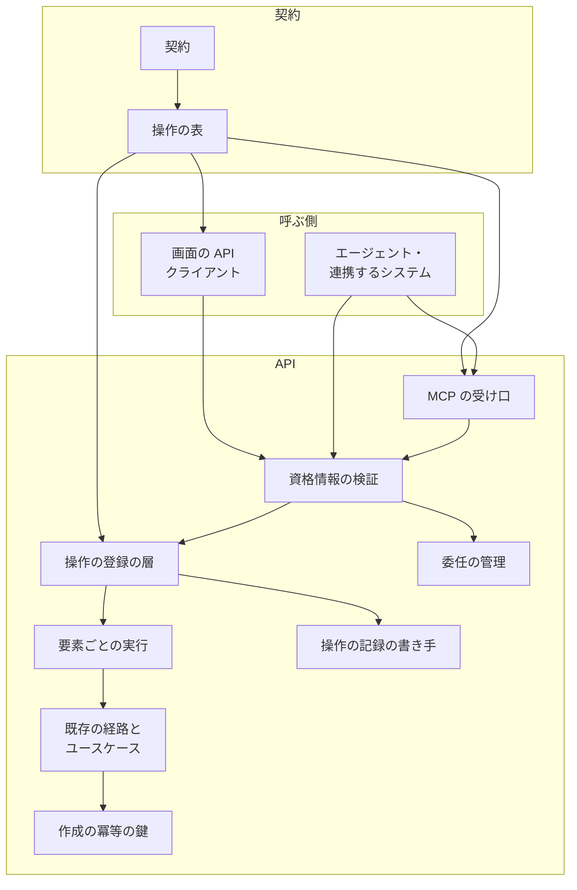
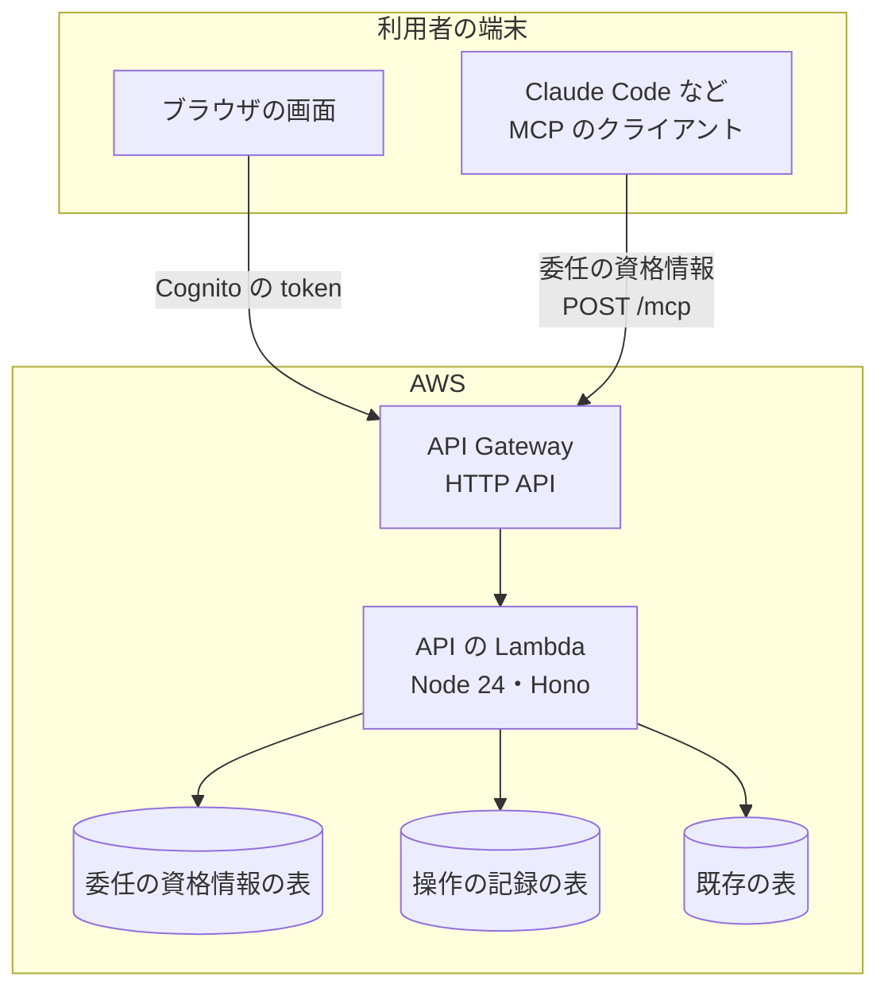
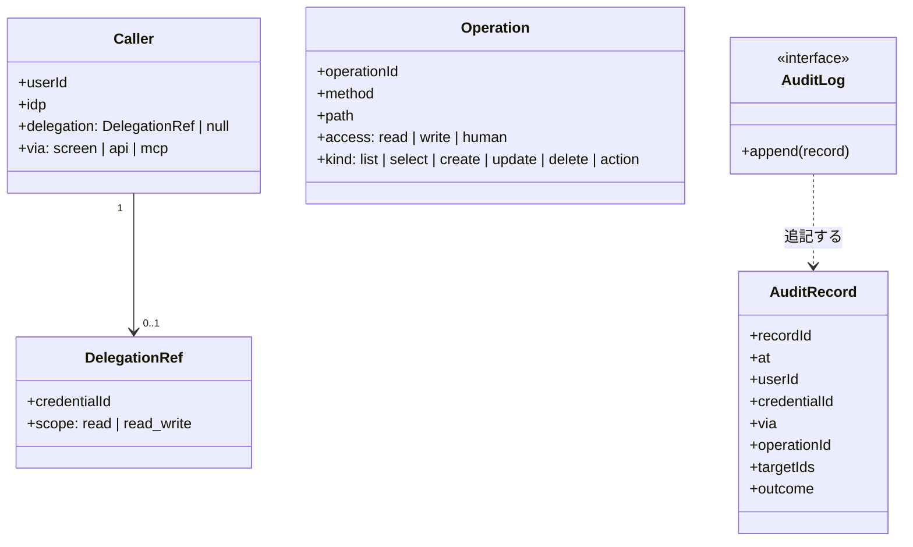
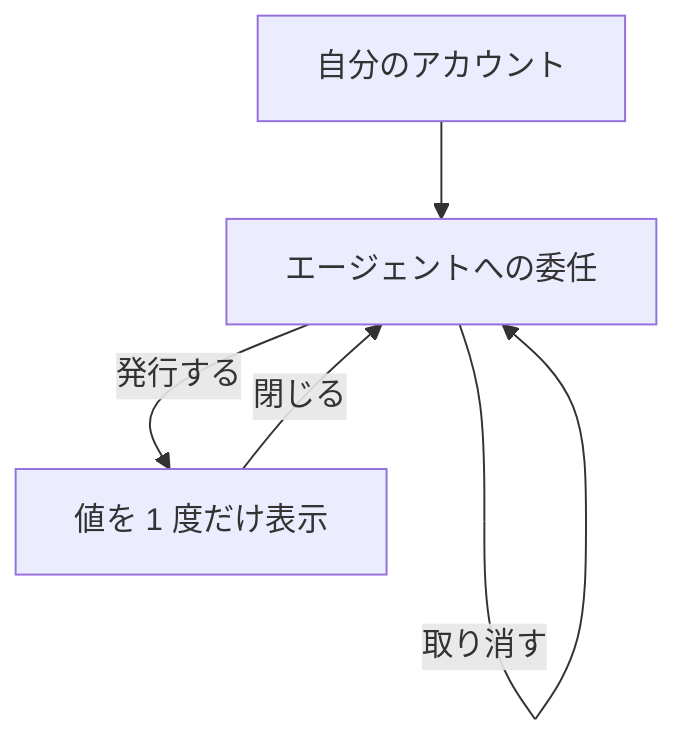
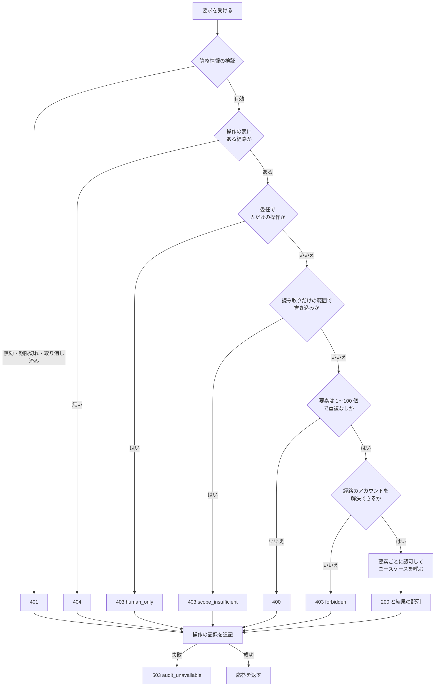
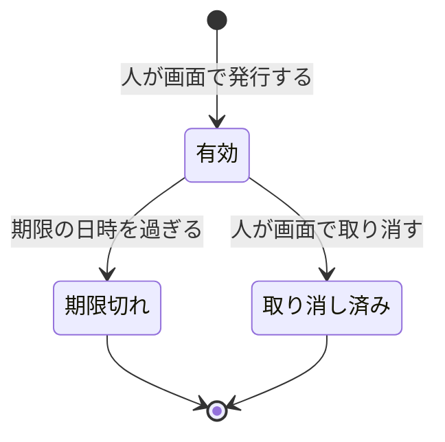

# NDF Factory: 画面で行える操作を、委任を受けたエージェントが API と MCP から同じ認可と記録のもとで行える（#2384）

## 目的

- **今どうなっているか**: Factory には MCP（Model Context Protocol）の受け口が無く、API を呼べるのは人のログインの token だけである。契約の 34 の利用者向けの操作は、画面の 1 枚に合わせた単一のレコードの入出力が混ざり、画面はスプリントの詳細・工程の中身・バックログ・ループの詳細を要素の数だけ別々に取っている。だれが・どの経路で何をしたかの記録も無い
- **誰に効くか**: Factory を使う人（承認と判断に集中できる）と、その人が任せる AI のエージェント・連携するシステム
- **変えると何が成り立つか**: 人が画面で発行した委任の資格情報で、エージェントが画面と同じ操作を API と MCP から行える。認可は人の操作と同じで、人だけが確定できる 10 の操作は委任から断る。すべての利用者向けの操作が配列で受け渡され、1 回ごとに操作の記録が 1 件残る

## 適用範囲

- **働く範囲**: このリポジトリの `factory/`（契約・API・画面）だけ。NDF のプラグインと配布先のリポジトリには届かない
- **プロジェクトごとに違うもの**: 無し（Factory は 1 つのサービスである。表の名前は環境変数で受ける）
- **当たるモード**: `standard`

## あるべき姿の根拠

| 根拠 | 種類 | 何を示すか |
| --- | --- | --- |
| #2168 の「方針（利用者の決定）」の表の 2 行（「AI からも人と同じく使える」「画面先行」、2026-11-02）と、スプリント MVV の Value 2・Value 4 の文 | 利用者の指示の原文 | 全操作を API と MCP から行えること、入出力を機能から起こして常に配列で受け渡すこと、承認は人だけが確定すること |
| MCP の仕様 2026-07-28 版の認可のページ（ https://modelcontextprotocol.io/specification/2026-07-28/basic/authorization.md ）: 「Authorization is OPTIONAL for MCP implementations」。基本のページ（ https://modelcontextprotocol.io/specification/2026-07-28/basic.md ）: 「clients and servers MAY negotiate their own custom authentication and authorization strategies」 | 外部の一次情報 | Factory が発行した資格情報を直に受ける形は仕様の範囲にある（決定 7） |
| 同じ版の Streamable HTTP のページ（ https://modelcontextprotocol.io/specification/2026-07-28/basic/transports/streamable-http.md ）: プロトコルの層のセッションと GET のストリームを除き、要求に対して `application/json` の 1 応答で返してよい | 外部の一次情報 | MCP の受け口を、状態を持たない Lambda の 1 経路に置ける（決定 14） |
| `npm view @modelcontextprotocol/server` の版 2.4.0（2026-10-23 更新）。パッケージの中に 2026-07-28 版の対応と、Web 標準の要求と応答を受ける受け口（`WebStandardStreamableHTTPServerTransport`）がある。依存は `zod` と同じ系列の `core` だけ（2026-11-04 に取得して確かめた） | 実測 | Hono の上で、新しい実行基盤を足さずに MCP を受けられる |
| `factory/web/src/api.ts` の `sprintRunDetails`・`stepDetails`・`backlogs`・`loopDetails` が `Promise.all` で要素ごとに経路を呼んでいる（2026-11-04） | 実測 | 配列で受ける契約にすると、画面の要求の回数が要素の数から 1 回へ減る |

要求と受け入れ条件は #2384 の本文にある（コピーは `issues/issue-2384-requirements.md`）。この文書は「どう作るか」だけを扱う。
契約の操作ごとの経路・要素・応答・扱いは [issue-2384-design-contracts.md](issue-2384-design-contracts.md)、決定の記録は [issue-2384-design-decisions.md](issue-2384-design-decisions.md) にある。

## ドメインモデル

### コンテキスト

| コンテキスト | 何の語が 1 つの意味に決まるか |
| --- | --- |
| Neural Development Factory（`ndf-factory`） | 利用者・アカウント・委任の資格情報・人だけが確定できる操作・操作の記録・呼び出し元の種類・機能から起こした契約 |

変更はこのコンテキストの中で閉じる。外のエージェントとクライアントは、文書化した契約（OpenAPI）と、そこから作った MCP のツールの定義だけでやり取りする（公開された言語）。

### 集約

| 集約 | 持ち主（書き換えてよいもの） | 根 | エンティティ | 値オブジェクト |
| --- | --- | --- | --- | --- |
| 委任の資格情報（新設） | 委任の管理（`factory/api/src/delegations/`） | 委任の資格情報 | — | 範囲・期限・秘密のハッシュ・クライアントの名前 |
| 操作の記録（新設） | 操作の記録の書き手（`factory/api/src/audit/`） | 記録 1 件 | — | 呼び出し元の種類・結果・対象の ID の配列 |
| スプリントの実行・開発ループ（既存） | 実行の制御・ループの制御（`factory/api/src/runs/`） | 実行・ループ | — | 作成の冪等の鍵（追加） |
| アカウント（既存） | 認証と料金プラン（`factory/api/src/accounts/`） | アカウント | 席 | 作成の冪等の鍵（追加） |

委任の資格情報は、利用者を ID で参照する。人の操作と同じ認可を掛けるため、アカウントへの権限は持たず、要求のたびに利用者から解決する。

### 不変条件

| # | 集約 | 条件 | 破れたときの扱い |
| --- | --- | --- | --- |
| I1 | 委任の資格情報 | 期限は発行から 300〜3,600 秒の間にある | 発行の要素を 400 で断り、保存しない |
| I2 | 委任の資格情報 | 期限を過ぎた・取り消した資格情報は認証に通らない。取り消しは、その後の最初の要求から効く | 401 で、操作を行わない |
| I3 | 委任の資格情報 | 秘密は SHA-256 のハッシュだけを保存し、平文を持たない。値は発行の応答で 1 度だけ返す | 保存の関数の引数に平文を取らない |
| I4 | 委任の資格情報 | 委任の資格情報では、人だけが確定できる操作を呼べない。委任の資格情報の発行と取り消しも含む | 範囲によらず 403（`human_only`）で、答えも状態も保存しない |
| I5 | 委任の資格情報 | 範囲が読み取りだけの資格情報では、書き込みの操作を呼べない | 403（`scope_insufficient`）で、操作を行わない |
| I6 | 委任の資格情報 | 委任の資格情報での認可の判定は、発行した人の直の操作の判定と同じになる | 利用者とアカウントの解決を人と同じ関数で行い、委任の側に認可の分岐を持たない |
| I7 | 操作の記録 | 利用者向けの操作 1 回に記録が 1 件増える。成功・一部の失敗・400・401・403 のどれでも増える | 追記に失敗したら操作を 503（`audit_unavailable`）で返す（決定 11） |
| I8 | 操作の記録 | 記録を書き換える・消す関数を持たない | 保存の契約は追記の関数 1 つだけを持つ |
| I9 | 操作の記録 | 記録に秘密と個人情報の値が入らない | 記録へ写す項目は許可した鍵の一覧からだけ取る（決定 12） |
| I10 | 機能から起こした契約 | 利用者向けの操作は、成功の応答の本文が配列で、要求の本文を持つなら配列である。経路の変数はアカウントの ID だけである | 検査が落ちる |
| I11 | 機能から起こした契約 | 利用者向けの操作と MCP のツールが 1 対 1 で対応し、画面の API クライアントが呼ぶ操作はすべて契約にある | 検査が落ちる |
| I12 | 機能から起こした契約 | 1 回の要求の要素は 1〜100 個で、同じ鍵の要素を 2 つ含まない | 400（`empty_items` / `too_many_items` / `duplicate_key`）で、どの要素も処理しない |
| I13 | 機能から起こした契約 | 指定の操作の応答は、入力と同じ順・同じ数の結果を持ち、認可は要素ごとに掛かる | 認可の無い要素だけを `forbidden` の結果にし、その要素のデータを応答に含めない |
| I14 | スプリントの実行・開発ループ・アカウント | 同じ利用者が同じ冪等の鍵で送った作成は、レコードを 1 件だけ作る | 2 回目は 1 回目の結果（同じ識別子）を返す |
| I15 | 機能から起こした契約 | MCP のツールは、操作の表を通して API と同じ経路を呼び、保存の関数を直に持たない | MCP の受け口に渡す依存をアプリの呼び出しの関数 1 つに限る |
| I16 | 操作の記録 | 呼び出し元の種類は、要求のヘッダーで変えられない | 種類は資格情報の種類と、MCP の受け口が内部の呼び出しに付ける印だけで決める（決定 13） |

### ドメインイベント

| # | イベント | 発生元 | 受け手 |
| --- | --- | --- | --- |
| E1 | 人が委任の資格情報を発行した | 委任の管理 | 操作の記録の書き手 |
| E2 | エージェントが委任の資格情報で API か MCP を呼んだ | 資格情報の検証 | 委任の管理（照合）・操作の記録の書き手 |
| E3 | 委任の資格情報の範囲と、操作の要る範囲を照らした | 操作の登録の層 | 操作の記録の書き手 |
| E4 | 人と同じ認可を要素ごとに掛けた | 要素ごとの実行 | 操作の記録の書き手 |
| E5 | 人だけが確定できる操作を断った | 操作の登録の層 | 操作の記録の書き手 |
| E6 | 配列の要素ごとに操作を行い、要素ごとの結果を返した | 要素ごとの実行 | 操作の記録の書き手 |
| E7 | 同じ冪等の鍵の作成を 2 回受け、2 回目は 1 回目の結果を返した | 実行の制御・ループの制御・認証と料金プラン | 操作の記録の書き手 |
| E8 | 操作の記録を 1 件追記した | 操作の記録の書き手 | 運用の担当（後から記録を読む人） |
| E9 | 人が委任の資格情報を取り消した | 委任の管理 | 資格情報の検証・操作の記録の書き手 |
| E10 | 取り消した委任の資格情報での要求を断った | 資格情報の検証 | 操作の記録の書き手 |

イベントは同じ要求の中の関数の呼び出しとして受け渡す。キューは使わない。

### 用語

| 用語 | 意味 | 用語集への反映 |
| --- | --- | --- |
| 委任の資格情報 | 要求の定義のまま。値の形は `ndfd_<資格情報の ID>_<秘密>` | 既存（要求で追加済み） |
| 人だけが確定できる操作 | 要求の定義のまま。契約の印は操作の扱い `human` | 既存（要求で追加済み） |
| 操作の記録 | 要求の定義のまま | 既存（要求で追加済み） |
| 呼び出し元の種類 | 要求の定義のまま | 既存（要求で追加済み） |
| 機能から起こした契約 | 要求の定義のまま | 既存（要求で追加済み） |
| 操作の扱い | 利用者向けの操作が要る範囲。読み取り（`read`）・書き込み（`write`）・人だけ（`human`）の 3 つ。契約の各操作に `x-ndf-access` として持つ | 追加 |
| 操作の表 | 契約から生成する、利用者向けの操作の一覧（`operationId`・メソッド・経路・操作の扱い・入力の定義）。画面・API・MCP がここから要求を組み、経路を登録する | 追加 |
| 要素の結果 | 配列で受け渡す操作の応答の 1 要素。入力と同じ順に並び、成功なら値を、失敗なら状態と理由（`code`）を持つ | 追加 |
| 作成の冪等の鍵 | 新しい識別子を作る作成の要素に、呼ぶ側が付ける鍵。同じ利用者・同じ操作・同じ鍵の作成を 1 件にする。進捗の事象の冪等の鍵とは別の鍵である | 追加 |

## 機能一覧

| # | 機能 | 誰が使うか |
| --- | --- | --- |
| F1 | 機能から起こした契約で、取得・作成・更新・削除・操作を配列で行う | 画面・委任を受けたエージェント・連携するシステム |
| F2 | 委任の資格情報を発行し、一覧で見て、取り消す | 人（画面） |
| F3 | 委任の資格情報で API を呼ぶ | 委任を受けたエージェント・連携するシステム |
| F4 | MCP のツールとして Factory の操作を呼ぶ | 委任を受けたエージェント |
| F5 | 人だけが確定できる操作を委任から断る | Factory（すべての経路） |
| F6 | 利用者向けの操作を 1 回ごとに記録する | Factory（すべての経路）。読むのは運用の担当 |
| F7 | 画面・契約・MCP の対応と配列の形を検査する | 開発者・継続的統合 |

## 構成要素

| 要素 | 責務 | 置き場 |
| --- | --- | --- |
| 契約 | 利用者向けの 37 の操作（既存 34・委任 3）を配列の形で定義し、各操作に操作の扱いを持つ。ランナー向けの経路と GitHub の Webhook は変えない | `factory/contracts/openapi/*.yaml`（`delegations.yaml` を新設） |
| 操作の表の生成 | 契約から操作の表を作る。`--check` で、コミットした表との食い違いを 1 で返す | `factory/contracts/scripts/generate.ts`・`src/generated/operations.ts` |
| 対応の検査 | 受け入れ条件 1・2・4・5・16 の対応と形を確かめる | `factory/contracts/tests/operations.test.ts`・`factory/web/scripts/check-source.ts` |
| 資格情報の検証 | `Authorization` の値を、委任の資格情報（頭が `ndfd_`）か Cognito の access token として検証し、利用者・委任の有無・呼び出し元の種類を文脈に置く | `factory/api/src/auth/verify.ts`・`resolve.ts` |
| 委任の管理 | 委任の資格情報の発行・一覧・取り消しと、値の照合 | `factory/api/src/delegations/`（新設） |
| 操作の登録の層 | 経路を操作の表から登録し、範囲の照合（I4・I5）・要素の数と重複の検査（I12）・操作の記録への受け渡しを、すべての利用者向けの操作に同じく掛ける | `factory/api/src/routes/operation.ts`（新設） |
| 要素ごとの実行 | 要素を並べる数 10 で順に既存のユースケースへ渡し、失敗を要素の結果に包む | `factory/api/src/routes/elements.ts`（新設） |
| 既存の経路 | 利用者向けの 34 の操作を操作の登録の層で登録し直し、要素の形へ合わせる。ユースケースの関数は変えない | `factory/api/src/routes/*.ts` |
| 作成の冪等の鍵 | 新しい識別子を作る 4 つの作成で、鍵の行を作るものと同じトランザクションで書く | `factory/api/src/runs/table.ts`・`dynamo-table.ts`・`memory-table.ts`・`accounts/store.ts`・`memory-store.ts` |
| 操作の記録の書き手 | 許可した鍵だけで記録を組み、追記する。保存の契約は追記の関数だけを持つ | `factory/api/src/audit/`（新設） |
| MCP の受け口 | `POST /mcp` で MCP の要求を受け、操作の表から作ったツールの呼び出しを同じアプリの経路へ内部で送る | `factory/api/src/mcp/`（新設） |
| 画面の API クライアント | 要求を操作の表から組み、配列の応答をほどいて今の `Api` の形で返す。委任の 3 操作を足す | `factory/web/src/api.ts` |
| ダミーの API クライアント | 同じ `Api` の形で委任の 3 操作を足す | `factory/web/src/dummy/` |
| 委任の画面 | 委任の資格情報を発行・一覧・取り消す | `factory/web/src/pages/DelegationsPage.tsx`・`screens.ts`・`i18n/ja.json` |



対応の検査は図に含めない。継続的統合の中で契約・操作の表・画面のソースを読むだけで、実行時の線を持たない。委任の画面とダミーの API クライアントは、画面の API クライアントの一部として描いている（ダミーは同じ形の差し替えである）。

### 配置



MCP の受け口は既存の API の Lambda の 1 経路に置き、新しい実行基盤を足さない。インフラ（private リポジトリ）へ渡すものは「データ構造」の「インフラへ渡すもの」にある。

### 置き場所

```text
factory/
├── contracts/
│   ├── openapi/delegations.yaml        （新設）
│   ├── openapi/{accounts,runs,loops,organizer}.yaml （配列の形へ書き換え）
│   ├── scripts/generate.ts             （操作の表の生成を足す）
│   ├── src/generated/operations.ts     （新設・生成物）
│   └── tests/operations.test.ts        （新設）
├── api/src/
│   ├── audit/{log,dynamo-log,memory-log}.ts        （新設）
│   ├── delegations/{service,store,memory-store}.ts （新設）
│   ├── mcp/server.ts                   （新設）
│   └── routes/{operation,elements}.ts  （新設）
└── web/src/pages/DelegationsPage.tsx   （新設）
```

## 構造



`Caller` は既存の型に 2 項目を足す。`AccountContext` は変えない（I6 の認可は今の解決の関数のまま）。
`Operation` の `kind` は契約の経路の形から生成の時点で決め、要素の検査と応答の形を選ぶ（[契約の表](issue-2384-design-contracts.md#操作の種類と形)）。

## データ構造

### 委任の資格情報の表

区分の鍵は `credential_id` だけ。利用者の一覧のため、GSI（`user_id`・`created_at`）を置く。読み出しは強い整合で行う（I2）。

| 列 | 型 | 空を許すか | 意味 |
| --- | --- | --- | --- |
| `credential_id` | 文字列 | 許さない | 主キー。ランダムな 16 バイトの base32 |
| `user_id` | 文字列 | 許さない | 委任した利用者（Cognito の `sub`） |
| `idp` | 文字列 | 許さない | 委任した利用者の IdP。人の解決と同じ `Caller` を組むために写す |
| `client_name` | 文字列 | 許さない | 人が付けたクライアントの名前（1〜64 字）。操作の記録には写さない |
| `scope` | 文字列 | 許さない | `read` / `read_write` |
| `secret_hash` | 文字列 | 許さない | 秘密（32 バイト）の SHA-256 の 16 進 |
| `created_at` | 文字列 | 許さない | 発行の日時（UTC、ISO 8601） |
| `expires_at` | 文字列 | 許さない | 期限（UTC） |
| `revoked_at` | 文字列 | 許す | 空は「取り消していない」。取り消しで 1 度だけ書く |

`revoked_at` の 1 回の書き込み以外は行を書き換えない。期限を過ぎた行も消さない。操作の記録が資格情報の ID だけを持つため、後からクライアントの名前をたどれるようにする。

### 操作の記録の表

区分の鍵は `record_id` だけ。書き込みは `attribute_not_exists(record_id)` の条件つきの追加だけで、更新と削除を行わない（I8）。検索の索引は持たない（記録の検索は要求の範囲の外）。

| 列 | 型 | 空を許すか | 意味 |
| --- | --- | --- | --- |
| `record_id` | 文字列 | 許さない | 主キー。要求の識別子（API Gateway の要求の ID、無ければ UUID）。構造化ログの同じ要求の行とたどれる |
| `at` | 文字列 | 許さない | 受けた日時（UTC、ミリ秒まで） |
| `user_id` | 文字列 | 許す | 操作した利用者。空は「401 で利用者を決められなかった」 |
| `credential_id` | 文字列 | 許す | 委任の資格情報の ID。空は「人の直の操作」か「401 で決められなかった」 |
| `via` | 文字列 | 許さない | 呼び出し元の種類。`screen` / `api` / `mcp` |
| `operation_id` | 文字列 | 許す | 契約の `operationId`。空は「契約に無い経路」（404 で終わった要求） |
| `account_id` | 文字列 | 許す | 経路のアカウントの ID。空は「アカウントを持たない操作」 |
| `target_ids` | 文字列の配列 | 許さない | 要素の鍵（[許可した鍵](issue-2384-design-contracts.md#操作の記録へ写す鍵)）を `<鍵の名前>=<値>` で並べる。0 件は空の配列 |
| `outcome` | 文字列 | 許さない | `ok`（すべての要素が成功）/ `partial`（一部の要素が失敗）/ `rejected`（要求全体を断った） |
| `status` | 数 | 許さない | 応答の HTTP の状態 |
| `reason` | 文字列 | 許す | `rejected` の誤りの `code`。`partial` は失敗した要素の `code` を重ねずに `,` で並べる。`ok` は空 |

この表は事象の記録（発生した操作を積み上げる）で、状態を持たない。集計の単位（利用者・アカウント・日時・呼び出し元・操作）を列として取り出せる。

### 作成の冪等の鍵の行

新しい識別子を作る 4 つの作成（スプリントの実行・開発ループ・チーム・委任の資格情報）で、作るものと同じ表へ同じトランザクションで書く（決定 4）。

| 置く表 | 鍵 | 値 |
| --- | --- | --- |
| 実行の表（スプリントの実行・開発ループ） | `IDEMP#<user_id>#<operationId>#<鍵>` | 作った識別子・作った日時 |
| アカウントの表（チーム） | 同じ形 | 作った識別子・作った日時 |
| 委任の資格情報の表 | 区分の鍵に `IDEMP#…` を入れた行 | 作った資格情報の ID。秘密は 2 回目に返さない（`credential` を `null` にする） |

TTL を 24 時間に置く。24 時間を過ぎた同じ鍵は新しい作成として扱う。鍵は 1〜64 字の英数字とハイフンである。

### CRUD

| 機能 | 委任の資格情報 | 操作の記録 | 冪等の鍵の行 | 既存の表 |
| --- | --- | --- | --- | --- |
| F1 配列で操作する | — | C | C・R（作成だけ） | C・R・U・D（今のユースケースのまま） |
| F2 発行・一覧・取り消し | C・R・U（`revoked_at`） | C | C・R | — |
| F3 委任で API を呼ぶ | R | C | — | 操作による |
| F4 MCP から呼ぶ | R | C | — | 操作による |
| F5 人だけの操作を断る | R | C | — | — |
| F6 記録する | — | C | — | — |

### インフラへ渡すもの

| 項目 | 内容 |
| --- | --- |
| 表 | 委任の資格情報の表（GSI `user_id`・`created_at`、TTL の属性 `ttl`）と、操作の記録の表。どちらもオンデマンド |
| 権限 | API の Lambda に、委任の資格情報の表の `GetItem`・`PutItem`・`UpdateItem`・`Query`（GSI）、操作の記録の表の `PutItem` だけ。操作の記録の表へ `UpdateItem`・`DeleteItem` を与えない |
| 既存の表 | 実行の表とアカウントの表で、TTL の属性 `ttl` を有効にする（作成の冪等の鍵の行だけが持つ） |
| 環境変数 | `DELEGATIONS_TABLE_NAME`・`AUDIT_TABLE_NAME` |
| 経路 | HTTP API に `POST /mcp` を足し、既存の API の Lambda へ通す。`GET` と `DELETE` の `/mcp` は Lambda が 405 を返す |

## 入出力の契約

| 項目 | 内容 |
| --- | --- |
| 置き場所 | `factory/contracts/openapi/accounts.yaml`・`runs.yaml`・`loops.yaml`・`organizer.yaml`（書き換え）と `delegations.yaml`（新設） |
| 変わる約束 | 利用者向けの 34 の操作を配列の形へ変え、委任の 3 操作を足す。経路・要素・応答・操作の扱いの一覧は [契約の表](issue-2384-design-contracts.md#操作の一覧) |
| 互換性の扱い | 互換なし。旧い形の経路を残さない（要求の前提 7）。ランナー向けの経路（`/run-jobs/*`）と受け口（`/ingest/*`）は変えない |
| 検査の手段 | `cd factory && npm run check`（Spectral・操作の表の `--check`・対応の検査・型検査・Vitest） |

MCP のツールの定義（名前・説明・入力の定義）は操作の表から作る。対応の規則は [契約の表の「MCP のツール」](issue-2384-design-contracts.md#mcp-のツール) にある。

### 画面

| 画面 | 何をする場所か |
| --- | --- |
| エージェントへの委任（`/delegations`、新設） | 委任の資格情報を発行し、値を 1 度だけコピーし、一覧で期限と状態を見て、取り消す |
| 自分のアカウント（既存） | 遷移の元。「エージェントへの委任」へのリンクを足す |



| 画面 | 項目 | 型 | 必須 | 上限 | 満たさないときの表示 |
| --- | --- | --- | --- | --- | --- |
| エージェントへの委任 | クライアントの名前 | 文字列 | 必須 | 64 字 | 「名前を入力してください」 |
| エージェントへの委任 | 範囲 | 読み取りだけ / 読み書き | 必須 | — | 既定は読み取りだけ |
| エージェントへの委任 | 期限 | 15 分 / 30 分 / 1 時間 | 必須 | 1 時間 | 既定は 1 時間 |

| 状態 | 表示 |
| --- | --- |
| 読み込み中・エラー・空 | 既存の部品（`LoadingState`・`ErrorState`・`EmptyState`）。空は「まだ委任していません」 |
| 発行の直後 | 値と、MCP のクライアントへの登録の例（URL と `Authorization` のヘッダー）。閉じると値は二度と出ない |
| 一覧の行 | クライアントの名前・範囲・発行と期限の日時（利用者の時刻帯）・状態（有効 / 期限切れ / 取り消し済み）・取り消すボタン（有効な行だけ） |
| オフライン | 発行と取り消しのボタンを無効にする（取り消せない操作をオフラインで確定させない。スプリント Value 3） |

権限: ログインした人なら役割によらず使える。委任は利用者に属し、アカウントに属さない。ナビゲーションには出さず、自分のアカウントからたどる。画面の地図（`docs/specifications/ndf-factory-screen-map.md`）に 1 行を足す。

## 処理の流れ



- **MCP からの呼び出し**: MCP の受け口が `tools/call` を受け、操作の表から経路・query・本文を組み、同じアプリへ内部の要求として送る。内部の要求は上の流れをそのまま通り、呼び出し元の種類だけが `mcp` になる。結果は MCP のツールの結果（`structuredContent` に応答の本文、`isError` は状態が 400 以上のとき真）へ写す。`tools/list` と、MCP の受け口そのものへの要求は操作ではないため記録しない
- **MCP の受け口の資格情報**: 委任の資格情報だけを受ける。Cognito の token とほかの値は 401 にする。`Origin` のヘッダーがあり画面のオリジンと違えば 403 にする（MCP の仕様の Streamable HTTP の要求）
- **記録の追記の失敗**: 構造化ログ（今の `jsonLogger` の出力先）へ、記録の全体を `audit_fallback` の印つきで 1 行出してから 503 を返す。書き込みの操作は既に行われていることがあるため、呼ぶ側は同じ要求を送り直す。作成は冪等の鍵で、更新・削除・取り消しは同じ値の書き込みとして、送り直しで 2 重にならない

### 委任の資格情報の状態



期限切れの行は取り消せない（取り消しは何も変えずに成功を返す。E9）。期限切れと取り消し済みから有効へ戻る遷移は無く、延長もしない。延ばしたいときは新しく発行する。

## 非機能の実現方式

| 大項目 | 要求の条件 | 実現方式 | 確かめ方 |
| --- | --- | --- | --- |
| 性能・拡張性 | 配列の要素は 1 回の要求で 100 個まで。超えたら 400 と上限値を返す | 操作の登録の層が、query の繰り返しと本文の配列の数を、ユースケースを呼ぶ前に数える。要素は並べる数 10 で処理する（今の一覧の読み出しと同じ値） | 101 個で 400 と `details.limit` 100、0 個で 400 を Vitest で見る |
| 性能・拡張性 | 画面は今と同じ回数以下の要求で同じ画面を描ける | 詳細・工程の中身・バックログ・ループの詳細を、要素の数によらず 1 回の要求で取る | 画面のテストで、詳細 3 件を開いたときの要求の数が 1 であることを数える |
| 運用・保守性 | 1 つの操作を、操作の記録の 1 件と要求の識別子でたどれる。秘密と個人情報の値は記録に書かない | 記録の主キーを要求の識別子にし、構造化ログの行にも同じ値を出す。記録の項目は許可した鍵からだけ組む | 受け入れ条件 19・22・23 のテスト |
| 移行性 | 旧い形の経路との並走は持たない。画面と API は同じ Pull Request の系列で同時に切り替える | 契約の書き換え・経路の登録し直し・画面の API クライアントを、実装の 1 本目の Pull Request に入れる（決定 15） | 画面の Vitest と Playwright が 1 本目で通る |
| セキュリティ | 委任の資格情報は期限 1 時間以内で、取り消しの後の最初の要求から断る。値は保存の時点でハッシュにし、平文で持たない。人だけが確定できる操作は委任から断る | 不透明な値を要求のたびに強い整合で引き、`secret_hash` を一定時間の比較で照らす。人だけの操作は操作の表の扱い `human` で、ユースケースを呼ぶ前に断る | 受け入れ条件 11〜14・17 のテスト |
| システム環境 | MCP のサーバーは `factory/api/` と同じ Node 24 の上で動き、新しい実行基盤を足さない | 既存の API の Lambda に `POST /mcp` を足す。依存は `@modelcontextprotocol/server`（と `zod`）と、操作の表の生成に使う `js-yaml`（既に Spectral の依存として入っている）だけ | `npm run check` と、手元で MCP のクライアントから `tools/list` を打つ |

### 記録の件数と費用の見積り（未決 3）

画面は見えている間、30 秒ごとに読み直す（`factory/web/src/poll.ts` の `DEFAULT_POLL_INTERVAL_MS`）。開いた画面 1 つで 1 時間に 120 件の記録になる。

| 仮定 | 値 |
| --- | --- |
| 1 人が画面を開いている時間 | 1 日 2 時間・月 22 日（仮定。実測ではない） |
| 1 人の月の記録 | 2 × 22 × 120 = 5,280 件 |
| 記録 1 件の大きさ | 0.5 KB 前後（列の数からの見積り。書き込み 1 回は 1 KB まで 1 単位） |
| 単価（米国東部、オンデマンド） | 書き込み 100 万単位で $0.625、保存 1 GB・月で $0.25（ https://aws.amazon.com/dynamodb/pricing/on-demand/ の計算例、2026-11-04 に取得） |

利用者 1,000 人で月 528 万件、書き込みは月 $3.3 である。保存は月 2.6 GB ずつ増え、12 か月で約 32 GB・月 $7.9 になる。無料枠は数えていない。保存期間を決めると（未決 2）保存の費用は頭打ちになる。

## 決定の記録

決定の記録は [issue-2384-design-decisions.md](issue-2384-design-decisions.md) にある。

## テスト設計

| 受け入れ条件・不変条件 | どの振る舞いで縛るか | どう壊したら落ちるべきか |
| --- | --- | --- |
| 1・I11 | 画面の API クライアントが組む要求の `operationId` がすべて操作の表にある。ソースに経路の文字列を直に書いた要求が無い | クライアントに表に無い経路の要求を 1 つ足す |
| 2・I11 | 操作の表の利用者向けの操作と、MCP の受け口が `tools/list` で返すツールの名前の集合が一致する | 契約に操作を 1 つ足し、ツールを作らない（またはその逆） |
| 3・I15 | MCP のツールの呼び出しが、API の経路と同じユースケースを通り、同じ結果を返す。MCP の受け口はアプリの呼び出しの関数しか受け取らない | MCP の受け口から保存の関数を直に呼ぶ |
| 4・5・I10 | 利用者向けの操作の成功の応答と要求の本文が配列で、経路の変数が `accountId` だけである | 1 件の取得の経路 `/sprint-runs/{sprintRunId}` を契約へ戻す |
| 6・8・I12 | 101 個で 400 と上限値 100、0 個で 400、同じ鍵 2 つで 400。どれもユースケースが呼ばれない | 数の検査を外す |
| 7・15・I13 | 3 要素のうち他人の 1 要素だけが `forbidden` で、順と数が入力と同じ。他人のデータが応答に無い | 1 要素の 403 で要求全体を 403 にする / 結果を並べ替える |
| 9・I14 | 同じ鍵の作成 2 回でレコードが 1 件、2 回目が同じ識別子。鍵の行と作るものが同じトランザクションにある | 鍵の行を作成の後に別に書く |
| 10・I6 | 人の token と、同じ人の委任の資格情報で同じ操作を呼び、許可と拒否が一致する | 委任の側にだけアカウントの照合を足す（または外す） |
| 11・12・I2 | 期限の後と取り消しの後の最初の要求が 401 で、ユースケースが呼ばれない | 資格情報の照合を 1 分ためる（キャッシュする） |
| 13・I5 | 読み取りだけの範囲で書き込みの操作が 403 | 範囲の照合を外す |
| 14・16・17・I4 | 扱い `human` の 10 の操作すべてを読み書きの範囲で呼び、403 で何も保存されない。`answerLoopPending` に扱い `human` がある | 操作の扱いを `write` に変える |
| 18 | 委任の資格情報でスプリントの詳細と承認待ちの一覧が読める | 読み取りの操作を `human` にする |
| 19・20・I7 | 成功・一部の失敗・400・401・403 のどれでも記録が 1 件増え、要求の 7 項目がそろう | 断った要求で記録を書かない |
| 21・I8 | 保存の契約の関数の一覧が追記 1 つだけ | 保存の契約に更新の関数を足す |
| 22・23・I9 | モデルの認証情報・ログインの token・委任の資格情報の値・GitHub の `code` と `proof`・チームの名前・クライアントの名前を含む要求を送り、記録のどの値にもそれらが無い。記録の列は許可した鍵と固定の列だけで、メールアドレス・氏名・課題の題と本文を写す列が無い | 許可した鍵の一覧に `name` を足す |
| 24 | 画面の既存の Vitest と Playwright が通る | 画面の API クライアントの応答のほどき方を誤る |
| 25 | ランナー向けの経路と受け口の既存のテストが変えずに通る | ランナー向けの経路を操作の登録の層へ入れる |
| 26 | 委任を使わない人の操作で、token の検証の失敗が 401、アカウントの解決の失敗が 403 | 資格情報の検証の分岐で Cognito の失敗を 403 にする |
| I1 | 期限 299 秒と 3,601 秒の発行が 400 で保存されない | 期限の検査を外す |
| I3 | 保存した行に秘密の平文が無く、ハッシュが値と一致する | 平文を保存する |
| I16 | 外から `x-ndf-via: mcp` などのヘッダーを付けた API の要求が `api` として記録される | ヘッダーから呼び出し元を読む |

## 設計の結果

| 課題 | 扱い | 取り込み先 | 触るファイル |
| --- | --- | --- | --- |
| #2384 | 実装する | — | `factory/contracts/`、`factory/api/src/`、`factory/web/src/`、`docs/specifications/ndf-factory-screen-map.md` |

## 未確認のまま残ること

| 項目 | 内容 |
| --- | --- |
| 要求の URL の長さ | 100 個の識別子を query で繰り返すと 5 KB 前後になる。API Gateway の HTTP API の上限は未確認。実装の 1 本目で、100 個の要求を本物の経路へ送って確かめる。収まらなければ要求の上限の値（前提 3）を下げる |
| 委任の 1 時間の期限と長く動くエージェント | 1 時間を超えて見守る使い方（具体例の「承認待ちになったら教えて」）は、人が 1 時間ごとに発行し直すことになる。MCP の認可の仕様（OAuth 2.1 と更新の token）に沿わせると解ける。承認ゲート 1 で、この形で出すかを見る（決定 7） |
| 記録の大きさと件数 | 1 件 0.5 KB と、1 日 2 時間の利用は仮定である。実装の後に本物の記録の大きさを測る |
| 配置の地域 | 単価は米国東部の値で、Factory の配置の地域はこのリポジトリから確かめられない |
| 記録の保存期間と削除の求め | 未決 2 のまま。外部の利用者へ公開する前に利用者が決める |
| オーガナイザーの画面 | 承認待ちの一覧・配布の履歴・止まった配布を解く 3 操作は契約にあり画面に無い。この課題は配列の形と MCP のツールを足し、画面は #2439 が作る |
| 規模（未決 4） | 設計は 1 本、実装は 4 本の Pull Request に分ける案を決定 15 に置いた。承認ゲート 1 で利用者が決める |
