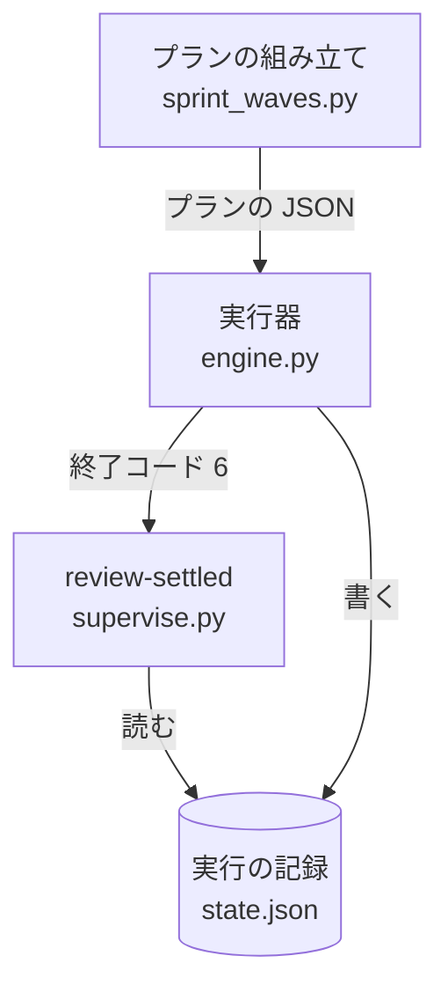
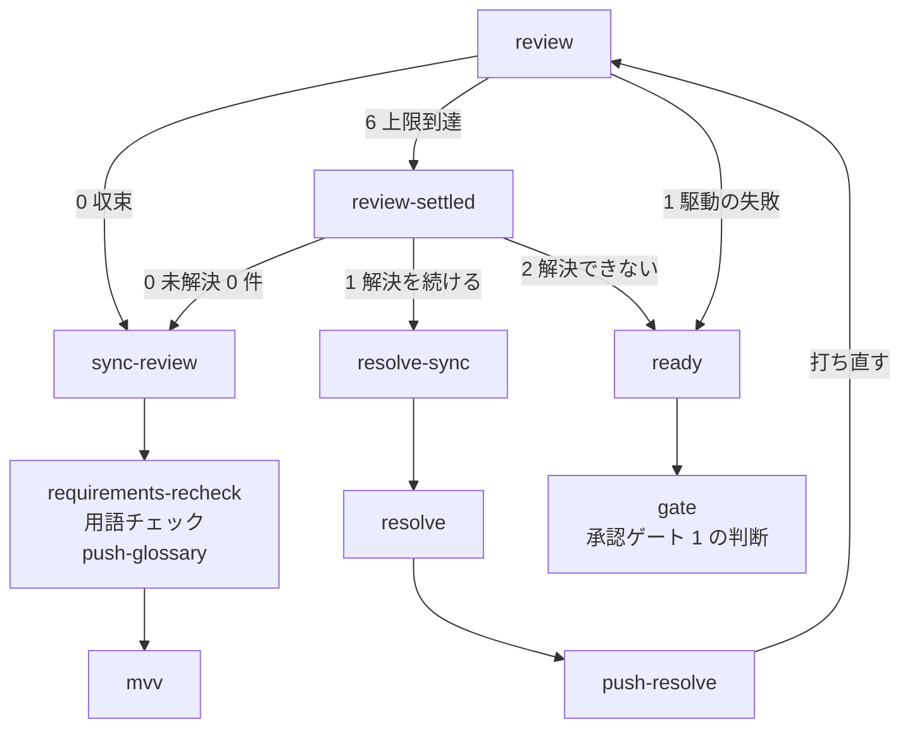

# 設計のプラン: 上限で終わった cross-review は、未解決の指摘を解決してから MVV 判定へ進める（#2388）

## 目的

- **今どうなっているか**: 設計のプランの cross-review が上限の 3 ラウンドに達して終わると、駆動の失敗と同じ経路（`ready` → 承認ゲート 1 の判断）へ進む。未解決の指摘が 0 件でも同じである。`pace: fast` / `pace: auto` と開発ループでは MVV 判定が一度も流れず、承認ゲート 1 が「判定できない」として人の判断待ちになる
- **誰に効くか**: 設計のプランを流すすべての利用者。`pace: fast` / `pace: auto` と開発ループでは、1 回あたり約 $1.5・27 分の周回の無駄が無くなる
- **変えると何が成り立つか**: 上限に達して未解決 0 件で終わったレビューは、収束したときと同じ経路（直しの取り込み → 仕様のコピーの照合 → 用語チェック → MVV 判定）を通る。未解決の指摘が残ったら、承認ゲート 1 へ進む前に解決のフロー（直し → 再レビュー）で解決する。どうしても解決できないと判定したときと、駆動の失敗だけが承認ゲート 1 の判断へ回る

## 適用範囲

- **働く範囲**: NDF の `supervise.py` が組み立てる設計のプラン（スプリントの設計のステージ）。配布先のリポジトリでも同じように働く
- **プロジェクトごとに違うもの**: 無し（ラウンドの上限・ペースは既存の設定のまま読む。判定の条件の値はプランの組み立てが引数で渡し、この変更で足す設定は無い）
- **当たるモード**: 設計のプランを流すすべてのモード。ペースは `normal` / `fast` / `auto` のすべて

## あるべき姿の根拠

| 根拠 | 種類 | 何を示すか |
| --- | --- | --- |
| 開発ループ lfactory2 の周回 2 の記録（設計 PR https://github.com/devbasex/ai-plugins/pull/2387 ）: 上限 3 ラウンド・指摘 3 件・修正 3 件・未解決 0 件・最終状態 `oscillation`・終了コード 6 で、`mvv` が流れずに承認ゲート 1 が人の判断待ちになった | 実測 | 上限到達・未解決 0 件の終わりが、今の経路では MVV 判定へ届かない |
| `pace: fast` / `auto` の設計のプランの規則の文（`plugins/ndf/scripts/supervise_lib/sprint_waves.py` の `plan_mvv_design`）: 設計の cross-review は上限 3 ラウンドで承認ゲート 1 の判定（`mvv` のステップ）へ渡し、収束を待たない。駆動そのものが失敗したら `gate` | 既存の規則 | 上限で止めたレビューは MVV 判定へ渡すことが、プランの意図としてすでに書かれている |
| `grep -n "unresolved\|review\|oscillation" plugins/ndf/scripts/mvv-gate.py` の当たり 0 件（2026-11-04） | 実測 | MVV 判定は未解決の件数を読まない。未解決が残ったまま渡すと人が見ないまま通りうるため、件数はプランの側で分ける |
| 承認ゲート 1 の答え「直して出し直す」の指摘 2・3（2026-11-04、#2388 の本文の「依頼（原文）」） | 利用者の決定 | 未解決の指摘は承認ゲート 1 の前に解決する。分け方は全ペースの共有の定義に置く |

要求と受け入れ条件は #2388 の本文にある（コピーは `issues/issue-2388-requirements.md`）。この文書は「どう作るか」だけを扱う。

この文書での呼び方は、要求の前提 1 に合わせて次のとおりにする。

| 呼び方 | 意味 |
| --- | --- |
| 上限到達 | cross-review の駆動が終了コード 6 で終わったこと（最終状態が `max_rounds` か `oscillation`）。レビューは成立している |
| 駆動の失敗 | cross-review の駆動が 0・6 以外で終わったこと（実行器は 1 として記録する。最終状態 `error` と、CLI が起動しないなど） |
| 未解決の件数 | cross-review の結果の件数（`metrics.unresolved`。最終の見直しの後に GitHub 側で数え直した、解決していない指摘の数） |
| 解決のフロー | 上限到達で未解決の指摘が残ったときに、直しを PR のブランチへ送り、cross-review を打ち直してラウンドを足すまでの 1 回の繰り返し |
| 解決できない | 下の「解決できないの判定」の条件のどれかが成り立ったこと |

## ドメインモデル

### コンテキスト

| コンテキスト | 何の語が 1 つの意味に決まるか |
| --- | --- |
| NDF の開発ワークフロー（`ndf-workflow`） | プラン・ステップ・MVV 判定・承認ゲート・欠け・解決のフロー |
| NDF の cross-review（`ndf-cross-review`） | 収束・上限到達・未解決の件数 |

cross-review が供給者、開発ワークフローが順応者の関係である。開発ワークフローは、cross-review の駆動の終了コードと結果の件数（`metrics.unresolved`）をそのまま読む。cross-review の契約は変えない（要求の対象範囲の「含まない」）。

### 集約

| 集約 | 持ち主（書き換えてよいもの） | 根 | エンティティ | 値オブジェクト |
| --- | --- | --- | --- | --- |
| 設計のプラン | プランの組み立て（`supervise_lib/sprint_waves.py`） | プラン | ステップ | 行き先（`next` / `on_fail` / `on_exit`）・規則の文・判定の条件の値 |
| プランの実行の記録 | 実行器（`supervise_lib/state.py` の `RunState`） | 実行の記録（`state.json`） | ステップの結果（`log` の 1 件） | 終了コード・件数（`counts`）・秒・費用（`llm.cost`）・欠け |

この変更が書き換えるのは設計のプランだけである。実行の記録は、新しいステップが読むだけで書き換えない。

### 不変条件

| # | 集約 | 条件 | 破れたときの扱い |
| --- | --- | --- | --- |
| I1 | 設計のプラン | レビューのステップが上限到達で終わり、未解決の件数が 0 なら、`sync-review` → `requirements-recheck` → 用語チェック → `push-glossary` を通る。その後は、`fast` / `auto` は `mvv` へ進む。`--state` 付きの `normal` は `ready` → 助言の `mvv` → `mvv-note` → `gate` へ進む。`normal` で `--state` が無いときは `ready` → `gate` へ進み、`mvv` を流さない | テストが落ちる |
| I2 | 設計のプラン | レビューのステップが上限到達で終わり、未解決の件数が 1 以上で、解決できないの判定がどれも成り立たないときは、解決のフロー（`resolve-sync` → `resolve` → `push-resolve` → `review`）へ進む。`gate` と `mvv` を流さない | テストが落ちる |
| I3 | 設計のプラン | 解決できないと判定したとき（読めないときを含む）は、`ready` → 承認ゲート 1 の判断（`gate`）へ進み、`fast` / `auto` では `mvv` を流さない | テストが落ちる |
| I4 | 設計のプラン | 駆動の失敗は `ready` → 承認ゲート 1 の判断（`gate`）へ進む（`fast` / `auto` で `mvv` を流さない）。解決のフローの中の再レビューでも同じである | テストが落ちる |
| I5 | 設計のプラン | 収束（終了コード 0）の経路は変わらない | 既存のテストが落ちる |
| I6 | 設計のプラン | 経路の分け方はプランの JSON（`on_exit` とステップ）に現れ、実行器（`supervise_lib/engine.py`）に設計のプラン専用の分岐を足さない | レビューで差し戻す（要求の非機能の条件「運用・保守性」） |
| I7 | 設計のプラン | 分け方は全ペースの設計のプランが共有するレビューのまとまり（`_review_steps`）の 1 か所に置き、ペースごとの組み立てに写さない | レビューで差し戻す（利用者の決定 S4） |

### ドメインイベント

| # | イベント | 発生元 | 受け手 |
| --- | --- | --- | --- |
| E1 | 設計 PR を作り、本文の「決めたこと」をそろえた | `pr`・`sync-body` | `review` |
| E2 | cross-review の駆動が終わった | `review` | 収束: `sync-review`。上限到達: `review-settled`。駆動の失敗: `ready` |
| E9 | 上限到達のレビューの未解決の件数と、解決できないの判定を確かめた | `review-settled`（新設） | 0 件: `sync-review`。1 件以上で解決を続ける: `resolve-sync`。解決できない: `ready` |
| E8 | 上限到達で残った未解決の指摘を、解決のフローで解決しようとした | `resolve-sync`・`resolve`・`push-resolve`（新設） | `review`（打ち直してラウンドを足す）。直しか送りが失敗: `ready` |
| E3 | レビューの直しを PR のブランチから取り込んだ | `sync-review` | `requirements-recheck` |
| E4 | 仕様のコピーと課題の本文の一致を確かめた | `requirements-recheck` | `glossary-check` |
| E5 | 用語チェックを通し、PR のブランチへ送った | `push-glossary` | `fast` / `auto`: `mvv`。`normal`: `ready` |
| E6 | MVV 判定が承認ゲート 1 を判定した | `mvv` | `fast` / `auto`: `approve`（従う）・プランの終わり（従わない・判定できない）。`--state` 付きの `normal` の助言の `mvv`: 判定の結果によらず `mvv-note` → `gate`（承認は利用者が行う） |
| E7 | 承認ゲート 1 の判断（`gate`）へ回した | `ready` | 利用者（`gate` の判断のステップ） |

E1〜E8 は要求の番号を引き継ぐ。E9 はこの設計で足す。

### 用語

用語集へ足す語・意味を変える語は無い。上の「この文書での呼び方」は要求の前提 1 の呼び方と、この課題の中だけで使う語である。

## 機能一覧

| # | 機能 | 誰が使うか |
| --- | --- | --- |
| F1 | 設計のプランのレビューのステップが、終了コード 6（上限到達）を未解決の件数の確かめへ回す | `supervise.py` の実行器（設計のプランを流すとき） |
| F2 | 実行の記録から未解決の件数と解決のフローの回数・費用・秒を読み、「0 件」「解決を続ける」「解決できない」を終了コードで返す副命令 | 設計のプランの `review-settled` のステップ |
| F3 | 未解決の指摘を直して PR のブランチへ送り、cross-review を打ち直す解決のフロー | 設計のプランの `resolve-sync`・`resolve`・`push-resolve` のステップ |
| F4 | 設計のプランの規則の文を、新しい経路に合わせる | 設計のプランの判断のステップ（`gate`）。規則の文は判断のたびに渡る |

## 構成要素

| 要素 | 責務 |
| --- | --- |
| レビューのまとまり（`sprint_waves.py` の `_review_steps`。変更） | `review` に `"on_exit": {"6": "review-settled"}` を足す。`review` の直後に `review-settled`・`resolve-sync`・`resolve`・`push-resolve` の 4 つのステップを置く（下の表）。送りのコマンドを `push-glossary` と同じにするため、引数に `push` を足す。全ペースの設計のプランがこの定義を共有する（要求の前提 3・I7） |
| 未解決の件数の確かめ（`supervise.py review-settled`。新設） | 実行の記録（`<状態ディレクトリ>/state.json`）の `log` を読み、下の「解決できないの判定」の順に照らして終了コード 0・1・2 を返す。結果 JSON を 1 行出す。LLM を呼ばない |
| 規則の文（`sprint_waves.py` の `RULE_DESIGN` と `plan_mvv_design` の `規則`。変更） | 「上限到達で未解決 0 件なら通常の経路。未解決が残れば解決のフローを回し、解決できないか駆動が失敗したら承認ゲート 1 の判断」に書き直す |
| 契約テストの見本のプラン（`plugins/ndf/scripts/tests/fixtures/supervise-contract/plans/sprint/1-design-16.json`。変更） | 書き出しのプランの変化（`review` の `on_exit`・新しい 4 つのステップ・規則の文・ステップの上限）を見本へ反映する。見本は `new sprint` の出力と突き合わせる比較元である |

足すステップ:

| id | 型 | 中身 | 成功の次 | 失敗の次 |
| --- | --- | --- | --- | --- |
| `review-settled` | run | `supervise.py review-settled --state {state_dir}/state.json --step review --fix-step resolve --max-attempts 2 --max-cost 1.5 --max-seconds 3600` | `sync-review`（終了コード 0） | `on_exit` の `"1"` は `resolve-sync`、`"2"` は `ready`。それ以外は `on_fail` の `ready` |
| `resolve-sync` | run | `sync-review` と同じ（`git fetch -q && git merge -q --ff-only '@{u}'`）。cross-review の直しに追いついてから直す | `resolve` | `ready` |
| `resolve` | work（`kind` は「修正」） | `review` の報告（結果の `items[0].report`）が示す未解決の指摘を直してコミットする。直せない指摘は理由を PR のスレッドへ返信する | `push-resolve` | `ready` |
| `push-resolve` | run | `push-glossary` と同じ送りのコマンド | `review` | `ready` |

工程は 4 つとも「ドキュメントレビュー」とする。



確定仕様 `docs/specifications/ndf-ubiquitous-language.md` の「設計のフェーズのステップ」の表は、`plan-to-spec` で新しい経路へ書き直す。この実装の Pull Request では触らない。

## 入出力の契約

`supervise.py` に副命令を 1 つ足す。既存の副命令と引数は変えない。

```text
supervise.py review-settled --state <state.json のパス> --step <ステップの id> --fix-step <ステップの id>
                            --max-attempts <回数> --max-cost <ドル> --max-seconds <秒>
```

| 引数 | 意味 |
| --- | --- |
| `--state` | 実行の記録のファイル。設計のプランは `{state_dir}/state.json` を渡す（`{state_dir}` は実行器が run のステップの `cmd` で置き換える） |
| `--step` | 未解決の件数を読むステップの id。設計のプランは `review` を渡す |
| `--fix-step` | 解決のフローの直しのステップの id。回数と費用はこのステップの結果から数える。設計のプランは `resolve` を渡す |
| `--max-attempts` / `--max-cost` / `--max-seconds` | 解決できないの判定の上限（下の表の U2・U4・U5） |

### 解決できないの判定

上から順に照らし、最初に当たった行の終了コードを返す。

| # | 条件 | 終了コード | 結果 JSON の `status` |
| --- | --- | --- | --- |
| U1 | 記録が読めない・`--step` の結果が無い・最後の結果の `exit` が 6 でない・`counts.unresolved` が整数でない | 2 | `stopped` |
| — | 最後の `--step` の結果の `counts.unresolved` が 0 | 0 | `ok` |
| U2 | 回数: `--fix-step` の成功した結果が `--max-attempts` 件（2）に達した | 2 | `stopped` |
| U3 | 同じ指摘の繰り返し: `--fix-step` の結果が 1 件以上あり、最後の `--step` の未解決の件数が、その前の `--step` の結果の件数から減っていない | 2 | `stopped` |
| U4 | 費用: `--fix-step` の結果の `llm.cost` の合計が `--max-cost`（$1.5）を超えた。費用が不明の結果（`llm.cost_unknown`）が 1 件でもあれば、この条件は成り立ったとみなす | 2 | `stopped` |
| U5 | 時間: 最初の `--fix-step` の結果より後の、`--fix-step` と `--step` の結果の秒の合計が `--max-seconds`（3600 秒）を超えた | 2 | `stopped` |
| — | 上のどれにも当たらない（未解決が 1 件以上で、解決を続けられる） | 1 | `stopped` |

結果 JSON は共通の形（`step_result.result`）で、次の値を持つ。

| 項目 | 値 |
| --- | --- |
| `tool` | `review-settled` |
| `summary` | 読んだ件数と、当たった条件（U1〜U5）か「解決を続ける」 |
| `metrics.unresolved` | 読んだ件数（読めなければ `null`） |
| `metrics.attempts` / `metrics.cost` / `metrics.seconds` | 解決のフローの回数・費用の合計・秒の合計 |
| `metrics.reason` | 当たった条件の番号（`U1`〜`U5`）。当たらなければ `null` |

## 処理の流れ

`review` が終わった後の行き先。`fast` / `auto` の設計のプランの流れで書く（`normal` は下の表の差分だけが違う）。



`resolve-sync`・`resolve`・`push-resolve` が失敗したときの `ready` への矢印は、図を読みやすくするため省いた（上の「足すステップ」の表のとおり）。

| ペース | `push-glossary` の次 | `ready` の次 | 上限到達で未解決が残ったときに流れるもの |
| --- | --- | --- | --- |
| `fast` / `auto`（`plan_mvv_design`） | `mvv` | `gate` | 解決のフロー。解決すれば用語チェックの後に `mvv`（従えば `approve` → マージ） |
| `--state` 付きの `normal`（`plan_advise_design`） | `ready` | `mvv`（助言）→ `gate` | 解決のフロー。解決すれば用語チェックと助言の `mvv` の後に `gate` で止まる |
| `normal`（`--state` 無し。`plan_sprint_design`） | `ready` | `gate` | 解決のフロー。解決すれば用語チェックの後に `gate` で止まる |

`review-settled` は実行の記録を読む。実行器はステップを終えるたびに `state.json` を書き直す。その後で次のステップを流す（`engine.py` の `run` が `RunState.record` を呼んでから次へ進む）。そのため、`review-settled` が流れる時点で、直前の `review` と解決のフローの結果は記録にある。

再レビューは同じ `review` のステップを打ち直す。`push-resolve` で PR の head が変わっている。そのため cross-review は前のラウンドを残したまま次のラウンドから続ける（要求の前提 5）。直しで何もコミットしなかったときは head が変わらず、打ち直しはラウンドを足して同じ指摘を数える。未解決の件数が減らないため U3 で止まる。

ステップの上限（プランの `上限`）は、書き出しが遷移から求める（`supervise_lib/limits.py`）。`review-settled` の終了コード 1 から `review` へ戻るループは、修正の work（`resolve`）を含む。そのため修正のループとして、`FIX_ROUNDS`（3）回分が上限に足される。U2 の上限 2 回はこの内側に収まる。

## 非機能の実現方式

| 条件 | 実現方式 |
| --- | --- |
| 経路の分け方はプランの JSON に現れ、実行器に設計のプラン専用の分岐を足さない | 実行器がすでに持つ `on_exit`（run と drive の終了コード → 行き先）と `on_fail` だけで分ける。`engine.py` は変えない |
| 作成済みのプランの JSON を書き換えない | 経路はプランの組み立てで決まり、書き出した JSON を読み直して直す処理を足さない。版を入れた後に作り直したプランから効く |

## 決定の記録

### 決定 1: 実行器と cross-review の契約を変えずに分けるため、上限到達の未解決の件数を後続の run のステップで確かめる

`review` の `on_exit` で終了コード 6 を `review-settled` へ回す。このステップは実行の記録から未解決の件数を読み、行き先を終了コードで返す。実行器の既存の行き先（`on_exit` と `on_fail`）だけで終わりを分けられる。そのため、`engine.py` にも cross-review の終了コードにも手を入れない。

cross-review の駆動が未解決 0 件の上限到達を別の終了コードで返す形は採らない。終了コードの契約は実装のプランのレビュー（#2143）とリファクタリングの欠け（#2047）も読んでおり、要求で「確認してから行う」に置いた変更である。実行器に「結果の件数で行き先を分ける」鍵を足す形も採らない。1 つの経路のために実行器の契約が増え、既存の `on_exit` と run のステップで足りる。

根拠: Value 5（決まった手順はスクリプトに、判断と中身は AI に）/ Value 7（根本原因の場所で直す）（MVV 版 5）

### 決定 2: 未解決の指摘は、承認ゲート 1 へ進む前に解決のフロー（直し → 再レビュー）で解決する

上限到達で未解決の指摘が残ったら、`resolve-sync` → `resolve` → `push-resolve` で直しを PR のブランチへ送る。その後 `review` を打ち直してラウンドを足す。再レビューの結果を `review-settled` がもう一度確かめ、0 件になれば通常の経路へ、解決できなければ承認ゲート 1 の判断へ回す。

これは承認ゲート 1 の答え「直して出し直す」の指摘 2 で利用者が決めた（2026-11-04。要求の S3）。未解決の指摘を承認ゲート 1 の前に解決すれば、人が承認で読むのは解決できなかった指摘だけになる。再レビューに cross-review の打ち直しを使うのは、直しが新しい指摘を生んでいないかを、上限到達までと同じ担当と基準で確かめるためである。

根拠: Value 2（人が判断できる量に収める）/ Vision（人が手を止めるのは判断が要る所だけ）/ 共通原則の優先順位（利用者の承認はプロジェクトの MVV より上）

### 決定 3: 解決のフローは、回数・同じ指摘の繰り返し・費用・時間のどれかで止め、読めないときも止める

「解決できない」の判定は、上の表の U1〜U5 で決める。

- **回数（U2）の上限は 2 回とする。** cross-review はすでに 3 ラウンドで直しを試みており、その後の 2 回で減らない指摘は、直す側でなく人の判断が要る指摘である見込みが高い。2 回は初期値で、リリース後テストで `review-settled` の `metrics.attempts` を見て見直す
- **同じ指摘の繰り返し（U3）は、未解決の件数が減らないことで判定する。** cross-review の結果は未解決の指摘を件数だけで返し、指摘ごとの識別子を返さない（要求の前提 5）。指摘の同一性を比べるには cross-review の結果の契約を変えることになるため、この課題では件数で判定する。件数が減らないとき、直しは残りの指摘を 1 件も消せていない
- **費用（U4）の上限は $1.5 とする。** 解決できずに人へ戻したときの無駄は 1 周回（lfactory2 の周回 2 の実測で $1.5・27 分）である。それを超えて直しに使うなら、人へ戻す方が安い。実行の記録に残る費用は作業（`resolve`）の分だけである。cross-review の駆動の費用は残らない（`state.py` の `RunState` が費用を足すのは LLM を呼ぶ作業と判断だけ）。そのため再レビューの分は時間（U5）で抑える
- **時間（U5）の上限は 3600 秒とする。** `review` のステップの打ち切り（`timeout` 3600 秒）と同じで、解決のフローの全体が 1 回のレビューの打ち切りを超えないようにする
- **読めないとき（U1）は解決できないと同じに扱う。** 件数が読めないまま 0 件として進めると、残った指摘を人が見ないまま `fast` / `auto` で設計 PR がマージされうる。件数が分からないまま直しを回しても、何を直すかが決まらない。取り違えたときに戻すのは、承認ゲート 1 で人が止める側より難しい（マージ済みの設計を差し戻すことになる）

値（2 回・$1.5・3600 秒）はプランの組み立てが `review-settled` の引数で渡す。プロジェクトの設定には足さない（Value 3 の「足すより減らす」。実測で見直すときは組み立ての定数を変える）。

根拠: 共通原則の上位の原則（人を守る）/ Value 3（上限に当たったらやめるか縮める）/ Value 4（外の利用で測って決める）（MVV 版 5）

### 決定 4: ペースごとに経路を分けないため、レビューのまとまりの共有の定義だけを直す

`_review_steps` は `normal` / `fast` / `auto` の設計のプランが共有している（要求の前提 3）。ここだけを直せば、3 つのプランの組み立て（`plan_sprint_design`・`plan_advise_design`・`plan_mvv_design`）は変えずに新しい経路を持つ。`plan_advise_design` と `plan_mvv_design` は `plan_sprint_design` の出力を元に組み立てる。そのため、`_review_steps` を呼ぶのは `plan_sprint_design` の 1 か所である。`normal` で変わるのは、上限到達のときに解決のフローと、直しの取り込みから用語チェックまでが流れることだけである。最後は承認ゲート 1 の判断で止まる（要求の前提 4）。

これは承認ゲート 1 の答えの指摘 3 で利用者が決めた（2026-11-04。要求の S4）。`fast` / `auto` のプランにだけ `on_exit` を足す形は採らない。同じ終わりがペースによって別の経路を通り、規則の文と経路の対応がペースごとに分かれる。

根拠: Value 7（根本原因の場所で直す。同じ役割の定義を分けない）/ 共通原則の優先順位（利用者の承認）（MVV 版 5）

## テスト設計

経路のテストは、ステップの結果を偽装してプランを実行器へ流す（`tests/test_supervise_limits.py` の `drive` と同じ流し方）。そのうえで、通ったステップの並びを確かめる。判定のテストは、`review-settled` に記録のファイルを渡して終了コードと `metrics.reason` を確かめる。

| 受け入れ条件・不変条件 | どの振る舞いで縛るか | どう壊したら落ちるべきか |
| --- | --- | --- |
| 受け入れ条件 1・I1 | `fast` / `auto` の設計のプランで `review` が 6・`review-settled` が 0 のとき、`review` → `review-settled` → `sync-review` → `requirements-recheck` → `glossary-check` → `push-glossary` → `mvv` の順に通り、`gate` を通らない | `review` の `on_exit` を消す、`review-settled` の `next` を `ready` にする |
| 受け入れ条件 2・I1 | `review-settled` を `exit` 6・`counts.unresolved` 0 の記録で打つと、最終状態が `max_rounds` でも `oscillation` でも終了コード 0 を返す（最終状態を見ない） | 判定に最終状態の値を加える |
| 受け入れ条件 3・I2 | 全ペースの設計のプランで `review` が 6・`review-settled` が 1 → 再レビューの `review` が 6・`review-settled` が 0 のとき、`resolve-sync` → `resolve` → `push-resolve` → `review` を通ってから `sync-review` 以降へ進み、`fast` / `auto` は `mvv` を流す | `on_exit` の `"1"` を `ready` にする、`push-resolve` の `next` を `sync-review` にする |
| 受け入れ条件 3・I3 | 全ペースの設計のプランで `review-settled` が 2 のとき、`ready` → `gate` へ進み `mvv` を通らない | `on_exit` の `"2"` を `sync-review` にする |
| 受け入れ条件 3・I4 | 解決のフローの再レビューの `review` が 1 のとき、`ready` → `gate` へ進む | 再レビューの失敗を `review-settled` へ回す |
| 受け入れ条件 4・I4 | `fast` / `auto` の設計のプランで `review` が 1 のとき、`review-settled` を通らずに `ready` → `gate` へ進み `mvv` を通らない | `on_exit` に `"1"` を足して `review-settled` へ回す |
| 受け入れ条件 5・I7 | `--state` 付きの `normal` の設計のプランで `review` が 6・`review-settled` が 0 のとき、`sync-review` 以降を通って助言の `mvv` を流し、`gate` で止まる | 共有の定義でなく `plan_mvv_design` だけに `on_exit` を足す |
| 受け入れ条件 6・I5 | 既存の経路のテスト（`DESIGN_ROUTE`）が、`review` が 0 のとき `review-settled` を通らずに通る | `review` の `next` を `review-settled` にする |
| 受け入れ条件 8（U1） | `counts.unresolved` が無い・`null`・該当のステップの結果が無い・`exit` が 6 でない・ファイルが読めない記録で、終了コード 2 と `U1` を返す | 件数が無いときに 0 か 1 を返す |
| 受け入れ条件 8（U2） | 未解決 1 件・`resolve` の成功が 2 件で、ほかの条件が成り立たない記録で、終了コード 2 と `U2` を返す。1 件なら終了コード 1 | 回数を数えない、失敗した `resolve` も数える |
| 受け入れ条件 8（U3） | `review` の未解決が 2 → 2（`resolve` 1 件）の記録で終了コード 2 と `U3`、2 → 1 なら終了コード 1 | 件数の比べ方を「増えたとき」だけにする |
| 受け入れ条件 8（U4） | `resolve` の `llm.cost` の合計が 1.6 の記録で終了コード 2 と `U4`。`cost_unknown` が真の結果を含む記録でも `U4` | 費用を足さない、不明の費用を 0 として扱う |
| 受け入れ条件 8（U5） | 最初の `resolve` より後の秒の合計が 3601 の記録で終了コード 2 と `U5` | 秒を数えない |
| 受け入れ条件 7 | 全体テスト `uv run --frozen --project . --all-extras pytest . -q -n 4` が終了コード 0。契約テストの見本のプランを書き出しの出力に合わせる | 見本を更新しない |
| I6 | `engine.py` に差分が無い（実装の Pull Request の差分で確かめる。テストは書かない） | — |

## 設計の結果

| 課題 | 扱い | 取り込み先 | 触るファイル |
| --- | --- | --- | --- |
| #2388 | 実装する | — | `plugins/ndf/scripts/supervise_lib/sprint_waves.py`、`plugins/ndf/scripts/supervise_lib/commands.py`、`plugins/ndf/scripts/supervise.py`、`plugins/ndf/scripts/tests/` |

## 未確認のまま残ること

| 項目 | 内容 |
| --- | --- |
| `run --from review-settled` での再開 | 途中から再開した実行で、前の実行の `review` と解決のフローの結果が `state.json` の `log` に残るかを確かめていない。残らなければ `review-settled` は U1 で終了コード 2 を返し、承認ゲート 1 の判断へ回る（決定 3 の安全側）。実装で 1 度流して確かめる |
| `metrics.unresolved` が `null` になる頻度 | cross-review が最終の見直し（`sweep`）を書かずに上限到達で終わる場合があるかを確かめていない。あれば上限到達でも U1 で承認ゲート 1 の判断へ回る。リリース後テストのフェーズレポートで `review-settled` の `summary` を見る |
| 判定の条件の値 | 2 回・$1.5・3600 秒は lfactory2 の周回 2 の 1 件の実測と `review` の打ち切りから置いた初期値で、解決のフローを流した実測はまだ無い。リリース後テストと開発ループの記録で `metrics.attempts`・`metrics.reason` を見て見直す |
| 打ち直しの cross-review のラウンドの上限 | 再レビューで cross-review が数え直す上限（設計の分類の既定 3 ラウンド）が、時間の上限（3600 秒）の内に収まるかを確かめていない。収まらなければ U5 で止まる |
