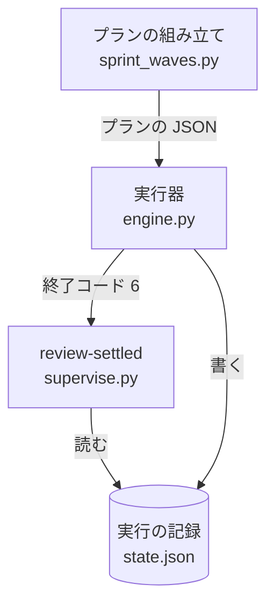
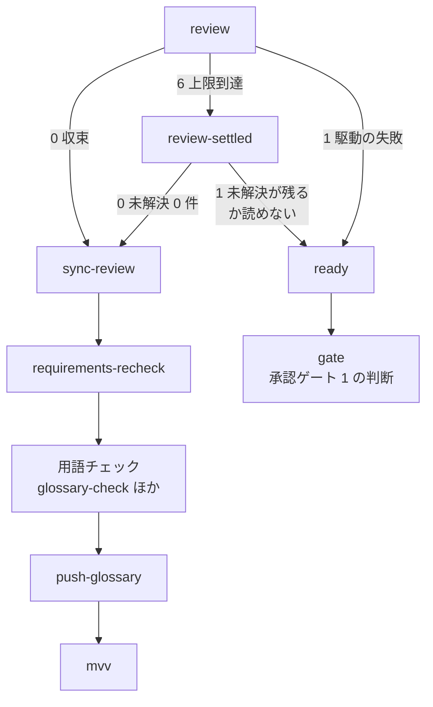

# 設計のプラン: cross-review が上限のラウンドで終わっても、未解決 0 件なら MVV 判定まで進める（#2388）

## 目的

- **今どうなっているか**: 設計のプランで cross-review が上限のラウンド（3 ラウンド）に達して終わると、未解決の指摘が 0 件でも、駆動が失敗したときと同じ経路（`ready` → 承認ゲート 1 の判断）へ進む。`pace: fast` / `pace: auto` と開発ループでは MVV 判定が一度も流れず、承認ゲート 1 が「判定できない」として人の判断待ちになる
- **誰に効くか**: `pace: fast` / `pace: auto` と開発ループで設計のプランを流す利用者。1 回あたり約 $1.5・27 分の周回の無駄が無くなる
- **変えると何が成り立つか**: 上限に達して未解決 0 件で終わったレビューは、収束したときと同じ経路（直しの取り込み → 仕様のコピーの照合 → 用語チェック → MVV 判定）を通る。未解決が残ったときと駆動の失敗だけが承認ゲート 1 の判断へ回る

## 適用範囲

- **働く範囲**: NDF の `supervise.py` が組み立てる設計のプラン（スプリントの設計のステージ）。配布先のリポジトリでも同じように働く
- **プロジェクトごとに違うもの**: 無し（ラウンドの上限・ペースは既存の設定のまま読み、この変更で足す設定は無い）
- **当たるモード**: 設計のプランを流すすべてのモード。ペースは `normal` / `fast` / `auto` のすべて

## あるべき姿の根拠

| 根拠 | 種類 | 何を示すか |
| --- | --- | --- |
| 開発ループ lfactory2 の周回 2 の記録（設計 PR https://github.com/devbasex/ai-plugins/pull/2387 ）: 上限 3 ラウンド・指摘 3 件・修正 3 件・未解決 0 件・最終状態 `oscillation`・終了コード 6 で、`mvv` が流れずに承認ゲート 1 が人の判断待ちになった | 実測 | 上限到達・未解決 0 件の終わりが、今の経路では MVV 判定へ届かない |
| `pace: fast` / `auto` の設計のプランの規則の文（`plugins/ndf/scripts/supervise_lib/sprint_waves.py` の `plan_mvv_design`）: 設計の cross-review は上限 3 ラウンドで承認ゲート 1 の判定（`mvv` のステップ）へ渡し、収束を待たない。駆動そのものが失敗したら `gate` | 既存の規則 | 上限で止めたレビューは MVV 判定へ渡すことが、プランの意図としてすでに書かれている |
| `grep -n "unresolved\|review\|oscillation" plugins/ndf/scripts/mvv-gate.py` の当たり 0 件（2026-11-04） | 実測 | MVV 判定は未解決の件数を読まない。未解決が残ったまま渡すと人が見ないまま通りうるため、件数はプランの側で分ける |

要求と受け入れ条件は #2388 の本文にある（コピーは `issues/issue-2388-requirements.md`）。この文書は「どう作るか」だけを扱う。

この文書での呼び方は要求の前提 1 に合わせる。

| 呼び方 | 意味 |
| --- | --- |
| 上限到達 | cross-review の駆動が終了コード 6 で終わったこと（最終状態が `max_rounds` か `oscillation`）。レビューは成立している |
| 駆動の失敗 | cross-review の駆動が 0・6 以外で終わったこと（実行器は 1 として記録する。最終状態 `error` と、CLI が起動しないなど） |
| 未解決の件数 | cross-review の結果の件数（`metrics.unresolved`。最終の見直しで残った指摘の数） |

## ドメインモデル

### コンテキスト

| コンテキスト | 何の語が 1 つの意味に決まるか |
| --- | --- |
| NDF の開発ワークフロー（`ndf-workflow`） | プラン・ステップ・MVV 判定・承認ゲート・欠け |
| NDF の cross-review（`ndf-cross-review`） | 収束・上限到達・未解決の件数 |

cross-review が供給者、開発ワークフローが順応者の関係（順応者）。開発ワークフローは、cross-review の駆動の終了コードと結果の件数（`metrics.unresolved`）をそのまま読み、cross-review の契約を変えない（要求の対象範囲の「含まない」）。

### 集約

| 集約 | 持ち主（書き換えてよいもの） | 根 | エンティティ | 値オブジェクト |
| --- | --- | --- | --- | --- |
| 設計のプラン | プランの組み立て（`supervise_lib/sprint_waves.py`） | プラン | ステップ | 行き先（`next` / `on_fail` / `on_exit`）・規則の文 |
| プランの実行の記録 | 実行器（`supervise_lib/state.py` の `RunState`） | 実行の記録（`state.json`） | ステップの結果（`log` の 1 件） | 終了コード・件数（`counts`）・欠け |

この変更が書き換えるのは設計のプランだけである。実行の記録は、新しいステップが読むだけで書き換えない。

### 不変条件

| # | 集約 | 条件 | 破れたときの扱い |
| --- | --- | --- | --- |
| I1 | 設計のプラン | レビューのステップが上限到達で終わり、未解決の件数が 0 なら、`sync-review` → `requirements-recheck` → 用語チェック → `push-glossary` を通ってから、MVV 判定（`fast` / `auto` は `mvv`、`normal` は助言の `mvv`）へ進む | テストが落ちる |
| I2 | 設計のプラン | レビューのステップが上限到達で終わり、未解決の件数が 1 以上か読めないときは、`ready` → 承認ゲート 1 の判断（`gate`）へ進み、`fast` / `auto` では `mvv` を流さない | テストが落ちる |
| I3 | 設計のプラン | 駆動の失敗は `ready` → 承認ゲート 1 の判断（`gate`）へ進む（`fast` / `auto` で `mvv` を流さない） | テストが落ちる |
| I4 | 設計のプラン | 収束（終了コード 0）の経路は変わらない | 既存のテストが落ちる |
| I5 | 設計のプラン | 経路の分け方はプランの JSON（`on_exit` とステップ）に現れ、実行器（`supervise_lib/engine.py`）に設計のプラン専用の分岐を足さない | レビューで差し戻す（要求の非機能の条件「運用・保守性」） |

### ドメインイベント

| # | イベント | 発生元 | 受け手 |
| --- | --- | --- | --- |
| E1 | 設計 PR を作り、本文の「決めたこと」をそろえた | `pr`・`sync-body` | `review` |
| E2 | cross-review の駆動が終わった | `review` | 収束: `sync-review`。上限到達: `review-settled`。駆動の失敗: `ready` |
| E8 | 上限到達のレビューで、未解決の件数が 0 であることを確かめた | `review-settled`（新設） | 0 件: `sync-review`。1 件以上か読めない: `ready` |
| E3 | レビューの直しを PR のブランチから取り込んだ | `sync-review` | `requirements-recheck` |
| E4 | 仕様のコピーと課題の本文の一致を確かめた | `requirements-recheck` | `glossary-check` |
| E5 | 用語チェックを通し、PR のブランチへ送った | `push-glossary` | `fast` / `auto`: `mvv`。`normal`: `ready` |
| E6 | MVV 判定が承認ゲート 1 を判定した | `mvv` | `approve`（従う）・プランの終わり（従わない・判定できない） |
| E7 | 承認ゲート 1 の判断（`gate`）へ回した | `ready` | 利用者（`gate` の判断のステップ） |

E1〜E7 は要求の番号を引き継ぐ。E8 はこの設計で足す。

### 用語

用語集へ足す語・意味を変える語は無い。上の「この文書での呼び方」は要求の前提 1 の呼び方で、この課題の中だけで使う。

## 機能一覧

| # | 機能 | 誰が使うか |
| --- | --- | --- |
| F1 | 設計のプランのレビューのステップが、終了コード 6（上限到達）を未解決の件数の確かめへ回す | `supervise.py` の実行器（設計のプランを流すとき） |
| F2 | 実行の記録から、指定したステップの未解決の件数を読み、0 件かを終了コードで返す副命令 | 設計のプランの `review-settled` のステップ |
| F3 | 設計のプランの規則の文を、新しい経路に合わせる | 設計のプランの判断のステップ（`gate`）。規則の文は判断のたびに渡る |

## 構成要素

| 要素 | 責務 |
| --- | --- |
| レビューのまとまり（`sprint_waves.py` の `_review_steps`。変更） | `review` に `"on_exit": {"6": "review-settled"}` を足す。`review` の直後に `review-settled` のステップ（run・工程「ドキュメントレビュー」・`next` は `sync-review`・`on_fail` は `ready`）を置く。全ペースの設計のプランがこの定義を共有する（要求の前提 3） |
| 未解決の件数の確かめ（`supervise.py review-settled`。新設） | 実行の記録（`<状態ディレクトリ>/state.json`）の `log` から、指定したステップの最後の結果を読み、終了コード 6 かつ `counts.unresolved` が整数の 0 なら終了コード 0、それ以外（1 件以上・件数が無い・記録が読めない・ステップの結果が無い）は終了コード 1 を返す。結果 JSON を 1 行出す。LLM を呼ばない |
| 規則の文（`sprint_waves.py` の `RULE_DESIGN` と `plan_mvv_design` の `規則`。変更） | 「上限到達で未解決 0 件なら通常の経路、未解決が残るか駆動が失敗したら承認ゲート 1 の判断」に書き直す |
| 契約テストの見本のプラン（`tests/fixtures/supervise-contract/plans/sprint/1-design-16.json`。変更） | 書き出しのプランの変化（`review` の `on_exit`・`review-settled`・規則の文・ステップの上限）を見本へ反映する。見本は `new sprint` の出力と突き合わせる比較元である |

確定仕様 `docs/specifications/ndf-ubiquitous-language.md` の「設計のフェーズのステップ」の表は、`plan-to-spec` で新しい経路へ書き直す（この実装の Pull Request では触らない）。



## 処理の流れ

`review` が終わった後の行き先。`fast` / `auto` の設計のプランの流れで書く（`normal` は下の表の差分だけが違う）。



| ペース | `push-glossary` の次 | `ready` の次 | 上限到達・未解決 0 件のときに流れるもの |
| --- | --- | --- | --- |
| `fast` / `auto`（`plan_mvv_design`） | `mvv` | `gate` | `mvv`（従えば `approve` → マージ。`gate` は流れない） |
| `normal` と `--state`（`plan_advise_design`） | `ready` | `mvv`（助言）→ `gate` | 用語チェックと助言の `mvv` の後に `gate` で止まる |
| `normal`（`--state` 無し。`plan_sprint_design`） | `ready` | `gate` | 用語チェックの後に `gate` で止まる |

`review-settled` は実行の記録を読む。実行器はステップを終えるたびに `state.json` を書き直してから次のステップを流す（`engine.py` の `run` が `RunState.record` を呼んだ後に次のステップへ進む）ため、`review-settled` が流れる時点で `review` の結果は記録にある。

## 入出力の契約

`supervise.py` に副命令を 1 つ足す。既存の副命令と引数は変えない。

```text
supervise.py review-settled --state <state.json のパス> --step <ステップの id>
```

| 引数 | 意味 |
| --- | --- |
| `--state` | 実行の記録のファイル。設計のプランは `{state_dir}/state.json` を渡す（`{state_dir}` は実行器が run のステップの `cmd` で置き換える） |
| `--step` | 未解決の件数を読むステップの id。設計のプランは `review` を渡す |

| 終了コード | 条件 | 結果 JSON の `status` |
| --- | --- | --- |
| 0 | 記録の `log` のうち `id` が `--step` の最後の 1 件が、`exit` 6 かつ `counts.unresolved` が整数の 0 | `ok` |
| 1 | 上以外（未解決 1 件以上・`counts` か `unresolved` が無い・`exit` が 6 でない・該当のステップの結果が無い・ファイルが読めない） | `stopped` |

結果 JSON は共通の形（`step_result.result`）で、`tool` は `review-settled`、`summary` に読んだ件数か読めなかった理由、`metrics` に `unresolved`（読めなければ `null`）を持つ。

## 非機能の実現方式

| 条件 | 実現方式 |
| --- | --- |
| 経路の分け方はプランの JSON に現れ、実行器に設計のプラン専用の分岐を足さない | 実行器がすでに持つ `on_exit`（drive は 0・1・6 を読む）と run のステップの `on_fail` だけで分ける。`engine.py` は変えない |
| 作成済みのプランの JSON を書き換えない | 経路はプランの組み立てで決まり、書き出した JSON を読み直して直す処理を足さない。版を入れた後に作り直したプランから効く |

## 決定の記録

### 決定 1: 実行器と cross-review の契約を変えずに分けるため、上限到達の未解決の件数を後続の run のステップで確かめる

`review` の `on_exit` で終了コード 6 を `review-settled` へ回し、そのステップが実行の記録から未解決の件数を読んで 0 件かを終了コードで返す。実行器の既存の行き先（`on_exit` と `on_fail`）だけで 4 つの終わりを分けられ、`engine.py` にも cross-review の終了コードにも手を入れない。

cross-review の駆動が未解決 0 件の上限到達を別の終了コードで返す形は採らない。終了コードの契約は実装のプランのレビュー（#2143）とリファクタリングの欠け（#2047）も読んでおり、要求で「確認してから行う」に置いた変更である。実行器に「結果の件数で行き先を分ける」鍵を足す形も採らない。1 つの経路のために実行器の契約が増え、既存の `on_exit` と run のステップで足りる。

根拠: Value 5 / Value 7（MVV 版 5）

### 決定 2: 人が見ないまま設計がマージされないよう、未解決の件数が読めない上限到達は未解決が残ったときと同じに扱う

`counts.unresolved` が無い・整数でない・記録が読めないときは、終了コード 1 を返して `ready` → `gate` へ回す。MVV 判定は未解決の件数を読まないため、読めないまま 0 件として進めると、残った指摘を人が見ないまま `fast` / `auto` で設計 PR がマージされうる。

読めないときに 0 件として扱う形は採らない。取り違えたときに戻すのが、承認ゲート 1 で人が止める側より難しい（マージ済みの設計を差し戻すことになる）。

根拠: 共通原則の上位の原則（人を守る）/ Value 2（MVV 版 5）

### 決定 3: ペースごとに経路を分けないため、レビューのまとまりの共有の定義だけを直す

`_review_steps` は `normal` / `fast` / `auto` の設計のプランが共有している（要求の前提 3）。ここだけを直せば、3 つのプランの組み立て（`plan_sprint_design`・`plan_advise_design`・`plan_mvv_design`）は変えずに新しい経路を持つ。`normal` で変わるのは、上限到達・未解決 0 件のときに用語チェックが流れることだけで、最後は承認ゲート 1 の判断で止まる（要求の前提 4）。

`fast` / `auto` のプランにだけ `on_exit` を足す形は採らない。同じ終わりがペースによって別の経路を通り、規則の文と経路の対応がペースごとに分かれる。

根拠: Value 7（MVV 版 5）

## テスト設計

経路のテストは、ステップの結果を偽装してプランを実行器へ流し、通ったステップの並びを確かめる（`tests/test_supervise_limits.py` の `drive` と同じ流し方）。

| 受け入れ条件・不変条件 | どの振る舞いで縛るか | どう壊したら落ちるべきか |
| --- | --- | --- |
| 受け入れ条件 1・I1 | `fast` / `auto` の設計のプランで `review` が 6・`review-settled` が 0 のとき、`review` → `review-settled` → `sync-review` → `requirements-recheck` → `glossary-check` → `push-glossary` → `mvv` の順に通り、`gate` を通らない | `review` の `on_exit` を消す、`review-settled` の `next` を `ready` にする |
| 受け入れ条件 2・I1 | `review-settled` を `exit` 6・`counts.unresolved` 0 の記録で打つと、最終状態が `max_rounds` でも `oscillation` でも終了コード 0 を返す（最終状態を見ない） | 判定に最終状態の値を加える |
| 受け入れ条件 3・I2 | `fast` / `auto` の設計のプランで `review` が 6・`review-settled` が 1 のとき、`ready` → `gate` へ進み `mvv` を通らない。`review-settled` は `counts.unresolved` が 1 以上・無い・`null` の記録で終了コード 1 を返す | `review-settled` の `on_fail` を `sync-review` にする、件数が無いときに 0 を返す |
| 受け入れ条件 4・I3 | `fast` / `auto` の設計のプランで `review` が 1 のとき、`review-settled` を通らずに `ready` → `gate` へ進み `mvv` を通らない | `on_exit` に `"1"` を足して `review-settled` へ回す |
| 受け入れ条件 5 | `normal` と `--state` の設計のプランで `review` が 6・`review-settled` が 0 のとき、`sync-review` 以降を通って助言の `mvv` を流し、`gate` で止まる | 共有の定義でなく `plan_mvv_design` だけに `on_exit` を足す |
| 受け入れ条件 6・I4 | 既存の経路のテスト（`DESIGN_ROUTE`）が、`review` が 0 のとき `review-settled` を通らずに通る | `review` の `next` を `review-settled` にする |
| 受け入れ条件 7 | 全体テスト `uv run --frozen --project . --all-extras pytest . -q -n 4` が終了コード 0。契約テストの見本のプランを書き出しの出力に合わせる | 見本を更新しない |
| I5 | `engine.py` に差分が無い（実装の Pull Request の差分で確かめる。テストは書かない） | — |

## 設計の結果

| 課題 | 扱い | 取り込み先 | 触るファイル |
| --- | --- | --- | --- |
| #2388 | 実装する | — | `plugins/ndf/scripts/supervise_lib/sprint_waves.py`、`plugins/ndf/scripts/supervise_lib/commands.py`、`plugins/ndf/scripts/supervise.py`、`plugins/ndf/scripts/tests/` |

## 未確認のまま残ること

| 項目 | 内容 |
| --- | --- |
| `run --from review-settled` での再開 | 途中から再開した実行で、前の実行の `review` の結果が `state.json` の `log` に残るかを確かめていない。残らなければ `review-settled` は終了コード 1 を返し、承認ゲート 1 の判断へ回る（決定 2 の安全側）。実装で 1 度流して確かめる |
| `metrics.unresolved` が `null` になる頻度 | cross-review が最終の見直し（`sweep`）を書かずに上限到達で終わる場合があるかを確かめていない。あれば上限到達・未解決 0 件でも承認ゲート 1 の判断へ回る。リリース後テストのフェーズレポートで `review-settled` の `summary` を見る |
| 起票者の推定 S3・S4 | 未解決 1 件以上を承認ゲート 1 の判断へ回すこと（S3）と、`normal` にも同じ分け方を当てること（S4）は、承認ゲート 1 で利用者が採否を決める |
